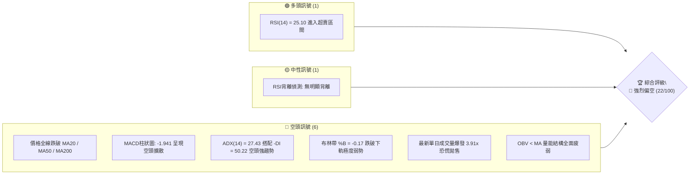
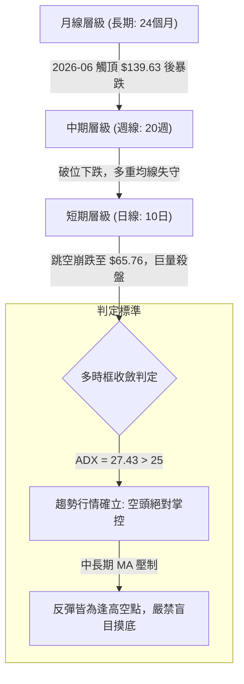
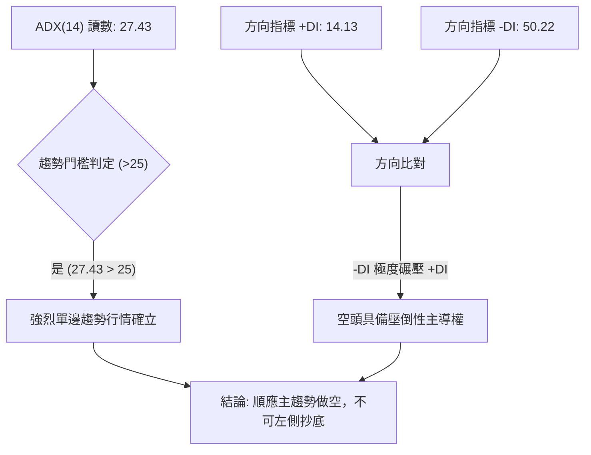
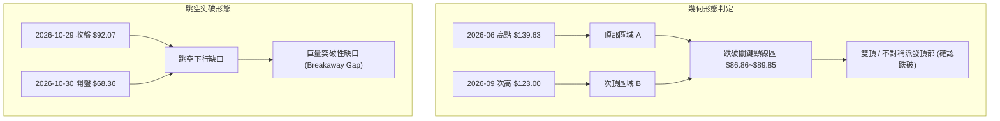
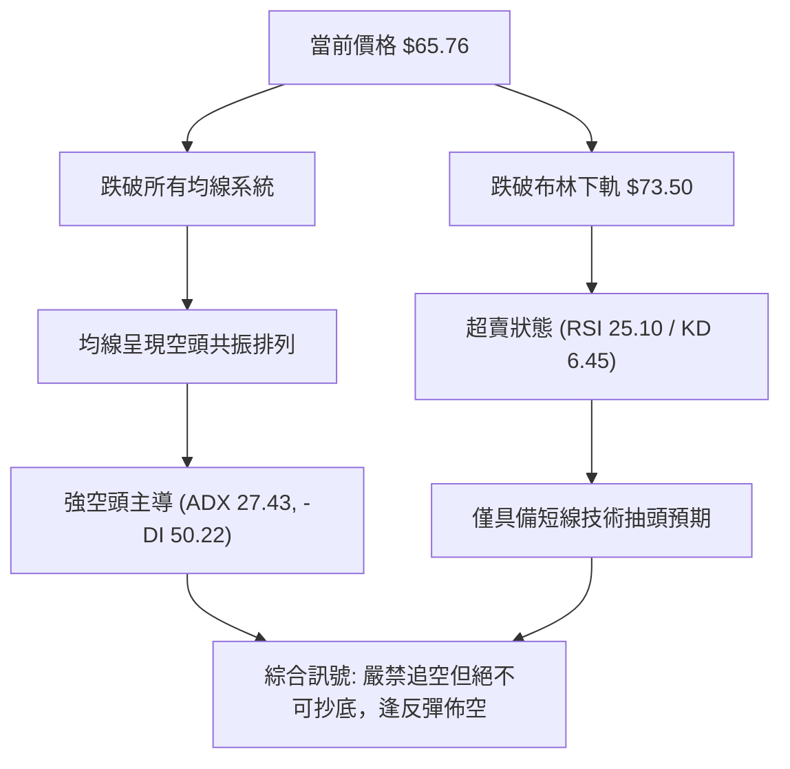
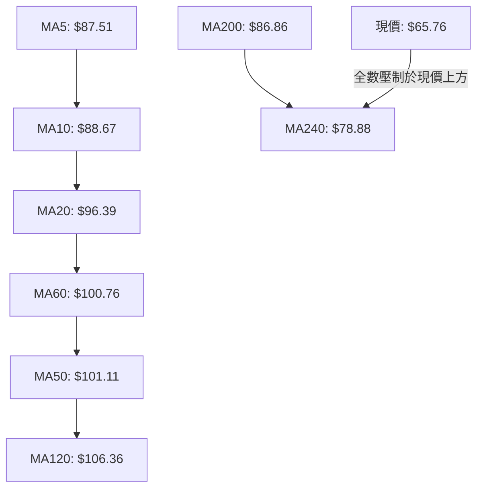
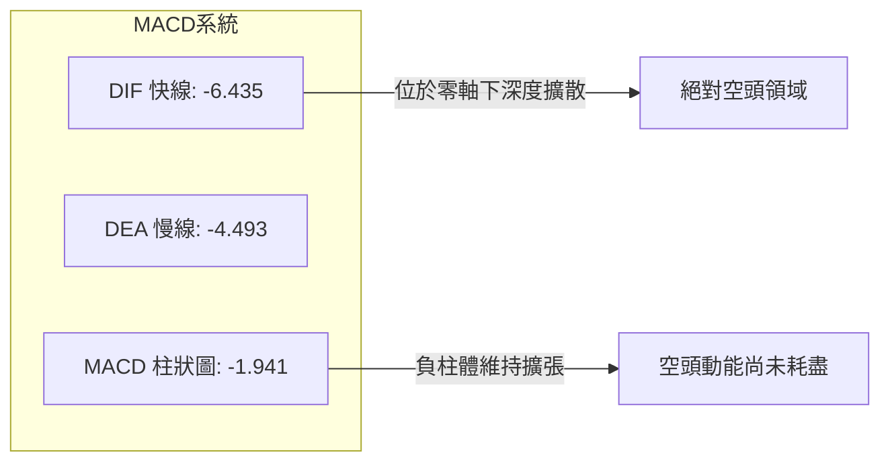
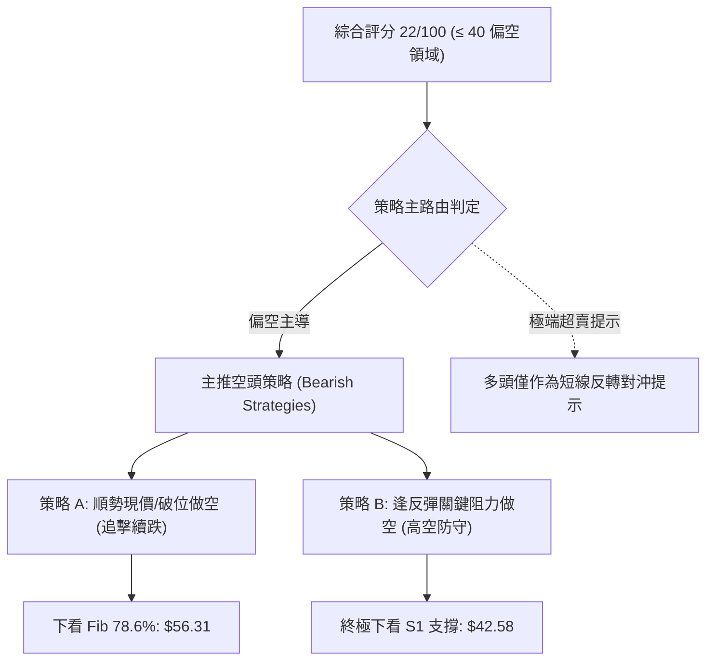
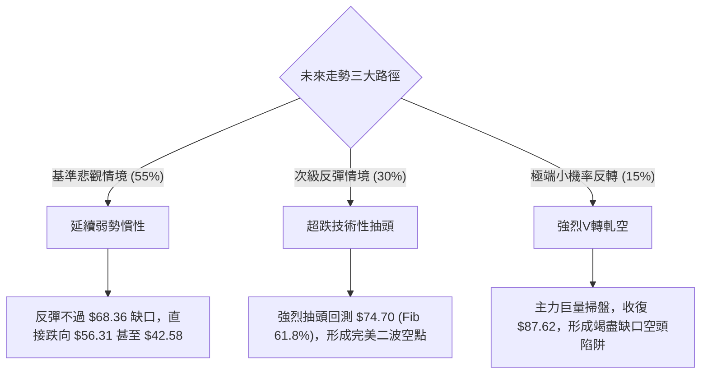

# INTC 技術分析報告

> **報告日期**：2026-11-02 ｜ **語言**：繁體中文 ｜ **數據來源**：Yahoo Finance ｜ **當前價格**：$65.76

---

## 目錄

| 章節 | 內容 |
|------|------|
| [1. 技術面概覽](#1-技術面概覽) | 訊號儀表板、核心指標、評分卡 |
| [2. 趨勢分析](#2-趨勢分析) | 多時框趨勢、長中短期走勢、ADX 評估 |
| [3. 圖表形態分析](#3-圖表形態分析) | 形態識別、K線組合、目標價推算 |
| [4. 支撐與阻力](#4-支撐與阻力) | 關鍵價位分布、波段聚集、斐波那契回調 |
| [5. 技術指標深度解讀](#5-技術指標深度解讀) | 均線系統、RSI、MACD、布林通道、成交量 |
| [6. 動能與波動率](#6-動能與波動率) | 動能四象限、ATR 波動率、Beta 市場敏感度 |
| [7. 多時框架總結](#7-多時框架總結) | 時框架矩陣、訊號一致性、多時框收斂 |
| [8. 交易策略建議](#8-交易策略建議) | 策略路由、價格情境階梯、主策略詳情 |
| [9. 風險提示與監控](#9-風險提示與監控) | 關鍵監控清單、情境樹、風控原則 |
| [10. 報告總結](#10-報告總結) | 核心結論與最佳策略配置速覽 |

---

## 1. 技術面概覽

### 🎯 技術訊號儀表板



### 📊 核心指標速覽表

| 指標類別 | 指標名稱 | 當前數值 | 訊號 | 解讀 |
|----------|----------|----------|------|------|
| **價格** | 當前收盤價 | $65.76 | 🔴 | 單日重挫跳空，位於 52 週區間 30.0% 低位 |
| **均線** | MA20 | $96.39 | 🔴 | 現價低於 MA20 達 -31.78%，短期嚴重負乖離 |
| **均線** | MA50 | $101.11 | 🔴 | 現價低於 MA50，中短期空頭排列確立 |
| **均線** | MA200 | $86.86 | 🔴 | 跌破牛熊分水嶺 -24.29%，長期上升趨勢遭到破壞 |
| **動能** | RSI(14) | 25.10 | 🟢 | 進入極度超賣區（<30），隨時具備技術性抽頭反彈動能 |
| **動能** | MACD (12,26,9) | -6.435 / -4.493 | 🔴 | 快慢線處於零軸下方深度負值，柱狀圖 -1.941 持續看空 |
| **隨機指標**| Stoch %K / %D | 6.45 / 30.77 | 🟢 | KD 位於超賣區，%K 極低，醞釀低檔金叉但尚未確立 |
| **趨勢強度**| ADX (14) | 27.43 | 🔴 | ADX > 25 且 -DI (50.22) 遠高於 +DI (14.13)，空頭單邊暴跌行情 |
| **通道通道**| 布林通道 (%B) | -0.17 | 🔴 | 突破下軌（$73.50），呈現極端超跌開口向下擴張 |
| **量能** | 最新成交量 / 20日均量 | 454,221,300 (3.91x) | 🔴 | 巨量黑K放量崩跌，主力資金停損出逃，OBV 疲軟 |
| **波動** | ATR(14) | $6.97 | 🔴 | 佔股價 10.60%，波動極度放大，交易風險驟升 |

### 🏆 技術評分卡

```
╔══════════════════════════════════════════════════════════════╗
║              技術評分卡 — INTC (2026-11-02)                  ║
╠══════════════════════════════════════════════════════════════╣
║ 趨勢強度      █████░░░░░░░░░░░░░░░  25/100  🔴 極弱 (空頭主導)║
║ 動能指標      ████░░░░░░░░░░░░░░░░  20/100  🔴 極弱 (跌勢猛烈)║
║ 支撐穩定度    █████░░░░░░░░░░░░░░░  25/100  🔴 薄弱 (破位尋底)║
║ 成交量配合    ███░░░░░░░░░░░░░░░░░  15/100  🔴 極差 (放量摜壓)║
║ 形態完整度    ██████░░░░░░░░░░░░░░  30/100  🔴 偏空 (高位反轉)║
║ 均線排列      ███░░░░░░░░░░░░░░░░░  15/100  🔴 惡劣 (全線失守)║
╠══════════════════════════════════════════════════════════════╣
║ 綜合評分      ████░░░░░░░░░░░░░░░░  22/100  🔴 強烈偏空       ║
╚══════════════════════════════════════════════════════════════╝
```
> **評分計算**：(25 + 20 + 25 + 15 + 30 + 15) ÷ 6 = 21.67 ≈ **22/100**。

---

## 2. 趨勢分析

### 🌐 多時框趨勢分析



### 📈 長期趨勢 — 12個月走勢圖（Unicode）

依據月度收盤價數據，過去 12 個月（2025-11 至 2026-10）價格經歷了主升浪衝頂與斷崖式回落：

```
INTC 月線走勢圖（過去12個月收盤價）
價格軸 ($)
$140 ┤                              ● 2026-06 ($139.63 歷史高點)
$120 ┤                        ●           ● 2026-09 ($120.23 反彈次高)
$100 ┤                  ●
 $80 ┤                                          ● 2026-10 ($65.76 現價)
 $60 ┤
 $40 ┤● 2025-11 ($40.56)   ● 2026-01~03 ($44~$46 整理平台)
 $20 ┤
     └─────────────────────────────────────────────────────────────
      11   12   01   02   03   04   05   06   07   08   09   10  (月份)
```

#### 走勢特徵分析表格

| 階段區間 | 時間跨度 | 起訖價位 | 累計漲跌幅 | 核心量價特徵與結構 |
|----------|----------|----------|------------|-------------------|
| **低位盤整** | 2025-11 ~ 2026-03 | $40.56 → $44.13 | +8.80% | 底部築底平台，成交量收縮，均線收斂 |
| **主升爆發** | 2026-03 ~ 2026-06 | $44.13 → $139.63 | +216.41% | 史詩級軋空暴漲，突破各週期均線，月線連收巨陽 |
| **高位分歧** | 2026-06 ~ 2026-08 | $139.63 → $89.51 | -35.89% | 見頂後急速回吐，回踩 $90 關鍵整數關口獲得支撐 |
| **次頂逃命** | 2026-08 ~ 2026-09 | $89.51 → $120.23 | +34.32% | 月線級別反彈次高點（Lower High），主力拉高出貨 |
| **斷崖破位** | 2026-09 ~ 2026-10 | $120.23 → $65.76 | -45.31% | 單月垂直腰斬，跌破 MA200 牛熊線與多道費氏支撐 |

### 📊 中期趨勢（週線分析）

中期走勢呈現標準的「雙頂派發後破位崩跌」走勢。上方雙頂分別坐落於 2026-06 高點及 2026-09-25 週收盤 $123.00。當前週線出現大陰線摜破平台：

```
INTC 週線空間壓力與支撐示意圖
══════════════════════════════════════════════════════════════
$132.75 ────────────────────────────────────── R3 強阻力
$127.04 ────────────────────────────────────── R2 次高波段阻力
$107.13 ────────────────────────────────────── R1 頸線與前期平台阻力
$86.86  ┄┄┄┄┄┄┄┄┄┄┄┄┄┄┄┄┄┄┄┄┄┄┄┄┄┄┄┄┄┄┄┄┄┄┄┄ MA200 長期牛熊分水嶺
$74.70  ────────────────────────────────────── 斐波那契 61.8% 關鍵位 (已失守)
$65.76  ══════════════════════════════════════ ◄ 當前收盤價 ($65.76)
$56.31  ┄┄┄┄┄┄┄┄┄┄┄┄┄┄┄┄┄┄┄┄┄┄┄┄┄┄┄┄┄┄┄┄┄┄┄┄ 斐波那契 78.6% 回調支撐
$42.58  ────────────────────────────────────── S1 密集波段強支撐
══════════════════════════════════════════════════════════════
```

### ⚡ 趨勢強度評估（ADX 解讀）



#### ADX 強度對照與解讀

| 指標變數 | 當前讀數 | 狀態門檻 | 趨勢屬性判斷 | 交易指引 |
|----------|----------|----------|--------------|----------|
| **ADX(14)** | **27.43** | > 25.0 | 強趨勢市場（Non-ranging） | 震盪逆勢指標（如超賣）失效風險極高 |
| **+DI** | **14.13** | 弱勢門檻 < 20 | 多頭動能匱乏，無力發動進攻 | 缺乏主動買盤支撐 |
| **-DI** | **50.22** | 極強門檻 > 40 | 空方全面主導，恐慌盤持續宣洩 | 賣壓強勁，未見衰竭訊號 |

---

## 3. 圖表形態分析

### 🔍 形態識別系統



#### 形態識別與信心度評估表

| 形態類別 | 信心度 | 判斷依據（引用數據） | 完成度 | 目標價（附嚴格推算式） |
|----------|--------|----------------------|--------|------------------------|
| **雙頂派發破位** | **78%** | 兩次頂部：2026-06-18 週收 $133.99 及 2026-09-25 週收 $123.00，跌破頸線低點 2026-08-28 週收 $89.47 | 100% (已破位) | 頸線 $89.47 − (雙頂均值 $128.50 − 頸線 $89.47) = $50.44；下方最接近數據支撐位為 **S1: $42.58** |
| **下行突破性缺口** | **85%** | 2026-10-29 收 $92.07 至 2026-10-30 開 $68.36，產生巨大跳空未補，單日放量 454.2M | 100% (已確認) | 缺口起點 $92.07 − 缺口寬度 ($92.07 − $68.36 = $23.71) = $68.36，現價 $65.76 已跌破滿足點，朝向 **Fib 78.6% $56.31** 尋求支撐 |

### 🕯️ 重要K線形態分析

嚴格依據數據中「近 10 根日K」與「近 8 根週K」之實際 OHLC 價格數據進行形態剖析：

#### 近 10 根日K 形態分析表

| 日期 | 開盤價 | 最高價 | 最低價 | 收盤價 | K線形態名稱 | 技術解讀 | 訊號 |
|------|--------|--------|--------|--------|-------------|----------|------|
| 2026-10-19 | $94.53 | $95.39 | $91.88 | $92.03 | 光腳中陰線 | 跌破 94 美元關口，空頭佔據主動 | 🔴 |
| 2026-10-20 | $90.73 | $93.73 | $88.77 | $91.69 | 下影紡錘線 | 測試 88 美元獲得短暫買盤，收復部分跌幅 | 🟡 |
| 2026-10-21 | $93.43 | $94.39 | $90.75 | $92.96 | 小陽線 | 縮量震盪反彈，受制於 95 美元反壓 | 🟡 |
| 2026-10-22 | $87.92 | $89.19 | $84.65 | $85.49 | 跳空下挫中陰線 | 放量 134.1M 跌破 86 美元，形成局部破位 | 🔴 |
| 2026-10-23 | $85.92 | $87.87 | $84.74 | $86.96 | 低位小陽星 | 止跌回穩，但反彈量能急凍（72.1M） | 🟡 |
| 2026-10-26 | $87.94 | $92.09 | $86.46 | $90.47 | 中陽實體線 | 反彈上攻，重新測試 90 美元上方壓力 | 🟢 |
| 2026-10-27 | $92.47 | $94.98 | $91.86 | $93.74 | 溫和走高陽線 | 延續反彈測試 95 美元整數關卡 | 🟢 |
| 2026-10-28 | $95.09 | $95.68 | $93.00 | $95.53 | 衝高小陽線 | 觸及波段高點 $95.68，受阻於前期平台 | 🟡 |
| 2026-10-29 | $92.97 | $93.50 | $90.84 | $92.07 | 增量回落陰線 | 成交量擴大至 134.2M，反彈夭折，主力資金搶先出逃 | 🔴 |
| 2026-10-30 | $68.36 | $68.77 | $63.20 | $65.76 | **斷崖式跳空暴跌大陰線** | 巨大缺口（跳空逾 25%），爆出 4.54 億股天量，空頭全面屠殺 | 🔴 |

#### 近 8 根週K 形態分析表

| 日期 | 開盤價 | 最高價 | 最低價 | 收盤價 | 週K形態名稱 | 技術解讀 | 訊號 |
|------|--------|--------|--------|--------|-------------|----------|------|
| 2026-09-11 | $100.80 | $106.69 | $99.34 | $102.94 | 破百穩健陽線 | 重新站上百元大關，多頭氣勢旺盛 | 🟢 |
| 2026-09-18 | $95.82 | $111.37 | $94.52 | $108.60 | 長陽突破實體 | 放量 6.26 億股，突破前高阻力 | 🟢 |
| 2026-09-25 | $116.53 | $127.44 | $114.93 | $123.00 | 大陽線伴隨上影 | 觸及次高 $127.44，高檔遭遇獲利了結賣壓 | 🟡 |
| 2026-10-02 | $120.68 | $126.00 | $113.97 | $119.33 | 高位十字星陰線 | 衝高無力，高檔籌碼鬆動，反轉預警 | 🔴 |
| 2026-10-09 | $115.34 | $118.20 | $104.00 | $104.70 | 大陰吞噬破位 | 跌破前週低點，確認雙頂反轉成立 | 🔴 |
| 2026-10-16 | $102.52 | $103.19 | $89.19 | $89.85 | 實體大陰線 | 摜破百元心理防線與 MA200，恐慌盤湧出 | 🔴 |
| 2026-10-23 | $94.53 | $95.39 | $84.65 | $86.96 | 弱勢整理陰星 | 低檔弱勢震盪，反彈無量 | 🔴 |
| 2026-10-30 | $87.94 | $95.68 | $63.20 | $65.76 | **崩跌光腳特大黑K** | 天量 8.6 億股重挫破底，直接摜穿多重支撐 | 🔴 |

### 📉 ASCII 走勢形態示意圖

```
INTC 日線形態崩跌示意圖 (2026-10-28 至 2026-10-30)
價格
$95.68 ┬───────┐ (10-28 高點 $95.68)
       │       │ 
$92.07 ┴───────┘ (10-29 收盤 $92.07)
══════════════════════════════════════════════════════════════
  ░░░░░░░░░░░░░░░░░░░░░░░░░░░░░░░░░░░░░░░░░░░░░░░░░░░░░░░░░░ 
  ░░░░ 巨型跳空缺口 ($92.07 → $68.36，寬度 $23.71) ░░░░░░░░ 
  ░░░░░░░░░░░░░░░░░░░░░░░░░░░░░░░░░░░░░░░░░░░░░░░░░░░░░░░░░░
══════════════════════════════════════════════════════════════
$68.77 ┬───────┐ (10-30 開盤 $68.36 / 最高 $68.77)
       │ 巨量  │ 
       │ 實體  │ 
$65.76 ┴───────┤ ◄ 10-30 收盤價 $65.76
               │ (最低 $63.20)
               ┴
```

### 🎯 形態目標價計算

根據雙頂反轉形態理論，形態跌幅滿足點計算公式為：
$$\text{目標價} = \text{頸線價格} - (\text{頭部均值} - \text{頸線價格})$$

1. **頭部高點聚集均值**：$(139.63 + 120.23) \div 2 = \$129.93$
2. **週線有效破位頸線**：採 2026-08-28 週收盤低點 $\$89.47$
3. **形態垂直高度**：$\$129.93 - \$89.47 = \$40.46$
4. **理論最小量度跌幅目標**：$\$89.47 - \$40.46 = \$49.01$
5. **對應既有技術支撐位**：
   - 第一目標：斐波那契 78.6% 回調位 **$56.31**
   - 第二極限目標：波段密集支撐區 **S1: $42.58**（距離理論目標 $49.01 下方約 6 美元）

---

## 4. 支撐與阻力

### 🗺️ 關鍵價位分布圖（Unicode）

```
INTC 價位結構分布圖（OHLCV 數據計算）
═════════════════════════════════════════════════════════════════
$142.35 ║████████████████████████████████║ 52週歷史極值高點 (Fib 0.0%)
$132.75 ║████████████████████████████    ║ 強阻力 R3 (+101.87%)
$127.04 ║██████████████████████          ║ 阻力 R2 (+93.19%)
$116.52 ║████████████████████            ║ 斐波那契 23.6% 阻力
$107.13 ║██████████████████              ║ 關鍵阻力 R1 (+62.91%)
$100.54 ║██████████████                  ║ 斐波那契 38.2% 回調位 / 百元整數大關
$87.62  ║██████████                      ║ 斐波那契 50.0% 中軸分水嶺 / 接近 MA200 ($86.86)
$74.70  ║████████                        ║ 斐波那契 61.8% 黃金分割強阻力 (剛失守)
════════╠════════════════════════════════╣ ◄ 當前收盤價 $65.76
$56.31  ║▓▓▓▓▓▓▓▓▓▓▓▓                    ║ 斐波那契 78.6% 下方關鍵回調支撐
$42.58  ║████████████████████████        ║ 強支撐 S1 (-35.25%)
$41.64  ║████████████████████████        ║ 強支撐 S2 (-36.68%)
$40.63  ║████████████████████████        ║ 極限支撐 S3 (-38.21%)
$32.89  ║████████████████████████████████║ 52週歷史低點 (Fib 100.0%)
═════════════════════════════════════════════════════════════════
```

### 🚧 阻力位分析表

阻力位完全依據系統計算之波段高點聚類資料：

| 阻力級別 | 準確價位 | 距現價空間 | 形成原因與籌碼屬性 | 突破難度 | 重要性 |
|----------|----------|------------|--------------------|----------|--------|
| **R1** | **$107.13** | +62.91% | 近一年密集震盪成交帶下軌，也是 2026 年 9 月多頭發力破位前的起漲平台 | 極高 | ★★★★★ |
| **R2** | **$127.04** | +93.19% | 2026-09-25 波段反彈次高點（週最高 $127.44）籌碼聚類壓力 | 極高 | ★★★★☆ |
| **R3** | **$132.75** | +101.87% | 歷史天價高點密集套牢區（2026-06-18 週收 $133.99）籌碼重災區 | 極致難度 | ★★★★★ |

### 🛡️ 支撐位分析表

支撐位完全依據系統計算之近一年波段低點聚類資料：

| 支撐級別 | 準確價位 | 距現價空間 | 形成原因與籌碼屬性 | 守住機率 | 重要性 |
|----------|----------|------------|--------------------|----------|--------|
| **S1** | **$42.58** | -35.25% | 2025-10 至 2026-03 築底平台核心成交密集區頂部（2026-03 收盤 $44.13） | 65% | ★★★★★ |
| **S2** | **$41.64** | -36.68% | 2025 年末主升浪起漲前的第二次回踩低點聚類 | 70% | ★★★★☆ |
| **S3** | **$40.63** | -38.21% | 2025-11 平台起漲基準收盤位（$40.56），多頭中長期最後防線 | 80% | ★★★★★ |

### 📐 斐波那契回調位分析

基準計算區間為 52 週最低點 **$32.89** 至 52 週最高點 **$142.35**（垂直振幅達 $109.46）：

| 斐波那契回調比例 | 精確對應點位 | 與現價 ($65.76) 相對關係 | 當前技術意義與角色轉換 |
|------------------|--------------|--------------------------|------------------------|
| **0.0% (52W High)** | $142.35 | 現價位於其下方 -53.80% | 歷史頂部牛市極值 |
| **23.6%** | $116.52 | 現價位於其下方 -43.56% | 第一道波段回調防線（已宣告全面失守） |
| **38.2%** | $100.54 | 現價位於其下方 -34.59% | 百元心理大關，前期支撐現已轉換為超級反壓 |
| **50.0%** | $87.62 | 現價位於其下方 -24.95% | 多空強弱平衡分界線，與 MA200 ($86.86) 重合 |
| **61.8%** | $74.70 | 現價位於其下方 -11.97% | **黃金分割防線被跳空跌破，轉換為短線第一道強壓** |
| **78.6%** | **$56.31** | **現價位於其上方 +16.78%** | **當前下方唯一最近的技術面緩衝支撐位** |
| **100.0% (52W Low)**| $32.89 | 現價位於其上方 +99.94% | 52 週大週期底部極限支撐 |

> **位置解讀**：現價 **$65.76** 正好卡在 **61.8% ($74.70)** 與 **78.6% ($56.31)** 之間的真空墜落帶。由於 61.8% 是被巨量跳空摜破，若短期出現跌深反彈，**$74.70** 將面臨排山倒海的解套賣壓；而下方空頭回補的第一個潛在煞車點即為 **$56.31**。

---

## 5. 技術指標深度解讀

### 🎛️ 指標訊號總覽



### 📈 移動平均線排列分析



#### 移動平均線數據對比表

| 均線名稱 | 數值 | 現價與均線差值 | 偏離幅度 (%) | 當前趨勢斜率與排列特徵 |
|----------|------|----------------|--------------|------------------------|
| **MA 5** | $87.51 | -$21.75 | -24.86% | 垂直急跌向下，短線超跌嚴重 |
| **MA 10** | $88.67 | -$22.91 | -25.84% | 斜率陡峭向下，形成短期第一壓制軌道 |
| **MA 20** | $96.39 | -$30.63 | -31.78% | 中期生命線快速下彎，遠離現價 |
| **MA 50** | $101.11 | -$35.35 | -34.96% | 破位百元，中期多頭架構徹底崩解 |
| **MA 60** | $100.76 | -$35.00 | -34.73% | 季線轉為下行通道壓制 |
| **MA 120**| $106.36 | -$40.60 | -38.17% | 半年線高檔走平後拐頭向下 |
| **MA 200**| $86.86 | -$21.10 | -24.29% | **年線失守，牛熊轉向，長期趨勢全面翻空** |
| **MA 240**| $78.88 | -$13.12 | -16.63% | 長期支撐均線被無情跳空摜破 |

### 📉 RSI(14) 分析

* 當前 RSI(14) 讀數：**25.10**（Wilder 計算法）
* 強度進度條：`█████░░░░░░░░░░░░░░░` 25.10%

#### 超買超賣區間與背離判定
1. **區間判斷**：RSI 跌至 25.10，遠低於 30 的極端超賣門檻，技術指標顯示市場處於極度拋售竭盡狀態。
2. **背離檢驗**：對比近 20 根 K 棒的首尾表現，價格自高位 $95.53 斷崖式跌至 $65.76，RSI 同步由 50 以上直線摜入 25.10，呈現標準的「價跌指標跌」，**無任何底背離跡象**。這表明此處的超賣並非主力洗盤，而是實質性的恐慌盤殺跌，切勿因超賣盲目抄底。

### 📊 MACD(12,26,9) 訊號解讀



* **快慢線位置**：DIF (-6.435) 遠低於 DEA (-4.493)，雙線均在零軸深處大幅發散，說明中長期下跌速度極快。
* **柱狀體解讀**：柱狀圖最新讀數為 **-1.941**，呈現鮮紅色空頭擴張狀態，並未出現綠色縮頭收斂，顯示空方動能依然在持續宣洩。

### 📦 布林通道分析

```
INTC 布林通道日線分佈示意圖
══════════════════════════════════════════════════════════════
$119.27 ────────────────────────────────── 上軌 (Upper Band)
        │
$96.39  ┄┄┄┄┄┄┄┄┄┄┄┄┄┄┄┄┄┄┄┄┄┄┄┄┄┄┄┄┄┄┄┄ 中軌 (MA20 Baseline)
        │
$73.50  ────────────────────────────────── 下軌 (Lower Band)
══════════════════════════════════════════════════════════════
$65.76  ▼ 現價跌出通道之外 (%B = -0.17)
```

* **通道開口**：帶寬顯著擴張，上軌上升至 $119.27，下軌被壓制至 $73.50。
* **%B 指標分析**：當前 %B 為 **-0.17**（小於 0 意指跌破下軌）。這屬於嚴重的「開口破下軌」走勢，代表價格已經脫離正常波動常態分佈，短線雖有均值回歸拉回軌道內的技術需求，但通道下軌 $73.50 將由原本的支撐轉變為反彈的強大蓋頭壓力。

### 💹 成交量分析（量價配合度）

1. **巨量下挫**：最新單日成交量高達 **454,221,300 股**，相較於 20 日均量 116,311,520 股，放量比率達 **3.91 倍**。週五單週成交量更飆升至 **860,249,900 股**。
2. **量價配合**：呈現典型的「放量長陰跳空破位」，成交量放大完全由恐慌性拋盤與停損賣單主導，非主力進場承接盤。
3. **OBV 走勢評估**：OBV 指標遠低於其均線系統，能量潮垂直向下潰退，量能疲弱無力，宣告資金正在全速撤離。

---

## 6. 動能與波動率

### ⚡ 動能評估四象限

| 象限 | 動能維度 (Momentum) | 波動率維度 (Volatility) | 當前判定 | 技術特徵與策略對策 |
|------|---------------------|-------------------------|----------|-------------------|
| **第一象限 (Q1)** | 強（多頭動能） | 低波動（有序推進） | — | 最佳波段做多環境（穩定上升趨勢） |
| **第二象限 (Q2)** | 弱（缺乏方向） | 低波動（量縮盤整） | — | 箱體震盪，宜高拋低吸或觀望 |
| **第三象限 (Q3)** | 強（爆發主升） | 高波動（情緒狂熱） | — | 追漲高風險高收益行情 |
| **第四象限 (Q4)** | **極弱 / 極端負動能** | **極高波動 (ATR 10.6%)** | **✓ INTC** | **空頭血洗階段：絕對避免盲目抄底，逢反彈佈空** |

### 📊 ATR 波動率分析

* **當前 ATR(14)**：**$6.97**
* **波動率佔比**：佔當前股價 $65.76 之比例高達 **10.60%**。
* **交易風險指引**：
  - 單日平均常態波幅已達 7 美元，意味著任何日內交易若未給予足夠的風控緩衝，極易被隨機噪音掃出場。
  - **止損距離建議**：常規波段策略止損距離必須設定在至少 1.5 倍至 2.0 倍 ATR（約 **$10.45 ~ $13.94**），方能承受目前異常放大的盤中震盪。
  - **部位控制**：因 ATR 高達 10.6%，倉位規模應較平時縮減至少 50% ~ 60%。

### 📐 Beta 與市場相關性

* **Beta 係數**：**2.23**
* **解讀**：INTC 展現出極端的高彈性特質（超高 Beta）。當科技板塊或半導體指數下跌 1% 時，INTC 平均將下挫 2.23%。在目前半導體產業雜音頻傳的情境下，高 Beta 特性導致其跌勢劇烈放大，空頭進一步利用此特性在衍生品市場進行槓桿擠壓。

---

## 7. 多時框架總結

### 📋 時框架評分表

| 時框架 | 趨勢方向 | 動能狀態 | 均線排列 | 形態特徵 | 綜合評分 | 戰術建議 |
|--------|----------|----------|----------|----------|----------|----------|
| **月線 (長期)** | 🔴 翻空 | 弱化回落 | 跌破短期均線 | 高位長上影後斷崖大陰 | 30/100 | 長期牛市架構破壞，多單離場 |
| **週線 (中期)** | 🔴 強空 | MACD柱擴張 | 跌破 MA200 牛熊線 | 雙頂派發破位完成 | 20/100 | 中期反彈皆為空點，順勢做空 |
| **日線 (短期)** | 🔴 極空 | RSI極度超賣 (25) | 空頭向下發散 | 巨量向下跳空缺口 | 15/100 | 短線有技術抽頭可能，嚴禁追空 |

### 🔲 綜合訊號矩陣

```
時框共振檢驗表
══════════════════════════════════════════════════════════════
指標 / 週期            日線層級        週線層級        月線層級
──────────────────────────────────────────────────────────────
趨勢主導 (Trend)       🔴 暴跌破位     🔴 雙頂崩塌     🔴 破位下挫
均線系統 (Moving Avg)  🔴 全面壓制     🔴 失守年線     🟡 回測低位均線
擺動指標 (Oscillators) 🟢 超賣鈍化     🔴 空頭延續     🔴 動能反轉向下
成交量能 (Volume)      🔴 恐慌拋售     🔴 天量摜壓     🔴 放量出逃
──────────────────────────────────────────────────────────────
時框共振度：【 90% 空頭高度共振 】
══════════════════════════════════════════════════════════════
```

### ⚖️ 多時框收斂結論

依據多時框收斂規則（嚴格要求 14）：
1. **行情屬性判定**：當前日線 ADX(14) 讀數為 **27.43**，明確高於 25 臨界值，判定目前屬於**典型單邊趨勢行情**（非震盪盤整）。
2. **主導權重分配**：在趨勢行情下，中長期時框（週線 / MA200）具備絕對優先決策權。目前週線跌破 MA200 ($86.86)，月線形成高位反轉，長期與中期趨勢均已被空方完全鎖定。日線層級雖出現 RSI = 25.10 之極端超賣，但**僅能視為尋找空頭進場點或短線空單獲利了結的輔助工具，絕不可作為逆勢做多的理由**。
3. **唯一方向性結論**：**【 🔴 強烈偏空 】**。後續所有策略規劃必須以順應中長期空頭趨勢為主軸，以反彈測試阻力為最佳放空契機。

---

## 8. 交易策略建議

### 🗺️ 策略決策流程圖



### 🧭 策略路由（依評分卡分流）

> **當前主策略方向 = 【 🔴 偏空做空 】（依據技術評分卡綜合得分：22 / 100）**
> 
> 本報告依據規範嚴格執行單一主向路由，不進行模稜兩可的兩頭下注。多頭訊號僅作為風險監控與空頭回補之參考。

### 🎯 價格情境階梯（Price Scenarios）

價位完全採用第 4 章由數據計算出的精確阻力與支撐水準：

| 觸發條件 | 下一目標 | 後續延伸 | 情境含義與操作指導 |
|----------|----------|----------|--------------------|
| **反彈受阻於 Fib 61.8% $74.70** | Fib 78.6% $56.31 | S1 $42.58 | 最完美的高空進場點，空頭趨勢正常中繼 |
| **反彈突破 R1 $107.13** | R2 $127.04 | R3 $132.75 | 空頭結構被不可思議破壞，所有空單必須無條件止損 |
| **直接摜破盤中低點 $63.20** | Fib 78.6% $56.31 | S1 $42.58 | 恐慌賣壓持續宣洩，順勢下看至 56 美元支撐 |
| **跌破 S1 $42.58** | S2 $41.64 | S3 $40.63 | 測試 2025 年長期底部，進入極限殺估值週期 |

### 📊 情境機率分佈

| 情境類別 | 發生機率 | 主要判定依據（引用指標與技術結構） |
|----------|----------|-----------------------------------|
| **延續弱勢 / 破底再探底** | **55%** | ADX = 27.43 強趨勢確立、-DI = 50.22 碾壓、放量跳空大黑K未見止跌底背離 |
| **跌深抽頭反彈後再跌** | **30%** | RSI = 25.10 極度超賣、布林 %B = -0.17 跌出下軌有均值回歸修復需求 |
| **橫盤震盪築底** | **15%** | 換手量雖達 4.54 億股，但缺口過大，籌碼需長時間沉澱與換手 |

### 🟢 主策略詳情（空頭專屬策略）

嚴格執行規範定義：
* **做空風險報酬比公式**：$(\text{進場價} - \text{目標價}) \div (\text{止損價} - \text{進場價})$
* 價格均採數據計算之真實數值（進場價、止損價、目標價）：

| 策略要素 | 策略 A（現價順勢破位做空） | 策略 B（逢反彈斐波那契做空） |
|----------|----------------------------|------------------------------|
| **策略邏輯** | 押注空頭趨勢強烈，跳空後快速下探 | 靜待極端超賣引發技術反抽至阻力區佈空 |
| **進場條件** | 週一開盤若反彈無力，直接於現價進場 | 股價反抽回測斐波那契 61.8% 阻力位受阻 |
| **進場價格** | **$65.76**（當前最新收盤價） | **$74.70**（斐波那契 61.8% 回調位） |
| **目標價 T1** | **$56.31**（斐波那契 78.6% 回調位） | **$56.31**（斐波那契 78.6% 回調位） |
| **目標價 T2** | **$42.58**（密集波段支撐位 S1） | **$42.58**（密集波段支撐位 S1） |
| **止損價格** | **$74.70**（上方失守之 Fib 61.8% 壓力） | **$87.62**（斐波那契 50.0% 分水嶺） |
| **風險報酬比 (T1)** | **1 : 1.06（以 T1 計）**<br>計算：$(65.76 - 56.31) \div (74.70 - 65.76) = 9.45 \div 8.94$ | **1 : 1.42（以 T1 計）**<br>計算：$(74.70 - 56.31) \div (87.62 - 74.70) = 18.39 \div 12.92$ |
| **風險報酬比 (T2)** | **1 : 2.59（以 T2 計）**<br>計算：$(65.76 - 42.58) \div (74.70 - 65.76) = 23.18 \div 8.94$ | **1 : 2.49（以 T2 計）**<br>計算：$(74.70 - 42.58) \div (87.62 - 74.70) = 32.12 \div 12.92$ |
| **預估勝率** | 58% | 68% |
| **建議倉位** | 10%（因波動放大，輕倉參與） | 15%（具備極佳風控空間，標準空頭配置） |

### 🔴 反向風險觸發點（對沖提示）

若出現以下情境，宣告空頭主策略面臨重大威脅，必須嚴格執行空單減倉或停損：
1. **反轉價位觸發**：若日線收盤強勢站回 **$74.70**（Fib 61.8%）上方，代表下行突破缺口可能演變為「竭盡缺口」，空單需即刻減碼 50%。
2. **極限止損觸發**：若價格收復 **$87.62**（Fib 50.0% 與 MA200 聚集處），宣佈本輪暴跌形態被完全化解，所有做空部位必須全數停損出場。
3. **指標翻多訊號**：日線 RSI(14) 快速突破 50 榮枯線，且 MACD 柱狀圖翻綠（大於 0）。

### ⭐ 整體訊號強度評星

```
做多訊號強度：★☆☆☆☆  (1.0/5星) — 僅剩跌深超賣，缺乏買盤確認
做空訊號強度：★★★★☆  (4.5/5星) — 趨勢、均線、形態、量能全面空頭共振
整體可信度：  ★★★★☆  (4.0/5星) — 數據指標方向一致，趨勢明朗
```

---

## 9. 風險提示與監控

### ✅ 關鍵監控指標 Checklist

```
╔══════════════════════════════════════════════════════════════╗
║              關鍵技術監控清單 (Key Monitoring Checklist)      ║
╠══════════════════════════════════════════════════════════════╣
║ [ ] 缺口回補監控：觀察 10-30 缺口下緣 $68.36 能否有效突破    ║
║ [ ] RSI 超賣修復方式：透過橫盤鈍化還是強勢反抽來修復指標      ║
║ [ ] 下方第一防線測試：回調至 Fib 78.6% $56.31 時的量能反應    ║
║ [ ] 成交量縮減速度：單日成交量何時能降回 20日均量 (1.16億)    ║
║ [ ] MACD 柱狀圖：負值柱狀圖 (-1.941) 是否出現連續縮頭跡象     ║
║ [ ] -DI 動能監控：觀察 -DI (50.22) 是否跌落 40 以下表示減速    ║
╚══════════════════════════════════════════════════════════════╝
```

### ⚠️ 風險場景分析



### 🛡️ 風險管理重要提醒

1. **嚴禁左側盲目摸底**：雖然 RSI 達到 25.10 的極度超賣水準，但在強烈趨勢行情中（ADX = 27.43），擺動指標極易出現「鈍化再鈍化」。歷史數據顯示，暴跌初期的單純超賣往往伴隨隨後的陰跌。
2. **巨額波動率下的倉位管理**：INTC 當前 ATR 高達 $6.97（佔比 10.60%），屬於極度高風險標的。任何單筆交易承擔之風險金額，不應超過總投資組合淨值的 **1.0%**。若設定止損幅度為 $8.94（策略 A），則該筆交易之名義本金規模應嚴格限制在總資產的 **7% ~ 8%** 以內。
3. **跳空缺口原則**：巨量跳空黑 K 是最嚴厲的籌碼審判，上方 $68.36 ~ $92.07 之間已沉澱數十億美元套牢籌碼，在未見明確的雙底或頭肩底等底部反轉結構前，任何盤中急拉均應視為誘多解套賣壓。

---

## 10. 報告總結

```
╔══════════════════════════════════════════════════════════════╗
║                   INTC 技術分析報告總結                      ║
╠══════════════════════════════════════════════════════════════╣
║ 報告日期：2026-11-02                                         ║
║ 當前價格：$65.76                                             ║
║ 分析評級：🔴 強烈偏空（技術評分卡：22 / 100）                 ║
╠══════════════════════════════════════════════════════════════╣
║ 關鍵結論：                                                   ║
║ ├─ 長期趨勢：🔴 翻空（2026-06 觸頂 $139.63 後暴跌，破 MA200） ║
║ ├─ 中期趨勢：🔴 強空（週線雙頂派發成型，下行通道完全開啟）   ║
║ ├─ 短期趨勢：🔴 極空（巨量跳空重挫，跌破布林下軌）           ║
║ ├─ 關鍵支撐：斐波那契 78.6% $56.31 ｜ 波段強支撐 S1: $42.58  ║
║ ├─ 關鍵阻力：斐波那契 61.8% $74.70 ｜ 波段強阻力 R1: $107.13 ║
║ └─ 華爾街目標價均值：$93.88（落後技術面破位現實，面臨下修）  ║
╠══════════════════════════════════════════════════════════════╣
║ 最優策略組合：                                               ║
║ 1. 🥇 最佳機會（策略 B）：逢超賣反彈至 $74.70 阻力放空        ║
║    目標 T1: $56.31，止損 $87.62（風報比 1 : 1.42）           ║
║ 2. 🥈 次選機會（策略 A）：現價 $65.76 輕倉順勢追空           ║
║    目標 T1: $56.31，止損 $74.70（風報比 1 : 1.06）           ║
║ 3. 🥉 保守選擇：完全空倉觀望，耐心等待價格下探至 S1 $42.58   ║
║    密集支撐區，並出現明確築底止跌形態後再行評估。             ║
╚══════════════════════════════════════════════════════════════╝
```

---

> ⚠️ **免責聲明**：本報告為依據客觀技術分析理論與量化數據生成之專業研報，所有數據及點位均嚴格取自提供的歷史交易資訊。本報告**僅供學術研究與投資分析參考**，**不構成任何要約、招攬或具體投資建議**。金融市場瞬息萬變，高波動股票交易具備極高本金虧損風險，投資人應獨立評估財務狀況並嚴格執行停損風控。

---
*報告生成時間：2026-11-02 ｜ 數據來源：Yahoo Finance ｜ 分析框架：多時框技術分析體系*