# INTC 技術分析報告

> **報告日期**：2026-11-03 ｜ **語言**：繁體中文 ｜ **數據來源**：Yahoo Finance ｜ **當前價格**：$59.97

---

## 目錄

| 章節 | 內容 |
|------|------|
| [1. 技術面概覽](#1-技術面概覽) | 訊號儀表板、核心指標、評分卡 |
| [2. 趨勢分析](#2-趨勢分析) | 多時框趨勢、長中短期走勢 |
| [3. 圖表形態分析](#3-圖表形態分析) | 形態識別、K線組合、目標價 |
| [4. 支撐與阻力](#4-支撐與阻力) | 關鍵價位、斐波那契回調 |
| [5. 技術指標深度解讀](#5-技術指標深度解讀) | MA/RSI/MACD/布林/成交量 |
| [6. 動能與波動率](#6-動能與波動率) | 動能評估、ATR、Beta |
| [7. 多時框架總結](#7-多時框架總結) | 時框架評分矩陣 |
| [8. 交易策略建議](#8-交易策略建議) | 多空策略、風險報酬比 |
| [9. 風險提示與監控](#9-風險提示與監控) | 監控指標、風險場景 |

---

## 1. 技術面概覽

### 🎯 技術訊號儀表板

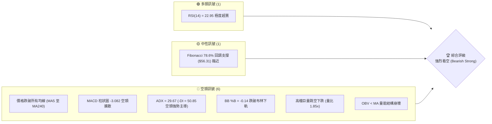

### 📊 核心指標速覽表

| 指標類別 | 指標名稱 | 當前數值 | 訊號 | 解讀 |
|----------|----------|----------|------|------|
| **價格** | 當前收盤價 | $59.97 | 🔴 | 跌破 60 美元關卡，處於 52 週區間偏低分位 (24.7%) |
| **均線** | MA20 | $93.58 | 🔴 | 價格在 MA20 下方 -35.91%，短期均線陡峭下行 |
| **均線** | MA50 | $100.50 | 🔴 | 價格在 MA50 下方 -40.33%，中期多頭結構徹底瓦解 |
| **均線** | MA200 | $86.92 | 🔴 | 價格在 MA200 下方 -31.01%，跌破長期生命線 |
| **動能** | RSI(14) | 22.95 | 🟢 | 進入極度超賣區（<30），隨時具備技術性死貓反彈潛能 |
| **動能** | MACD | -8.346 | 🔴 | DIF 線遠在訊號線 (-5.264) 下方，柱狀圖 -3.082 擴大 |
| **動能** | Stoch %K / %D | 1.36 / 15.94 | 🟢 | 隨機指標進入個位數極端超賣，短線動能嚴重鈍化 |
| **趨勢** | ADX(14) | 29.67 | 🔴 | ADX > 25 確認為強烈趨勢行情，-DI 高達 50.85 顯示空方全面掌控 |
| **通道** | Bollinger %B | -0.14 | 🔴 | 價格脫離布林下軌 ($67.36) 運行，屬於非理性拋售階段 |
| **成交量**| 最新量 / 20日均量 | 229.47M / 123.79M | 🔴 | 量比達 1.85x，下跌伴隨顯著恐慌性拋售放量 |
| **波動** | ATR(14) | $6.93 | 🔴 | 佔股價 11.55%，單日波動極其劇烈，操作風險極高 |

### 🏆 技術評分卡

```
╔══════════════════════════════════════════════════════════════╗
║                技術評分卡 — INTC (2026-11-03)               ║
╠══════════════════════════════════════════════════════════════╣
║ 趨勢強度 (Trend)       ███░░░░░░░░░░░░░░░░░  15/100  🔴 強空主導 ║
║ 動能指標 (Momentum)    █████░░░░░░░░░░░░░░░  25/100  🔴 極度低迷 ║
║ 支撐穩定度 (Support)   ████░░░░░░░░░░░░░░░░  20/100  🔴 破位無撐 ║
║ 成交量配合 (Volume)    ████░░░░░░░░░░░░░░░░  18/100  🔴 恐慌放量 ║
║ 形態完整度 (Pattern)   ████░░░░░░░░░░░░░░░░  22/100  🔴 破線向下 ║
║ 均線排列 (MA System)   ███░░░░░░░░░░░░░░░░░  14/100  🔴 瀑布發散 ║
╠══════════════════════════════════════════════════════════════╣
║ 綜合評分 (Overall)     ████░░░░░░░░░░░░░░░░  19/100  🔴 強烈看空 ║
╚══════════════════════════════════════════════════════════════╝
```
*(註：綜合評分由六項子評分算術平均計算：(15 + 25 + 20 + 18 + 22 + 14) ÷ 6 = 19.0，四捨五入為 19/100)*

---

## 2. 趨勢分析

### 🌐 多時框趨勢分析

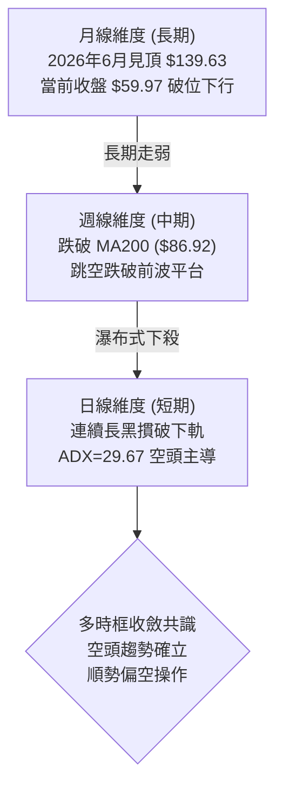

### 📈 長期趨勢 — 12個月走勢圖（Unicode）

```
INTC 月線走勢圖（過去12個月：2025-12 至 2026-11）
價格軸 ($)
$140 ┤                         ● (2026-06 $139.63 歷史波段頂點)
$120 ┤                   ●           ● (2026-09 $120.23 次高點)
$100 ┤             ●           ●   ●
 $80 ┤                                   
 $60 ┤                                     ●← 當前價格 ($59.97)
 $40 ┤ ●     ●   ●
 $20 ┤
     └─┬───┬───┬───┬───┬───┬───┬───┬───┬───┬───┬───
      12  01  02  03  04  05  06  07  08  09  10  11 (月份)
      25 ----------------- 2026 --------------------
```

**走勢特徵分析表格**：

| 時間區間 | 起始/收盤價 | 區間漲跌幅 | 主要走勢特徵與結構 |
|----------|-------------|------------|--------------------|
| 2025-11 ~ 2026-03 | $40.56 → $44.13 | +8.80% | 底部築底箱型震盪，量能溫和蓄勢 |
| 2026-03 ~ 2026-06 | $44.13 → $139.63 | +216.41% | 主升浪暴力拉升，月線連四紅，創下 52 週高點 $142.35 |
| 2026-06 ~ 2026-08 | $139.63 → $89.51 | -35.89% | 高檔獲利了結大回撤，於 $89.50 附近尋求支撐 |
| 2026-08 ~ 2026-09 | $89.51 → $120.23 | +34.32% | 次級反彈構築次高點，呈現雙頂右肩結構 |
| 2026-09 ~ 2026-11 | $120.23 → $59.97 | -50.12% | 崩跌式跳空破位，單月腰斬，抹平年內大部分漲幅 |

### 📊 中期趨勢（週線分析）

中期走勢呈現「雙重頂破位後的單邊空頭延伸」。近 8 週K棒展現空方極為殘酷的殺盤節奏：從 2026-09-25 週收盤 $123.00 跌至 2026-11-02 收盤 $59.97，僅僅 6 週累計跌幅達 51.24%。2026-10-30 當週更是創下單週成交量 861.63M 股的歷史天量破位長黑，顯示機構投資者大規模無差別拋售。

```
週線關鍵壓力與支撐階梯圖：
══════════════════════════════════════════════════════════════════════
 [壓力 R3] $132.75 ═════════════════════════════════════ 波段高點群
 [壓力 R2] $127.04 ═════════════════════════════════════ 次高頸線區
 [壓力 R1] $107.13 ═════════════════════════════════════ 破位平台下沿
       ─── MA200: $86.92 ────────────────────────────── 長期均線壓力
       ─── Fib 61.8%: $74.70 ────────────────────────── 關鍵黃金分割位
 [現價]    $59.97 ◄─── (處於歷史真空跌勢中)
       ─── Fib 78.6%: $56.31 ────────────────────────── 下方首道弱支撐
 [支撐 S1] $42.58 ═════════════════════════════════════ 近一年起漲基底
 [支撐 S2] $41.64 ═════════════════════════════════════ 強支撐核心帶
 [支撐 S3] $40.63 ═════════════════════════════════════ 終極防守低點
══════════════════════════════════════════════════════════════════════
```

### ⚡ 趨勢強度評估（ADX 解讀）

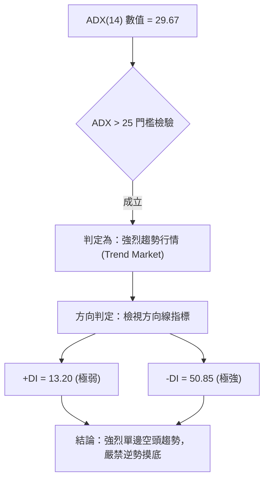

| 指標名稱 | 當前數值 | 參考門檻 | 當前市場狀態判定 |
|----------|----------|----------|------------------|
| **ADX(14)** | 29.67 | > 25.00 | 強趨勢狀態確立，排除無方向箱型盤整 |
| **-DI** | 50.85 | > 40.00 | 空方力量爆發，處於壓倒性主導地位 |
| **+DI** | 13.20 | < 20.00 | 多方動能極度萎縮，反彈動能嚴重不足 |
| **DI 差值** | -37.65 | 負值擴大 | 空頭動能加速度擴張，趨勢未見收斂鈍化信號 |

---

## 3. 圖表形態分析

### 🔍 形態識別系統

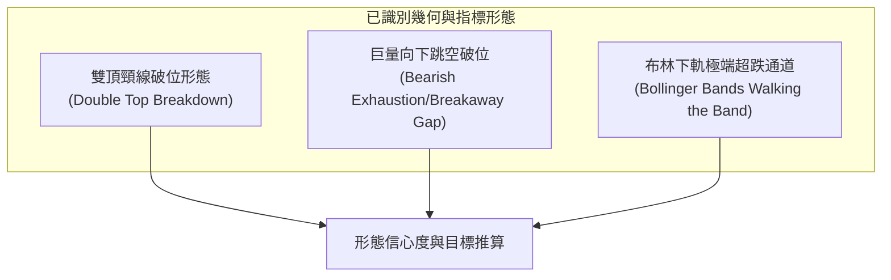

**形態信心度與目標價評估表**：

| 形態名稱 | 信心度 | 判斷依據（引用數據） | 完成度 | 目標價（附精確計算式） |
|----------|--------|----------------------|--------|------------------------|
| **大型雙頂破位** | 75% | 2026-06 高點 $139.63 與 2026-09 高點 $120.23 形成不對稱雙頂；頸線為波段低點聚類阻力 R1 ($107.13)。2026-10-16 當週破位確認。 | 85% | 頸線 $107.13 − 形態高度 ($139.63 − $107.13 = $32.50) = **$74.63**（已跌破，滿足目標後向支撐 S1 $42.58 尋求測底） |
| **巨量向下跳空** | 90% | 2026-10-30 日K開盤 $68.36，較前日收盤 $92.07 向下跳空達 $23.71，伴隨 455.60M 巨量。 | 100% | 由跳空缺口推算：前一日收盤 $92.07 − 當日低點 $63.20 = $28.87 測量垂直落差，破位延伸滿足點為 $63.20 − $28.87 = **$34.33**（逼近 52W 低點 $32.89） |
| **布林極限負偏離**| 85% | 布林 %B 為 -0.14，股價收在 $59.97 遠低於布林下軌 $67.36。 | 100% | 指標型形態：股價嚴重偏離軌道，技術性均值回歸初級目標為布林下軌反壓 **$67.36** |

### 🕯️ 重要 K 線形態分析

依據提供的「近 10 根日K」與「近 8 根週K」實際數據進行嚴謹形態解析：

#### 近 10 根日K線解析表

| 日期 | 開盤價 | 最高價 | 最低價 | 收盤價 | K線形態 | 深度技術解讀 | 訊號 |
|------|--------|--------|--------|--------|---------|--------------|------|
| 2026-10-20 | $90.73 | $93.73 | $88.77 | $91.69 | 小陽線 | 震盪回升，受壓於 MA20 ($93.58) | 🟡 |
| 2026-10-21 | $93.43 | $94.39 | $90.75 | $92.96 | 假陰十字 | 衝高回落，高點承壓，量能萎縮 | 🟡 |
| 2026-10-22 | $87.92 | $89.19 | $84.65 | $85.49 | 低開中陰線 | 跳空低開摜破前低，量能擴增至 134M 股 | 🔴 |
| 2026-10-23 | $85.92 | $87.87 | $84.74 | $86.96 | 縮量陽線 | 低檔弱勢抵抗，未回補當日低開缺口 | 🟡 |
| 2026-10-26 | $87.94 | $92.09 | $86.46 | $90.47 | 中陽實體 | 反彈測試上方均線阻力，量能平平 | 🟡 |
| 2026-10-27 | $92.47 | $94.98 | $91.86 | $93.74 | 帶上影小陽 | 挑戰 MA20 ($93.58) 未果，多頭力竭 | 🟡 |
| 2026-10-28 | $95.09 | $95.68 | $93.00 | $95.53 | 衝高小陽線 | 創反彈高點 $95.68，遇 MA50 ($100.50) 反壓折返 | 🟡 |
| 2026-10-29 | $92.97 | $93.50 | $90.84 | $92.07 | 孕線收黑 | 跌破前日實體，成交量放大至 134M，變盤信號 | 🔴 |
| 2026-10-30 | $68.36 | $68.77 | $63.20 | $65.76 | 崩跌破位大黑K | 惡性向下跳空 $23.71，爆出 455.6M 天量，多頭防線全面瓦解 | 🔴 |
| 2026-11-02 | $65.40 | $65.72 | $59.40 | $59.97 | 光頭大黑K | 延續性拋壓，擊破 $60 心理整數，收盤收在全天相對低點 | 🔴 |

#### 近 8 根週K線解析表

| 日期 | 開盤價 | 最高價 | 最低價 | 收盤價 | 週K形態 | 深度技術解讀 | 訊號 |
|------|--------|--------|--------|--------|---------|--------------|------|
| 2026-09-18 | $95.82 | $111.37 | $94.52 | $108.60 | 突破長陽週K | 突破百元關卡，推升次波反彈高潮 | 🟢 |
| 2026-09-25 | $116.53 | $127.44 | $114.93 | $123.00 | 高檔長上影陽 | 衝擊 R2 ($127.04) 遇阻，為波段右肩次高點 | 🟡 |
| 2026-10-02 | $120.68 | $126.00 | $113.97 | $119.33 | 高檔陰孕線 | 頂部停滯，成交量萎縮至 495M 股，顯現量價背離 | 🔴 |
| 2026-10-09 | $115.34 | $118.20 | $104.00 | $104.70 | 光腳中陰週K | 摜破短均線，週 MACD 柱狀圖由正翻負 (-2.052) | 🔴 |
| 2026-10-16 | $102.52 | $103.19 | $89.19 | $89.85 | 實體大黑週K | 跌破百元大關與頸線 R1 ($107.13)，形態破位 | 🔴 |
| 2026-10-23 | $94.53 | $95.39 | $84.65 | $86.96 | 弱勢十字陰 | 跌破 MA200 ($86.92)，多頭喪失最後防線 | 🔴 |
| 2026-10-30 | $87.94 | $95.68 | $63.20 | $65.76 | 歷史級放量長黑 | 週跌 -24.38%，861.63M 驚人量能殺盤，空頭極盛 | 🔴 |
| 2026-11-02 | $65.40 | $65.72 | $59.40 | $59.97 | 破位延續陰K | 跌破 $60 心理防線，收盤價逼近 Fib 78.6% ($56.31) | 🔴 |

### 📉 ASCII 走勢形態示意圖

```
INTC 關鍵破位形態與巨量跳空缺口示意圖
價格
$127.04 ──┐ (2026-09-25 次高頂部 R2)
          │  
$107.13 ──┴──────────┐ (雙頂頸線阻力 R1)
                     │
$95.68 ──────────────┼───────┐ (10-28 弱勢反彈高點)
$92.07 ──────────────┼───────┴──┐ (10-29 跳空起跌點)
                     │           ║ 
                     │   ░░░░░░░ ║ ◄── 惡性向下跳空缺口 ($92.07 → $68.36)
                     │   ░ 空頭 ░ ║     (未回補強阻力區間)
                     │   ░ 缺口 ░ ║
$68.36 ──────────────┼───────────┘
$65.76 ──────────────┼───────┐ (10-30 收盤)
$59.97 ──────────────┴───────┴──● ◄── 現價 ($59.97) 跌破布林下軌
$56.31 ─────────────────────────┄┄┄┄┄ 斐波那契 78.6% 回調關鍵支撐
$42.58 ─────────────────────────═════ 關鍵波段支撐聚類 S1
```

### 🎯 形態目標價計算

1. **雙頂形態破位理論目標**：
   - 頂部 A（2026-06 高點）= $139.63
   - 頸線位（阻力 R1）= $107.13
   - 形態垂直高度 $H = \$139.63 - \$107.13 = \$32.50$
   - 雙頂第一等幅測量目標 = 頸線 $107.13 - H (\$32.50) = **$74.63**
   - *驗證*：當前價格 $59.97 已完全跌破 $74.63，宣告第一測量目標達成，進入雙頂形態的延伸下跌浪（1.618 倍延伸）。
   - 1.618 倍延伸目標 = $\$107.13 - (\$32.50 \times 1.618) = \$107.13 - \$52.59 = **\$54.54**，此價位與下方斐波那契 78.6% ($56.31) 極為接近。

2. **跳空向下測量缺口（Runaway/Breakaway Gap）目標**：
   - 缺口上方基準（2026-10-29 收盤）= $92.07
   - 破位實體底部（2026-10-30 低點）= $63.20
   - 單日下殺落差 $\Delta = \$92.07 - \$63.20 = \$28.87$
   - 依據旗形/缺口等幅延伸推算之空頭目標 = $\$63.20 - \$28.87 = **\$34.33**
   - *驗證*：該目標價位已逼近數據中已計算之 52 週低點 **$32.89** 與歷史支撐聚類 S3 **$40.63**。

---

## 4. 支撐與阻力

### 🗺️ 關鍵價位分布圖（Unicode）

```
INTC 價位結構分布圖（引用 OHLCV 計算之真實數據）
══════════════════════════════════════════════════════════════
$132.75 ║██████████████████████████████║ 強阻力 R3 (年內次高聚合區)
$127.04 ║████████████████████          ║ 阻力 R2 (右肩次高點)
$107.13 ║██████████████████████████████║ 關鍵阻力 R1 (頸線破位平台)
$100.54 ║──────────────────────────────║ Fib 38.2% 回調位 / 鄰近 MA50
 $87.62 ║──────────────────────────────║ Fib 50.0% 多空分水嶺 / MA200
 $74.70 ║──────────────────────────────║ Fib 61.8% 黃金分割強反壓
 $67.36 ║┄┄┄┄┄┄┄┄┄┄┄┄┄┄┄┄┄┄┄┄┄┄┄┄┄┄┄┄┄┄║ 布林通道下軌 (超賣反彈初級阻力)
 $59.97 ╠══════════════════════════════╣ ◄ 現價 ($59.97)
 $56.31 ║▓▓▓▓▓▓▓▓▓▓                    ║ Fib 78.6% 回調關鍵支撐
 $42.58 ║████████████████████          ║ 波段支撐 S1 (年內起漲底)
 $41.64 ║████████████████████████      ║ 強支撐 S2 (密集成交區)
 $40.63 ║██████████████████████████████║ 終極防守 S3 (強支撐底線)
 $32.89 ║██████████████████████████████║ 52週低點 / 100% Fib 回調位
══════════════════════════════════════════════════════════════
```

### 🚧 阻力位分析表

*(註：嚴格引用數據中由 OHLCV 聚類計算之阻力價位)*

| 阻力級別 | 價位 | 形成原因與背景結構 | 突破難度 | 重要性 |
|----------|------|--------------------|----------|--------|
| **R1** | $107.13 | 近一年波段高點聚類下緣，亦為 2026 年 7 月與 9 月多次回踩與反彈的頸線中樞，累積龐大套牢籌碼。 | 極高 🔴 | ★★★★★ |
| **R2** | $127.04 | 2026-09-25 當週衝高見頂之收盤與最高點聚類區，確立右肩確立的次級頭部阻力帶。 | 極高 🔴 | ★★★★☆ |
| **R3** | $132.75 | 逼近 2026-06 歷史波段高點群（$139.63），為多頭歷史天花板聚類點，距離現價高達 +121.36%。 | 極高 🔴 | ★★★☆☆ |

### 🛡️ 支撐位分析表

*(註：嚴格引用數據中由 OHLCV 聚類計算之支撐價位)*

| 支撐級別 | 價位 | 形成原因與背景結構 | 守住機率 | 重要性 |
|----------|------|--------------------|----------|--------|
| **S1** | $42.58 | 近一年波段低點聚類（2025 年底起漲平台群），距現價 -29.00%，為第一道具實質籌碼沉澱的結構支撐。 | 60% 🟡 | ★★★★☆ |
| **S2** | $41.64 | 2025 年 10-11 月密集換手區之低點核心聚類，距現價 -30.57%，具備較強的價值買盤承接力。 | 70% 🟢 | ★★★★★ |
| **S3** | $40.63 | 近一年波段低點聚類底部極限，距現價 -32.25%，多頭年線級別結構防守底線，不容有失。 | 80% 🟢 | ★★★★★ |

### 📐 斐波那契回調位分析

依據 52 週完整波動區間（低點 **$32.89** → 高點 **$142.35**，總垂直空間 $109.46）嚴格計算：

| 回調比率 | 斐波那契價位 | 當前相對位置 | 技術意義與多空攻防解讀 |
|----------|--------------|--------------|------------------------|
| **0.0%** | $142.35 | 距現價 +137.37% | 52 週絕對最高點，多頭牛市終點 |
| **23.6%** | $116.52 | 距現價 +94.30% | 第一回調位，已於 2026 年 10 月中旬被放量摜破 |
| **38.2%** | $100.54 | 距現價 +67.65% | 關鍵分割位，與 MA50 ($100.50) 形成雙重重合反壓 |
| **50.0%** | $87.62 | 距現價 +46.11% | 多空平衡分水嶺，與 MA200 ($86.92) 形成共振強阻力 |
| **61.8%** | $74.70 | 距現價 +24.56% | 黃金分割強反壓，跌破此位宣告長牛趨勢被徹底扭轉 |
| **當前價格** | **$59.97** | **當前位置** | **落於 61.8% ($74.70) 與 78.6% ($56.31) 弱勢區間** |
| **78.6%** | $56.31 | 距現價 -6.10% | 極度深度回調防線，為當前空頭向下跌勢的最近緩衝點 |
| **100.0%** | $32.89 | 距現價 -45.16% | 52 週起漲最低點，若跌破則視為年線級別破底 |

**解讀**：現價 $59.97 處於 61.8% ($74.70) 跌破後的慣性探底階段，距下方 78.6% ($56.31) 僅有 -6.10% 空間。技術上 61.8% 跌破後，極高機率將向下測試 78.6% 甚至 100% 回調位。當前反彈的第一最大阻力即為 61.8% ($74.70)。

---

## 5. 技術指標深度解讀

### 🎛️ 指標訊號總覽

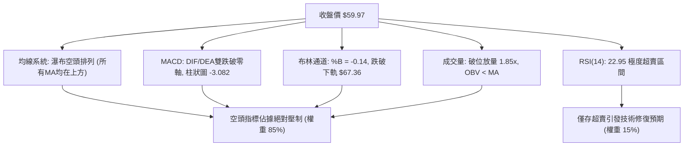

### 📈 移動平均線排列分析

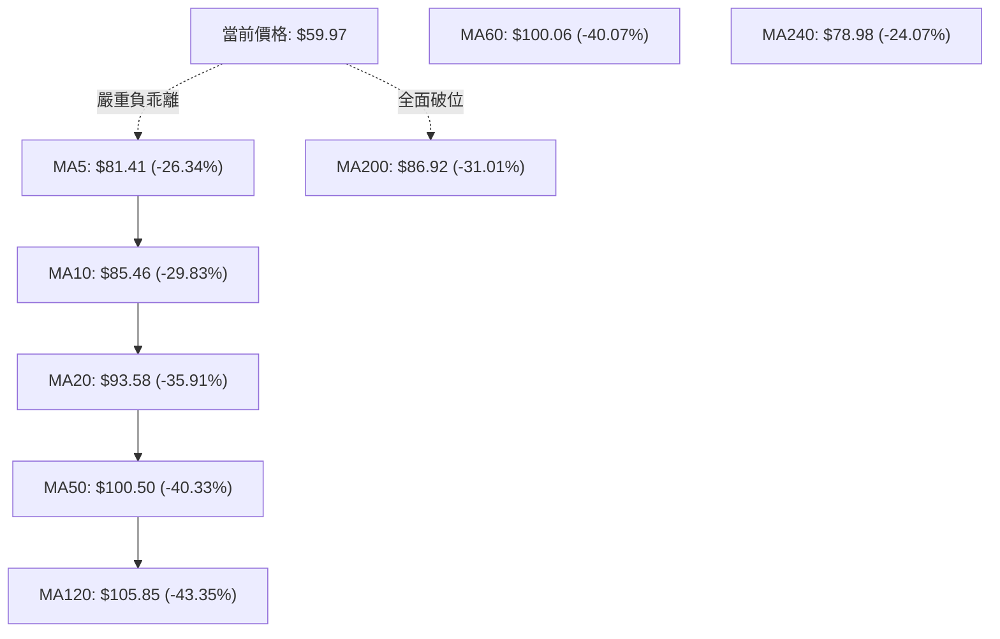

**移動平均線數值與狀態表**：

| 均線名稱 | 當前價格位階 | 與現價乖離率 | 短期斜率走勢 | 技術評估 |
|----------|--------------|--------------|--------------|----------|
| **MA5** | $81.41 | -26.34% | 陡峭向下 ▁ | 極短期動能崩塌，首道動態壓制 |
| **MA10** | $85.46 | -29.83% | 陡峭向下 ▁ | 短期空方下壓均線，反彈難越 |
| **MA20** | $93.58 | -35.91% | 拐頭向下 ▂ | 月線級別生命線下彎，中期轉空 |
| **MA50** | $100.50 | -40.33% | 高檔下彎 ▄ | 跌破百元心理防線，中線主力棄守 |
| **MA60** | $100.06 | -40.07% | 下行發散 ▄ | 季線下穿，中期頂部結構不可逆 |
| **MA120** | $105.85 | -43.35% | 見頂下拐 ▆ | 半年線開始下走，長期牛市結束 |
| **MA200** | $86.92 | -31.01% | 走平轉空 █ | 年線失守，牛熊分界線被放量跌破 |
| **MA240** | $78.98 | -24.07% | 上行力竭 █ | 兩年均線亦被跌破，長週期支撐全失 |

*解讀*：現價全線運行於所有移動平均線之下，且所有短期與中期均線呈現典型的空頭瀑布發散，向上反彈將遭遇層層巨大解套拋壓。

### 📉 RSI(14) 分析

```
RSI(14) 當前水平：22.95  (超賣區間 < 30)
0       10      20      30              50                      70     100
├───────┼───────┼───────┼───────────────┼───────────────────────┼───────┤
[極度超賣] ▓▓▓▓▓▓░░░░░░░░░░░░░░░░░░░░░░░░░░░░░░░░░░░░░░░░░░░░░░░░░░░░░░░░
        ▲ 現值: 22.95
```

- **超買超賣判定**：RSI(14) 讀數為 22.95，已深陷 30 以下極度超賣區，反映過去 14 天跌勢極具破壞性。配合 Stoch %K (1.36) 與 %D (15.94) 的個位數讀數，短線存在強烈的動能耗竭與技術性抽頭修復需求。
- **背離分析**：檢視近 20 根 K 棒數據，價格自 $95.53 連續暴跌至 $59.97 創下波段新低，RSI 亦自 60 以上同步筆直下墜至 22.95。**明確結論：RSI 無任何底背離現象**，指標方向與價格跌勢完全吻合，屬於「無背離的強烈主跌段」，切勿因單純超賣而盲目抄底。

### 📊 MACD(12/26/9) 訊號解讀

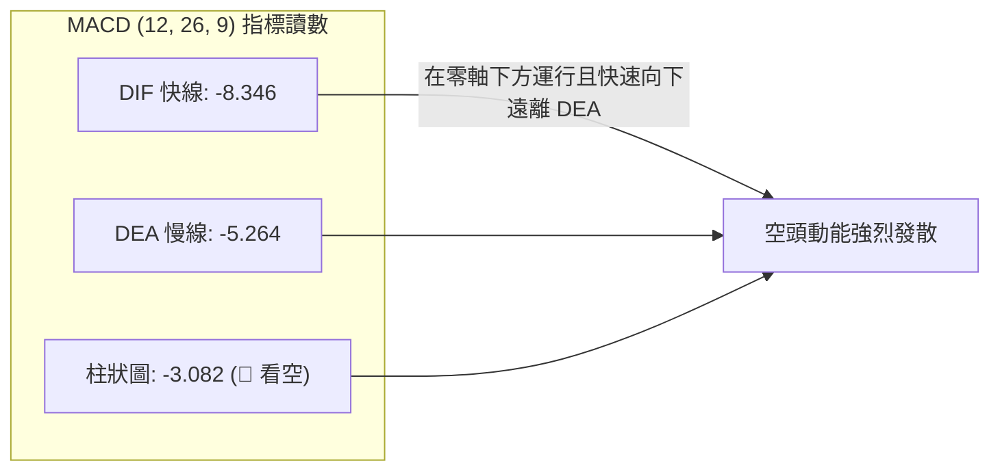

- **線位解讀**：DIF (-8.346) 與 DEA (-5.264) 均深處於零軸下方（零軸為多空分水嶺），確認當前處於標準的「零下弱勢空頭格局」。
- **柱狀圖解讀**：MACD Hist 為 -3.082，較前期持續擴張（近週收盤柱狀圖自 -1.941 進一步擴大至 -3.082），代表空頭加速度尚未減弱，殺盤賣壓仍在蔓延。
- **背離判定**：MACD 線與柱狀圖同步創出近期新低，**不存在底背離特徵**，空方動能佔據絕對主導。

### 📦 布林通道分析

```
布林通道 (Bollinger Bands 20, 2) 結構示意圖：
$119.79 ──┬───────────────────────────── 上軌 (Upper Band)
          │
 $93.58 ──┼───────────────────────────── 中軌 (Middle Band = MA20)
          │
 $67.36 ──┼───────────────────────────── 下軌 (Lower Band)
          │  ░░░ 軌道外真空跌勢 ░░░
 $59.97 ──┴──● 現價 (%B = -0.14) ◄── 脫離通道運行
```

- **帶寬與位置**：通道上軌 $119.79，中軌 $93.58，下軌 $67.36。帶寬高達 $52.43，顯示通道極度擴張。
- **%B 指標深度解讀**：%B 讀數為 **-0.14**（當 %B < 0 代表跌破下軌）。現價 $59.97 遠低於下軌 $67.36，呈現罕見的「沿下軌向下暴衝（Walking the Lower Band）」之極端超跌形態。此種狀態通常出現在基本面重大黑天鵝引發的踩踏，下軌反壓 $67.36 將轉為短線第一道難以逾越的天花板。

### 💹 成交量分析（量價配合度）

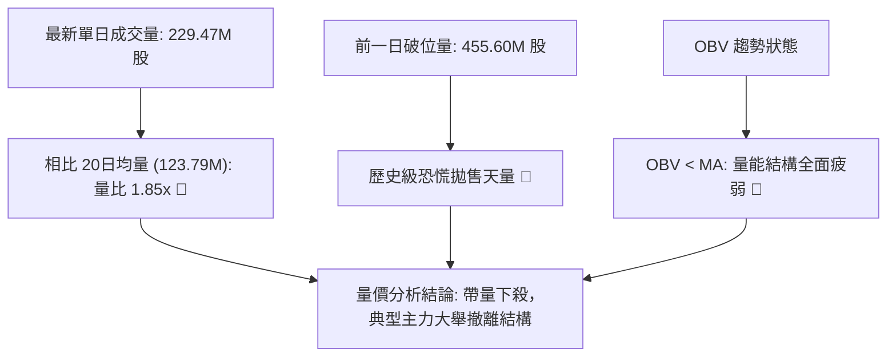

- **量價配合度**：在 2026-10-30 與 2026-11-02 兩日下殺中，分別爆出 455.60M 股與 229.47M 股的巨量，成交量分別達到 20 日均量的 3.68 倍與 1.85 倍。週成交量更達到 861.63M 股。
- **價跌量增的惡性結構**：暴跌伴隨成交量成倍放大，顯示賣壓並非散戶惜售下的無量陰跌，而是機構大資金的主動性砍倉與流動性擠兌。
- **OBV 能量潮解讀**：OBV 指標現階段顯著低於其均線（OBV < MA），能量潮持續創低，宣告籌碼面嚴重渙散，未見任何機構逢低護盤承接的量能特徵。

---

## 6. 動能與波動率

### ⚡ 動能評估四象限

| 象限 | 動能維度 (Momentum) | 波動率維度 (Volatility) | INTC 當前狀態 | 戰略評估與應對 |
|------|---------------------|-------------------------|---------------|----------------|
| **Q1 (高動/低波)** | 強勢多頭動能 | 低波動平穩推進 | — | 最佳趨勢波段持有區 |
| **Q2 (弱動/低波)** | 弱勢/中性動能 | 低波動窄幅盤整 | — | 適合觀望或區間網格操作 |
| **Q3 (強動/高波)** | 強烈單邊動能 | 高波動劇烈發散 | **✓ (極端空頭)** | **高風險高殺傷力：順勢做空或空倉觀望** |
| **Q4 (弱動/高波)** | 震盪混亂無序 | 高波動無方向洗盤 | — | 容易雙巴，避免進場 |

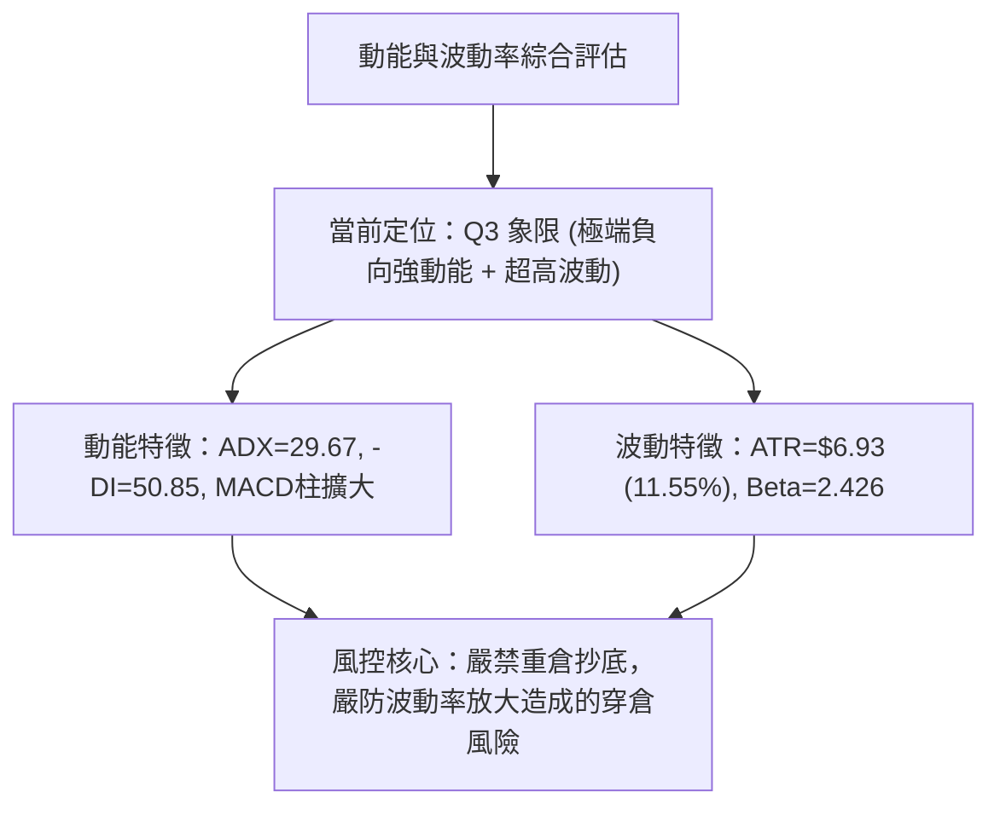

### 📊 ATR 波動率分析

- **ATR(14) 數值**：**$6.93**（佔當前股價 $59.97 的 **11.55%**）。
- **波動率解讀**：通常美股大型半導體股之日級別 ATR 佔股價比率約在 2%–4% 之間，當前 INTC 的 ATR 飆升至 11.55%，代表單日股價平均上下震盪幅度接近 7 美元，屬於極端高波動異常狀態。
- **止損距離建議**：
  - 在此等波動率下，常規的 2%–3% 緊密止損會被市場雜音瞬間觸發。
  - 技術性止損距離必須依據 **1.0 至 1.5 倍 ATR** 進行動態設定，即合理止損防護間距應為 **$6.93 至 $10.40**。
  - 對應的單筆交易部位規模必須縮減至常規持倉的 1/3 至 1/4，以控制整體帳戶最大回撤。

### 📐 Beta 與市場相關性

- **Beta 係數**：**2.426**。
- **市場相關性解讀**：INTC 的 Beta 高達 2.426，代表其對大盤（S&P 500 / Nasdaq）的波動敏感度是大盤的 2.4 倍以上。當整體半導體板塊或宏觀市場遭遇逆風時，INTC 將呈現加倍的劇烈下挫。高 Beta 疊加極端弱勢的技術面，意味著在整體市場尚未完全企穩之前，該股容易成為機構避險拋售的首選標的。

---

## 7. 多時框架總結

### 📋 時框架評分表

| 時框架 | 趨勢方向 | 動能狀態 | 均線排列 | 形態結構 | 綜合評分 | 戰略建議 |
|--------|----------|----------|----------|----------|----------|----------|
| **月線 (長期)** | 🔴 強烈空頭 | 下降動能擴張 | 跌破 MA240 ($78.98) | 雙頂高檔見頂腰斬 | 20/100 | 長期投資者離場觀望 |
| **週線 (中期)** | 🔴 空頭崩跌 | MACD柱線負向擴大 | 瀑布下行，破 MA200 | 放量長黑破位缺口 | 15/100 | 中線反彈逢高減磅/做空 |
| **日線 (短期)** | 🔴 極端超跌 | RSI 22.95 鈍化 | 空頭排列，脫離下軌 | 巨量向下跳空光頭黑K | 22/100 | 短線順勢空，嚴禁左側抄底 |

### 🔲 綜合訊號矩陣

| 維度 | 短期 (日線) | 中期 (週線) | 長期 (月線) | 多時框一致性解讀 |
|------|-------------|-------------|-------------|------------------|
| **趨勢方向** | 🔴 空頭破位 | 🔴 單邊下行 | 🔴 長空確立 | 三時框 100% 完美空頭共振 |
| **動能方向** | 🟢 短線超賣 | 🔴 空頭加速 | 🔴 陰跌發散 | 僅日線超賣，但動能仍由空方支配 |
| **量能特徵** | 🔴 恐慌拋售量 | 🔴 破位週天量 | 🔴 頂部量價背離 | 全週期顯示資金持續流出 |
| **關鍵防守** | 🔴 $67.36 下軌失守 | 🔴 $86.92 年線失守 | 🔴 $74.70 61.8% 失守 | 長中短期核心支撐全數失守 |

### ⚖️ 多時框收斂結論

依據多時框收斂優先級規則：
1. **行情性質判定**：當前 ADX(14) = 29.67，明確大於 25.00 臨界點，市場定性為**典型的強烈單邊趨勢行情**（非震盪盤整行情）。
2. **主導時框裁決**：在趨勢行情中，中長期（週線 / MA50 / MA200）方向具有最高支配權。當前週線與月線均呈現長黑破位、失守 MA200 ($86.92) 的標準空性格局；日線級別的 RSI 超賣（22.95）僅能視為隨時可能被空頭趨勢碾壓的短暫雜音，**只能作為尋找反彈沽空進場點的參考，不可作為反轉做多的依據**。
3. **唯一方向性結論**：**【強烈看空（Strong Bearish）】**。多時框訊號收斂指向一致性的空頭延伸行情，技術評分卡鎖定為 **19/100**。交易策略必須全面順應中長期空頭趨勢，嚴格採取「反彈受阻放空」或「破位順勢追空」為主策略。

---

## 8. 交易策略建議

### 🗺️ 策略決策流程圖

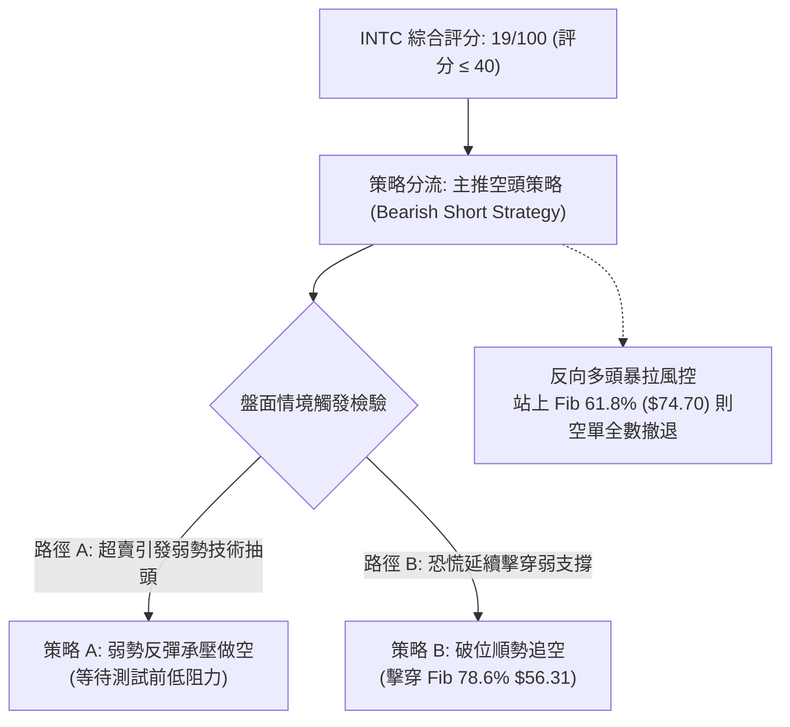

### 🧭 策略路由

> **當前主策略方向 = 【主推空頭策略（Short Strategy）】（依據評分卡綜合評分：19/100）**
> 
> *分流依據*：綜合評分 19/100 ≤ 40 門檻，空頭佔據絕對優勢，多時框呈現瀑布式下跌共振。本報告全面主推空頭主動進場策略；多頭交易僅列為反向風險提示與對沖預警，嚴禁任何左側非理性摸底做多。

### 🎯 價格情境階梯（Price Scenarios）

*(註：價位嚴格引用第 4 章及關鍵數據中 OHLCV / Fibonacci 算定之真實數值)*

| 觸發條件 | 下一目標 | 後續延伸 | 情境技術含義與應對 |
|----------|----------|----------|--------------------|
| **跌破 Fib 78.6% $56.31** | S1 **$42.58** | S2 **$41.64** | **單邊破位加速**：空頭直奔近一年歷史底部起漲區，順勢抱牢空單 |
| **受阻於 $65.40 / 下軌 $67.36** | $59.97 | $56.31 | **反彈夭折**：技術性超賣回抽結束，形成次級高點，空單最佳加碼點 |
| **強勢回抽突破 Fib 61.8% $74.70** | MA200 **$86.92** | R1 **$107.13** | **空頭趨勢遭到反轉破壞**：空單嚴格止損，行情轉入寬幅震盪築底 |

### 📊 情境機率分佈

| 盤面情境 | 發生機率 | 主要依據與技術論證 |
|----------|----------|--------------------|
| **順勢下行 / 再探新低** | **65%** | ADX = 29.67 強烈趨勢未減，-DI 高達 50.85，量能爆出 1.85x 拋售巨量，均線全面空頭瀑布下壓。 |
| **超賣弱勢震盪反抽** | **25%** | RSI(14) 達 22.95 極端超賣，Stoch %K 跌至 1.36，布林 %B (-0.14) 脫軌，隨時存在均值回歸修復。 |
| **強勢 V 型反轉上攻** | **10%** | 上方套牢籌碼沉重，跳空缺口 ($68.36–$92.07) 阻力巨大，無基本面重大利多難以直接扭轉。 |

### 🟢 主策略詳情（空頭交易策略）

```
╔══════════════════════════════════════════════════════════════╗
║               INTC 執行策略詳情（空頭主動操作）             ║
╠══════════════════════════════════════════════════════════════╣
║ 策略 A（主選）：弱勢反彈承壓做空 (Bearish Pullback Short)   ║
║ 策略 B（次選）：跌破關鍵支撐追空 (Bearish Breakdown Short)   ║
╚══════════════════════════════════════════════════════════════╝
```

| 策略要素 | 策略 A（弱勢反彈承壓做空） | 策略 B（破位順勢追空） |
|----------|----------------------------|------------------------|
| **進場條件** | 股價因極度超賣引發抽頭，反彈測試 2026-11-02 開盤點 $65.40 附近受阻滯漲 | 盤中實體放量跌破斐波那契 78.6% 關鍵支撐位 $56.31 確認 |
| **進場價格** | **$65.40** | **$56.31** |
| **目標價 T1** | **$42.58**（引用支撐 S1） | **$42.58**（引用支撐 S1） |
| **目標價 T2** | **$32.89**（引用 52W Low / 100% Fib） | **$40.63**（引用支撐 S3） |
| **止損價格** | **$74.70**（引用 Fib 61.8% 阻力位） | **$63.20**（引用 2026-10-30 日K低點） |
| **風險報酬比** | **1 : 2.45（以 T1 計）**<br/>*(以 T2 計為 1 : 3.50)* | **1 : 1.99（以 T1 計）**<br/>*(以 T2 計為 1 : 2.28)* |
| **成功機率** | **65%** | **60%** |
| **建議倉位** | **10% 總資金**（因高波動縮小風險敞口） | **8% 總資金** |

*精確風報比驗證算式（依規則 17）：*
- **策略 A (以 T1 計)**：
  - 獲利空間 = 進場價 $\$65.40 - \text{T1 } \$42.58 = \$22.82$
  - 承擔風險 = 止損價 $\$74.70 - \text{進場價 } \$65.40 = \$9.30$
  - 風險報酬比 = $\$22.82 \div \$9.30 = 2.4537 \rightarrow$ **1 : 2.45（以 T1 計）**
  - *(以 T2 計)*：$(\$65.40 - \$32.89) \div \$9.30 = \$32.51 \div \$9.30 = 3.4956 \rightarrow$ **1 : 3.50（以 T2 計）**
- **策略 B (以 T1 計)**：
  - 獲利空間 = 進場價 $\$56.31 - \text{T1 } \$42.58 = \$13.73$
  - 承擔風險 = 止損價 $\$63.20 - \text{進場價 } \$56.31 = \$6.89$
  - 風險報酬比 = $\$13.73 \div \$6.89 = 1.9927 \rightarrow$ **1 : 1.99（以 T1 計）**
  - *(以 T2 計)*：$(\$56.31 - \$40.63) \div \$6.89 = \$15.68 \div \$6.89 = 2.2757 \rightarrow$ **1 : 2.28（以 T2 計）**

### 🔴 反向風險觸發點（對沖提示）

若出現非預期之強勢利多促使盤面反轉，以下價位與訊號為空頭邏輯推翻的**嚴格停損與防禦警戒線**：
1. **第一防禦警戒線：$67.36（布林通道下軌）**
   - 若日線實體陽線強勢站回 $67.36 之上，代表極度超賣脫軌修復正式轉為實質性反彈，原短線破位空單應立即獲利了結或平手離場。
2. **趨勢反轉停損線：$74.70（Fib 61.8% 黃金分割強反壓）**
   - 若價格強勢收復 $74.70，代表空頭中繼結構被破壞，雙頂下殺的等幅延伸跌勢終結，所有空頭頭寸必須**無條件市價全數止損**，嚴防軋空行情爆發。

### ⭐ 整體訊號強度評星

```
╔══════════════════════════════════════════════════╗
║ 做多訊號強度：★☆☆☆☆  (1/5 星 - 僅極端超賣)    ║
║ 做空訊號強度：★★★★☆  (4/5 星 - 趨勢量能共振)  ║
║ 整體技術可信度：★★★★☆  (4/5 星 - 破位形態完整)║
╚══════════════════════════════════════════════════╝
```

---

## 9. 風險提示與監控

### ✅ 關鍵監控指標 Checklist

```
╔══════════════════════════════════════════════════════════════╗
║              INTC 每日盤面核心監控指標 Checklist            ║
╠══════════════════════════════════════════════════════════════╣
║ [ ] RSI(14) 是否脫離 30 超賣區（若升破 30 防範空頭回補軋空）  ║
║ [ ] 股價能否收復布林通道下軌 $67.36（評估脫軌修正力道）      ║
║ [ ] 下方斐波那契 78.6% ($56.31) 支撐測試是否出現止跌長下影   ║
║ [ ] 單日成交量是否回落至 20日均量 (123.79M) 以下（量縮止跌） ║
║ [ ] 日K線跳空缺口下沿 ($68.36) 是否有回補跡象                ║
║ [ ] -DI (50.85) 是否下穿 40 門檻（判定空頭動能是否衰竭）     ║
║ [ ] 標普半導體板塊指數 (SOX) 是否同步企穩築底              ║
╚══════════════════════════════════════════════════════════════╝
```

### ⚠️ 風險場景分析

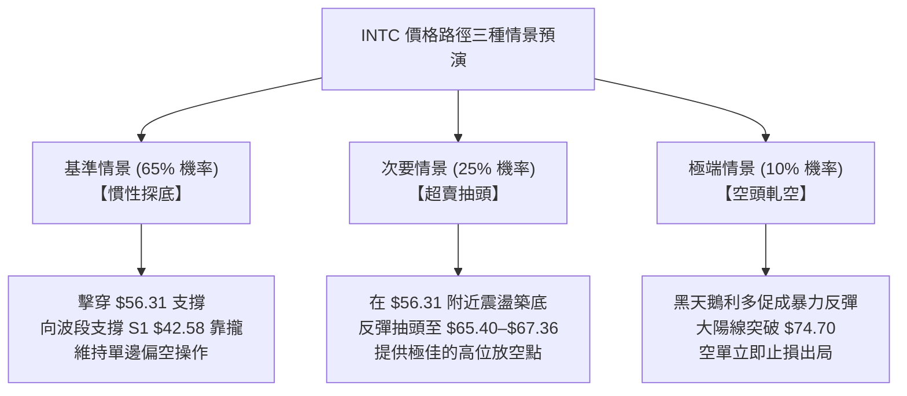

### 🛡️ 風險管理重要提醒

1. **極端波動率下的部位規模控制（Position Sizing）**：
   - 當前 ATR(14) 高達 $6.93（11.55% of price），Beta 高達 2.426，該標的已具備槓桿型產品的高波動特質。
   - 根據凱利公式與凱文·沃許風險模型，單一帳戶承擔 INTC 的風險敞口不得超過總資產的 **10%**。單筆交易的最大可承擔虧損金額（Risk per Trade）必須嚴格鎖定在帳戶淨值的 **1.0%–1.5%** 之內。
2. **跳空缺口風險防範**：
   - 近期 INTC 走勢展現出極強的跳空特徵（2026-10-30 單日跳空超過 25%）。在盤後或財報/消息面發酵時，普通止損單可能面臨嚴重的滑價風險（Slippage）。
   - 建議建立保護性期權（如持有空單時買入虛值看漲期權 Protective Call）進行尾部風險對沖。
3. **拒絕逆勢摸底**：
   - 儘管當前股價自 52 週高點 $142.35 已回撤近 58%，但「價格便宜」絕非買入理由。在均線呈瀑布發散且成交量爆發性出逃的背景下，盲目左側抄底極易遭遇二次腰斬殺盤。嚴守技術紀律，趨勢反轉前維持空方思維。

---

## 📋 報告總結

```
╔══════════════════════════════════════════════════════════════╗
║                 INTC 技術分析報告終極總結                    ║
╠══════════════════════════════════════════════════════════════╣
║ 報告日期：2026-11-03                                         ║
║ 當前價格：$59.97                                             ║
║ 分析評級：🔴 強烈看空（Bearish Strong / 技術評分 19/100）    ║
╠══════════════════════════════════════════════════════════════╣
║ 關鍵結論：                                                   ║
║ ├─ 長期趨勢：🔴 強烈空頭（月線雙頂頸線失守，長牛格局瓦解）    ║
║ ├─ 中期趨勢：🔴 瀑布下殺（跌破 MA200 $86.92，週線放天量破位） ║
║ ├─ 短期趨勢：🔴 極端超跌（脫離布林下軌 $67.36，空頭加速）     ║
║ ├─ 核心支撐：$56.31 (Fib 78.6%) ｜ $42.58 (S1) ｜ $41.64 (S2) ║
║ ├─ 核心阻力：$67.36 (BB下軌) ｜ $74.70 (Fib 61.8%) ｜ $107.13 ║
║ └─ 分析師目標：均價 $93.88 ｜ 最低 $70.00 ｜ 最高 $160.00     ║
╠══════════════════════════════════════════════════════════════╣
║ 最優策略組合：                                               ║
║ 1. 🥇 最佳機會：策略 A（弱勢反彈承壓做空）                   ║
║    進場 $65.40 ｜ 止損 $74.70 ｜ 目標 $42.58 ｜ 風報比 1:2.45║
║ 2. 🥈 次選機會：策略 B（跌破支撐順勢追空）                   ║
║    進場 $56.31 ｜ 止損 $63.20 ｜ 目標 $42.58 ｜ 風報比 1:1.99║
║ 3. 🥉 保守選擇：完全空倉離場觀望，耐心等待日線級別止跌結構   ║
╚══════════════════════════════════════════════════════════════╝
```

---

> ⚠️ **免責聲明**：本報告為 AI 自動生成之技術分析研究，所有數據指標及價位均嚴格基於所提供之歷史價格與成交量計算。本報告**僅供學術研究與投資策略交流參考**，**絕對不構成任何實盤買賣要約或投資建議**。金融市場瞬息萬變，技術指標具備滯後性，投資人應自行獨立判斷並承擔全部交易盈虧風險。

---

*報告生成時間：2026-11-03 ｜ 數據來源：Yahoo Finance ｜ 分析框架：多時框技術分析體系*