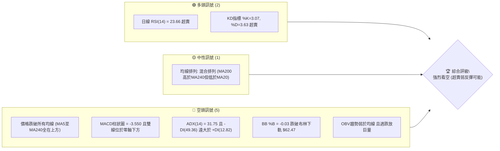
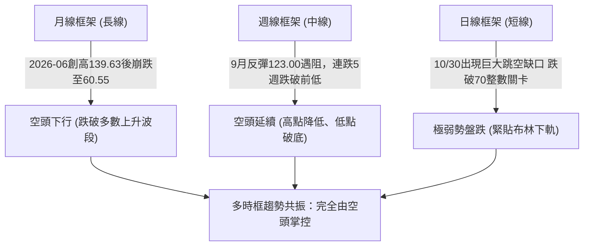
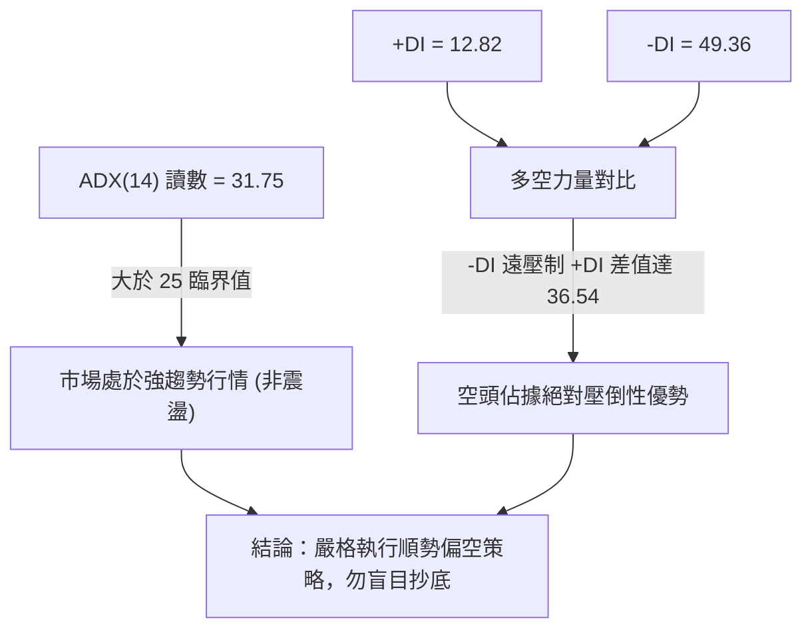
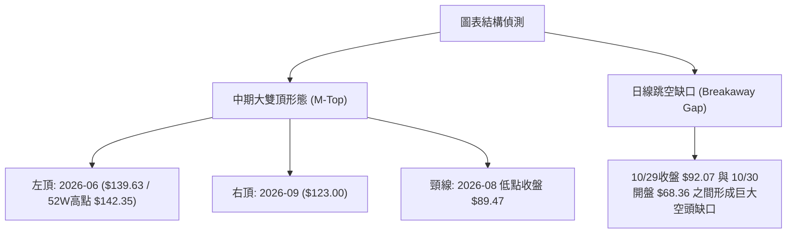
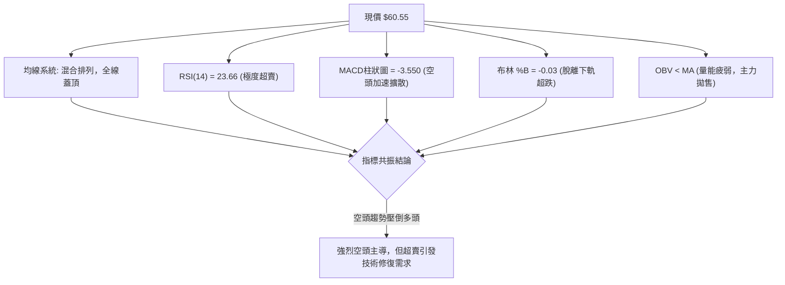
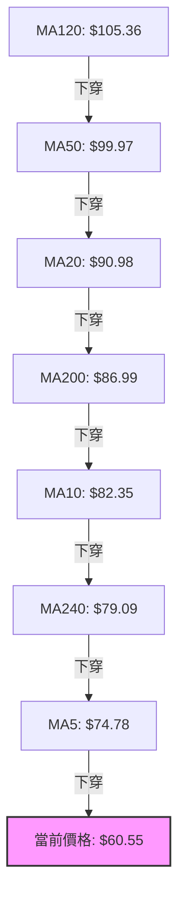
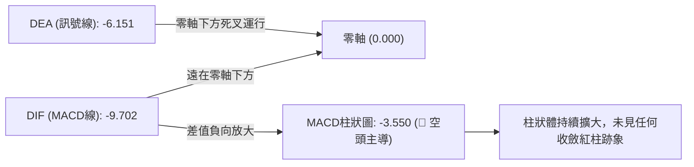
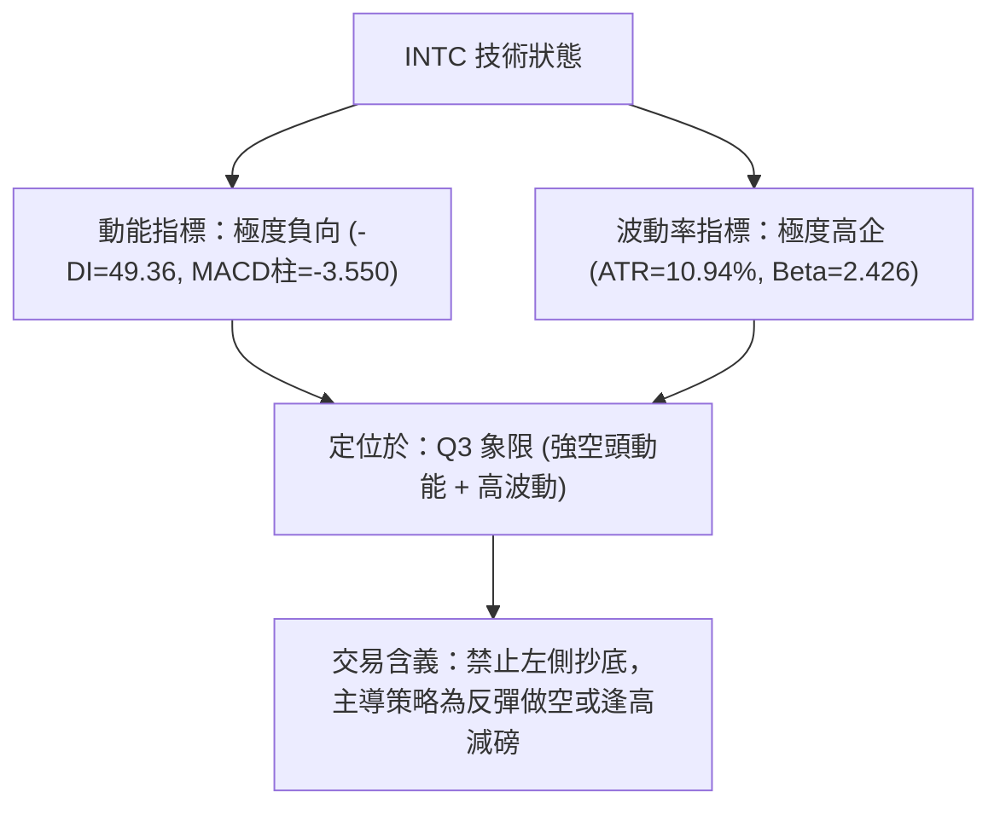
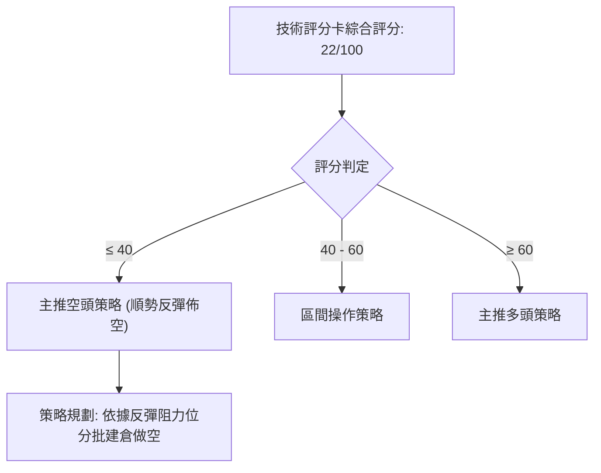
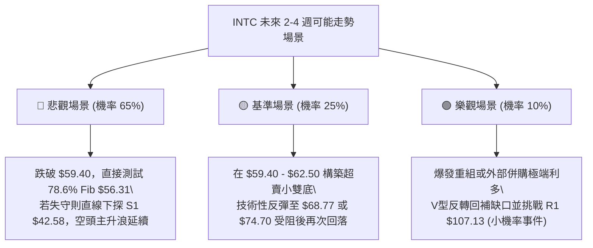

# INTC 技術分析報告

> **報告日期**：2026-11-04 ｜ **語言**：繁體中文 ｜ **數據來源**：Yahoo Finance ｜ **當前價格**：$60.55

---

## 目錄

| 章節 | 內容 |
|------|------|
| [1. 技術面概覽](#1-技術面概覽) | 訊號儀表板、核心指標、評分卡 |
| [2. 趨勢分析](#2-趨勢分析) | 多時框趨勢、長中短期走勢 |
| [3. 圖表形態分析](#3-圖表形態分析) | 形態識別、K線組合、目標價 |
| [4. 支撐與阻力](#4-支撐與阻力) | 關鍵價位、斐波那契回調 |
| [5. 技術指標深度解讀](#5-技術指標深度解讀) | MA/RSI/MACD/布林/成交量 |
| [6. 動能與波動率](#6-動能與波動率) | 動能評估、ATR、Beta |
| [7. 多時框架總結](#7-多時框架總結) | 時框架評分矩陣 |
| [8. 交易策略建議](#8-交易策略建議) | 多空策略、風險報酬比 |
| [9. 風險提示與監控](#9-風險提示與監控) | 監控指標、風險場景 |

---

## 1. 技術面概覽

### 🎯 技術訊號儀表板



### 📊 核心指標速覽表

| 指標類別 | 指標名稱 | 當前數值 | 訊號 | 解讀 |
|----------|----------|----------|------|------|
| **價格** | 當前價格 | $60.55 | 🔴 | 位於52週區間25.3%處，且創近半年新低 |
| **均線** | MA20 | $90.98 | 🔴 | 價格低於MA20達-33.45%，短中期均線空頭排列 |
| **均線** | MA50 | $99.97 | 🔴 | 價格低於MA50達-39.43%，中期趨勢嚴重受損 |
| **均線** | MA200 | $86.99 | 🔴 | 價格低於MA200達-30.39%，跌破長期年線牛熊分水嶺 |
| **動能** | RSI(14) | 23.66 | 🟢 | 極度超賣（<30），隨時有技術性死貓反彈可能 |
| **動能** | MACD(12,26,9) | -9.702 / -6.151 (柱 -3.550) | 🔴 | 雙線負值擴大，綠柱持續向下延伸，空頭動能極強 |
| **波動** | ATR(14) | $6.63 (10.94%) | 🔴 | 每日震幅超10%，極度高波動，市場充斥恐慌情緒 |
| **趨勢強度** | ADX(14) | 31.75 (-DI=49.36) | 🔴 | 強趨勢（ADX>25），且由空方（-DI）絕對主導 |
| **通道狀態** | Bollinger Bands | 上軌 $119.49 / 下軌 $62.47 | 🔴 | %B為-0.03，價格脫離布林下軌向下破位 |
| **成交量** | 量比 (vs 20MA) | 1.17x (日量1.47億) | 🔴 | 破位伴隨放量，OBV弱於均線，量能不配合上漲 |

### 🏆 技術評分卡

```
╔══════════════════════════════════════════════════════════════════╗
║                 技術評分卡 — INTC (2026-11-04)                   ║
╠══════════════════════════════════════════════════════════════════╣
║ 趨勢強度      ████████████████░░░░  20/100  🔴 極弱 (空頭強趨勢) ║
║ 動能指標      ████████░░░░░░░░░░░░  25/100  🔴 極空 (僅超賣防守) ║
║ 支撐穩定度    ████████░░░░░░░░░░░░  20/100  🔴 脆弱 (近端無有效支撐)║
║ 成交量配合    ██████████░░░░░░░░░░  30/100  🔴 疲弱 (下殺巨量沈澱)║
║ 形態完整度    ████████░░░░░░░░░░░░  20/100  🔴 破位 (大雙頂下破) ║
║ 均線排列      ██████░░░░░░░░░░░░░░  15/100  🔴 紊亂 (全線蓋頂下穿)║
╠══════════════════════════════════════════════════════════════════╣
║ 綜合評分      ████████░░░░░░░░░░░░  22/100  🔴 強烈看空 / 避險   ║
╚══════════════════════════════════════════════════════════════════╝
```
*註：綜合評分由六項子評分 (20 + 25 + 20 + 30 + 20 + 15) ÷ 6 = 21.67，四捨五入為 22/100。*

---

## 2. 趨勢分析

### 🌐 多時框趨勢分析



### 📈 長期趨勢 — 12個月走勢圖（Unicode）

```
INTC 月線走勢圖（過去12個月：2025-12 至 2026-11）
價格軸 ($)
$140 ┤                         ● 2026-06 ($139.63)
$120 ┤                             ● 2026-05 ($114.68)      ● 2026-09 ($120.23)
$100 ┤                   ● 2026-04 ($94.48)
$80  ┤                                                   ● 2026-07/08 (~$90)
$60  ┤                                                                          ● 2026-11 ($60.55 現價)
$40  ┤ ● 2025-12 ($36.90)                                                       ● 2026-10 ($65.76)
     └──────────────────────────────────────────────────────────────────────────
       25-12   26-01   26-02   26-03   26-04   26-05   26-06   26-07   26-08   26-09   26-10   26-11
```

**過去12個月歷史走勢特徵分析表**：

| 時間階段 | 月收盤區間 | 累積漲跌幅 | 結構與量價特徵 |
|----------|------------|------------|----------------|
| **2025-12 至 2026-03** | $36.90 → $44.13 | +19.59% | 底部緩步築底，股價於 $40 關卡附近換手。 |
| **2026-04 至 2026-06** | $94.48 → $139.63 | +216.41% | 主升浪暴力拉升，於 2026-06 觸及高點 $139.63（52週高點 $142.35）。 |
| **2026-07 至 2026-08** | $90.20 → $89.51 | -35.90% | 獲利了結盤湧出，急速回調至 $90.00 一線尋求季線支撐。 |
| **2026-09** | $120.23 | +34.32% | 次級反彈波，構建潛在「雙頂」右肩，最高摸至週收盤 $123.00。 |
| **2026-10 至 2026-11** | $65.76 → $60.55 | -49.64% | 財報暴雷引發斷崖式跳空下殺，一舉貫穿 MA200，直逼波段起漲點。 |

### 📊 中期趨勢（週線分析）

中期走勢呈現典型「雙頂頸線破位」格局。週線在 2026-06 創下高點後，於 2026-07/08 在 $89.47~$90.20 構築頸線位，隨後 9 月強彈至 $123.00 形構雙頂；10 月底一根週成交量達 8.61 億股的破位大陰線直接摜破 $89.47 頸線，確立中期空頭結構展開。

```
週線關鍵架構示意圖：
$142.35 ──┐ (左頂 2026-06)
          │                      ┌── $123.00 (右頂 2026-09)
          └─── $90.20 ───────────┴─── $89.47 (頸線區域)
               (2026-07/08 支撐)       │
                                       ▼ 10/30 放量貫穿跌破
                                       ====================== $60.55 (當前現價)
```

### ⚡ 趨勢強度評估（ADX 解讀）



**ADX 趨勢強度對照表**：

| 指標變數 | 當前數值 | 參考區間標準 | 趨勢屬性判定 |
|----------|----------|--------------|--------------|
| **ADX(14)** | **31.75** | > 25 (強趨勢), > 40 (極端趨勢) | 處於強烈且加速展開的趨勢行情中 |
| **+DI(14)** | **12.82** | 數值偏低（多頭動能萎縮） | 買盤動能極度疲弱 |
| **-DI(14)** | **49.36** | 數值極高（空頭全力宣洩） | 空方主動拋壓沈重，拋售高潮未見縮量枯竭 |
| **趨勢性質**| **空頭單邊** | ADX > 25 且 -DI > +DI | 絕對空頭趨勢（依規則14：不可當作盤整操作） |

---

## 3. 圖表形態分析

### 🔍 形態識別系統



**形態信心度與測量表格**（依規則 15）：

| 形態名稱 | 信心度 | 判斷依據（引用數據） | 完成度 | 目標價（附計算式） |
|----------|--------|----------------------|--------|--------------------|
| **大雙頂 (M-Top)** | 85% | 左頂 $142.35（52W高），右頂週收盤 $123.00，頸線跌破 2026-08-28 週收盤 $89.47，10/30 週巨量貫穿。 | 100% (已跌破頸線) | 頸線 $89.47 − 形態高度 ($123.00 − $89.47 = $33.53) = **$55.94**（高度推算） |
| **突破型向下跳空缺口** | 90% | 2026-10-29 最低價 $90.84 與 2026-10-30 最高價 $68.77，形成巨大未回補缺口（缺口區 $68.77–$90.84），當日放量 4.55 億股。 | 100% (完全脫離) | 依缺口理論屬向下突破缺口，中短期將成為強大天花板壓制。 |
| **底部反轉形態** | 15% | 數據中未偵測到任何雙底、頭肩底或反轉K線架構。 | 0% | 訊號不足，僅做超賣指標型解讀，嚴禁臆測底部。 |

### 🕯️ 重要K線形態分析

依規則 19，完全基於數據中近 10 根日 K 與近 8 根週 K 之實際數值進行分析：

| 日期（週期） | 開盤價 | 最高價 | 最低價 | 收盤價 | K線形態名稱 | 技術解讀 | 訊號方向 |
|--------------|--------|--------|--------|--------|-------------|----------|----------|
| **2026-10-28 (日K)** | 95.09 | 95.68 | 93.00 | 95.53 | 小陽線 | 財報前反彈縮量誘多，高點未過前波阻力 | 🟡 中性偏空 |
| **2026-10-29 (日K)** | 92.97 | 93.50 | 90.84 | 92.07 | 中陰線 | 成交量擴大至1.34億股，主力資金提前出逃 | 🔴 看空 |
| **2026-10-30 (日K)** | 68.36 | 68.77 | 63.20 | 65.76 | 崩跌跳空大陰棒 | 巨量4.55億股斷崖崩跌，盤中暴跌近30%，下引線極短 | 🔴 強烈看空 |
| **2026-11-02 (日K)** | 65.40 | 65.72 | 59.40 | 59.97 | 光腳長陰破底線 | 延續恐慌拋售，跌破60大關至59.40，空方全面肆虐 | 🔴 強烈看空 |
| **2026-11-03 (日K)** | 61.33 | 62.59 | 59.87 | 60.55 | 假反彈小陰十字星 | 開高走低，上影線觸及62.59受阻，低檔換手未見長下影支撐 | 🔴 弱勢整理 |
| **2026-10-23 (週K)** | 94.53 | 95.39 | 84.65 | 86.96 | 破位長陰週K | 跌破90元整數支撐與MA200，週收盤創階段新低 | 🔴 看空 |
| **2026-10-30 (週K)** | 87.94 | 95.68 | 63.20 | 65.76 | 歷史級巨量暴跌陰K | 單週爆量8.61億股，實體陰線幅度逾24%，空頭毀滅性打擊 | 🔴 強烈看空 |
| **2026-11-03 (週K)** | 65.40 | 65.72 | 59.40 | 60.55 | 續跌小陰K (進行中) | 3個交易日內持續於破底邊緣震盪，下檔買盤極其薄弱 | 🔴 看空 |

### 📉 ASCII 走勢形態示意圖

```
INTC 近期日K線跳空破位走勢圖
價格軸 ($)
$96 ┤      ┌─┐ (10/28 高 95.68)
$92 ┤  ┌─┐ │ │ ┌─┐ (10/29 低 90.84)
$88 ┤  │ │ └─┘ │ │
    ┆  ┆ ┆      ┆ ┆  
    ┆  【 巨 大 跳 空 缺 口 區 間: $68.77 - $90.84 】
    ┆  ┆ ┆      ┆ ┆  
$68 ┤               ┌─┐ (10/30 開 68.36, 高 68.77)
$64 ┤               │ │
$60 ┤               │ │ ┌─┐    ┌─┐ (11/03 收 60.55)
$56 ┤               └─┘ └─┘─── └─┘ (11/02 低 59.40)
    └──────────────────────────────────────────────
       10/26 10/27 10/28 10/29 10/30 11/02 11/03
```

### 🎯 形態目標價計算

根據經典圖表學雙頂（M-Top）破位原理：
1. **右肩頸線基準**：取 2026-08-28 週收盤低點 **$89.47** 為破位頸線。
2. **形態頂部高點**：取 2026-09-25 週收盤高點 **$123.00** 為雙頂右頂。
3. **形態垂直高度**：$123.00 − $89.47 = **$33.53**。
4. **最小量度下行目標 (Measured Move)**：
   $$\text{下行目標價} = \text{頸線} - \text{形態高度} = \$89.47 - \$33.53 = \mathbf{\$55.94}$$
   *此形態推算目標價 $55.94 緊鄰斐波那契 78.6% 回調位 $56.31，顯示 $55.94–$56.31 區間為形態學重要潛在考驗區域。*

---

## 4. 支撐與阻力

### 🗺️ 關鍵價位分布圖（Unicode）

```
INTC 價位結構分布圖 (依據 OHLCV 聚類與斐波那契計算)
═══════════════════════════════════════════════════════════════════
$142.35 ║██████████████████████████████║ 52週最高點 (0.0% Fib)
$132.75 ║████████████████████████      ║ 強阻力 R3 (+119.24%)
$127.04 ║████████████████████          ║ 阻力 R2 (+109.81%)
$107.13 ║████████████████████████████  ║ 關鍵阻力 R1 (+76.93%)
$100.54 ║──────────────────────────────║ 38.2% 斐波那契回調位
$87.62  ║──────────────────────────────║ 50.0% 斐波那契回調位
$74.70  ║──────────────────────────────║ 61.8% 斐波那契回調位
$62.47  ║······························║ 日線布林下軌 (現已失守)
$60.55  ╠══════════════════════════════╣ ◄ 當前市價 ($60.55)
$56.31  ║──────────────────────────────║ 78.6% 斐波那契回調位 (首道回調防線)
$42.58  ║▓▓▓▓▓▓▓▓▓▓▓▓▓▓▓▓▓▓▓▓▓▓        ║ 關鍵支撐 S1 (-29.68%)
$41.64  ║████████████████████          ║ 次級支撐 S2 (-31.23%)
$40.63  ║████████████████████████████  ║ 強支撐 S3 (-32.90%)
$32.89  ║██████████████████████████████║ 52週最低點 (100.0% Fib)
═══════════════════════════════════════════════════════════════════
```

### 🚧 阻力位分析表

阻力位嚴格引用技術數據中「波段高點聚類」計算結果：

| 阻力級別 | 價位 | 形成原因（依據數據） | 突破難度 | 技術重要性 |
|----------|------|----------------------|----------|------------|
| **R1** | **$107.13** | 近一年波段高點密集聚類位，且位於 MA120 ($105.36) 附近 | 極高 | 關鍵分水嶺，未收復前中長線維持完全空頭結構 |
| **R2** | **$127.04** | 近一年次高震盪平台聚集處，週線 9 月底起跌點區域 | 極高 | 空方重兵防守區，套牢籌碼極度密集 |
| **R3** | **$132.75** | 逼近歷史波段極值，歷史高點區間成交堆積密集區 | 極高 | 多頭大週期反轉目標，短期內無觸及可能 |

### 🛡️ 支撐位分析表

支撐位嚴格引用技術數據中「波段低點聚類」計算結果：

| 支撐級別 | 價位 | 形成原因（依據數據） | 守住機率 | 技術重要性 |
|----------|------|----------------------|----------|------------|
| **S1** | **$42.58** | 近一年波段低點聚類首道核心關卡（距現價 -29.68%） | 60% | 2026 年初起漲平台底部邊緣，多頭中長線生命線 |
| **S2** | **$41.64** | 近一年低點次級密集支撐區（距現價 -31.23%） | 65% | 密集換手防守點，具備強力買盤承接歷史 |
| **S3** | **$40.63** | 歷史月線收盤密集區（2025-10/11 約 $40-$40.56） | 75% | 長期強支撐底線，跌破將引發向 52W 低點清算 |

### 📐 斐波那契回調位分析

依據 52 週波動區間（高點 **$142.35** 至 低點 **$32.89**，總落差 $109.46）計算之各回調位解析如下：

| 回調比率 | 斐波那契價位 | 當前相對位置 | 技術意涵與解讀 |
|----------|--------------|--------------|----------------|
| **0.0%** (High) | $142.35 | 現價下方 +135.1% | 52週最高峰值，長期巨浪頂部 |
| **23.6%** | $116.52 | 現價下方 +92.4% | 第一道淺回調位，9月反彈曾短暫爭奪 |
| **38.2%** | $100.54 | 現價下方 +66.0% | 多空平衡強弱線，與 MA50 ($99.97) 重合共振 |
| **50.0%** | $87.62 | 現價下方 +44.7% | 半數回撤位，與 8 月低點頸線及 MA200 ($86.99) 重疊 |
| **61.8%** | $74.70 | 現價下方 +23.4% | 黃金分割防守位，10/30 跳空一舉摜穿，轉化為強大阻力 |
| **78.6%** | **$56.31** | **現價下方 -7.0%** | **深層回調防線，為當前價格下探的第一考驗目標** |
| **100.0%** (Low) | $32.89 | 現價下方 -45.7% | 52週最低點，終極底部 |

**現價區間解讀**：
當前收盤價 **$60.55** 正好落於 **61.8% ($74.70)** 與 **78.6% ($56.31)** 之間。在跌破 61.8% 黃金分割位後，技術走勢慣性將尋求 78.6% 回調位 **$56.31** 的測試。若 $56.31 告失，下檔將直接敞開向下測尋 **S1 ($42.58)** 的空間。

---

## 5. 技術指標深度解讀

### 🎛️ 指標訊號總覽



### 📈 移動平均線排列分析



**均線乖離率與狀態表**：

| 均線名稱 | 數值 | 距現價乖離 | 走勢趨向 | 技術訊號評估 |
|----------|------|------------|----------|--------------|
| **MA5** | $74.78 | -19.02% | 陡峭向下 ▁ | 極短期嚴重負乖離，存在短線抽腳預期 |
| **MA10** | $82.35 | -26.47% | 陡峭向下 ▁ | 短期空頭防線，壓制任何隔日反彈 |
| **MA20** | $90.98 | -33.45% | 加速下彎 ▁ | 中短期生命線徹底崩塌 |
| **MA50** | $99.97 | -39.43% | 下彎 ▁ | 中期空頭總指揮，阻力巨大 |
| **MA60** | $99.44 | -39.11% | 下行 ▁ | 季線下移，確立中週期熊市 |
| **MA120** | $105.36 | -42.53% | 走平轉下 ▆ | 半年線開始下垂，長期頂部沉重 |
| **MA200** | $86.99 | -30.39% | 緩升中被下破 | 長期牛熊線被放量摜破，轉化為堅固天花板 |
| **MA240** | $79.09 | -23.44% | 走升但被摜破 | 年線已無法提供任何支撐 |

*均線排列判定：數據標示為「混合排列」（因 MA200 仍大於 MA240，但短均線已完全跌破長均線），實質上已形成惡性的空頭排列雛形。*

### 📉 RSI(14) 分析

```
RSI(14) 當前水平評估 (Wilder 計算):
0 ────────── 20 ── 23.66 ────── 30 ──────────────── 50 ──────────────── 70 ────────── 100
[ 極度超賣區間 ]  ▲            [ 弱勢區間 ]        [ 平衡線 ]          [ 超買區間 ]
                現值
進度條展示:
超賣強度: [████████████████████░░░░░] 78.8% (距 0 軸深度)
```

- **超買超賣判定**：RSI(14) 讀數為 **23.66**，遠低於 30 臨界水平，屬於**嚴重超賣**。同時，Stoch KD 指標中 %K 為 3.07，%D 為 3.63，雙雙進入極限超賣區（<10）。
- **背離分析**：依據數據快照，比對近 20 根 K 棒首尾的價格與 RSI 方向，**「無明顯背離」**。價格創新低之際，RSI 亦同步下墜，代表下殺動能具備實質賣壓驅動，並非量能枯竭引起的動能衰竭底背離。

### 📊 MACD(12,26,9) 訊號解讀



- **MACD 線**：-9.702
- **訊號線 (Signal)**：-6.151
- **柱狀圖 (Histogram)**：-3.550
- **深度研判**：雙線深陷零軸以下，MACD 線與訊號線的負向間距高達 -3.550，且柱狀體持續發散走低。週線 MACD 柱亦由前週的 -1.941 擴大至 -3.550。此現象顯示空頭動能仍處於加速釋放期，完全無底背離特徵。

### 📦 布林通道分析

```
布林通道 (20日, 2倍標準差) 當前價位示意圖：
$119.49 ┬────────────────────────────────────────── 布林上軌
        │
        │
 $90.98 ┼────────────────────────────────────────── 布林中軌 (MA20)
        │
 $62.47 ┴────────────────────────────────────────── 布林下軌
 $60.55 ════ ◄ 當前價格 ($60.55, %B = -0.03, 跌破下軌)
```

- **通道帶寬與形態**：上軌 $119.49，下軌 $62.47，帶寬高達 $57.02，通道急劇開口擴張，屬於典型突破單邊擴散形態。
- **%B 指標分析**：%B 為 **-0.03**（小於 0 即表示價格實質收在下軌下方）。在強趨勢中（ADX=31.75），「貼軌下行」甚至「破軌破位」是極端空頭攻擊的表徵，不可單純依據回歸均值原理猜底買入。

### 💹 成交量分析（量價配合度）

```
量價配合度分析圖表 (近5日量能)：
10/28  82.5M  █▍                (反彈縮量)
10/29 134.1M  ██▎               (起跌微增)
10/30 455.6M  █████████         (放量崩跌破位，恐慌盤)
11/02 230.7M  ████▋             (續跌放量，拋壓沉重)
11/03 147.2M  ███               (量縮小十字，買盤觀望)
───────────────
20日均量: 126.1M
```

- **量比與均量對比**：最新單日成交量為 147,222,100 股，相較於 20 日均量 126,112,475 股，量比為 **1.17x**。
- **放量性質分析**：10/30 出現 4.55 億股的天量崩跌，週線更是爆出 8.61 億股的歷史天量。這種巨量長黑代表大量籌碼在 $65–$68 區間被動止損被套，形成實質的沉重浮額。
- **OBV 趨勢**：數據明確指示 **「OBV < MA → 量能疲弱」**，能量潮指標呈持續下行流出態勢，證實整體資金持續撤離，完全沒有主力吸籌的背離訊號。

---

## 6. 動能與波動率

### ⚡ 動能評估四象限

| 象限 | 動能維度 | 波動維度 | INTC當前歸屬 | 行為特徵與技術含義 |
|:---:|:---:|:---:|:---:|---|
| **Q1** | 強多頭動能 | 低波動 | — | 穩定單邊上行趨勢（最佳做多機會） |
| **Q2** | 弱動能 | 低波動 | — | 區間沉寂橫盤，方向不明 |
| **Q3** | 強動能 (空) | 高波動 | **✓ (INTC所處象限)** | **強烈單邊殺跌伴隨恐慌拋售，極高風險與高空頭獲利空間** |
| **Q4** | 弱多頭動能 | 高波動 | — | 寬幅震盪洗盤，容易兩頭打臉 |



### 📊 ATR 波動率分析

- **ATR(14) 數值**：**$6.63**（採用 Wilder 平滑計算）。
- **ATR 相對百分比**：高達股價的 **10.94%**（$6.63 ÷ $60.55）。
- **風控與止損距離考量**：
  - 由於日震幅超過 10%，任何常規的緊密止損（如 2%–3%）極易被市場雜訊掃出場。
  - **合理止損緩衝空間**：依據 1.5 倍 ATR 計算為 $6.63 × 1.5 = **$9.95**；1.0 倍 ATR 計算為 **$6.63**。
  - 當前波段操作需預留至少 $6.60 以上的止損距離，同時應等比例壓縮名義持倉部位，以防極端跳空風險。

### 📐 Beta 與市場相關性

- **Beta 係數**：**2.426**。
- **市場敏感性評估**：INTC 相較於 S&P 500 大盤呈現 **2.43 倍**的超高敏感度與高波動性。在科技晶片板塊整體面臨下行壓力或半導體逆風時，INTC 呈現出放大的補跌效應；高 Beta 屬性意味著當前下行趨勢具有極高的市場系統性拋售乘數效應。

---

## 7. 多時框架總結

### 📋 時框架評分表

| 時框架 | 趨勢方向 | 動能狀態 | 均線系統 | 形態結構 | 綜合評分 | 操作指導建議 |
|--------|----------|----------|----------|----------|:--------:|--------------|
| **月線 (長期)** | 🔴 下行破位 | 弱化下穿 | 跌破多數均線 | 2026年高點大雙頂右側 | 25/100 | 長期投資者離場觀望 |
| **週線 (中期)** | 🔴 空頭排列 | 空頭加速擴散 | 跌破 MA200 牛熊線 | 跌破頸線 $89.47 | 15/100 | 中線反彈全數逢高減碼 |
| **日線 (短期)** | 🔴 崩跌超賣 | 極限超賣未背離 | 混合但全線覆蓋在上方 | 巨大向下跳空缺口 | 26/100 | 嚴禁盲目摸底，防反彈陷阱 |

### 🔲 綜合訊號矩陣

```
時框與指標共振診斷矩陣：
╔═════════════╦══════════════╦══════════════╦══════════════╗
║ 指標維度    ║ 短期 (日線)  ║ 中期 (週線)  ║ 長期 (月線)  ║
╠═════════════╬══════════════╬══════════════╬══════════════╣
║ 趨勢方向    ║ 🔴 強烈空頭  ║ 🔴 強烈空頭  ║ 🔴 下行確立  ║
║ 動能 (MACD) ║ 🔴 負向擴大  ║ 🔴 負向擴大  ║ 🟡 翻空走低  ║
║ 超買超賣    ║ 🟢 極度超賣  ║ 🟢 進入超賣  ║ 🟡 中性偏弱  ║
║ 均線架構    ║ 🔴 全面空頭  ║ 🔴 跌破MA200 ║ 🟡 長期均線下彎║
║ 量價配合    ║ 🔴 放量下殺  ║ 🔴 歷史天量黑║ 🔴 出貨特徵  ║
╚═════════════╩══════════════╩══════════════╩══════════════╝
```

### ⚖️ 多時框收斂結論

依據本報告**嚴格要求第 14 條（多時框收斂規則）**進行最終收斂：
1. **行情屬性判定**：當前 ADX(14) 讀數為 **31.75**（明確大於 25 臨界線），判定當前為標準的**「強趨勢行情」**，絕非「盤整震盪行情」。
2. **時框優先級權重**：在強趨勢行情下，嚴格以**中長期（週線 / MA50 / MA200）方向為依歸**，日線級別的指標超賣（如 RSI=23.66、KD 極低）僅能視為尋找順勢防禦或反彈進場點的參考，不可據以逆勢翻多。
3. **收斂方向唯一結論**：**🔴 強烈偏空（順勢做空 / 逢反彈減磅）**。本結論與第 1 章技術評分卡（22/100）及第 2、5 章之技術訊號完全一致。

---

## 8. 交易策略建議

### 🗺️ 策略決策流程圖



### 🧭 策略路由（依評分卡分流）

> **當前主策略方向 = 🔴 強烈偏空 / 逢反彈做空（依綜合評分 22/100 路由分流）**
> 
*說明：依據評分卡 22 分（≤40分），嚴禁主推任何多頭建倉策略。多頭訊號僅作為極短線技術性死貓反彈的「空頭對沖防禦與減碼提示」，主策略全面導向順勢空頭策略。*

### 🎯 價格情境階梯（Price Scenarios）

價位嚴格引用第 4 章及數據庫中「波段聚類與斐波那契」精確數值：

| 觸發條件 | 下一目標 | 後續延伸 | 情境含義與技術應對 |
|----------|----------|----------|--------------------|
| **跌破 $59.40** (前低) | **$56.31** (78.6% Fib) | **S1 $42.58** | **空頭延續下殺**：恐慌拋壓二次釋放，直指大波段深層回調 |
| **跌破 S1 $42.58** | **S2 $41.64** | **S3 $40.63** | **崩盤惡化**：長線起漲平台瓦解，向歷史底部滑落 |
| **反彈受阻 $74.70** (61.8% Fib) | **$60.55** (現價) | **$56.31** | **弱勢反彈結束**：死貓反彈受制於黃金分割阻力，最佳加空點 |
| **向上突破 R1 $107.13** | **R2 $127.04** | **R3 $132.75** | **多頭結構逆轉**：除非收復 R1，否則中長線空頭結構無法扭轉 |

### 📊 情境機率分佈

| 情境劇本 | 預估機率 | 主要指標依據（嚴格引用數據） |
|----------|:--------:|------------------------------|
| **劇本甲：破底再探深層支撐 ($56.31 / $42.58)** | **65%** | ADX=31.75 強趨勢、-DI=49.36 佔優、MACD柱=-3.550 綠柱擴散、OBV<MA 量能疲弱。 |
| **劇本乙：極限超賣引發弱勢反彈 ($65.76 - $74.70)** | **25%** | RSI(14)=23.66 極度超賣、KD %K=3.07 進入盲區、日線脫離布林下軌 (%B=-0.03)。 |
| **劇本丙：完全逆轉填補缺口 (站回 $90.84 以上)** | **10%** | 上方套牢量達 8.61 億股週天量，均線全線覆蓋下壓，短期基本面無重大利多無法支撐。 |

### 🔴 主策略詳情（空頭專屬策略）

本策略以空頭順勢為主，精準引用數據庫數值：
- **策略 A（反彈做空）**：針對 RSI 極度超賣引發之死貓反彈，於阻力位布局做空。
- **策略 B（破底追空）**：針對價格直接貫穿 11/02 日內低點 $59.40 時順勢追空。

| 策略要素 | 策略 A（反彈高空 — 首選） | 策略 B（破底順勢空 — 次選） |
|----------|----------------------------|------------------------------|
| **進場條件** | 股價反彈至 61.8% 斐波那契回調位 $74.70 附近受阻回落 | 跌破 11/02 日線最低點 $59.40 時順勢跟進 |
| **進場價格** | **$74.70** (61.8% Fib) | **$59.40** (前低破位點) |
| **目標價 T1** | **$56.31** (78.6% Fib) | **$56.31** (78.6% Fib) |
| **目標價 T2** | **$42.58** (支撐位 S1) | **$42.58** (支撐位 S1) |
| **止損價格** | **$82.35** (MA10 壓制線) | **$66.03** (進場價 + 1.0 ATR: 59.40 + 6.63) |
| **風險報酬比** | **1 : 2.40（以 T1 計）**<br>*(計算: (74.70-56.31)/(82.35-74.70) = 18.39/7.65)* | **1 : 0.47（以 T1 計）**<br>*(計算: (59.40-56.31)/(66.03-59.40) = 3.09/6.63)*<br>*(以 T2 計則為 1 : 2.54)* |
| **成功機率** | **65%** | **55%** |
| **建議倉位** | **15% - 20%** (因高 Beta 與高 ATR，嚴控風險) | **10%** (輕倉快進快出) |

*註：風險報酬比嚴格按規則 17 計算：做空時比值 = (進場價 − 目標價) ÷ (止損價 − 進場價)。*

### 🟢 反向風險觸發點（對沖與空頭止損提示）

若出現以下情境，宣告空頭主策略失效，空單必須立即無條件平倉止損：
1. **價格強勢收復 $74.70（61.8% Fib）** 並連續 2 日站穩，且伴隨成交量突破 2 億股。
2. **日線 RSI(14) 強勢回升至 45 以上**，且日線 MACD 柱狀體出現第一根紅柱翻正。
3. 若出現上述狀況，原持有多頭虧損部位者方可考慮小幅回補或暫緩停損，空頭投機部位則全數退場觀望。

### ⭐ 整體訊號強度評星

```
做多訊號強度：★☆☆☆☆  (1/5星 - 僅存超賣指標防守，無結構支撐)
做空訊號強度：★★★★☆  (4/5星 - 破位、巨量、強趨勢共振)
整體可信度：  ★★★★☆  (4/5星 - 數據完整，均線量價高度一致)
```

---

## 9. 風險提示與監控

### ✅ 關鍵監控指標 Checklist

```
╔══════════════════════════════════════════════════════════════════╗
║               INTC 關鍵技術監控清單 (Checklist)                  ║
╠══════════════════════════════════════════════════════════════════╣
║ [ ] 監控 1：前低 $59.40 是否失守？ (跌破確認向 $56.31 尋求支撐) ║
║ [ ] 監控 2：RSI(14) 是否在 20 附近形成有效底背離？ (觀察反彈契機)║
║ [ ] 監控 3：MACD 柱狀圖是否收斂？ (當前 -3.550，縮小至 -1.5 內) ║
║ [ ] 監控 4：單日成交量是否降至 8,000 萬股以下？ (判斷拋壓枯竭)   ║
║ [ ] 監控 5：向下跳空缺口下沿 $68.77 是否被反抽回補？ (關鍵壓力) ║
║ [ ] 監控 6：布林帶 %B 是否重新回到 0.00 以上？ (終結貼軌下行)   ║
╚══════════════════════════════════════════════════════════════════╝
```

### ⚠️ 風險場景分析



### 🛡️ 風險管理重要提醒

1. **波動率極端放大風險（ATR $6.63）**：
   - 當前 ATR 佔股價高達 **10.94%**，意味著單日股價波動跨度可能達 10% 以上。
   - **倉位管理守則**：常規單一標的倉位上限為 20%，但在當前高波動環境下，總體風險暴露建議降至 **10%–15%** 以下。單筆交易最大虧損金額嚴格控制在總投資組合淨值的 **1.0%** 以內。
2. **缺口引力與多頭陷阱**：
   - 10/30 留下的巨額跳空缺口（$68.77 至 $90.84）上方積聚了高達 4.55 億股至 8.61 億股的驚人套牢盤。
   - 任何未見底部反轉形態、僅依據「指標超賣」展開的急拉反彈，均屬於「死貓反彈（Dead Cat Bounce）」，切忌追高，應視為逢高出脫多頭持股或布局做空的契機。
3. **重大基本面利空外溢效應**：
   - 近期新聞明確揭示「AMD 與 Intel 均面臨 PC 需求疲軟，警告 2027 年市場雙位數下滑」以及「AMD AI 業務營收首次有望超越 Intel」，疊加多數華爾街機構下調評級至 Hold / Neutral / Sell。技術面的破位與基本面的惡化形成負向螺旋，萬不可抱持「股價便宜」心態進行非理性抄底。

---

## 📋 報告總結

```
╔══════════════════════════════════════════════════════════════════╗
║                   INTC 技術分析報告總結                          ║
╠══════════════════════════════════════════════════════════════════╣
║ 報告日期：2026-11-04                                             ║
║ 當前價格：$60.55                                                 ║
║ 綜合評分：22 / 100 (評級：🔴 強烈看空 / 避險)                    ║
║                                                                  ║
║ 關鍵技術結論：                                                   ║
║ ├─ 長期趨勢：🔴 下行破位，大週期雙頂確立，跌破 MA200 牛熊分水嶺 ║
║ ├─ 中期趨勢：🔴 跌破 $89.47 頸線，歷史巨量大陰線形成沉重蓋頂浮額║
║ ├─ 短期趨勢：🔴 貼布林下軌破位，極度超賣 (RSI 23.66) 但未見底背離║
║ ├─ 關鍵支撐：78.6% Fib $56.31 ｜ S1 $42.58 ｜ S2 $41.64          ║
║ ├─ 關鍵阻力：61.8% Fib $74.70 ｜ MA20 $90.98 ｜ R1 $107.13       ║
║ └─ 機構共識：Hold (43位分析師均價 $92.72，但近期評級密集遭調降)  ║
║                                                                  ║
║ 最優策略組合建議：                                               ║
║ 1. 🥇 最佳機會：逢反彈至 $74.70 (61.8% Fib) 佈局做空 (策略 A)， ║
║               目標 T1 $56.31，止損 $82.35，風報比 1 : 2.40。    ║
║ 2. 🥈 次選機會：跌破 $59.40 前低順勢輕倉追空 (策略 B)，          ║
║               目標 $56.31 / $42.58，止損 $66.03。                ║
║ 3. 🥉 保守選擇：多頭完全空倉觀望，嚴禁摸底；套牢者逢反彈減碼避險。║
╚══════════════════════════════════════════════════════════════════╝
```

---

> ⚠️ **免責聲明**：本報告為技術分析研究，所有數據指標及形態解讀均基於客觀市場歷史數據計算。本報告**僅供學術研究與投資架構參考**，**不構成任何要約、推薦或投資建議**。金融市場瞬息萬變，技術指標存在滯後性與失效風險，投資人應獨立評估自身風險承受能力並自負盈虧。

---

*報告生成時間：2026-11-04 ｜ 數據來源：Yahoo Finance ｜ 分析框架：多時框技術分析體系*