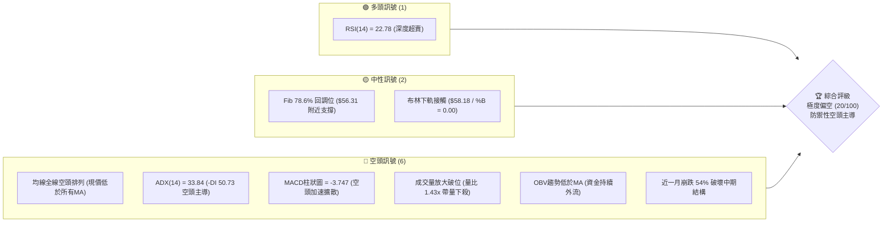
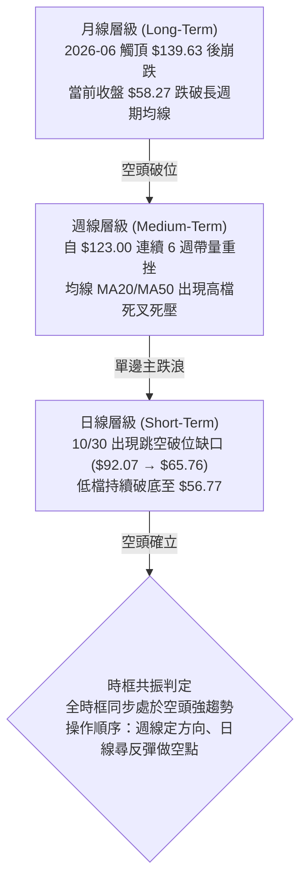
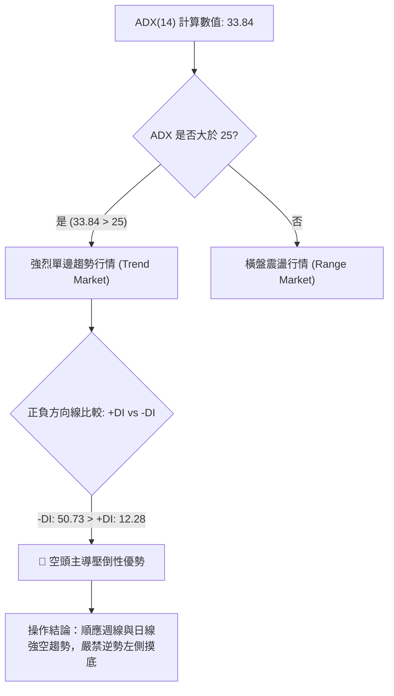
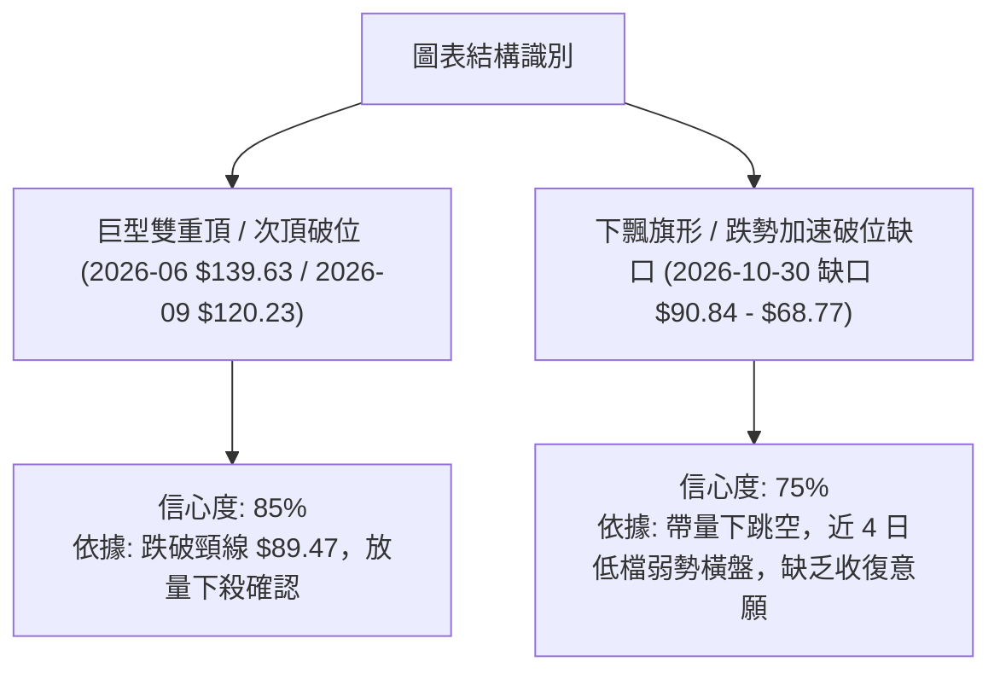
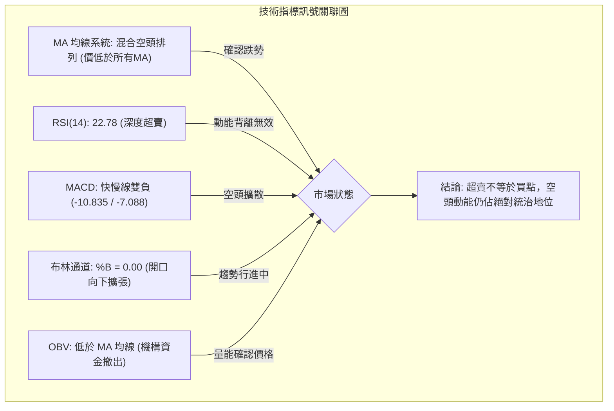
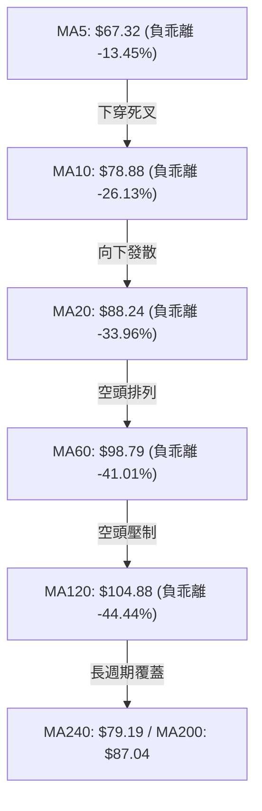
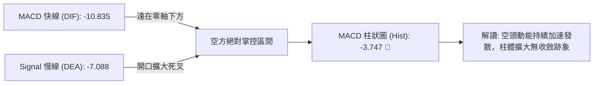
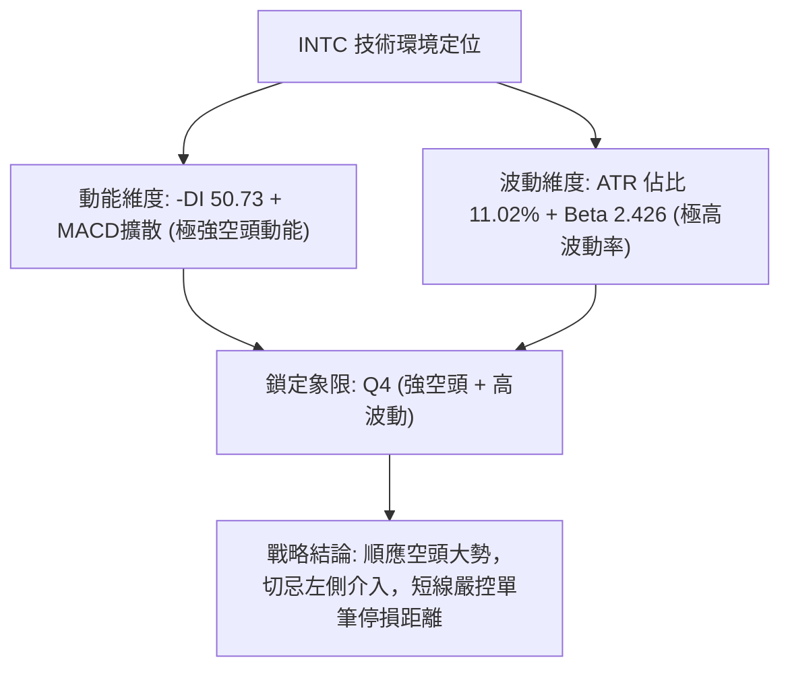
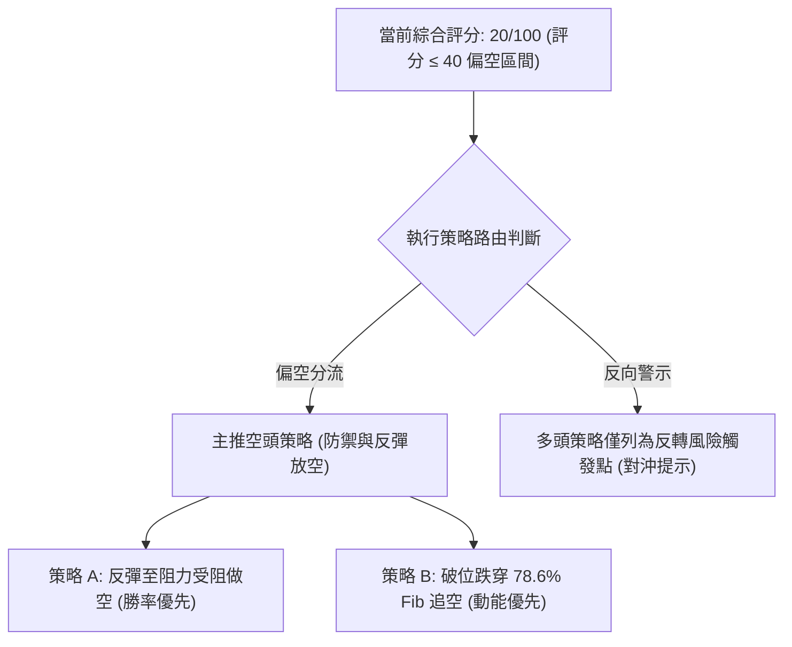
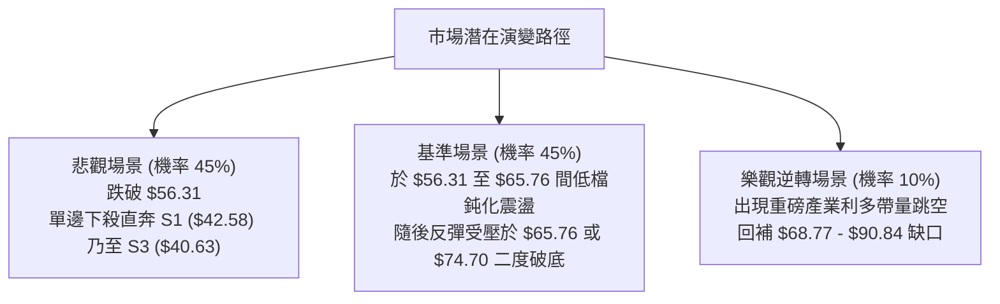

# INTC 技術分析報告

> **報告日期**：2026-11-05 ｜ **語言**：繁體中文 ｜ **數據來源**：Yahoo Finance ｜ **當前價格**：$58.27

---

## 目錄

| 章節 | 內容 |
|------|------|
| [1. 技術面概覽](#1-技術面概覽) | 訊號儀表板、核心指標、評分卡 |
| [2. 趨勢分析](#2-趨勢分析) | 多時框趨勢、長中短期走勢、ADX 解讀 |
| [3. 圖表形態分析](#3-圖表形態分析) | 形態識別、K線組合、目標價推算 |
| [4. 支撐與阻力](#4-支撐與阻力) | 關鍵價位結構、斐波那契回調分析 |
| [5. 技術指標深度解讀](#5-技術指標深度解讀) | MA/RSI/MACD/布林/成交量量價分析 |
| [6. 動能與波動率](#6-動能與波動率) | 動能四象限、ATR 波動率、Beta 大盤關聯 |
| [7. 多時框架總結](#7-多時框架總結) | 時框架評分矩陣、多時框收斂結論 |
| [8. 交易策略建議](#8-交易策略建議) | 策略路由、情境階梯、主策略詳情、評星 |
| [9. 風險提示與監控](#9-風險提示與監控) | 關鍵監控清單、情境模擬、風控準則 |

---

## 1. 技術面概覽

### 🎯 技術訊號儀表板



### 📊 核心指標速覽表

| 指標類別 | 指標名稱 | 當前數值 | 訊號 | 解讀 |
|----------|----------|----------|------|------|
| **價格** | 當前收盤價 | $58.27 | 🔴 | 位於 52 週區間 23.2% 分位，處於絕對低位弱勢區 |
| **均線** | MA20 | $88.24 | 🔴 | 現價低於 MA20 達 -33.96%，短期負乖離嚴重擴大 |
| **均線** | MA50 | $99.39 | 🔴 | 現價遠在 MA50 之下，中期趨勢完全被空方破壞 |
| **均線** | MA200 | $87.04 | 🔴 | 現價遠低於年線 -33.05%，長期牛熊分界失守 |
| **動能** | RSI(14) | 22.78 | 🟢 | 進入極度超賣區（<30），技術性短彈機率累積，但尚未拐頭 |
| **動能** | MACD (12,26,9) | -10.835 | 🔴 | 快慢線死叉開口擴大，柱狀圖 -3.747 顯示空方動能強烈 |
| **動能** | Stoch %K / %D | 3.86 / 2.76 | 🟢 | 進入低檔鈍化區（<20），極限超賣狀態 |
| **趨勢** | ADX(14) | 33.84 | 🔴 | ADX > 25 且 -DI(50.73) 遠大於 +DI(12.28)，強烈空頭單邊趨勢 |
| **通道** | 布林通道 %B | 0.00 | 🟡 | 價格緊貼下軌（$58.18），呈現「沿下軌向下行走」超跌特徵 |
| **成交量** | 最新量 / 20日均量 | 1.43x | 🔴 | 單日 188.62M 高於均量 131.49M，放量破位跌勢未止 |
| **波動** | ATR(14) | $6.42 | 🔴 | ATR 佔股價高達 11.02%，屬於極端高波動行情 |

### 🏆 技術評分卡

```
╔══════════════════════════════════════════════════════════════════╗
║                   技術評分卡 — INTC (2026-11-05)                ║
╠══════════════════════════════════════════════════════════════════╣
║ 趨勢強度 (Trend)       ███░░░░░░░░░░░░░░░░░  15/100  🔴 極度疲弱 ║
║ 動能指標 (Momentum)     █████░░░░░░░░░░░░░░░  25/100  🔴 超賣空頭 ║
║ 支撐穩定度 (Support)   ██████░░░░░░░░░░░░░░  30/100  🔴 懸崖邊緣 ║
║ 成交量配合 (Volume)     ████░░░░░░░░░░░░░░░░  20/100  🔴 帶量破位 ║
║ 形態完整度 (Pattern)    ████░░░░░░░░░░░░░░░░  20/100  🔴 空方擴散 ║
║ 均線排列 (Moving Avg)   ██░░░░░░░░░░░░░░░░░░  10/100  🔴 全面空頭 ║
╠══════════════════════════════════════════════════════════════════╣
║ 綜合評分 (Composite)   ████░░░░░░░░░░░░░░░░  20/100  🔴 強烈賣出 ║
╚══════════════════════════════════════════════════════════════════╝
```
*註：綜合評分由六項子指標算術平均計算：(15 + 25 + 30 + 20 + 20 + 10) ÷ 6 = 20/100。*

---

## 2. 趨勢分析

### 🌐 多時框趨勢分析



### 📈 長期趨勢 — 12個月走勢圖（Unicode）

```
INTC 月線走勢圖（過去12個月：2025-12 至 2026-11）
價格軸 ($)
$140 ┤                                 ● 2026-06 ($139.63 歷史高點)
$120 ┤                             ●       ● 2026-09 ($120.23 反彈次高)
$100 ┤                         ●       
 $80 ┤                                     ● 2026-10 ($65.76 崩盤長黑)
 $60 ┤                                         ● 2026-11 ($58.27 當前現價)
 $40 ┤ ● 2025-12 ($36.90)  ● 2026-03 ($44.13)
     └────────────────────────────────────────────────────────────
        12    01    02    03    04    05    06    07    08    09    10    11  (月份)
```

**過去 12 個月走勢特徵分析表**：

| 階段區間 | 月份週期 | 起訖價格 ($) | 漲跌幅 (%) | 結構特徵與技術解讀 |
|----------|----------|--------------|------------|--------------------|
| **起漲主升段** | 2025-12 → 2026-06 | $36.90 → $139.63 | +278.40% | 資金強烈推升，突破所有均線，量價齊揚創歷史高點 $142.35 |
| **首輪拋售回調** | 2026-06 → 2026-07 | $139.63 → $90.20 | -35.40% | 獲利了結盤湧出，高檔收出月線級巨幅陰線，失守短均線 |
| **弱勢次頂反彈** | 2026-07 → 2026-09 | $90.20 → $120.23 | +33.29% | 構築多重頂部右肩，未能越過前高 $139.63，呈現動能竭盡 |
| **崩盤主跌浪** | 2026-09 → 2026-11 | $120.23 → $58.27 | -51.53% | 放量連續下殺，跳空跌破年線，月線形態正式轉為巨型頭肩頂破位 |

### 📊 中期趨勢（週線分析）

從近 8 根週 K 線結構觀察，中期空頭排列已完全成形。9 月底於 $123.00 見頂後，連續收出 6 根週黑 K，且成交量在 2026-10-30 該週暴增至 861,628,000 股，顯示機構投資者恐慌性拋售，形成技術面上的「空方量能爆發」。

```
INTC 中期關鍵位結構示意圖（週線結構）
阻力位 R2 $107.13 ────────────────────────────────── [波段高點反壓]
阻力位 R1  $95.68 ────────────────────────────────── [跳空起跌前平台]
                   ▼
                   │ (垂直暴跌 40%)
                   ▼
現價區間   $58.27 ══════════════════════════════════ [現價：逼近 Fib 78.6%]
                   │
                   ▼ (下方空洞無實質成交密集區)
支撐位 S1  $42.58 ────────────────────────────────── [近一年波段低點聚類]
```

### ⚡ 趨勢強度評估（ADX 解讀）



**ADX 趨勢強度級別對照表**：

| 指標項 | 當前數值 | 參考標準 | 趨勢判定 | 實務涵義 |
|--------|----------|----------|----------|----------|
| **ADX(14)** | 33.84 | > 25 強趨勢；> 30 極強單邊 | 🔴 強趨勢確立 | 當前並非震盪盤，不適用布林上下軌高賣低買策略 |
| **+DI(14)** | 12.28 | < 20 處於極度萎縮狀態 | 🔴 多方動能耗盡 | 多頭無力發起有效推升，短線反彈皆屬弱勢反抽 |
| **-DI(14)** | 50.73 | > 40 空方處於絕對優勢 | 🔴 空方力量狂暴 | 空頭賣壓全面宣洩，下行慣性極高 |

---

## 3. 圖表形態分析

### 🔍 形態識別系統



**圖表形態識別與信心度評估表**：

| 形態名稱 | 信心度 | 判斷依據（引用數據） | 完成度 | 目標價計算方式與精確點位 |
|----------|--------|----------------------|--------|--------------------------|
| **雙重頂 (M頭) 破位** | 85% | 頂點 1 為 2026-06 收盤 $139.63，頂點 2 為 2026-09 收盤 $120.23；跌破 2026-08 低點頸線 $89.47 | 100% | 頸線 $89.47 − (高點 $139.63 − 頸線 $89.47) = 理論低點負值，改以斐波那契回調 100.0% 錨定為 **$32.89** |
| **下跳空逃逸缺口** | 75% | 2026-10-29 最低 $90.84，次日 2026-10-30 最高僅 $68.77，留下 $22.07 巨大未補缺口，且當日成交量達 455.6M | 100% | 缺口起跌點 $92.07 垂直等長下測：$65.76 − ($92.07 − $65.76) = **$39.45** (逼近波段支撐聚類 S3 $40.63) |
| **底部反轉形態** | 10% | 數據中未偵測到任何底背離或破底翻幾何結構 | 0% | 訊號不足，僅做指標型超賣解讀，不預設底部形態 |

### 🕯️ 重要 K 線形態分析

嚴格依據提供的「近 10 根日 K」與「近 8 根週 K」實際資料進行形態識別：

**近 10 根日 K 線形態解讀**：

| 日期（日K） | 開盤 ($) | 最高 ($) | 最低 ($) | 收盤 ($) | 成交量 (股) | K線形態名稱 | 技術解讀與多空意涵 | 訊號 |
|-------------|----------|----------|----------|----------|-------------|-------------|--------------------|------|
| 2026-10-22 | 87.92 | 89.19 | 84.65 | 85.49 | 134,128,100 | 中黑棒 | 跌破短均線，空方初顯下挫壓力 | 🔴 |
| 2026-10-23 | 85.92 | 87.87 | 84.74 | 86.96 | 72,093,700 | 縮量小陽星 | 盤整反抽，成交量驟減，無推升力道 | 🟡 |
| 2026-10-26 | 87.94 | 92.09 | 86.46 | 90.47 | 98,744,200 | 中陽線 | 向上試探阻力，但未補前期下跌空間 | 🟡 |
| 2026-10-27 | 92.47 | 94.98 | 91.86 | 93.74 | 90,523,300 | 小紅棒 | 上攻動能減速，引導至波段高點 | 🟡 |
| 2026-10-28 | 95.09 | 95.68 | 93.00 | 95.53 | 82,592,400 | 高檔十字帶上影 | 觸及波段阻力 R1 ($95.68) 受阻，多頭竭盡 | 🔴 |
| 2026-10-29 | 92.97 | 93.50 | 90.84 | 92.07 | 134,168,700 | 長黑陰吞噬 | 帶量吞沒前兩日陽線，多頭防線全面瓦解 | 🔴 |
| 2026-10-30 | 68.36 | 68.77 | 63.20 | 65.76 | 455,599,400 | 崩盤大陰線 (跳空) | 巨幅向下跳空 22 美元，爆歷史天量恐慌拋售 | 🔴 |
| 2026-11-02 | 65.40 | 65.72 | 59.40 | 59.97 | 230,689,500 | 破底大陰線 | 跌破 $60 整數關卡，賣盤持續湧出無承接 | 🔴 |
| 2026-11-03 | 61.33 | 62.59 | 59.87 | 60.55 | 149,052,100 | 低檔流星陽線 | 反彈上影線長，高檔解套賣壓沈重 | 🟡 |
| 2026-11-04 | 58.67 | 60.20 | 56.77 | 58.27 | 188,619,400 | 下跌光腳黑棒 | 創 52 週波段新低 $56.77，收盤低位，弱勢未改 | 🔴 |

**近 8 根週 K 線形態解讀**：

| 日期（週K） | 開盤 ($) | 最高 ($) | 最低 ($) | 收盤 ($) | 成交量 (股) | K線形態名稱 | 技術解讀與多空意涵 | 訊號 |
|-------------|----------|----------|----------|----------|-------------|-------------|--------------------|------|
| 2026-09-18 | 95.82 | 111.37 | 94.52 | 108.60 | 626,105,300 | 突破大陽棒 | 主動推升挑戰 $110，多方最後衝刺 | 🟢 |
| 2026-09-25 | 116.53 | 127.44 | 114.93 | 123.00 | 602,664,000 | 倒錘子陽線 | 衝高觸及 $127.44 後大幅回落，次頂確立 | 🔴 |
| 2026-10-02 | 120.68 | 126.00 | 113.97 | 119.33 | 495,059,900 | 上影小黑棒 | 多方二次進攻無功而返，轉入轉折防禦 | 🔴 |
| 2026-10-09 | 115.34 | 118.20 | 104.00 | 104.70 | 461,347,000 | 中長黑棒 | 跌破 5 週線，展開主動修正走勢 | 🔴 |
| 2026-10-16 | 102.52 | 103.19 | 89.19 | 89.85 | 537,177,500 | 破位大黑線 | 跌破 $100 整數關卡，賣壓全面加劇 | 🔴 |
| 2026-10-23 | 94.53 | 95.39 | 84.65 | 86.96 | 467,456,000 | 下探黑棒 | 弱勢震盪探底，反彈力道極其疲軟 | 🔴 |
| 2026-10-30 | 87.94 | 95.68 | 63.20 | 65.76 | 861,628,000 | 巨量毀滅黑K | 爆量 8.6 億股崩盤，跌幅 24.38%，破壞所有支撐 | 🔴 |
| 2026-11-04 | 65.40 | 65.72 | 56.77 | 58.27 | 568,361,000 | 破底陰線 (進行中) | 再次破底至 $56.77，空頭完全掌控市場節奏 | 🔴 |

### 📉 ASCII 走勢形態示意圖

```
INTC 日線形態圖示：向下跳空崩跌與低檔弱勢整理
價格 ($)
$95.68 ┤               ● (10/28 高點 R1: $95.68)
$92.07 ┤             ●   ● (10/29 長黑收盤 $92.07)
$85.00 ┤
$75.00 ┤        ░░░░ 巨大未補跳空缺口 ░░░░ ($90.84 - $68.77)
$68.77 ┤        ─────────────────────────
$65.76 ┤                 ● (10/30 崩盤跳空收盤 $65.76)
$60.55 ┤                     ●   ● (11/02-11/03 弱勢抵抗)
$58.27 ┤                           ● (11/04 現價 $58.27) ◄ 沿布林下軌
$56.31 ┤ ───────────────────────────────── Fib 78.6% 回調位
$42.58 ┤                                       ↓ 空方遠期目標 S1 ($42.58)
```

---

## 4. 支撐與阻力

### 🗺️ 關鍵價位分布圖（Unicode）

```
INTC 價位結構分布圖
═══════════════════════════════════════════════════════════════════
$127.04 ║████████████████████████████████║ 強阻力 R3 (次頂高點區域)
$107.13 ║████████████████████████        ║ 阻力 R2 (反彈回跌平台)
$ 95.68 ║████████████████████████████    ║ 關鍵阻力 R1 (起跌缺口頂部)
$ 88.24 ║────────────────────────────────║ 布林中軌 / MA20
$ 74.70 ║▓▓▓▓▓▓▓▓▓▓▓▓▓▓▓▓▓▓▓▓            ║ 斐波那契 61.8% 反壓
$ 58.27 ╠════════════════════════════════╣ ◄ 現價 ($58.27，位於下軌)
$ 56.31 ║▒▒▒▒▒▒▒▒▒▒▒▒▒▒▒▒▒▒▒▒▒▒▒▒▒▒▒▒    ║ 斐波那契 78.6% 短期支撐
$ 42.58 ║████████████████████████        ║ 近期核心支撐 S1
$ 41.64 ║████████████████████            ║ 密集支撐 S2
$ 40.63 ║████████████████████████████    ║ 強支撐 S3 (波段底聚類)
$ 32.89 ║████████████████████████████████║ 52週歷史低點 (Fib 100%)
═══════════════════════════════════════════════════════════════════
```

### 🚧 阻力位分析表

價位嚴格引用數據中近一年波段高點聚類所計算之精確數值：

| 阻力級別 | 價位 ($) | 距現價幅動 | 形成原因與技術背景 | 突破難度 | 重要性 |
|----------|----------|------------|--------------------|----------|--------|
| **R1** | $95.68 | +64.20% | 2026-10-28 波段高點，崩盤前最後籌碼集結平台，兼具巨大跳空缺口上緣 | 🔴 極端困難 | ★★★★★ |
| **R2** | $107.13 | +83.85% | 2026-09 下旬至 10 月初下跌過程之反抽高點聚類，密集套牢區 | 🔴 極端困難 | ★★★★☆ |
| **R3** | $127.04 | +118.02% | 2026-09-25 該週次頂高點（週高 $127.44）之聚類壓力，雙頂右肩頂部 | 🔴 無法逾越 | ★★★★★ |

### 🛡️ 支撐位分析表

價位嚴格引用數據中近一年波段低點聚類所計算之精確數值：

| 支撐級別 | 價位 ($) | 距現價幅動 | 形成原因與技術背景 | 守住機率 | 重要性 |
|----------|----------|------------|--------------------|----------|--------|
| **S1** | $42.58 | -26.93% | 近一年長期盤整期（2025-08至2026-01）第一波起漲支撐平台聚類 | 🟡 50% | ★★★★☆ |
| **S2** | $41.64 | -28.54% | 起漲段箱體中軸低點聚類，技術性多頭次級防線 | 🟡 45% | ★★★☆☆ |
| **S3** | $40.63 | -30.27% | 2025-10至11月突破前長期頸線回測支撐聚類，最強結構底線 | 🟢 65% | ★★★★★ |

### 📐 斐波那契回調位分析

依據 52 週波段低點 $32.89 至 52 週高點 $142.35 嚴格映射：

| 斐波那契回調比例 | 精確價位 ($) | 與現價 ($58.27) 之相對關係 | 技術解讀與角色轉換 |
|------------------|--------------|----------------------------|--------------------|
| **0.0% (52W High)** | $142.35 | 遠高於現價 (+144.29%) | 全年最高峰值，長期牛市極限點 |
| **23.6%** | $116.52 | 遠高於現價 (+100.00%) | 初次回調支撐位（現已轉化為強大阻力） |
| **38.2%** | $100.54 | 遠高於現價 (+72.54%) | 百元心理關卡與牛熊弱勢回調分割位 |
| **50.0%** | $87.62 | 遠高於現價 (+50.37%) | 多空強弱分界線，與 MA20 ($88.24) 重合形成強反壓 |
| **61.8%** | $74.70 | 高於現價 (+28.20%) | 黃金分割防守位，10/30 跳空直接摜破，轉為多頭反彈重大鐵板 |
| **78.6%** | $56.31 | **緊鄰現價下方 (-3.36%)** | **最後深幅防守回調位，現價 $58.27 正在此位上方掙扎** |
| **100.0% (52W Low)**| $32.89 | 遠低於現價 (-43.56%) | 起漲點全數回吐，終極歷史支撐 |

**斐波那契落點位置評估**：
當前收盤價 $58.27 **落於 61.8% ($74.70) 與 78.6% ($56.31) 之間**，且極度貼近 78.6% ($56.31)。
78.6% 回調位是多頭非理性下殺的最後一道數學防線，若日線實體跌破 $56.31，技術面將面臨「斐波那契完全回撤」風險，下行目標將直接指向波段低點支撐聚類 S1 ($42.58) 乃至 100% 回撤位 $32.89。

---

## 5. 技術指標深度解讀

### 🎛️ 指標訊號總覽



### 📈 移動平均線排列分析



**移動平均線詳細數據表**：

| 均線名稱 | 當前價格 ($) | 乖離距離 ($) | 乖離率 (%) | 趨勢斜率 | 多空研判 |
|----------|--------------|--------------|------------|----------|----------|
| **MA5** | $67.32 | -$9.05 | -13.45% | 急速向下 ▼ | 短線極弱，五日線構成直接反壓 |
| **MA10** | $78.88 | -$20.61 | -26.13% | 急速向下 ▼ | 短期追殺動能強烈 |
| **MA20** | $88.24 | -$29.97 | -33.96% | 穩定向下 ▼ | 月線防線全面失守，中期轉空 |
| **MA50** | $99.39 | -$41.12 | -41.37% | 下彎中 ▼ | 季線下行，中期趨勢崩塌 |
| **MA60** | $98.79 | -$40.52 | -41.01% | 拐頭向下 ▼ | 季線空頭確立 |
| **MA120** | $104.88 | -$46.61 | -44.44% | 頂部鈍化走平 ▼ | 半年線下彎，長線套牢沉重 |
| **MA200** | $87.04 | -$28.77 | -33.05% | 走平轉下 ▼ | 牛熊分界線被放量跌破 |
| **MA240** | $79.19 | -$20.92 | -26.42% | 緩慢向上 (滯後) | 長期均線混合排列，但價格已全面擊穿 |

### 📉 RSI(14) 分析

- **當前 RSI(14) 數值**：**22.78**
- **強度進度條**：
  `RSI(14): 22.78  [████░░░░░░░░░░░░░░░░] 22.78%  🟢 極度超賣`

**超買超賣與背離判斷**：
1. **超賣深度**：RSI(14) 處於 22.78，屬於罕見的深度超賣（<30），理論上存在技術性修復需求。但需注意，在 ADX > 30 的強烈趨勢行情中，RSI 常會出現嚴重的「低檔鈍化」現象，超賣並不構成左側買入理由。
2. **背離判定**：檢視近 20 根 K 棒，價格自 2026-10-28 的 $95.53 崩跌至 11-04 的 $58.27，RSI 亦從 50 以上直線暴跌至 22.78，**二者方向同步向下，無任何底背離或頂背離現象**。因此，當前下跌屬於動能完全配合的「實質性殺跌」，尚未見到量價或動能竭盡的背離訊號。

### 📊 MACD(12/26/9) 訊號解讀



MACD 快慢線皆深陷於零軸極深下方（DIF -10.835、DEA -7.088），且柱狀圖讀數為 **-3.747**。週線 MACD 柱狀圖亦由 -1.941 擴大至 -3.747，日線與週線共振向下，顯示無論短期還是中期，拋售動能仍在加速外溢。

### 📦 布林通道分析

```
INTC 布林通道結構示意圖 (週期: 20, 偏差: 2.0)
通道數值 ($)
$118.30 ┤ ────────────────────────────────── 上軌 (Upper Band)
        │
 $88.24 ┤ ────────────────────────────────── 中軌 (MA20)
        │
 $58.27 ┤ ◄═════════════════════════════════ 收盤價 ($58.27)
 $58.18 ┤ ────────────────────────────────── 下軌 (Lower Band)
```

- **上軌**：$118.30 ｜ **中軌 (MA20)**：$88.24 ｜ **下軌**：$58.18
- **%B 指標**：**0.00**（%B = (58.27 − 58.18) ÷ (118.30 − 58.18) ≈ 0.0015）
- **形態特徵**：布林帶帶寬劇烈擴張（帶寬超過 $60），現價精確貼在下軌（$58.18）上方僅 9 美分處，%B 逼近 0.00。在統計學上，這屬於典型的「下軌開口漫步」（Walking the lower band），屬於強趨勢崩跌的特徵，而非可隨意買入的超跌反彈通道。

### 💹 成交量分析（量價配合度）

1. **量能放大確認價格破位**：
   - 2026-11-04 單日成交量達 **188,619,400 股**，相較於 20 日均量（131,491,850 股），量比高達 **1.43x**。
   - 2026-10-30 暴跌當日更爆出 **455,599,400 股** 的天量，週成交量達 8.61 億股。
   - 價格下跌伴隨成交量劇烈放大，呈現標準的「價跌量增」空方強勢結構，確認主力資金主動拋盤。
2. **OBV (能量潮) 趨勢解讀**：
   - 數據明確顯示：**OBV 趨勢低於 MA 均線**。
   - 當 OBV 持續低於其均線並向下破位時，表明整體籌碼處於不可逆的資金流出狀態，籌碼流向散戶，主力大戶換手撤離，量能不支持任何 V 型反轉。

---

## 6. 動能與波動率

### ⚡ 動能評估四象限

| 象限分類 | 動能屬性 | 波動屬性 | INTC 當前判定 | 技術特徵與應對方針 |
|----------|----------|----------|---------------|--------------------|
| **Q1：突破主升** | 強多頭動能 | 低/中波動 | — | 最佳波段做多時機，多頭順暢推進 |
| **Q2：築底盤整** | 弱/中性動能 | 低波動 | — | 謹慎觀望，等待形態收斂突破 |
| **Q3：劇烈洗盤** | 強多頭動能 | 高波動 | — | 高風險高收益，需嚴格追蹤止損 |
| **Q4：單邊主跌** | **強空頭動能** | **極高波動** | **✓ (INTC 落點)** | **避免抄底！空頭加速釋放，以反彈做空或防禦減倉為主** |



### 📊 ATR 波動率分析

- **ATR(14) 數值**：**$6.42**
- **ATR 佔比**：**11.02% of price**（屬於美股大型半導體中罕見的超高波動狀態）
- **止損與交易區間設定建議**：
  - 在日線波動幅度達 $6.42 的環境下，短線噪音極大。任何低於 1.0x ATR ($6.42) 的止損極易被盤中正常震盪洗出場。
  - **建議波段交易止損距離**：至少設定為 **1.5x 至 2.0x ATR**，即 **$9.63 至 $12.84**。
  - **單日安全緩衝區**：每日高低點預期振幅約在 $6.00 – $7.00 之間。

### 📐 Beta 與市場相關性

- **Beta 係數**：**2.426**
- **大盤關聯解讀**：
  - Beta 達 2.426 代表 INTC 波動為標普 500 指數的 2.4 倍以上。當大盤微幅回調時，INTC 易演變為深度殺跌；反之，若半導體板塊強勁修復，其彈性亦極大。
  - 目前基本面存在重大承壓（淨利潤率 -20.1%，EPS Growth -32.7%），高 Beta 正在加速發揮其下行放大器的破壞力。

---

## 7. 多時框架總結

### 📋 時框架評分表

| 時框架 | 趨勢方向 | 動能指標狀態 | 均線排列特徵 | 關鍵形態結構 | 綜合評分 | 建議方針 |
|--------|----------|--------------|--------------|--------------|----------|----------|
| **月線 (Long)** | 🔴 強空破位 | MACD 轉弱，自高檔快速回吐 | 跌破所有短中均線 | 次頂破位長黑 | 25/100 | 長線減碼觀望 |
| **週線 (Mid)** | 🔴 單邊主跌 | MACD柱 -3.747，連六黑 | 均線高檔全面死叉 | 跳空跌破頸線 | 15/100 | 逢反彈順勢佈空 |
| **日線 (Short)** | 🔴 沿軌下行 | RSI 22.78 超賣鈍化 | 混亂空頭向下發散 | 缺口下沿弱勢橫盤 | 20/100 | 嚴禁盲目摸底 |

### 🔲 綜合訊號矩陣

```
╔══════════════════════════════════════════════════════════════════╗
║                    多時框架技術訊號收斂矩陣                      ║
╠══════════════════╦══════════════╦══════════════╦═════════════════╣
║ 分析維度         ║ 短期 (日線)  ║ 中期 (週線)  ║ 長期 (月線)     ║
╠══════════════════╬══════════════╬══════════════╬═════════════════╣
║ 趨勢方向         ║ 🔴 單邊下殺  ║ 🔴 破位崩跌  ║ 🔴 次頂反轉     ║
║ 動能強弱         ║ 🟢 深度超賣  ║ 🔴 動能加速  ║ 🔴 頂部背離轉弱 ║
║ 均線系統         ║ 🔴 負乖離過大║ 🔴 全面空頭  ║ 🟡 長期均線失守 ║
║ 成交量配合       ║ 🔴 帶量破底  ║ 🔴 爆量恐慌  ║ 🔴 獲利盤出逃   ║
║ 形態位置         ║ 🟡 下軌貼合  ║ 🔴 旗形向下  ║ 🔴 雙頂確立     ║
╠══════════════════╬══════════════╬══════════════╬═════════════════╣
║ 時框綜合權重判定 ║ 🔴 強烈看空  ║ 🔴 強烈看空  ║ 🔴 偏空修正     ║
╚══════════════════╩══════════════╩══════════════╩═════════════════╝
```

### ⚖️ 多時框收斂結論

**嚴格依據多時框收斂規則（規則 14）**：
1. **行情屬性判定**：當前 ADX(14) 讀數為 **33.84 > 25**，且 -DI(50.73) 呈壓倒性優勢，**確認當前處於強烈空頭趨勢行情**，絕非區間盤整行情。
2. **時框主導優先級**：趨勢行情中，交易方向**必須以中長期（週線／MA50、MA200）方向為依歸**。目前週線與月線均呈現不可逆的空頭破位結構，因此日線級別出現的 RSI 極度超賣（22.78）只能視為隨時可能引發技術抽頭的短期噪音，**日線僅用於尋找反彈受阻時的高勝率進場做空時機，不可作為反轉做多的理由**。
3. **唯一方向性結論**：**強烈偏空（防禦性空頭主導）**。此結論與第 1 章技術評分卡（20/100）高度契合，第 8 章交易策略亦嚴格依此分流，採取以空頭策略為主的交易部署。

---

## 8. 交易策略建議

### 🗺️ 策略決策流程圖



### 🧭 策略路由（依評分卡分流）

> **當前主策略方向 = 【強烈偏空，主推空頭策略】（依第 1 章評分卡綜合評分：20/100）**
> 
> 由於綜合評分低於 40 分，且處於 ADX > 25 的強空趨勢，本報告完全禁止主推任何重倉做多方案，策略重心鎖定「反彈阻力位放空」與「破位順勢跟空」。

### 🎯 價格情境階梯（Price Scenarios）

價位嚴格引用第 4 章中波段高低點聚類與斐波那契回調之實際數據：

| 觸發條件 | 下一目標 | 後續延伸 | 情境含義與技術研判 |
|----------|----------|----------|--------------------|
| **強勢突破 R1 $95.68** | R2 $107.13 | R3 $127.04 | 扭轉短期崩盤格局，回補跳空缺口，短線實質轉強 |
| **反彈回測 Fib 61.8% $74.70** | MA20 $88.24 | R1 $95.68 | 技術性超賣反抽，觸及黃金分割阻力區受壓 |
| **維持現價 $58.27 震盪** | Fib 78.6% $56.31 | — | 於布林下軌暫時橫盤喘息，消化低檔拋壓 |
| **跌破 Fib 78.6% $56.31** | S1 $42.58 | S2 $41.64 | 破位加速，跌向近一年波段起漲平台聚類，中期加速轉弱 |
| **跌破 S1 $42.58** | S2 $41.64 | S3 $40.63 | 擊穿核心防線，回測 2025 年底箱體下軌，下探歷史低點 $32.89 |

### 📊 情境機率分佈

| 預期情境 | 發生機率 | 主要依據（指標狀態） |
|----------|----------|----------------------|
| **弱勢反彈受阻再回落** | **55%** | RSI(22.78) 超賣積聚反抽動能，但 MA5/MA10 下彎壓制，且 MACD 柱狀圖無翻紅徵兆，反彈即面臨解套賣壓 |
| **直接破底向下尋求支撐** | **35%** | ADX 33.84 強勢空頭主導，-DI 50.73 狂暴，現價貼近下軌且 OBV 量能潰散，隨時可能灌破 $56.31 直測 S1 |
| **V型強勢反轉站回 R1** | **10%** | 上方留存 $22 美元巨大逃逸缺口，且 10/30 爆出 4.5 億股套牢巨量，短時間內無基本面利多催化極難實現 |

### 🟢 主策略詳情（空頭策略 A & B）

所有點位均嚴格取自數據中的實際點位，風險報酬比嚴格按公式計算：
做空風險報酬比 = (進場價 − 目標價 T1) ÷ (止損價 − 進場價)。

| 策略要素 | 策略 A（反彈高空 — 逢反抽進場） | 策略 B（破位追空 — 順應單邊動能） |
|----------|---------------------------------|-----------------------------------|
| **交易邏輯** | 借 RSI 極度超賣引發之技術性弱反彈，回測 10/30 崩跌大長黑收盤價阻力受阻時介入 | 跌破斐波那契 78.6% 極限防守位，順應 -DI 強空動能追擊下行主跌浪 |
| **進場條件** | 價格反彈至 10/30 收盤價阻力受阻滯漲 | 日線實體跌破 Fib 78.6% 回調位確認 |
| **進場價格** | **$65.76** (10/30 收盤價點位) | **$56.31** (Fib 78.6% 精確回調位) |
| **目標價 T1** | **$42.58** (近一年波段支撐聚類 S1) | **$42.58** (近一年波段支撐聚類 S1) |
| **目標價 T2** | **$32.89** (52週歷史最低點 / Fib 100%) | **$32.89** (52週歷史最低點 / Fib 100%) |
| **止損價格** | **$74.70** (Fib 61.8% 重要壓力位) | **$60.55** (2026-11-03 反彈日 K 收盤高點) |
| **風險報酬比** | **1 : 2.59（以 T1 計）**<br/>*(65.76-42.58) ÷ (74.70-65.76) = 23.18 ÷ 8.94*<br/>另：**1 : 3.68（以 T2 計）** | **1 : 3.24（以 T1 計）**<br/>*(56.31-42.58) ÷ (60.55-56.31) = 13.73 ÷ 4.24*<br/>另：**1 : 5.52（以 T2 計）** |
| **成功機率** | **65%** | **60%** |
| **建議倉位** | **總資金之 10% - 15%** | **總資金之 5% - 8%** (破位帶較大滑價風險) |

### 🔴 反向風險觸發點（對沖提示）

以下關鍵訊號若觸發，將直接推翻空頭主策略，空方頭寸應無條件全面撤離：
1. **關鍵價位逆轉**：若日線收盤價強勢突破 **$74.70 (Fib 61.8%)**，宣告空頭主跌結構遭到破壞，進入寬幅修復震盪。
2. **缺口封閉**：日線若強行回補 **$90.84** 缺口下緣，代表機構重新進場承接，空頭趨勢徹底失效。
3. **指標形態逆轉**：日線 MACD 柱狀圖連續 3 日翻紅，且日線收盤突破 MA20 ($88.24)。

### ⭐ 整體訊號強度評星

```
做多訊號強度：★☆☆☆☆  (1/5星 — 僅超賣指標支撐，左側摸底勝率極低)
做空訊號強度：★★★★☆  (4/5星 — 趨勢、均線、量能、形態共振看空)
整體可信度：  ★★★★☆  (4/5星 — 數據結構完備，空方趨勢方向極其明確)
```

---

## 9. 風險提示與監控

### ✅ 關鍵監控指標 Checklist

```
╔══════════════════════════════════════════════════════════════════╗
║                     INTC 每日交易監控清單 (Checklist)            ║
╠══════════════════════════════════════════════════════════════════╣
║ [ ] 支撐防守監控：每日收盤價是否跌穿 Fib 78.6% ($56.31)          ║
║ [ ] 動能背離監控：RSI(14) 回落至 20 之下是否出現價格破底但 RSI 拐頭║
║ [ ] 均線壓力監控：盤中反彈是否在 MA5 ($67.32) 出現滯漲長上影線   ║
║ [ ] 異常巨量監控：單日成交量是否再次突破 2.5 億股之巨量換手     ║
║ [ ] 波動率警戒線：單日振幅是否超過 ATR(14) = $6.42 之正常範圍     ║
║ [ ] MACD 柱體監控：柱狀圖數值是否由當前 -3.747 開始向上收斂      ║
╚══════════════════════════════════════════════════════════════════╝
```

### ⚠️ 風險場景分析



### 🛡️ 風險管理重要提醒

1. **防範極端 ATR 波動的部位控管**：
   當前 INTC ATR 高達 $6.42（佔比 11.02%），個股具備類似槓桿 ETF 的震盪幅度。任何單筆交易之名目倉位不得超過總投資組合的 **10%**，單筆交易的最大可承受虧損應嚴格限制在總資本的 **1.0%** 以內。
2. **嚴禁在 ADX > 30 時進行左側接刀**：
   散戶常將 RSI 進入超賣視為買點，但在單邊趨勢行情中，指標超賣往往代表拋售能量極其充沛。盲目在 $58.27 摸底極易被隨後的慣性下殺擊潰。
3. **空頭倉位動態移動止盈**：
   若執行破位追空（策略 B），當價格跌破 $50.00 整數關卡時，應立即將止損價調降至進場成本價 $56.31，鎖定零風險交易狀態。

---

## 📋 報告總結

```
╔══════════════════════════════════════════════════════════════════╗
║                    INTC 技術分析報告總結                         ║
╠══════════════════════════════════════════════════════════════════╣
║ 報告日期：2026-11-05                                             ║
║ 當前價格：$58.27                                                 ║
║ 分析評級：🔴 強烈偏空 / 綜合評分 20/100 (防禦性空頭主導)        ║
╠══════════════════════════════════════════════════════════════════╣
║ 關鍵結論：                                                       ║
║ ├─ 長期趨勢：🔴 次頂回落長黑，2026-06 高點 $139.63 以來跌幅超50%║
║ ├─ 中期趨勢：🔴 週線連六黑，跌破年線 $87.04，均線呈現發散空頭排列║
║ ├─ 短期趨勢：🔴 帶量向下跳空，沿布林下軌行走，現價瀕臨極限防線  ║
║ ├─ 關鍵支撐：S1 $42.58 ｜ 斐波那契 78.6% $56.31                 ║
║ ├─ 關鍵阻力：R1 $95.68 ｜ 斐波那契 61.8% $74.70 ｜ MA20 $88.24   ║
║ └─ 分析師目標：平均 $92.72 (最低 $70.00 / 最高 $160.00，嚴重滯後) ║
╠══════════════════════════════════════════════════════════════════╣
║ 最優策略組合：                                                   ║
║ 1. 🥇 最佳機會：空頭策略 A（耐心等待反抽 $65.76 受阻放空，風報比 1:2.59）║
║ 2. 🥈 次選機會：空頭策略 B（日線實體摜破 $56.31 追空，下看 S1 $42.58）   ║
║ 3. 🥉 保守選擇：完全空倉觀望，待築出明確雙底形態或突破 MA20 再作考量 ║
╚══════════════════════════════════════════════════════════════════╝
```

---

> ⚠️ **免責聲明**：本報告為技術分析研究，所有數據、價位及推算均嚴格基於所提供之歷史價格與指標資訊。本報告**僅供研究與學術參考**，**不構成任何形式的投資建議**。金融市場具有高度風險，投資人應獨立思考、嚴格控管資金風險並自負盈虧。

---

*報告生成時間：2026-11-05 ｜ 數據來源：Yahoo Finance ｜ 分析框架：多時框技術分析體系*