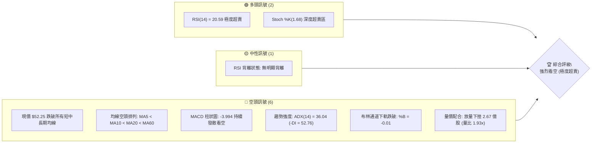
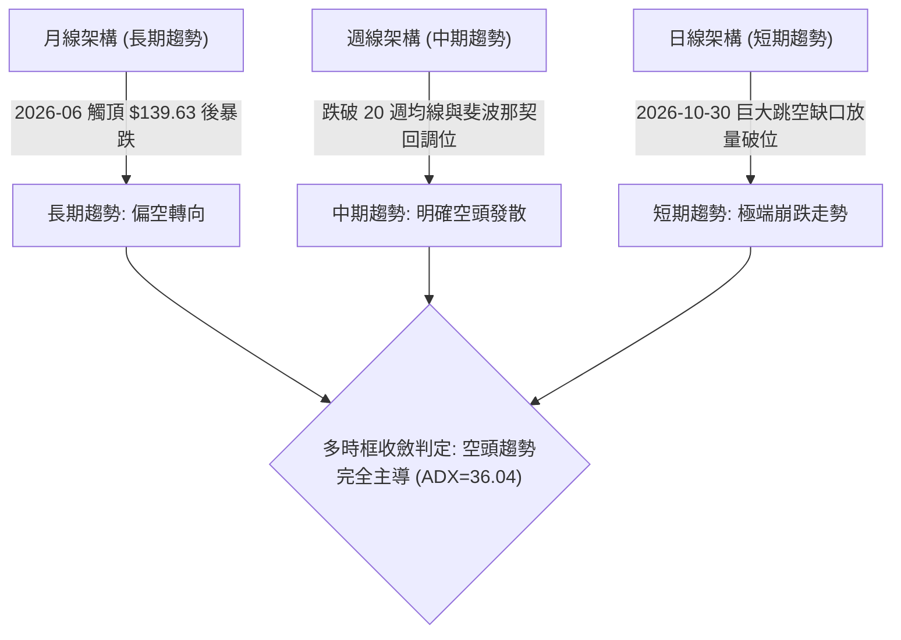
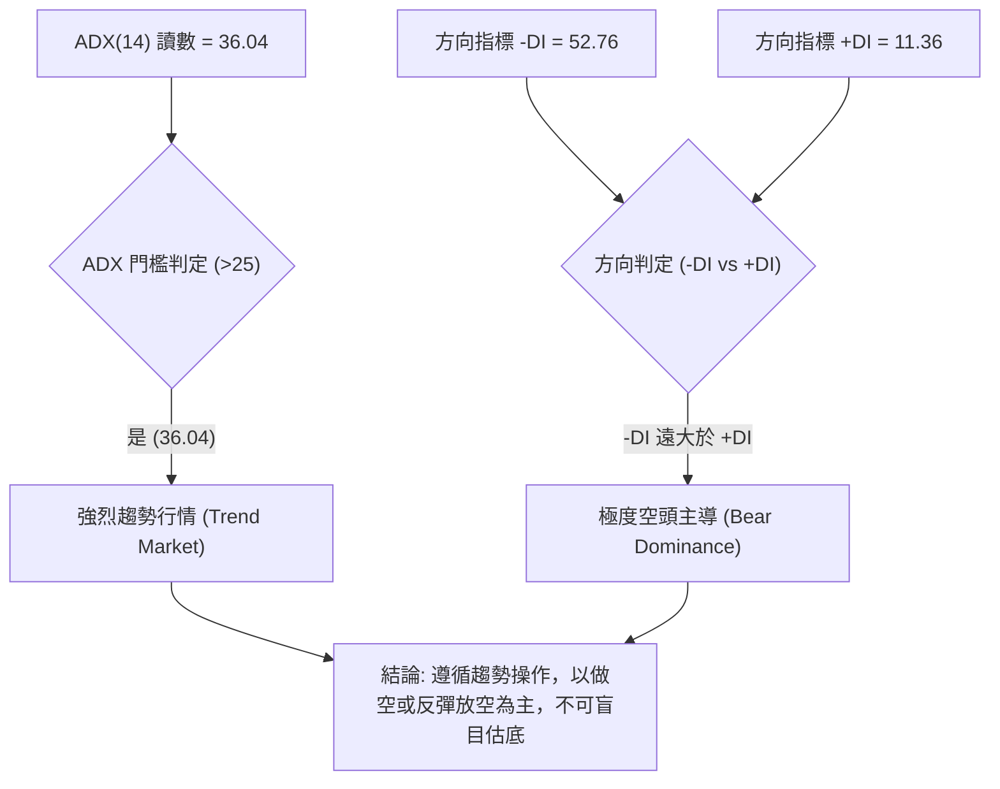
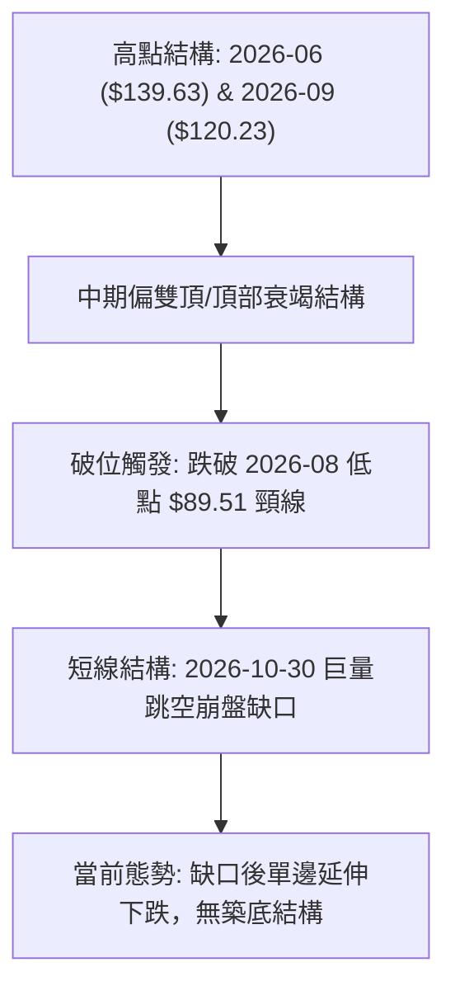
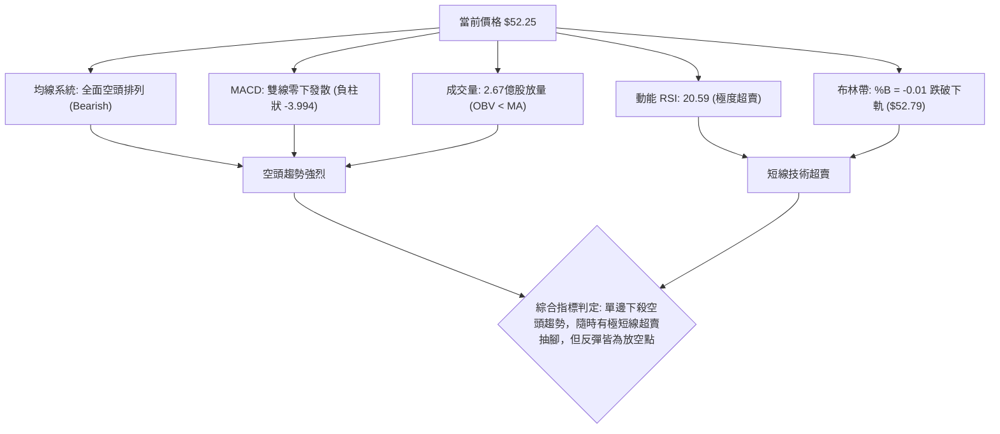
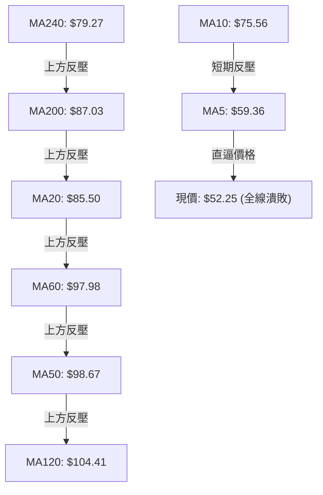
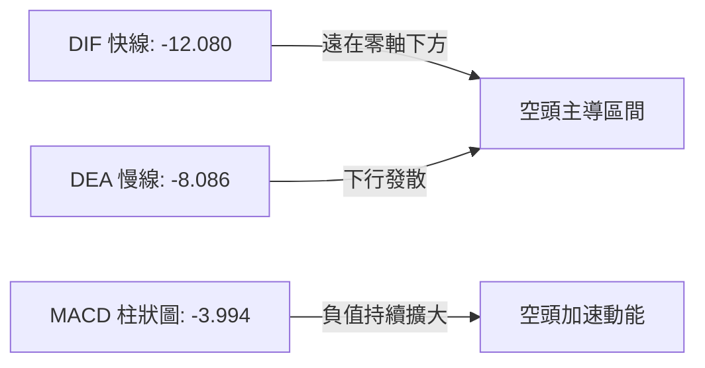
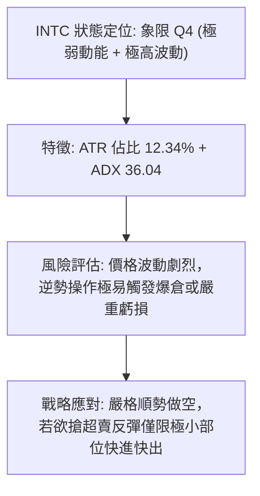
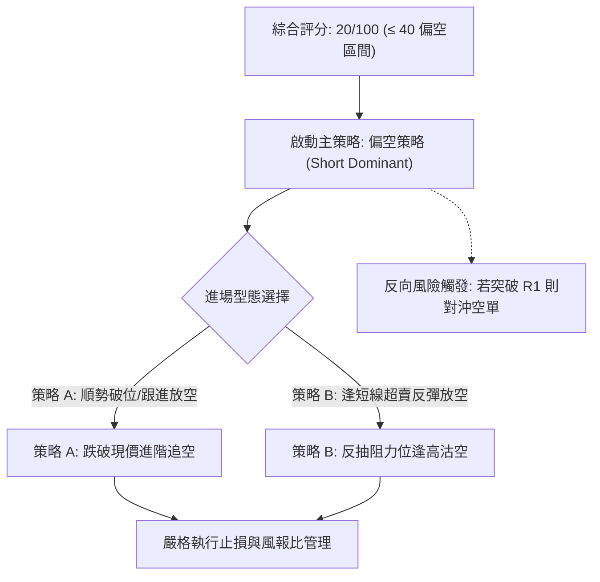
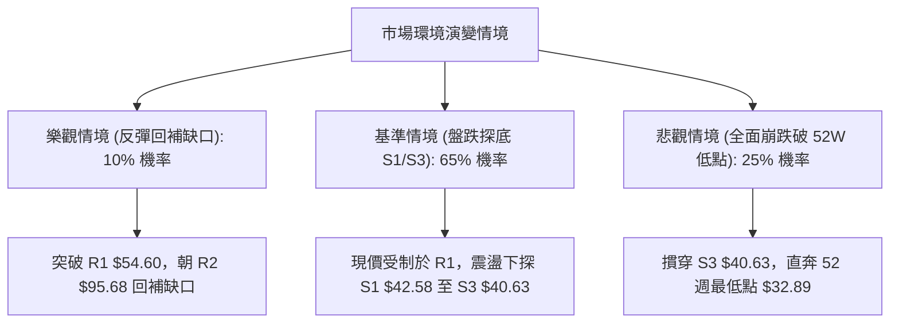

# INTC 技術分析報告

> **報告日期**：2026-11-06 ｜ **語言**：繁體中文 ｜ **數據來源**：Yahoo Finance ｜ **當前價格**：$52.25

---

## 目錄

| 章節 | 內容 |
|------|------|
| [1. 技術面概覽](#1-技術面概覽) | 訊號儀表板、核心指標、評分卡 |
| [2. 趨勢分析](#2-趨勢分析) | 多時框趨勢、長中短期走勢 |
| [3. 圖表形態分析](#3-圖表形態分析) | 形態識別、K線組合、目標價 |
| [4. 支撐與阻力](#4-支撐與阻力) | 關鍵價位、斐波那契回調 |
| [5. 技術指標深度解讀](#5-技術指標深度解讀) | MA/RSI/MACD/布林/成交量 |
| [6. 動能與波動率](#6-動能與波動率) | 動能評估、ATR、Beta |
| [7. 多時框架總結](#7-多時框架總結) | 時框架評分矩陣 |
| [8. 交易策略建議](#8-交易策略建議) | 多空策略、風險報酬比 |
| [9. 風險提示與監控](#9-風險提示與監控) | 監控指標、風險場景 |
| [📋 報告總結](#-報告總結) | 總結儀表板與綜合結論 |

---

## 1. 技術面概覽

### 🎯 技術訊號儀表板



### 📊 核心指標速覽表

| 指標類別 | 指標名稱 | 當前數值 | 訊號 | 解讀 |
|----------|----------|----------|------|------|
| **價格** | 當前價格 | $52.25 | 🔴 | 位於 52 週高低區間 17.7%，自高點 $142.35 回撤幅度達 -63.29% |
| **均線** | MA20 | $85.50 | 🔴 | 價格遠在 MA20 下方 (-38.89%)，短中期下行動能劇烈 |
| **均線** | MA50 | $98.67 | 🔴 | 價格遠在 MA50 下方 (-47.05%)，中期趨勢徹底潰敗 |
| **均線** | MA200 | $87.03 | 🔴 | 價格跌破年線支撐 (-39.96%)，長期結構轉為空頭 |
| **動能** | RSI(14) | 20.59 | 🟢 | 進入嚴重超賣區間 (<30)，具技術性跌深反彈動能但尚未止跌 |
| **動能** | MACD(12,26,9) | -12.080 | 🔴 | 雙線位於零軸下方深度負值，柱狀圖 -3.994 持續擴大看空 |
| **波動** | ATR(14) | $6.45 | 🔴 | ATR 佔股價高達 12.34%，日震幅極高，空頭主導下的恐慌釋放 |

### 🏆 技術評分卡

```
╔══════════════════════════════════════════════════════════════╗
║               技術評分卡 — INTC (2026-11-06)                 ║
╠══════════════════════════════════════════════════════════════╣
║ 趨勢強度 (空頭趨勢強烈)   ████████████████░░░░  20/100  🔴   ║
║ 動能指標 (嚴重超賣待反彈) ████████░░░░░░░░░░░░  30/100  🔴   ║
║ 支撐穩定度 (跌破重要支撐) ████░░░░░░░░░░░░░░░░  15/100  🔴   ║
║ 成交量配合 (空頭放量下殺) ████░░░░░░░░░░░░░░░░  15/100  🔴   ║
║ 形態完整度 (跳空破位下墜) ██████░░░░░░░░░░░░░░  20/100  🔴   ║
║ 均線排列 (全面空頭發散)   ████░░░░░░░░░░░░░░░░  20/100  🔴   ║
╠══════════════════════════════════════════════════════════════╣
║ 綜合評分 (六項算術平均)   ████░░░░░░░░░░░░░░░░  20/100  🔴   ║
║ 評級結論: 強烈看空 (Bearish Breakdown)                       ║
╚══════════════════════════════════════════════════════════════╝
```

*註：綜合評分 = (20 + 30 + 15 + 15 + 20 + 20) ÷ 6 = 120 ÷ 6 = 20/100。*

---

## 2. 趨勢分析

### 🌐 多時框趨勢分析



### 📈 長期趨勢 — 12個月走勢圖（Unicode）

```
INTC 月線走勢圖（過去12個月：2025-12 至 2026-11）
價格軸 ($)
$140 ┤                               ●(2026-06 高點 $139.63)
$130 ┤
$120 ┤                                             ●(2026-09 $120.23)
$110 ┤                         ●(2026-05 $114.68)
$100 ┤
 $90 ┤                   ●(2026-04 $94.48)   ●(07) ●(08)
 $80 ┤
 $70 ┤                                                   ●(2026-10 $65.76)
 $60 ┤
 $50 ┤                                                         ●(現價 $52.25)
 $40 ┤             ●(01) ●(02) ●(03)
 $30 ┤ ●(2025-12 $36.90)
     └─────────────────────────────────────────────────────────────────
       12   01    02    03    04    05    06    07    08    09    10    11 (月份)
```

**走勢特徵分析表格**：

| 階段區間 | 時間跨度 | 起訖價位 | 區間漲跌幅 | 走勢特徵與結構解讀 |
|----------|----------|----------|------------|--------------------|
| 底部啟動期 | 2025-12 ~ 2026-03 | $36.90 → $44.13 | +19.59% | 長期底部盤整蓄勢，震盪走高完成築底結構 |
| 主升浪噴發 | 2026-04 ~ 2026-06 | $44.13 → $139.63 | +216.41% | 暴力主升浪，成交量爆發，月線連續大陽線攻頂 |
| 首波回撤期 | 2026-06 ~ 2026-08 | $139.63 → $89.51 | -35.89% | 高檔獲利了結盤湧出，出現大幅度均值回歸回調 |
| 次高雙頂反彈 | 2026-08 ~ 2026-09 | $89.51 → $120.23 | +34.32% | 構築次級高點，未過前高 $139.63，形成雙頭隱憂 |
| 斷崖式破位期 | 2026-09 ~ 2026-11 | $120.23 → $52.25 | -56.54% | 財報展望不佳引發恐慌拋售，日線巨量跳空暴跌 |

### 📊 中期趨勢（週線分析）

```
INTC 中期週線壓力與支撐示意圖
═════════════════════════════════════════════════════════════
 $123.00 ── 2026-09-25 波段次高阻力區
           │
  $95.68 ── 近一年波段阻力 R2 / 10-30 跳空起跌點
           │
  $54.60 ── 短線近一年波段阻力 R1 (反彈關鍵阻力)
 ───────────────────────────────────────────────────────────
  $52.25 ◄─ 當前收盤價 (空頭壓制下探)
 ───────────────────────────────────────────────────────────
  $42.58 ── 近一年波段低點支撐 S1 (中期下行防守首位)
           │
  $41.64 ── 近一年波段低點支撐 S2 (密集支撐帶中軸)
           │
  $40.63 ── 近一年波段低點支撐 S3 (核心防守防線)
═════════════════════════════════════════════════════════════
```

週線指標顯示，RSI 已由 2026-09-25 的 66.9 快速崩跌至當前的 20.6；週 MACD 柱狀圖由正轉負後擴大至 -3.994，週成交量連續兩週爆出 8.61 億及 8.36 億股天量，表明中期資金出現無秩序撤離（Liquidation），中期空頭趨勢強烈確立。

### ⚡ 趨勢強度評估（ADX 解讀）



**ADX 趨勢強度對照表**：

| 指標變數 | 當前數值 | 參考標準區間 | 趨勢狀態判定 | 操作指導方針 |
|----------|----------|--------------|--------------|--------------|
| **ADX(14)** | 36.04 | > 25 (強趨勢)；> 35 (極強趨勢) | 處於極強單邊趨勢 | 嚴禁採用震盪逆勢打底策略，尊重空頭趨勢 |
| **+DI(14)** | 11.36 | 低於 20 為多頭衰退 | 多頭動能枯竭 | 多頭無主動進攻意願 |
| **-DI(14)** | 52.76 | 高於 40 為極端拋售 | 空方全力施壓 | 賣壓宣洩進行中，主導權在空方 |

---

## 3. 圖表形態分析

### 🔍 形態識別系統



**形態信心度表格**：

| 形態名稱 | 信心度 | 判斷依據（引用數據） | 完成度 | 目標價（附計算式） |
|----------|--------|----------------------|--------|--------------------|
| 雙頂型態 (Double Top) | 85% | 2026-06 高點 $139.63 與 2026-09 次高 $120.23，跌破頸線 $89.51 (2026-08 低點) | 100% (已完全破位) | $39.39（頸線 $89.51 − 形態高度 [$139.63 − $89.51 = $50.12] = $39.39） |
| 突破性跳空下行缺口 | 90% | 2026-10-29 最低 $90.84 至 2026-10-30 最高 $68.77，缺口幅度達 $22.07 | 100% (缺口未補) | 下行等距測幅：10-28 高點 $95.68 至 10-29 收盤 $92.07 跌勢延伸，短線下看 S1 $42.58 |
| 築底形態 (Bottoming) | 0% | 數據中未偵測到任何底背離、雙底或頭肩底信號，純屬單邊下殺 | 0% | 訊號不足，僅做指標型解讀（布林超賣突破） |

### 🕯️ 重要K線形態分析

依規則 19，完全依據數據中「近10根日K」與「近8根週K」的實際開高低收進行精確解讀：

**近10根日K形態分析**：

| 日期（日K） | 開 | 高 | 低 | 收 | K線形態 | 解讀 | 訊號 |
|-------------|---|---|---|---|---------|------|------|
| 2026-10-23 | 85.92 | 87.87 | 84.74 | 86.96 | 小實體紅K帶上下影線 | 於 $85 附近短暫抵抗，多空僵持 | 🟡 中性 |
| 2026-10-26 | 87.94 | 92.09 | 86.46 | 90.47 | 中陽線帶長上影線 | 嘗試反彈受壓於 $92 以上，多頭受阻 | 🟡 中性 |
| 2026-10-27 | 92.47 | 94.98 | 91.86 | 93.74 | 溫和揚升小陽線 | 震盪走高測試阻力，量能維持 9000 萬股 | 🟡 中性 |
| 2026-10-28 | 95.09 | 95.68 | 93.00 | 95.53 | 小陽線觸及波段高點 | 觸及波段阻力 R2 ($95.68) 後滯漲 | 🟡 轉弱 |
| 2026-10-29 | 92.97 | 93.50 | 90.84 | 92.07 | 陰線包覆前日實體 | 獲利盤搶先離場，形成反轉看跌吞噬雛形 | 🔴 看空 |
| 2026-10-30 | 68.36 | 68.77 | 63.20 | 65.76 | 崩跌跳空大陰線 | 爆量 4.55 億股跳空低開，恐慌拋盤傾巢而出 | 🔴 極空 |
| 2026-11-02 | 65.40 | 65.72 | 59.40 | 59.97 | 光頭大陰線跌破 $60 | 空頭延續，跌勢毫無抵抗，收在當日偏低位 | 🔴 看空 |
| 2026-11-03 | 61.33 | 62.59 | 59.87 | 60.55 | 縮量小陽反彈星線 | 跌深微幅抽腳，但高點未碰及前日收盤 | 🟡 弱反彈 |
| 2026-11-04 | 58.67 | 60.20 | 56.77 | 58.27 | 跳空低走中陰線 | 反彈一日即破破底，收破 $59，空方再度掌控 | 🔴 看空 |
| 2026-11-05 | 56.51 | 56.73 | 51.51 | 52.25 | 放量下挫長陰線 | 成交量擴大至 2.67 億股，收於 $52.25 逼近最低 | 🔴 極空 |

**近8根週K形態分析**：

| 日期（週K） | 開 | 高 | 低 | 收 | K線形態 | 解讀 | 訊號 |
|-------------|---|---|---|---|---------|------|------|
| 2026-09-18 | 95.82 | 111.37 | 94.52 | 108.60 | 帶下影長陽線 | 多頭反撲突破百元大關，成交量擴增 | 🟢 看多 |
| 2026-09-25 | 116.53 | 127.44 | 114.93 | 123.00 | 跳空大陽線創波段次高 | 抵達次高點 $127.44，買盤呈現竭盡式爆發 | 🟢 轉警惕 |
| 2026-10-02 | 120.68 | 126.00 | 113.97 | 119.33 | 高位震盪吊首小陰線 | 高檔出現上影線與獲利回吐，動能走弱 | 🟡 看跌反轉 |
| 2026-10-09 | 115.34 | 118.20 | 104.00 | 104.70 | 光腳中陰線破百 | 跌破 110 整數關口，下影線極短，賣壓加劇 | 🔴 看空 |
| 2026-10-16 | 102.52 | 103.19 | 89.19 | 89.85 | 長實體大陰線 | 破頸線 $90 關鍵關口，空頭全面主導 | 🔴 看空 |
| 2026-10-23 | 94.53 | 95.39 | 84.65 | 86.96 | 帶長下影小實體陰線 | 於 $85 處出現抵抗下影線，量能萎縮 | 🟡 抵抗 |
| 2026-10-30 | 87.94 | 95.68 | 63.20 | 65.76 | 世紀暴跌放量巨陰線 | 爆出 8.61 億股週天量，週線級別斷崖破位 | 🔴 極空 |
| 2026-11-05 | 65.40 | 65.72 | 51.51 | 52.25 | 放量無抵抗連跌大陰線 | 賣壓持續傾瀉，收跌至 $52.25，直逼前期低點 | 🔴 極空 |

### 📉 ASCII 走勢形態示意圖

```
INTC 跌破頸線與向下跳空破位示意圖
價格軸 ($)
$123.00 ┤        ┌──┐ (2026-09-25 次頂)
        │        │  │
 $95.68 ┤  ┌──┐  │  │        ┌──┐ (10-28 波段反彈高點 R2)
        │  │  │  │  │        │  │
 $89.51 ┼──┴──┴──┴──┴────────┴──┴────── 頸線位置 (Neckline) 破位
        │
 $68.77 ┤                         ═══ 10-30 跳空缺口頂部
        │                         ░░░ [巨大跳空缺口 $22.07]
 $63.20 ┤                         ═══ 10-30 缺口底部
        │                                 │
 $54.60 ┤                                ├── R1 短線反彈阻力位
 $52.25 ┤                                ▼ 現價 $52.25 (下行延伸中)
        │
 $42.58 ┤................................ 支撐 S1 (目標支撐帶)
```

### 🎯 形態目標價計算

1. **雙頂形態等距測幅**：
   - 形態頂部 = $139.63（2026-06 高點）
   - 形態頸線 = $89.51（2026-08 低點）
   - 形態高度 = $139.63 − $89.51 = $50.12
   - 理論下跌目標價 = 頸線 $89.51 − 形態高度 $50.12 = **$39.39**
   - 評估：該理論目標價 $39.39 與近一年波段低點密集支撐區 S3 ($40.63) 極為接近，高度吻合。

---

## 4. 支撐與阻力

### 🗺️ 關鍵價位分布圖（Unicode）

```
INTC 價位結構分布圖（引用 OHLCV 計算聚類數據）
═══════════════════════════════════════════════════════════════
$107.13 ║██████████████████████████████║ 強阻力 R3 (波段高點聚類)
 $95.68 ║████████████████████          ║ 阻力 R2 (10-28 高點/缺口上緣)
 $54.60 ║████████████████████████      ║ 關鍵阻力 R1 (+4.50% from price)
════════╠══════════════════════════════╣ ◄ 現價 $52.25
 $42.58 ║▓▓▓▓▓▓▓▓▓▓▓▓▓▓▓▓              ║ 近期支撐 S1 (-18.51% from price)
 $41.64 ║██████████████                ║ 密集支撐 S2 (-20.31% from price)
 $40.63 ║████████████████████████      ║ 強支撐 S3 (-22.24% from price)
═══════════════════════════════════════════════════════════════
```

### 🚧 阻力位分析表

| 阻力級別 | 價位 | 形成原因（依據波段聚類數據） | 突破難度 | 重要性 |
|----------|------|------------------------------|----------|--------|
| **R1** | $54.60 | 近一年波段高點聚類，目前短線反彈首道防線 (+4.50%) | 🟡 中等 | 短線多頭若欲引發跌深技術反彈，必須收復的首要防守點 |
| **R2** | $95.68 | 2026-10-28 波段反彈高點聚類，亦為暴跌前平台下緣 (+83.12%) | 🔴 極高 | 中期強大套牢天花板，未補之跳空巨量缺口上緣阻力 |
| **R3** | $107.13 | 2026 年中波段高點密集換手聚類區 (+105.03%) | 🔴 極高 | 長期籌碼套牢密集區，中長期多空分水嶺 |

### 🛡️ 支撐位分析表

| 支撐級別 | 價位 | 形成原因（依據波段聚類數據） | 守住機率 | 重要性 |
|----------|------|------------------------------|----------|--------|
| **S1** | $42.58 | 近一年波段低點聚類，前波大起漲段平台頂部 (-18.51%) | 🟡 55% | 跌破現價後的下一個重要技術支撐防線 |
| **S2** | $41.64 | 近一年波段低點密集區核心帶 (-20.31%) | 🟡 60% | 具備次級買盤緩衝功能的關鍵低點支撐 |
| **S3** | $40.63 | 近一年波段低點聚類底限，緊鄰 $40 整數心理關卡 (-22.24%) | 🟢 70% | 空方測幅理論值 ($39.39) 抵達前的最後防線 |

### 📐 斐波那契回調位分析

依據 52 週完整區間（低點 $32.89 → 高點 $142.35，震幅 $109.46）計算之斐波那契回調結構：

| 回調比例 | 斐波那契價位 | 當前相對位置與技術解讀 |
|----------|--------------|------------------------|
| 0.0% | $142.35 | 52 週最高點 (歷史波段頂部) |
| 23.6% | $116.52 | 初級回調位，已被跳空崩跌直接摜穿 |
| 38.2% | $100.54 | 重要結構支撐位，破位轉為極強阻力 |
| 50.0% | $87.62 | 中性分水嶺，跌破宣告主升浪完全終結 |
| 61.8% | $74.70 | 黃金分割強支撐，10-30 跳空直接貫穿，支撐轉阻力 |
| **78.6%** | **$56.31** | **極限回調位，現價 $52.25 已正式破位（落在 78.6% 與 100% 之間）** |
| 100.0% | $32.89 | 52 週最低點 (歷史波段起漲點) |

**深度解讀**：
當前收盤價 $52.25 已跌破斐波那契 78.6% 回調關鍵位 $56.31。在技術分析理論中，跌破 78.6% 意味著先前的整段牛市上升走勢已遭破壞，股價正朝 100% 回調位（即 52 週低點 $32.89）滑落，但在抵達該極限低點前，近一年波段低點聚類 S1 ($42.58) ~ S3 ($40.63) 將扮演核心攔截帶。

---

## 5. 技術指標深度解讀

### 🎛️ 指標訊號總覽



### 📈 移動平均線排列分析



**移動平均線狀態詳解**：
- **MA5 ($59.36)**：現價距離 MA5 達 -11.98%，呈現極端負乖離。
- **MA10 ($75.56)**：短線下壓速度極快 (-30.85%)。
- **MA20 ($85.50)**：布林中軌，中期第一道巨大反壓 (-38.89%)。
- **MA50 ($98.67) 與 MA200 ($87.03)**：長期均線已遭實質跌破。短期均線群（MA5、MA10、MA20）呈現完全順序向下的「空頭發散」，整體均線評級為全面看空。

### 📉 RSI(14) 分析

```
RSI(14) 讀數進度條:
0 ────────── 20.59 ──── 30 ──────────────────────── 70 ────────── 100
[████░░░░░░░░░░░░░░░░░░░░░░░░░░░░░░░░░░░░░░░░] 20.59 (極度超賣)
```

- **數值與區間**：RSI(14) 報 20.59，遠低於 30 超賣線，進入歷史罕見的嚴重超賣區間。
- **背離檢驗**：依據數據系統評估「RSI 背離：無明顯背離」（近 20 根 K 棒首尾價格與 RSI 同步重挫，未見指標抬升跡象）。這意味著當前的暴跌是動能十足的實質破位，而非空頭力竭所造成的假跌破。

### 📊 MACD(12,26,9) 訊號解讀



- 快線 DIF (-12.080) 與慢線 DEA (-8.086) 呈現嚴重的死亡交叉發散，兩者均在零軸深處下潛。
- 柱狀圖讀數為 -3.994，顯示空方動能不但沒有衰減，反而呈現二度加速發散，尚未見到收斂拐點。

### 📦 布林通道分析

```
INTC 布林通道結構圖 (參數: 20, 2)
═════════════════════════════════════════════════════════════
 $118.20 ──────────────────────────── 布林上軌 (Upper Band)
         │
         │
  $85.50 ──────────────────────────── 中軌 (MA20 / Middle Band)
         │
         │
  $52.79 ──────────────────────────── 布林下軌 (Lower Band)
 ───────────────────────────────────────────────────────────
  $52.25 ◄─ 現價破軌 (%B = -0.01，收於下軌之外)
═════════════════════════════════════════════════════════════
```

- 布林帶寬度呈現張口擴大（Band Expansion），伴隨股價連續緊貼並跌穿下軌。
- 布林 %B 指標為 -0.01（低於 0），表明股價已被推擠出常態分佈之外，空頭具備高度動能，形成「穿軌走跌」的單邊極端行情。

### 💹 成交量分析（量價配合度）

- **最新成交量**：267,415,600 股，相較於 20 日均量 (138,887,270 股)，量比高達 **1.93x**。
- **量價特徵**：在價格跌幅達 -10.33%（自開盤 $56.51 跌至 $52.25）的同時，成交量爆出近翻倍的大量，呈現典型的「放量下殺（Volume Dump）」。
- **OBV 趨勢**：數據明確顯示「OBV < MA → 量能疲弱」。資金大幅流出，籌碼結構渙散，無主力進場護盤跡象。

---

## 6. 動能與波動率

### ⚡ 動能評估四象限

| 象限代號 | 動能維度 | 波動維度 | INTC 當前位置判定 | 戰略解讀與操作指引 |
|----------|----------|----------|-------------------|--------------------|
| **Q1** | 動能強 (多) | 波動低 | 否 | 穩健多頭主升段 (非目前狀態) |
| **Q2** | 動能弱 (平) | 波動低 | 否 | 窄幅盤整打底期 (非目前狀態) |
| **Q3** | 動能強 (多) | 波動高 | 否 | 狂熱多頭噴發段 (非目前狀態) |
| **Q4** | **動能極弱 (空)** | **波動極高** | **✓ 當前精準落點** | **恐慌單邊殺戮段：波動劇烈擴大，空頭動能絕對壓制，切忌盲目摸底** |



### 📊 ATR 波動率分析

- **ATR(14) 數值**：**$6.45**。
- **ATR 佔比**：佔當前股價高達 **12.34%**，顯示該股目前具備極高的每日潛在震幅。
- **風控止損依據**：
  - 一般順勢交易建議以 1.5 倍 ATR 作為動態止損緩衝：$6.45 × 1.5 = **$9.68**。
  - 短線激進波段交易建議以 1.0 倍 ATR 作為硬性止損：**$6.45**。

### 📐 Beta 與市場相關性

- **Beta 係數**：**2.426**。
- **解讀**：INTC 的波動幅度為大盤（S&P 500）的 2.426 倍，屬於極高系統性風險標的。在大盤走弱或半導體板塊調整背景下，該股具有顯著的下行放大效應。

---

## 7. 多時框架總結

### 📋 時框架評分表

| 時框架 | 趨勢方向 | 動能狀態 | 均線排列 | 圖表形態 | 綜合評分 | 戰略建議 |
|--------|----------|----------|----------|----------|----------|----------|
| **月線 (長期)** | 偏空下行 | 動能由盛轉衰 | 跌破 5 月、10 月均線 | 高位長黑破位 | 30/100 🔴 | 長線減碼觀望 |
| **週線 (中期)** | 明確看空 | MACD 連續翻負 | 均線高檔向下死亡交叉 | 雙頂破頸線等距下行 | 20/100 🔴 | 中期逢反彈建立空單 |
| **日線 (短期)** | 極端空頭 | RSI 20.59 (嚴重超賣) | 全均線發散向下 | 巨量跳空缺口延伸下殺 | 15/100 🔴 | 順勢偏空，提防超賣小抽腳 |

### 🔲 綜合訊號矩陣

```
╔══════════════════════════════════════════════════════════════╗
║              INTC 多時框指標一致性收斂矩陣                   ║
╠══════════════════════════════════════════════════════════════╣
║ 檢驗維度       │ 日線訊號      │ 週線訊號      │ 趨勢一致性 ║
╠════════════════╪═══════════════╪═══════════════╪════════════╣
║ 趨勢方向 (MA)  │ 🔴 極端看空   │ 🔴 明確看空   │ 強度高度吻合║
║ 擺盪指標 (RSI) │ 🟢 嚴重超賣   │ 🔴 跌破超賣   │ 短線背反震盪║
║ 能量指標 (MACD)│ 🔴 空頭發散   │ 🔴 綠柱擴大   │ 趨勢高度吻合║
║ 成交量配合     │ 🔴 放量下挫   │ 🔴 連續天量拋 │ 籌碼高度一致║
║ 波動狀態 (ADX) │ 🔴 強空單邊   │ 🔴 空頭主導   │ 完全收斂   ║
╚══════════════════════════════════════════════════════════════╝
```

### ⚖️ 多時框收斂結論

依據多時框收斂規則（規則 14）：
1. **趨勢/盤整判定**：當前 ADX(14) 讀數為 **36.04**（遠大於 25 臨界值），確認市場處於標準的「**強烈趨勢行情**」，絕非區間盤整行情。
2. **時框主導優先級**：在強趨勢架構下，中長期（週線／MA50 $98.67、MA200 $87.03）主導主要方向，日線僅用以尋找短線進場與風控節奏。
3. **收斂唯一方向**：週線與日線均線全數崩跌，成交量極端放大，日線 RSI 雖達 20.59 之嚴重超賣，但屬於強空單邊行情中的鈍化超賣，絕不可作為反轉逆向抄底依據。
4. **最終方向性結論**：**強烈偏空（Bearish Breakdown）**。第 8 章之主交易策略必須嚴格鎖定**放空策略**。

---

## 8. 交易策略建議

### 🗺️ 策略決策流程圖



### 🧭 策略路由（依評分卡分流）

**當前主策略方向 = 主推空頭策略（依技術評分 20/100 偏空判定）**

由於綜合評分僅為 **20/100**，符合規則「綜合評分偏空（≤40）主推空頭策略」，多頭策略僅於後文列為反轉風險對沖提示。

### 🎯 價格情境階梯（Price Scenarios）

價位完全嚴格引用第 4 章「關鍵價位」區塊之波段高低點數值：

| 觸發條件 | 下一目標 | 後續延伸 | 情境含義 |
|----------|----------|----------|----------|
| **向上反彈觸及 R1 $54.60** | R2 $95.68 | R3 $107.13 | 極度超賣引發技術性抽腳，反抽阻力測試 |
| **現價 $52.25 弱勢震盪** | S1 $42.58 | S2 $41.64 | 空方暫歇但多方無力，盤跌消化短線賣壓 |
| **下行跌破現價區間** | S1 $42.58 | S3 $40.63 | 單邊空頭主升浪延續，朝前波密集低點下探 |

### 📊 情境機率分佈

| 情境劇本 | 機率 | 主要依據 |
|----------|------|----------|
| **跌勢延續 / 再探新低** | **65%** | ADX 高達 36.04 (-DI 52.76)、MACD 負柱狀擴大至 -3.994、放量破線無承接 |
| **超賣弱勢抽腳 / 區間震盪** | **25%** | RSI(14) 達 20.59、布林通道破下軌 (%B -0.01)，隨時有空頭回補引發的小反彈 |
| **強勢反轉補空缺口** | **10%** | 上方留有巨大未補缺口，但 OBV 量能極度疲弱，無主力介入跡象，機率極低 |

### 🔴 主策略詳情（空頭主推）

以下兩項空頭策略之進場、止損、目標價完全基於「關鍵價位」區塊數值，且嚴格遵守規則 17 之風險報酬比公式計算：

$$風險報酬比 = \frac{\text{進場價} - \text{目標價 T1}}{\text{止損價} - \text{進場價}}$$

| 策略要素 | 策略 A（逢反彈高空 — 穩健型） | 策略 B（破位順勢做空 — 激進型） |
|----------|--------------------------------|----------------------------------|
| **進場條件** | 跌深反抽測試 R1 阻力受阻回落 | 跌破當日低點延續下行 |
| **進場價格** | **$54.60**（近一年波段阻力 R1） | **$52.25**（當前最新收盤價） |
| **目標價 T1** | **$42.58**（近一年波段支撐 S1） | **$42.58**（近一年波段支撐 S1） |
| **目標價 T2** | **$40.63**（近一年波段強支撐 S3）| **$40.63**（近一年波段強支撐 S3）|
| **止損價格** | **$59.36**（MA5 短期均線壓制位） | **$54.60**（阻力位 R1） |
| **風險報酬比** | **1 : 2.53（以 T1 計）**<br>*(54.60 - 42.58) ÷ (59.36 - 54.60) = 12.02 ÷ 4.76*<br>另註：1 : 2.94（以 T2 計） | **1 : 4.11（以 T1 計）**<br>*(52.25 - 42.58) ÷ (54.60 - 52.25) = 9.67 ÷ 2.35*<br>另註：1 : 4.94（以 T2 計） |
| **成功機率** | **65%** | **55%** |
| **建議倉位** | **15%** (總資金佔比) | **10%** (總資金佔比) |

### 🟢 反向風險觸發點（對沖提示）

- **多頭反轉警訊**：若日線級別收盤價強勢突破並站穩 **$54.60 (R1)**，表示短線超賣反彈演變為實質軋空，空頭部位必須立即減碼 50% 或完全止損離場。
- **翻多確認信號**：股價回補 2026-10-30 缺口並站上 **$68.77**（缺口上緣），此時空頭架構破壞，方可考慮建立多頭試探倉位。

### ⭐ 整體訊號強度評星

```
做多訊號強度：★☆☆☆☆  (1/5星 - 僅有極度超賣，毫無築底結構)
做空訊號強度：★★★★☆  (4/5星 - 趨勢強勁，各項空頭指標全面收斂)
整體可信度：  ★★★★☆  (4/5星 - 成交量配合良好，趨勢真實可信)
```

---

## 9. 風險提示與監控

### ✅ 關鍵監控指標 Checklist

```
╔══════════════════════════════════════════════════════════════╗
║               INTC 交易風控與關鍵監控清單                    ║
╠══════════════════════════════════════════════════════════════╣
║ [ ] 監控 R1 ($54.60) 能否有效壓制反彈 (空頭第一道防線)        ║
║ [ ] 監控成交量是否在跌破 $50 時出現恐慌性倍數放量 (拋售竭盡) ║
║ [ ] 觀察日線 RSI 是否在 20 以下形成 W 底或底背離 (反彈前兆)  ║
║ [ ] 追蹤 MACD 柱狀圖是否由 -3.994 開始向上收斂 (動能減弱)    ║
║ [ ] 密切留意 ATR 是否自 $6.45 異常飆升 (波動失控風險)        ║
║ [ ] 警惕板塊突發性政策面或收購傳聞引發的暴力軋空             ║
╚══════════════════════════════════════════════════════════════╝
```

### ⚠️ 風險場景分析



### 🛡️ 風險管理重要提醒

1. **ATR 波動風險管控**：當前 ATR 高達 $6.45（每日波動率逾 12%），單日震幅巨大。做空交易必須放寬止損點距至合理技術位（如 R1 $54.60），並**相應縮減單筆倉位規模（建議不超過總資金 10-15%）**，防止日內雜訊引發非理性爆倉。
2. **切忌左側摸底**：雖然 RSI 跌至 20.59、Stoch %K 跌至 1.68 呈現歷史極值，但在強趨勢市場（ADX = 36.04）中，指標將出現長期「低檔鈍化」，盲目搶反彈極易遭遇「下落的飛刀」。
3. **跳空缺口引力與阻力**：10-30 留下的巨大跳空缺口 ($68.77 ~ $90.84) 是極強大的中期套牢壓力區，在未有效回補並突破前，所有反彈均應視為空頭防禦下的逃命波或加空良機。

---

## 📋 報告總結

```
╔══════════════════════════════════════════════════════════════════╗
║                    INTC 技術分析報告總結                         ║
╠══════════════════════════════════════════════════════════════════╣
║ 報告日期：2026-11-06                                             ║
║ 當前價格：$52.25                                                 ║
║ 分析評級：🔴 強烈看空 (綜合評分: 20/100)                         ║
║                                                                  ║
║ 關鍵結論：                                                       ║
║ ├─ 長期趨勢：🔴 跌破年線與關鍵斐波那契回調位，轉入熊市結構       ║
║ ├─ 中期趨勢：🔴 週線雙頂跌破頸線 $89.51，等距測幅指向 $39.39    ║
║ ├─ 短期趨勢：🔴 跳空暴跌單邊延伸，ADX=36.04 空方絕對主導         ║
║ ├─ 關鍵支撐：S1 $42.58 / S2 $41.64 / S3 $40.63                   ║
║ ├─ 關鍵阻力：R1 $54.60 / R2 $95.68 / R3 $107.13                  ║
║ └─ 分析師目標：均價 $92.72 (最低 $70.00 / 最高 $160.00)          ║
║                                                                  ║
║ 最優策略組合：                                                   ║
║ 1. 🥇 最佳機會：策略 A — 反抽 R1 ($54.60) 建立空單，下看 S1      ║
║    ($42.58)，風報比 1 : 2.53 (止損 $59.36)                      ║
║ 2. 🥈 次選機會：策略 B — 現價 ($52.25) 順勢跟進追空，下看 S1     ║
║    ($42.58)，風報比 1 : 4.11 (止損 $54.60)                      ║
║ 3. 🥉 保守選擇：場外空倉觀望，耐心等待股價於 S3 ($40.63) 築底     ║
╚══════════════════════════════════════════════════════════════════╝
```

---

> ⚠️ **免責聲明**：本報告為技術分析研究成果，所有數據均基於歷史價格與成交量資訊。本報告**僅供研究與學術參考**，**不構成任何個人投資建議或要約**。金融市場投資具有高度風險，投資人應獨立評估自身風險承受能力並自負盈虧。

---

*報告生成時間：2026-11-06 ｜ 數據來源：Yahoo Finance ｜ 分析框架：多時框技術分析體系*