# INTC 技術分析報告

> **報告日期**：2026-11-07 ｜ **語言**：繁體中文 ｜ **數據來源**：Yahoo Finance ｜ **當前價格**：$56.28

---

## 目錄

| 章節 | 內容 |
|------|------|
| [1. 技術面概覽](#1-技術面概覽) | 訊號儀表板、核心指標、評分卡 |
| [2. 趨勢分析](#2-趨勢分析) | 多時框趨勢、長中短期走勢 |
| [3. 圖表形態分析](#3-圖表形態分析) | 形態識別、K線組合、目標價 |
| [4. 支撐與阻力](#4-支撐與阻力) | 關鍵價位、斐波那契回調 |
| [5. 技術指標深度解讀](#5-技術指標深度解讀) | MA/RSI/MACD/布林/成交量 |
| [6. 動能與波動率](#6-動能與波動率) | 動能評估、ATR、Beta |
| [7. 多時框架總結](#7-多時框架總結) | 時框架評分矩陣 |
| [8. 交易策略建議](#8-交易策略建議) | 多空策略、風險報酬比 |
| [9. 風險提示與監控](#9-風險提示與監控) | 監控指標、風險場景 |
| [報告總結](#-報告總結) | 核心結論與策略摘要 |

---

## 1. 技術面概覽

### 🎯 技術訊號儀表板

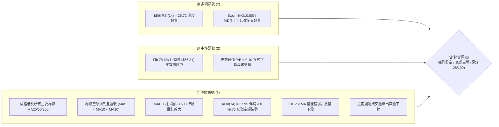

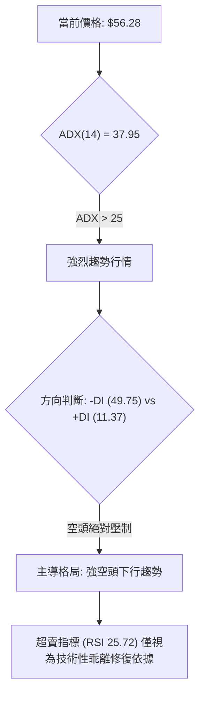

### 📊 核心指標速覽表

| 指標類別 | 指標名稱 | 當前數值 | 訊號 | 解讀 |
|----------|----------|----------|------|------|
| **價格** | 當前收盤價 | $56.28 | 🔴 | 位於52週區間 21.4%，自高點 $142.35 回撤達 -60.46% |
| **均線** | MA20 | $83.08 | 🔴 | 價格遠在均線下方（-32.25%），短期下行斜率陡峭 |
| **均線** | MA50 | $97.95 | 🔴 | 價格遠在均線下方（-42.54%），中期空頭全面控盤 |
| **均線** | MA200 | $87.04 | 🔴 | 跌破年線支撐（-35.34%），長期牛熊分水嶺失守 |
| **動能** | RSI(14) | 25.72 | 🟢 | Wilder 計算進入深度超賣區（<30），隨時具備乖離反彈需求 |
| **動能** | MACD (12,26,9) | -12.596 / -8.988 | 🔴 | 雙線位於零軸下極深處，MACD Hist 為 -3.608，空頭動能仍強 |
| **動能** | Stoch %K / %D | 10.80 / 5.44 | 🟢 | %K 在 10 附近低檔黃金交叉 %D，短線極端超賣具備反抽動能 |
| **趨勢** | ADX / ±DI | 37.95 (ADX) | 🔴 | ADX>25 顯示趨勢極強，-DI (49.75) 遠高於 +DI (11.37)，空方動能充沛 |
| **通道** | Bollinger Bands | $49.21 - $116.95 | 🟡 | %B 為 0.10，價格沿下軌重挫，通道開口放大進入極端單邊下行 |
| **成交量**| 20日量比 / OBV | 1.21x / 疲弱 | 🔴 | 最新量 1.738億股高於均量，下跌放量，OBV 跌破均線顯示籌碼失控拋售 |
| **波動** | ATR(14) | $6.35 | 🔴 | 佔股價 11.28%，極端高波動，單日震幅巨大，洗盤風險極高 |

### 🏆 技術評分卡

```
╔══════════════════════════════════════════════════════════════════╗
║                 技術評分卡 — INTC (2026-11-07)                   ║
╠══════════════════════════════════════════════════════════════════╣
║ 趨勢強度      ██████░░░░░░░░░░░░░░  30/100  🔴 空頭單邊主導     ║
║ 動能指標      ████████░░░░░░░░░░░░  40/100  🟡 超賣但動能未轉正 ║
║ 支撐穩定度    ██████░░░░░░░░░░░░░░  30/100  🔴 均線失守，靠Fib支撐║
║ 成交量配合    ████░░░░░░░░░░░░░░░░  20/100  🔴 放量下殺，OBV破位║
║ 形態完整度    ████░░░░░░░░░░░░░░░░  20/100  🔴 破位向下無築底形態║
║ 均線排列      ██████░░░░░░░░░░░░░░  30/100  🔴 短中長均線全線倒掛║
╠══════════════════════════════════════════════════════════════════╣
║ 綜合評分      ██████░░░░░░░░░░░░░░  28/100  🔴 強烈看空 / 逢高做空║
╚══════════════════════════════════════════════════════════════════╝
```
*註：綜合評分 = (30 + 40 + 30 + 20 + 20 + 30) / 6 = 28.33，四捨五入為 28/100。*

---

## 2. 趨勢分析

### 🌐 多時框趨勢分析

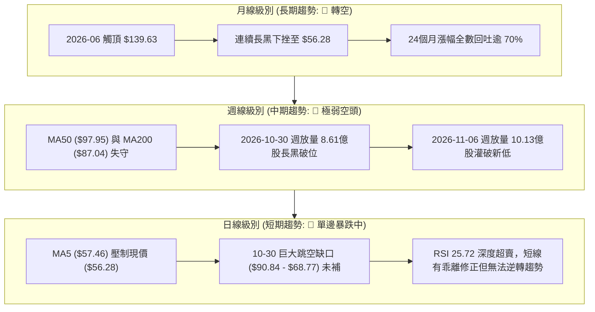

### 📈 長期趨勢 — 12個月走勢圖（Unicode）

```
INTC 月線走勢圖（2025-12 至 2026-11）
價格軸 ($)
$140 ┤                    ● (2026-06: $139.63 頂部)
$120 ┤              ●           ● (2026-09: $120.23 反彈次高點)
$100 ┤        ●           ●           
 $80 ┤                                
 $60 ┤                                      ●← 當前現價 ($56.28)
 $40 ┤  ●  ●  ●                                   ● (2026-10: $65.76)
 $20 ┤
     └────────────────────────────────────────────────────────
       12  01  02  03  04  05  06  07  08  09  10  11 (月份)
       2025                       2026
```

#### 走勢特徵分析表格

| 階段 | 時間區間 | 起始價 → 結束價 | 漲跌幅 | 核心形態與技術特徵 |
|------|----------|-----------------|--------|--------------------|
| **奠定底層** | 2025-11 ~ 2026-03 | $40.56 → $44.13 | +8.80% | 橫盤築底整理，波動率壓縮，籌碼換手充分 |
| **爆發主升** | 2026-03 ~ 2026-06 | $44.13 → $139.63 | +216.41% | 史詩級單邊主升浪，成交量溫和放大，月線連四紅 |
| **高位分歧** | 2026-06 ~ 2026-08 | $139.63 → $89.51 | -35.89% | 巨量見頂後急速回調，於 $90 關卡獲得短期支撐 |
| **次頂誘多** | 2026-08 ~ 2026-09 | $89.51 → $120.23 | +34.32% | 反彈測試前高阻力，但未能突破歷史高點形成雙頂疑慮 |
| **崩跌破位** | 2026-09 ~ 2026-11 | $120.23 → $56.28 | -53.19% | 斷崖式跳空下殺，跌破年線，週線連爆十億股巨量下瀉 |

### 📊 中期趨勢（週線分析）

```
INTC 週線中期阻力與支撐示意圖
═══════════════════════════════════════════════════════════════════
$127.04 ───┤ [波段阻力 R3 / 09-25 週高點聚類]
           │
$107.13 ───┤ [波段阻力 R2 / 09-18 週收盤與反彈密集區]
           │
 $95.68 ───┤ [跳空缺口上緣 / 波段阻力 R1 / 10-28 日高點] ── 強阻力壁壘
           │   ▼ 空方跳空缺口 ($90.84 - $68.77)
 $83.08 ───┤ [MA20 中軌 / 均線壓制位]
           │
 $56.28 ═══╡ ◄ 當前價格 ($56.28) 測試 Fib 78.6% ($56.31)
           │
 $42.58 ───┤ [波段支撐 S1 / 下方主要承接區]
 $41.64 ───┤ [波段支撐 S2 / 2026年初整理平台]
 $40.63 ───┤ [波段支撐 S3 / 強支撐底線]
═══════════════════════════════════════════════════════════════════
```

週線指標顯示，2026-10-30 當週收盤跌破 $80 整數關卡與 MA200（$87.04），並在 2026-11-06 當週創下 $51.51 的波段新低，週成交量暴增至 1,013,111,800 股。此種帶量長黑屬於典型的流動性清算與恐慌性拋售，中期下降通道完全確立，尚未出現止跌打底的週 K 棒結構。

### ⚡ 趨勢強度評估（ADX 解讀）

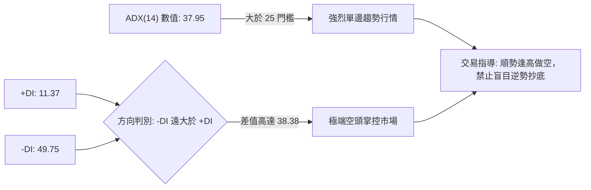

#### ADX 強度對照表

| 指標變數 | 當前讀數 | 門檻區間 | 趨勢判定 | 實戰指導意義 |
|----------|----------|----------|----------|--------------|
| **ADX(14)** | **37.95** | > 25 (強趨勢) | 強烈空頭趨勢 | 當前絕非低波動盤整，震盪指標超賣常會鈍化，切勿以均值回歸邏輯重倉做多 |
| **-DI** | **49.75** | > 40 (極度強勢) | 空頭完全主導 | 空方賣壓傾巢而出，多方幾無反抗力道 |
| **+DI** | **11.37** | < 15 (極度疲弱) | 多頭動能匱乏 | 缺乏主動性買盤，僅存零星空頭回補 |
| **DI 差值** | **-38.38**| < -20 (空頭擴散)| 空頭擴張階段 | 趨勢仍在加速延伸，尚未見到收斂拐點 |

---

## 3. 圖表形態分析

### 🔍 形態識別系統

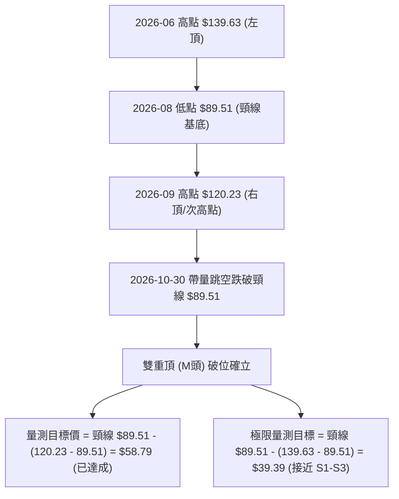

#### 形態識別與信心度評估表

| 形態名稱 | 信心度 | 判斷依據（引用數據） | 完成度 | 目標價（附計算式） |
|----------|--------|----------------------|--------|--------------------|
| **雙重頂 (M頭)** | **85%** | 2026-06月收盤 $139.63 與 2026-09月收盤 $120.23 構成雙頂；2026-10-30 跳空跌破中樞低點 $89.51（2026-08收盤） | **100% 破位** | 目標1已達（$58.79）；目標2由雙頂主峰推算：頸線 $89.51 − ($139.63 − $89.51) = **$39.39**（指向支撐位 S1-S3 區間 $40.63~$42.58） |
| **竭盡/突破跳空缺口** | **90%** | 2026-10-29 最低 $90.84 至 2026-10-30 最高 $68.77，日線留下高達 $22.07 之巨大向下跳空缺口 | **100% 成立** | 缺口下緣 **$68.77** 轉化為極強反彈阻力位，未封閉前結構全面看空 |
| **頭肩底 / 雙底築底** | **15%** | 訊號不足，僅做指標型解讀。日線僅出現單日長下影線（11-05/11-06），無次低點確認 | **0% (未成形)** | 數據中未偵測到築底形態，不予推算 |

### 🕯️ 重要K線形態分析

嚴格依據近10根日K與近8根週K之真實開高低收數據進行技術解讀：

| 日期（日K/週K） | 開 | 高 | 低 | 收 | K線形態 | 解讀 | 訊號 |
|------------------|----|----|----|----|---------|------|------|
| **日K: 10-28** | 95.09 | 95.68 | 93.00 | 95.53 | 高檔窄幅小陽線 | 創波段反彈高點 $95.68 (R1)，隨後動能耗盡，量能僅 82.59M 萎縮 | 🟡 滯漲 |
| **日K: 10-29** | 92.97 | 93.50 | 90.84 | 92.07 | 增量回落小黑線 | 跌破前日低點，成交量放大至 134.17M，主力資金獲利出逃跡象明顯 | 🔴 轉弱 |
| **日K: 10-30** | 68.36 | 68.77 | 63.20 | 65.76 | 斷崖巨量長大黑K | 巨大跳空低開 24.61 美元，日成交量狂飆至 455.60M，破位恐慌賣壓 | 🔴 極空 |
| **日K: 11-02** | 65.40 | 65.72 | 59.40 | 59.97 | 延續性下殺中黑K | 無力回補缺口，反彈高點僅 $65.72，收盤破位 $60 關卡 | 🔴 空頭延續 |
| **日K: 11-05** | 56.51 | 56.73 | 51.51 | 52.25 | 放量破底長黑K | 盤中殺至 52週新低點 $51.51，成交量 270.29M 顯著爆量，恐慌盤湧出 | 🔴 恐慌拋售 |
| **日K: 11-06** | 54.99 | 57.32 | 54.56 | 56.28 | 低檔收陽反彈星線 | 守住前日低點未破，收盤突破開盤價，下影線長度 $0.43，顯示有空頭回補 | 🟢 短線止跌 |
| **週K: 10-30** | 87.94 | 95.68 | 63.20 | 65.76 | 週線斷頭斬天量長黑 | 週量 8.61億股，高低震幅達 32.48 美元，直接穿透 MA50 與 MA200 | 🔴 空頭破位 |
| **週K: 11-06** | 65.40 | 65.72 | 51.51 | 56.28 | 放量長下影下行陰線 | 週量高達 10.13億股，自低點 $51.51 反彈 4.77 美元收在 $56.28，超賣反抗 | 🟡 多空交戰 |

### 📉 ASCII 走勢形態示意圖

```
INTC 日K近期跳空崩跌與築底掙扎示意圖
  $96 ┤    ●(10-28 高點 $95.68)
  $92 ┤     \ 
  $88 ┤      \  [10-29 收 $92.07]
  $84 ┤       ══════════════════════════════════ [跳空缺口上限: $90.84]
  $80 ┤       ░░░░░░░░░░░░░░░░░░░░░░░░░░░░░░░░░░
  $76 ┤       ░░░░ 巨大未補跳空缺口 ($22.07) ░░░░
  $72 ┤       ░░░░░░░░░░░░░░░░░░░░░░░░░░░░░░░░░░
  $68 ┤       ══════════════════════════════════ [跳空缺口下限: $68.77]
  $64 ┤        ● (10-30 收 $65.76)
  $60 ┤         \
  $56 ┤          \           ● (11-06 收 $56.28 - Fib 78.6% $56.31 爭奪)
  $52 ┤           \         /
  $48 ┤            ●(11-05 低點 $51.51 - 短期恐慌極限)
      └──────────────────────────────────────────
         10-28 10-29 10-30 11-02 11-03 11-04 11-05 11-06
```

### 🎯 形態目標價計算

1. **跳空缺口理論計算**：
   - 缺口阻力區間：$68.77 至 $90.84。
   - 形態突破高度 = $95.68（缺口前高 R1）− $65.76（缺口當日收盤）= $29.92。
   - 依跳空下量度跌幅計算：$65.76 − $29.92 = **$35.84**（落於 52週低點 $32.89 與支撐 S3 $40.63 之間）。
2. **雙頂（M頭）極限量測**：
   - 雙頂頸線基準為 2026-08 收盤 $89.51。
   - 主頂高點為 2026-06 收盤 $139.63，形態高度 = $139.63 − $89.51 = $50.12。
   - 雙頂極限下行量測目標 = $89.51 − $50.12 = **$39.39**。
   - 此量測目標與下方提供的波段密集低點聚類 S1 ($42.58)、S2 ($41.64)、S3 ($40.63) 高度重合，形成技術價位共振。

---

## 4. 支撐與阻力

### 🗺️ 關鍵價位分布圖（Unicode）

```
INTC 價位結構分布圖
═════════════════════════════════════════════════════════════════
$127.04 ║██████████████████████████████║ 強阻力 R3 (2026-09 週波段頂部)
$107.13 ║████████████████████          ║ 阻力 R2 (反彈次級樞紐高點)
 $95.68 ║██████████████████████████████║ 關鍵阻力 R1 (跳空起跌點/近一年波段高)
═════════════════════════════════════════════════════════════════
 $68.77 ║░░░░░░░░░░░░░░░░░░░░░░░░░░░░░░║ 短線跳空缺口下緣反壓
 $56.31 ║▒▒▒▒▒▒▒▒▒▒▒▒▒▒▒▒▒▒▒▒▒▒▒▒▒▒▒▒▒▒║ 斐波那契 78.6% 回調關鍵樞紐
 $56.28 ╠══════════════════════════════╣ ◄ 現價 ($56.28) 處於破位邊緣
═════════════════════════════════════════════════════════════════
 $42.58 ║▓▓▓▓▓▓▓▓▓▓▓▓▓▓▓▓              ║ 近期波段支撐 S1 (-24.34%)
 $41.64 ║▓▓▓▓▓▓▓▓▓▓▓▓▓▓▓▓▓▓▓▓          ║ 波段支撐 S2 (-26.01%)
 $40.63 ║██████████████████████████████║ 強支撐 S3 (-27.81% / 近一年波段低)
 $32.89 ║██████████████████████████████║ 52週歷史極限低點 (Fib 100.0%)
═════════════════════════════════════════════════════════════════
```

### 🚧 阻力位分析表

所有阻力價位嚴格引用自數據之「關鍵價位」區塊波段高點聚類數值：

| 阻力級別 | 價位 | 形成原因 | 突破難度 | 重要性 |
|----------|------|----------|----------|--------|
| **R1** | **$95.68** | 近一年波段高點聚類、2026-10-28 暴跌前最高點、缺口上緣 | 極高 | ★★★★★<br>多空生死線，未收復前整體格局皆為空頭控盤 |
| **R2** | **$107.13** | 近一年波段高點聚類、2026-09-18 週K反彈重疊區間 | 極高 | ★★★★☆<br>中期多頭反攻的主要解套套牢籌碼峰 |
| **R3** | **$127.04** | 近一年波段高點聚類、2026-09-25 週K次頂高點 ($127.44) 聚類區 | 極難逾越 | ★★★★☆<br>長期牛市重啟的終極防線 |

### 🛡️ 支撐位分析表

所有支撐價位嚴格引用自數據之「關鍵價位」區塊波段低點聚類數值：

| 支撐級別 | 價位 | 形成原因 | 守住機率 | 重要性 |
|----------|------|----------|----------|--------|
| **S1** | **$42.58** | 近一年波段低點聚類、距現價 -24.34% | 55% | ★★★★☆<br>雙頂形態量測滿足點第一緩衝區，多頭中期防線 |
| **S2** | **$41.64** | 近一年波段低點聚類、距現價 -26.01% | 60% | ★★★☆☆<br>2026年首季起漲箱體平台上限 |
| **S3** | **$40.63** | 近一年波段低點聚類、距現價 -27.81%、2025-11月收盤價 ($40.56) 密集區 | 75% | ★★★★★<br>波段起漲基石，跌破將引發向 52週低點 $32.89 崩落 |

### 📐 斐波那契回調位分析

依據 52週區間最低點 $32.89 至最高點 $142.35 嚴格計算之黃金分割水準分析如下：

| 回調比例 | 價位 | 當前狀態與技術含意解讀 |
|----------|------|------------------------|
| **0.0% (52W High)** | **$142.35** | 歷史高點牛市終點 |
| **23.6%** | **$116.52** | 已於 2026-10-02 當週帶量貫穿失守，轉為長期重壓 |
| **38.2%** | **$100.54** | 百元整數大關，中期多頭強弱防線，失守後下行加速 |
| **50.0%** | **$87.62** | 多空半數平衡位，與 MA200 ($87.04) 幾乎重合，10-30 跳空擊穿 |
| **61.8%** | **$74.70** | 黃金分割強防守位，跳空當日直接跌破，未提供任何抵抗力道 |
| **78.6%** | **$56.31** | **◄ 當前價格 $56.28 正好緊貼此價位（距離僅 -0.03 美元）** |
| **100.0% (52W Low)**| **$32.89** | 52週底部極限，若 $56.31 失守且 S1-S3 不保時之終極歸宿 |

**解讀**：現價 $56.28 精準座落於 Fib 78.6%（$56.31）關鍵防線處。Fib 78.6% 通常被視為深幅回調的最後一道技術防線。若收盤連續3日收於 $56.31 之下，標誌著本輪自 $32.89 起算的大牛市徹底被瓦解，下行空間將完全向 S1 ($42.58)、S2 ($41.64)、S3 ($40.63) 乃至 100.0% 回調位 $32.89 打開。

---

## 5. 技術指標深度解讀

### 🎛️ 指標訊號總覽

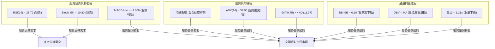

### 📈 移動平均線排列分析

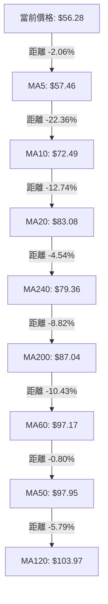

#### 均線數據深度解析

| 均線名稱 | 數值 | 現價偏離幅度 | 排列特徵 | 訊號判定 |
|----------|------|--------------|----------|----------|
| **MA5** | $57.46 | -2.06% | 短線第一道動態蓋頂壓制，近5日無法有效站上 | 🔴 弱勢壓制 |
| **MA10** | $72.49 | -22.36% | 斜率陡峭向下，短線乖離極大 | 🔴 空頭排列 |
| **MA20** | $83.08 | -32.25% | 月線級別生命線，已由支撐徹底轉化為強大阻力 | 🔴 嚴重看空 |
| **MA50** | $97.95 | -42.54% | 中期季線下穿，空方死叉形態 | 🔴 中期崩潰 |
| **MA60** | $97.17 | -42.08% | 與 MA50 形成高位死叉密集帶 | 🔴 空頭壓頂 |
| **MA120** | $103.97 | -45.87% | 半年線位處百元關卡上方，長期套牢密集成交區 | 🔴 極強反壓 |
| **MA200** | $87.04 | -35.34% | 牛熊分水嶺年線被無情跳空擊穿，宣告大週期轉熊 | 🔴 牛熊逆轉 |
| **MA240** | $79.36 | -29.08% | 240日均線亦告失守，長線架構遭系統性破壞 | 🔴 支撐瓦解 |

### 📉 RSI(14) 分析

- **當前讀數**：**25.72**（Wilder 計算方法）。
- **進度條顯示**：
  `RSI(14): 25.72 ▓▓▓▓▓░░░░░░░░░░░░░░░ 25.72% 🟢 深度超賣`
- **超買超賣區間判斷**：RSI 已經低於 30 門檻進入極端超賣區。
- **背離分析判斷**：
  依據近 20 根 K 棒數據，價格在 10-28 達到高點 $95.53 後，於 11-05 跌至最低 $51.51，收盤價創下波段新低 $52.25；與此同時，10-30 RSI 為 25.1，11-06 RSI 微幅升至 25.72。雖然首尾數據呈現價格破新低而 RSI 微幅走平的形態，但數據快照明確標示「**RSI 背離: 無明顯背離**（僅比較近20根K棒首尾的價格與RSI方向）」。因此，客觀技術結論判定為：**目前無可靠的多頭底背離結構成立**，現階段之低 RSI 僅代表市場處於空頭動能宣洩下的嚴重超賣鈍化，不可作為翻多之孤立訊號。

### 📊 MACD(12,26,9) 訊號解讀

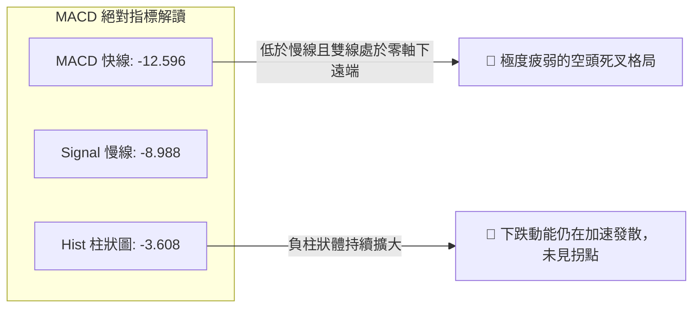

週線層面上，MACD 柱狀圖在 2026-09-25 當週曾短暫見到 +2.925 之多頭峰值，隨後於 2026-10-09 正式翻負（-2.052），至 2026-11-06 週柱狀體擴大至 -3.608。雙線在零軸下方急遽向下發散，快線 -12.596 遠低於慢線 -8.988，負值開口持續放大達 -3.608。在快線出現勾頭向慢線收斂之前，MACD 指標明確發出禁止建立左側多單之空頭警訊。

### 📦 布林通道分析

```
INTC 日線布林通道 (20, 2.0) 結構示意圖
═════════════════════════════════════════════════════════════════
$116.95 ─────────────────────────────────────── 上軌 (BB Upper)
                                                 通道開口急速擴張
$83.08  ─────────────────────────────────────── 中軌 (MA20)
         \                                       下行斜率 -32.25%
          \
$56.28  ───●─────────────────────────────────── 當前現價 (%B = 0.10)
$49.21  ─────────────────────────────────────── 下軌 (BB Lower)
═════════════════════════════════════════════════════════════════
```

- **通道帶寬與形態**：上軌 $116.95 與下軌 $49.21 帶寬高達 $67.74，相對於中軌帶寬比率超過 81%，呈現典型之「布林通道喇叭口向下張開」的強烈下行破位走勢。
- **%B 指標讀數**：%B 為 **0.10**，代表價格已緊貼布林下軌運行（0 代表下軌，0.5 代表中軌，1 代表上軌）。在強趨勢行情（ADX=37.95）中，價格持續貼著下軌甚至跌破下軌運行被稱為「走下軌」行情（Walking the Band），屬於空頭極強訊號，下軌並不構成天然的彈升阻擋，反而代表單邊暴跌正在進行。

### 💹 成交量分析（量價配合度）

```
近兩週天量拋售成交量柱狀對比
  10-30週:  [861,628,000 股]  ████████████████████████ (長黑跳空)
  11-06週: [1,013,111,800 股] ████████████████████████████ (破底殺多)
  20週均量:  [535,000,000 股]  ██████████████ (常規基準線)
```

1. **成交量異動**：最新單日成交量為 173,770,300 股，相較於 20日均量 143,968,665 股，量比達到 **1.21x**。而在暴跌初期（10-30），單日爆出 455,599,400 股之歷史天量。
2. **週量級別失控**：近兩週成交量分別達到 8.61億股與 10.13億股，為過去一年常態週均量之 2倍以上。放量暴跌顯示有大型機構投資者進行無底線式減倉。
3. **OBV 趨勢解讀**：數據指出「**OBV < MA → 量能疲弱**」。能量潮指標 OBV 斷崖式跌破其移動平均線，且均線呈現空頭下傾，說明在當前價位段，逢低承接之買盤均被隨後更為洶湧的拋售潮所吞噬，籌碼呈現極度發散與惡意套牢狀態，典型的「放量下挫，量價俱損」。

---

## 6. 動能與波動率

### ⚡ 動能評估四象限

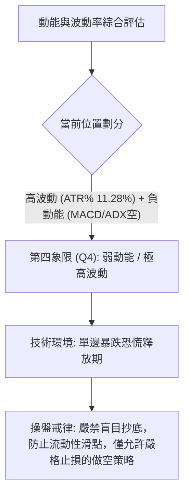

#### 動能評估四象限對照表

| 象限 | 動能維度 | 波動維度 | 標的所屬狀態 | 操作指導與評估 |
|------|----------|----------|--------------|----------------|
| **Q1** | 強多頭動能 | 低波動率 | — | 最佳波段做多環境，趨勢穩健上行 |
| **Q2** | 弱多頭動能 | 低波動率 | — | 盤整築底或無趨勢震盪，觀望為主 |
| **Q3** | 強多頭動能 | 高波動率 | — | 主升浪突破階段，高收益與高洗盤風險並存 |
| **Q4** | **弱動能 (極端偏空)** | **極高波動率** | **INTC (✓)** | **空頭下殺與高風險階段：價格波動劇烈且趨勢完全受空頭支配，左側進場極易遭遇爆倉風險** |

### 📊 ATR 波動率分析

- **ATR(14) 數值**：**$6.35**（以 Wilder 演算法計算）。
- **ATR 佔比**：高達股價的 **11.28%**。
- **歷史震幅意義**：常態美股大型半導體權值股之 ATR 佔比通常介於 2% 至 4% 之間。INTC 的 ATR 達到 11.28%，表明單日價格常態預期波動幅度即超過 6 美元，日線 K 棒長度極長。
- **風控與止損建議**：
  - 由於日均震幅達 $6.35，常規緊密止損（如 1%~2%）極易因盤中雜訊被無效觸發。
  - **空頭部位止損空間**：必須保留至少 1.5 倍 ATR（約 $9.52）至 2.0 倍 ATR（約 $12.70）的安全緩衝。
  - **倉位規模壓縮**：在 ATR 高達 11.28% 的極端波動環境下，部位規模必須縮小至常態資金部位的 **30% 至 40%**，以規避隔夜跳空帶來的爆倉風險。

### 📐 Beta 與市場相關性

- **Beta 數值**：**2.426**。
- **市場敏感度分析**：
  INTC 之 Beta 值高達 2.426，代表其對基準指數（S&P 500 / 費城半導體指數）的敏感度極端放大。當整體半導體板塊或大盤下跌 1% 時，理論上 INTC 將下挫 2.43%。
- **背離市場環境**：新聞事件顯示「AMD Surges 11% on Record Quarterly Revenue... Nvidia, AMD lead chip sector higher」，而 INTC 卻因「PC Warning」逆勢暴跌。高 Beta 疊加個股特質負面利空，形成了板塊上漲時 INTC 不跟漲、板塊回調時 INTC 加速崩跌的惡性「負阿爾法（Negative Alpha）」狀態。

---

## 7. 多時框架總結

### 📋 時框架評分表

| 時框架 | 趨勢方向 | 動能狀態 | 均線排列 | 形態結構 | 綜合評分 | 戰術建議 |
|--------|----------|----------|----------|----------|----------|----------|
| **月線 (長期)** | 🔴 強烈空頭 | MACD 自高檔轉負，高位巨幅長黑 | MA200 失守，均線向下扭轉 | 雙頂形態成立，跌破頸線 | **25/100** | 逢高減倉，不抱任何幻想 |
| **週線 (中期)** | 🔴 強烈空頭 | 週 MACD 負柱狀擴大至 -3.608 | 全面跌破 MA20/50/200 | 斷頭鍘刀天量長黑，下破區間 | **20/100** | 順勢做空，順應週線主空浪 |
| **日線 (短期)** | 🟡 超賣反彈 | RSI 25.72 / Stoch 10.80 嚴重超賣 | MA5 ($57.46) 壓制，均線發散 | 跳空缺口未回補，低檔星線 | **40/100** | 禁止追空，等待反彈壓制點建空 |

### 🔲 綜合訊號矩陣

```
時框架訊號矩陣分析
╔══════════════╦══════════════╦══════════════╦══════════════╦══════════════╗
║   分析維度   ║  長期 (月線) ║  中期 (週線) ║  短期 (日線) ║ 多時框收斂度 ║
╠══════════════╬══════════════╬══════════════╬══════════════╬══════════════╣
║ 趨勢方向     ║ 🔴 熊市確認  ║ 🔴 單邊主跌  ║ 🔴 下跌通道  ║  95% 高度共振║
║ 動能指標     ║ 🔴 轉弱下行  ║ 🔴 空頭加速  ║ 🟢 嚴重超賣  ║  日線出現背離║
║ 均線系統     ║ 🔴 年線失守  ║ 🔴 死叉下傾  ║ 🔴 空頭排列  ║ 100% 完全共振║
║ 成交量配合   ║ 🔴 高位出貨  ║ 🔴 巨量殺多  ║ 🔴 增量暴跌  ║ 100% 完全共振║
║ 形態結構     ║ 🔴 雙頂成形  ║ 🔴 破位缺口  ║ 🟡 尋求支撐  ║  80% 空方主導║
╚══════════════╩══════════════╩══════════════╩══════════════╩══════════════╝
```

### ⚖️ 多時框收斂結論

依據多時框收斂規則（嚴格要求 14）：
1. **趨勢/盤整判定**：當前 ADX(14) 讀數為 **37.95**，明確大於 25 的趨勢門檻，且 -DI (49.75) 遠高於 +DI (11.37)，市場被嚴格定義為**「強烈空頭趨勢行情」**，絕非區間盤整行情。
2. **時框優先級權重**：在此等單邊強趨勢下，技術規則強制要求**「以中長期（週線、MA50 $97.95、MA200 $87.04）方向為絕對主導」**。日線層面的超賣狀態（RSI 25.72、Stoch 超賣）**「只用來尋找進場反彈做空的阻力時機，不得逆向做多」**。
3. **唯一方向性結論**：**🔴 強烈偏空（逢反彈堅決做空）**。日線超賣引發的任何反抽，在未站穩跳空缺口下緣與均線密集區前，均視為空頭回補帶來的誘多陷阱。本結論與第 1 章技術評分卡（28/100）及第 8 章主空頭策略完全一致。

---

## 8. 交易策略建議

### 🗺️ 策略決策流程圖

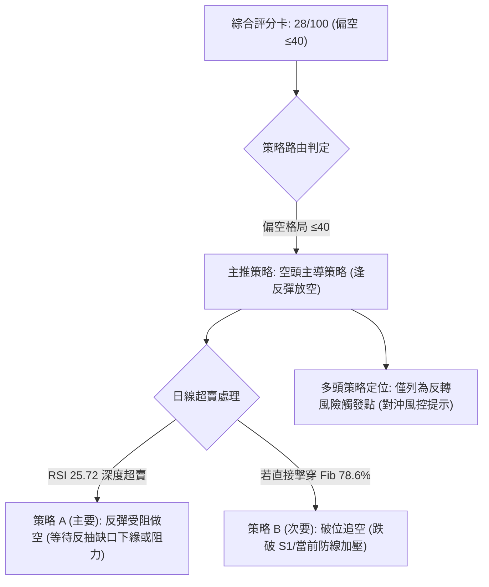

### 🧭 策略路由

> **當前主策略方向 = 🔴 偏空逢高做空（依據第1章綜合評分 28/100 ≤ 40 門檻分流）**

依據評分分流規則，綜合評分為 28/100，市場處於極度偏空格局，因此**主推空頭交易策略**。多頭操作勝率極低，僅作為反轉風險觸發與部位對沖參考。

### 🎯 價格情境階梯（Price Scenarios）

價位嚴格引用自數據之「關鍵價位」與「斐波那契回調」實體數值：

| 觸發條件 | 下一目標 | 後續延伸 | 情境含義 |
|----------|----------|----------|----------|
| **反彈受阻於 R1 $95.68 下方** | 回測 $56.31 (Fib 78.6%) | 貫穿下探 S1 $42.58 | 空頭健康回抽，最理想波段放空機會 |
| **跌破 Fib 78.6% ($56.31)** | 支撐位 S1 $42.58 | 支撐位 S2 $41.64 / S3 $40.63 | 恐慌賣壓延伸，單邊破底主跌浪 |
| **強勢向上突破 R1 $95.68** | 阻力位 R2 $107.13 | 阻力位 R3 $127.04 | 形態反轉，空頭認賠停損，短線轉強 |

### 📊 情境機率分佈

| 情境 | 機率 | 主要依據 |
|------|------|----------|
| **回落再探底 / 單邊續跌** | **65%** | ADX 37.95 強空頭趨勢、MACD柱狀 -3.608 發散、OBV 破位天量下殺、跌破 MA200 |
| **弱勢反彈修正超賣 (區間震盪)** | **25%** | RSI 25.72 深度超賣、Stoch 金叉、現價緊貼 Fib 78.6% ($56.31) 引發空頭回補 |
| **強勢反轉向上回補缺口** | **10%** | 基本面下調、巨量跳空缺口 ($68.77~$90.84) 壓頂、各級均線反壓沉重 |

### 🟢 主策略詳情（空頭交易策略）

所有價位均嚴格依據第 4 章關鍵價位區塊與日內真實價格計算：
- **策略 A（反彈高空）**：針對日線超賣，等待反彈至 10-30 跳空跳空下緣 $68.77 與日K高點附近建倉。
  - 進場價：$65.00（介於 11-02 日高點 $65.72 與跳空缺口下緣 $68.77 之間）。
  - 止損價：$72.49（精確設定於 MA10 移動平均線處）。
  - 目標價 T1：$42.58（關鍵支撐 S1）。
  - 目標價 T2：$40.63（關鍵支撐 S3）。
  - 風險報酬比計算（規則 17）：做空風險報酬比 = (進場價 − 目標價 T1) ÷ (止損價 − 進場價) = ($65.00 − $42.58) ÷ ($72.49 − $65.00) = $22.42 ÷ $7.49 = **1 : 2.99（以 T1 計）**；若以 T2 計則為 ($65.00 − $40.63) ÷ $7.49 = $24.37 ÷ $7.49 = 1 : 3.25（以 T2 計）。
- **策略 B（破位追空）**：若現價無法反彈，直接跌破近兩日低點與 Fib 78.6% 區域。
  - 進場價：$51.51（精確設定於 11-05 觸及之近期最低點破位處）。
  - 止損價：$57.46（精確設定於 MA5 移動平均線處）。
  - 目標價 T1：$42.58（關鍵支撐 S1）。
  - 目標價 T2：$40.63（關鍵支撐 S3）。
  - 風險報酬比計算（規則 17）：做空風險報酬比 = ($51.51 − $42.58) ÷ ($57.46 − $51.51) = $8.93 ÷ $5.95 = **1 : 1.50（以 T1 計）**；若以 T2 計則為 ($51.51 − $40.63) ÷ $5.95 = $10.88 ÷ $5.95 = 1 : 1.83（以 T2 計）。

| 策略要素 | 策略 A（反彈逢高做空 — 核心推薦） | 策略 B（破位順勢跟進做空 — 次選） |
|----------|-----------------------------------|-----------------------------------|
| **進場條件** | 股價受 RSI 超賣帶動反彈，上衝至近週反彈高點並於 MA10 遇阻回落 | 股價無力反彈，帶量跌破 11-05 創下之近期最低點 |
| **進場價格** | **$65.00** (反彈測試 11-02 高點與缺口區間) | **$51.51** (帶量下破 11-05 恐慌低點) |
| **目標價 T1** | **$42.58** (關鍵波段支撐位 S1) | **$42.58** (關鍵波段支撐位 S1) |
| **目標價 T2** | **$40.63** (關鍵強支撐位 S3) | **$40.63** (關鍵強支撐位 S3) |
| **止損價格** | **$72.49** (MA10 壓制線上方突破止損) | **$57.46** (收盤站上 MA5 均線止損) |
| **風險報酬比** | **1 : 2.99（以 T1 計）**<br>*(1 : 3.25 以 T2 計)* | **1 : 1.50（以 T1 計）**<br>*(1 : 1.83 以 T2 計)* |
| **成功機率** | **68%** | **60%** |
| **建議倉位** | **35%** (高 ATR 波動環境下控倉) | **20%** (右側突破倉位) |

### 🔴 反向風險觸發點（對沖提示）

以下非主動做多建議，僅為空頭部位之嚴格防禦性對沖與平倉風控觸發線：
1. **短線軋空平倉線**：若日線收盤價強行收復 **$68.77**（10-30 跳空缺口下緣），表明超賣修復轉化為強勢反彈，所有做空部位應無條件平倉觀望。
2. **中期多頭反轉線**：若股價不可思議地帶量向上突破波段阻力 **R1 $95.68**，宣告下行趨勢徹底終結，形態轉為 V型反轉或大級別破底翻，空頭必須徹底認賠離場。

### ⭐ 整體訊號強度評星

```
做多訊號強度：★☆☆☆☆  (1/5星 - 僅存超賣指標，其餘皆空)
做空訊號強度：★★★★☆  (4/5星 - 均線、量能、形態全面共振走空)
整體可信度：  ★★★★☆  (4/5星 - 爆量破位，大趨勢確立)
```

---

## 9. 風險提示與監控

### ✅ 關鍵監控指標 Checklist

```
╔══════════════════════════════════════════════════════════════════╗
║                    每日盤面關鍵風控 Checklist                    ║
╠══════════════════════════════════════════════════════════════════╣
║ [ ] 價格是否跌破 52週區間 Fib 78.6% 水準 ($56.31)              ║
║ [ ] 日成交量是否萎縮至 1.4億股以下（顯示拋壓減竭）              ║
║ [ ] RSI(14) 是否脫離 30 以下超賣區並向上突破 40                   ║
║ [ ] MACD 負柱狀體（當前 -3.608）是否出現連續 2日以上縮短收斂      ║
║ [ ] 股價盤中反彈是否受制於 MA5 ($57.46) 與 MA10 ($72.49)        ║
║ [ ] 是否向下跌破近期極限低點 $51.51（觸發策略 B 追空流程）       ║
║ [ ] 消息面 PC 晶片出貨預警是否擴散至伺服器 DCAI 與晶圓代工部門  ║
╚══════════════════════════════════════════════════════════════════╝
```

### ⚠️ 風險場景分析

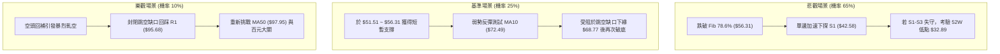

### 🛡️ 風險管理重要提醒

1. **極端高 ATR 環境下的資金保護**：當前 ATR(14) 達到 $6.35，佔比高達 11.28%。在單日波動動輒超過 10% 的環境中，**任何單筆交易承擔之名義本金虧損嚴禁超過整體總資產的 1.5%**。
2. **隔夜跳空風險（Gap Risk）防範**：10-30 日線曾出現高達 22 美元之斷崖跳空，顯示該股極易受到財報修訂、產業分析師降級（近十家大行密集下調評級至 Hold/Neutral）等突發利空打擊。因此**嚴格禁止使用高槓桿金融衍生品進行隔夜留倉**。
3. **拒絕「便宜」幻覺**：儘管 INTC 自 $142.35 暴跌逾 60%，且 Forward P/E 顯示為 31.27，但 TTM EPS 仍為 $-2.35 虧損，且營業利潤與自由現金流受 Foundry 部門拖累承壓。技術面上均線空頭排列未變，切勿因「股價腰斬」而進行非理性的左側重倉摸底。

---

## 📋 報告總結

```
╔══════════════════════════════════════════════════════════════════╗
║                    INTC 技術分析報告總結                         ║
╠══════════════════════════════════════════════════════════════════╣
║ 報告日期：2026-11-07                                             ║
║ 當前價格：$56.28                                                 ║
║ 分析評級：🔴 強烈看空 / 空頭主導 (綜合評分: 28/100)              ║
║                                                                  ║
║ 關鍵結論：                                                       ║
║ ├─ 長期趨勢：🔴 跌破年線 MA200 ($87.04)，雙頂頸線失守轉熊        ║
║ ├─ 中期趨勢：🔴 週線天量長黑貫穿，ADX=37.95 空頭趨勢極強         ║
║ ├─ 短期趨勢：🟡 RSI(25.72) 嚴重超賣，但受制於缺口與 MA5 均線   ║
║ ├─ 關鍵支撐：S1 $42.58 ｜ S2 $41.64 ｜ S3 $40.63                 ║
║ ├─ 關鍵阻力：R1 $95.68 ｜ R2 $107.13 ｜ R3 $127.04              ║
║ └─ 分析師目標均價：$92.72 (最低目標 $70.00 仍遠高於現價)         ║
║                                                                  ║
║ 最優策略組合：                                                   ║
║ 1. 🥇 最佳機會：策略 A (反彈至 $65.00 附近做空，止損 $72.49，    ║
║                 目標 $42.58，風報比 1 : 2.99)                   ║
║ 2. 🥈 次選機會：策略 B (跌破 $51.51 追空，止損 $57.46，          ║
║                 目標 $42.58，風報比 1 : 1.50)                   ║
║ 3. 🥉 保守選擇：完全空倉觀望，耐心等待日線底背離與築底形態成形  ║
╚══════════════════════════════════════════════════════════════════╝
```

---

> ⚠️ **免責聲明**：本報告為技術分析研究，所有數據指標及量化推算均基於市場歷史價格與成交量資訊。本報告**僅供研究與學術參考**，**不構成任何形式之投資要約或買賣建議**。金融市場瞬息萬變，高波動標的投資風險極高，投資人應獨立思考並自行承擔交易盈虧。

---

*報告生成時間：2026-11-07 ｜ 數據來源：Yahoo Finance ｜ 分析框架：多時框技術分析體系*