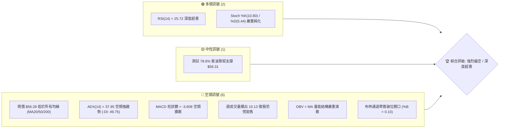
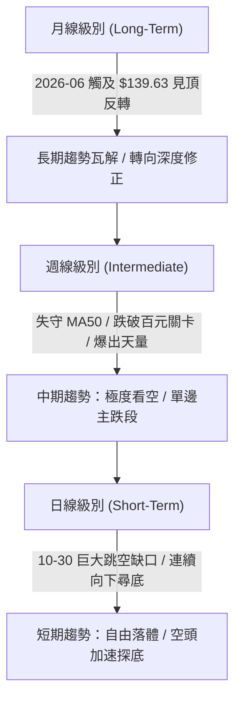
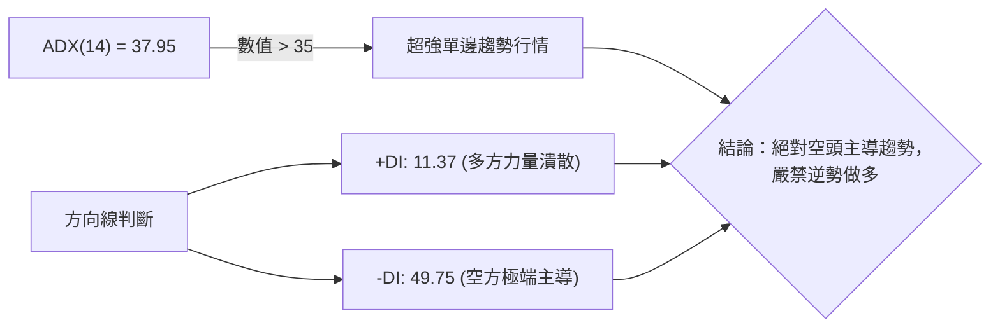
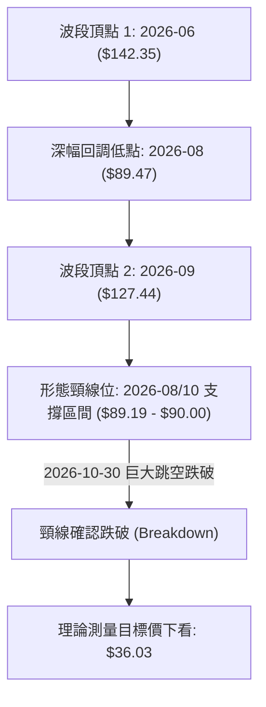
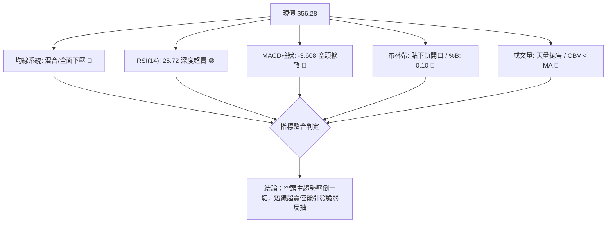
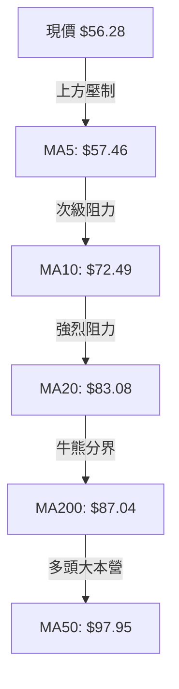
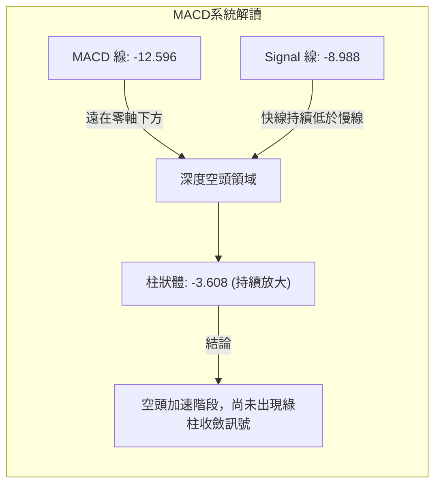
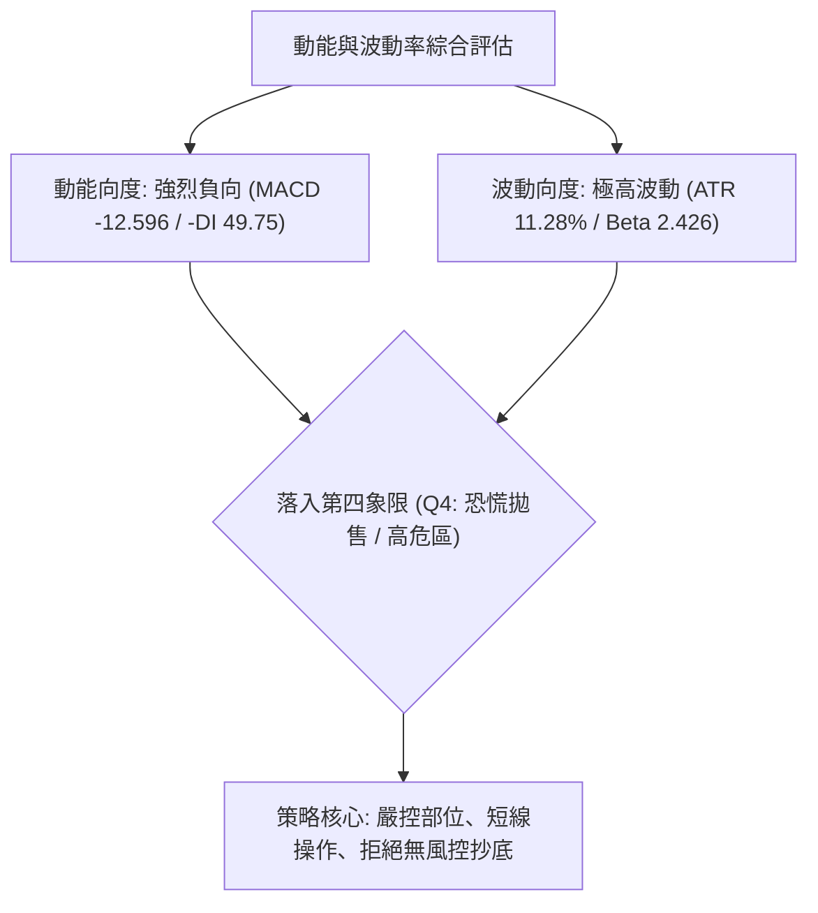
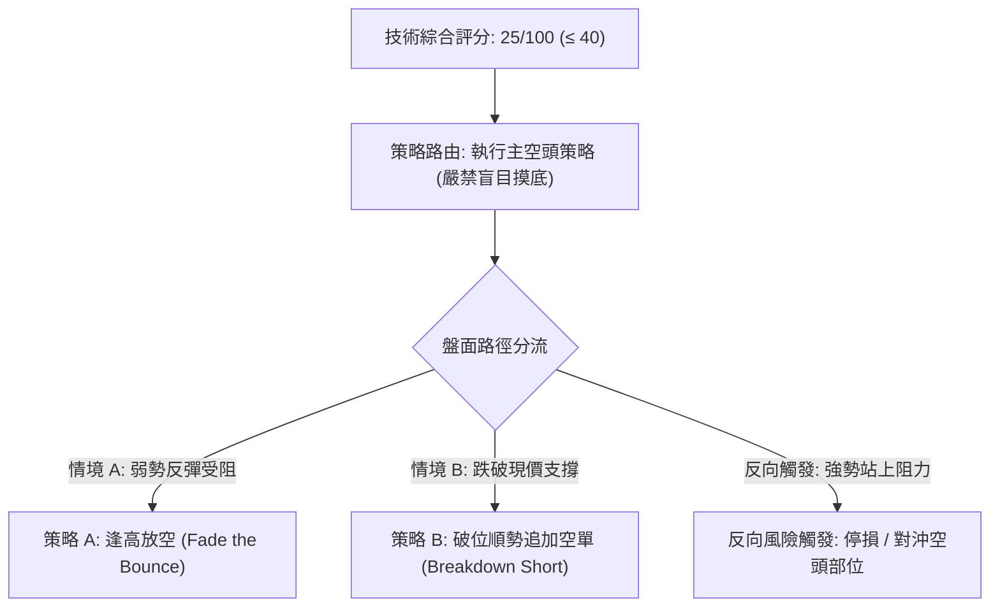
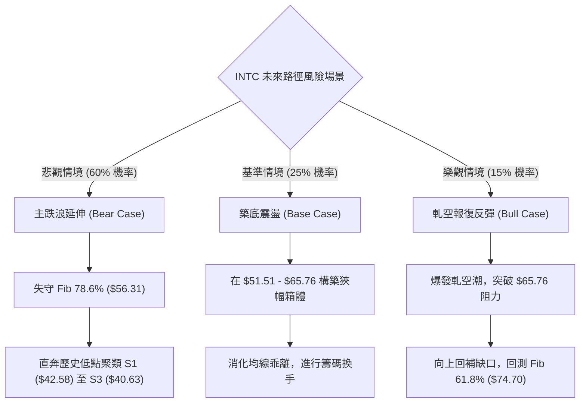

# INTC 技術分析報告

> **報告日期**：2026-11-08 ｜ **語言**：繁體中文 ｜ **數據來源**：Yahoo Finance ｜ **當前價格**：$56.28

---

## 目錄

| 章節 | 內容 |
|------|------|
| [1. 技術面概覽](#1-技術面概覽) | 訊號儀表板、核心指標、評分卡 |
| [2. 趨勢分析](#2-趨勢分析) | 多時框趨勢、長中短期走勢、ADX解讀 |
| [3. 圖表形態分析](#3-圖表形態分析) | 形態識別、K線組合、目標價推算 |
| [4. 支撐與阻力](#4-支撐與阻力) | 關鍵價位分布、波段聚類、斐波那契回調 |
| [5. 技術指標深度解讀](#5-技術指標深度解讀) | 均線系統、RSI、MACD、布林通道、OBV |
| [6. 動能與波動率](#6-動能與波動率) | 動能四象限、ATR波幅、Beta係數解讀 |
| [7. 多時框架總結](#7-多時框架總結) | 時框架評分矩陣、多時框收斂定調 |
| [8. 交易策略建議](#8-交易策略建議) | 策略路由、主空頭策略、情境階梯、風報比 |
| [9. 風險提示與監控](#9-風險提示與監控) | 監控清單、情境樹狀圖、部位風控 |

---

## 1. 技術面概覽

### 🎯 技術訊號儀表板

Intel（INTC）在經歷了 2026 年上半年的非理性拉升後，當前呈現極度疲弱的空頭崩跌走勢。日線與週線結構全面破位，均線呈現空頭發散排列，目前股價正處於 52 週波段的極低分位數（21.4%），技術面完全由空方掌控。



### 📊 核心指標速覽表

下表彙整當前市場關鍵技術指標數值，呈現標準空頭趨勢伴隨短線極限超賣特徵：

| 指標類別 | 指標名稱 | 當前數值 | 訊號 | 解讀 |
|:---|:---|:---|:---:|:---|
| **價格** | 當前收盤價 | $56.28 | 🔴 | 位於 52 週高低區間 21.4% 位置，逼近底部警戒 |
| **均線** | 短期 MA20 | $83.08 | 🔴 | 乖離率 -32.25%，空頭發散下壓，短線嚴重承壓 |
| **均線** | 中期 MA50 | $97.95 | 🔴 | 價格遠在 MA50 下方 (-42.54%)，中期趨勢完全崩壞 |
| **均線** | 長期 MA200| $87.04 | 🔴 | 跌破年線關鍵分水嶺，宣告長期多頭架構瓦解 |
| **動能** | RSI(14) | 25.72 | 🟢 | 進入 <30 深度超賣區，短線空頭動能有技術性衰竭可能 |
| **動能** | MACD (12,26,9)| -12.596 / 柱 -3.608| 🔴 | 快慢線雙雙跌入零軸極下方，空方柱體擴散無止跌收斂 |
| **動能** | 隨機指標 (Stoch) | %K: 10.80 / %D: 5.44 | 🟢 | 雙線落於極度超賣區，具備短線技術性死叉反彈潛力 |
| **趨勢** | ADX(14) | 37.95 (-DI: 49.75) | 🔴 | ADX > 25 且 -DI 逼近 50，顯示單邊下跌空頭趨勢極強 |
| **通道** | 布林通道 | 下軌 $49.21 / %B: 0.10 | 🔴 | 貼著下軌重挫，通道開口急劇放大，空頭波動劇烈 |
| **成交量**| 20日均量比 | 1.21x (173.77M / 143.97M) | 🔴 | 下跌帶量，且週線爆出 10.13 億股歷史天量，籌碼潰逃 |
| **波動** | ATR(14) | $6.35 (11.28%) | 🔴 | 日內波動幅度高達 11.28%，極端高波動環境，風控門檻高 |

### 🏆 技術評分卡

依照六大技術面向進行客觀量化評估，滿分為 100 分。本評分卡旨在反映多頭結構健全度：

```
╔══════════════════════════════════════════════════════════════════════════╗
║                     技術評分卡 — INTC (2026-11-08)                       ║
╠══════════════════════════════════════════════════════════════════════════╣
║ 趨勢強度 (Trend)     ████░░░░░░░░░░░░░░░░  20/100  🔴 極弱 (強空頭格局)   ║
║ 動能指標 (Momentum)  █████░░░░░░░░░░░░░░░  25/100  🔴 弱勢 (超賣但無背離) ║
║ 支撐穩定度 (Support) ███████░░░░░░░░░░░░░  35/100  🟡 脆弱 (測 Fib 78.6%) ║
║ 成交量配合 (Volume)  █████░░░░░░░░░░░░░░░  25/100  🔴 惡化 (拋售爆巨量)   ║
║ 形態完整度 (Pattern) ██████░░░░░░░░░░░░░░  30/100  🔴 破位 (斷頭跳空走勢) ║
║ 均線排列 (MA System) ███░░░░░░░░░░░░░░░░░  15/100  🔴 潰敗 (全面空頭發散) ║
╠══════════════════════════════════════════════════════════════════════════╣
║ 綜合評分             █████░░░░░░░░░░░░░░░  25/100  評級：強烈偏空         ║
╚══════════════════════════════════════════════════════════════════════════╝
```

*計算依據（規則 18 算術平均）：(20 + 25 + 35 + 25 + 30 + 15) ÷ 6 = 150 ÷ 6 = 25 分。整體評級屬於「強烈偏空」。*

---

## 2. 趨勢分析

### 🌐 多時框趨勢分析

當前多時框視角展現出典型的高位崩塌傳導至所有時間級別的特徵。由月線的高位反轉，週線的量能爆發破位，日線的向下跳空延伸，構成完美的共振下行。



### 📈 長期趨勢 — 12個月走勢圖（Unicode）

過去 12 個月（2025-11 至 2026-11）INTC 經歷了極其劇烈的「過山車」走勢。從 2025 年底的 $40 附近起步，於 2026 年初至年中受 AI 浪潮推升至歷史波段高點 $142.35（6 月收盤 $139.63），隨後在下半年出現斷崖式拋售，全數回吐上半年漲幅。

```
INTC 月線走勢圖（過去12個月：2025-11 至 2026-11）
價格軸 ($)
$140 ┤                                      ● (2026-06: 139.63)
$120 ┤                                ●           ● (2026-09: 120.23)
$100 ┤                          ●           ●
$80  ┤                                            ●
$60  ┤                                                  ● (2026-10: 65.76)
$40  ┤  ●     ●     ●     ●                                   ●←現價 $56.28
$20  ┤
     └─────────────────────────────────────────────────────────────► 時間
       11    12    01    02    03    04    05    06    07    08    09    10    11
     (25)  (25)  (26)  (26)  (26)  (26)  (26)  (26)  (26)  (26)  (26)  (26)  (26)
```

**12個月走勢特徵階段劃分表**：

| 階段區間 | 時間段 | 起訖收盤價 | 區間漲跌幅 | 走勢特徵與結構意涵 |
|:---|:---|:---|:---:|:---|
| **第一階段：底部築基** | 2025-11 至 2026-03 | $40.56 → $44.13 | +8.80% | 在 $36.90 - $46.47 間平穩築底，籌碼完成初步沉澱。 |
| **第二階段：主升浪爆發** | 2026-03 至 2026-06 | $44.13 → $139.63 | +216.41% | 伴隨產業預期強烈噴出，連續大陽線拔高，創 52 週高點 $142.35。 |
| **第三階段：高位震盪出貨**| 2026-06 至 2026-09 | $139.63 → $120.23| -13.89% | 出現「巨震回踩 $90 後急拉至 $120」的次高點假突破，主力出貨顯著。|
| **第四階段：全面崩盤跳水**| 2026-09 至 2026-11 | $120.23 → $56.28 | -53.19% | 兩個月內腰斬，跌破所有均線支撐，以歷史級成交量跳空下殺。 |

### 📊 中期趨勢（週線分析）

中期走勢顯示自 2026-09-25 創下波段次高點 $123.00 收盤價以來，INTC 展開連續 6 週的陰線重挫。

```
INTC 週線近兩個月壓力支撐示意圖
價格軸 ($)
$125 ┤     ● (09-25 收 123.00)
$115 ┤        ● (10-02 收 119.33)
$105 ┤           ● (10-09 收 104.70)
$95  ┤              ─── 波段高點阻力 R1: $95.68 ───
$85  ┤                 ● (10-16 收 89.85)
$75  ┤                    ● (10-23 收 86.96)
$65  ┤                       ● (10-30 收 65.76，跳空暴跌)
$55  ┤                          ● (11-06 收 56.28) ◄ 現價測試 Fib 78.6%
$45  ┤              ─── 波段低點聚類 S1: $42.58 ───
     └─────────────────────────────────────────────────────► 週K推進
```

週線層面已跌破多條長期趨勢線，且最近兩週（10-30 與 11-06 當週）分別爆出 8.61 億股與 10.13 億股的驚人拋售量，說明市場拋壓不僅來自散戶，機構部位亦出現大規模清倉式停損。

### ⚡ 趨勢強度評估（ADX 解讀）

當前日線 ADX(14) 讀數為 **37.95**。依據技術分析理論，ADX 跨越 25 代表行情進入顯著趨勢狀態，跨越 35 則確立為強烈單邊趨勢行情。



**ADX 趨勢強度量化對照表**：

| 指標變數 | 當前讀數 | 門檻區間 | 當前狀態判定 | 交易指引 |
|:---|:---:|:---:|:---:|:---|
| **ADX 數值** | 37.95 | > 25 (強趨勢) / > 35 (極強) | 🟢 強趨勢確認 | 順應趨勢交易，摒棄震盪指標高拋低吸邏輯 |
| **+DI (多方)** | 11.37 | < 20 (極端虛弱) | 🔴 多方完全喪失主導權 | 任何反彈均屬弱勢修正，非趨勢反轉 |
| **-DI (空方)** | 49.75 | > 40 (極度強勢) | 🔴 空方力量極度主導 | 空頭動能充沛，下方空間仍未封死 |
| **趨勢性質** | 空頭單邊 | -DI 遠大於 +DI 且 ADX 向上 | 🔴 空頭驅動趨勢 | 遵循規則 14，以中長期均線下行方向為主導 |

---

## 3. 圖表形態分析

### 🔍 形態識別系統

在日線與週線結構上，INTC 構築並確認突破了一個宏大的雙頂（Double Top）轉向形態，隨後在 10 月底展開斷崖式跳空下破，呈現強烈的空頭測量下行（Bearish Measured Move）。



**形態信心度與目標價評估表（依規則 15）**：

| 形態名稱 | 信心度 | 判斷依據（引用數據） | 完成度 | 目標價（附嚴謹計算式） |
|:---|:---:|:---|:---:|:---|
| **雙頂破位 (Double Top)** | 85% | 頂點1 $142.35，頂點2 $127.44，頸線取 2026-10-16 當週低點 $89.19。10-30 跳空跌破確認。 | 100% (已破位) | 頸線 $89.19 − 形態高度 ($142.35 − $89.19 = $53.16) = **$36.03** |
| **主跌推動浪 (Impulse Wave)**| 70% | 10-28 高點 $95.68 遇阻，隨後 10-30 跳空重挫跌破 $68.36 開盤，形成測量缺口。 | 75% | 依跳空前高 $95.68 起算，下探前低聚類 S1: **$42.58** |
| **頭肩底 / 反轉築底** | <20% | 數據中完全未見底部抬升或右肩結構，訊號嚴重不足。 | 0% | 訊號不足，僅做指標型超賣解讀，不預設底部目標價。 |

### 🕯️ 重要K線形態分析

嚴格依據提供的「近10根日K」與「近8根週K」開高低收數據進行客觀解讀（依規則 19）：

#### 1. 近 10 根日 K 線形態解讀

| 日期 | 開 | 高 | 低 | 收 | K線形態名稱 | 形態特徵與技術意涵 | 訊號 |
|:---:|:---:|:---:|:---:|:---:|:---|:---|:---:|
| **2026-10-26** | 87.94 | 92.09 | 86.46 | 90.47 | 中陽線 | 嘗試挑戰 MA20，但量能僅 98.74M，反彈動能有限 | 🟡 |
| **2026-10-27** | 92.47 | 94.98 | 91.86 | 93.74 | 上攻小陽線 | 向上逼近 R1 阻力區，高位遇壓留下小上影線 | 🟡 |
| **2026-10-28** | 95.09 | 95.68 | 93.00 | 95.53 | 高檔偽十字星 | 觸及 R1 阻力位 $95.68，縮量滯漲，多頭動能耗盡 | 🔴 |
| **2026-10-29** | 92.97 | 93.50 | 90.84 | 92.07 | 轉折陰線 | 低開低走收跌，成交量放大至 134.17M，主力出逃訊號 | 🔴 |
| **2026-10-30** | 68.36 | 68.77 | 63.20 | 65.76 | **空頭突破缺口巨陰** | 開盤直接自 $92 跳空至 $68，爆 4.55 億天量，恐慌崩盤 | 🔴 |
| **2026-11-02** | 65.40 | 65.72 | 59.40 | 59.97 | 下行延續大陰線 | 破位後無像樣承接，低開跌破 60 元大關，成交量 2.30 億 | 🔴 |
| **2026-11-03** | 61.33 | 62.59 | 59.87 | 60.55 | 低檔小陽孕線 | 跌勢暫緩，在 $60 上下震盪，成交量縮至 1.49 億 | 🟡 |
| **2026-11-04** | 58.67 | 60.20 | 56.77 | 58.27 | 弱勢下挫陰線 | 衝高 $60.20 遇阻回落，再破前日低點，空方持續掌控 | 🔴 |
| **2026-11-05** | 56.51 | 56.73 | 51.51 | 52.25 | 帶長下影長陰線 | 盤中殺跌至 $51.51 後獲買盤拉回，成交量放大至 2.70 億 | 🟡 |
| **2026-11-06** | 54.99 | 57.32 | 54.56 | 56.28 | 低開反彈中陽線 | 低開 $54.99 站上 $56.28，小幅確認 11-05 下影線支撐 | 🟢 |

#### 2. 近 8 根週 K 線形態解讀

| 日期 | 開 | 高 | 低 | 收 | 週K形態名稱 | 形態特徵與技術意涵 | 訊號 |
|:---:|:---:|:---:|:---:|:---:|:---|:---|:---:|
| **2026-09-18** | 95.82 | 111.37 | 94.52 | 108.60 | 帶量突破大陽 | 衝破百元大關，多頭情緒亢奮，成交 6.26 億 | 🟢 |
| **2026-09-25** | 116.53 | 127.44 | 114.93 | 123.00 | 高位放量長陽 | 觸及次高點 $127.44，量能維持 6.02 億，呈現主力最後拉抬 | 🟡 |
| **2026-10-02** | 120.68 | 126.00 | 113.97 | 119.33 | 高檔流星孕線 | 開高走低留下影線，週收盤轉弱，動能開始減退 | 🔴 |
| **2026-10-09** | 115.34 | 118.20 | 104.00 | 104.70 | 中期破位長陰 | 實體跌穿 $110 關卡，宣告頂部確認成立 | 🔴 |
| **2026-10-16** | 102.52 | 103.19 | 89.19 | 89.85 | 吞噬巨陰破位 | 重挫擊穿百元整數與 $90 頸線關卡，空頭全面主導 | 🔴 |
| **2026-10-23** | 94.53 | 95.39 | 84.65 | 86.96 | 弱勢反抽陰十字 | 試圖反抽 $95 頸線失敗，受阻於 R1 前緣 | 🔴 |
| **2026-10-30** | 87.94 | 95.68 | 63.20 | 65.76 | **世紀級跳空長陰** | 週振幅逾 36%，成交量暴增至 8.61 億，摧毀所有中期多頭 | 🔴 |
| **2026-11-06** | 65.40 | 65.72 | 51.51 | 56.28 | **天量長下影錘頭** | 探底 $51.51 伴隨 10.13 億歷史天量，浮現潛在初步承接力道 | 🟢 |

### 📉 ASCII 走勢形態示意圖

以下展示 2026 年 10 月底至 11 月初爆發的「跳空崩塌與下影承接」形態：

```
INTC 日K近期形態示意圖 (2026-10-26 至 2026-11-06)
價格 ($)
$96 ┤      ┼── 10-28 遇阻 R1 ($95.68)
$92 ┤   ┌┐ ┃  ┌┐
$88 ┤   ││ ┃  ││
$84 ┤   └┘ ┴  └┘
$80 ┤
$76 ┤   ░░░░░░░░░░░░░░░░░░░░░░░░░░░░░░░░ 巨大破位缺口 ($90.84 - $68.77)
$72 ┤   ░░░░░░░░░░░░░░░░░░░░░░░░░░░░░░░░
$68 ┤         ┌┐
$64 ┤         ││ ┌┐
$60 ┤         └┘ ││ ┌┐ ┌┐
$56 ┤            └┘ ││ ││    ┌┐ ◄ 11-06 收 $56.28 (回升於 Fib 78.6% $56.31 旁)
$52 ┤               └┘ ││ ┌┐ ││
$48 ┤                  ┴  ││ └┘
$44 ┤                     ┴── 11-05 探底長下影 $51.51 (天量承接)
    └─────────────────────────────────────────────────────────────
       26 27 28 29 30 02 03 04 05 06 (日K日期)
```

### 🎯 形態目標價計算

根據經典技術形態幾何投射原則：
1. **雙頂頸線破位測量**：
   - 形態頂部基準值取波段高點聚類：$142.35
   - 形態頸線基準點取 2026-10-16 當週低點：$89.19
   - 垂直高度 $H = \$142.35 - \$89.19 = \$53.16$
   - 幾何等幅下行目標價 $T = 頸線 \$89.19 - H (\$53.16) = \mathbf{\$36.03}$（該數值與數據中 52 週低點 $32.89 形成強烈共振保護區間）。
2. **缺口跳空測量下限**：
   - 跳空前一日（10-29）收盤價 $92.07 至缺口底部收盤價 $65.76，落差達 $26.31。
   - 若由 $65.76 進行等幅延伸：$\$65.76 - \$26.31 = \mathbf{\$39.45}$，該數值極度接近下方波段低點聚類 S3: **$40.63** 與 S1: **$42.58**。

---

## 4. 支撐與阻力

### 🗺️ 關鍵價位分布圖（Unicode）

本圖彙整由 OHLCV 歷史波段聚類計算所得的嚴謹關鍵價位，標記當前現價所處的位置：

```
INTC 價位結構分布圖 (由 OHLCV 數據計算)
═══════════════════════════════════════════════════════════════════
$142.35 ║                                                ║ 52W 最高點 / Fib 0.0%
$127.04 ║████████████████████████████████████████████████║ 強烈歷史波段阻力 R3
$116.52 ║────────────────────────────────────────────────║ Fib 23.6% 回調位
$107.13 ║████████████████████████████████████            ║ 中期波段聚類阻力 R2
$100.54 ║────────────────────────────────────────────────║ Fib 38.2% 整數心理關卡
$95.68  ║████████████████████████████████████████████████║ 核心波段高點阻力 R1 (跳空起跌點)
$87.62  ║────────────────────────────────────────────────║ Fib 50.0% 回調位 (共振 MA200)
$74.70  ║────────────────────────────────────────────────║ Fib 61.8% 黃金分割強壓
$56.31  ║════════════════════════════════════════════════║ Fib 78.6% 回調位
$56.28  ╠════════════════════════════════════════════════╣ ◄ 當前收盤價 ($56.28)
$42.58  ║▓▓▓▓▓▓▓▓▓▓▓▓▓▓▓▓▓▓▓▓▓▓▓▓▓▓▓▓▓▓▓▓▓▓▓▓▓▓▓▓        ║ 核心波段低點支撐 S1
$41.64  ║▓▓▓▓▓▓▓▓▓▓▓▓▓▓▓▓▓▓▓▓▓▓▓▓▓▓▓▓▓▓▓▓                ║ 次級波段低點支撐 S2
$40.63  ║████████████████████████████████████████████████║ 關鍵底部結構支撐 S3
$32.89  ║                                                ║ 52W 最低點 / Fib 100.0%
═══════════════════════════════════════════════════════════════════
```

### 🚧 阻力位分析表

阻力位嚴格引用 OHLCV 計算之波段高點聚類數據：

| 阻力級別 | 價位 | 與現價距離 | 形成原因與籌碼解讀 | 突破難度 | 重要性 |
|:---:|:---:|:---:|:---|:---:|:---:|
| **R1** | **$95.68** | +70.01% | 10-28 高點，跳空崩跌前的平台頂部，聚集巨量套牢籌碼 | 極高 | 🔴 核心分水嶺 |
| **R2** | **$107.13** | +90.35% | 9-18 週K起漲開盤高點聚類，百元整數大關上方的套牢平台 | 極高 | 🔴 中期強壓 |
| **R3** | **$127.04** | +125.73%| 2026-09-25 週K波段高點聚類 ($127.44)，歷史次高峰密集出貨區 | 極高 | 🔴 長期天花板 |

### 🛡️ 支撐位分析表

支撐位嚴格引用 OHLCV 計算之波段低點聚類數據：

| 支撐級別 | 價位 | 與現價距離 | 形成原因與籌碼解讀 | 守住機率 | 重要性 |
|:---:|:---:|:---:|:---|:---:|:---:|
| **S1** | **$42.58** | -24.34% | 近一年主要波段低點聚類，2026 年初起漲前的最後突破平台 | 65% | 🟢 核心第一防線 |
| **S2** | **$41.64** | -26.01% | 2026-03 收盤價 $44.13 之下的密集支撐緩衝帶，密集交易底層 | 70% | 🟡 次級緩衝區 |
| **S3** | **$40.63** | -27.81% | 2025-11 平台低點收盤聚類 ($40.56)，長線牛熊分界線底座 | 85% | 🟢 生死防守線 |

### 📐 斐波那契回調位分析

依據 52 週波段低點 **$32.89** 至 52 週波段高點 **$142.35** 展開的斐波那契回調測算：

| 回調比例 | 對應價位 | 與現價距離 | 當前狀態與技術意義解讀 |
|:---:|:---:|:---:|:---|
| **0.0% (High)** | $142.35 | +152.93% | 52 週最高點，2026 年多頭行情終點站 |
| **23.6%** | $116.52 | +107.04% | 跌破後宣告主升浪結構徹底破裂 |
| **38.2%** | $100.54 | +78.64% | 百元心理大關，中期多空強弱防守位（已失守） |
| **50.0%** | $87.62 | +55.69% | 多空平衡中軸，與長期 MA200 ($87.04) 形成完美共振壓制 |
| **61.8%** | $74.70 | +32.73% | 黃金分割重要防守位，跳空破位後轉化為強大反彈壓力 |
| **78.6%** | **$56.31** | **+0.05%** | **極限防守位！現價 $56.28 正處於此水準點（僅差 $0.03）** |
| **100.0% (Low)**| $32.89 | -41.56% | 52 週最低點，全波段漲幅徹底回吐的終極支撐 |

**斐波那契深度解讀**：
當前收盤價 **$56.28** 與 78.6% 回調位 **$56.31** 幾近重合。78.6% 屬於深度回調的「最後防守閥門」。若在此位置無法形成帶量反轉築底，技術結構將不可避免地滑向 100% 回調位 $32.89，中途僅有 S1 ($42.58) 與 S3 ($40.63) 具備結構性抵抗力道。

---

## 5. 技術指標深度解讀

### 🎛️ 指標訊號總覽



### 📈 移動平均線排列分析

目前 INTC 均線系統處於極端混亂後的空頭順序發散下壓狀態：

| 均線名稱 | 均線價位 | 與現價乖離 | 走勢特徵與微觀結構 | 趨勢判定 |
|:---:|:---:|:---:|:---|:---:|
| **MA5** | $57.46 | -2.06% | 短線急速下壓，近幾日反彈皆受制於此 | 🔴 看空 |
| **MA10** | $72.49 | -22.36%| 斷崖式向下陡峭傾斜，短期空頭第一道天花板 | 🔴 看空 |
| **MA20** | $83.08 | -32.25%| 乖離率擴大至 -32%，中期下壓動能未見減速 | 🔴 看空 |
| **MA60** | $97.17 | -42.08%| 季線急速翻空，即將與 MA120 形成高位死叉 | 🔴 看空 |
| **MA120** | $103.97 | -45.87%| 半年線下行，高位長期套牢籌碼防線 | 🔴 看空 |
| **MA200** | $87.04 | -35.34%| 年線遭強勢跳空擊穿，牛熊週期已徹底轉向 | 🔴 看空 |
| **MA240** | $79.36 | -29.08%| 雙年線亦失守，代表 2 年持有者全面轉為虧損 | 🔴 看空 |



### 📉 RSI(14) 分析

當前 Wilder RSI(14) 讀數為 **25.72**，正式進入技術指標公認的 <30 嚴重超賣區間。

```
RSI(14) 強度指標狀態：
0 ─────── [25.72] ─── 30 ──────────────────────── 70 ────────────────────── 100
  深度超賣區 ▓▓▓▓▓░░░░░░░░░░░░░░░░░░░░░░░░░░░░░░░░░░░░░░░░ 超買區
```

**背離客觀研判**：
- **數據檢驗**：依據系統近 20 根 K 棒首尾檢測，報告明確指示「無明顯背離」。
- **趨勢背景**：在強趨勢行情（ADX = 37.95）中，RSI 超賣常會轉化為「超賣鈍化」，即價格持續下跌而 RSI 長期徘徊在 20-30 之間。不可單憑 RSI < 30 即盲目進場抄底。

### 📊 MACD(12,26,9) 訊號解讀

MACD 當前數值處於嚴重的空頭發散狀態：
- **DIF (MACD 線)**：-12.596
- **DEA (信號線)**：-8.988
- **MACD 柱狀體 (Hist)**：-3.608



快線與慢線雙雙深潛至負值深處，且負柱狀體高達 -3.608，未見任何柱體縮小或快線拐頭跡象，技術上屬於極度標準的空方主導訊號。

### 📦 布林通道分析

當前布林通道（20, 2）各軌道價位如下：
- **上軌**：$116.95
- **中軌 (MA20)**：$83.08
- **下軌**：$49.21
- **%B 指標**：0.10（0 代表下軌，1 代表上軌）

```
INTC 布林通道（20,2）位置示意圖
價格軸 ($)
$116.95 ┤────────────────────── 布林上軌
        │
$83.08  ┤══════════════════════ 布林中軌 (MA20)
        │
$56.28  ┤  ●← 當前價格 (%B = 0.10，逼近下軌)
$49.21  ┤────────────────────── 布林下軌
```

現價 $56.28 距離下軌 $49.21 僅有些微空間，%B 為 0.10，顯示價格正處於下軌邊界附近「貼軌滑落」。在通道開口劇烈擴大的背景下，這種貼軌走勢象徵空頭強趨勢尚未終結。

### 💹 成交量分析（量價配合度）

1. **量價異動**：最新交易日成交量為 173,770,300 股，相較於 20 日均量（143,968,665 股）放大 1.21 倍。
2. **週成交量激增**：11-06 當週週成交量爆出 **1,013,111,800 股**的天量。
3. **OBV（能量潮）狀態**：官方數據明確指出「OBV < MA → 量能疲弱」。
4. **量價結論**：跌破百元及跳空下殺過程中均伴隨巨量釋放，量能完全站在空方一側，呈現「帶量崩盤、放量破位」的標準量價同步看空特徵。

---

## 6. 動能與波動率

### ⚡ 動能評估四象限

將市場處境置於「動能方向與強度」與「市場波動率（ATR）」兩個維度評估：

| 象限代號 | 動能狀態 | 波動率狀態 | 標的所處狀態判定 | 交易戰術評估 |
|:---:|:---:|:---:|:---:|:---|
| **Q1** | 正向強動能 | 低波動 | — | 最佳順勢持股環境 |
| **Q2** | 弱/負向動能 | 低波動 | — | 盤整觀望，等待突破 |
| **Q3** | 正向強動能 | 高波動 | — | 突破加速，獲利迅速但也具洗盤風險 |
| **Q4** | **極負向動能** | **極高波動** | **✓ INTC 當前位置 (Q4)** | **高風險陷阱區！避免主動進場，以空方順勢為主** |



### 📊 ATR 波動率分析

- **ATR(14) 絕對數值**：**$6.35**
- **ATR 佔比 (ATR %)**：**11.28%**（以當前價格 $56.28 計算）

**技術意涵與停損設置指引**：
每日平均震幅達到驚人的 11.28%，代表日內跳動超過 $6 美元實屬常態。在此環境下，過於狹窄的技術停損（如 1-2 美元）極易被市場噪聲掃出場。
- **波段交易停損距離**：建議至少拉開 **1.5 至 2.0 倍 ATR**，即 **$9.50 至 $12.70** 的風險緩衝空間。
- **部位換算**：由於單日波動達 11%，單筆交易曝險部位上限應嚴格縮減至平常的三分之一至二分之一。

### 📐 Beta 與市場相關性

- **Beta 數值**：**2.426**
- **市場意涵**：INTC 的系統性波動敏感度為 S&P 500 大盤的 2.42 倍以上。在半導體產業遭遇逆風與大盤回調階段，該股將呈現顯著的「放大殺跌」效應；反之，若半導體板塊出現集體報復性反彈，其短線彈升彈性亦極大。

---

## 7. 多時框架總結

### 📋 時框架評分表

依照多時間維度對 INTC 當前技術狀態進行綜合評鑑：

| 時框架 | 趨勢方向 | 動能狀態 | 均線排列 | 圖表形態 | 綜合評分 | 操作指引 |
|:---|:---:|:---:|:---:|:---:|:---:|:---|
| **日線 (Daily)** | 🔴 強烈看空 | 🟢 超賣鈍化 | 🔴 空頭發散 | 🔴 跳空破位 | **25/100** | 逢反彈順勢放空 / 嚴禁持有多單過夜 |
| **週線 (Weekly)**| 🔴 極度看空 | 🔴 柱體擴散 | 🔴 破年線 | 🔴 雙頂崩塌 | **20/100** | 中期主跌段，未見止跌底型 |
| **月線 (Monthly)**| 🔴 轉空下行 | 🔴 高位衰竭 | 🟡 混合糾結 | 🔴 倒V天花板 | **30/100** | 長線回吐全部漲幅，防守前低 S3 |

### 🔲 綜合訊號矩陣

| 維度 | 短期 (日線) | 中期 (週線) | 長期 (月線) | 矩陣共振狀態 |
|:---|:---:|:---:|:---:|:---:|
| **趨勢方向** | 空頭探底 | 空頭單邊 | 空頭反轉 | 🔴 全時框完全共振看空 |
| **動能指標** | 極度超賣 | 空方主導 | 弱勢下移 | 🟡 短線有超賣反抽需求，但被中長期壓制 |
| **量價結構** | 拋售帶量 | 歷史天量 | 放量收陰 | 🔴 籌碼全面瓦解，無主力吸籌跡象 |
| **關鍵支撐** | 測 $56.31 | 測 S1 ($42.58)| 測 S3 ($40.63)| 🔴 各時框支撐逐級下移 |

### ⚖️ 多時框收斂結論

**嚴格依據「規則 14」進行多時框結論收斂**：
1. **行情性質判定**：當前日線 **ADX(14) = 37.95 遠高於 25**，確立當前市場處於極強的**「趨勢行情」**，絕非區間盤整行情。
2. **優先級收斂原則**：在趨勢行情下，中長期時框（週線 / MA50 / MA200）方向具有最高決定權，日線指標僅能用於尋找逢高進場放空的時機，不可單憑日線 RSI 超賣逆勢做多。
3. **唯一方向性結論**：**【強烈偏空】**。
   日線極端超賣（RSI 25.72）與週線長下影線（11-06 最低 $51.51）僅代表短線賣壓可能出現暫時性喘息，但週線與月線結構已徹底破位，主趨勢下行方向毫無動搖。

---

## 8. 交易策略建議

### 🗺️ 策略決策流程圖



### 🧭 策略路由（依評分卡分流）

> **當前主策略方向 = 【逢高放空 / 破位追空（主推空頭策略）】（依評分 25/100）**

因技術評分卡綜合評分為 **25/100（≤ 40）**，依交易紀律本報告**主推空頭策略**，多頭僅列為反轉風險提示。

### 🎯 價格情境階梯（Price Scenarios）

價位嚴格引用第 4 章及數據中 OHLCV 計算之實際數值：

| 觸發條件 | 下一目標 | 後續延伸 | 情境技術含義 |
|:---|:---:|:---:|:---|
| **向上反抽站穩 Fib 61.8% $74.70** | Fib 50.0% $87.62 | 阻力 R1 $95.68 | 展開深幅超賣修復反彈，中期壓力測試 |
| **在現價區間 $56.28 弱勢震盪** | Fib 78.6% $56.31 | — | 空頭中繼整理，消化日線低檔超賣指標 |
| **向下跌破現價區間與 Fib 78.6%** | 核心支撐 S1 $42.58 | 支撐 S2 $41.64 / S3 $40.63 | 主跌浪延伸，向下尋求歷史波段底層支撐 |

### 📊 情境機率分佈

| 情境劃分 | 機率預估 | 主要技術依據 |
|:---|:---:|:---|
| **情境一：延續跌勢 / 再度探底** | **60%** | ADX 37.95 強空頭趨勢、MACD 負柱狀體持續擴散、週線 10 億天量拋售潰敗。 |
| **情境二：低位弱勢震盪** | **25%** | RSI 25.72 深度超賣與 Stoch %K 10.80 鈍化，短線空方動能面臨技術性休整。 |
| **情境三：展開強勁技術性反彈** | **15%** | 股價精準測試 Fib 78.6% ($56.31)，且 11-05 觸及 $51.51 後留長下影線。 |

### 🟢 主策略詳情（空頭交易策略）

所有價位均嚴格取自數據中的 OHLCV 計算值與斐波那契回調位：

| 策略要素 | 策略 A（反彈逢高做空） | 策略 B（破位順勢做空） |
|:---|:---|:---|
| **策略類型** | 順勢逢高沽空 (Fade Counter-Trend Rally) | 關鍵位破位追加做空 (Breakdown Short) |
| **進場條件** | 股價弱勢反彈測試 Fib 61.8% 遇阻回落時進場 | 現價 $56.28 確認跌破 Fib 78.6% $56.31 時追空 |
| **進場價格** | **$74.70** (Fib 61.8% 回調位) | **$56.28** (當前市價) |
| **目標價 T1** | **$56.31** (Fib 78.6% 回調位) | **$42.58** (波段低點聚類支撐 S1) |
| **目標價 T2** | **$42.58** (波段低點聚類支撐 S1) | **$32.89** (52W 最低點 / Fib 100%) |
| **止損價格** | **$87.62** (Fib 50.0% 回調位) | **$65.76** (10-30 跳空收盤價 / 關鍵阻力) |
| **風險報酬比** | **1 : 1.42**（以 T1 計）<br>*(以 T2 計為 1 : 2.49)* | **1 : 1.45**（以 T1 計）<br>*(以 T2 計為 1 : 2.47)* |
| **勝率預估** | 65% | 60% |
| **建議倉位** | 10% - 15% | 5% - 10% |

*風險報酬比精確計算式（規則 17）：*
- *策略 A (以 T1 計)：$(\$74.70 - \$56.31) \div (\$87.62 - \$74.70) = \$18.39 \div \$12.92 = \mathbf{1.42}$*
- *策略 A (以 T2 計)：$(\$74.70 - \$42.58) \div (\$87.62 - \$74.70) = \$32.12 \div \$12.92 = \mathbf{2.49}$*
- *策略 B (以 T1 計)：$(\$56.28 - \$42.58) \div (\$65.76 - \$56.28) = \$13.70 \div \$9.48 = \mathbf{1.45}$*
- *策略 B (以 T2 計)：$(\$56.28 - \$32.89) \div (\$65.76 - \$56.28) = \$23.39 \div \$9.48 = \mathbf{2.47}$*

### 🔴 反向風險觸發點（對沖提示）

若出現以下訊號，代表空頭結構面臨失效或強烈擠壓（Short Squeeze），所有空頭部位必須立即停損離場或進行對沖：
1. **價格突破關鍵阻力**：日線收盤價強勢突破 **$65.76**（10-30 收盤價）甚至進一步封閉缺口回踩 **$74.70**（Fib 61.8%）。
2. **動能全面金叉**：日線 MACD 柱狀體由負翻正，且 DIF 快線上穿 DEA 發出零下金叉。
3. **成交量異動**：出現單日成交量突破 3 億股的「長陽包陰」吞噬形態。

### ⭐ 整體訊號強度評星

```
做多訊號強度：★☆☆☆☆  (1/5星 - 僅有指標嚴重超賣，無形態與均線支撐)
做空訊號強度：★★★★☆  (4/5星 - 均線空頭排列，趨勢強度極高，順勢優勢顯著)
整體可信度：  ★★★★☆  (4/5星 - OHLCV 聚類與各項動能指標共振高度一致)
```

---

## 9. 風險提示與監控

### ✅ 關鍵監控指標 Checklist

```
╔══════════════════════════════════════════════════════════════════════════╗
║                    INTC 關鍵技術監控指標 CHECKLIST                       ║
╠══════════════════════════════════════════════════════════════════════════╣
║ [ ] 價位監控：是否跌破 Fib 78.6% ($56.31) 誘發新一輪止損賣壓            ║
║ [ ] 價位監控：是否向上反抽觸及 Fib 61.8% ($74.70) 遭遇空頭伏擊          ║
║ [ ] 均線監控：MA5 ($57.46) 是否對日線反彈形成持續死叉壓制               ║
║ [ ] 動能監控：RSI(14) 能否自 25.72 回升至 30 之上完成超賣修復           ║
║ [ ] 動能監控：MACD 柱狀體 (-3.608) 是否出現連續兩日收窄跡象              ║
║ [ ] 趨勢監控：ADX(14) 讀數是否由 37.95 拐頭向下 (趨勢減速訊號)          ║
║ [ ] 籌碼監控：日成交量是否回落至 20 日均量 (1.43 億股) 下方回歸平靜     ║
╚══════════════════════════════════════════════════════════════════════════╝
```

### ⚠️ 風險場景分析



### 🛡️ 風險管理重要提醒

1. **嚴禁主觀猜底**：
   在 ADX 高達 37.95 且 -DI 逼近 50 的環境下，左側「接飛刀」屬於勝率極低的交易行為。即便 RSI 進入 25.72 深度超賣，歷史經驗表明單邊跌勢中超賣鈍化可維持數週之久。
2. **部位規模嚴格受限**：
   因當前 INTC 之 ATR(14) 高達 $6.35（佔股價 11.28%），標的具備極端波動性。單筆交易之最大容許虧損金額應控制在總交易資金的 1% 以內，整體持倉規模不得超過投資組合的 15%。
3. **跳空風險防範**：
   近期 INTC 頻繁受基本面消息引發跨日跳空，隔夜持倉（無論多空）均面臨巨大跳空缺口風險。短線日內交易者宜嚴守收盤前減倉或平倉原則，避免承擔無法控管的跳空損失。

---

## 📋 報告總結

```
╔══════════════════════════════════════════════════════════════════════════╗
║                          INTC 技術分析報告總結                           ║
╠══════════════════════════════════════════════════════════════════════════╣
║ 報告日期：2026-11-08                                                     ║
║ 當前價格：$56.28                                                         ║
║ 分析評級：⚖️ 強烈偏空 / 深度超賣 (技術綜合評分: 25/100)                  ║
║                                                                          ║
║ 關鍵技術結論：                                                           ║
║ ├─ 長期趨勢：🔴 高位雙頂破位，自 $142.35 展開全面崩塌，長期結構瓦解     ║
║ ├─ 中期趨勢：🔴 跌破年線 MA200 ($87.04)，週線爆出 10.13 億股天量出逃    ║
║ ├─ 短期趨勢：🔴 空頭主導單邊走勢 (ADX: 37.95)，RSI(25.72) 嚴重超賣鈍化   ║
║ ├─ 關鍵支撐：S1: $42.58 ｜ S2: $41.64 ｜ S3: $40.63                     ║
║ ├─ 關鍵阻力：R1: $95.68 ｜ R2: $107.13 ｜ R3: $127.04                   ║
║ └─ 斐波那契：現價 $56.28 緊貼 Fib 78.6% ($56.31) 最後防守閥門           ║
║                                                                          ║
║ 最優策略組合：                                                           ║
║ 1. 🥇 最佳機會 (策略 A)：反彈至 Fib 61.8% ($74.70) 逢高放空，            ║
║                         目標下看 $56.31 / $42.58，風報比 1:1.42 / 1:2.49 ║
║ 2. 🥈 次選機會 (策略 B)：現價 $56.28 跌破 Fib 78.6% 追空，               ║
║                         目標下看 S1 ($42.58)，風報比 1:1.45             ║
║ 3. 🥉 保守選擇：空手觀望，靜待日線構築出雙底或頭肩底等右側反轉形態       ║
╚══════════════════════════════════════════════════════════════════════════╝
```

---

> ⚠️ **免責聲明**：本報告為依據客觀技術分析量化模型產出之研究報告，所有技術價位均依據歷史 OHLCV 數據計算推演。本報告**僅供學術研究與投資邏輯參考**，**不構成任何要約、招攬或具體投資建議**。市場有風險，交易需獨立判斷並自負盈虧。

---

*報告生成時間：2026-11-08 ｜ 數據來源：Yahoo Finance ｜ 分析框架：多時框技術分析模型*