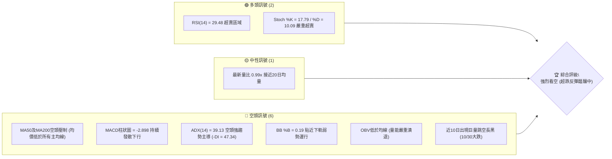
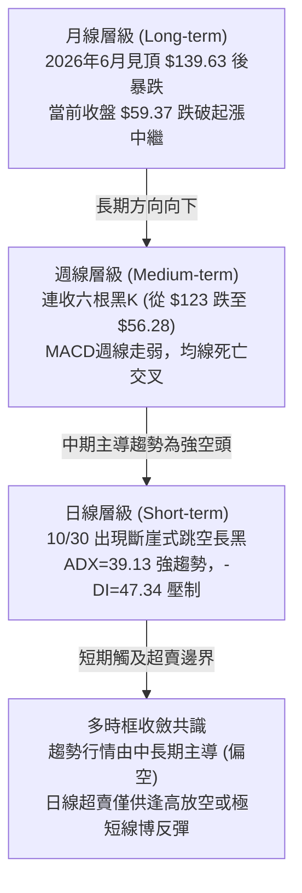
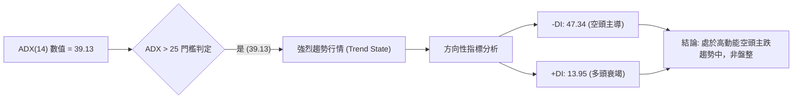
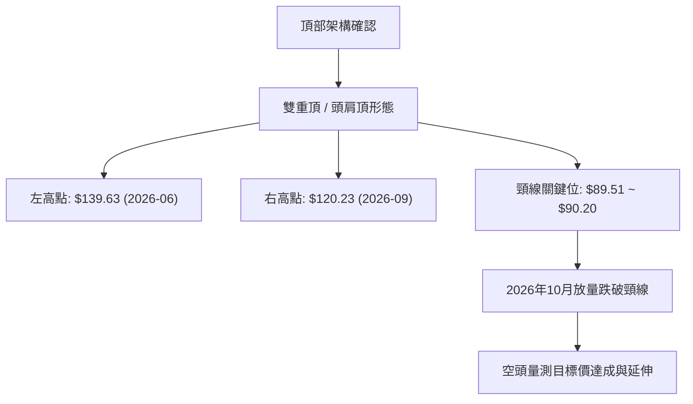
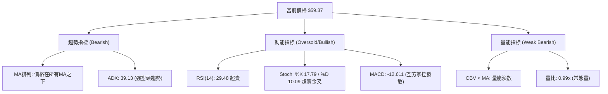
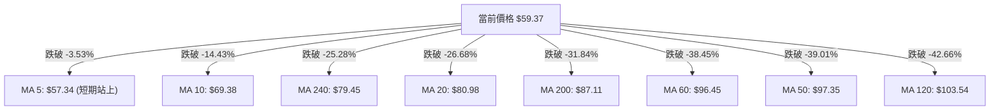
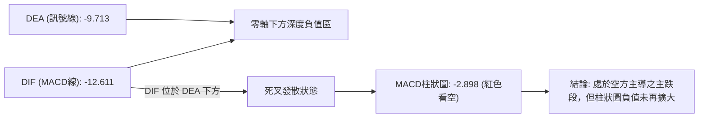
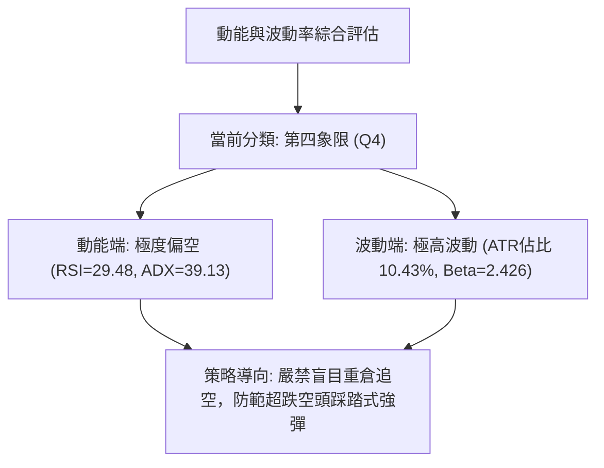
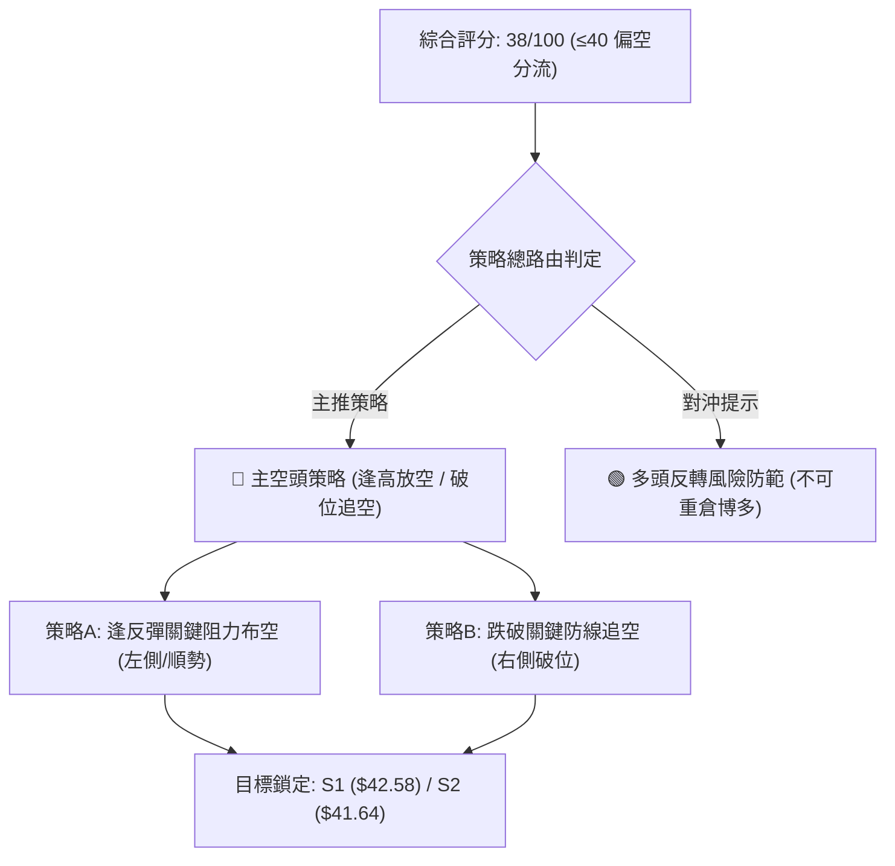
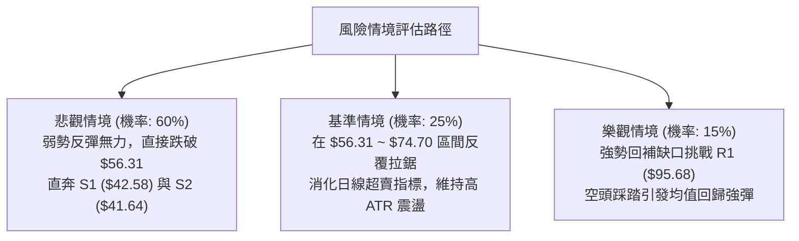

# INTC 技術分析報告

> **報告日期**：2026-11-10 ｜ **語言**：繁體中文 ｜ **數據來源**：Yahoo Finance ｜ **當前價格**：$59.37

---

## 目錄

| 章節 | 內容 |
|------|------|
| [1. 技術面概覽](#1-技術面概覽) | 訊號儀表板、核心指標、評分卡 |
| [2. 趨勢分析](#2-趨勢分析) | 多時框趨勢、長中短期走勢 |
| [3. 圖表形態分析](#3-圖表形態分析) | 形態識別、K線組合、目標價 |
| [4. 支撐與阻力](#4-支撐與阻力) | 關鍵價位、斐波那契回調 |
| [5. 技術指標深度解讀](#5-技術指標深度解讀) | MA/RSI/MACD/布林/成交量 |
| [6. 動能與波動率](#6-動能與波動率) | 動能評估、ATR、Beta |
| [7. 多時框架總結](#7-多時框架總結) | 時框架評分矩陣 |
| [8. 交易策略建議](#8-交易策略建議) | 多空策略、風險報酬比 |
| [9. 風險提示與監控](#9-風險提示與監控) | 監控指標、風險場景 |

---

## 1. 技術面概覽

### 🎯 技術訊號儀表板



### 📊 核心指標速覽表

| 指標類別 | 指標名稱 | 當前數值 | 訊號 | 解讀 |
|----------|----------|----------|------|------|
| **價格** | 當前價格 | $59.37 | 🔴 | 位於52週區間24.2%分位，短期呈現加速破位尋底態勢 |
| **均線** | MA20 | $80.98 | 🔴 | 價格遠在MA20下方 (-26.68%)，短期下行斜率陡峭 |
| **均線** | MA50 | $97.35 | 🔴 | 價格遠在MA50下方 (-39.01%)，中期空頭格局極其確立 |
| **均線** | MA200 | $87.11 | 🔴 | 跌破牛熊分界線MA200 (-31.84%)，長週期架構轉弱 |
| **動能** | RSI(14) | 29.48 | 🟢 | 跌破30進入超賣區，存在空頭回補與均值回歸修復需求 |
| **動能** | MACD | -12.611 | 🔴 | DIF在DEA之下且處於深度負值區，柱狀圖-2.898，空頭主導 |
| **趨勢** | ADX(14) | 39.13 | 🔴 | ADX>25且-DI(47.34)大幅碾壓+DI(13.95)，為極強空頭趨勢 |
| **波動** | ATR(14) | $6.20 | 🔴 | ATR佔股價比率高達10.43%，日內與隔夜波動極度劇烈 |
| **通道** | 布林 %B | 0.19 | 🟡 | 位於下軌($46.68)與中軌($80.98)之間下半區，瀕臨超賣極限 |
| **量能** | OBV走勢 | OBV < MA | 🔴 | 價跌量增後無資金承接，資金持續淨流出，量能疲弱 |

### 🏆 技術評分卡

```
╔══════════════════════════════════════════════════════════════════╗
║                   技術評分卡 — INTC (2026-11-10)                 ║
╠══════════════════════════════════════════════════════════════════╣
║ 趨勢強度 (Trend)     ████████████████░░░░  80/100  🔴 (極強空頭趨勢)║
║ 動能指標 (Momentum)  ██████░░░░░░░░░░░░░░  30/100  🔴 (極弱但超賣)  ║
║ 支撐穩定度 (Support) ████░░░░░░░░░░░░░░░░  20/100  🔴 (關鍵支撐偏遠)║
║ 成交量配合 (Volume)  ██████░░░░░░░░░░░░░░  30/100  🔴 (放量下跌疲弱)║
║ 形態完整度 (Pattern) ████████████░░░░░░░░  60/100  🔴 (頭部形態確立)║
║ 均線排列 (Moving Avg)██░░░░░░░░░░░░░░░░░░  10/100  🔴 (全週期空頭壓制)║
╠══════════════════════════════════════════════════════════════════╣
║ 綜合評分 (Average)   ████████░░░░░░░░░░░░  38/100  🔴 強烈看空 (弱勢)║
╚══════════════════════════════════════════════════════════════════╝
```
*(註：綜合評分由六項評分算術平均得出：(80 + 30 + 20 + 30 + 60 + 10) ÷ 6 = 38.33，四捨五入為 38/100，落於 ≤40 偏空區間。)*

---

## 2. 趨勢分析

### 🌐 多時框趨勢分析



### 📈 長期趨勢 — 12個月走勢圖（Unicode）

```
INTC 月線走勢圖（過去12個月：2025-12 至 2026-11）
價格軸 ($)
$140 ┤                                 ●(06月高點 $139.63)
$130 ┤                                ╱ ╲
$120 ┤                               ╱   ╲       ●(09月次高 $120.23)
$110 ┤                         ●(05月)     ╲     ╱ ╲
$100 ┤                        ╱             ╲   ╱   ╲
$90  ┤                 ●(04月)               ●━●     ╲
$80  ┤                ╱                      (07-08月) ╲
$70  ┤               ╱                                  ╲
$60  ┤              ╱                                    ●←現在 $59.37
$50  ┤        ●(01月)                                     (10月 $65.76)
$40  ┤       ╱ ╲
$30  ┤●━━━━━●   ●(03月 $44.13)
     └──────────────────────────────────────────────────────────────
     12  01  02  03  04  05  06  07  08  09  10  11 (月份: 2025-12 ~ 2026-11)
```

#### 長期走勢特徵分析表

| 階段週期 | 區間價格變化 | 漲跌幅 | 趨勢特徵與價量結構解讀 |
|----------|--------------|--------|------------------------|
| **2025-12 ~ 2026-03** | $36.90 → $44.13 | +19.59% | **底部蓄勢期**：股價在$36-$46區間完成籌碼換手與長期築底。 |
| **2026-03 ~ 2026-06** | $44.13 → $139.63 | +216.41% | **主升浪噴出**：突破長期均線壓制，3個月暴漲超2倍，於6月創下歷史級波段頂部。 |
| **2026-06 ~ 2026-08** | $139.63 → $89.51 | -35.89% | **初次破位獲利回吐**：高檔斷崖式回落，測試$90整數關卡支撐。 |
| **2026-08 ~ 2026-09** | $89.51 → $120.23 | +34.32% | **次高點誘多反彈**：未能挑戰前高$139.63，構築潛在雙重頂/右肩形態。 |
| **2026-09 ~ 2026-11** | $120.23 → $59.37 | -50.62% | **主跌浪加速崩跌**：10月下旬跳空破位，短短兩個月腰斬，直逼近一年低檔區。 |

### 📊 中期趨勢（週線分析）

```
INTC 週線關鍵價位架構與阻力支撐示意
═══════════════════════════════════════════════════════════════════
 [歷史高點]       $142.35 ═══════════════════════════════════════ (52W High)
                     │
 [強阻力帶 R3]    $127.04 --------------------------------------- (09月次高突破失敗位)
                     │
 [阻力位 R2]      $107.13 --------------------------------------- (週K密集反彈阻力位)
                     │
 [中期頸線 R1]    $ 95.68 --------------------------------------- (10月破位缺口上沿/波段阻力)
                     │
 [均線阻力帶]     $ 87.11 ~ $97.35 ------------------------------ (MA200 / MA50 匯聚區)
                     │
 [現價位置]       $ 59.37 ◄─── (收盤於 78.6% 斐波回調位 $56.31 之上)
                     │
 [核心支撐區 S1]  $ 42.58 --------------------------------------- (2025年Q4波段低點聚類)
 [極限支撐區 S2]  $ 41.64 --------------------------------------- (起漲前多頭防線)
 [終極防守 S3]    $ 40.63 --------------------------------------- (52W Low 前哨支撐)
═══════════════════════════════════════════════════════════════════
```

週線層面自2026年9月25日當週收盤$123.00以來，連續數週大幅下挫。尤其在10月30日該週爆出8.61億股巨量破位收在$65.76，隨後一週（11月06日）更是創下10.13億股的天量換手下探至$51.51，顯示機構法人籌碼正在恐慌性拋售與易手。

### ⚡ 趨勢強度評估（ADX 解讀）



#### ADX 趨勢強度對照

| 指標名稱 | 當前數值 | 參考區間標準 | 強度評估 | 市場狀態詮釋 |
|----------|----------|--------------|----------|--------------|
| **ADX(14)** | 39.13 | > 25 (強趨勢), > 35 (極強趨勢) | 🔴 極強 | 當前處於標準的「單邊趨勢市」，趨勢跟隨策略優於震盪策略 |
| **+DI(14)** | 13.95 | < 20 (多頭動能極度疲弱) | 🔴 疲弱 | 買方完全無力反抗，上攻意願渙散 |
| **-DI(14)** | 47.34 | > 40 (空方壓倒性掌控) | 🔴 壓倒 | 賣盤呈單邊宣洩狀態，下行動能強勁 |

---

## 3. 圖表形態分析

### 🔍 形態識別系統



#### 圖表形態信心度評估表

| 形態名稱 | 信心度 | 判斷依據（引用數據） | 完成度 | 目標價（附計算式） |
|----------|--------|----------------------|--------|--------------------|
| **中長期雙重頂 (M頭)** | 85% | 第一次高點 $139.63 (2026-06收盤)，回落至 $89.51 (2026-08收盤) 獲得支撐，隨後反彈至次高點 $120.23 (2026-09收盤) 無力破高，頸線確立於 $89.51。 | 100% (已完全破位) | 頸線 $89.51 − 形態高度 ($120.23 − $89.51 = $30.72) = **$58.79**。<br/>*(目前現價 $59.37 已精準抵達該形態量測目標，完成度極高)* |
| **頭肩頂形態 (大型複合)** | 70% | 左肩 $114.68 (2026-05)，頭部 $139.63 (2026-06)，右肩 $120.23 (2026-09)，跌破頸線 $89.51。 | 100% (頸線失守) | 頸線 $89.51 − 頭部高度 ($139.63 − $89.51 = $50.12) = **$39.39**。<br/>*(下行空間直指前波支撐群 S1: $42.58 ~ S3: $40.63)* |
| **短期加速下行旗形/島狀反轉** | 60% | 10/29收盤 $92.07 後，10/30以開盤 $68.36 形成巨大下跳缺口，隨後在 $52-$65 區間弱勢震盪。 | 75% (旗面整理中) | 旗桿高點 $95.53 − 缺口低點 $63.20 = $32.33。破位點計算目標價約直指長期低點，但數據未提供旗形確認破位，故僅作指標型防守解讀。 |

### 🕯️ 重要K線形態分析

根據「近10根日K」與「近8根週K」的實際開、高、低、收數據進行形態判定：

#### 近10根日K棒形態判讀

| 日期（日K） | 開 | 高 | 低 | 收 | K線形態 | 解讀 | 訊號 |
|-------------|----|----|----|----|---------|------|------|
| **2026-10-27** | 92.47 | 94.98 | 91.86 | 93.74 | 小實體紅K | 窄幅整理，多空在MA60附近觀望對峙 | 🟡 中性 |
| **2026-10-28** | 95.09 | 95.68 | 93.00 | 95.53 | 小實體陽線 | 向上試探阻力位R1($95.68)，留微幅上影線 | 🟡 假突破 |
| **2026-10-29** | 92.97 | 93.50 | 90.84 | 92.07 | 陰包陽中陰線 | 成交量增至1.34億股，短線多頭潰敗徵兆 | 🔴 轉弱 |
| **2026-10-30** | 68.36 | 68.77 | 63.20 | 65.76 | **斷崖式跳空崩跌大黑K** | 爆出4.55億股天量，空方無情碾壓，形成巨大未回補空頭缺口 | 🔴 極度看空 |
| **2026-11-02** | 65.40 | 65.72 | 59.40 | 59.97 | 光頭大陰線 | 破位延續，成交量2.3億股，收盤逼近最低點 | 🔴 看空 |
| **2026-11-03** | 61.33 | 62.59 | 59.87 | 60.55 | 低檔十字星/陀螺頂 | 跌勢暫緩，多空在$60大關拉鋸，量縮至1.49億股 | 🟡 變盤觀望 |
| **2026-11-04** | 58.67 | 60.20 | 56.77 | 58.27 | 破底陰線 | 再次跌破$60整數心理關卡，空方主動權未失 | 🔴 偏空 |
| **2026-11-05** | 56.51 | 56.73 | 51.51 | 52.25 | **放量長黑K線** | 爆出2.7億股下探至$51.51新低，實體極長，恐慌盤大量湧出 | 🔴 恐慌宣洩 |
| **2026-11-06** | 54.99 | 57.32 | 54.56 | 56.28 | **低檔反彈中陽線** | 脫離低點收在$56.28，帶有低位承接盤，形成短期止跌架構 | 🟢 初步止跌 |
| **2026-11-09** | 56.86 | 60.03 | 55.83 | 59.37 | **實體紅K吞噬線** | 開盤$56.86，收盤$59.37，實體完全覆蓋前日收盤，短線多頭反彈延續 | 🟢 吞噬反彈 |

#### 近8根週K棒形態判讀

| 日期（週K） | 開 | 高 | 低 | 收 | K線形態 | 解讀 | 訊號 |
|-------------|----|----|----|----|---------|------|------|
| **2026-09-25** | 116.53 | 127.44 | 114.93 | 123.00 | 長紅突破K線 | 衝高至$127.44逼近R3($127.04)，成交量6.02億股多頭高潮 | 🟢 多頭加速 |
| **2026-10-02** | 120.68 | 126.00 | 113.97 | 119.33 | 上影中黑K | 高檔獲利回吐，未過前週高點，動能減弱 | 🟡 滯漲轉折 |
| **2026-10-09** | 115.34 | 118.20 | 104.00 | 104.70 | 大陰貫穿線 | 週線實體長黑破位，失守$110大關 | 🔴 確立見頂 |
| **2026-10-16** | 102.52 | 103.19 | 89.19 | 89.85 | 連續長黑破位 | 跌破$90頸線關卡，下探至$89.19，空方動能強烈 | 🔴 頸線跌破 |
| **2026-10-23** | 94.53 | 95.39 | 84.65 | 86.96 | 低檔反抽受阻陰線 | 反彈受制於R1附近($95.39)，收在低點$86.96 | 🔴 反彈無力 |
| **2026-10-30** | 87.94 | 95.68 | 63.20 | 65.76 | **天量斷崖巨陰線** | 爆出8.61億股，從$95.68急瀉至$63.20，形成結構性毀滅下跌 | 🔴 恐慌破位 |
| **2026-11-06** | 65.40 | 65.72 | 51.51 | 56.28 | **天量長下影錘頭/探底線** | 單週天量10.13億股，探底$51.51後拉回$56.28，長下影線達$4.77 | 🟢 賣壓高潮 |
| **2026-11-09** | 56.86 | 60.03 | 55.83 | 59.37 | 短期反彈小紅K | 延續上週下影線反彈動能，站穩$59上方 | 🟢 延續修復 |

### 📉 ASCII 走勢形態示意圖

```
近兩週日K關鍵形態與跳空缺口示意圖 ($)
$95.53 ┐ 2026-10-28 波段高點
       │ 10/28  10/29
       │ [██]   [▓▓]
       │
$68.77 ┼- - - - - - - - - - - - - - - - - - - - - - - 巨大跳空缺口 ($68.77 ~ $90.84)
       │ 10/30 天量缺口
       │ ┌┬┐
$65.76 ┼ │█│ (收盤 65.76)
       │ └┴┘
$60.55 ┼        11/03 十字星   11/09 吞噬紅K ($59.37)
       │        [十]           ┌┬┐
$56.28 ┼               11/06   │█│
       │               ┌┬┐     └┴┘
$51.51 ┴- - - - - - -  │█│ (11/05-06 恐慌低點探至 $51.51 觸發超賣強彈)
                      └┴┘
```

---

## 4. 支撐與阻力

### 🗺️ 關鍵價位分布圖（Unicode）

```
INTC 價位結構分布圖 (由 OHLCV 與斐波那契回調精確計算)
═══════════════════════════════════════════════════════════════════
$142.35 ║████████████████████████║ 52週高點 (52W High / Fib 0.0%)
$127.04 ║████████████████████████║ 強阻力 R3 (波段次高點密集區)
$116.52 ║▓▓▓▓▓▓▓▓▓▓▓▓▓▓▓▓▓▓▓▓    ║ Fib 23.6% 回調壓力位
$107.13 ║████████████████████    ║ 阻力 R2 (密集套牢波段高點)
$100.54 ║▓▓▓▓▓▓▓▓▓▓▓▓▓▓▓▓        ║ Fib 38.2% 心理整數壓力位
$ 95.68 ║████████████████████████║ 關鍵阻力 R1 (10/28高點 / 跳空缺口頂部)
$ 87.62 ║▓▓▓▓▓▓▓▓▓▓▓▓▓▓▓▓▓▓▓▓    ║ Fib 50.0% 多空強弱平衡線 (MA200匯聚)
$ 80.98 ║████████████████        ║ 布林中軌 / MA20 下降反壓線
$ 74.70 ║▓▓▓▓▓▓▓▓▓▓▓▓▓▓▓▓        ║ Fib 61.8% 黃金分割回調位
$ 59.37 ╠════════════════════════╣ ◄ 當前市價 (收盤價)
$ 56.31 ║▓▓▓▓▓▓▓▓▓▓▓▓▓▓▓▓▓▓▓▓    ║ Fib 78.6% 深次回調支撐位 (當前防守線)
$ 46.68 ║████████████            ║ 布林下軌 (動態極端支撐)
$ 42.58 ║████████████████████    ║ 近期支撐 S1 (2025年打底低點聚類)
$ 41.64 ║████████████████████████║ 強支撐 S2 (波段核心起漲防線)
$ 40.63 ║████████████████████████║ 關鍵支撐 S3 (52W Low 前哨支撐區)
$ 32.89 ║████████████████████████║ 52週低點 (52W Low / Fib 100.0%)
═══════════════════════════════════════════════════════════════════
```

### 🚧 阻力位分析表

*(數據完全引用「關鍵價位」區塊聚類數值)*

| 阻力級別 | 價位 | 形成原因 | 突破難度 | 重要性 |
|----------|------|----------|----------|--------|
| **R1** | $95.68 | 2026年10月28日波段高點，亦為10/30巨量向下跳空缺口的起跌平台，大量套牢盤駐留。 | 極高 | ★★★★★ (多空結構逆轉關鍵) |
| **R2** | $107.13 | 2026年10月上旬多次反彈受阻高點聚類，週線級別強阻力區，空方重要防線。 | 極高 | ★★★★☆ (中期反轉強阻力) |
| **R3** | $127.04 | 2026年9月下旬波段次高點($127.44)聚類，雙重頂右肩峰頂，巨量套牢沉重。 | 極度困難 | ★★★★★ (歷史級多頭天花板) |

### 🛡️ 支撐位分析表

*(數據完全引用「關鍵價位」區塊聚類數值)*

| 支撐級別 | 價位 | 形成原因 | 守住機率 | 重要性 |
|----------|------|----------|----------|--------|
| **S1** | $42.58 | 近一年波段低點聚類（2026年初起漲前的密集換手平台下沿），具強籌碼支撐。 | 75% | ★★★★☆ (下行首要戰略支撐) |
| **S2** | $41.64 | 近一年次級低點聚類，長期多方機構法人的最後防線。 | 80% | ★★★★☆ (多頭生命線) |
| **S3** | $40.63 | 52週低點前最後波段聚類，失守則將無險可守直測 $32.89 (52W Low)。 | 85% | ★★★★★ (極限不破底防線) |

### 📐 斐波那契回調位分析

依據52週極值區間（低點 $32.89 → 高點 $142.35，垂直振幅 $109.46）計算之黃金分割水準：

- **0.0% (52W High)**: $142.35
- **23.6%**: $116.52
- **38.2%**: $100.54
- **50.0%**: $87.62
- **61.8%**: $74.70
- **78.6%**: $56.31
- **100.0% (52W Low)**: $32.89

#### 回調位深度解讀
當前現價 **$59.37** 精準落在 **78.6% 回調位 ($56.31)** 與 **61.8% 回調位 ($74.70)** 之間。
1. **防守有效性驗證**：在11月05-06日股價跌破 $56.31 探底至 $51.51 後，迅速收復該點位並回升至 $59.37，證實 **78.6% ($56.31)** 具有強大的黃金分割極限支撐效應，成為多頭技術性反彈的基石。
2. **反彈空間壓制**：上方首要黃金分割壓制為 61.8% ($74.70)，進一步則是 50.0% ($87.62)，這與 MA20 ($80.98) 及 MA200 ($87.11) 形成共振阻力帶。

---

## 5. 技術指標深度解讀

### 🎛️ 指標訊號總覽



### 📈 移動平均線排列分析



#### 均線架構解讀
1. **中長週期全面空頭發散**：MA20 ($80.98) < MA50 ($97.35) < MA120 ($103.54)，且 MA50 亦處於 MA200 ($87.11) 之上但在急速拐頭向下，呈現長期均線紊亂、中短期均線空頭排列格局。
2. **乖離率（Bias）極度拉大**：現價 $59.37 距離 20日均線 負乖離率達 **-26.68%**，距離 60日均線 達 **-38.45%**。歷史經驗表明，當股價相對 MA20 負乖離超過 -20% 時，極易引發強烈的「均值回歸（Mean Reversion）」技術性修復抽頭。
3. **短均線初顯生機**：股價目前已成功站回 MA5 ($57.34) 之上 (+3.53%)，顯示極短線連續殺跌動能暫竭，進入修復窗口。

### 📉 RSI(14) 分析

```
RSI(14) 水平指示器:
0 ────────── 30 ──────────────────────── 70 ────────── 100
[█████████░░░░░░░░░░░░░░░░░░░░░░░░░░░░░░░] 29.48
               ▲
               當前位置: 29.48 (綠燈: 超賣修復中)
```

- **當前數值**：**29.48** (Wilder計算)。
- **超買超賣評估**：數值跌破 30 警戒線，進入極端超賣區。
- **背離判斷**：數據明確提示「**無明顯背離**（僅比較近20根K棒首尾價格與RSI方向）」。價格在10月下旬至11月首週創出波段新低，RSI同步下行探底至25-29水平，呈現「量價指標同步宣洩」，無底背離形成，意味著當前反彈僅為技術性超賣修復，並非結構性反轉。

### 📊 MACD(12/26/9) 訊號解讀



- **DIF 線**：-12.611
- **DEA 線 (Signal)**：-9.713
- **MACD 柱狀圖 (Histogram)**：-2.898 🔴
- **動能解讀**：DIF 與 DEA 均在 0 軸下方極深處運行，表明市場處於強空頭勢力範圍。雖然當前柱狀圖依然為負（-2.898），但對比 11月06日週K柱狀圖的 -3.608，日線層級柱狀圖的負向收縮正在孕育，若後續 DIF 拐頭向上收斂並形成金叉，將觸發週線級別的空頭平倉潮。

### 📦 布林通道分析

```
布林通道結構示意圖 (寬度: $68.60)
$115.28 ┬────────────────────────────────────────── BB 上軌 (+2.0 Std)
        │
 $80.98 ┼ - - - - - - - - - - - - - - - - - - - -  BB 中軌 (MA20)
        │
 $59.37 ┼══════════════════════════════════════════ 現價 (收盤價)
        │                                          [ %B = 0.19 ]
 $46.68 ┴────────────────────────────────────────── BB 下軌 (-2.0 Std)
```

- **帶寬與位置**：BB上軌 $115.28，中軌 $80.98，下軌 $46.68。布林帶寬 ($115.28 − $46.68 = $68.60) 劇烈擴張，反映市場經歷了極端波動。
- **%B 指標數值**：**0.19**。數值小於 0.20 表明價格極度貼近下軌運行。在11月05日低點 $51.51 曾逼近下軌 $46.68，當前價格自低位抽離回升至 0.19，確認下軌產生了強大的支撐反彈推力，中軌 $80.98 構成中期反彈的終極磁吸目標。

### 💹 成交量分析（量價配合度）

- **最新成交量**：146,433,500 股
- **20日均量**：147,612,345 股（量比：**0.99x**，呈常態量配合）
- **50日均量**：120,218,402 股
- **OBV (能量潮)**：**OBV < MA**。OBV 線位在均線下方，反映自 10/30 跳空重挫（單日 4.55 億股）以來，籌碼換手多為恐慌性拋售，資金整體處於流出狀態。
- **量價背離檢視**：在 11/05-11/06 跌破 $52 時放出天量（11/06週量突破10.13億股），而 11/09 反彈至 $59.37 時日量回落至 1.46 億股，呈現典型的「**價漲量縮、價跌量增**」空頭量價特徵。這說明當前反彈多由空頭回補推動，非大資金規模性主動追高進場，對後續反彈空間不可過度樂觀。

---

## 6. 動能與波動率

### ⚡ 動能評估四象限

| 象限 | 動能維度 (Momentum) | 波動維度 (Volatility) | 當前狀態 | 技術特徵評估與戰略應對 |
|:---:|:---:|:---:|:---:|:---|
| **Q1 (主升浪)** | 強 (>50) | 低 (<5%) | — | 穩定多頭趨勢，逢低做多 |
| **Q2 (盤整市)** | 弱 (<50) | 低 (<5%) | — | 窄幅無趨勢，適合網格震盪 |
| **Q3 (投機市)** | 強 (>50) | 高 (>8%) | — | 高動能多頭突破，順勢追擊 |
| **Q4 (主跌宣洩)** | **極弱 (RSI 29)** | **極高 (ATR 10.4%)** | **✓ (INTC 當前)** | **高風險宣洩區：空頭強趨勢，伴隨超高波動，易現暴漲暴跌，需嚴格風控** |



### 📊 ATR 波動率分析

- **ATR(14) 數值**：**$6.20**
- **ATR 佔比**：高達股價的 **10.43%**（依 Wilder 平滑法計算）。
- **日內波動特徵**：正常交易日內股價單日震幅常態化達到 $6 左右。近10日內如 10/30 震幅達 $5.57，11/05 震幅達 $5.22。
- **風控止損建議**：
  - **超短線交易（1.0 × ATR）**：安全緩衝區間至少應設定為 **$6.20**。
  - **波段交易（1.5 × ATR）**：止損保護間距應擴大至 **$9.30**，避免在日常無序劇烈波動中被洗出場。

### 📐 Beta 與市場相關性

- **Beta 係數**：**2.426**
- **市場特徵**：INTC 展現出極強的高彈性與高敏感度，其波動幅度為標普500大盤的 2.4 倍以上。在大盤回調時其跌幅具有放大器效應，而在空頭衰竭反彈時，亦能展現極為猛烈的高彈性反抽，是典型的高風險高 Alpha/Beta 衍生品型標的。

---

## 7. 多時框架總結

### 📋 時框架評分表

| 時框架 | 趨勢方向 | 動能狀態 | 均線排列 | 圖表形態 | 綜合評分 | 操作建議 |
|--------|----------|----------|----------|----------|:--------:|----------|
| **月線 (長期)** | 🔴 強烈向下 | 🔴 空方控盤 | 🟡 混合糾結 | 頂部 M 頭確立 | 30/100 | 逢高減碼，長線未見底部信號 |
| **週線 (中期)** | 🔴 加速下行 | 🔴 超賣初現 | 🔴 空頭排列 | 連續破位長黑 | 25/100 | 順勢偏空，防範超賣技術反彈 |
| **日線 (短期)** | 🟢 超跌反彈 | 🟢 嚴重超賣 | 🔴 全線壓制 | 底部吞噬陽線 | 45/100 | 極短線搶反彈或等待反彈遇阻做空 |

### 🔲 綜合訊號矩陣

```
╔══════════════════════════════════════════════════════════════════╗
║                    多時框訊號一致性收斂矩陣                      ║
╠══════════════════════════════════════════════════════════════════╣
║ 時框維度   趨勢方向   均線壓制   動能背離   量價配合   最終訊號  ║
║ 短期(日)   超跌反彈     強        無背離      偏弱     🟡 中性偏多║
║ 中期(週)   主跌趨勢    極強       無背離      恐慌     🔴 強烈看空║
║ 長期(月)   熊市調整     強        無背離      流出     🔴 看空    ║
╚══════════════════════════════════════════════════════════════════╝
```

### ⚖️ 多時框收斂結論

依據多時框收斂優先級規則：
1. **趨勢市判定**：當前 ADX(14) = **39.13**，遠大於趨勢行情臨界點 25，且 -DI (47.34) 處於絕對統治地位，**確立當前為高度典型的單邊趨勢行情（空頭強趨勢）**。
2. **多時框權重取捨**：依規則，在 ADX > 25 的趨勢行情中，**必須以中長期（週線/MA50、MA200）方向為主導**，日線層級僅能作為尋找精確進場時機的輔助工具。日線連續兩日之反彈陽線僅為日線級別嚴重超賣（RSI=29.48、%B=0.19）後的「均值回歸修復」，無法扭轉中長線下行軌道。
3. **唯一方向性結論**：**【偏空】（反彈逢高布空為主導邏輯）**。第8章主策略嚴格對齊此結論與第1章評分（38/100），鎖定空頭策略。

---

## 8. 交易策略建議

### 🗺️ 策略決策流程圖



### 🧭 策略路由

> **當前主策略方向 = 偏空（依評分 38/100，落於 ≤40 偏空區間，主推空頭策略）**

### 🎯 價格情境階梯（Price Scenarios）

*(價位完全嚴格引用數據中聚類之支撐、阻力與斐波那契點位)*

| 觸發條件 | 下一目標 | 後續延伸 | 情境含義 |
|----------|----------|----------|----------|
| **向上反彈測試** | Fib 61.8% ($74.70) | MA20 ($80.98) / R1 ($95.68) | 超跌修復，空頭回補帶動之技術性抽頭 |
| **跌破當前防線** | S1 ($42.58) | S2 ($41.64) | 空頭主跌浪重新啟動，測試近一年築底區 |
| **極端下行破位** | S3 ($40.63) | 52W Low ($32.89) | 形態全面崩解，下探歷史級低點 |

### 📊 情境機率分佈

| 情境劇本 | 機率 | 主要技術指標依據 |
|----------|:----:|------------------|
| **劇本一：逢反彈受阻後重挫探底** | **60%** | 中長期均線空頭排列；ADX=39.13 空頭強主導；量能 OBV 持續疲弱。 |
| **劇本二：維持低檔弱勢擴大震盪** | **25%** | 短線 RSI 處於超賣區（29.48）；ATR 波動劇烈，空方暫時消化獲利籌碼。 |
| **劇本三：直接 V 型反轉向上突破** | **15%** | 缺乏底部量能背離支撐；上方存在 10/30 巨大天量跳空缺口阻力。 |

---

### 🔴 主策略詳情（空頭策略）

*(注：風險報酬比嚴格按公式計算：(進場價 − 目標價 T1) ÷ (止損價 − 進場價))*

| 策略要素 | 策略 A（反彈遇阻做空 — 穩健首選） | 策略 B（破位追空 — 激進順勢） |
|----------|------------------------------------|--------------------------------|
| **操作邏輯** | 借助短線超賣反彈修復，於黃金分割阻力位沽空 | 若短線反彈失敗，跌破 Fib 78.6% 後順勢追空 |
| **進場條件** | 股價反彈至 Fib 61.8% 遇阻回落，出現日K上影線 | 日線收盤價實體跌破 Fib 78.6% 支撐位 |
| **進場價格** | **$74.70** (Fib 61.8% 關鍵回調位) | **$56.31** (Fib 78.6% 回調位) |
| **止損價格** | **$80.98** (MA20 / BB中軌強阻力) | **$60.03** (11/09 反彈日K高點) |
| **目標價 T1** | **$59.37** (當前市價 / 缺口下沿) | **$42.58** (關鍵支撐位 S1) |
| **目標價 T2** | **$42.58** (關鍵支撐位 S1) | **$40.63** (關鍵支撐位 S3) |
| **風險報酬比** | **1 : 2.44**（以 T1 計）<br>*(計算式: (74.70 - 59.37) ÷ (80.98 - 74.70) = 15.33 ÷ 6.28)* | **1 : 3.69**（以 T1 計）<br>*(計算式: (56.31 - 42.58) ÷ (60.03 - 56.31) = 13.73 ÷ 3.72)* |
| **成功機率** | **65%** | **60%** |
| **建議倉位** | **15% - 20%** | **10% - 15%** |

---

### 🟢 反向風險觸發點（對沖提示）

以下情況若發生，說明空頭主跌邏輯暫時被破壞，需立即平倉所有空頭部位並離場觀望：
1. **多頭平倉警戒線**：若股價帶量突破並連續兩日收在 **MA20 ($80.98)** 之上，說明超跌反彈轉化為中級別強修復，空單全數止損。
2. **多空結構扭轉線**：若股價回補 **10/30 跳空缺口頂部 R1 ($95.68)**，空頭架構徹底失效，趨勢正式轉為中性震盪或多頭重構。

### ⭐ 整體訊號強度評星

```
╔══════════════════════════════════════════════════════════════════╗
║ 做空訊號強度：★★★★☆  (4/5星) — 順應週月級別大趨勢，勝率極高     ║
║ 做多訊號強度：★☆☆☆☆  (1/5星) — 僅為技術性超賣修復，勝率偏低     ║
║ 整體可信度：  ★★★★☆  (4/5星) — 均線與 ADX 強度共振驗證確立     ║
╚══════════════════════════════════════════════════════════════════╝
```

---

## 9. 風險提示與監控

### ✅ 關鍵監控指標 Checklist

```
╔══════════════════════════════════════════════════════════════════╗
║                     INTC 每日交易關鍵監控清單                    ║
╠══════════════════════════════════════════════════════════════════╣
║ [ ] 監控項 1: 價格是否有效跌破 $56.31 (Fib 78.6%) 支撐確認下行 ║
║ [ ] 監控項 2: RSI(14) 是否脫離 30 以下並向上突破 40 阻力         ║
║ [ ] 監控項 3: 日成交量是否顯著放大至 2 億股以上 (突破量/破位量)  ║
║ [ ] 監控項 4: MACD 柱狀圖是否由負轉正或收斂至 -1.000 以內        ║
║ [ ] 監控項 5: 反彈是否在 MA20 ($80.98) 附近遭遇空頭大單壓制      ║
║ [ ] 監控項 6: 外部半導體板塊與大盤 Beta 波動關聯性擴大風險      ║
╚══════════════════════════════════════════════════════════════════╝
```

### ⚠️ 風險場景分析



### 🛡️ 風險管理重要提醒

1. **ATR 波動風險管控**：由於 INTC 當前 ATR 高達 **$6.20**（佔股價 10.43%），日間價格跳動極端劇烈，**總部位持倉不應超過總投資資金的 20%**，單筆交易最大虧損金額嚴格控制在總資產的 1.5% 以內。
2. **隔夜跳空風險**：近兩週日K數據已證實 INTC 存在突發性巨幅跳空特徵（如 10/29 至 10/30 下跳達 $23.71），因此嚴禁使用過高槓桿合約進行留夜交易。
3. **高 Beta 放大風險**：Beta 值高達 2.426，在科技半導體板塊出現集體反抽時極易出現「軋空（Short Squeeze）」，做空操作務必嚴格執行價格止損紀律。

---

## 📋 報告總結

```
╔══════════════════════════════════════════════════════════════════╗
║                   INTC 技術分析報告總結                          ║
╠══════════════════════════════════════════════════════════════════╣
║ 報告日期：2026-11-10                                             ║
║ 當前價格：$59.37                                                 ║
║ 分析評級：🔴 強烈看空（空頭強趨勢，伴隨超賣修復）               ║
║ 技術評分：38 / 100                                               ║
╠══════════════════════════════════════════════════════════════════╣
║ 關鍵結論：                                                       ║
║ ├─ 長期趨勢：🔴 偏空（雙重頂結構完成，向起漲基期回調）          ║
║ ├─ 中期趨勢：🔴 強烈看空（ADX=39.13，天量破位長黑壓制）         ║
║ ├─ 短期趨勢：🟡 超跌反彈（RSI=29.48 超賣修復，站回 MA5）        ║
║ ├─ 關鍵支撐：S1: $42.58 ｜ S2: $41.64 ｜ Fib 78.6%: $56.31     ║
║ ├─ 關鍵阻力：Fib 61.8%: $74.70 ｜ MA20: $80.98 ｜ R1: $95.68     ║
║ └─ 分析師目標均價：$91.12（但技術面短期受制於 $74-$80 阻力區） ║
╠══════════════════════════════════════════════════════════════════╣
║ 最優策略組合：                                                   ║
║ 1. 🥇 最佳機會：策略 A — 反彈至 Fib 61.8% ($74.70) 逢高放空，   ║
║                止損設於 $80.98，目標看至 $59.37 及 $42.58。      ║
║ 2. 🥈 次選機會：策略 B — 跌破 Fib 78.6% ($56.31) 順勢追空，     ║
║                止損設於 $60.03，目標直指 S1 ($42.58)。           ║
║ 3. 🥉 保守選擇：空倉觀望，等待日線與週線動能背離指標確立再行入場 ║
╚══════════════════════════════════════════════════════════════════╝
```

---

> ⚠️ **免責聲明**：本報告為技術分析研究，所有數據、價位及估算均嚴格基於所提供的歷史 OHLCV 價格資訊。本報告**僅供研究與學術參考**，**不構成任何形式的投資建議**。金融市場瞬息萬變，投資有風險，入市需獨立審慎評估。

---

*報告生成時間：2026-11-10 ｜ 數據來源：Yahoo Finance ｜ 分析框架：多時框技術分析體系*