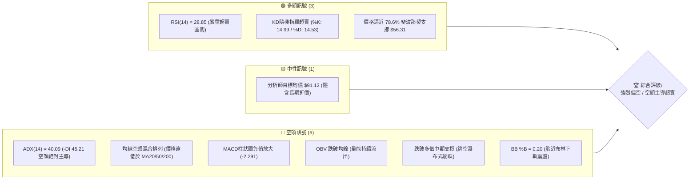
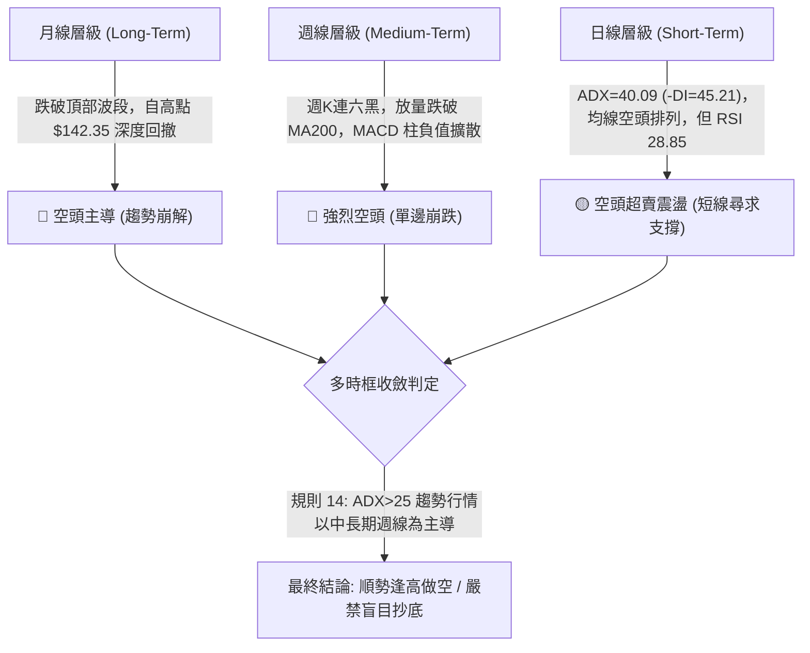
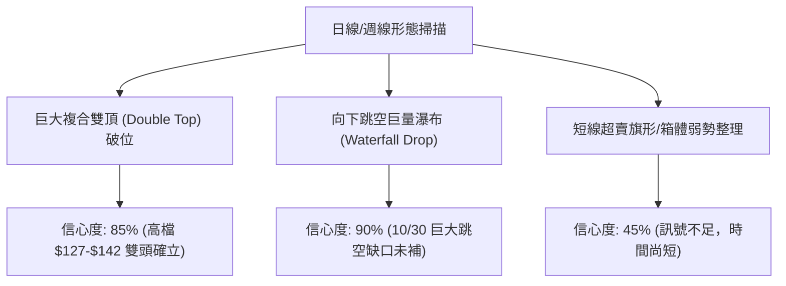
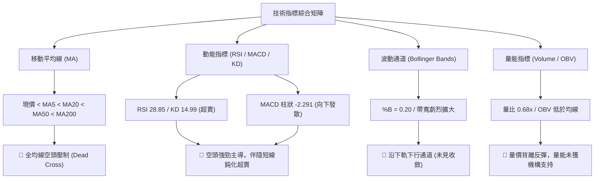
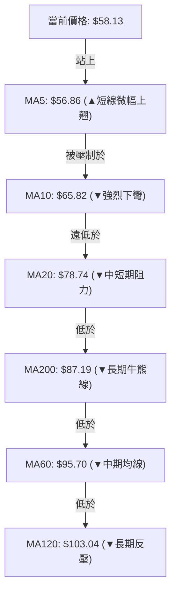
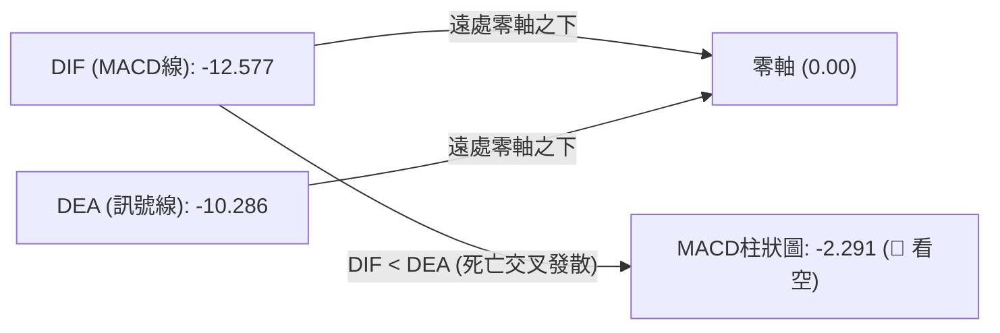
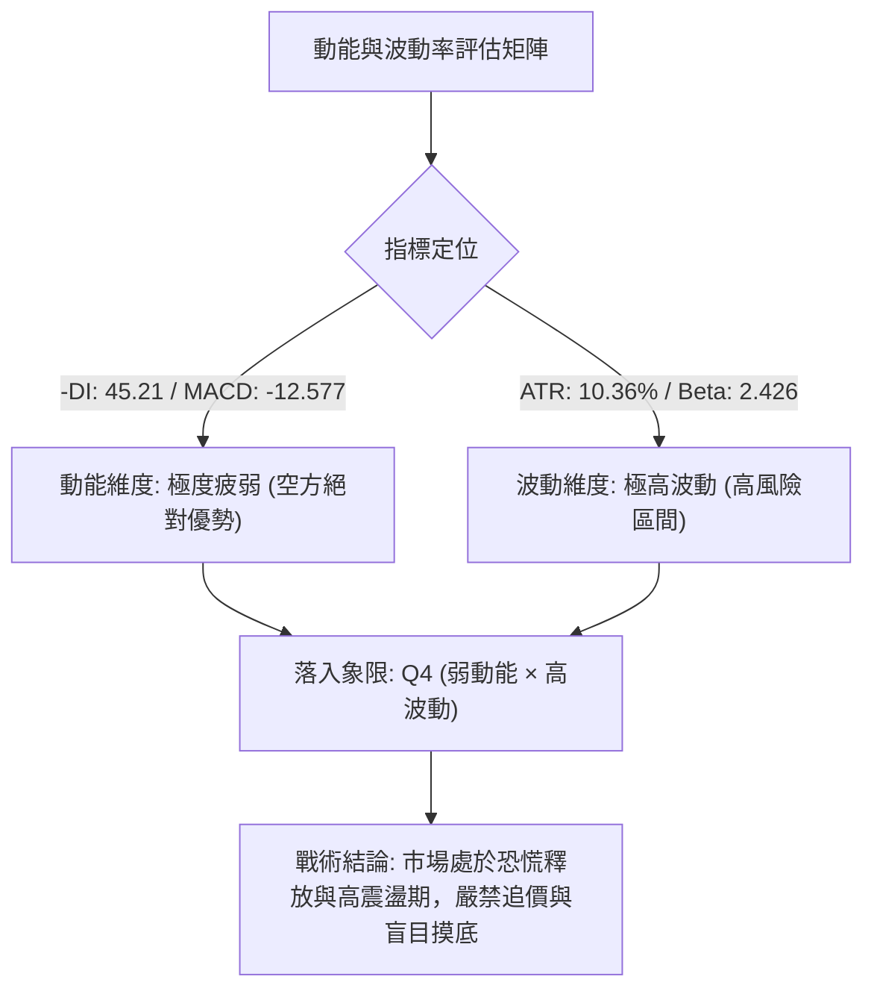
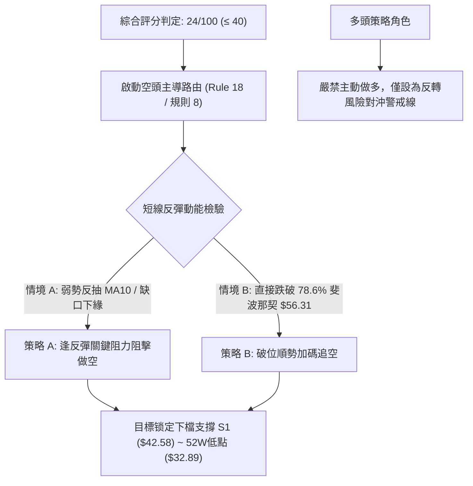
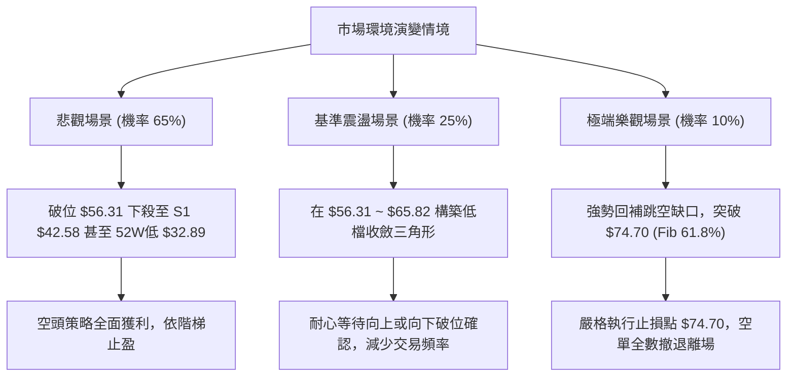

# INTC 技術分析報告

> **報告日期**：2026-11-11 ｜ **語言**：繁體中文 ｜ **數據來源**：Yahoo Finance ｜ **當前價格**：$58.13 USD

---

## 目錄

| 章節 | 內容 |
|------|------|
| [1. 技術面概覽](#1-技術面概覽) | 訊號儀表板、核心指標、評分卡 |
| [2. 趨勢分析](#2-趨勢分析) | 多時框趨勢、長中短期走勢 |
| [3. 圖表形態分析](#3-圖表形態分析) | 形態識別、K線組合、目標價 |
| [4. 支撐與阻力](#4-支撐與阻力) | 關鍵價位、斐波那契回調 |
| [5. 技術指標深度解讀](#5-技術指標深度解讀) | MA/RSI/MACD/布林/成交量 |
| [6. 動能與波動率](#6-動能與波動率) | 動能評估、ATR、Beta |
| [7. 多時框架總結](#7-多時框架總結) | 時框架評分矩陣 |
| [8. 交易策略建議](#8-交易策略建議) | 多空策略、風險報酬比 |
| [9. 風險提示與監控](#9-風險提示與監控) | 監控指標、風險場景 |
| [10. 報告總結](#10-報告總結) | 總覽儀表與核心結論 |

---

## 1. 技術面概覽

### 🎯 技術訊號儀表板



### 📊 核心指標速覽表

| 指標類別 | 指標名稱 | 當前數值 | 訊號 | 解讀 |
|:---|:---|:---|:---:|:---|
| **價格** | 當前收盤價 | $58.13 | 🔴 | 位於52週區間 23.1% 分位，結構極度疲弱 |
| **均線** | MA20 | $78.74 | 🔴 | 現價低於 MA20 達 -26.18%，乖離率偏大但趨勢向下 |
| **均線** | MA50 | $96.72 | 🔴 | 現價低於 MA50 達 -39.90%，中期空頭壓制堅固 |
| **均線** | MA200 | $87.19 | 🔴 | 跌破牛熊分界線 MA200，長期趨勢正式轉熊 |
| **動能** | RSI(14) | 28.85 | 🟢 | Wilder 計算值低於 30，短線具備技術性超賣反彈條件 |
| **動能** | MACD (12,26,9) | -12.577 / Hist -2.291 | 🔴 | 雙線位於零軸之下且柱狀圖向下發散，空頭動能強勁 |
| **動能** | KD 隨機指標 | %K: 14.99 / %D: 14.53 | 🟢 | 雙線處於 20 以下超賣鈍化區，隨時醞釀低檔金叉 |
| **趨勢強度** | ADX(14) | 40.09 (-DI: 45.21) | 🔴 | ADX > 25 且 -DI 壓倒性勝過 +DI (14.05)，強勁單邊空頭 |
| **通道** | 布林通道 | 上軌 $112.88 / 下軌 $44.61 | 🟡 | %B = 0.20，帶寬劇烈擴大，開口向下加速擴張 |
| **量能** | 成交量 / OBV | 100,389,700 (量比 0.68x) | 🔴 | 最新量能低於20日均量；OBV 顯著低於 MA，資金拋售流出 |
| **波動** | ATR(14) | $6.02 (10.36%) | 🔴 | 波動劇烈，單日波幅超過一成，交易風控要求極高 |

### 🏆 技術評分卡

```
╔══════════════════════════════════════════════════════════════╗
║              技術評分卡 — INTC (2026-11-11)                  ║
╠══════════════════════════════════════════════════════════════╣
║ 趨勢強度      ████░░░░░░░░░░░░░░░░  20/100  🔴 強烈看空       ║
║ 動能指標      █████░░░░░░░░░░░░░░░  25/100  🔴 動能極弱       ║
║ 支撐穩定度    ███████░░░░░░░░░░░░░  35/100  🔴 支撐下移       ║
║ 成交量配合    ████░░░░░░░░░░░░░░░░  20/100  🔴 空方放量       ║
║ 形態完整度    █████░░░░░░░░░░░░░░░  25/100  🔴 破位形態       ║
║ 均線排列      ████░░░░░░░░░░░░░░░░  19/100  🔴 全面承壓       ║
╠══════════════════════════════════════════════════════════════╣
║ 綜合評分      █████░░░░░░░░░░░░░░░  24/100  🔴 強烈偏空       ║
╚══════════════════════════════════════════════════════════════╝
```
> **評分計算說明**：（趨勢 20 + 動能 25 + 支撐 35 + 量能 20 + 形態 25 + 均線 19）÷ 6 = 144 ÷ 6 = 24/100。綜合評分為 24 分，按規則第 18 條，評分 ≤ 40 確立為偏空架構。

---

## 2. 趨勢分析

### 🌐 多時框趨勢分析



### 📈 長期趨勢 — 12個月走勢圖（Unicode）

依據過去 12 個月收盤數據（2025-12 至 2026-11），繪製月線 ASCII 價格走勢圖：

```
INTC 月線走勢圖（過去12個月：2025-12 至 2026-11）
價格 ($)
$140 ┤                       ● 2026-06 ($139.63 / 52W高點 $142.35)
$130 ┤                      / \
$120 ┤                     /   \     ● 2026-09 ($120.23 反彈次高)
$110 ┤                ●---●     \   / \
$100 ┤               / 05  06    \ /   \
 $90 ┤          ●---/             ●     \
 $80 ┤         / 04              07-08   \
 $70 ┤        /                           \
 $60 ┤       /                             ● 2026-10 ($65.76)
 $50 ┤  ●---●                               \
 $40 ┤ 01   02-03                             ● 2026-11 ($58.13 現價)
 $30 ┤● 2025-12 ($36.90)
     └─────────────────────────────────────────────────────────────
       12   01   02   03   04   05   06   07   08   09   10   11  (月份)
```

#### 走勢特徵分析表格

| 階段 | 期間 | 價格區間 | 累計漲跌幅 | 結構特徵與技術解讀 |
|:---|:---|:---:|:---:|:---|
| **啟動突破期** | 2025-12 ~ 2026-03 | $36.90 → $44.13 | +19.59% | 底部緩步墊高，突破 $40 整數關卡，蓄積上攻動能 |
| **主升浪噴出** | 2026-03 ~ 2026-06 | $44.13 → $139.63 | +216.41% | 暴利性主升浪，成交量極度放大，創下 52 週高點 $142.35 |
| **首波獲利了結**| 2026-06 ~ 2026-08 | $139.63 → $89.51 | -35.89% | 高檔獲利回吐，於 $90 關卡（MA200 附近）尋求短暫支撐 |
| **弱勢雙頂反抽**| 2026-08 ~ 2026-09 | $89.51 → $120.23 | +34.32% | 次級反彈未過前高，形成右側較低的波段高點（M頭右肩雛形）|
| **斷頭瀑布崩跌**| 2026-09 ~ 2026-11 | $120.23 → $58.13 | -51.65% | 破位崩跌，連續跳空殺穿 MA50、MA200，目前直逼下檔支撐 |

### 📊 中期趨勢（週線分析）

從近 8 週的收盤價與週成交量可清晰識別中期趨勢的崩壞過程：
1. **量價背離轉為放量殺跌**：2026-09-25 週K衝上 $123.00，但隨後三週量能未能跟進，形成連續陰線回落。
2. **關鍵頸線破位放巨量**：2026-10-30 該週放量至 861,628,000 股，單週暴跌 -24.38%（收 $65.76）；緊接著 2026-11-06 該週成交量進一步爆出 1,013,723,800 股（逾10億股天量），收盤跌至 $56.28。
3. **週線 MACD 徹底惡化**：週 MACD 柱狀圖由 2026-09-25 的 +2.925 劇烈翻負，連續降至 -1.941、-3.608，中線波段空頭結構完全確立。

```
週線支撐阻力結構示意：
[阻力 R3: $127.04] ══════ 波段雙頂頭部
       │
[阻力 R2: $107.13] ────── 反彈次高頸線
       │
[阻力 R1: $95.68]  ────── 10/28 高點與密集成交區（強大套牢蓋頭壓力）
       │
[現價 : $58.13]    ◄───── 弱勢反彈於 78.6% 回調位 $56.31 上方
       │
[支撐 S1: $42.58]  ══════ 近一年起漲波段關鍵平台低點聚類
```

### ⚡ 趨勢強度評估（ADX 解讀）

```mermaid
graph TD
    A["ADX(14) 讀數 = 40.09"] --> B{"ADX 門檻檢驗"}
    B -->|"> 25 強趨勢標準"| C["確認進入極強單邊趨勢行情 (非盤整震盪)"]
    D["方向指標對比"] --> E["-DI: 45.21"]
    D --> F["+DI: 14.05"]
    E & F --> G{"-DI 遠大於 +DI (差值 31.16)"| H["極度強烈之空方單邊主導趨勢"]
    C & H --> I["結論: 任何逆勢做多均屬高風險，策略必須順應空頭方向"]
```

| 指標變數 | 當前數值 | 參考臨界值 | 狀態評估 | 實戰指導含義 |
|:---|:---:|:---:|:---:|:---|
| **ADX(14)** | **40.09** | 25.00 / 40.00 | 進入極強趨勢區間 | 行情處於單邊發散，震盪指標（如 KD、RSI）會出現嚴重鈍化，不可單憑超賣逆勢摸底 |
| **+DI(14)** | **14.05** | 20.00 | 多頭進攻動能潰散 | 買盤力道極其萎縮，無力組織像樣的波段推升 |
| **-DI(14)** | **45.21** | 30.00 | 空頭實質絕對主控 | 賣壓宣洩猛烈，市場由主動拋售主導 |

---

## 3. 圖表形態分析

### 🔍 形態識別系統



#### 形態識別信心度與目標價評估表

| 形態名稱 | 信心度 | 判斷依據（引用數據） | 完成度 | 目標價（附嚴格計算式） |
|:---|:---:|:---|:---:|:---|
| **高檔複合雙頂破位** | **85%** | 第一頂 2026-06 ($139.63 / $142.35)，第二頂 2026-09 ($120.23 / R3 $127.04)；頸線跌破 R1 ($95.68)。 | 100% (已跌破) | 由雙頂形態高度推算：頸線 R1 $95.68 − 形態高度 ($127.04 − $95.68 = $31.36) = **$64.32**（已跌破抵達）。若以最高點 $142.35 計算，高度 $46.67，推算第二目標為 $95.68 − $46.67 = **$49.01**。 |
| **放量跳空崩跌裂口** | **90%** | 2026-10-30 日K向下跳空，開盤 $68.36 遠低於前日低點 $90.84，成交量爆出 455,599,400 股。 | 100% (完全成形) | 該缺口具備「突破型／逃逸型缺口」特徵，阻力區落在缺口上沿 **$90.84** 至 **$95.68**，在回補前趨勢保持極度看空。 |
| **底部雙底 / 築底形態** | **20%** | 數據中未偵測到有效底部形態；低點僅見 11-05 的 $51.51 與 11-06 的 $54.56，尚未構築頸線。 | 15% (未成形) | 依規則 15，信心度 < 50%，**判定為訊號不足，僅做超賣指標型解讀**，不予強行推算多頭目標價。 |

### 🕯️ 重要K線形態分析

嚴格依據數據中「近10根日K」與「近8根週K」之實際開高低收進行精準形態識別：

| 日期（週期） | 開盤價 | 最高價 | 最低價 | 收盤價 | K線形態名稱 | 技術解讀 | 訊號方向 |
|:---|:---:|:---:|:---:|:---:|:---|:---|:---:|
| **2026-10-29 (日K)** | $92.97 | $93.50 | $90.84 | $92.07 | 破位中黑K棒 | 實體跌破 $93 關鍵平台，預告高檔盤整失守，成交量擴至 1.34 億股 | 🔴 空方 |
| **2026-10-30 (日K)** | $68.36 | $68.77 | $63.20 | $65.76 | 災難性跳空大黑K | 巨大跳空低開 -26.5%，巨量 4.55 億股，恐慌拋盤奪門而出，奠定空頭格局 | 🔴 強空 |
| **2026-11-05 (日K)** | $56.51 | $56.73 | $51.51 | $52.25 | 長黑加速K棒 | 創下波段低點 $51.51，成交量 2.70 億股，跌破 $55 短暫防線 | 🔴 空方 |
| **2026-11-06 (日K)** | $54.99 | $57.32 | $54.56 | $56.28 | 低檔反彈小陽K | 下測低點不破，收盤高於開盤，帶動短線超賣技術修復 | 🟡 短多反彈 |
| **2026-11-09 (日K)** | $56.86 | $60.03 | $55.83 | $59.37 | 衝高小陽K (上影線) | 盤中上探 $60.03 遇阻回落，留下 $0.66 上影線，多頭上攻力度受限 | 🟡 中性 |
| **2026-11-10 (日K)** | $57.96 | $60.65 | $56.85 | $58.13 | 墓碑型十字流星K | 衝高至 $60.65 後承壓收於 $58.13，成交量驟減至 1.00 億股，量價背離滯漲 | 🔴 短線轉弱 |
| **2026-10-30 (週K)** | $87.94 | $95.68 | $63.20 | $65.76 | 長黑崩跌破位週K | 殺穿所有短中期均線，成交量爆量 8.61 億股，確立週線層級破位 | 🔴 強烈看空 |
| **2026-11-06 (週K)** | $65.40 | $65.72 | $51.51 | $56.28 | 十億天量錘子狀下影週K | 週量突破 10.13 億股，雖帶有下影線（最低 $51.51），但收盤仍在低位，顯示拋壓仍劇 | 🟡 空頭放量 |

### 📉 ASCII 走勢形態示意圖

```
INTC 近期日K走勢形態示意（2026-10-28 至 2026-11-10）
價格軸 ($)
$96 ┤ ● 10-28 高點 ($95.68 R1)
$92 ┤   ● 10-29 ($92.07)
$88 ┤     \
$84 ┤      \  [巨大跳空缺口 Gap: $68.77 ~ $90.84]
$80 ┤       \
$76 ┤        \
$72 ┤         \
$68 ┤          ● 10-30 跳空低開 ($68.36 / 收 $65.76)
$64 ┤           \
$60 ┤            ●---● 11-02~03 弱勢盤整 ($59.97~$60.55)      ● 11-10 流星線 ($60.65/$58.13)
$56 ┤                 \                                  / \
$52 ┤                  ● 11-05 殺跌波段低 ($51.51)      ●---● 11-06~09 反彈 ($56.28~$59.37)
    └──────────────────────────────────────────────────────────────────────────
      10-28  10-29  10-30  11-02  11-03  11-04  11-05  11-06  11-09  11-10
```

---

## 4. 支撐與阻力

### 🗺️ 關鍵價位分布圖（Unicode）

```
INTC 價位結構分布圖（嚴格依據 OHLCV 計算聚類與斐波那契點位）
═════════════════════════════════════════════════════════════════
$142.35 ║████████████████████████████████████║ 52W 最高點 / Fib 0.0%
$127.04 ║████████████████████████████        ║ 強阻力 R3 (雙頂次高峰聚類)
$107.13 ║████████████████████                ║ 阻力 R2 (中期波段高點聚類)
$100.54 ║▓▓▓▓▓▓▓▓▓▓▓▓▓▓▓▓▓▓▓▓                ║ Fib 38.2% 回調位
$ 95.68 ║████████████████████████████████    ║ 關鍵頸線阻力 R1 (10/28日高點聚類)
$ 87.62 ║▓▓▓▓▓▓▓▓▓▓▓▓▓▓▓▓                    ║ Fib 50.0% 多空分水嶺 (接近MA200 $87.19)
$ 78.74 ║████████████                        ║ 布林中軌 / MA20 阻力
$ 74.70 ║▓▓▓▓▓▓▓▓▓▓▓▓▓▓▓▓▓▓▓▓▓▓▓▓            ║ Fib 61.8% 黃金分割回調位
$ 58.13 ╠════════════════════════════════════╣ ◄ 當前收盤價 ($58.13)
$ 56.31 ║▓▓▓▓▓▓▓▓▓▓▓▓▓▓▓▓▓▓▓▓▓▓▓▓▓▓▓▓        ║ Fib 78.6% 極限支撐位
$ 44.61 ║██████████                          ║ 布林下軌支撐
$ 42.58 ║████████████████████████            ║ 關鍵支撐 S1 (近一年波段低點聚類)
$ 41.64 ║████████████████████                ║ 強支撐 S2 (波段密集成交低點)
$ 40.63 ║████████████████████████████        ║ 極限支撐 S3 (起漲波段底部聚類)
$ 32.89 ║████████████████████████████████████║ 52W 最低點 / Fib 100.0%
═════════════════════════════════════════════════════════════════
```

### 🚧 阻力位分析表

阻力位嚴格引用自「關鍵價位（由 OHLCV 計算）」區塊數值：

| 阻力級別 | 價位 | 與現價距離 | 形成原因與技術背景 | 突破難度 | 重要性 |
|:---|:---:|:---:|:---|:---:|:---:|
| **關鍵阻力 R1** | **$95.68** | +64.60% | 2026-10-28 跳空暴跌前之最後波段高點聚類，同時為 MA60 ($95.70) 與 MA50 ($96.72) 匯聚處 | 極高 | 🔴 核心牛熊防線 |
| **重要阻力 R2** | **$107.13** | +84.29% | 近一年多次反彈波段高點聚類，亦靠近 MA120 ($103.04) 長期均線反壓區 | 極高 | 🔴 中期多空門檻 |
| **強阻力 R3** | **$127.04** | +118.54% | 2026-09-25 週K波段高點 $127.44 與雙頂形態右側峰頂聚類，套牢籌碼沉重 | 難以逾越 | 🔴 長期頂部壓制 |

### 🛡️ 支撐位分析表

支撐位嚴格引用自「關鍵價位（由 OHLCV 計算）」區塊數值：

| 支撐級別 | 價位 | 與現價距離 | 形成原因與技術背景 | 守住機率 | 重要性 |
|:---|:---:|:---:|:---|:---:|:---:|
| **關鍵支撐 S1** | **$42.58** | -26.75% | 近一年起漲波段第一道低點聚類，亦接近 2026-03 突破平台起點 ($44.13) | 60% | 🟢 核心第一防線 |
| **強支撐 S2** | **$41.64** | -28.37% | 近一年密集換手之波段低點核心密集帶，籌碼防禦力較強 | 65% | 🟢 次級緩衝防線 |
| **極限支撐 S3** | **$40.63** | -30.10% | 2025-11 ($40.56) 月線歷史平台低點聚類，整數防守重鎮 | 75% | 🟢 多頭生命線 |

### 📐 斐波那契回調位分析

依據 52 週波動極值（低點 $32.89 → 高點 $142.35），計算各關鍵比例回調點位：

```
斐波那契回調階梯與現價定位：
 0.0% (52W High)  $142.35 ────────────────────────────────────── 頂部極值
23.6%             $116.52 ────────────────────────────────────── 已失守
38.2%             $100.54 ────────────────────────────────────── 整數關卡失守
50.0%             $ 87.62 ────────────────── MA200 ($87.19) 匯聚處（已跌破）
61.8%             $ 74.70 ────────────────── 黃金分割關鍵反轉位（已跌破）
[當前收盤價]      $ 58.13 ◄─── 位於 78.6% 與 61.8% 之間震盪
78.6%             $ 56.31 ────────────────── 短線最後防線（距現價僅 -3.13%）
100.0% (52W Low)  $ 32.89 ────────────────────────────────────── 起漲原點
```

#### 斐波那契深度解讀
- **現價定位**：INTC 當前收盤價 **$58.13** 介於 **78.6% ($56.31)** 與 **61.8% ($74.70)** 之間。
- **技術意義**：在經典技術分析理論中，當股價跌破 61.8%（$74.70）防線後，代表原本的多頭推升浪潮已徹底瓦解，回調性質轉變為實質反轉；目前價格正直接考驗深層回調的最後關卡 78.6%（$56.31）。若日線收盤確認跌破 $56.31，下方將直接回測 100.0%（52週低點 **$32.89**）以及波段支撐群 S1 ($42.58) ~ S3 ($40.63)。

---

## 5. 技術指標深度解讀

### 🎛️ 指標訊號總覽



### 📈 移動平均線排列分析



#### 均線數據深度對比

| 均線名稱 | 數值 | 與現價乖離率 | 排列型態 | 趨勢研判與戰術意義 |
|:---|:---:|:---:|:---:|:---|
| **MA 5** | $56.86 | +2.23% | ▲ 微幅走揚 | 連續 3 個交易日收高帶動短期均線收復，提供極短線極弱支撐 |
| **MA 10** | $65.82 | -11.68% | ▼ 快速下墜 | 短線第一道反彈強阻力，空方首要攔截線 |
| **MA 20** | $78.74 | -26.18% | ▼ 陡峭下行 | 布林中軌所在，中期趨勢生命線，未站上前中期空頭不變 |
| **MA 60** | $95.70 | -39.26% | ▼ 加速下彎 | 季線下壓，與阻力 R1 ($95.68) 完全重疊，構成中期天花板 |
| **MA 200**| $87.19 | -33.33% | ▼ 跌破下行 | 2026-10 破位殺穿年線，宣告長達數月之牛市推升浪正式終結 |
| **均線排列綜合** | **混合偏空** | — | **空頭發散** | 長短期均線呈現「由上而下遞減」之空頭空手排列，任何反彈皆屬乖離修正 |

### 📉 RSI(14) 分析

#### RSI 數值進度條
```
RSI(14) 讀數: 28.85
[███████░░░░░░░░░░░░░░░░░] 28.85% (超賣區間 < 30)
 0      20   30          50          70   80     100
             ▲(當前位置 28.85)
```
- **超買超賣判定**：RSI 讀數為 **28.85**（Wilder 計算），已跌入 30 以下之嚴重超賣區域，顯示短線市場拋售情緒極度宣洩，短線容易觸發技術性抽頭或空頭回補。
- **背離分析**：依據近 20 根 K 棒的首尾價格與指標方向比對，價格自高位崩跌，RSI 亦同步從高點摜入低檔，**目前無明顯底背離（無背離）**。這表明價格的下跌完全由強勁賣盤動能所驅使，尚未出現「價格創低而動能衰竭」的止跌反轉訊號。

### 📊 MACD(12,26,9) 訊號解讀



- **柱狀圖動態**：當前 MACD 數值為 **-12.577**，訊號線為 **-10.286**，MACD Hist 為 **-2.291**。柱狀圖持續處於顯著負值區間，代表空方動能仍佔據主導，綠柱未見快速收斂，尚未形成任何黃金交叉轉折。

### 📦 布林通道分析

```
INTC 布林通道（20, 2）位置示意
價格軸 ($)
$112.88 ┼──────────────────────────────────────── 布林上軌 (Upper Band)
        │
 $95.81 ┼
        │
 $78.74 ┼──────────────────────────────────────── 布林中軌 (MA20 Middle Band)
        │
 $61.67 ┼
 $58.13 ┼········································ 現價 ($58.13, %B = 0.20)
 $44.61 ┼──────────────────────────────────────── 布林下軌 (Lower Band)
```

- **布林帶寬與 %B 解讀**：布林帶寬（Bandwidth = ($112.88 − $44.61) ÷ $78.74 = 86.70%）呈現巨幅擴張狀態，顯示市場處於極高波動的單邊趨勢；**%B 數值為 0.20**，表明價格緊貼下軌下行，屬於典型的空頭強勢走勢。

### 💹 成交量分析（量價配合度）

1. **量能縮水與反彈無力**：最新成交量為 **100,389,700 股**，相較 20 日均量 **148,260,065 股**，量比僅 **0.68x**。近幾日價格自 $51.51 反彈至 $58.13，但成交量卻由 11-05 的 2.70 億股連續萎縮至 1.00 億股，呈現典型的「**價漲量縮**」空頭量價背離。
2. **OBV 趨勢檢驗**：OBV 指標持續位於其均線下方，資金流向呈現淨流出。機構在 10/30 與 11/06 兩週狂倒超過 18 億股，而當前的反彈僅為散戶與空頭平倉買盤，缺乏大型機構主力建倉進場跡象。

---

## 6. 動能與波動率

### ⚡ 動能評估四象限



#### 動能與波動率象限分析表

| 象限 | 動能維度 | 波動維度 | 象限特徵 | INTC 當前定位 | 投資評估與行動指南 |
|:---:|:---:|:---:|:---|:---:|:---|
| **Q1** | 強 (多頭) | 低波動 | 穩步推升、低風險主升 | — | 最佳波段做多環境 |
| **Q2** | 弱 (盤整) | 低波動 | 橫盤收斂、動能衰竭 | — | 觀望等待方向突破 |
| **Q3** | 強 (多頭) | 高波動 | 暴漲暴跌、情緒亢奮 | — | 高風險高收益博弈 |
| **Q4** | **弱 (空頭)** | **高波動** | **恐慌殺跌、巨幅震盪** | **✓ (當前狀態)** | **避免逆勢進場；適合空頭逢高佈局或場外觀望** |

### 📊 ATR 波動率分析

- **ATR 數值**：ATR(14) 讀數高達 **$6.02 USD**，佔當前股價比例達 **10.36%**（Wilder 計算）。
- **實戰指導與止損設置**：
  - 由於 INTC 單日預期常態波動超過 $6 元，過窄的止損極易被市場雜訊掃出場。
  - **保本型止損距離**：至少需保留 1.0 × ATR = **$6.02**。
  - **趨勢型止損距離**：需設置 1.5 ~ 2.0 × ATR = **$9.03 ~ $12.04**。
  - 倉位規模必須嚴格縮減至平常的 30%~50%，以吸收單日逾 10% 的巨大價格震盪。

### 📐 Beta 與市場相關性

- **Beta 係數**：**2.426**。
- **解讀**：INTC 的系統性風險敞口是大盤（S&P 500）的 2.426 倍。當前大盤若回檔 1%，INTC 技術面預期跌幅將擴大至 2.4% 以上；在高 Beta 疊加個股破位利空背景下，下行風險被高度放大。

---

## 7. 多時框架總結

### 📋 時框架評分表

| 時框架 | 趨勢方向 | 動能狀態 | 均線排列 | 形態識別 | 綜合評分 | 戰術建議 |
|:---|:---:|:---:|:---:|:---:|:---:|:---|
| **月線 (長期)** | 🔴 轉空 | 負值擴大 | 跌破 MA20，測試年線 | 歷史大雙頂破位 | 25/100 | 長期投資者宜減碼避險 |
| **週線 (中期)** | 🔴 強空 | MACD柱連擴 | 跌破全部週均線 | 十億天量破位瀑布 | 15/100 | 中期順勢建立放空倉位 |
| **日線 (短期)** | 🟡 超賣反彈 | RSI<30 / KD低檔 | 全空頭排列 (壓制於MA10) | 弱勢低檔箱體盤整 | 32/100 | 短線超賣反彈，逢高尋求空點 |

### 🔲 綜合訊號矩陣

```
時框訊號一致性矩陣：
┌──────────────┬───────────────┬───────────────┬───────────────┐
│  分析維度    │   短期 (日線) │   中期 (週線) │   長期 (月線) │
├──────────────┼───────────────┼───────────────┼───────────────┤
│ 趨勢方向     │ 🟡 震盪尋底   │ 🔴 單邊暴跌   │ 🔴 破位下行   │
│ 均線系統     │ 🔴 空頭壓制   │ 🔴 死亡交叉   │ 🔴 跌破牛熊線 │
│ 動能指標     │ 🟢 極度超賣   │ 🔴 強空未竭   │ 🔴 轉弱下行   │
│ 量能配合     │ 🔴 反彈價增量縮│ 🔴 週天量殺跌 │ 🔴 出貨跡象   │
│ 形態結論     │ 🟡 弱勢整理   │ 🔴 雙頂頸線破 │ 🔴 頂部成形   │
└──────────────┴───────────────┴───────────────┴───────────────┘
  綜合判定：長中期空頭方向達成高度共識（85% 空頭一致性）
```

### ⚖️ 多時框收斂結論

依據【嚴格要求 14】之多時框收斂規則：
1. **行情屬性判定**：當前 ADX(14) 讀數為 **40.09 > 25**，確立市場處於**強烈的單邊趨勢行情**，而非無方向之低波動盤整。
2. **時框優先級裁決**：在 ADX > 25 的趨勢行情中，**必須以中長期（週線／MA50、MA200）方向為絕對主導**。日線級別出現的 RSI 超賣（28.85）與 KD 低檔鈍化，僅能視為超跌帶來的短期乖離修正，絕不可視為反轉做多依據。
3. **唯一方向性結論**：**極度偏空（強烈看空，逢反彈做空）**。所有交易規劃必須順應週線瀑布式下行的空頭主浪，利用日線反彈受阻於均線壓力時建立空頭部位。

---

## 8. 交易策略建議

### 🗺️ 策略決策流程圖



### 🧭 策略路由

> **當前主策略方向 = 強烈偏空（做空主導，依評分 24/100）**
> 依據嚴格要求規範，綜合評分 24/100（≤ 40）觸發**主推空頭策略**分流，多頭操作僅列為極短線對沖提示，嚴禁兩頭下注。

### 🎯 價格情境階梯（Price Scenarios）

價位嚴格引用自第 4 章「關鍵價位與斐波那契」精確數值：

| 觸發條件 | 下一目標 | 後續延伸 | 情境含義 | 應對戰術 |
|:---|:---:|:---:|:---|:---|
| **上破阻力 R1 $95.68** | R2 $107.13 | R3 $127.04 | 扭轉中期破位結構，多頭反攻 | 徹底停損所有空單，空翻多 |
| **反彈受阻 MA10 $65.82** | 測試現價 $58.13 | 跌向 S1 $42.58 | 超賣修復完畢，主跌浪延續 | **主推做空進場點（策略 A）** |
| **跌破 Fib 78.6% $56.31** | S1 $42.58 | S2 $41.64 / S3 $40.63 | 跌破最後防線，開啟破位下殺 | **主推破位做空點（策略 B）** |
| **跌破支撐 S1 $42.58** | 52W低點 $32.89 | 尋求歷史底點 | 恐慌崩盤深化，下行空間全面打開 | 順勢持有空單並下移移動止損 |

### 📊 情境機率分佈

| 情境劇本 | 機率 | 主要依據（指標狀態與量價關係） |
|:---|:---:|:---|
| **劇本一：逢反彈後續跌 / 破位殺跌** | **65%** | ADX=40.09 強趨勢確立；-DI=45.21 壓制；全均線空頭排列；週K爆十億天量拋售。 |
| **劇本二：於 $56.31~$65.82 區間震盪** | **25%** | RSI 28.85 處於超賣區；短期波動過大致使空頭獲利回補，在低檔進行籌碼換手。 |
| **劇本三：強勢 V 型反轉回補缺口** | **10%** | 除非有基本面極端利多，否則上方 $68.77~$90.84 巨大套牢缺口壓頂，機率極低。 |

### 🟢 主策略詳情（空頭主導策略）

嚴格依據規則 17 計算風險報酬比：$(Entry − T1) ÷ (Stop − Entry)$。

| 策略要素 | 策略 A（反彈阻力做空） | 策略 B（破位追擊做空） |
|:---|:---|:---|
| **策略類型** | 逢高放空（反彈衰竭進場） | 破位放空（順勢破位進場） |
| **進場條件** | 價格反彈至 MA10 附近受阻，日K收出上影線或黑K | 日線收盤實體跌破斐波那契 78.6% 回調位 $56.31 |
| **進場價格** | **$65.82**（精確引用 MA10 數值） | **$56.31**（精確引用 Fib 78.6% 數值） |
| **止損價格** | **$74.70**（精確引用 Fib 61.8% 壓力） | **$60.65**（精確引用 11-10 日K/週K最高價） |
| **目標價 T1** | **$42.58**（精確引用 關鍵支撐 S1） | **$42.58**（精確引用 關鍵支撐 S1） |
| **目標價 T2** | **$32.89**（精確引用 52W 最低點 / Fib 100.0%） | **$40.63**（精確引用 極限支撐 S3） |
| **風險空間** | Stop − Entry = $74.70 − $65.82 = **$8.88** | Stop − Entry = $60.65 − $56.31 = **$4.34** |
| **利潤空間 (T1)**| Entry − T1 = $65.82 − $42.58 = **$23.24** | Entry − T1 = $56.31 − $42.58 = **$13.73** |
| **利潤空間 (T2)**| Entry − T2 = $65.82 − $32.89 = **$32.93** | Entry − T2 = $56.31 − $40.63 = **$15.68** |
| **風險報酬比** | **1 : 2.62（以 T1 計）** ｜ [1 : 3.71（以 T2 計）] | **1 : 3.16（以 T1 計）** ｜ [1 : 3.61（以 T2 計）] |
| **成功機率** | **65%** | **60%** |
| **建議倉位** | **15%**（總資金佔比） | **10%**（總資金佔比） |

*算式驗證：*
- *策略 A (T1): $23.24 ÷ $8.88 = 2.617 → **1 : 2.62***
- *策略 A (T2): $32.93 ÷ $8.88 = 3.708 → **1 : 3.71***
- *策略 B (T1): $13.73 ÷ $4.34 = 3.163 → **1 : 3.16***
- *策略 B (T2): $15.68 ÷ $4.34 = 3.612 → **1 : 3.61***

### 🔴 反向風險觸發點（對沖提示）

若出現以下情境，說明空頭主浪遭遇強烈逆轉，必須強制平倉空單並啟動風控：
1. **價格突破收復 Fib 61.8% ($74.70)**：若日線以大陽線帶量站穩 $74.70 之上，代表 10/30 跳空缺口下沿被回補，超賣修復演變為實質趨勢反轉，空頭主策略全數失效，強制停損。
2. **日線 RSI 出現背離上穿 50 中軸**：若 RSI 突破 50 並伴隨成交量放大至 2 億股以上，空頭必須無條件平倉觀望。

### ⭐ 整體訊號強度評星

```
╔══════════════════════════════════════════════════════════════╗
║ 做多訊號強度：★☆☆☆☆  (1.0/5星 — 僅超賣技術指標，無形態支撐)║
║ 做空訊號強度：★★★★☆  (4.5/5星 — 趨勢、均線、量能高度共振看空)║
║ 整體可信度：  ★★★★☆  (4.0/5星 — 數據結構清晰，大成交量背書)║
╚══════════════════════════════════════════════════════════════╝
```

---

## 9. 風險提示與監控

### ✅ 關鍵監控指標 Checklist

```
╔══════════════════════════════════════════════════════════════╗
║              INTC 每日盤面風控監控清單 (Checklist)           ║
╠══════════════════════════════════════════════════════════════╣
║ [ ] 監控點 1: 斐波那契 78.6% 支撐 $56.31 是否失守 (破位訊號)   ║
║ [ ] 監控點 2: MA10 ($65.82) 反抽是否出現縮量滯漲 (加空訊號)   ║
║ [ ] 監控點 3: 成交量是否異常放大至 2.5 億股以上 (主力換手訊號) ║
║ [ ] 監控點 4: 日線 RSI(14) 是否站上 40 或形成底背離 (止跌訊號) ║
║ [ ] 監控點 5: ATR(14) 是否收斂至 $4.00 以下 (波動收斂訊號)   ║
║ [ ] 監控點 6: 阻力 R1 ($95.68) 與 MA200 牛熊分界線動態變化    ║
╚══════════════════════════════════════════════════════════════╝
```

### ⚠️ 風險場景分析



### 🛡️ 風險管理重要提醒

1. **ATR 波動風險管控**：目前 ATR(14) 高達 **$6.02**（佔股價 10.36%），意味著盤中任意 5%~10% 的劇烈洗盤皆屬常態。交易者**絕對不可使用全額或高槓桿部位**，單筆交易虧損額度必須嚴格限制在總資產的 1.0%~1.5% 以內。
2. **缺口引力風險**：上方 $68.77 至 $90.84 的巨大跳空缺口具備高度技術意義。在單邊暴跌趨勢中，市場偶爾會出現猛烈的「空頭踩踏式軋空（Short Squeeze）」，若進場做空必須設置嚴格止損，切忌在缺乏止損保護下盲目扛單。
3. **高 Beta 疊加風險**：Beta 達 **2.426**，半導體產業板塊若受大盤疲弱拖累，跌勢將加劇。空頭部位可適度作為投資組合中多頭部位的對沖工具，但仍需隨時監控科技板塊整體資金流向。

---

## 10. 報告總結

```
╔════════════════════════════════════════════════════════════════╗
║                   INTC 技術分析報告總結                        ║
╠════════════════════════════════════════════════════════════════╣
║ 報告日期：2026-11-11                                          ║
║ 當前價格：$58.13 USD                                          ║
║ 分析評級：🔴 強烈看空 / 空頭主導超賣 (綜合評分: 24/100)        ║
╠════════════════════════════════════════════════════════════════╣
║ 關鍵結論：                                                     ║
║ ├─ 長期趨勢：🔴 跌破 MA200 ($87.19)，自 $142.35 展開深幅崩跌   ║
║ ├─ 中期趨勢：🔴 週K十億天量跳空破位，ADX=40.09 空方極強趨勢  ║
║ ├─ 短期趨勢：🟡 RSI=28.85 嚴重超賣，承壓於 MA10 ($65.82) 弱勢 ║
║ ├─ 關鍵支撐：S1 $42.58 ｜ Fib 78.6% $56.31 ｜ S2 $41.64        ║
║ ├─ 關鍵阻力：MA10 $65.82 ｜ Fib 61.8% $74.70 ｜ R1 $95.68      ║
║ └─ 估值參考：分析師目標均價 $91.12 (短期受技術面嚴重壓制)      ║
╠════════════════════════════════════════════════════════════════╣
║ 最優策略組合：                                                 ║
║ 1. 🥇 最佳機會：策略 A — 反彈至 MA10 ($65.82) 受阻做空        ║
║                 (止損 $74.70，目標 $42.58，風報比 1 : 2.62)    ║
║ 2. 🥈 次選機會：策略 B — 破位 Fib 78.6% ($56.31) 順勢追空      ║
║                 (止損 $60.65，目標 $42.58，風報比 1 : 3.16)    ║
║ 3. 🥉 保守選擇：場外空倉觀望，等待日線構築有效雙底或回補缺口  ║
╚════════════════════════════════════════════════════════════════╝
```

---

> ⚠️ **免責聲明**：本報告為 AI 自動生成之技術分析研究，所有數據、指標評估與價位推算均嚴格基於所提供之歷史價格與量能資訊（OHLCV）。本報告**僅供學術研究與參考**，**不構成任何要約、招攬或具體投資建議**。金融市場具有高度風險，投資人應獨立評估風險，並自行承擔交易盈虧。

---
*報告生成時間：2026-11-11 ｜ 數據來源：Yahoo Finance ｜ 分析框架：多時框技術分析體系*