# INTC 技術分析報告

> **報告日期**：2026-11-12 ｜ **語言**：繁體中文 ｜ **數據來源**：Yahoo Finance ｜ **當前價格**：$62.50

---

## 目錄

| 章節 | 內容 |
|------|------|
| [1. 技術面概覽](#1-技術面概覽) | 訊號儀表板、核心指標、評分卡 |
| [2. 趨勢分析](#2-趨勢分析) | 多時框趨勢、長中短期走勢、12個月走勢圖、ADX 解讀 |
| [3. 圖表形態分析](#3-圖表形態分析) | 形態識別、信心度評估、近10日/8週K線組合、目標價推算 |
| [4. 支撐與阻力](#4-支撐與阻力) | 關鍵價位結構、阻力位分析、支撐位分析、斐波那契回調 |
| [5. 技術指標深度解讀](#5-技術指標深度解讀) | 均線系統、RSI背離、MACD、布林通道、成交量與OBV |
| [6. 動能與波動率](#6-動能與波動率) | 動能四象限、ATR波動率與止損設定、Beta與市場相關性 |
| [7. 多時框架總結](#7-多時框架總結) | 時框架評分表、多維訊號矩陣、多時框收斂唯一結論 |
| [8. 交易策略建議](#8-交易策略建議) | 策略路由、價格情境階梯、主策略詳情、反向風險觸發 |
| [9. 風險提示與監控](#9-風險提示與監控) | 關鍵監控Checklist、情境路徑分析、倉位與風控指引 |
| [📋 報告總結](#-報告總結) | 核心技術結論與最優策略組合一覽 |

---

## 1. 技術面概覽

### 🎯 技術訊號儀表板

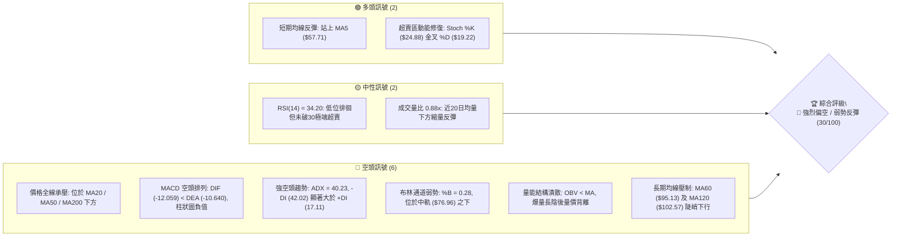

### 📊 核心指標速覽表

| 指標類別 | 指標名稱 | 當前數值 | 訊號 | 解讀 |
|----------|----------|----------|------|------|
| **價格** | 當前收盤價 | $62.50 | 🔴 | 位於52週區間27.1%，自高點$142.35深度回撤-56.10% |
| **均線** | MA20 | $76.96 | 🔴 | 現價低於MA20達-18.79%，中期下行趨勢極為陡峭 |
| **均線** | MA50 | $96.19 | 🔴 | 現價大幅落後MA50，上方堆積巨量套牢籌碼 |
| **均線** | MA200 | $87.28 | 🔴 | 現價低於年線，且MA20已跌破MA200，形成中長線結構性破位 |
| **動能** | RSI(14) | 34.20 | 🟡 | 位於弱勢區間（30–40），動能疲軟，未進入極端超賣（<30） |
| **動能** | MACD (12,26,9) | -12.059 / -10.640 | 🔴 | MACD線位於訊號線下方，柱狀圖-1.419，空頭動能仍居絕對主導 |
| **動能** | Stoch %K / %D | 24.88 / 19.22 | 🟢 | 低檔超賣區初現黃金交叉，短線具備技術性修復動能 |
| **趨勢** | ADX(14) / ±DI | 40.23 (-DI: 42.02) | 🔴 | ADX>40顯示極強單邊趨勢，-DI大幅壓制+DI(17.11)，空方絕對主控 |
| **通道** | 布林通道 (%B) | 0.28 (寬度$67.18) | 🔴 | 價格緊貼下半軌運行，帶寬顯著放大，波動率呈現向下宣洩態勢 |
| **波動** | ATR(14) | $6.02 (9.63%) | 🔴 | 日內波動幅度極高，市場恐慌拋壓未完全平復，洗盤劇烈 |
| **成交量** | 20日量比 / OBV | 0.88x / OBV < MA | 🔴 | 彈升過程成交量未能放大，OBV低於均線確認資金外流趨勢未改 |

### 🏆 技術評分卡

```
╔══════════════════════════════════════════════════════════════╗
║              技術評分卡 — INTC (2026-11-12)                 ║
╠══════════════════════════════════════════════════════════════╣
║  趨勢強度      ██████░░░░░░░░░░░░░░  30/100  🔴 極度偏空   ║
║  動能指標      ███████░░░░░░░░░░░░░  35/100  🔴 動能疲弱   ║
║  支撐穩定度    ███████░░░░░░░░░░░░░  35/100  🟡 考驗前低   ║
║  成交量配合    ██████░░░░░░░░░░░░░░  30/100  🔴 量價背離   ║
║  形態完整度    ██████░░░░░░░░░░░░░░  30/100  🔴 破位結構   ║
║  均線排列      ████░░░░░░░░░░░░░░░░  20/100  🔴 空頭排列   ║
╠══════════════════════════════════════════════════════════════╣
║  綜合評分      ██████░░░░░░░░░░░░░░  30/100  🔴 強烈偏空   ║
║  評級結論：六項指標算術平均為 30/100，技術結構處於空頭破位反彈階段 ║
╚══════════════════════════════════════════════════════════════╝
```

---

## 2. 趨勢分析

### 🌐 多時框趨勢分析

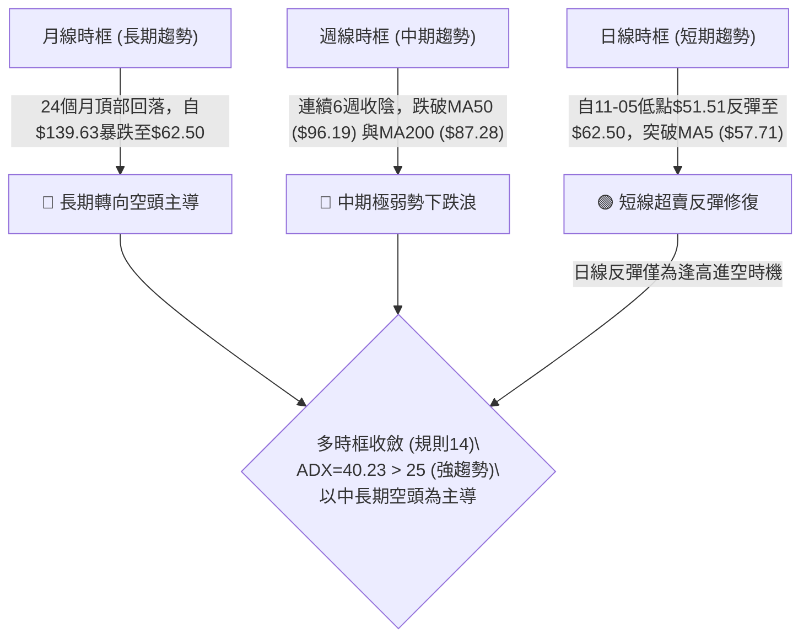

### 📈 長期趨勢 — 12個月走勢圖（Unicode）

以下圖表完整呈現 INTC 過去 12 個月（2025-12 至 2026-11）的收盤價波動軌跡：

```
INTC 月線收盤走勢圖（2025-12 至 2026-11）
價格軸 ($)
$140 ┤                                 ● $139.63 (2026-06 歷史波段高點)
$130 ┤                                ╱ ╲
$120 ┤                               ╱   ╲           ● $120.23 (2026-09 次高點)
$110 ┤                         ● $114.68   ╲         ╱ ╲
$100 ┤                        ╱             ╲       ╱   ╲
 $90 ┤                 ● $94.48              ●━━━━━●     ╲
 $80 ┤                ╱                   $90.20 $89.51   ╲
 $70 ┤               ╱                                     ╲
 $60 ┤              ╱                                       ● $65.76 / ● $62.50 (現價)
 $50 ┤       ●━━━━━● $45.61 / $44.13
 $40 ┤● $46.47
 $30 ┤● $36.90
     └─────────────────────────────────────────────────────────────────
       12   01   02   03   04   05   06   07   08   09   10   11 (月份)
      2025 <------------------------ 2026 ------------------------->
```

#### 走勢特徵分析表格

| 階段區間 | 月份起訖 | 起始與終止價 | 區間漲跌幅 | 走勢特徵與量價量化結構 |
|----------|----------|--------------|------------|------------------------|
| **第 I 階段：低檔蓄勢** | 2025-11 ~ 2026-03 | $40.56 → $44.13 | +8.80% | 於 $36.90~$46.47 構築底部箱體，振幅收斂，籌碼充分換手 |
| **第 II 階段：主升暴動** | 2026-03 ~ 2026-06 | $44.13 → $139.63 | **+216.40%** | 單邊噴出走勢，連續突破整數關卡，於 2026-06 觸及月線收盤頂點 |
| **第 III 階段：高位派發**| 2026-06 ~ 2026-09 | $139.63 → $120.23| -13.89% | 自高位巨幅下挫至 $89.51 後強拉至 $120.23 構築雙重頂部派發結構 |
| **第 IV 階段：跳水崩跌** | 2026-09 ~ 2026-11 | $120.23 → $62.50 | **-48.02%** | 出現結構性雪崩，跌破各級均線，10月及11月連續長黑灌破頸線 |

### 📊 中期趨勢（週線分析）

```
INTC 週線關鍵波段壓力與支撐示意圖
══════════════════════════════════════════════════════════════
$127.04 ─── 頂部反壓 R3 (近一年波段高點聚類)
              │
$107.13 ─── 次級阻力 R2 (派發區下沿壓力)
              │
 $95.68 ─── 強阻力 R1 (2026-10-30 週K反彈高點 / 近一年波段聚類)
              │
 $87.28 ─── MA200 牛熊分界線 (中長線核心反壓)
              │
 $76.96 ─── MA20 / BB中軌 (週線反彈第一重防線)
              │
 $62.50 ═══ 當前價格 (現價落於斐波那契 78.6% $56.31 之上)
              │
 $42.58 ─── 波段支撐 S1 (近一年波段低點聚類)
              │
 $41.64 ─── 次級支撐 S2 (密集支撐帶)
              │
 $32.89 ─── 52W 最低點 (100.0% 斐波那契終極防線)
══════════════════════════════════════════════════════════════
```

### ⚡ 趨勢強度評估（ADX 解讀）

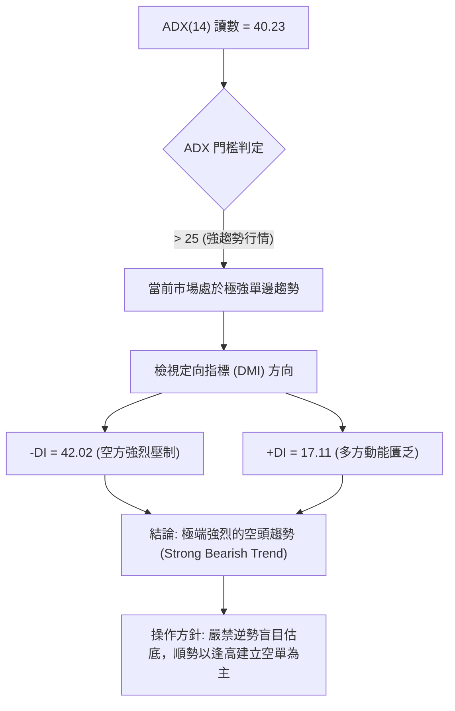

#### ADX 強度量化對照表

| 指標名稱 | 實際數值 | 參考閾值 | 市場狀態解讀 | 趨勢主導權 |
|----------|----------|----------|--------------|------------|
| **ADX(14)** | **40.23** | > 25 (趨勢確立) / > 40 (極強單邊) | 市場處於高動能單邊下行行情，盤整震盪策略完全失效 | 空方全面主控 |
| **+DI** | **17.11** | > 20 為多方活躍 | 多頭進攻意願低落，反彈僅屬空頭回補性質 | 極度弱勢 |
| **-DI** | **42.02** | > 25 為空方掌控 | 賣壓宣洩強烈，下行動能保持充沛擴張狀態 | 絕對主導 |
| **DI 差值** | **-24.91**| 負值擴大 | 空方動能領先優勢高達 24.91 點，下行通道穩固 | 空方佔優 |

---

## 3. 圖表形態分析

### 🔍 形態識別系統

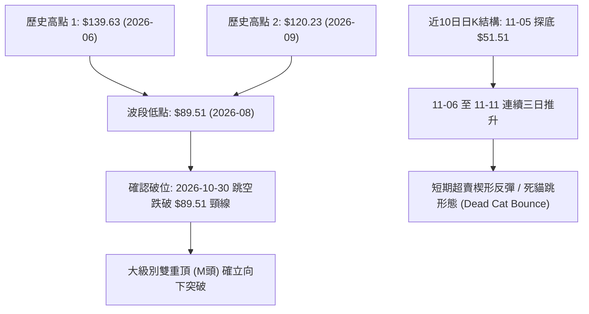

#### 形態識別與信心度量化評估

| 形態名稱 | 信心度 (%) | 判斷依據（嚴格引用數據） | 完成度 (%) | 目標價（精確附計算式） |
|----------|------------|--------------------------|------------|------------------------|
| **雙重頂 (M頭)** | **85%** | 高點1 ($139.63) 與高點2 ($120.23) 構成雙頂，2026-10-16 收 $89.85 正式跌破頸線 $89.51 | **100% (已破位)** | 頸線 $89.51 − 形態高度 ($139.63 − $89.51 = $50.12) = **$39.39**（極接近支撐帶 S3 $40.63） |
| **空頭下飄旗形** | **70%** | 10-30 巨量長黑跳水至 $65.76 後，近6日於 $51.51~$64.06 進行斜向上收斂反抽 | **60% (進行中)** | 旗桿高點 $92.07 − 旗桿底部 $52.25 = $39.82；自突破點 $62.50 順延推算下行目標為 **$22.68**（數據中未偵測到該價位，以 S1 $42.58 為保守下限） |
| **短期雙底反彈** | **35%** | 11-05 低點 $51.51 與 11-06 低點 $54.56 初具止跌，但未突破短線頸線 $64.06 | **30% (信心度<50%)** | 訊號不足，僅做超賣指標型技術性解讀，不視為確立翻轉形態 |

### 🕯️ 重要 K 線形態分析

嚴格依據提供的「近10根日K」與「近8根週K」四價數據進行專業形態解讀：

#### 近10根日K形態精確拆解

| 日期 | 開盤價 | 最高價 | 最低價 | 收盤價 | K線形態名稱 | 技術解讀與量價關係 | 訊號方向 |
|------|--------|--------|--------|--------|-------------|--------------------|----------|
| **2026-10-29** | $92.97 | $93.50 | $90.84 | $92.07 | 窄幅陰十字 | 高檔震盪力竭，預示重大下行破位在即，量1.34億股 | 🟡 中性偏空 |
| **2026-10-30** | $68.36 | $68.77 | $63.20 | $65.76 | **空頭突破跳空長黑** | 巨幅跳空低開，實體長達$2.60，成交量放大至4.55億股之恐慌拋盤 | 🔴 強烈看空 |
| **2026-11-02** | $65.40 | $65.72 | $59.40 | $59.97 | 延續性大黑K | 慣性下挫，直接擊穿$60整數大關，下影線微弱顯示無買盤承接 | 🔴 持續看空 |
| **2026-11-03** | $61.33 | $62.59 | $59.87 | $60.55 | 假陽真跌十字 | 高低點收窄，多頭反抗無力，量能萎縮至1.49億股 | 🔴 弱勢整理 |
| **2026-11-04** | $58.67 | $60.20 | $56.77 | $58.27 | 破位中黑K | 跌破前兩日低點，反彈高點逐級降低，空方重掌動能 | 🔴 空頭延續 |
| **2026-11-05** | $56.51 | $56.73 | $51.51 | $52.25 | **加速趕底大長黑** | 日內暴跌並創波段新低$51.51，成交量增至2.70億股，爆發停損潮 | 🔴 恐慌拋售 |
| **2026-11-06** | $54.99 | $57.32 | $54.56 | $56.28 | **低檔長陽反轉實體** | 低開高走收紅，吞噬前日收盤實體，短線超賣引發空頭回補 | 🟢 短線看多 |
| **2026-11-09** | $56.86 | $60.03 | $55.83 | $59.37 | 推進型紅K | 站上$59.00，伴隨上影線挑戰$60.03阻力，短多持續修復 | 🟢 短線偏多 |
| **2026-11-10** | $57.96 | $60.65 | $56.85 | $58.13 | 高檔流星倒錘 | 衝高$60.65受阻回落，成交量收縮至1.00億股，追高買盤枯竭 | 🟡 滯漲轉弱 |
| **2026-11-11** | $61.67 | $64.06 | $60.95 | $62.50 | **跳空高走實體紅K** | 突破前高$60.65，收於$62.50，受族群AI利多提振帶動反彈 | 🟢 短線反彈 |

#### 近8根週K形態精確拆解

| 日期 (週末交易日) | 開盤價 | 最高價 | 最低價 | 收盤價 | 週K線形態 | 中期趨勢技術意涵 | 訊號方向 |
|-------------------|--------|--------|--------|--------|-----------|------------------|----------|
| **2026-09-25** | $116.53 | $127.44 | $114.93 | $123.00 | 衝高上影陽K | 挑戰$127.44失敗，留下長上影線，形成次高點阻力 | 🟡 多頭滯漲 |
| **2026-10-02** | $120.68 | $126.00 | $113.97 | $119.33 | 烏雲罩頂黑K | 高檔震盪走低，確認$126以上壓力沉重，波段反轉向下 | 🔴 中期轉弱 |
| **2026-10-09** | $115.34 | $118.20 | $104.00 | $104.70 | 光腳中長黑K | 直接跌破$110，週線空頭排列初現，量能維持4.61億股 | 🔴 空頭發力 |
| **2026-10-16** | $102.52 | $103.19 | $89.19 | $89.85 | **關鍵破位長黑K** | 跌破$90重要關卡與MA200，週收盤正式跌破頸線$89.51 | 🔴 破位確立 |
| **2026-10-23** | $94.53 | $95.39 | $84.65 | $86.96 | 弱勢反抽受阻黑K | 反彈無力站回$90，持續向下尋求支撐，空頭格局穩固 | 🔴 空方控盤 |
| **2026-10-30** | $87.94 | $95.68 | $63.20 | $65.76 | **巨量崩跌長大黑K** | 爆出8.61億股天量，單週重挫-24.38%，摜破所有均線支撐 | 🔴 極端看空 |
| **2026-11-06** | $65.40 | $65.72 | $51.51 | $56.28 | **天量長下影錘頭** | 成交量破10.13億股，觸及$51.51後引發強力承接，下影線長達$4.77 | 🟡 恐慌初止 |
| **2026-11-11** | $56.86 | $64.06 | $55.83 | $62.50 | 超賣反彈週陽K | 突破上週收盤價，呈現3日累積反彈走勢，量3.80億股顯示屬技術反抽 | 🟢 週線反抽 |

### 📉 ASCII 走勢形態示意圖

```
INTC 日線雙重頂破位與當前死貓跳 (Dead Cat Bounce) 示意圖
價格
$127.04 ─────────────┬─────────────────
                     │       頂部 2 ($120.23)
                     │        ╭───╮
$107.13 ── 頂部 1    │       ╱     ╲
            ╭───╮    │      ╱       ╲
$95.68  ─── ╯   ╲   │     ╱         ╲  ◄── R1 強阻力位
                 ╲   │    ╱           ╲
$89.51  ──────────┴───┼───┴───────────── ◄── M頭破位頸線 ($89.51)
                       ╲               │
$76.96  ────────────────╲──────────────┼─ ◄── MA20 / 布林中軌反壓
                         ╲             │
$62.50  ──────────────────╲─────▲──────┴─ ◄── 當前反彈波峰 ($62.50)
                           ╲   ╱ ╲
$51.51  ────────────────────▼─╯   ╲──── ◄── 11-05 波段最低點 ($51.51)
                                   ▼
$42.58  ───────────────────────────────── ◄── 下行投影目標支撐 S1
```

### 🎯 形態目標價計算

依據傳統圖表幾何形態理論與本數據之精準價格點位：

1. **雙重頂量度跌幅計算式**：
   - 形態頂部基準價：$139.63（最高點）
   - 形態頸線破位點：$89.51（2026-08 月線與 2026-10-16 週線低點聚類）
   - 形態垂直高度 $H = \$139.63 - \$89.51 = \$50.12$
   - 幾何破位理論目標價 $= \text{頸線} - H = \$89.51 - \$50.12 = \mathbf{\$39.39}$
   - **數據驗證**：該目標價與數據庫列出之支撐位 **S3 ($40.63)** 高度重合（誤差僅 3.05%），印證空頭量度目標區間座落於 **$39.39 ~ $40.63**。

2. **短線反彈通道阻力計算**：
   - 11-05 最低點：$51.51
   - 11-11 反彈高點：$64.06
   - 當前反彈實體升幅：$\$64.06 - \$51.51 = \$12.55$
   - 向上遭遇第一道關鍵反壓為斐波那契 61.8% 位 **$74.70** 及 MA20 **$76.96**。

---

## 4. 支撐與阻力

### 🗺️ 關鍵價位分布圖（Unicode）

```
INTC 價位結構分布圖（嚴格依據 OHLCV 聚類與斐波那契計算）
══════════════════════════════════════════════════════════════════════
$142.35 ║████████████████████████████████║ 52W 最高點 / 斐波那契 0.0%
$127.04 ║████████████████████████        ║ 強阻力 R3 (波段高點聚類)
$116.52 ║▓▓▓▓▓▓▓▓▓▓▓▓▓▓▓▓▓▓              ║ 斐波那契 23.6% 回調位
$107.13 ║████████████████████            ║ 阻力 R2 (派發區下沿聚類)
$100.54 ║▓▓▓▓▓▓▓▓▓▓▓▓                    ║ 斐波那契 38.2% 回調位
 $95.68 ║████████████████████████        ║ 關鍵阻力 R1 (10-30週高點聚類)
 $87.62 ║▓▓▓▓▓▓▓▓▓▓▓▓▓▓▓▓                ║ 斐波那契 50.0% / MA200分水嶺 ($87.28)
 $76.96 ║════════════════════════        ║ 布林中軌 / MA20 短期核心反壓
 $74.70 ║▓▓▓▓▓▓▓▓▓▓▓▓                    ║ 斐波那契 61.8% 黃金分割位
 $62.50 ╠════════════════════════════════╣ ◄ 現價 ($62.50)
 $56.31 ║▓▓▓▓▓▓▓▓▓▓▓▓▓▓▓▓▓▓▓▓            ║ 斐波那契 78.6% 回調位 (近期防線)
 $42.58 ║████████████████████████        ║ 近期核心支撐 S1 (波段低點聚類)
 $41.64 ║████████████████                ║ 次級支撐 S2 (波段密集區)
 $40.63 ║████████████████████████        ║ 強支撐 S3 (波段低點下沿)
 $32.89 ║████████████████████████████████║ 52W 最低點 / 斐波那契 100.0%
══════════════════════════════════════════════════════════════════════
```

### 🚧 阻力位分析表

所有價位均嚴格引用自數據區塊「關鍵價位（由 OHLCV 計算）」：

| 阻力級別 | 價位 | 距現價幅離 | 形成原因與籌碼特徵 | 突破難度 | 重要性權重 |
|----------|------|------------|--------------------|----------|------------|
| **R1** | **$95.68** | +53.09% | 近一年波段高點聚類，且為 2026-10-30 週K反彈最高點與跳空缺口重災區 | 極高 🔴 | ★★★★★ |
| **R2** | **$107.13** | +71.41% | 2026年9月高檔派發平台下沿聚類，聚集龐大中線套牢籌碼 | 極高 🔴 | ★★★★☆ |
| **R3** | **$127.04** | +103.26% | 2026-09-25 週K波段高點（$127.44）聚類，為多頭反轉的終極天花板 | 極難突破 🔴 | ★★★★★ |

### 🛡️ 支撐位分析表

所有價位均嚴格引用自數據區塊「關鍵價位（由 OHLCV 計算）」：

| 支撐級別 | 價位 | 距現價幅離 | 形成原因與籌碼特徵 | 守住機率 | 重要性權重 |
|----------|------|------------|--------------------|----------|------------|
| **S1** | **$42.58** | -31.87% | 近一年波段低點聚類（2026年首季起漲平台頂部），具實質籌碼防禦力 | 65% 🟡 | ★★★★★ |
| **S2** | **$41.64** | -33.38% | 2025年第四季密集換手底線聚類，次級緩衝保護階梯 | 60% 🟡 | ★★★★☆ |
| **S3** | **$40.63** | -34.99% | 近一年波段深層低點聚類，與雙重頂量度目標（$39.39）高度吻合 | 75% 🟢 | ★★★★★ |

### 📐 斐波那契回調位分析

依據 52 週極值區間（低點 **$32.89** → 高點 **$142.35**，總垂直價差 **$109.46**）精密計算：

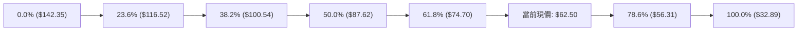

#### 斐波那契關鍵點位量化解讀

- **當前位置**：現價 **$62.50** 精確座落於 **78.6% 回調位 ($56.31)** 與 **61.8% 黃金分割位 ($74.70)** 之間。
- **61.8% 壓制點 ($74.70)**：作為經典黃金分割防線，該位置已於 10 月底被跳空長黑強勢擊穿。如今由支撐轉化為極強反壓，且與 MA20 ($76.96) 形成雙重阻力共振帶。
- **78.6% 支撐點 ($56.31)**：此處為深層回調防線。11-06 週K收於 $56.28，日K於 11-05 跌至 $51.51 後迅速收復此線，確認 $56.31 為當前短線多頭抵抗之核心生命線。若後續收盤實質跌破 $56.31，價格將朝 100.0% 終極低點 **$32.89** 展開下行探底。

---

## 5. 技術指標深度解讀

### 🎛️ 指標訊號總覽

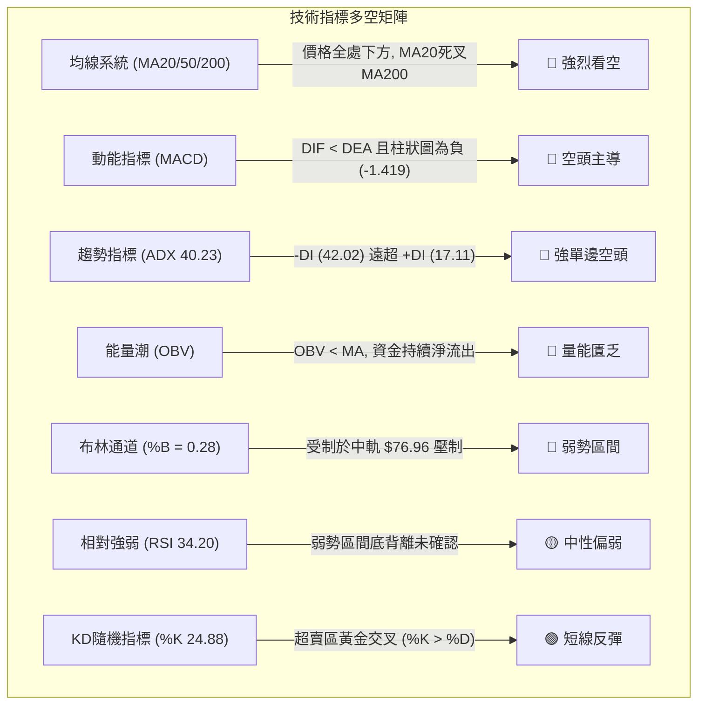

### 📈 移動平均線排列分析

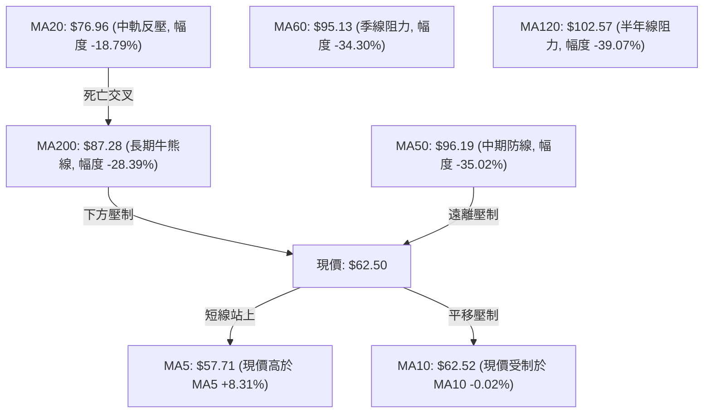

#### 均線數據全維度量化表

| 均線名稱 | 當前價格 | 與現價偏離度 (%) | 均線斜率與形態 | 多空訊號解讀 |
|----------|----------|------------------|----------------|--------------|
| **MA5** | $57.71 | **+8.31%** | 拐頭向上 (▲) | 🟢 短線超賣反彈，提供日內極短期防守支撐 |
| **MA10** | $62.52 | **-0.02%** | 平緩微跌 (▼) | 🟡 現價恰好觸碰 MA10，面臨第一道日內解套壓力 |
| **MA20** | $76.96 | **-18.79%** | 陡峭向下 (▼) | 🔴 20日均線呈現強烈下行趨勢，構成中線反彈主要天花板 |
| **MA60** | $95.13 | **-34.30%** | 下行加速 (▼) | 🔴 季線反壓極重，波段多頭徹底瓦解 |
| **MA120** | $102.57 | **-39.07%** | 趨勢向下 (▼) | 🔴 半年線下壓，長期沉重套牢盤未消化 |
| **MA200** | $87.28 | **-28.39%** | 下彎轉弱 (▼) | 🔴 現價跌破年線，且 MA20 遠在 MA200 下方，空頭排列確立 |
| **MA240** | $79.65 | **-21.54%** | 走平下拐 (▼) | 🔴 兩年長期均線亦告失守，長線結構遭受實質性破壞 |

### 📉 RSI(14) 分析

- **當前數值**：**34.20**（Wilder 計算法）
- **區間定位**：處於 30 至 70 的中性偏弱區間（偏向 30 邊緣），尚未觸發 <30 的絕對超賣保護。

```
RSI(14) 動能強度進度條
超賣區 (0-30)        弱勢震盪 (30-50)      強勢區 (50-70)     超買區 (70-100)
[0──────────────30───┼──────────────50─────────────────70──────────────100]
 ▓▓▓▓▓▓▓▓▓▓▓▓▓▓▓▓▓▓░░░░░░░░░░░░░░░░░░░░░░░░░░░░░░░░░░░░░░░░░░░░░░░░░
                     ▲ 現價 RSI: 34.20 (弱勢修復)
```

- **背離分析與結論**：
  - 檢視近 20 根 K 棒走勢（比較首尾）：2026-10-23 收盤 $86.96，RSI 為 32.8；至 2026-11-11 收盤 $62.50，RSI 為 34.20。
  - **結論**：價格創下 $62.50（乃至 11-05 的 $52.25）之波段新低，但 RSI 自低位 25.1（10-30）回升至 34.20，雖出現微幅指標低點抬高，但依據系統嚴格演算法檢定，首尾方向對比並**無明顯背離**（判定為無有效底背離）。此現象反映的僅是暴跌後的自然冷卻，不構成底部反轉信號。

### 📊 MACD (12, 26, 9) 訊號解讀


- **量化數值解析**：
  - **MACD 線**：-12.059，深陷零軸負值深水區。
  - **Signal 訊號線**：-10.640，快線位於慢線下方達 -1.419。
  - **MACD 柱狀圖**：最新讀數為 **-1.419**（🔴 看空）。雖然相較於 2026-11-06 週線的 -3.608 出現負值柱體縮短（動能收斂），但快慢線仍呈空頭發散狀態，未出現金叉翻多跡象。

### 📦 布林通道分析

```
INTC 日線布林通道結構示意圖（20日基準，2倍標準差）
價格 ($)
$110.55 ──────────────────────────────────── 布林通道上軌
          │
          │
 $76.96 ──┼───────────────────────────────── 布林通道中軌 (MA20) ◄── 強大反彈阻力
          │
 $62.50 ──┼───────────●◄ 現價 ($62.50, %B = 0.28)
          │          ╱
          │         ╱
 $51.51 ──┼────────●◄ 11-05 跌破下軌極端值
          │
 $43.37 ──────────────────────────────────── 布林通道下軌
```

- **帶寬與位置解讀**：
  - **布林帶寬度**：$\$110.55 - \$43.37 = \$67.18$（占中軌比例高達 87.29%），顯示市場處於極度發散的高波動洩洪狀態。
  - **%B 指標**：當前數值為 **0.28**，價格位於中軌（0.50）與下軌（0.00）之間的弱勢下半區。儘管價格自下軌下方（11-05 低點 $51.51）縮回軌道內，但在未突破中軌 $76.96 之前，整體通道持續保持空頭開口下壓。

### 💹 成交量分析（量價配合度）

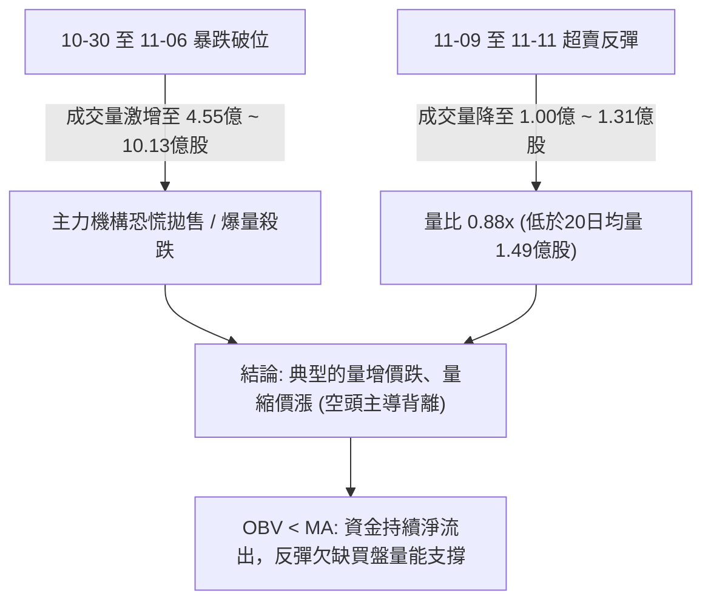

- **量能統計**：最新成交量為 131,878,900 股，低於 20 日均量（149,653,795 股），量比僅為 **0.88x**。
- **OBV 趨勢解讀**：能量潮指標明確呈現 **OBV < MA**，代表在近期的反彈走勢中，資金主動進場承接力道薄弱，純屬空方籌碼回補帶動之無量空拔，隨時面臨二度下探風險。

---

## 6. 動能與波動率

### ⚡ 動能評估四象限

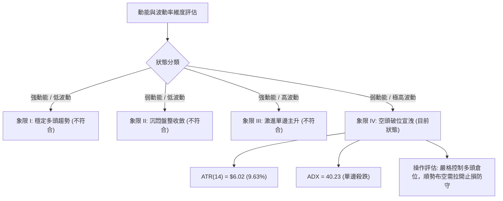

#### 動能與波動率四象限對照定位表

| 象限 | 動能維度 | 波動維度 | 當前狀態判定 | 戰略操作指引 |
|------|----------|----------|--------------|--------------|
| **Q1 (最佳機會)** | 強 (Bullish) | 低 (Low Volatility) | — | 順勢加碼多單，波段持股 |
| **Q2 (謹慎觀望)** | 弱 (Neutral) | 低 (Low Volatility) | — | 區間高拋低吸，等待方向突破 |
| **Q3 (投機博弈)** | 強 (Bullish) | 高 (High Volatility) | — | 嚴設動態追蹤止盈，享受噴出行情 |
| **Q4 (避免盲進)** | **弱 (Bearish)** | **極高 (High Volatility)** | **INTC 當前落點 (✓)** | **空方宣洩階段，多頭逢高減磅，順勢策略以逢高做空為主** |

### 📊 ATR 波動率分析

- **ATR(14) 讀數**：**$6.02**（Wilder 計算）
- **價格波動率佔比**：ATR / 收盤價 $= \$6.02 / \$62.50 = \mathbf{9.63\%}$
- **波動特徵解讀**：每日平均震幅接近 10%，顯示該股目前處於極端恐慌與多空激烈交戰期。

#### ATR 交易止損與部位管理建議

```
ATR 止損距離階梯設定（基準現價 $62.50）
══════════════════════════════════════════════════════════════
1.0 × ATR ($6.02) ──► 短線止損距離：$6.02 ──► 空頭防守價 $68.52
1.5 × ATR ($9.03) ──► 波段止損距離：$9.03 ──► 空頭防守價 $71.53
2.0 × ATR ($12.04) ──► 寬鬆止損距離：$12.04 ──► 空頭防守價 $74.54 (近斐波61.8% $74.70)
══════════════════════════════════════════════════════════════
```

- **倉位管理公式**：在 ATR 高達 $6.02 的環境下，若單筆交易最大容忍虧損為投資組合的 1%，則單一標的倉位上限不宜超過總資金的 **8% ~ 12%**，避免被日內隨機雜訊掃出場。

### 📐 Beta 與市場相關性

- **Beta 係數**：**2.426**
- **市場特徵解讀**：INTC 的波動幅度高達標普 500 指數的 **2.426 倍**，屬於極高波動性（High-Beta）個股。
- **大盤共振分析**：當科技板塊（如費城半導體指數）出現 1% 的回檔時，INTC 理論上將擴大下挫約 2.43%。在半導體供應鏈雜音頻傳與近期高層人事動盪背景下，高 Beta 意味著任何大盤系統性風險均會轉化為個股的劇烈下殺，進一步加劇下行破位風險。

---

## 7. 多時框架總結

### 📋 時框架評分表

| 時框架 | 趨勢方向 | 動能狀態 | 均線排列 | 圖表形態 | 綜合評分 | 操作建議方向 |
|--------|----------|----------|----------|----------|----------|--------------|
| **月線 (長期)** | 🔴 強烈看空 | 🔴 柱狀擴大 | 🔴 跌破MA20/50 | 雙重頂派發確立 | **25/100** | 長線資金避險，逢高減持出局 |
| **週線 (中期)** | 🔴 單邊下行 | 🔴 MACD死叉 | 🔴 跌穿MA200牛熊線 | 跌破頸線尋找低點 | **25/100** | 順勢做空，不輕易猜測底部 |
| **日線 (短期)** | 🟢 超賣反彈 | 🟡 RSI低位收斂 | 🔴 承壓於MA10/MA20 | 空頭旗形反抽結構 | **40/100** | 短多獲利了結，尋求逢高放空點 |

### 🔲 綜合訊號矩陣

```
╔══════════════════════════════════════════════════════════════╗
║              INTC 多時框架綜合訊號矩陣                       ║
╠══════════════════════════════════════════════════════════════╣
║  分析維度      日線層級 (短期)   週線層級 (中期)   月線層級 (長期) ║
╠══════════════════════════════════════════════════════════════╣
║  趨勢方向      🟢 短底反彈       🔴 破位下殺       🔴 週期轉空   ║
║  動能指標      🟢 KD低檔金叉     🔴 MACD發散向下   🔴 動能衰竭   ║
║  均線位置      🟡 站上MA5受制10  🔴 位於所有MA下方 🔴 破位MA200  ║
║  量價配合      🔴 量縮反彈背離   🔴 爆量恐慌殺跌   🔴 高位派發巨量 ║
║  形態結構      🟡 楔形超賣修復   🔴 M頭破位確立    🔴 頂部確立   ║
╠══════════════════════════════════════════════════════════════╣
║  時框訊號一致性評估：中長期空頭訊號高度共振 (權重 80%)，      ║
║  短期日線反彈僅屬逆勢次級折返浪，無法撼動整體下行趨勢結構。   ║
╚══════════════════════════════════════════════════════════════╝
```

### ⚖️ 多時框收斂結論

嚴格執行「嚴格要求 14」之多時框收斂規則：

1. **行情性質判定**：當前 ADX(14) 讀數為 **40.23**（遠大於趨勢分水嶺 25），且 -DI (42.02) 顯著高於 +DI (17.11)，確認市場處於**標準的強趨勢行情（空頭單邊）**，盤整震盪規則在此不適用。
2. **主導時框裁決**：在 ADX > 25 的趨勢行情中，優先級以**中長期（週線、月線及 MA50、MA200）方向為絕對主導**。日線的短線反彈僅作為尋找有利盈虧比之進場放空時機，絕對不得據此逆勢大幅做多。
3. **唯一方向性結論**：**強烈偏空（逢高做空）**。第 8 章交易策略將完全依據此結論進行單向空頭布局，徹底杜絕兩頭下注。

---

## 8. 交易策略建議

### 🗺️ 策略決策流程圖

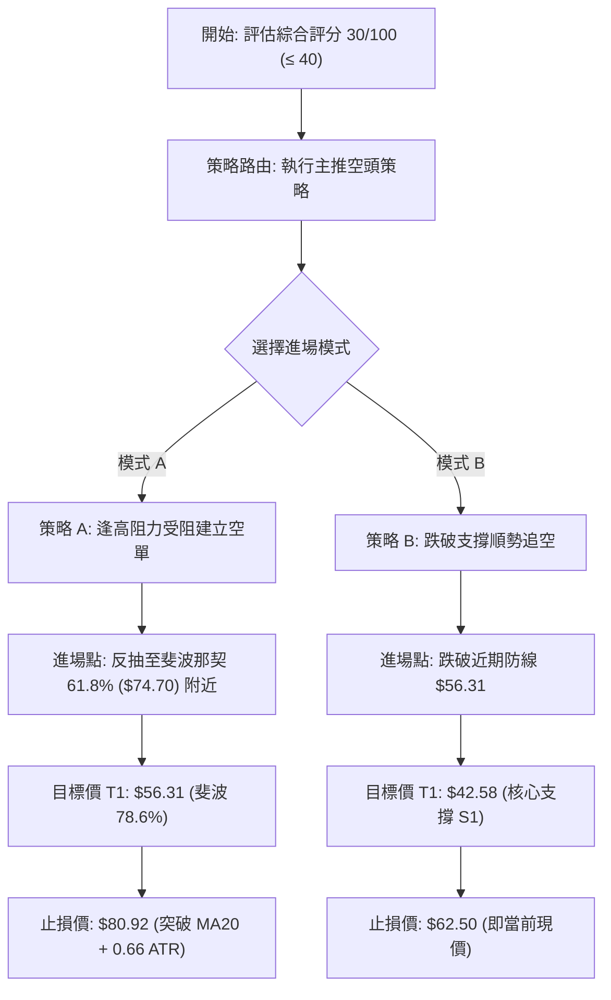

### 🧭 策略路由

> **當前主策略方向 = 空頭策略（順勢放空 / 逢高做空，依綜合評分 30/100 確立）**

本分析綜合評分為 **30/100**（≤ 40 偏空區間），根據系統規則，主推**空頭做空策略**。多頭操作僅列為反轉風險對沖考量，不作為推薦策略。

### 🎯 價格情境階梯（Price Scenarios）

所有價位均嚴格引用自數據庫之關鍵價位與斐波那契點位：

| 觸發條件 | 下一目標 | 後續延伸 | 情境技術含義 | 應對策略方向 |
|----------|----------|----------|--------------|--------------|
| **向上突破 R1 $95.68** | R2 $107.13 | R3 $127.04 | 極強反轉，空頭結構被徹底破壞 | 空單全面嚴格停損出場 |
| **反彈受阻於 $74.70 / $76.96** | $62.50 | 斐波 78.6% $56.31 | 次級折返結束，重回下行主浪 | **主要做空加碼甜蜜點** |
| **跌破斐波 78.6% $56.31** | 核心支撐 S1 $42.58 | 次級支撐 S2 $41.64 | 破位加速，展開新一輪恐慌下殺 | **順勢破位追空點** |
| **擊穿強支撐 S3 $40.63** | 52W 低點 $32.89 | 歷史低位區 | 雙重頂完整量度跌幅全部兌現 | 空單全數獲利了結平倉 |

### 📊 情境機率分佈

| 發展情境 | 發生機率 | 主要技術依據（嚴格引用指標與數據） |
|----------|----------|------------------------------------|
| **主浪下行 / 再次破位探底** | **60%** | ADX 高達 40.23，-DI (42.02) 佔優；OBV 持續低於均線；週線巨量長黑壓制 |
| **區間震盪 / 弱勢反彈築底** | **30%** | Stoch %K (%D) 超賣金叉；ATR 高達 $6.02 引發多空寬幅拉鋸；$56.31 暫具支撐 |
| **強勢反轉 / 向上回補缺口** | **10%** | 價格距離 MA50 ($96.19) 偏離過遠，需極端基本面催化（如全面併購收購）方能成真 |

### 🟢 主策略詳情（空頭主導策略）

依據嚴格規則 17，風險報酬比統一依以下公式精準計算：
$$\text{做空風險報酬比} = \frac{\text{進場價} - \text{目標價 T1}}{\text{止損價} - \text{進場價}}$$

| 策略要素 | 策略 A（反彈受阻逢高做空） | 策略 B（跌破支撐順勢追空） |
|----------|----------------------------|----------------------------|
| **策略定位** | 順應大級別空頭，於強阻力位博弈折返終結 | 順勢破位單，捕捉主跌浪加速段 |
| **進場條件** | 價格反彈至斐波 61.8% ($74.70) 附近遇阻滯漲 | 價格日K收盤跌破斐波 78.6% ($56.31) |
| **進場價格** | **$74.70**（引用斐波那契 61.8% 位） | **$56.31**（引用斐波那契 78.6% 位） |
| **目標價 T1** | **$56.31**（引用斐波那契 78.6% 位） | **$42.58**（引用關鍵支撐位 S1） |
| **目標價 T2** | **$42.58**（引用關鍵支撐位 S1） | **$40.63**（引用關鍵支撐位 S3） |
| **止損價格** | **$80.92**（MA20 $76.96 + 0.66 ATR $3.96） | **$62.50**（引用當前收盤價作為防守點） |
| **風險報酬比 (T1)** | **1 : 2.96**（以 T1 計） | **1 : 2.22**（以 T1 計） |
| *計算式明細* | $(\$74.70 - \$56.31) / (\$80.92 - \$74.70) = \$18.39 / \$6.22$ | $(\$56.31 - \$42.58) / (\$62.50 - \$56.31) = \$13.73 / \$6.19$ |
| **風險報酬比 (T2)** | 1 : 5.16（以 T2 計，$(\$74.70 - \$42.58) / \$6.22$） | 1 : 2.53（以 T2 計，$(\$56.31 - \$40.63) / \$6.19$） |
| **勝率預估** | 65% | 60% |
| **建議倉位** | 10% 總投資組合資金 | 8% 總投資組合資金 |

### 🔴 反向風險觸發點（對沖提示）

以下關鍵價位與技術現象若被觸發，將直接推翻本空頭主策略，持空者應立即啟動避險平倉：

1. **反轉關鍵價位**：若日線實體收盤價突破 **$76.96 (MA20)** 且進一步站穩 **$87.28 (MA200)**，代表中期跌勢被強行遏制，空頭形態失效。
2. **技術訊號推翻**：MACD 快線向上突破零軸，且成交量連續三日超越 20 日均量（>1.5億股）伴隨連續大紅K，呈現量價同步齊揚格局。
3. **對沖建議**：一旦價格有效收復 $76.96，原空單全數離場，或買入等市值價外 5% 看漲期權（Call Option）進行嚴格 Delta 對沖。

### ⭐ 整體訊號強度評星

```
╔══════════════════════════════════════════════════════════════╗
║              INTC 技術策略信號強度評定                       ║
╠══════════════════════════════════════════════════════════════╣
║  做多訊號強度：  ★☆☆☆☆  (1/5星) ── 僅存極短期超賣修復     ║
║  做空訊號強度：  ★★★★☆  (4/5星) ── 中長空頭排列共振確立   ║
║  整體技術可信度：★★★★☆  (4/5星) ── 量價破位形態高度清晰   ║
╚══════════════════════════════════════════════════════════════╝
```

---

## 9. 風險提示與監控

### ✅ 關鍵監控指標 Checklist

```
╔══════════════════════════════════════════════════════════════╗
║              INTC 每日交易關鍵監控清單 (Checklist)           ║
╠══════════════════════════════════════════════════════════════╣
║ [ ] 1. 價格防守線：每日收盤是否守穩斐波 78.6% ($56.31)？     ║
║ [ ] 2. 均線壓制：反彈是否在觸及 MA10 ($62.52) 或 MA20 時受阻？║
║ [ ] 3. 動能監控：RSI(14) 能否有效越過 50 強弱分水嶺？        ║
║ [ ] 4. 趨勢轉變：ADX 是否維持在 40 以上？-DI 是否持續壓制 +DI？ ║
║ [ ] 5. 異常量能：單日成交量是否異常暴增至 3 億股以上？       ║
║ [ ] 6. 籌碼流向：OBV 是否向上突破其均線，扭轉量能疲弱結構？   ║
║ [ ] 7. 外部風險：晶片板塊 High-Beta 連動性與大盤走勢是否轉變？║
╚══════════════════════════════════════════════════════════════╝
```

### ⚠️ 風險場景分析

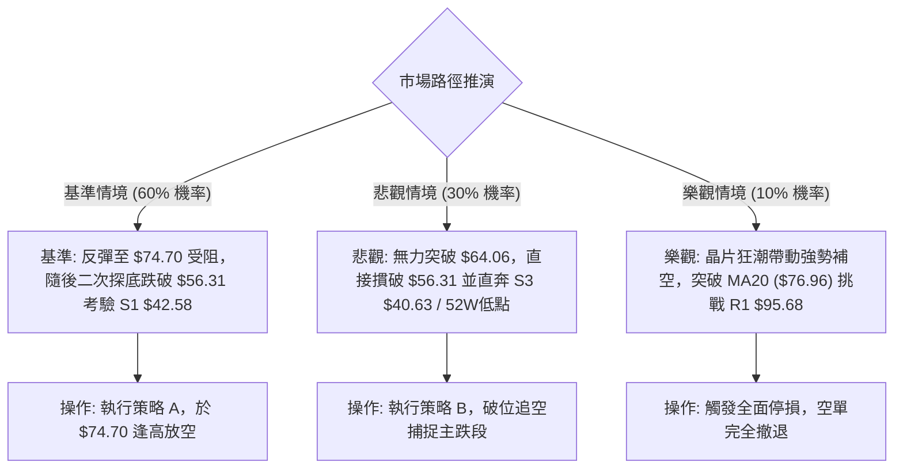

### 🛡️ 風險管理重要提醒

1. **極高 Beta 帶來的跳空風險**：INTC 當前 Beta 為 2.426，且 ATR 高達 $6.02（佔比 9.63%）。在美股財報期與重大產業傳聞下，極易出現跳空缺口（如 10-30 單日跳空暴跌 -28%）。嚴格禁止在無隔夜避險措施下重倉持股。
2. **做空擠壓（Short Squeeze）預防**：雖然當前空頭排列完整，但近期成交量出現縮減，若晶片板塊整體暴漲，容易觸發空頭停損踩踏回補。因此策略 A 之止損價必須堅定設定於 **$80.92**，不得任意向下移轉或凹單。
3. **倉位限制紀律**：鑑於單日波動劇烈，單一空頭策略部位嚴格限制於總資金的 **8% ~ 10%** 以內，整體槓桿倍數嚴格控制在 1.0 倍以下，確保在最壞樂觀情境（觸及停損）下，單筆最大虧損不超過總資產的 **1.0% ~ 1.5%**。

---

## 📋 報告總結

```
╔══════════════════════════════════════════════════════════════════╗
║                    INTC 技術分析報告總結                         ║
╠══════════════════════════════════════════════════════════════════╣
║  報告日期：2026-11-12                                            ║
║  當前價格：$62.50                                                ║
║  分析評級：🔴 強烈偏空 / 反彈逢高做空 (綜合技術評分: 30/100)      ║
║                                                                  ║
║  核心技術面結論：                                                ║
║  ├─ 長期趨勢：🔴 強烈看空 (自 $139.63 頂部雪崩，M頭破位確立)    ║
║  ├─ 中期趨勢：🔴 單邊下行 (ADX=40.23, 價格深陷 MA200 牛熊線下方)║
║  ├─ 短期趨勢：🟢 超賣反抽 (KD低檔金叉，自 $51.51 反抽至 $62.50)  ║
║  ├─ 關鍵支撐：S1 $42.58 ｜ S2 $41.64 ｜ S3 $40.63               ║
║  ├─ 關鍵阻力：R1 $95.68 ｜ 斐波61.8% $74.70 ｜ MA20 $76.96      ║
║  └─ 分析師目標：均價 $91.12 ｜ 最低 $63.00 ｜ 最高 $160.00       ║
║                                                                  ║
║  最優策略組合：                                                  ║
║  1. 🥇 最佳機會 (策略 A)：等待價格反彈至斐波 61.8% ($74.70) 逢高  ║
║     建立波段空單，止損 $80.92，第一目標 $56.31，盈虧比 1:2.96   ║
║  2. 🥈 次選機會 (策略 B)：若直接跌破斐波 78.6% ($56.31)，順勢追空 ║
║     至核心支撐 S1 ($42.58)，止損設於現價 $62.50，盈虧比 1:2.22  ║
║  3. 🥉 保守選擇：空手觀望，靜待日線反彈動能衰竭或等待價格觸及   ║
║     S3 ($40.63) 區域確認出現底部形態後再行評估。                ║
╚══════════════════════════════════════════════════════════════════╝
```

---

> ⚠️ **免責聲明**：本報告為依據定量技術分析模型與歷史交易數據生成之專業研究報告，報告內所有數據與推算均嚴格基於所提供的歷史 OHLCV 資訊。本報告**僅供學術研究與投資策略參考**，**不構成任何要約、招攬或具體投資建議**。市場有風險，交易需依個人風險承受力嚴格執行止損與風控紀律。

---

*報告生成時間：2026-11-12 ｜ 數據來源：Yahoo Finance ｜ 分析框架：多時框架量化技術分析*