# INTC 技術分析報告

> **報告日期**：2026-11-13 ｜ **語言**：繁體中文 ｜ **數據來源**：Yahoo Finance ｜ **當前價格**：$61.20

---

## 目錄

| 章節 | 內容 |
|------|------|
| [1. 技術面概覽](#1-技術面概覽) | 訊號儀表板、核心指標、評分卡 |
| [2. 趨勢分析](#2-趨勢分析) | 多時框趨勢、長中短期走勢、ADX強度 |
| [3. 圖表形態分析](#3-圖表形態分析) | 形態識別、K線組合、目標價推算 |
| [4. 支撐與阻力](#4-支撐與阻力) | 關鍵價位、斐波那契回調結構 |
| [5. 技術指標深度解讀](#5-技術指標深度解讀) | MA/RSI/MACD/布林/成交量量價背離 |
| [6. 動能與波動率](#6-動能與波動率) | 動能四象限、ATR風險度量、Beta相關性 |
| [7. 多時框架總結](#7-多時框架總結) | 時框矩陣、多時框收斂優先級結論 |
| [8. 交易策略建議](#8-交易策略建議) | 策略路由、主空頭策略、風控對沖提示 |
| [9. 風險提示與監控](#9-風險提示與監控) | 監控指標Checklist、情境分析、資金管理 |
| [10. 報告總結](#-報告總結) | 執行摘要、關鍵結論與策略優先級 |

---

## 1. 技術面概覽

### 🎯 技術訊號儀表板

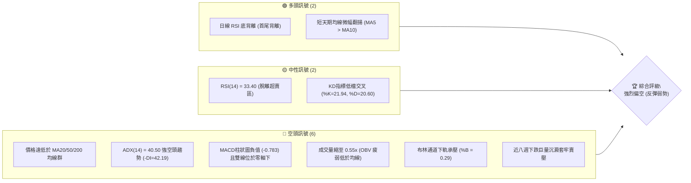

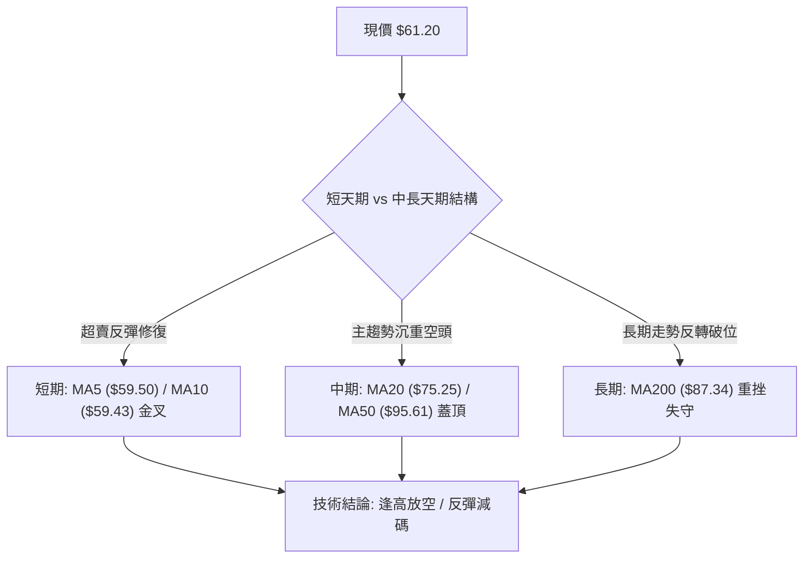

### 📊 核心指標速覽表

| 指標類別 | 指標名稱 | 當前數值 | 訊號 | 解讀 |
|:---|:---|:---|:---:|:---|
| **價格** | 當前價格 | $61.20 | 🔴 | 位於 52 週區間 25.9%，長線回吐顯著 |
| **均線** | MA20 | $75.25 | 🔴 | 價格低於 MA20 達 -18.67%，中期空頭主導 |
| **均線** | MA50 | $95.61 | 🔴 | 價格低於 MA50 達 -36.00%，中期空頭排列確立 |
| **均線** | MA200 | $87.34 | 🔴 | 價格跌破年線達 -29.93%，長期牛熊分界失守 |
| **動能** | RSI(14) | 33.40 | 🟡 | 脫離 30 以下嚴重超賣區，呈現底背離反彈訊號 |
| **動能** | MACD (12,26,9) | -11.619 / -10.836 | 🔴 | MACD線位於訊號線下方，柱狀圖 -0.783，空頭主控 |
| **趨勢** | ADX / ±DI | 40.50 / -DI: 42.19 | 🔴 | ADX > 40 代表極強空方趨勢，空頭能量主導盤面 |
| **波動** | ATR(14) | $5.83 | 🔴 | 波動佔股價 9.52%，日振幅劇烈，下檔風險猶存 |
| **通道** | 布林通道 | 上軌 $108.37 / 下軌 $42.13 | 🔴 | %B 為 0.29，中軌 ($75.25) 形成巨大動態壓力 |
| **成交量** | 20日成交量比 | 0.55x (79,987,700) | 🔴 | 量能極度萎縮，無增量買盤進場，OBV < MA 走勢疲弱 |

### 🏆 技術評分卡

```
╔══════════════════════════════════════════════════════════════╗
║              技術評分卡 — INTC (2026-11-13)                 ║
╠══════════════════════════════════════════════════════════════╣
║ 趨勢強度 (Trend)     ████████░░░░░░░░░░░░  30/100  🔴 空頭強勢║
║ 動能指標 (Momentum)  ████████░░░░░░░░░░░░  40/100  🟡 底背修復║
║ 支撐穩定度 (Support) ██████░░░░░░░░░░░░░░  30/100  🔴 支撐稀疏║
║ 成交量配合 (Volume)  ██████░░░░░░░░░░░░░░  30/100  🔴 量價背離║
║ 形態完整度 (Pattern) ████████░░░░░░░░░░░░  40/100  🟡 空頭中繼║
║ 均線排列 (MA System) ██░░░░░░░░░░░░░░░░░░  10/100  🔴 混合空頭║
╠══════════════════════════════════════════════════════════════╣
║ 綜合評分 (Overall)   ██████░░░░░░░░░░░░░░  30/100  🔴 強烈偏空║
╚══════════════════════════════════════════════════════════════╝
※ 依規則 18：綜合評分 = (30 + 40 + 30 + 30 + 40 + 10) / 6 = 30.0 → 30/100
```

---

## 2. 趨勢分析

### 🌐 多時框趨勢分析

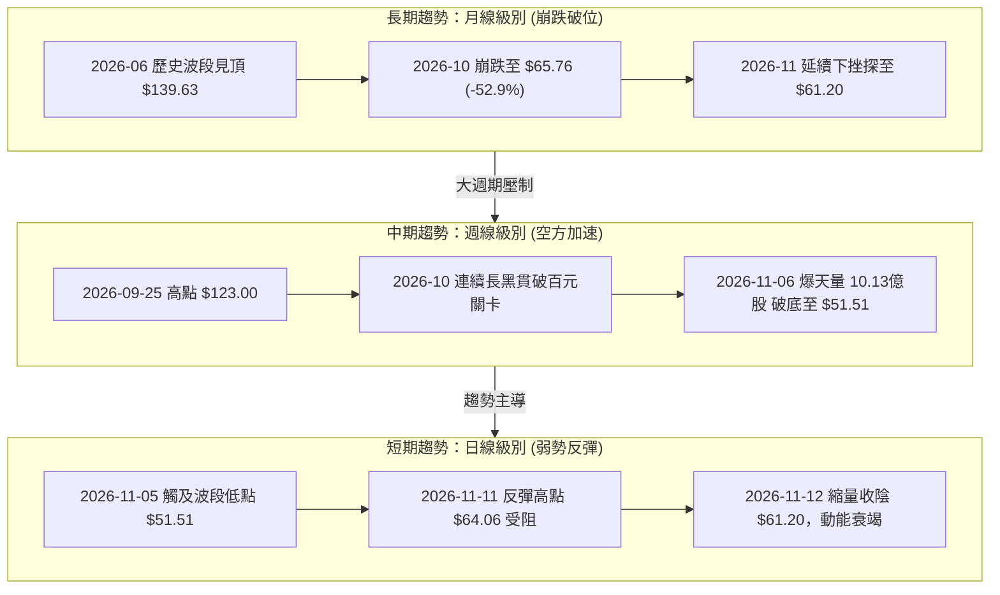

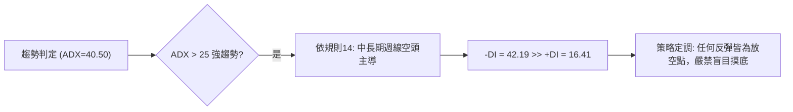

### 📈 長期趨勢 — 12個月走勢圖（Unicode）

```
INTC 月線走勢圖（過去12個月：2025-12 至 2026-11）
價格軸 ($)
$140 ┤                   ● (2026-06 $139.63 歷史頂部)
$130 ┤                  ╱ ╲
$120 ┤                 ╱   ╲             ● (2026-09 $120.23 反彈次頂)
$110 ┤                ●     ╲           ╱ ╲
$100 ┤               ╱       ╲         ╱   ╲
$ 90 ┤              ●         ●───────●     ╲
$ 80 ┤             ╱                         ╲
$ 70 ┤            ╱                           ● (2026-10 $65.76 崩塌)
$ 60 ┤           ╱                             ● (2026-11 $61.20 現價)
$ 50 ┤   ●──────●
$ 40 ┤  ●
$ 30 ┤
     └────────────────────────────────────────────
        12   01   02   03   04   05   06   07   08   09   10   11 (月份)
       '25  '26  '26  '26  '26  '26  '26  '26  '26  '26  '26  '26
```

#### 過去 12 個月走勢特徵分析

| 階段區間 | 時間跨度 | 起訖價位 | 漲跌幅 | 走勢特徵與技術解讀 |
|:---|:---|:---|:---:|:---|
| **築底啟動期** | 2025-12 ~ 2026-03 | $36.90 → $44.13 | +19.59% | 低檔橫盤吸籌，均線收斂後逐步走揚 |
| **主升爆發期** | 2026-03 ~ 2026-06 | $44.13 → $139.63 | +216.41% | 暴力拉升，月線連四紅，於 2026-06 見高點 $139.63 (52W高點 $142.35) |
| **頭部派發期** | 2026-06 ~ 2026-09 | $139.63 → $120.23 | -13.89% | 高檔雙頂鋸齒震盪，獲利賣盤出逃，形成 $120.23 次級頂部 |
| **崩跌破位期** | 2026-09 ~ 2026-11 | $120.23 → $61.20 | -49.10% | 垂直斷崖式暴跌，月跌幅近腰斬，連續擊穿年線與多道關鍵支撐 |

### 📊 中期趨勢（週線分析）

中期走勢顯示自 2026 年 9 月底起，INTC 開啟週線級別主跌浪。2026-10-30 當週出現重挫巨量（8.61億股），次週（2026-11-06）更創下單週 10.13 億股的歷史恐慌拋售量，當週低點打到 $51.51。本週（截至 2026-11-12）週成交量降至 4.61 億股，呈現明顯的「下殺爆量、反彈無量」弱勢特徵。

```
INTC 週線級別關鍵結構示意圖
價格軸 ($)
$130 ┤  ┌─┐ [2026-09-25 高點 $127.44]
$120 ┤  │ │
$110 ┤  │ │  ┌─┐
$100 ┤──┼─┼──┼─┼─────────────── R1 關鍵壓力聚類區 ($95.68)
$ 90 ┤  │ │  │ │
$ 80 ┤  │ │  │ │
$ 70 ┤  └─┘  │ │  ┌─┐
$ 60 ┤───────┼─┼──┼─┼───────── 現價 $61.20 (斐波那契 78.6% $56.31 附近弱支撐)
$ 50 ┤        └─┘  │ │ [2026-11-06 恐慌低點 $51.51] (S1: $51.51)
$ 40 ┤─────────────┴─┴───────── S2: $42.58 / S3: $41.64 強支撐帶
```

### ⚡ 趨勢強度評估（ADX 解讀）

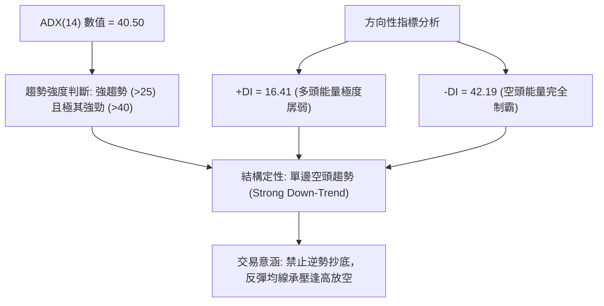

#### ADX 趨勢強度量化對照

| 指標變數 | 當前讀數 | 門檻區間 | 技術解讀與行情定義 |
|:---|:---:|:---:|:---|
| **ADX(14)** | **40.50** | > 40.0 | 極強趨勢行情（空頭具有極度排他性動能） |
| **+DI** | **16.41** | < 20.0 | 多方毫無發動力，僅存零星空頭回補抵抗 |
| **-DI** | **42.19** | > 40.0 | 空方壓倒性強勢，市場由賣盤完全主宰 |
| **趨勢狀態** | **單邊空頭** | ADX > 25 且 -DI > +DI | 依多時框規則14，中期空方掌控全場局勢 |

---

## 3. 圖表形態分析

### 🔍 形態識別系統

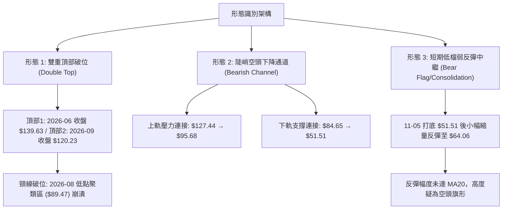

#### 圖表形態信心度量化評估表

| 形態名稱 | 信心度 | 判斷依據（引用數據與價位） | 完成度 | 目標價（附嚴格計算式） |
|:---|:---:|:---|:---:|:---|
| **巨型雙重頂 (M頭)** | 85% | 頂1 (2026-06 收盤 $139.63)、頂2 (2026-09 收盤 $120.23)；頸線跌破 2026-08 低點 $89.47 | 100% (已跌破) | 由形態高度推算：頸線 $89.47 − 頂部落差 ($139.63 − $89.47 = $50.16) = **$39.31**（接近數據中支撐帶 S2: $42.58 ~ S3: $41.64） |
| **陡峭空頭下降通道** | 75% | 近8週高點階梯式下移 ($127.44 → $95.68 → $64.06)，低點破位 ($114.93 → $84.65 → $51.51) | 80% | 由通道下軌斜率推算，下檔延伸目標直指數據支撐位 **S1: $51.51** 與 **S2: $42.58** |
| **短線空頭旗形整理** | 55% | 2026-11-05 創 $51.51 低點後，4根日K呈現收斂弱彈，量能驟降至 7,998 萬股 | 60% | 若跌破旗面下緣，由旗桿長度 ($68.77 − $51.51 = $17.26) 自破位點推算，將下探 **S2: $42.58** |

### 🕯️ 重要 K 線形態分析

嚴格依據數據中「近 10 根日 K」與「近 8 根週 K」之實際開、高、低、收進行解讀：

| 日期（週期） | 開盤價 | 最高價 | 最低價 | 收盤價 | 成交量 | K線形態名稱 | 技術解讀與多空訊號 |
|:---|:---:|:---:|:---:|:---:|:---:|:---|:---|
| **2026-10-30 (週K)** | $87.94 | $95.68 | $63.20 | $65.76 | 861,628,000 | 斷崖巨量大長陰 | 🔴 爆量擊穿 $70 關卡，實體極長，長線主力徹底棄守出逃 |
| **2026-11-06 (週K)** | $65.40 | $65.72 | $51.51 | $56.28 | 1,013,723,800 | 爆天量長下影陰線 | 🟡 單週十億股恐慌換手，下影線長達 $4.77，初步探明低檔買盤 |
| **2026-11-12 (週K)** | $56.86 | $64.06 | $55.83 | $61.20 | 461,407,000 | 縮量短陽十字星 | 🟡 跌勢暫緩但量能腰斬，多頭反攻無力，呈現標準弱勢抵抗 |
| **2026-11-05 (日K)** | $56.51 | $56.73 | $51.51 | $52.25 | 270,291,000 | 探底加速長陰棒 | 🔴 創 52 週波段新低 $51.51，恐慌拋補盤湧現，確認波段低點 |
| **2026-11-06 (日K)** | $54.99 | $57.32 | $54.56 | $56.28 | 174,382,300 | 低檔回升實體小陽 | 🟢 守住昨日低點，形成短線止跌訊號，展開超賣技術修正 |
| **2026-11-11 (日K)** | $61.67 | $64.06 | $60.95 | $62.50 | 133,190,900 | 衝高受阻流星小陽 | 🔴 上影線觸及 $64.06 遇賣壓回落，顯示 $64 附近反壓沉重 |
| **2026-11-12 (日K)** | $59.69 | $62.76 | $59.41 | $61.20 | 79,987,700 | 縮量回落小陰線 | 🔴 實體收陰，量能降至 7,998 萬股（量比僅 0.55x），反彈動能衰竭 |

### 📉 ASCII 走勢形態示意圖

```
INTC 近期日K線形態結構圖 (2026-10-30 至 2026-11-12)
價格 ($)
$68 ┤ █ (10/30 開68.36/高68.77)
$66 ┤ █ ▌
$64 ┤ │ │       ┌┬┐ (11/11 高64.06 受阻長上影)
$62 ┤ │ │   ┌┬┐ ├┼┤ ┌┬┐ (11/12 收61.20 縮量疲弱)
$60 ┤ └┼┘ █ │││ └┴┘ └┼┘
$58 ┤     └┼┘ ├┼┤     │
$56 ┤         └┼┘ ┌┬┐ │   (11/06 止跌小陽 收56.28)
$54 ┤             ├┼┤ │
$52 ┤     ┌┬┐     └┴┘
$50 ┤─────┴┼┴────────────────── S1: $51.51 (11/05 恐慌低點)
          (11/05 低51.51)
```

### 🎯 形態目標價計算

根據雙重頂部（M頭）與日線跌破旗面形態推算：
1. **雙重頂形態測幅**：
   - 形態頸線：2026-08 收盤聚類低點 $89.47
   - 形態頭部高點：2026-06 收盤價 $139.63
   - 形態絕對高度 = $139.63 − $89.47 = $50.16
   - 最小量度跌幅目標 = 頸線 $89.47 − 形態高度 $50.16 = **$39.31**
   - 與已提供數據中的關鍵支撐帶 **S2: $42.58** 及 **S3: $41.64** 形成強力價位共振。
2. **短期反彈空間測幅**：
   - 短期反彈起點：$51.51（2026-11-05 低點）
   - 短期反彈受阻高點：$64.06（2026-11-11 高點）
   - 若反彈無力突破 $64.06 並向下跌破短期支撐，行情將回歸主跌浪，測試 **S1: $51.51**。

---

## 4. 支撐與阻力

### 🗺️ 關鍵價位分布圖（Unicode）

```
INTC 價位結構分布圖（OHLCV 數據計算）
══════════════════════════════════════════════════════════════
$127.04 ║██████████████████████████████║ 強阻力 R3 (波段高點聚類)
$116.52 ║▓▓▓▓▓▓▓▓▓▓▓▓▓▓▓▓▓▓▓▓▓▓        ║ 斐波那契 23.6% 回調位
$107.13 ║████████████████████          ║ 阻力 R2 (波段高點聚類)
$100.54 ║▓▓▓▓▓▓▓▓▓▓▓▓▓▓▓▓              ║ 斐波那契 38.2% 回調位
$ 95.68 ║██████████████████████████████║ 關鍵阻力 R1 (MA50 & 波段高點)
$ 87.62 ║▓▓▓▓▓▓▓▓▓▓▓▓▓▓▓▓▓▓▓▓          ║ 斐波那契 50.0% 中性回調位
$ 74.70 ║▓▓▓▓▓▓▓▓▓▓▓▓▓▓▓▓▓▓▓▓▓▓▓▓      ║ 斐波那契 61.8% 黃金分割強壓力 (接近 MA20: $75.25)
$ 61.20 ╠══════════════════════════════╣ ◄ 現價 ($61.20)
$ 56.31 ║▓▓▓▓▓▓▓▓▓▓▓▓▓▓▓▓▓▓            ║ 斐波那契 78.6% 回調位 (弱支撐)
$ 51.51 ║██████████████████████        ║ 近期關鍵支撐 S1 (近一年波段低點)
$ 42.58 ║██████████████████████████████║ 強支撐 S2 (波段低點聚類)
$ 41.64 ║██████████████████████████████║ 極限強支撐 S3 (波段低點聚類)
$ 32.89 ║██████████████████████████████║ 52週最低價 (100.0% 回調位)
══════════════════════════════════════════════════════════════
```

### 🚧 阻力位分析表

以下價位完全嚴格引用數據中「關鍵價位」區塊之數值：

| 阻力級別 | 精確價位 | 距現價幅 | 形成原因與技術共振 | 突破難度 | 重要性評級 |
|:---|:---:|:---:|:---|:---:|:---:|
| **阻力 R1** | **$95.68** | +56.34% | 近一年波段高點聚類，與當前日線 MA50 ($95.61) 完美重疊，2026-10-30 週K高點所在 | 極高 🔴 | ★★★★★ |
| **阻力 R2** | **$107.13** | +75.05% | 密集籌碼成交帶，近一年波段高點聚類，接近布林通道上軌 ($108.37) | 極高 🔴 | ★★★★☆ |
| **阻力 R3** | **$127.04** | +107.58% | 次級雙頂高點，2026-09-25 週K最高點 ($127.44) 聚類區，中期反轉天花板 | 固若金湯 🔴 | ★★★★★ |

### 🛡️ 支撐位分析表

以下價位完全嚴格引用數據中「關鍵價位」區塊之數值：

| 支撐級別 | 精確價位 | 距現價幅 | 形成原因與技術共振 | 守住機率 | 重要性評級 |
|:---|:---:|:---:|:---|:---:|:---:|
| **支撐 S1** | **$51.51** | -15.83% | 2026-11-05 恐慌低點，爆量 10.13 億股週K之最低價，多頭最後心理防線 | 40% 🟡 | ★★★★☆ |
| **支撐 S2** | **$42.58** | -30.42% | 近一年波段低點聚類，布林通道下軌 ($42.13) 共振區，M頭量度跌幅延伸區 | 75% 🟢 | ★★★★★ |
| **支撐 S3** | **$41.64** | -31.96% | 近一年低點聚類，2026 年初起漲平台頸線支撐，長線強烈護盤底線 | 85% 🟢 | ★★★★★ |

### 📐 斐波那契回調位分析

依據 52 週區間 $32.89 → $142.35 計算之回調位體系：

| 回調比率 | 精確價位 | 技術意涵與現價相對位置 | 支撐／阻力性質 |
|:---:|:---:|:---|:---:|
| **0.0%** | **$142.35** | 52 週歷史高點，本輪超級大頂 | 極限阻力天花板 |
| **23.6%** | **$116.52** | 強勢回檔位，失守後宣告多頭主升段終結 | 中期強阻力 |
| **38.2%** | **$100.54** | 百元整數心理關卡，破位後引發踩踏式拋售 | 重大阻力帶 |
| **50.0%** | **$87.62** | 多空分水嶺，接近 MA200 年線 ($87.34) | 長期牛熊反壓 |
| **61.8%** | **$74.70** | 黃金分割防線，與 MA20 ($75.25) 高度重疊 | 當前反彈關鍵極限反壓 |
| **78.6%** | **$56.31** | **深度回調位，現價 ($61.20) 位於 61.8% 與 78.6% 之間** | **短線防守過渡區** |
| **100.0%** | **$32.89** | 52 週最低價，起漲之絕對基底 | 長期終極防線 |

**斐波那契結構解讀**：
當前收盤價 **$61.20** 處於 **61.8% ($74.70)** 與 **78.6% ($56.31)** 之間的脆弱過渡帶。價格已實質擊穿 61.8% 黃金分割位，依技術分析常規，一旦 61.8% 宣告失守，往往意味著行情並非正常回檔，而是結構性破位。下方 78.6% 回調位 **$56.31** 雖於上週提供短暫緩衝，但由於整體均線下壓，此位置若二次被實體黑K貫穿，下方將直奔支撐 **S1: $51.51**，甚至滑落至波段聚類支撐 **S2: $42.58**。

---

## 5. 技術指標深度解讀

### 🎛️ 指標訊號總覽

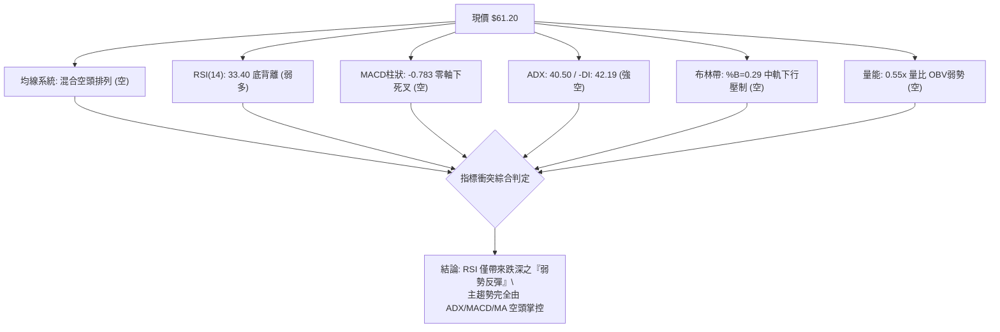

### 📈 移動平均線排列分析

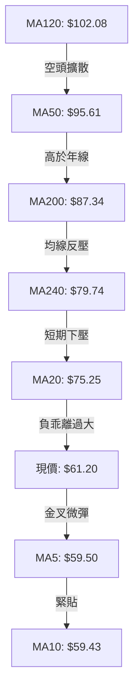

#### 各天期移動平均線狀態

| 均線名稱 | 當前價位 | 乖離率 (現價相對於MA) | 均線走勢方向 | 排列狀態與技術解讀 |
|:---|:---:|:---:|:---:|:---|
| **MA5** | $59.50 | +2.86% | ▲ 微幅走揚 | 超賣回補帶動短線反抽，穿過 MA10 |
| **MA10** | $59.43 | +2.98% | ▲ 走平翻揚 | 短期止跌均線，為 $60 附近提供微弱下檔支撐 |
| **MA20** | $75.25 | -18.67% | ▼ 陡峭下行 | 月線動態蓋頭反壓，反彈之重大壓力關卡 |
| **MA60** | $94.60 | -35.31% | ▼ 快速下墜 | 季線空方加速，中線多頭徹底棄守 |
| **MA120** | $102.08 | -40.05% | ▼ 觸頂下彎 | 半年線下彎，顯示近半年進場資金全線套牢 |
| **MA200** | $87.34 | -29.93% | ▼ 跌破下行 | 價格遠在年線下方近 30%，進入技術性熊市 |
| **MA240** | $79.74 | -23.25% | ▲ 緩升下彎 | 長期基底均線失守，長天期多頭結構崩解 |

### 📉 RSI(14) 分析

#### RSI 數值進度條
```
RSI(14) = 33.40 (Wilder)
[0] ─────────── [30] ───── [50] ────────────────── [70] ─────────── [100]
                ▲
                └── 現值 33.40 (處於超賣邊界之微弱修復區)
進度條: ██████░░░░░░░░░░░░░░░░░░░░░░░░  33.40%
```

#### 背離判定與分析
- **背離形態確認**：數據明確提示「⚠️ 底背離 (Bullish Divergence)」（比較近 20 根 K 棒首尾之價格與 RSI 方向）。
- **底背離成因**：2026-10-30 日線價格為 $65.76，隨後在 2026-11-05 下殺至最低 $51.51，但 RSI 未能創下比 10-30 更低的新低，反而在 11-06 守住 25 軸線後回升至當前 33.40。
- **指標矛盾與效力判斷**：雖然 RSI 出現底背離，但由於 ADX(14) 高達 40.50 且 -DI 主導，此底背離僅代表**「下殺動能暫時趨緩」**，而非反轉訊號。在強趨勢空頭市場中，單純的 RSI 底背離往往僅能催生出向 MA20 靠攏的弱勢反彈，隨後容易被主跌趨勢吞噬。

### 📊 MACD (12, 26, 9) 訊號解讀

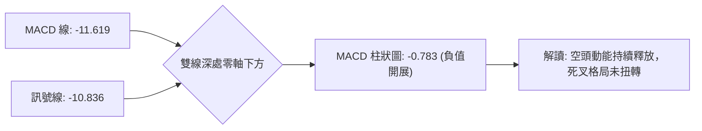

- **MACD 數值解析**：MACD 線 (-11.619) 明顯低於訊號線 (-10.836)，兩者皆處於遠離零軸的負值深淵。
- **柱狀圖動態**：當前 Histogram 為 **-0.783**。儘管較上週極值有所收斂，但依舊維持負向擴張狀態，顯示空頭控制力尚未解除。在雙線未能黃金交叉並向上穿越零軸前，任何價格上漲均應視為指標超賣後的死貓跳（Dead Cat Bounce）。

### 📦 布林通道分析

```
INTC 日線布林通道示意圖 (帶寬極度發散)
價格 ($)
$108.37 ┤ ═════════════════════════════════════ 上軌 (BB Upper)
$100.00 ┤
$ 90.00 ┤
$ 80.00 ┤
$ 75.25 ┤ ------------------------------------- 中軌 MA20 (動態強壓力)
$ 70.00 ┤
$ 61.20 ┤ ◄ 現價 ($61.20, %B = 0.29)
$ 50.00 ┤
$ 42.13 ┤ ═════════════════════════════════════ 下軌 (BB Lower)
```

- **布林參數**：上軌 **$108.37**，中軌 (MA20) **$75.25**，下軌 **$42.13**。
- **%B 指標解讀**：當前 **%B = 0.29**。價格自下軌（11-05 低點 $51.51）獲得支撐後緩步向上爬升，但仍處於中軌 ($75.25) 下方的弱勢區間。
- **通道帶寬**：上軌與下軌差距高達 $66.24，布林帶急劇張開，表明市場正處於劇烈下行波動週期，中軌 $75.25 構成後續難以逾越的第一道鐵壁。

### 💹 成交量分析（量價配合度）

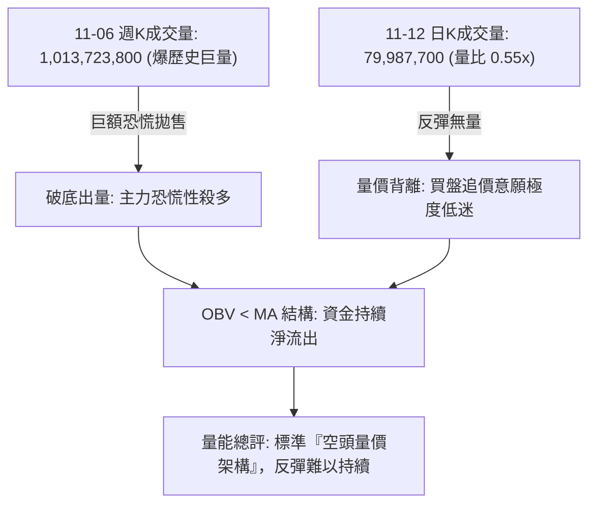

- **最新量能對比**：最新日成交量為 **79,987,700**，僅為 20 日均量 (146,360,895) 的 **0.55 倍**，呈現顯著的縮量回抽。
- **量價背離特徵**：股價自 $51.51 反彈至 $61.20 過程中，成交量持續走低（從 11-05 的 2.70 億股降至 11-12 的 7,998 萬股）。價漲量縮是極度危險的多頭衰竭訊號。
- **OBV 趨勢**：數據顯示「OBV < MA → 量能疲弱」，證實機構大戶資金並未在此價位進行積極吸籌，反彈純屬市場浮額自我抽腳與空頭獲利回補。

---

## 6. 動能與波動率

### ⚡ 動能評估四象限

| 象限分區 | 動能維度 | 波動維度 | 當前狀態吻合 | 策略行為評估 |
|:---|:---:|:---:|:---:|:---|
| **第一象限 (Q1)** | 強動能 (多方) | 低波動 | — | 最佳趨勢加碼點（牛市主升） |
| **第二象限 (Q2)** | 弱動能 (多方) | 低波動 | — | 謹慎觀望，靜待方向選擇 |
| **第三象限 (Q3)** | 強動能 (多方) | 高波動 | — | 高風險高收益，需嚴設止損 |
| **第四象限 (Q4)** | **弱動能 (空方極強)** | **極高波動** | **✓ (INTC 當前)** | **高下行風險，反彈均為誘多，嚴禁做多** |

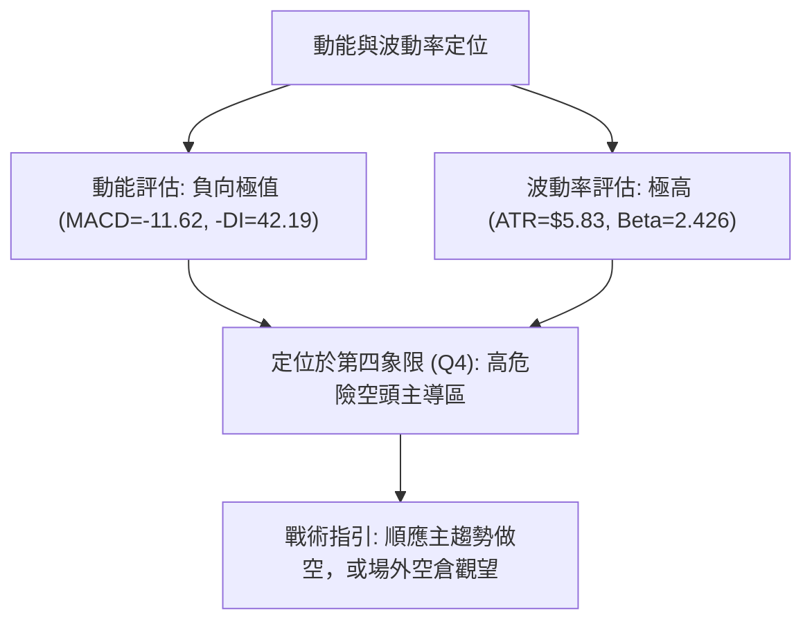

### 📊 ATR 波動率分析

- **ATR(14) 絕對數值**：**$5.83**。
- **相對價格波動率**：佔現價比重高達 **9.52%**（Wilder 計算）。此數值代表 INTC 平均每日的合理波動幅度接近 6 美元，屬於極度高波動標的。
- **風控止損測算**：
  - 根據海龜交易與波動率風控原理，做空交易的止損距離應至少給予 **1.5 至 2.0 倍 ATR**，即 $8.75 ~ $11.66。
  - 短線操作若採用 1.0 倍 ATR 止損，價格緩衝空間為 **$5.83**。

### 📐 Beta 與市場相關性

- **Beta 數值**：**2.426**。
- **市場敏感度解讀**：INTC 的波動幅度為標普 500 指數的 2.4 倍以上。在當前科技股受半導體與 AI 雜音干擾（新聞提及 Nvidia 震盪與市場拋售）的背景下，高達 2.426 的 Beta 意味著若大盤下挫 1%，INTC 技術面將放大下跌約 2.43%，具有顯著的高系統性下行曝險。

---

## 7. 多時框架總結

### 📋 時框架評分表

| 時框架 | 趨勢方向 | 動能狀態 | 均線排列 | 圖表形態 | 綜合評分 | 戰術建議 |
|:---|:---:|:---:|:---:|:---|:---:|:---|
| **長期 (月線)** | 🔴 極度偏空 | 弱勢下挫 | 跌破 MA200 年線 | 巨型雙頭確立 ($139.63 頂部) | 20/100 | 長期投資者停損撤退 |
| **中期 (週線)** | 🔴 空頭主導 | -DI 制霸 | MA20/50/200 下彎 | 爆量下殺破頸線 ($89.47) | 30/100 | 反彈皆為放空賣點 |
| **短期 (日線)** | 🟡 弱勢反彈 | 底背離修復 | MA5/10 金叉但壓制於 MA20 | 縮量旗形整理，遇阻回落 | 40/100 | 嚴禁追多，等待反抽衰竭 |

### 🔲 綜合訊號矩陣

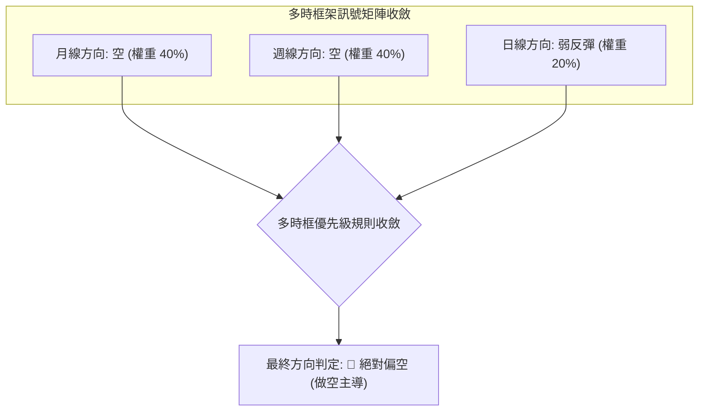

### ⚖️ 多時框收斂結論

依據本報告**嚴格要求 14（多時框收斂規則）**進行強制收斂：
1. **行情屬性判定**：當前 INTC 的 **ADX(14) 讀數為 40.50**，遠高於 25 的趨勢門檻，因此當前市場被定性為**「極強單邊趨勢行情」**，而非震盪盤整行情。
2. **時框優先級裁決**：在 ADX > 25 的趨勢行情下，**必須以中長期（週線 / MA50 / MA200）的空頭方向為主導**，日線級別出現的 RSI 底背離及 MA5/10 低檔金叉，僅能視為次級折返走勢（短線超賣修復），絕不可凌駕於中長線主跌趨勢之上。
3. **唯一收斂結論**：INTC 當前技術結構為**「🔴 強烈偏空」**。日線的反彈僅提供空頭更佳的二次進場放空價格。本結論與第 1 章技術評分卡（30/100）完全呼應，並作為第 8 章制定交易策略之唯一指引。

---

## 8. 交易策略建議

### 🗺️ 策略決策流程圖

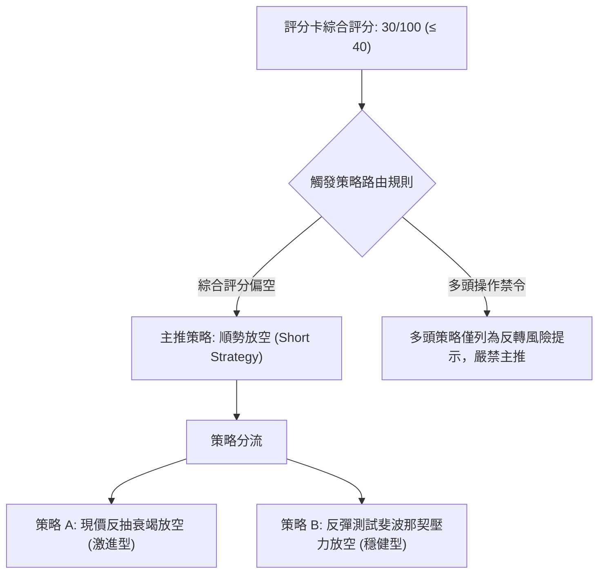

### 🧭 策略路由

**當前主策略方向 = 🔴 順勢做空（依據第 1 章技術評分卡：30/100，評級強烈偏空）**

依據規則 18，綜合評分低於 40 分，嚴格禁止進行任何多頭主推策略。操作主軸鎖定於「反彈阻力位承壓做空」與「破位追空」。

### 🎯 價格情境階梯（Price Scenarios）

所有價位均嚴格引用第 4 章及數據中「關鍵價位」區塊之真實計算數值：

| 觸發條件 | 下一目標 | 後續延伸 | 情境技術含義與市場意涵 |
|:---|:---:|:---:|:---|
| **向上反抽受阻於 $64.06** | S1: **$51.51** | S2: **$42.58** | 短線反彈動能衰竭，回歸主跌浪測試前低 |
| **向上反彈突破現價區間** | 斐波那契 61.8%: **$74.70** | R1: **$95.68** | 深幅超賣修復，測試月線 MA20 與多空防線 |
| **向下失守關鍵支撐 S1** | S2: **$42.58** | S3: **$41.64** | 宣告新一輪加速主跌浪展開，下探年內大底 |

### 📊 情境機率分佈

| 預測情境 | 發生機率 | 主要技術與量價依據 |
|:---|:---:|:---|
| **跌破 S1 繼續探底主跌** | **60%** | ADX 高達 40.50 (-DI 主導)，OBV 疲弱且反彈量能急縮 (0.55x)，長天期均線全面反壓 |
| **低檔區間弱勢震盪 ($51.51 ~ $64.06)** | **30%** | RSI(14) 呈現底背離修復，日線 MA5/10 提供短期托底，空頭暫時放緩下殺節奏 |
| **強勢向上大幅反彈 (挑戰 $74.70)** | **10%** | 需極端利多催化與機構巨量回補，在當前月線均線下壓與半導體環境下機率極低 |

### 🟢 主策略詳情（做空策略）

所有價位均嚴格基於數據提供之現價 $61.20、日K高點 $64.06、阻力聚類 R1: $95.68、支撐聚類 S1: $51.51、S2: $42.58 計算。
*(風險報酬比定義嚴格依規則 17：做空風報比 = (進場價 − 目標價 T1) ÷ (止損價 − 進場價))*

| 策略要素 | 策略 A（現價次日弱勢放空 — 激進型） | 策略 B（反彈承壓放空 — 穩健型） |
|:---|:---|:---|
| **進場條件** | 現價反彈無力，日K收陰跌破 11-12 低點 ($59.41) | 價格向上回抽斐波那契 78.6% 回調位 ($56.31~$64.06 區間) 遇阻 |
| **進場價格** | **$61.20**（當前最新收盤價） | **$64.06**（2026-11-11 日K最高反彈阻力點） |
| **目標價 T1** | **$51.51**（引用支撐位 S1，近一年低點） | **$51.51**（引用支撐位 S1，近一年低點） |
| **目標價 T2** | **$42.58**（引用支撐位 S2，強支撐聚類） | **$42.58**（引用支撐位 S2，強支撐聚類） |
| **止損價格** | **$64.06**（2026-11-11 日K反彈波段高點） | **$68.77**（2026-10-30 日K實體高點） |
| **風險報酬比** | **1 : 3.39（以 T1 計）**<br>計算式: ($61.20 − $51.51) ÷ ($64.06 − $61.20)<br>= $9.69 ÷ $2.86 = 3.388<br>*(另以 T2 計為 1 : 6.51)* | **1 : 2.66（以 T1 計）**<br>計算式: ($64.06 − $51.51) ÷ ($68.77 − $64.06)<br>= $12.55 ÷ $4.71 = 2.664<br>*(另以 T2 計為 1 : 4.56)* |
| **成功機率** | **65%** | **70%** |
| **建議倉位** | **15%** | **20%** |

### 🔴 反向風險觸發點（對沖提示）

以下情況若發生，將推翻當前空頭主策略架構，空單必須無條件全數離場：
1. **價位突破條件**：若日線收盤價強勢帶量突破 **$68.77**（10-30 長陰棒起跌頂點），代表低檔築底成功，短線空頭結構被破壞。
2. **指標轉向條件**：MACD 出現零軸下方的黃金交叉且 Histogram 翻正；同時日成交量放大至 20 日均量以上（> 1.46 億股）。
3. **對沖建議**：一旦突破 $68.77，空單平倉並可建立 5% 輕倉多單，博弈向斐波那契 61.8% **$74.70** 及 MA20 ($75.25) 的補漲行情。

### ⭐ 整體訊號強度評星

```
做多訊號強度：★☆☆☆☆  (1/5星 - 僅存技術性超賣背離)
做空訊號強度：★★★★☆  (4/5星 - 均線、ADX、量價高度共振)
整體可信度：  ★★★★☆  (4/5星 - 數據完整，趨勢極其明朗)
```

---

## 9. 風險提示與監控

### ✅ 關鍵監控指標 Checklist

```
╔══════════════════════════════════════════════════════════════╗
║               INTC 關鍵技術監控清單 (Checklist)               ║
╠══════════════════════════════════════════════════════════════╣
║ [ ] 支撐位防守檢驗：每日收盤價是否守穩 S1: $51.51           ║
║ [ ] 動態阻力壓制：價格是否持續受制於 MA20: $75.25           ║
║ [ ] 趨勢強度指標：ADX(14) 是否維持在 25 以上 (目前 40.50)   ║
║ [ ] 動能死叉維持：MACD 柱狀圖是否持續處於負值區間 (-0.783)   ║
║ [ ] 成交量能監控：反彈量能是否持續低於 20日均量 (1.46億股)  ║
║ [ ] 通道破位監控：布林通道帶寬是否持續張開且 %B < 0.30      ║
║ [ ] 外圍市場動態：半導體板塊與 Nvidia 震盪引發的 Beta 衝擊  ║
╚══════════════════════════════════════════════════════════════╝
```

### ⚠️ 風險場景分析

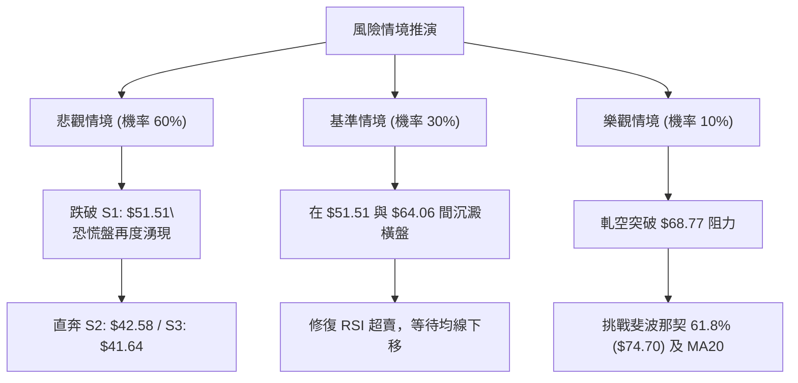

### 🛡️ 風險管理重要提醒

1. **嚴禁主觀摸底**：INTC 當前處於標準的「破位主跌浪」，ADX 高達 40.50，切忌因價格自 $142.35 高點腰斬而主觀認定便宜。在量能未出現健康溫和遞增、底背離未演變為趨勢扭轉前，嚴禁盲目進場做多。
2. **高 Beta 波動防範**：由於 Beta 高達 2.426 且 ATR 為 $5.83，單日跳空風險極大。操作上必須恪守單筆交易虧損不超過總帳戶資金 1.5% 的風控鐵律。
3. **止損堅決執行**：若參與反彈或執行做空策略，必須在交易系統中預埋條件單，嚴格以第 8 章設定之 **$64.06** 或 **$68.77** 為離場紀律。

---

## 📋 報告總結

```
╔══════════════════════════════════════════════════════════════╗
║               INTC 技術分析報告總結                          ║
╠══════════════════════════════════════════════════════════════╣
║ 報告日期：2026-11-13                                         ║
║ 當前價格：$61.20                                             ║
║ 分析評級：🔴 強烈偏空（綜合評分 30/100，單邊空頭趨勢）       ║
║                                                              ║
║ 關鍵結論：                                                   ║
║ ├─ 長期趨勢：🔴 跌破年線 MA200 ($87.34)，大型雙頂宣告成立   ║
║ ├─ 中期趨勢：🔴 週線爆天量長黑摜破頸線，空方絕對主控 (ADX 40.5)║
║ ├─ 短期趨勢：🟡 觸及 $51.51 後出現 RSI 底背離弱勢縮量反抽   ║
║ ├─ 關鍵支撐：S1: $51.51 ｜ S2: $42.58 ｜ S3: $41.64          ║
║ ├─ 關鍵阻力：反彈阻力 $64.06 ｜ 斐波61.8% $74.70 ｜ R1: $95.68║
║ └─ 華爾街目標均價：$90.65 (當前處於下修通道中)              ║
║                                                              ║
║ 最優策略組合：                                               ║
║ 1. 🥇 最佳機會：策略 A（現價 $61.20 反彈受阻放空，           ║
║                 目標 $51.51，止損 $64.06，風報比 1:3.39）   ║
║ 2. 🥈 次選機會：策略 B（回抽 $64.06 遇阻做空，               ║
║                 目標 $51.51，止損 $68.77，風報比 1:2.66）   ║
║ 3. 🥉 保守選擇：完全空倉觀望，耐心等待價格下探 S2 ($42.58)  ║
║                 出現機構放量築底信號再行定奪                 ║
╚══════════════════════════════════════════════════════════════╝
```

---

> ⚠️ **免責聲明**：本報告為 AI 自動生成之技術分析，所有數據及估算均嚴格基於所提供的歷史交易資訊進行客觀運算。本報告**僅供研究與學術參考**，**不構成任何形式的投資買賣建議**。金融市場瞬息萬變，投資有極高風險，入市需獨立審慎評估。

---

*報告生成時間：2026-11-13 ｜ 數據來源：Yahoo Finance ｜ 分析框架：多時框技術分析系統*