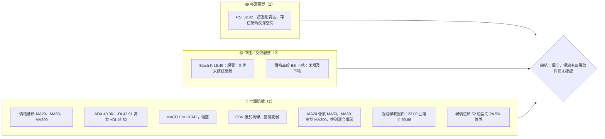
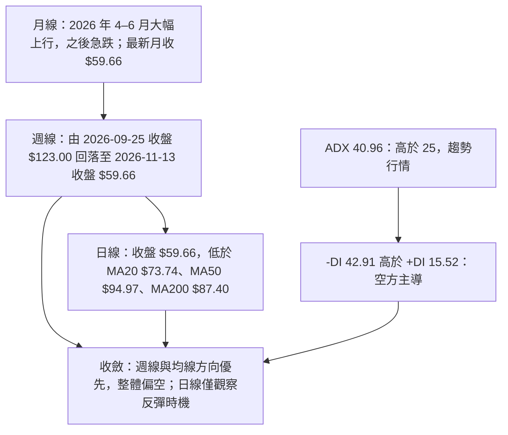
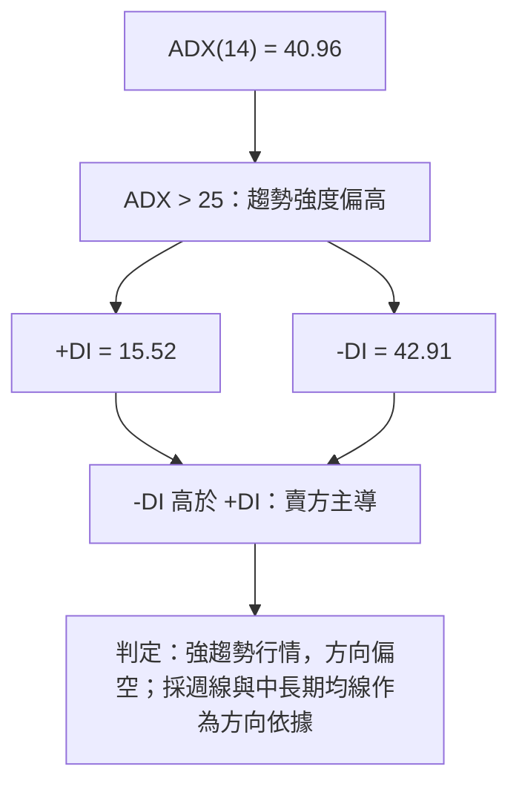
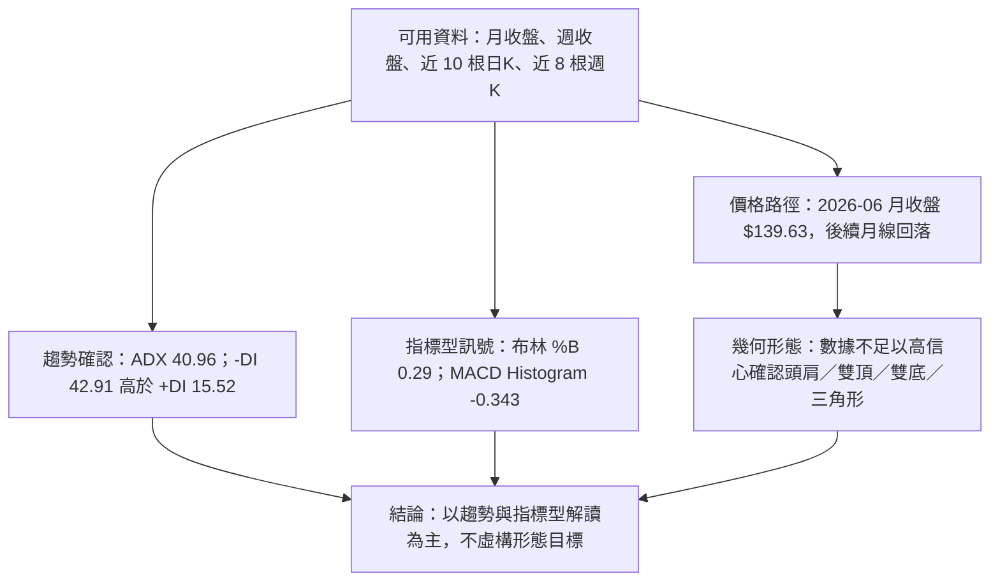
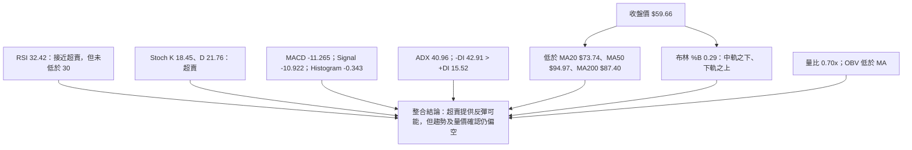
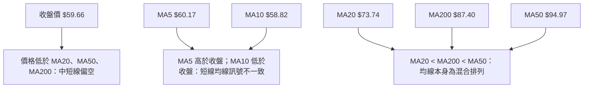
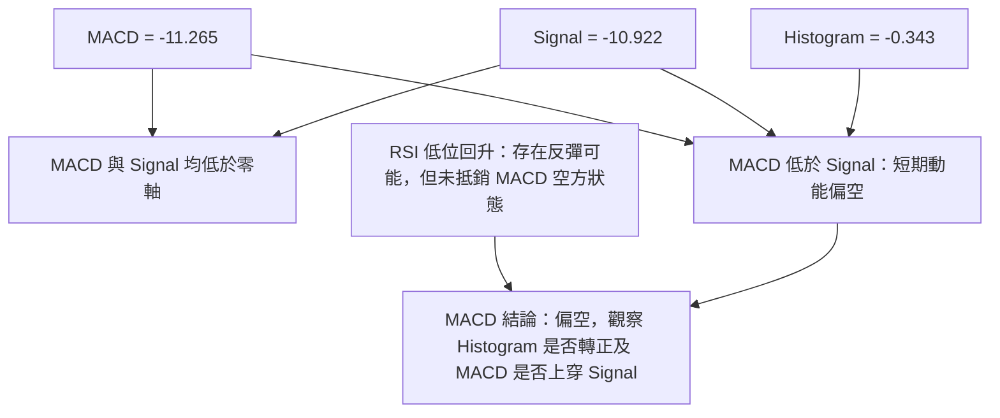
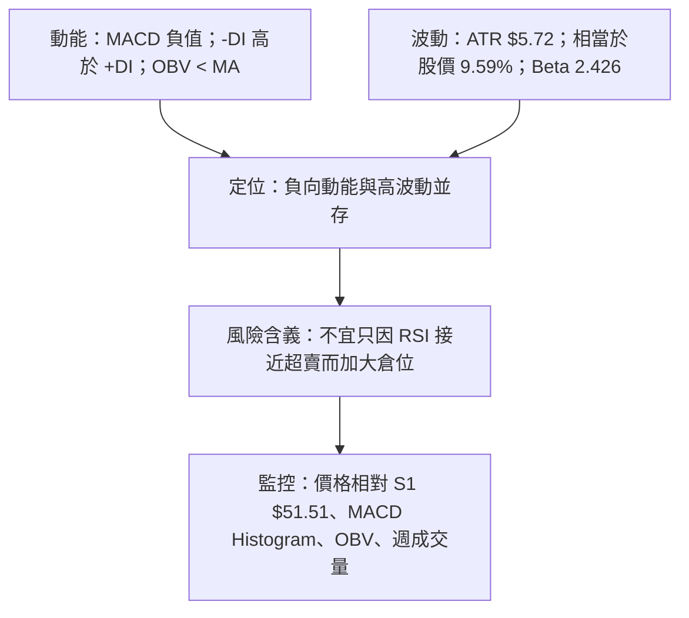
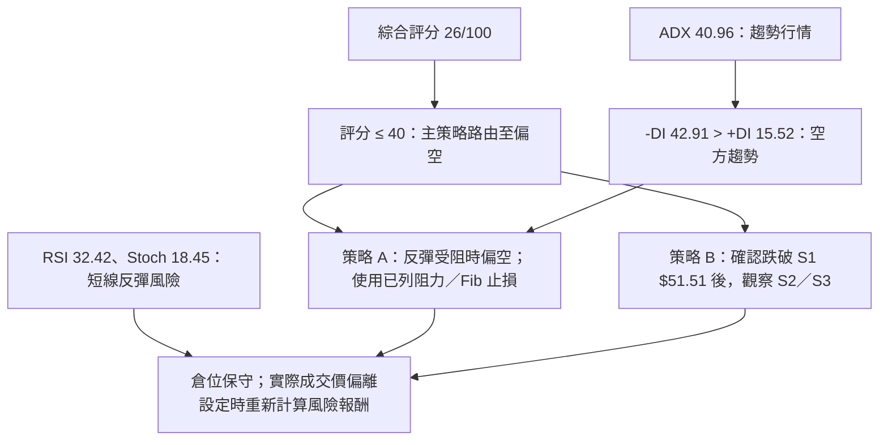
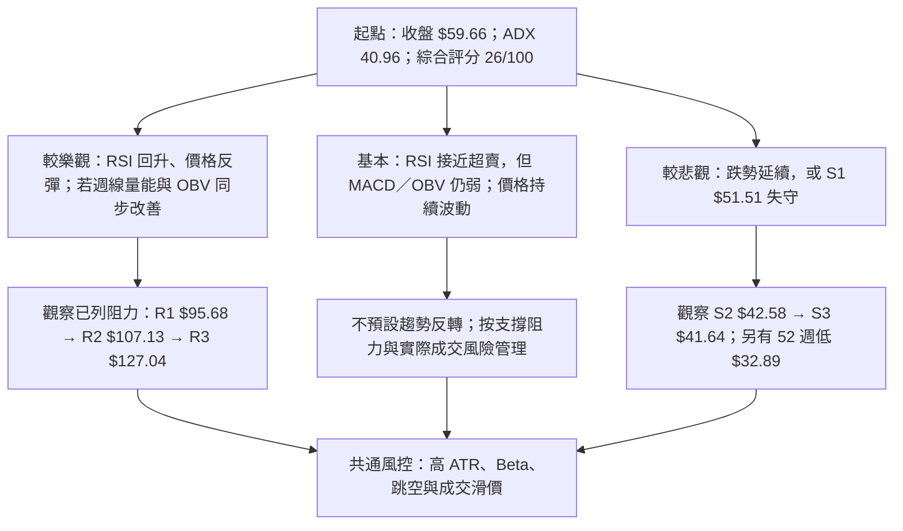

# INTC 技術分析報告

> **報告日期**：2026-11-14 ｜ **語言**：繁體中文 ｜ **數據來源**：Yahoo Finance（依據題示資料） ｜ **當前價格**：**$59.66**

---

## 目錄

| 章節 | 內容 |
|------|------|
| 1. 技術面概覽 | 訊號儀表板、核心指標、評分卡 |
| 2. 趨勢分析 | 多時框趨勢、長中短期走勢 |
| 3. 圖表形態分析 | 形態識別、K線組合、目標價 |
| 4. 支撐與阻力 | 關鍵價位、斐波那契回調 |
| 5. 技術指標深度解讀 | MA、RSI、MACD、布林通道、成交量 |
| 6. 動能與波動率 | 動能評估、ATR、Beta |
| 7. 多時框架總結 | 時框架評分矩陣 |
| 8. 交易策略建議 | 主策略、情境分析、風險報酬比 |
| 9. 風險提示與監控 | 監控指標、風險場景 |

---

## 1. 技術面概覽

### 🎯 技術訊號儀表板

以下統計是對所提供主要指標的方向性整理，不是獨立樣本的統計推論。RSI 低位與 Stochastic 超賣代表可能出現反彈，但尚未抵銷趨勢、均線及量能的偏空訊號。



### 📊 核心指標速覽表

| 指標類別 | 指標名稱 | 當前數值 | 訊號 | 解讀 |
|---|---:|---:|---|---|
| 價格 | 收盤價 | $59.66 | 🔴 | 報告採用之當前價格；低於 MA20、MA50、MA200 |
| 區間 | 52 週高／低 | $142.35／$32.89 | 🔴 | 現價位於所提供 52 週區間的 24.5% 位置 |
| 均線 | MA20 | $73.74 | 🔴 | 收盤價低於 MA20 約 $14.08 |
| 均線 | MA50 | $94.97 | 🔴 | 收盤價低於 MA50 約 $35.31 |
| 均線 | MA200 | $87.40 | 🔴 | 收盤價低於 MA200 約 $27.74 |
| 動能 | RSI(14) | 32.42 | 🟡 | 接近超賣，但未低於 30；不能單憑此值確認反轉 |
| 動能 | MACD | -11.265 | 🔴 | MACD 低於零軸，整體動能偏弱 |
| 動能 | MACD Histogram | -0.343 | 🔴 | 仍為負值，空方動能未完全消退 |
| 趨勢 | ADX(14) | 40.96 | 🔴 | 趨勢強度高於 25；配合 -DI 主導，屬強勢下行趨勢 |
| 波動 | ATR(14) | $5.72 | 🔴 | ATR 約為股價的 9.59%，單日波動風險偏高 |
| 量能 | 最新成交量／20 日均量 | 102.32M／145.36M | 🔴 | 量比 0.70x；當日量低於 20 日均量 |
| 量能 | OBV | OBV < MA | 🔴 | 整體量能趨勢偏弱，尚未確認價格反彈 |
| 波動區間 | 布林 %B | 0.29 | 🟡 | 低於中軌、但高於下軌；位於布林區間偏下位置 |

### 🏆 技術評分卡

評分使用 0–100 分尺度。六項子評分各自依題示指標評估；綜合評分為六項的**算術平均**，四捨五入至整數。

```text
技術評分卡 — INTC（2026-11-14）
╔══════════════════════════════════════════════════════════════╗
║ 趨勢強度      ████░░░░░░░░░░░░░░░░  20/100  🔴            ║
║ 動能指標      ██████░░░░░░░░░░░░░░  30/100  🔴            ║
║ 支撐穩定度    ████████░░░░░░░░░░░░  40/100  🟡            ║
║ 成交量配合    █████░░░░░░░░░░░░░░░  25/100  🔴            ║
║ 形態完整度    ████░░░░░░░░░░░░░░░░  20/100  🔴            ║
║ 均線排列      ████░░░░░░░░░░░░░░░░  20/100  🔴            ║
╠══════════════════════════════════════════════════════════════╣
║ 六項算術平均  █████░░░░░░░░░░░░░░░  26/100  🔴 偏空       ║
╚══════════════════════════════════════════════════════════════╝
```

計算：\((20+30+40+25+20+20) ÷ 6 = 25.83\)，四捨五入為 **26/100**。

- **趨勢強度 20/100**：ADX 顯示趨勢強，但 -DI 明顯高於 +DI，趨勢方向偏空。
- **動能指標 30/100**：RSI 低位有反彈可能，但 MACD、MACD Histogram 仍偏空。
- **支撐穩定度 40/100**：已提供 S1，但趨勢較強且價格仍遠低於多條均線，支撐有待驗證。
- **成交量配合 25/100**：OBV 低於均線，最新量低於 20 日及 50 日均量。
- **形態完整度 20/100**：價格有明確跌勢，但現有數據不足以確認標準反轉形態。
- **均線排列 20/100**：價格低於 MA20、MA50、MA200；MA20、MA50、MA200 的相對排序雖非完整空頭排列，整體價格位置仍弱。

---

## 2. 趨勢分析

### 🌐 多時框趨勢分析



| 時框 | 主要觀察 | 判斷 | 強度 |
|---|---|---|---|
| 月線 | 2026-06 收盤 $139.63，之後 2026-11 收盤 $59.66 | 🟡 高位反轉後大幅下跌；趨勢已由上行轉為急速修正 | ▓▓▓▓▓▓▓▓░░ 80% |
| 週線 | 2026-09-25 收盤 $123.00，至 2026-11-06 收盤 $56.28，11-13 收 $59.66 | 🔴 明顯下行；最新週僅回升，尚未破壞跌勢結構 | ▓▓▓▓▓▓▓▓▓░ 90% |
| 日線 | 價格低於 MA20、MA50、MA200；ADX 40.96 | 🔴 下行趨勢仍強；超賣訊號提供反彈可能，不代表趨勢反轉 | ▓▓▓▓▓▓▓▓░░ 80% |

### 📈 長期趨勢 — 12 個月走勢圖

以下使用 **2025-12 至 2026-11 的月收盤價**共 12 筆資料。走勢圖只呈現月收盤序列；月內高低點並不等同於月收盤，因此不以此圖推定日內高低。

```text
INTC 月線收盤走勢圖（2025-12 至 2026-11）
每個 ● 代表對應月份的收盤價；數字為該月收盤價
價格（美元）

140 ┤                              ● 139.63
120 ┤                                ● 114.68
100 ┤                                  ● 90.20 ● 89.51
 80 ┤                                            ● 120.23
 60 ┤                                                ● 65.76 ● 59.66
 40 ┤                  ● 36.90
 20 ┤● 20.05 ● 19.43 ● 23.73 ● 22.71 ● 20.10 ● 19.55 ● 22.40 ● 19.80
  0 ┼──────────────────────────────────────────────────────────────
     25-12 26-01 26-02 26-03 26-04 26-05 26-06 26-07 26-08 26-09
                                                    26-10 26-11
```

| 階段 | 月收盤序列 | 走勢特徵 |
|---|---|---|
| 2025-12 至 2026-03 | $36.90、$46.47、$45.61、$44.13 | 月收盤先回升，後於高位整理 |
| 2026-04 至 2026-06 | $94.48、$114.68、$139.63 | 快速上行階段；2026-06 為提供月收盤資料中的最高值 |
| 2026-07 至 2026-08 | $90.20、$89.51 | 從 2026-06 高位大幅回落後，月收盤在較低區域停留 |
| 2026-09 | $120.23 | 月收盤反彈，但後續未能延續 |
| 2026-10 至 2026-11 | $65.76、$59.66 | 再度大幅回落，月線方向偏弱 |

> **注意**：題示月線序列從 2025-11 開始，但 12 個月圖採 2025-12 至 2026-11 的 12 個收盤月。52 週極值另列為 $142.35／$32.89，不把它們冒充月收盤價。

### 📊 中期趨勢（週線分析）

近 20 週收盤資料顯示，股價在 2026 年 9 月下旬收於 $123.00 後持續走低，最近一週收盤回升至 $59.66。週 RSI 從 2026-11-06 的 25.7 回升至 32.4，但週 MACD 柱仍為負值 **-0.343**，故較合理的解讀是「跌勢中出現反彈」，而非「中期轉多」。

```text
週線收盤趨勢（近 8 根週K，收盤價）
$127.44 ┤  ● 高點區：2026-09-25 週內高 $127.44
$123.00 ┤  ● 09-25 收盤
$119.33 ┤     ● 10-02
$104.70 ┤        ● 10-09
 $89.85 ┤           ● 10-16
 $86.96 ┤              ● 10-23
 $65.76 ┤                 ● 10-30
 $56.28 ┤                    ● 11-06
 $59.66 ┤                       ● 11-13（最新收盤）
         └────────────────────────────────────────────
          09-25  10-02  10-09  10-16  10-23  10-30  11-06  11-13
```

- **趨勢方向**：偏空。近 8 根週線收盤從 $123.00 下滑至 $59.66。
- **反彈訊號**：最新週收盤較前週收盤上升；週 RSI 回到 32.4。
- **反彈確認不足**：MACD 柱仍為負值；週線價格仍遠低於 MA20、MA50 與 MA200 的相應日線數值。
- **量能提醒**：2026-10-30 與 2026-11-06 週成交量分別為 861,628,000 與 1,013,723,800，較其後 2026-11-13 週的 564,429,600 高；跌勢階段曾伴隨較大週量，不能只將近期反彈視為買盤確認。

### ⚡ 趨勢強度評估（ADX 解讀）



| ADX 區間 | 常見解讀 | INTC 當前狀態 |
|---|---|---|
| ADX < 20 | 趨勢偏弱，較可能盤整 | 不符合 |
| ADX 20–25 | 趨勢形成中 | 不符合 |
| ADX > 25 | 趨勢行情，需配合 DI 判斷方向 | 符合；數值為 40.96 |
| +DI > -DI | 多方方向較強 | 不符合；+DI 為 15.52 |
| -DI > +DI | 空方方向較強 | 符合；-DI 為 42.91 |

**ADX 結論**：ADX 只說明趨勢強度，不單獨判定方向。此處方向由 DI 差異補足：空方主導。依多時框收斂規則，當前不應以日線短暫超賣訊號覆蓋週線與均線所顯示的偏空背景。

---

## 3. 圖表形態分析

### 🔍 形態識別系統

現有資料包含月收盤序列、近 20 週收盤及近 10 根日K／近 8 根週K。這些資料足以確認價格曾快速上行後急跌，但不足以精確確認完整頭肩頂、雙頂、雙底或三角形的幾何邊界。因此，不以主觀連線宣稱傳統形態成立。



| 形態／訊號 | 信心度 | 判斷依據（引用資料） | 完成度 | 目標價 |
|---|---:|---|---|---|
| 中期下行趨勢 | 90% | 週收盤由 2026-09-25 的 $123.00 下跌至 2026-11-06 的 $56.28；ADX 40.96 且 -DI 高於 +DI | 仍在發展 | **不屬於幾何形態，無獨立形態目標價** |
| 高位急跌／趨勢反轉型走勢 | 75% | 月收盤由 2026-06 的 $139.63 下行至 2026-11 的 $59.66；月度及週度資料均顯示大幅回落 | 已發生下跌，底部未確認 | **不提供形態目標價** |
| 雙底 | <50% | 僅能看到 2026-11-05 日低 $51.51，以及近週低點；沒有足夠歷史擺盪點確認兩個分離、相近低點及頸線 | 不成立／未確認 | N/A（數據未提供） |
| 頭肩頂／雙頂／三角形／旗形 | <50% | 可用週K與日K樣本不足以確認完整峰谷、頸線或收斂邊界 | 不成立／未確認 | N/A（數據未提供） |
| 布林通道偏下區 | 70% | BB %B = 0.29，現價 $59.66 低於中軌 $73.74、高於下軌 $40.67 | 指標狀態成立 | 非傳統圖表形態，不推算形態目標 |

**總結**：趨勢型訊號明確偏空；傳統幾何形態證據不足。沒有以形態高度推算目標價，因此本報告的交易目標僅採用題示已列出的關鍵支撐價位。

### 🕯️ 重要 K 線形態分析

以下只使用題示「近 10 根日K」與「近 8 根週K」內的開、高、低、收。影線與實體比例為依該表 OHLC 直接計算；不把樣本外日期描述為特定 K 線形態。

| 日期（日K） | 開 | 高 | 低 | 收 | K線觀察 | 解讀 | 訊號 |
|---|---:|---:|---:|---:|---|---|---|
| 2026-11-02 | $65.40 | $65.72 | $59.40 | $59.97 | 長陰線，收盤接近低位 | 開收差 $5.43，當日賣壓顯著 | 🔴 |
| 2026-11-03 | $61.33 | $62.59 | $59.87 | $60.55 | 小陰線 | 收低於開，實體較前日縮小 | 🟡 |
| 2026-11-04 | $58.67 | $60.20 | $56.77 | $58.27 | 小陰線 | 實體 $0.40，反映當日波動中偏弱收盤 | 🟡 |
| 2026-11-05 | $56.51 | $56.73 | $51.51 | $52.25 | 長陰線，接近低位收盤 | 收盤距低點 $0.74；空方主導 | 🔴 |
| 2026-11-06 | $54.99 | $57.32 | $54.56 | $56.28 | 陽線，帶上影線 | 收盤高於開盤，但尚未收復 11-05 下跌幅度 | 🟡 |
| 2026-11-09 | $56.86 | $60.03 | $55.83 | $59.37 | 陽線 | 收盤高於開盤，短線反彈延續 | 🟢 |
| 2026-11-10 | $57.96 | $60.65 | $56.85 | $58.13 | 陰線，帶下影線 | 盤中波動後收低，反彈未連續 | 🟡 |
| 2026-11-11 | $61.67 | $64.06 | $60.95 | $62.50 | 小陽線，長上影 | 高點明顯高於收盤，追價未能維持 | 🟡 |
| 2026-11-12 | $59.69 | $62.76 | $59.41 | $61.20 | 陽線 | 收盤高於開盤，但仍受上方壓力影響 | 🟢 |
| 2026-11-13 | $60.66 | $61.34 | $57.00 | $59.66 | 小陰實體、較長下影 | 下影顯示低位有承接，但收盤仍低於開盤，不能單獨確認反轉 | 🟡 |

| 日期（週K） | 開 | 高 | 低 | 收 | K線觀察 | 解讀 | 訊號 |
|---|---:|---:|---:|---:|---|---|---|
| 2026-09-25 | $116.53 | $127.44 | $114.93 | $123.00 | 陽線 | 當週收盤高於開盤，位於其樣本中的高價區 | 🟢 |
| 2026-10-02 | $120.68 | $126.00 | $113.97 | $119.33 | 小陰線 | 高位收低，價格進入回落階段 | 🟡 |
| 2026-10-09 | $115.34 | $118.20 | $104.00 | $104.70 | 長陰線 | 收盤接近週內低位，空方動能增加 | 🔴 |
| 2026-10-16 | $102.52 | $103.19 | $89.19 | $89.85 | 長陰線 | 下行延續，收盤靠近低位 | 🔴 |
| 2026-10-23 | $94.53 | $95.39 | $84.65 | $86.96 | 陰線 | 收盤低於開盤，仍為下行週 | 🔴 |
| 2026-10-30 | $87.94 | $95.68 | $63.20 | $65.76 | 大幅陰線，長下影 | 價格振幅大；收盤仍大幅低於開盤，波動放大 | 🔴 |
| 2026-11-06 | $65.40 | $65.72 | $51.51 | $56.28 | 長陰線 | 收盤低於開盤，且週低與日線提供之 $51.51 一致 | 🔴 |
| 2026-11-13 | $56.86 | $64.06 | $55.83 | $59.66 | 陽線、長上影 | 週內反彈，但高位遇賣壓；仍低於前週範圍上緣 | 🟡 |

> OHLC 表顯示的是特定期間的價格，不代表可單獨用一根 K 線預測後續。尤其 2026-11-13 日K收盤仍低於開盤，因此其下影線只屬承接線索，不是已確認看漲反轉形態。

### 📉 ASCII 走勢形態示意圖

```text
INTC 週線走勢示意（以近 8 根週K收盤價為主）
價格
$127 ┤ ● 09-25（收 $123.00；週高 $127.44）
$119 ┤    ● 10-02（收 $119.33）
$105 ┤       ● 10-09（收 $104.70）
 $90 ┤          ● 10-16（收 $89.85）
 $87 ┤             ● 10-23（收 $86.96）
 $66 ┤                ● 10-30（收 $65.76）
 $56 ┤                   ● 11-06（收 $56.28）
 $60 ┤                      ● 11-13（收 $59.66）
      └────────────────────────────────────────────
        高位回落         跌勢加速       低位反彈未確認
```

### 🎯 形態目標價計算

- **沒有確認的頭肩、雙頂、雙底、旗形或三角形**，故沒有可用的頸線、形態高度或突破點。
- 依數據紀律，不在形態證據不足時自行建立形態高度。
- 本報告不提供自行推算的形態目標價。
- 交易情境所用目標價將引用「關鍵價位」中的 S1、S2、S3。
- 分析師共識平均目標價 **$90.65** 為外部分析師估值，不是技術形態目標價，兩者不可混為一談。

---

## 4. 支撐與阻力

### 🗺️ 關鍵價位分布圖

下圖只列題示「關鍵價位」中的阻力、支撐及斐波那契價位；**現價 $59.66** 為題示收盤價。

```text
INTC 價位結構分布圖（美元）
══════════════════════════════════════════════════════════
$142.35 ║ 52 週高點／Fib 0.0%                         ║
$127.04 ║████████████████████████████ R3 阻力        ║
$116.52 ║ Fib 23.6%                                   ║
$107.13 ║████████████████████████ R2 阻力             ║
$100.54 ║ Fib 38.2%                                   ║
 $95.68 ║████████████████████████ R1 阻力             ║
 $87.62 ║ Fib 50.0%                                   ║
 $74.70 ║ Fib 61.8%                                   ║
 $59.66 ╠══════════════════════ 現價 ═════════════════╣
 $56.31 ║ Fib 78.6%                                   ║
 $51.51 ║▓▓▓▓▓▓▓▓▓▓▓▓▓▓▓▓ S1 支撐                     ║
 $42.58 ║▓▓▓▓▓▓▓▓▓▓▓▓▓▓▓▓▓▓ S2 支撐                  ║
 $41.64 ║▓▓▓▓▓▓▓▓▓▓▓▓▓▓▓▓▓▓ S3 支撐                  ║
 $32.89 ║ 52 週低點／Fib 100.0%                       ║
══════════════════════════════════════════════════════════
```

### 🚧 阻力位分析表

阻力位依題示 OHLCV 關鍵價位資料，直接引用波段高點聚類數值。

| 阻力級別 | 價位 | 形成原因 | 突破難度 | 重要性 |
|---|---:|---|---|---|
| R1 | $95.68 | 近一年波段高點聚類；亦接近日線 MA50 $94.97，但兩者是不同來源 | 高 | 重要的第一道結構阻力 |
| R2 | $107.13 | 近一年波段高點聚類；位於 Fib 38.2% $100.54 上方 | 高 | 中期反彈若靠近此位，需觀察量能與週線收盤 |
| R3 | $127.04 | 近一年波段高點聚類；接近近週資料中的高價區，但僅引用所列阻力值 | 很高 | 上方主要波段阻力 |

> 阻力位之間的 MA 或 Fibonacci 數值只作交叉觀察，不額外推導未列出的關鍵水平。

### 🛡️ 支撐位分析表

支撐位直接引用題示關鍵價位資料中的波段低點聚類值。

| 支撐級別 | 價位 | 形成原因 | 守住機率評估 | 重要性 |
|---|---:|---|---|---|
| S1 | $51.51 | 近一年波段低點聚類；亦為 2026-11-05 日低及 2026-11-06 週低 | 中低；價格靠近時需觀察是否出現放量承接 | 高 |
| S2 | $42.58 | 近一年波段低點聚類 | N/A（數據未提供機率） | 高 |
| S3 | $41.64 | 近一年波段低點聚類，與 S2 形成相近區域的支撐帶 | N/A（數據未提供機率） | 高 |
| 52 週低 | $32.89 | 52 週區間最低價；同時為 Fibonacci 100.0% | N/A（數據未提供機率） | 若 S2、S3 失守，屬更低位的區間參考 |

**支撐結構解讀**：S1 $51.51 是最近且有日／週 OHLC 低點資料呼應的第一支撐；但 ADX 偏高、-DI 主導，支撐不宜預設為必然有效。若 S1 失守，下一層明確列出的支撐是 S2 $42.58 與 S3 $41.64。

### 📐 斐波那契回調位分析

以下直接引用題示 52 週區間 $32.89 → $142.35 的斐波那契水平，不自行重算。

| 回調比率 | 價位 | 與現價關係 |
|---|---:|---|
| 0.0%（52 週高） | $142.35 | 高於現價 |
| 23.6% | $116.52 | 高於現價 |
| 38.2% | $100.54 | 高於現價 |
| 50.0% | $87.62 | 高於現價 |
| 61.8% | $74.70 | 高於現價 |
| 78.6% | $56.31 | 低於現價 |
| 100.0%（52 週低） | $32.89 | 低於現價 |

**現價位置**：$59.66 位於 **Fib 61.8% $74.70 與 Fib 78.6% $56.31** 之間，且距離 78.6% 回調位不遠。這表示股價已回吐較大比例的 52 週區間漲幅，但 Fibonacci 本身不是反轉確認。現價仍低於 MA20 $73.74，也低於 MA50 $94.97，需等待價格重新站回關鍵均線並改善量能，才有較強的趨勢修復證據。

---

## 5. 技術指標深度解讀

### 🎛️ 指標訊號總覽



| 指標群 | 偏多資訊 | 偏空資訊 | 整合判斷 |
|---|---|---|---|
| RSI／Stochastic | RSI 32.42，Stoch K 18.45：下行後有反彈空間 | RSI 尚未確認反轉；Stoch 超賣可能在強趨勢中維持 | 🟡 僅支持反彈觀察，不等於買進確認 |
| MACD | MACD 柱仍為負，但數值為 -0.343 | MACD 線 -11.265 低於 Signal -10.922；兩者在零軸下方 | 🔴 仍偏空 |
| 均線 | MA5 $60.17 與 MA10 $58.82 接近現價，短線有整理空間 | 價格低於 MA20、MA50、MA200；中期均線偏弱 | 🔴 中長期結構偏空 |
| 布林 | 現價高於下軌 $40.67 | 現價低於中軌 $73.74；%B 0.29 | 🟡 處於通道下半部 |
| 成交量／OBV | 最新日量 102.32M，仍有交易活動 | 低於 20 日均量，OBV < MA；反彈未獲量能確認 | 🔴 量價配合不足 |

### 📈 移動平均線排列分析



| 均線 | 數值 | 相對現價 | 方向與解讀 |
|---|---:|---|---|
| MA5 | $60.17 | 現價低 $0.51 | 近端短線壓力，差距小 |
| MA10 | $58.82 | 現價高 $0.84 | 近端短線支撐參考，但不作本報告的結構支撐位 |
| MA20 | $73.74 | 現價低 $14.08 | 短中期方向偏弱 |
| MA50 | $94.97 | 現價低 $35.31 | 中期反彈需面對的均線阻力 |
| MA200 | $87.40 | 現價低 $27.74 | 長期價格趨勢仍低於長期均線 |

**均線整合解讀**：

- 均線系統標示為「混合排列」，不是單純的 MA20 < MA50 < MA200 全空頭排序。
- 但現價同時低於 MA20、MA50、MA200，表示價格位置本身高度偏弱。
- MA20 $73.74 低於 MA200 $87.40，而 MA50 $94.97 高於 MA200，反映不同期間均線受此前波動影響，不能僅用均線交叉方向替代價格趨勢判斷。
- 週線趨勢與 ADX／DI 訊號偏空，故均線「混合」並不構成多頭確認。

### 📉 RSI(14) 分析

```text
RSI(14) 強度條（0–100）
0         20        30        50        70        80       100
|----------|---------|---------|---------|---------|---------|
                         ▲ 32.42
                         ██████░░░░░░░░░░░░░░░░░░░░░░░░░░░░░░
區域：<30 超賣｜30–70 中性｜>70 超買
```

- **當前 RSI：32.42**，依題示分類屬 30–70 的中性區間，但接近超賣界線。
- RSI 從低位回升可作為下跌速度放緩或短線反彈的線索；然而 RSI 單一值並不能證明底部。
- 週線 RSI 由 2026-11-06 的 25.7 回升至 2026-11-13 的 32.4，改善訊號與週收盤反彈一致。
- 但 MACD Histogram 仍為負、OBV < MA、價格仍在多條中長期均線下方，構成反轉確認不足的反向證據。
- **背離判斷**：題示資料明確提供「RSI 背離：無明顯背離（僅比較近 20 根K棒首尾的價格與 RSI 方向）」。因此本報告判定：**未偵測到明確 RSI 頂背離或底背離**。此結論只限該資料使用的比較方法，不代表所有擺盪點均已被完整檢驗。

### 📊 MACD(12/26/9) 訊號解讀



- MACD 線 **-11.265** 低於訊號線 **-10.922**，Histogram **-0.343**，組合偏空。
- MACD 與訊號線皆在零軸下方，表示中期動能背景仍弱。
- Histogram 負值較小並不等於已轉多；仍需觀察是否持續收斂、轉正，以及 MACD 線是否上穿訊號線。
- **背離判斷**：提供資料沒有列出 MACD 背離判斷，也未提供可完整驗證高低點的長期逐日 MACD 序列。因此結論為：**N/A（數據未提供）以確認標準 MACD 頂背離或底背離；不宣稱存在背離**。

### 📦 布林通道分析

```text
INTC 布林通道（美元，依題示數值）
上軌  $106.81  ┤──────────────────────────────────────
               │
中軌   $73.74  ┤───────────────────── MA20
               │                  現價 $59.66
現價   $59.66  ┤─────────────────●
               │
下軌   $40.67  ┤──────────────────────────────────────
               └───────────────────────────────────────
                  %B = 0.29（位於通道下半部）
```

- 上軌 **$106.81**、中軌 **$73.74**、下軌 **$40.67**。
- 現價 $59.66 低於中軌、高於下軌；BB %B 為 **0.29**，與「弱勢通道下半部」一致。
- 現價並未觸及布林下軌，故不應把布林下軌當成已確認的支撐。
- 通道寬度資料未提供，不能精確判斷波帶是否擴張或收斂；亦不能僅憑 %B 推斷波動率方向。
- 盤整時布林通道可作區間參考；但本次 ADX 為 40.96，屬趨勢行情，因此依規則採週線和中長期方向為主，布林只作日線位置參考。

### 💹 成交量分析（量價配合度）

| 量能項目 | 數值 | 判讀 |
|---|---:|---|
| 最新日成交量 | 102,322,800 | 低於 20 日均量及 50 日均量 |
| 20 日均量 | 145,361,870 | 最新量約為 0.70 倍 |
| 50 日均量 | 122,965,672 | 最新量亦低於 50 日均量 |
| 最新週成交量 | 564,429,600 | 低於前兩週所列週量 |
| OBV 趨勢 | OBV < MA | 量能趨勢疲弱 |

- 最新日成交量的量比為 **0.70x**，尚未顯示大幅放量買盤。
- 近週線下跌階段中，2026-10-30 與 2026-11-06 週成交量較高，隨後最新週反彈收盤時週成交量回落；這表示價格反彈沒有明確獲得更強的週量確認。
- OBV 低於其均線，與中期價格下跌方向一致，量能尚未確認反轉。
- **量價結論**：短線反彈存在，但量能確認程度低；若日後價格反彈而 OBV 仍弱，需留意反彈可能只是空頭趨勢中的回補或修復。

---

## 6. 動能與波動率

### ⚡ 動能評估四象限

題示未提供可統一量化的「動能分數」與「年化波動率」門檻，以下依 RSI、MACD、ADX、ATR、OBV 的方向與強弱，做質化象限定位；不虛構額外分數。

| 象限 | 動能 | 波動 | 當前狀態 | 評估 |
|---|---|---|---|---|
| Q1 | 強 | 低 | — | 趨勢延續相對平穩 |
| Q2 | 弱 | 低 | — | 可控但方向性有限 |
| Q3 | 強 | 高 | — | 高風險、高趨勢延續機會 |
| Q4 | 弱／負向 | 高 | **✓ 當前較接近** | 價格弱、波動高，倉位與止損需保守 |



### 📊 ATR 波動率分析

- **ATR(14)：$5.72**。
- ATR 為現價 $59.66 的 **9.59%**，顯示單日常態波動幅度相對股價不低。
- ATR 是波動度參考，不是方向指標；上漲或下跌都可能出現較大日內擺幅。
- 交易止損若設得太窄，可能被日常波動觸發；但在高 ATR 股票中，單純放寬止損也會增加單股風險，應以減少倉位控制風險金額。
- 本報告交易策略的止損價採用已提供的斐波那契價位，不以 ATR 自行推算新的支撐／阻力價位。
- ATR 建議用途：計算交易規模、評估止損距離是否過窄，以及避免在高波動時段過度加碼。

### 📐 Beta 與市場相關性

- **Beta：2.426**，表示歷史價格對市場波動的敏感程度偏高。
- Beta 不等同於精確的每日相關係數，也不能用來預測下一個交易日的方向。
- 在市場風險偏好轉弱、半導體板塊同步下跌時，高 Beta 可能放大價格波動。
- 題示近期新聞包含半導體股回落及美債殖利率上升相關訊息，可作為板塊與宏觀風險背景；但新聞本身不是技術反轉訊號。
- **風險提示**：單股 Beta 2.426 加上 ATR 占股價 9.59%，代表持倉不宜只按一般低波動大型股的風險假設配置。

---

## 7. 多時框架總結

### 📋 時框架評分表

本表的時框架評分為各時框架訊號強弱的分析性整理；第 1 章六項綜合評分 **26/100** 維持不變，不因本章重新計算。

| 時框架 | 趨勢方向 | 動能 | 均線排列／價格位置 | 形態 | 綜合評分 | 建議 |
|---|---|---|---|---|---:|---|
| 月線 | 急漲後轉為大幅回落 | 偏弱 | 月線收盤資料顯示高位下跌；長期月均線數據 N/A（數據未提供） | 傳統形態不足以確認 | 30/100 | 🔴 不以低位月收盤單獨判定築底 |
| 週線 | 偏空 | RSI 反彈、MACD Histogram 仍為負 | 週收盤從 $123.00 回落到 $59.66 | 下跌明確，反轉尚未確認 | 25/100 | 🔴 等待週線結構與量能改善 |
| 日線 | 偏空 | RSI 32.42、Stoch 超賣，但 MACD 偏空 | 現價低於 MA20、MA50、MA200 | 指標型反彈觀察；幾何反轉形態未確認 | 26/100 | 🔴 以空方背景下的反彈管理風險 |
| 綜合 | 偏空 | 超賣與弱勢動能並存 | 均線價格位置偏弱、ADX 趨勢強 | 形態信心不足 | **26/100** | **偏空；避免把超賣等同反轉** |

### 🔲 綜合訊號矩陣

| 維度 | 日線 | 週線 | 月線 | 一致性 |
|---|---|---|---|---|
| 趨勢方向 | 🔴 偏空 | 🔴 偏空 | 🟡 急漲後大幅修正 | 中高一致 |
| 動能 | 🔴 MACD 偏空；RSI 接近超賣 | 🟡 RSI 回升；MACD 柱仍負 | 🔴 月收盤回落 | 大方向偏空，短線動能有反彈差異 |
| 均線／價格位置 | 🔴 價格低於 MA20／50／200 | 🔴 週收盤顯著低於前期高位 | 長期月均線 N/A（數據未提供） | 已提供均線時框偏空 |
| 成交量 | 🔴 最新日量低於均量、OBV < MA | 🔴 最新週量低於前兩週下跌階段 | N/A（數據未提供） | 反彈量能未確認 |
| 波動 | 🔴 ATR 佔股價 9.59% | 🔴 週線區間大幅波動 | 🔴 月收盤振幅顯著 | 高波動一致 |

```text
訊號一致性矩陣
                     短線（日）     中期（週）     長期（月）
趨勢方向                 🔴              🔴              🟡
動能                     🟡              🟡              🔴
量能                     🔴              🔴              N/A
最終方向                 偏空            偏空            修正偏弱
主導權重                 較低            最高            輔助
```

### ⚖️ 多時框收斂結論

1. **行情分類**：ADX(14) = **40.96 > 25**，依本報告規則判定為趨勢行情，而非以布林上下軌為主的盤整行情。
2. **方向判斷**：-DI **42.91** 高於 +DI **15.52**，趨勢方向偏空。
3. **主導時框**：依規則以中長期週線與 MA50／MA200 方向為主，日線用於觀察進場時機。
4. **衝突處理**：日線 RSI 與 Stochastic 接近超賣，代表短線反彈可能；但週線收盤一路走低、MACD 柱為負、OBV < MA，且價格低於 MA50／MA200，因此不以超賣訊號推翻中期偏空結論。
5. **唯一方向性結論**：**偏空**。第 1 章評分 **26/100**，第 8 章採用偏空主策略；若價格站回重要阻力並改善量價，才需重新評估。

---

## 8. 交易策略建議

### 🗺️ 策略決策流程圖



### 🧭 策略路由

**當前主策略方向 = 偏空（依綜合評分 26/100）**。

依評分路由規則，主推偏空策略；多頭只列為反轉風險提示，不把兩種方向同時列為主要建議。以下價格均使用題示收盤價、支撐阻力或 Fibonacci 已列價位，不另外創造技術價位。

### 🎯 價格情境階梯（Price Scenarios）

| 觸發條件 | 下一目標 | 後續延伸 | 情境含義 |
|---|---:|---:|---|
| 向上突破並站穩 R1 **$95.68** | R2 **$107.13** | R3 **$127.04** | 可能是趨勢修復訊號；須配合週線收盤、MACD 與 OBV 改善 |
| 收盤仍介於現價 **$59.66** 與 R1 **$95.68** 之間 | — | — | 寬幅反彈／整理；ADX 仍高，不能逕以盤整策略假設均值回歸 |
| 跌破 S1 **$51.51** | S2 **$42.58** | S3 **$41.64** | 支撐失守後，下方已有明列價位；若持續跌勢，觀察 52 週低 $32.89 |

### 📊 情境機率分佈

以下為依題示技術指標作出的**主觀情境估計**，不是統計模型結果，三項合計 100%。

| 情境 | 機率 | 主要依據 |
|---|---:|---|
| 續跌／再探支撐 | 50% | ADX 40.96、-DI 42.91 高於 +DI 15.52；價格低於 MA20／MA50／MA200；OBV < MA |
| 區間整理／震盪 | 30% | RSI 32.42、Stochastic 超賣；現價高於 BB 下軌 $40.67；週 RSI 從 25.7 回升 |
| 反彈延伸 | 20% | 近週收盤由 $56.28 回升至 $59.66，RSI 回升；但尚無 OBV 或 MACD 轉多確認 |

> 這些機率不是對未來的保證。若市場、產業或公司消息造成跳空，技術情境可能失效。

### 🟢 主策略詳情（偏空）

**風險報酬比定義**：做空之風險報酬比依「進場價 − 目標價」除以「止損價 − 進場價」計算，以下均以 T1 作為主比值，並另列 T2 比值。以已列價位構成的理論計算，不含交易成本、滑價及借券成本。

| 策略要素 | 策略 A：現價附近偏空管理 | 策略 B：S1 跌破確認後偏空 |
|---|---|---|
| 進場條件 | 若在現價附近採取偏空交易，須確認反彈動能未能改善；注意 RSI 低位造成反彈風險 | 僅在價格確認跌破 S1 後考慮；不得把尚未跌破的 S1 當作已觸發 |
| 進場價格 | **$59.66**（題示收盤價） | **$51.51**（S1；僅作觸發參考價） |
| 目標價 T1 | **$51.51**（S1） | **$42.58**（S2） |
| 目標價 T2 | **$42.58**（S2） | **$41.64**（S3） |
| 止損價格 | **$74.70**（Fib 61.8%） | **$56.31**（Fib 78.6%） |
| 風險報酬比 | **1 : 0.54（以 T1 計）**；T2 為 **1 : 1.14** | **1 : 1.86（以 T1 計）**；T2 為 **1 : 2.06** |
| 成功機率 | 低至中；現價附近進場的止損距離較大，且 RSI 接近超賣 | 中低；須先確認失守 S1，且實際成交價可能偏離觸發價 |
| 建議倉位 | 低；不得因帳面風險報酬比尚可而忽略高波動 | 低至中低；限確認跌破後，並按實際成交價重算 |
| 風險備註 | 策略 A 的 T1 獲利空間為 $8.15，風險距離為 $15.04；T1 風險報酬比低於 1 | 策略 B 以 $51.51 作理論觸發價；若實際成交低於此價，須重算止損距離及風險報酬 |

**比值驗算**：

- 策略 A，做空至 T1：\((59.66-51.51) ÷ (74.70-59.66) = 8.15 ÷ 15.04 = 0.54\)，故為 **1 : 0.54**。
- 策略 A，做空至 T2：\((59.66-42.58) ÷ 15.04 = 17.08 ÷ 15.04 = 1.14\)，故為 **1 : 1.14**。
- 策略 B，做空至 T1：\((51.51-42.58) ÷ (56.31-51.51) = 8.93 ÷ 4.80 = 1.86\)，故為 **1 : 1.86**。
- 策略 B，做空至 T2：\((51.51-41.64) ÷ 4.80 = 9.87 ÷ 4.80 = 2.06\)，故為 **1 : 2.06**。

> 策略 B 是條件式跌破策略，不代表現價已符合進場條件。若市場跳空越過觸發價，或實際成交價與 $51.51 不同，必須重新計算交易風險；不能直接沿用表中比值。

### 🔴 反向風險觸發點（對沖提示）

以下只作為偏空主策略的風險監控，不構成另一套多頭主策略：

- 價格重新站上 **Fib 61.8% $74.70**，且週線收盤能延續，空方策略風險增加。
- 價格站回 MA20 **$73.74** 並非單一多頭確認；仍需觀察是否能進一步改善 MACD、OBV 及週成交量。
- 若價格向上突破 **R1 $95.68**，需重新評估偏空結論；若續破 R2 **$107.13**，原有下行趨勢假設更需檢討。
- RSI 低位若伴隨價格反彈，但成交量、OBV 持續疲弱，較可能是反彈未確認；若反彈同時有週線量能及 MACD 改善，則空方風險升高。
- 任何跳空、公司公告或板塊急變，都可能使預設止損成交在不利價格。

### ⭐ 整體訊號強度評星

```text
做多訊號強度：★★☆☆☆  2/5 星
依據：RSI／Stochastic 接近超賣、週收盤反彈；但 MACD 與 OBV 未確認轉多。

做空訊號強度：★★★★☆  4/5 星
依據：ADX 強、-DI 主導、價格低於 MA20／MA50／MA200、週線趨勢偏空。

整體可信度：  ★★★☆☆  3/5 星
依據：方向訊號偏空且相互確認；但股價波動高，且超賣令短線反彈與滑價風險增加。
```

---

## 9. 風險提示與監控

### ✅ 關鍵監控指標 Checklist

```text
INTC 技術面監控清單（以週線方向為主）
╔══════════════════════════════════════════════════════════════╗
║ □ 價格是否守住 S1 $51.51；若失守，留意 S2 $42.58、S3 $41.64║
║ □ 若反彈，是否站回 Fib 78.6% $56.31 並持續收高           ║
║ □ 是否站回 MA20 $73.74；不要只以盤中穿越判定反轉          ║
║ □ MACD Histogram -0.343 是否持續收斂、轉正                 ║
║ □ RSI 32.42 是否回升並維持，或再次落入 30 以下              ║
║ □ -DI 42.91 是否回落、+DI 15.52 是否改善                    ║
║ □ OBV 是否重新站回其均線；目前狀態為 OBV < MA               ║
║ □ 成交量是否改善；最新日量 102,322,800，量比 0.70x          ║
║ □ ATR $5.72（股價 9.59%）是否使止損與倉位超出風險預算       ║
║ □ Beta 2.426 下，是否出現半導體板塊或大盤同步急跌            ║
╚══════════════════════════════════════════════════════════════╝
```

| 監控項目 | 當前基準 | 需關注的變化 |
|---|---:|---|
| S1 | $51.51 | 週線收盤若失守，關注 S2、S3；不以單日刺穿直接判定週線確認 |
| S2／S3 | $42.58／$41.64 | 若 S1 失守，觀察下方支撐反應及成交量 |
| RSI(14) | 32.42 | 若 RSI 回升仍需配合 MACD、量能與價格結構 |
| MACD Histogram | -0.343 | 觀察負值是否收斂；數據不足時不臆測交叉日期 |
| ADX、DI | ADX 40.96；-DI 42.91、+DI 15.52 | 若 ADX 仍高而 -DI 主導，空頭趨勢風險仍在 |
| OBV | OBV < MA | 若價格反彈而 OBV 未跟上，反彈確認度偏低 |
| 量比 | 0.70x | 觀察突破或支撐測試是否有高於均量的交易活動 |
| ATR | $5.72 | 對持倉股數及止損距離做壓力測試 |
| 均線位置 | MA20 $73.74；MA50 $94.97；MA200 $87.40 | 價格低於三條均線，需觀察能否逐步收復 |

### ⚠️ 風險場景分析



| 場景 | 觸發性觀察 | 技術含義 | 風險管理重點 |
|---|---|---|---|
| 較樂觀 | 週線持續收高，並伴隨 MACD、OBV 與成交量改善 | 反彈由技術修復轉為較可信的趨勢修復；仍需逐一面對 R1、R2、R3 | 重新評估空頭部位，不以單日急升直接假設長線轉多 |
| 基本 | 價格仍在支撐阻力區間活動，RSI 低位但 MACD／OBV 未確認 | 空頭趨勢中的震盪或反彈；訊號可能互相衝突 | 降低交易頻率，避免用短線指標反覆追價 |
| 悲觀 | S1 $51.51 失守，且 -DI 仍高於 +DI | 下方支撐關注 S2 $42.58 與 S3 $41.64；跌勢可能延續 | 嚴格控制倉位，並留意跳空與波動擴大 |
| 意外風險 | 公司消息、產業消息、總體利率變化或板塊急跌／急升 | 技術價位可能因跳空而失去精確成交意義 | 不以預設價格保證成交；實際成交後重算風險 |

### 🛡️ 風險管理重要提醒

1. **趨勢與超賣要分開判讀**  
   RSI 32.42、Stochastic 超賣，說明短線可能反彈；ADX 40.96 與 -DI 主導則顯示趨勢仍偏空。超賣可能在強勢下跌中持續，不能當作單獨買進理由。

2. **高波動下按風險金額決定倉位**  
   ATR 為 $5.72，相當於股價 9.59%；Beta 為 2.426。交易部位應以「止損被觸發時可承受的資金損失」倒推，而不是固定股數或只看價格便宜。

3. **明確區分盤中觸及與收盤確認**  
   支撐／阻力位在盤中被穿越，不等同於日線或週線有效突破。特別是本報告依 ADX 判定為趨勢行情，週線方向比短線盤中波動更具主導性。

4. **策略比值是理論計算，不保證成交**  
   策略 B 使用 S1 $51.51 作觸發參考，但若實際成交價格低於設定值，止損距離、獲利空間及風險報酬比都會改變。實際交易前應按成交價格重算。

5. **空頭交易另有工具性風險**  
   做空可能涉及借券成本、召回、流動性、跳空及理論上無上限的損失；本報告中的價格止損無法保證在跳空時以該價格成交。

6. **不要把外部分析師目標價當成技術阻力**  
   分析師共識平均目標價為 $90.65，低／高目標為 $63.00／$160.00；這些是分析師目標資料，與本報告由 OHLCV 計算的 R1／R2／R3 不同。

7. **資料限制**  
   未提供完整逐日兩年 OHLCV、逐日 OBV 序列、完整布林帶寬變化或長期均線斜率原始序列。因此對歷史背離、完整幾何形態、突破有效性及量價累積型態均採保守結論；缺漏處以 N/A（數據未提供）標示。

---

## 📋 報告總結

```text
INTC 技術分析報告總結
════════════════════════════════════════════════════════════════
報告日期：2026-11-14
當前價格：$59.66
分析評級：🔴 偏空（綜合評分 26/100）

關鍵結論：
├─ 長期趨勢：🟡 2026 年中急升後大幅回落；月線均線資料 N/A（數據未提供）
├─ 中期趨勢：🔴 週線由 $123.00 回落；最新反彈尚未確認趨勢反轉
├─ 短期趨勢：🔴 價格低於 MA20、MA50、MA200；RSI 接近超賣
├─ 關鍵支撐：S1 $51.51；其後 S2 $42.58、S3 $41.64
├─ 關鍵阻力：R1 $95.68；其後 R2 $107.13、R3 $127.04
└─ 分析師共識平均目標：$90.65（非技術形態目標）

最優策略組合：
1. 🥇 最佳機會：依 26/100 評分以偏空為主；等待反彈未能改善量價或跌破 S1 後再按條件評估。
2. 🥈 次選機會：若出現週線級反彈，先觀察 MACD、OBV 及成交量是否同步改善，不因 RSI 低位單獨追多。
3. 🥉 保守選擇：高 ATR、Beta 與跳空風險下，降低倉位並等待週線確認；不符合條件時可不交易。
════════════════════════════════════════════════════════════════
```

> ⚠️ **免責聲明**：本報告為 AI 根據使用者提供之技術資料所作分析，僅供研究與學術參考，不構成投資建議、買賣邀約或收益保證。技術指標與價格情境可能失效，尤其在高波動、跳空或重大消息事件中；投資人應依自身風險承受能力審慎決策。

*報告生成時間：2026-11-14 ｜ 數據來源：Yahoo Finance（依據題示資料）｜ 分析框架：多時框技術分析*