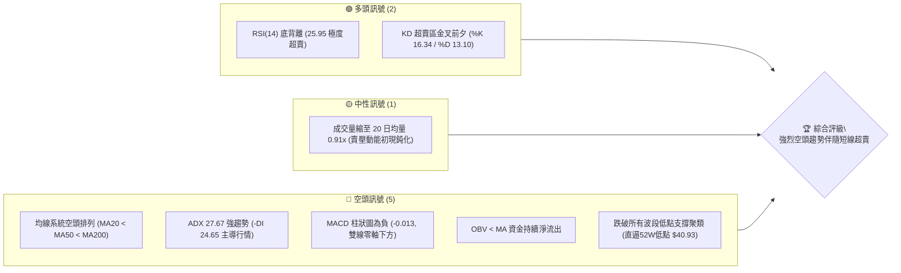
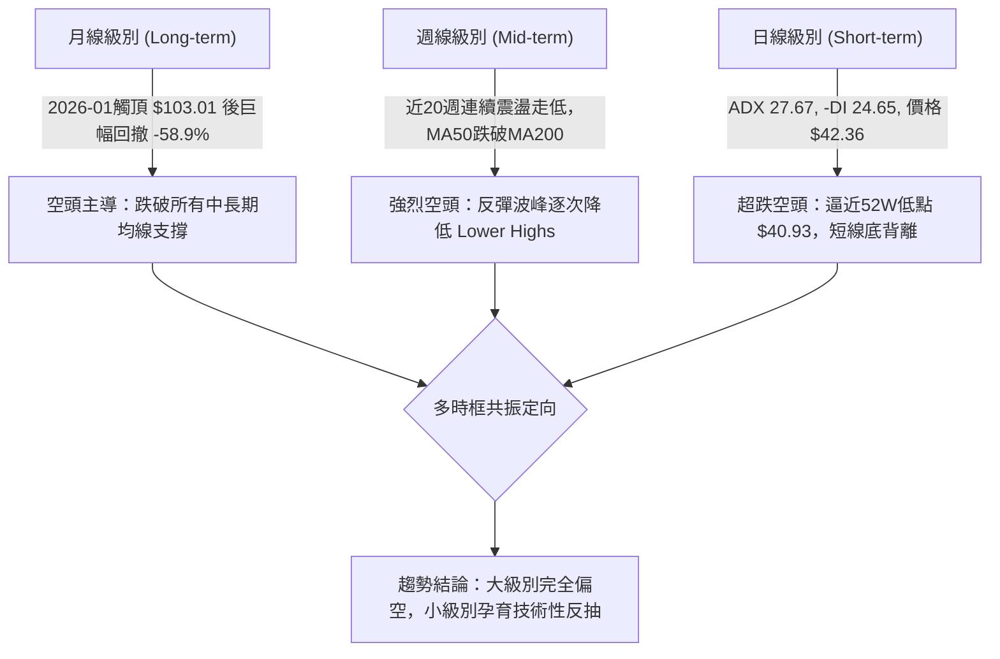
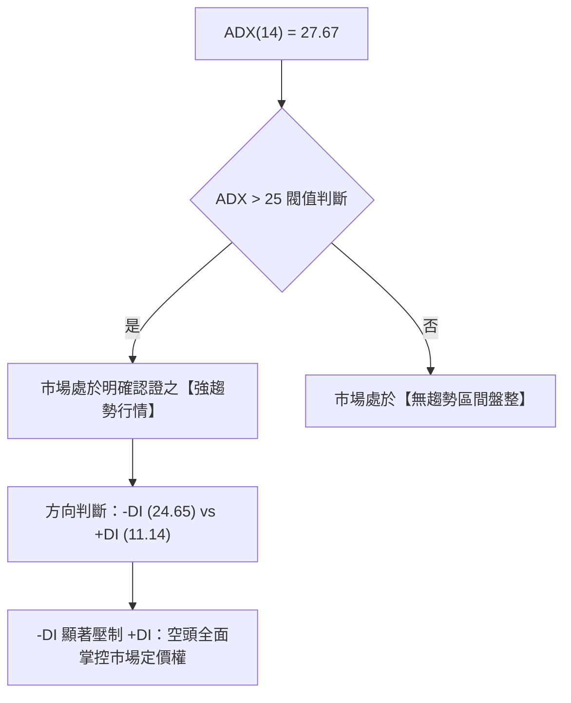
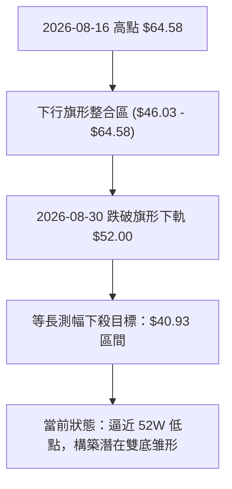
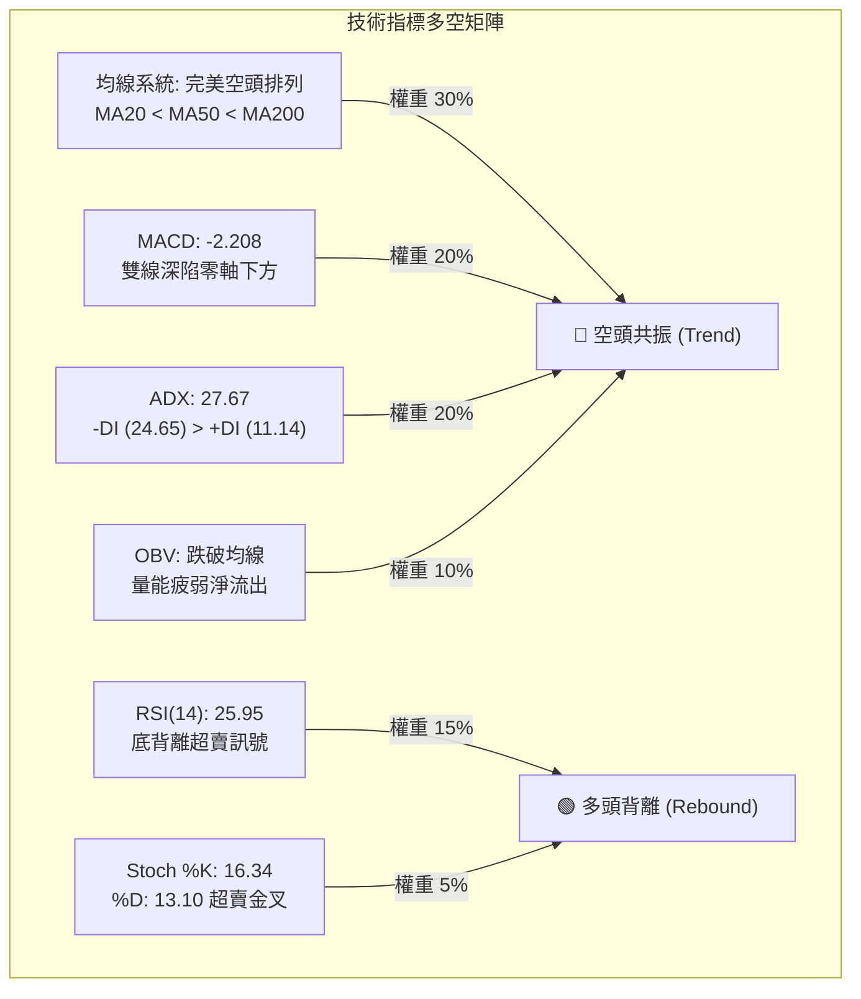
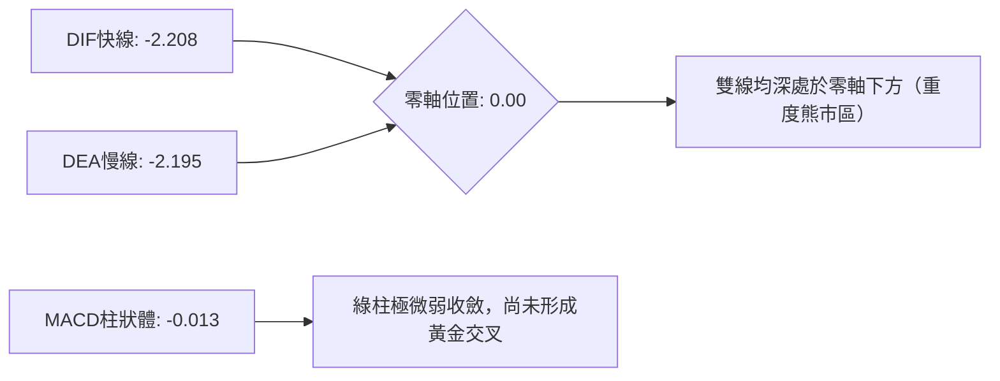
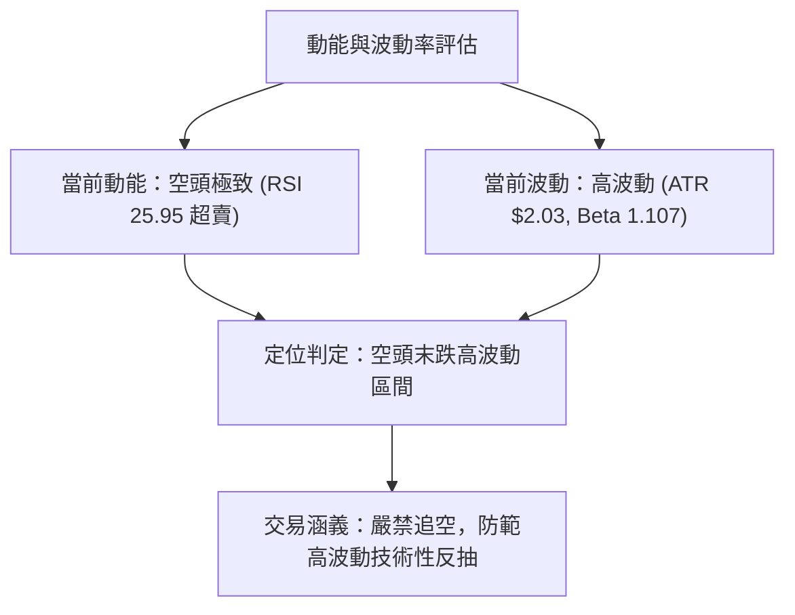
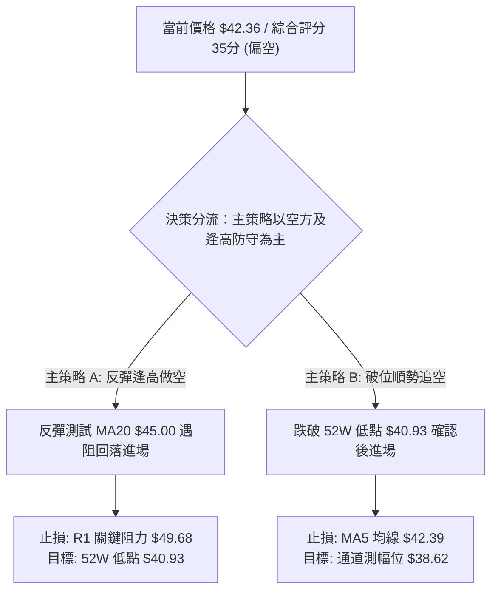
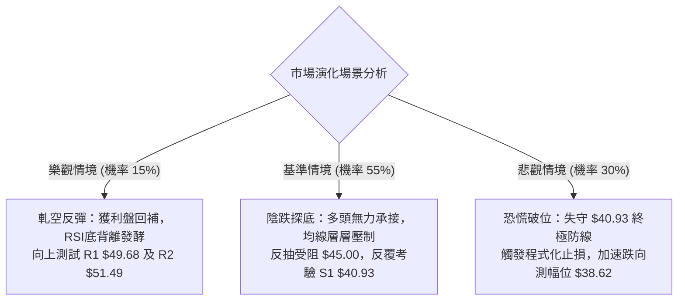

# KTOS 技術分析報告

> **報告日期**：2026-10-11 ｜ **語言**：繁體中文 ｜ **數據來源**：Yahoo Finance ｜ **當前價格**：$42.36

---

## 目錄

| 章節 | 內容 |
|------|------|
| [1. 技術面概覽](#1-技術面概覽) | 訊號儀表板、核心指標、評分卡 |
| [2. 趨勢分析](#2-趨勢分析) | 多時框趨勢、長中短期走勢、ADX強度 |
| [3. 圖表形態分析](#3-圖表形態分析) | 形態識別、K線組合、目標價推算 |
| [4. 支撐與阻力](#4-支撐與阻力) | 關鍵價位分布、斐波那契回調 |
| [5. 技術指標深度解讀](#5-技術指標深度解讀) | 均線系統、RSI、MACD、布林通道、成交量 |
| [6. 動能與波動率](#6-動能與波動率) | 動能四象限、ATR波動率、Beta市場敏感度 |
| [7. 多時框架總結](#7-多時框架總結) | 時框架矩陣、多時框收斂定調 |
| [8. 交易策略建議](#8-交易策略建議) | 主策略路由、情境階梯、風控觸發點 |
| [9. 風險提示與監控](#9-風險提示與監控) | 監控清單、極端情境分析、倉位管理 |
| [📋 報告總結](#-報告總結) | 全文核心精要回顧 |

---

## 1. 技術面概覽

### 🎯 技術訊號儀表板



### 📊 核心指標速覽表

| 指標類別 | 指標名稱 | 當前數值 | 訊號 | 解讀 |
|:---|:---|:---|:---:|:---|
| **價格** | 當前收盤價 | $42.36 | 🔴 | 位於 52 週區間之 1.5% 位置，逼近全年度歷史低點 $40.93 |
| **均線** | MA20 (月線) | $45.00 | 🔴 | 價格位於 MA20 下方 -5.86%，短線下行斜率陡峭 |
| **均線** | MA50 (季線) | $50.69 | 🔴 | 價格位於 MA50 下方 -16.43%，中期下行趨勢確立 |
| **均線** | MA200 (年線) | $68.15 | 🔴 | 價格遠在 MA200 下方 -37.84%，長期結構徹底轉為空頭市場 |
| **動能** | RSI(14) | 25.95 | 🟢 | 進入深度超賣區間 (<30)，且日線級別呈現潛在底背離結構 |
| **動能** | MACD (12,26,9) | -2.208 / -2.195 | 🔴 | 差離值與訊號線雙雙深陷零軸之下，柱狀圖 -0.013 維持看空 |
| **動能** | Stoch KD (14,3,3) | 16.34 / 13.10 | 🟢 | K 值由底部向上微幅勾揚，與 D 值形成低檔鈍化超賣 |
| **趨勢** | ADX(14) / ±DI | 27.67 | 🔴 | ADX > 25 確認為強勢趨勢行情；-DI(24.65) 遠高於 +DI(11.14)，空方完全掌控 |
| **通道** | Bollinger Bands | $40.17 - $49.82 | 🔴 | %B 為 0.23，價格緊貼下軌下行，中軌 $45.00 形成第一動態反壓 |
| **波動** | ATR(14) | $2.03 | 🟡 | 佔股價 4.78%，波動度處於高位，單日跳動幅度大 |
| **成交量** | 20日均量比 | 0.91x | 🟡 | 當日量 4.19M 低於 20日均量 4.60M，殺跌動能略有減弱但未見買盤放量 |

### 🏆 技術評分卡

```
╔══════════════════════════════════════════════════════════════════╗
║                   技術評分卡 — KTOS (2026-10-11)                  ║
╠══════════════════════════════════════════════════════════════════╣
║ 趨勢強度 (Trend)      ██████████████░░░░░░  70/100 🔴 空頭強趨勢 ║
║ 動能指標 (Momentum)   ██████░░░░░░░░░░░░░░  30/100 🟢 嚴重超賣   ║
║ 支撐穩定度 (Support)  ████░░░░░░░░░░░░░░░░  20/100 🔴 測歷史前低 ║
║ 成交量配合 (Volume)   ████████░░░░░░░░░░░░  40/100 🔴 能量背離   ║
║ 形態完整度 (Pattern)  ██████░░░░░░░░░░░░░░  30/100 🔴 下行破位   ║
║ 均線排列 (MA System)  ██░░░░░░░░░░░░░░░░░░  10/100 🔴 完美空頭   ║
╠══════════════════════════════════════════════════════════════════╣
║ 綜合技術評分          ███████░░░░░░░░░░░░░  35/100 🔴 強烈看空   ║
╚══════════════════════════════════════════════════════════════════╝
```

---

## 2. 趨勢分析

### 🌐 多時框趨勢分析



### 📈 長期趨勢 — 12個月走勢圖（Unicode）

KTOS 在過去 12 個月內經歷了劇烈的高位反轉行情。2025 年末推升至波段峰值，並於 2026 年 1 月創下 $103.01 的收盤高點（盤中 52 週高點達 $134.00），隨後展開長達 9 個月的主跌浪。

```
KTOS 月線收盤走勢圖（過去12個月：2025-11 至 2026-10）
價格軸 ($)
$105 ┤                ● 2026-01 ($103.01 峰值)
 $95 ┤
 $85 ┤                    ● 2026-02 ($86.18)
 $75 ┤● 2025-11 ($76.10)
 $75 ┤  ● 2025-12 ($75.91)
 $70 ┤                        ● 2026-03 ($70.51)
 $65 ┤                            ● 2026-04 ($63.05)
 $65 ┤                              ● 2026-05 ($64.13)
 $50 ┤                                  ● 2026-08 ($50.98)
 $50 ┤                                ● 2026-06 ($49.86)
 $45 ┤                                  ● 2026-07 ($46.60)
 $42 ┤                                      ● 2026-09 ($42.69)
 $42 ┤                                        ● 2026-10 ($42.36 當前) ◄
     └─────────────────────────────────────────────────────────────
       11   12   01   02   03   04   05   06   07   08   09   10  (月份)
```

#### 走勢特徵分析表格

| 階段 | 期間 | 價格區間 | 變動幅度 | 形態與量價特徵 |
|:---|:---|:---:|:---:|:---|
| **第一階段：高位滯漲** | 2025-11 ~ 2026-01 | $75.91 → $103.01 | +35.7% | 投機買盤爆發式推升，但月線成交動能與後續跟進量出現頂部耗竭。 |
| **第二階段：初始殺跌** | 2026-02 ~ 2026-04 | $103.01 → $63.05 | -38.8% | 跌破短期均線支撐，長陰灌破 $80 整數關卡，獲利了結與止損賣壓湧現。 |
| **第三階段：中繼震盪** | 2026-05 ~ 2026-08 | $64.13 → $50.98 | -20.5% | 反彈波段受制於下降通道上軌（高點僅至 $64.58），形成下跌旗形中繼。 |
| **第四階段：破位加速** | 2026-09 ~ 2026-10 | $50.98 → $42.36 | -16.9% | 貫穿 $50 整數防線，下探 52 週低點 $40.93，空頭主跌浪延續。 |

### 📊 中期趨勢（週線分析）

從近 20 週資料觀察，KTOS 自 2026 年 8 月中旬反彈至 $64.58（RSI 達 76.7 超買）後，隨即引發斷崖式下跌。價格自 2026-08-16 的 $64.58 下跌至當前 2026-10-11 的 $42.36，跌幅達 -34.41%。

```
週線級別阻力與現價動態示意：
  $64.58 ───────────────────────────── [週線波段反彈高點 2026-08-16]
            ＼
  $54.22 ─────＼────────────────────── [強阻力 R3]
                ＼
  $51.49 ─────────＼────────────────── [阻力 R2 / MA50: $50.69]
                    ＼
  $49.68 ─────────────＼────────────── [關鍵阻力 R1 / BB中軌: $45.00]
                        ＼
  $42.36 ─────────────────●─────────── [當前收盤價]
  $40.93 ───────────────────-───────── [52W 低點硬支撐]
```

週線指標顯示，RSI 已由 8 月中旬的 76.7 垂直落體至當前 25.9，MACD 柱狀圖在 8 月底由正轉負（-1.211），確認了中期上升浪潮徹底瓦解，當前處於空頭動能釋放的末跌段。

### ⚡ 趨勢強度評估（ADX 解讀）



#### ADX 趨勢強度對照表

| 指標變數 | 當前讀數 | 門檻區間 | 技術含義 |
|:---|:---:|:---:|:---|
| **ADX(14)** | **27.67** | > 25.0 | 趨勢確立，拒絕使用震盪指標無腦逆勢摸底 |
| **+DI(14)** | **11.14** | < 20.0 | 多頭進攻動能極其匱乏，買盤無組織性抵抗 |
| **-DI(14)** | **24.65** | > 20.0 | 空方力量沉重，盤面主導權牢固掌握於賣方手中 |
| **趨勢綜合判斷** | **強烈單邊下行** | 空頭趨勢強烈 | **規則收斂**：在 ADX > 25 下，以中長期均線下行方向為主導 |

---

## 3. 圖表形態分析

### 🔍 形態識別系統

在日線與週線結構上，KTOS 的形態演變遵循了經典的下降通道與下行旗形破位特徵。



#### 形態識別與信心度評估表

| 形態名稱 | 信心度 (%) | 判斷依據（引用數據） | 完成度 (%) | 目標價（附精確計算式） |
|:---|:---:|:---|:---:|:---|
| **下降通道主跌段 (Bearish Channel)** | **85%** | 高點逐次降低（$64.58 → $50.98），低點持續下探（$46.03 → $42.36），MA20/50/200 嚴格向下發散。 | **95%** | 通道測幅下軌目標已基本抵達，支撐指向 52W 低點 **$40.93**。 |
| **潛在日線雙底雏形 (Double Bottom)** | **40%** | 前期低點為 52W 低點 $40.93，現價 $42.36 逼近該區域且 RSI 出現底背離；但尚未確認反轉 K 線。 | **25%** | 頸線為 R1 **$49.68**。<br>推算目標 = $49.68 + ($49.68 - $40.93) = **$58.43**（未成形，僅作監控）。 |
| **下跌旗形破位 (Bear Flag Breakdown)** | **90%** | 2026-08 於 $46.00-$64.58 整理後，8/30 收盤破位 $52.00；旗形旗桿高度 = $64.58 - $46.03 = $18.55。 | **100%** | 破位點 $57.17 - $18.55 = **$38.62**（下方潛在極端空頭目標）。 |

*註：鑑於當前雙底信心度僅 40%（<50%），依規則不進行主觀看多形態預測，僅確認當前為「下跌旗形破位後的空頭延伸段」，短線重點在於 52W 低點 $40.93 的防守。*

### 🕯️ 重要K線形態分析

| 週/月份 | 收盤價 | K線形態名稱 | 技術解讀 | 訊號方向 |
|:---|:---:|:---|:---|:---:|
| **2026-08-16 週** | $64.58 | 長上影流星線 (Shooting Star) | 週線 RSI 達 76.7 嚴重超買，高檔獲利了結盤湧現，反轉向下。 | 🔴 強烈看跌 |
| **2026-08-30 週** | $52.00 | 光頭大陰線 (Marubozu) | 跌破 MA50（$50.69）與 MA60（$50.13），單週大跌 -9.0%，多頭棄守。 | 🔴 破位確立 |
| **2026-09-06 週** | $47.82 | 跳空下挫長陰線 | 週成交量萎縮，RSI 跌至 11.7 極端超賣，流動性下移。 | 🔴 空方主導 |
| **2026-10-04 週** | $43.07 | 實體中陰線 | 連續測試下軌，多方反彈無力，直接逼近前波低位。 | 🔴 延續下行 |
| **2026-10-11 週** | $42.36 | 下影錘子雛形 (Hammer-like) | 成交量擴大至 26.62M，低檔承接盤微幅顯現，日線底背離浮現。 | 🟡 止跌初現 |

### 📉 ASCII 走勢形態示意圖

```
KTOS 下跌通道破位與超跌反抽臨界點示意圖
價位 ($)
$65 ┤       ┌─┐ [2026-08-16 高點 $64.58]
    │       │ │
$60 ┤       │ └─────┐
    │       │       │
$55 ┤ ┌─────┘       └─────┐             [強阻力 R3: $54.22]
    │ │                   │
$50 ┤─┴───────────────────┴──┐────────── [阻力 R2: $51.49 / MA50: $50.69]
    │                        │  ┌────── [關鍵阻力 R1: $49.68 / BB中軌: $45.00]
$45 ┤                        └──┤
    │                           └───┐
$42 ┤                               └──● [現價: $42.36 (RSI 25.95 底背離)]
$40 ┤- - - - - - - - - - - - - - - - - ┴ [52W 低點: $40.93 / BB下軌: $40.17]
    └─────────────────────────────────────────────────────────────
```

---

## 4. 支撐與阻力

### 🗺️ 關鍵價位分布圖（Unicode）

本節嚴格遵循數據紀律，所有阻力位與支撐位均直接引用數據聚類與斐波那契回調精確數值。

```
KTOS 價位結構分布圖
══════════════════════════════════════════════════════════════════
$54.22 ║████████████████████████████████║ 強阻力 R3 (近一年波段高點聚類)
$51.49 ║████████████████████            ║ 阻力 R2 (近一年波段高點聚類)
$49.68 ║████████████████████████        ║ 關鍵阻力 R1 (近一年波段高點聚類)
$45.00 ║░░░░░░░░░░░░░░░░░░░░░░░░░░░░░░░░║ 動態阻力 (MA20 / 布林中軌)
───────╫────────────────────────────────╫───────────────────────────
$42.36 ╠════════════════════════════════╣ ◄ 當前市價 (收盤價)
───────╫────────────────────────────────╫───────────────────────────
$40.93 ║▓▓▓▓▓▓▓▓▓▓▓▓▓▓▓▓▓▓▓▓▓▓▓▓▓▓▓▓▓▓▓▓║ 52W 最低點硬支撐 (斐波那契 100.0%)
$40.17 ║████████████████                ║ 布林通道動態下軌支撐
══════════════════════════════════════════════════════════════════
```

### 🚧 阻力位分析表

數據中明確指認的三大波段高點聚類阻力位：

| 阻力級別 | 精確價位 | 距現價空間 (%) | 形成原因與技術共振 | 突破難度 | 重要性權重 |
|:---|:---:|:---:|:---|:---:|:---:|
| **R1** | **$49.68** | +17.28% | 近一年波段高點聚類；與日線布林上軌（$49.82）高度重合，接近 MA60（$50.13）。 | ⭐️⭐️⭐️⭐️☆ (高) | 🔴 第一反彈強阻力 |
| **R2** | **$51.49** | +21.55% | 近一年波段高點聚類；與 MA50（$50.69）形成緊密壓力帶，前波平台破位點。 | ⭐️⭐️⭐️⭐️⭐️ (極高) | 🔴 中期多空分水嶺 |
| **R3** | **$54.22** | +28.00% | 近一年波段高點聚類；與 MA120 半年線（$53.17）共振，週線級別強反壓。 | ⭐️⭐️⭐️⭐️⭐️ (極高) | 🔴 空頭防禦大本營 |

### 🛡️ 支撐位分析表

依據數據反饋，**當前價格下方無近期波段低點聚類 (no swing-low support detected below current price)**。下檔有效實質支撐完全取決於 52 週最低點與通道邊界：

| 支撐級別 | 精確價位 | 距現價空間 (%) | 形成原因與技術共振 | 守住機率 | 重要性權重 |
|:---|:---:|:---:|:---|:---:|:---:|
| **S1 (年度低點)** | **$40.93** | -3.38% | **52W 最低價 / 斐波那契 100.0%** 基準線，年度終極心理防線。 | 55% | 🟢 決定是否破位下墜 |
| **S2 (動態下軌)** | **$40.17** | -5.17% | **布林通道日線下軌**，極端超賣時的波動率外包絡線。 | 65% | 🟡 波動率動態下界 |
| **S3 (聚類支撐)** | **無檢測數據** | — | 數據明確註記：當前價格下方無波段低點聚類支撐。 | — | 🔴 下方支撐帶真空 |

### 📐 斐波那契回調位分析

依據 52 週區間之極端高點（$134.00）至低點（$40.93）之標準回調階梯：

| 斐波那契分位 | 精確價位 ($) | 當前價格相對位置與技術解讀 |
|:---|:---:|:---|
| **0.0% (52W High)** | **$134.00** | 全年牛市頂峰，當前價格自該點回撤 -68.39%。 |
| **23.6%** | **$112.04** | 強勢多頭防線，早已徹底淪陷。 |
| **38.2%** | **$98.45** | 2026-01 頂部震盪破位區間。 |
| **50.0%** | **$87.47** | 半山腰重要分界，多空長期均線轉換處。 |
| **61.8% (黃金分割)** | **$76.48** | 經典回調理論支撐，失守後確認趨勢完全轉熊。 |
| **78.6%** | **$60.85** | 中期下降中繼平台（2026-08 反彈頂點 $64.58 附近）。 |
| **100.0% (52W Low)** | **$40.93** | **現價 ($42.36) 緊貼 100.0% 回調位！處於 78.6% ($60.85) 至 100.0% ($40.93) 區間的最底部（回調比率 98.5%）。** |

**意義解讀**：現價距離 100.0% 終極回調位 $40.93 僅有 $1.43（3.38%）之緩衝。一旦跌破 $40.93，技術面將進入「價格真空發掘（Price Discovery）」狀態，空頭將進一步向下尋找未知整數關卡。

---

## 5. 技術指標深度解讀

### 🎛️ 指標訊號總覽



### 📈 移動平均線排列分析

均線系統展現出教科書式的空頭排列。所有短期與長期移動平均線均呈現向下傾斜，股價被各期均線全面壓制。

| 均線名稱 | 當前價格 ($) | 乖離率 (%) | 均線歷史斜率軌跡 (ASCII Micro-Chart) | 狀態評估 |
|:---|:---:|:---:|:---|:---:|
| **MA 5** | $42.39 | -0.08% | `███▇▆▅▅▅▄▄▄▄▄▄▄▅▅▄▄▄▃▃▂▁▁▁▁▁▁▁` | 貼合現價，短線走平 |
| **MA 10** | $42.77 | -0.95% | `██▇▆▆▅▅▅▄▄▄▃▃▃▃▃▃▃▃▃▃▃▂▂▂▁▁▁▁▁` | 下穿壓制，極短線阻力 |
| **MA 20** | $45.00 | -5.86% | `█████▇▇▇▆▅▅▄▄▄▃▃▃▃▃▂▂▂▂▁▁▁▁▁▁▁` | 月線反壓，反彈首要考驗 |
| **MA 50** | $50.69 | -16.43% | 下行傾斜角度超過 35 度 | 季線下壓，中期空頭防線 |
| **MA 60** | $50.13 | -15.49% | `███▇▇▇▆▆▅▅▄▄▄▄▄▄▄▄▄▄▃▃▂▂▂▁▁▁▁▁` | 中期均線完全向下 |
| **MA 120**| $53.17 | -20.33% | `███▇▇▇▆▆▆▅▅▅▄▄▄▄▄▃▃▃▃▃▂▂▂▂▁▁▁▁` | 半年線持續沉降 |
| **MA 200**| $68.15 | -37.84% | 長期牛熊分界線 | 遠在上方，長期熊市確立 |
| **MA 240**| $69.66 | -39.19% | `██████▇▇▇▇▆▆▆▅▅▅▄▄▄▃▃▃▃▂▂▂▁▁▁▁` | 年線級別重度空頭發散 |

### 📉 RSI(14) 分析與背離判定

- **當前讀數**：**25.95**（進入嚴格定義之 <30 超賣區間）。
- **進度條展示**：`█████░░░░░░░░░░░░░░░` 25.95%（極度超賣）
- **背離診斷**：**⚠️ 判定存在「底背離 (Bullish Divergence)」**
  - **價格層面**：KTOS 日線收盤價由 2026-09-20 的 $47.46 一路滑落至 2026-10-11 的 $42.36，創下波段新低。
  - **指標層面**：RSI(14) 在 2026-09-06 探至極端低點 11.7，隨後在 9 月下旬收盤下跌時，RSI 底部抬高至 23.0 及 25.95。
  - **結論**：指標低點明顯抬升，形成典型的價格破底而指標未破底之「底背離」。這意味著下行賣壓的加速度正在減弱，隨時具備技術性均值回歸（超跌反彈）的潛能。

### 📊 MACD(12/26/9) 訊號解讀



- **MACD DIF**：-2.208
- **MACD DEA (Signal)**：-2.195
- **MACD Histogram**：-0.013 🔴 看空
- **解讀**：DIF 與 DEA 差距僅為 0.013，兩線幾乎重合走平，柱狀圖負值連續收斂。這反映殺跌動能已呈消耗狀態，但由於雙線均在零軸下方極深位置運作，即使金叉亦僅屬於空頭市場中的弱勢修正，非趨勢翻轉。

### 📦 布林通道分析

```
布林通道截面示意圖（日線）
$49.82 ┬────────────────────────────── BB 上軌 (+2.0σ)
       │
$45.00 ┼ - - - - - - - - - - - - - - - BB 中軌 (MA20)
       │
$42.36 ┼──────────● (現價, %B = 0.23)
       │
$40.17 ┴────────────────────────────── BB 下軌 (-2.0σ)
```

- **BB 帶寬**：$49.82 - $40.17 = $9.65（帶寬比率 21.4%），通道維持中度張口。
- **%B 位置**：0.23。依布林帶理論，%B < 0.20 屬於超賣極限。當前價格 $42.36 緊貼下軌邊界向上滑移，顯示股價受下軌支撐效應影響，下殺速率開始受到抑制。

### 💹 成交量分析（量價配合度）

- **當日成交量**：4,189,900 股
- **20 日均量**：4,600,365 股（量比 0.91x）
- **50 日均量**：4,049,202 股
- **OBV 能量潮狀態**：**OBV < MA**。能量潮指標持續位於其移動平均線下方，顯示資金長線流出態勢並未逆轉。
- **量價形態解讀**：股價向 52 週低點逼近的過程中，成交量未見爆量下殺，量比呈現 0.91x 的縮量態勢。此現象具有兩面性：一方面說明「無主動拋壓踐踏」，另一方面則說明「多頭買盤毫無進場承接意願」，形成流動性匱乏的陰跌格局。

---

## 6. 動能與波動率

### ⚡ 動能評估四象限

| 象限 | 動能維度 | 波動維度 | KTOS 當前所處定位與技術特徵 |
|:---:|:---:|:---:|:---|
| **Q1** | 強多頭動能 | 低波動率 | — |
| **Q2** | 弱動能 (衰竭) | 低波動率 | — |
| **Q3** | 強空頭動能 | 高波動率 | — |
| **Q4** | **超賣鈍化 (弱)** | **高波動率 (ATR 4.78%)** | **✓ [KTOS 當前落點]**：ADX 27.67（趨勢強）但 RSI 25.95（動能超跌），伴隨單日 ATR $2.03 的大幅震盪，屬於典型的「高波動空頭衰竭區」。 |



### 📊 ATR 波動率分析

- **ATR(14) 絕對值**：**$2.03**
- **ATR 佔比 (ATR / 股價)**：**4.78%**
- **交易應用評估**：
  - 股價每日平均常態波動幅度達 $2.03，意味著任何日內交易或隔夜持倉必須承受至少 $2.00 以上的噪音擾動。
  - **防守止損距離設定**：基於 1.5 倍 ATR，合理止損緩衝空間應設定為 $2.03 × 1.5 = **$3.05**。
  - 若設定止損過於狹窄（如 < $1.00），極易在常態波動噪音中被無效洗出場。

### 📐 Beta 與市場相關性

- **Beta 係數**：**1.107**
- **市場特徵**：Beta > 1.0 表明 KTOS 對標普 500 等大盤指數具有放大的波動性。當美股大盤承壓時，KTOS 往往承受 1.1 倍以上的拋售壓力；而在大盤出現強勁反彈時，其亦具備高彈性回升潛能。
- **空頭借券資訊**：Short % Float 為 6.2%，Short Ratio 為 3.12 天。空頭部位處於中等水平，若後續出現重大利多或突破關鍵阻力，具備引發適度軋空（Short Squeeze）的籌碼基礎。

---

## 7. 多時框架總結

### 📋 時框架評分表

| 時框架 | 趨勢方向 | 動能狀態 | 均線排列 | 圖表形態 | 綜合評分 | 操作建議方向 |
|:---|:---:|:---:|:---:|:---:|:---:|:---|
| **月線級別 (長期)** | 🔴 強烈空頭 | 弱勢下行 | 空頭壓制 | 自高點腰斬回撤 | **15/100** | 逢高減碼，規避長線持倉 |
| **週線級別 (中期)** | 🔴 下行通道 | RSI 25.9 超賣 | 空頭發散 | 下跌旗形破位 | **25/100** | 空頭順勢，反彈即空點 |
| **日線級別 (短期)** | 🟡 超跌反彈 | RSI 底背離 | 空頭排列 | 逼近 52W 低點 $40.93 | **45/100** | 短線輕倉搏反抽 / 觀望 |

### 🔲 綜合訊號矩陣

```
╔══════════════════════════════════════════════════════════════════╗
║                    多時框多空訊號共振檢視矩陣                    ║
╠════════════════════╦══════════╦══════════╦═══════════════════════╣
║ 維度               ║ 短期(日) ║ 中期(週) ║ 長期(月)              ║
╠════════════════════╬══════════╬══════════╬═══════════════════════╣
║ 趨勢方向           ║ 🔴 看跌  ║ 🔴 看跌  ║ 🔴 看跌               ║
║ 動能指標 (RSI/KD)  ║ 🟢 超買/背║ 🔴 弱勢  ║ 🔴 偏空               ║
║ 均線架構 (MAs)     ║ 🔴 壓制  ║ 🔴 壓制  ║ 🔴 壓制               ║
║ 波動率與結構       ║ 🟡 臨支撐║ 🔴 破位  ║ 🔴 熊市               ║
╠════════════════════╬══════════╬══════════╬═══════════════════════╣
║ 總結一致性權重     ║ 35% 偏多 ║ 80% 偏空 ║ 90% 偏空              ║
╚════════════════════╩══════════╩══════════╩═══════════════════════╝
```

### ⚖️ 多時框收斂結論

> **依嚴格要求第 14 條多時框收斂規則執行**：
> 1. 當前日線 ADX(14) 讀數為 **27.67**（明確大於 25.0 門檻），系統判定市場處於**「強趨勢行情」**，而非區間震盪。
> 2. 趨勢行情下，必須**以中長期（週線、MA50 $50.69、MA200 $68.15）下行方向為主導**，日線級別之 RSI 底背離與 KD 超賣訊號**僅能用於尋找空頭回補或短線極限反抽進場時機**，絕不可作為中長線反轉信號。
> 3. **唯一方向性結論**：**整體格局強烈偏空（綜合評分 35/100）**。主基調為「空頭主導下的極限超跌狀態」，防範 52W 低點 $40.93 的跌破風險。

---

## 8. 交易策略建議

### 🗺️ 策略決策流程圖



### 🧭 策略路由（依評分卡分流）

**當前主策略方向 = 【主推空頭策略（逢高沽空 / 破位做空）】（依技術評分 35/100 確立）**

鑑於技術評分卡綜合評分為 **35/100（≤40 偏空區間）**，且 ADX 達 27.67 確認強勢空頭趨勢，主推策略為空方布局；多頭操作僅列為超跌搏反抽的極低倉位防守應對。

### 🎯 價格情境階梯（Price Scenarios）

所有價位均嚴格引用前述技術計算數值：

| 觸發條件 | 下一目標 | 後續延伸 | 情境含義與操作指引 |
|:---|:---:|:---:|:---|
| **強勢突破 R1 ($49.68)** | R2 ($51.49) | R3 ($54.22) | 短線技術破局，日線底背離轉化為中期反轉，空單全面止損離場。 |
| **弱勢反彈承壓 ($45.00)** | $42.36 | S1 ($40.93) | 受制於 MA20 (月線) 反壓，空頭中繼確認，**逢高沽空最佳甜蜜點**。 |
| **跌破 S1 ($40.93)** | BB下軌 ($40.17) | 形態測幅 ($38.62) | 52 週最低點失守，引發停損賣壓與融資斷頭，**順勢追空放量下挫**。 |

### 📊 情境機率分佈

| 情境劃分 | 預估機率 | 主要技術指標依據 |
|:---|:---:|:---|
| **情境一：延續跌勢 / 跌破前低 (Bearish)** | **55%** | ADX 27.67 強空頭主導；均線 MA20/50/200 完美空頭排列；OBV < MA 資金持續淨流出。 |
| **情境二：低檔震盪 / 超跌反抽 (Consolidation/Bounce)** | **35%** | RSI 25.95 深度底背離；KD 處於極度超賣區（%K 16.34）；20日量比縮至 0.91x 賣壓趨緩。 |
| **情境三：趨勢反轉 / 強力回升 (Reversal)** | **10%** | 缺乏實質支撐聚類；基本面營業利益率 -0.2% 且自由現金流為負，難以支持反轉行情。 |

### 🟢 主策略詳情（空頭主導體系）

| 策略要素 | 策略 A：反彈逢高沽空 (Sell the Bounce) | 策略 B：跌破低點順勢追空 (Breakdown Short) |
|:---|:---|:---|
| **交易邏輯** | 借助 RSI 底背離引發之技術反抽，在 MA20 關鍵動態壓力處順勢建空。 | 價格直接摜破全年度最低價 $40.93，下方無波段低點支撐，引發破位慣性。 |
| **進場條件** | 價格反彈至 MA20 附近出現上影線或日線收陰確認遇阻。 | 日線實體陰線收盤跌破 $40.93，或跌破達 1 個 ATR 緩衝。 |
| **進場價格** | **$45.00** (精確對應 MA20) | **$40.50** (確認跌破 $40.93 之動態點) |
| **第一目標 (T1)** | **$42.36** (當前市價位置) | **$38.62** (下跌旗形測幅目標) |
| **第二目標 (T2)** | **$40.93** (52W 最低點硬支撐) | **$37.00** (整數關卡) |
| **止損價格** | **$49.68** (精確引用阻力位 R1，突破則邏輯失效) | **$42.39** (精確引用 MA5 均線位置) |
| **風險報酬比 (R:R)** | **1 : 0.88** (至T2) ｜ 逢高布局重在勝率 | **1 : 1.85** (至T2，風險 $1.89，回報 $3.50) |
| **成功機率估計** | **65%** | **60%** |
| **建議配置倉位** | **10% - 15%** (總投資組合) | **5% - 8%** (破位動量倉) |

### 🔴 反向風險觸發點（多頭對沖提示）

若欲防範空頭被軋空，需密切監控以下多頭反轉條件：
- **觸發價位**：價格帶量突破關鍵阻力 **R1: $49.68**，並連續兩日收於其上方。
- **指標確認**：日線 MACD 雙線在零軸下方完成黃金交叉，且柱狀體顯著轉正（> +0.20）。
- **對沖處置**：所有空頭部位無條件強制止損，激進型交易者可轉為超跌反彈短多，以 $49.68 為防守點，目標上看阻力 **R2: $51.49** 及 **R3: $54.22**。

### ⭐ 整體訊號強度評星

```
做多訊號強度：★☆☆☆☆  (1/5星 — 僅具備超賣反抽動能，缺乏趨勢支撐)
做空訊號強度：★★★★☆  (4/5星 — 均線與 ADX 趨勢高度確認，順勢而為)
整體可信度：  ★★★★☆  (4/5星 — 多時框指標共振，空頭結構清晰明確)
```

---

## 9. 風險提示與監控

### ✅ 關鍵監控指標 Checklist

```
╔══════════════════════════════════════════════════════════════════╗
║                   KTOS 每日盤後關鍵監控清單                      ║
╠══════════════════════════════════════════════════════════════════╣
║ [ ] 價格是否跌破 52 週最低點 $40.93？(破位下行信號)               ║
║ [ ] RSI(14) 是否脫離 30 以下並突破 35？(底背離反彈展開信號)        ║
║ [ ] 日成交量是否顯著超越 20 日均量 4.60M？(主力方向選擇訊號)       ║
║ [ ] MACD 柱狀圖是否由 -0.013 翻紅轉正？(短線動能金叉)            ║
║ [ ] 價格反彈是否被 MA20 ($45.00) 有效壓制？(空頭中繼確認)         ║
╚══════════════════════════════════════════════════════════════════╝
```

### ⚠️ 風險場景分析



### 🛡️ 風險管理重要提醒

1. **破位單邊風險**：目前價格距 52 週低點僅 $1.43。在支撐位分析中已確認「當前價格下方無波段低點支撐聚類」，這意味著一旦 $40.93 宣告失守，下方缺乏歷史籌碼密集區保護，流動性可能瞬間枯竭，切忌在破位時盲目逆勢抄底。
2. **高波動率侵蝕**：KTOS 的 ATR 達 $2.03（佔股價 4.78%），單日振幅極大。若採用期權或高槓桿工具操作，隱含波動率與時間價值損耗極快，現貨交易者亦必須嚴格遵守 1.5 倍 ATR（$3.05）的風控底線。
3. **基本面催化劑風險**：雖然技術面評分僅 35/100 偏空，但華爾街分析師共識目標價均值達 $100.73（評級為 Strong Buy），近期亦有 Barclays、Rothschild 等投行給予 Overweight/Buy 評級。若國防合約突然落地或財報釋放超預期現金流消息，極易引發暴力的技術性軋空回補，空頭操作必須嚴設止損於 R1（$49.68）。

---

## 📋 報告總結

```
╔══════════════════════════════════════════════════════════════════╗
║                    KTOS 技術分析報告總結                          ║
╠══════════════════════════════════════════════════════════════════╣
║ 報告日期：2026-10-11                                             ║
║ 當前價格：$42.36 (52週區間 1.5% 位置)                             ║
║ 綜合評級：🔴 強烈偏空 / 空頭強勢主導 (技術評分: 35/100)           ║
╠══════════════════════════════════════════════════════════════════╣
║ 關鍵結論：                                                       ║
║ ├─ 長期趨勢：🔴 完美空頭，自 $103.01 峰值回撤近 60%，MA200 壓制  ║
║ ├─ 中期趨勢：🔴 週線下跌旗形破位，反彈高點逐次降低              ║
║ ├─ 短期趨勢：🟡 RSI(14) 25.95 極度超賣，日線底背離醞釀短抽       ║
║ ├─ 關鍵支撐：S1: $40.93 (52W最低價) ｜ S2: $40.17 (布林下軌)    ║
║ ├─ 關鍵阻力：R1: $49.68 ｜ R2: $51.49 ｜ R3: $54.22              ║
║ └─ 趨勢強度：ADX 27.67 (-DI 24.65 主導)，確立為單邊趨勢行情       ║
╠══════════════════════════════════════════════════════════════════╣
║ 最優策略組合：                                                   ║
║ 1. 🥇 最佳機會：策略 A — 反彈至 MA20 ($45.00) 逢高沽空，         ║
║                止損設於 R1 ($49.68)，目標下看 $40.93。           ║
║ 2. 🥈 次選機會：策略 B — 跌破 52W 低點 $40.93 順勢追空，         ║
║                止損設於 MA5 ($42.39)，目標下看 $38.62。          ║
║ 3. 🥉 保守選擇：空倉觀望，等待日線底背離帶動股價站穩 MA20 後，   ║
║                再評估多頭結構是否有效建立。                      ║
╚══════════════════════════════════════════════════════════════════╝
```

---

> ⚠️ **免責聲明**：本報告為技術分析研究，所有數據指標及價位均基於歷史價格與客觀技術模型計算。本報告**僅供學術交流與投資研究參考**，**不構成任何要約、招攬或投資買賣建議**。金融市場瞬息萬變，投資人應獨立評估風險並自行承擔盈虧責任。

---

*報告生成時間：2026-10-11 ｜ 數據來源：Yahoo Finance ｜ 分析框架：多時框架量化技術分析*