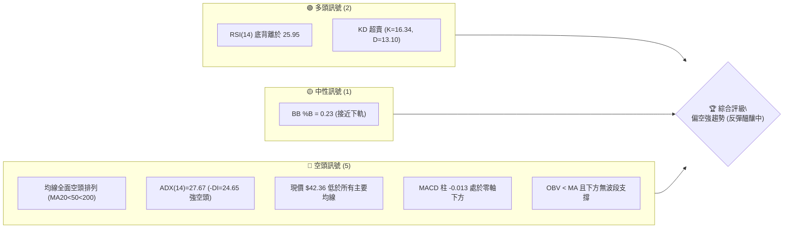
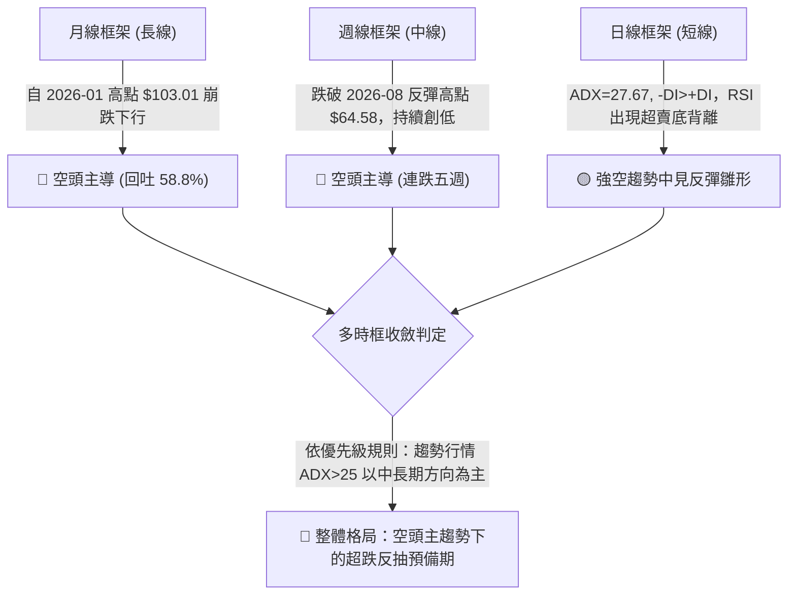
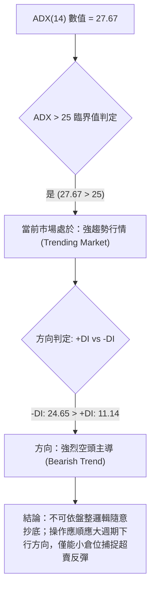
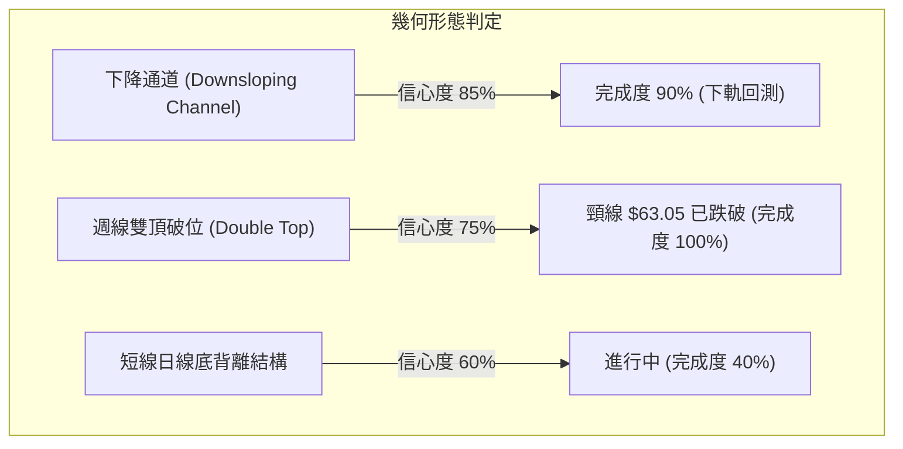
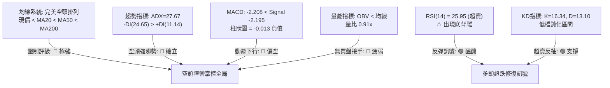
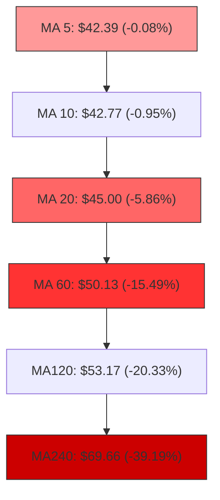
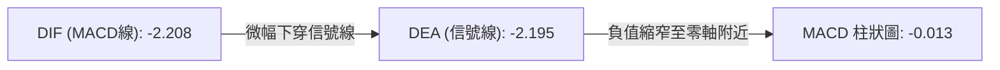
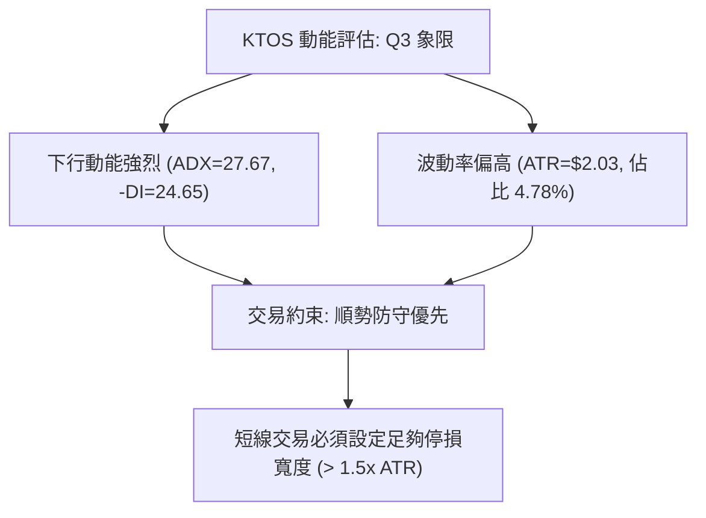
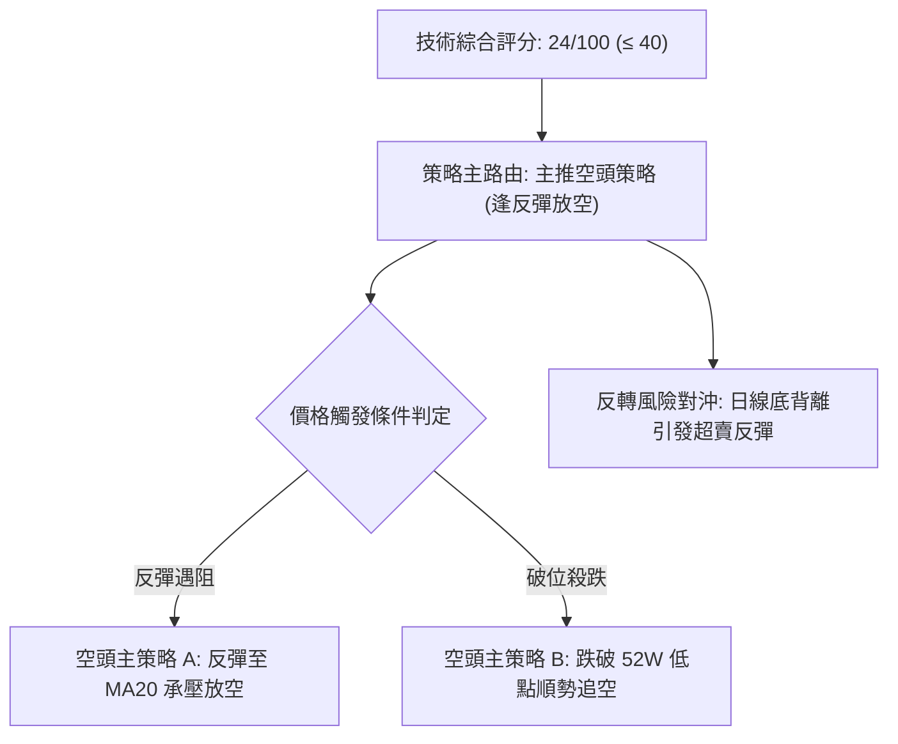
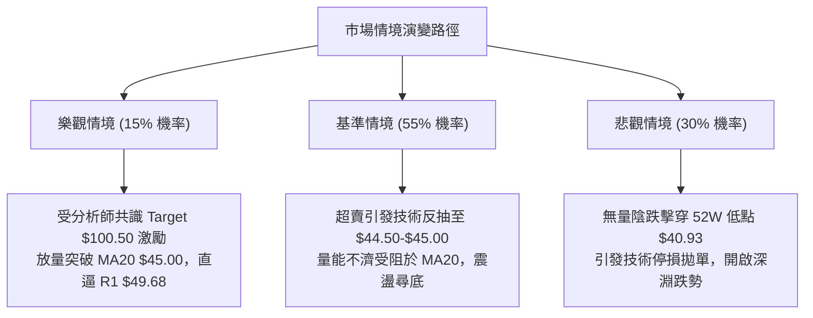

# KTOS 技術分析報告

> **報告日期**：2026-10-12 ｜ **語言**：繁體中文 ｜ **數據來源**：Yahoo Finance ｜ **當前價格**：$42.36

---

## 目錄

| 章節 | 內容 |
|------|------|
| [1. 技術面概覽](#1-技術面概覽) | 訊號儀表板、核心指標、評分卡 |
| [2. 趨勢分析](#2-趨勢分析) | 多時框趨勢、長中短期走勢 |
| [3. 圖表形態分析](#3-圖表形態分析) | 形態識別、K線組合、目標價 |
| [4. 支撐與阻力](#4-支撐與阻力) | 關鍵價位、斐波那契回調 |
| [5. 技術指標深度解讀](#5-技術指標深度解讀) | MA/RSI/MACD/布林/成交量 |
| [6. 動能與波動率](#6-動能與波動率) | 動能評估、ATR、Beta |
| [7. 多時框架總結](#7-多時框架總結) | 時框架評分矩陣 |
| [8. 交易策略建議](#8-交易策略建議) | 多空策略、風險報酬比 |
| [9. 風險提示與監控](#9-風險提示與監控) | 監控指標、風險場景 |

---

## 1. 技術面概覽

### 🎯 技術訊號儀表板



### 📊 核心指標速覽表

| 指標類別 | 指標名稱 | 當前數值 | 訊號 | 解讀 |
|----------|----------|----------|------|------|
| **價格** | 當前價格 | $42.36 | 🔴 | 位於 52 週區間底端 1.5%，空頭絕對壓制 |
| **均線** | MA20 | $45.00 | 🔴 | 價格低於 MA20 (-5.86%)，短線承壓 |
| **均線** | MA50 | $50.69 | 🔴 | 價格低於 MA50 (-16.43%)，中期空頭排列 |
| **均線** | MA200 | $68.15 | 🔴 | 價格遠低於 MA200 (-37.84%)，長期熊市通道 |
| **動能** | RSI(14) | 25.95 | 🟢 | 極度超賣區間 (<30)，且日線出現底背離訊號 |
| **動能** | MACD | -2.208 / -2.195 | 🔴 | DIF 位於信號線下方，MACD 柱為 -0.013 |
| **動能** | Stoch %K/%D | 16.34 / 13.10 | 🟢 | 超賣鈍化區，隨時具備技術性抽頭動能 |
| **趨勢** | ADX(14) | 27.67 | 🔴 | ADX > 25 且 -DI(24.65) > +DI(11.14)，空頭強趨勢 |
| **波動** | ATR(14) | $2.03 | 🟡 | 佔股價 4.78%，日內波動偏高，需放寬停損 |
| **量能** | OBV | OBV < MA | 🔴 | 量能疲弱，資金未見持續性主動買盤承接 |

### 🏆 技術評分卡

```
╔══════════════════════════════════════════════════════════════╗
║                技術評分卡 — KTOS (2026-10-12)                ║
╠══════════════════════════════════════════════════════════════╣
║ 趨勢強度 (ADX/趨勢方向) ▓▓▓▓▓▓▓▓░░░░░░░░░░░░  28/100 🔴 空頭強勢 ║
║ 動能指標 (RSI/MACD/KD)  ▓▓▓▓▓▓▓▓▓▓░░░░░░░░░░  36/100 🟡 超賣反彈 ║
║ 支撐穩定度 (價格結構)   ▓▓▓▓░░░░░░░░░░░░░░░░  15/100 🔴 破底邊緣 ║
║ 成交量配合 (OBV/均量)   ▓▓▓▓▓▓░░░░░░░░░░░░░░  25/100 🔴 量能疲弱 ║
║ 形態完整度 (K線結構)    ▓▓▓▓▓▓▓▓░░░░░░░░░░░░  32/100 🔴 空頭下飄 ║
║ 均線排列 (MA5至MA240)   ▓▓░░░░░░░░░░░░░░░░░░  10/100 🔴 完美空頭 ║
╠══════════════════════════════════════════════════════════════╣
║ 綜合技術評分            ▓▓▓▓▓░░░░░░░░░░░░░░░  24/100 🔴 強烈偏空 ║
╚══════════════════════════════════════════════════════════════╝
```

---

## 2. 趨勢分析

### 🌐 多時框趨勢分析



### 📈 長期趨勢 — 12個月走勢圖（Unicode）

```
KTOS 月線走勢圖（過去12個月：2025-11 至 2026-10）
價格軸 ($)
$105 ┤                 ● (2026-01 $103.01)
$95  ┤
$85  ┤                       ● (2026-02 $86.18)
$75  ┤ ● (2025-11 $76.10)
$75  ┤   ● (2025-12 $75.91)    ● (2026-03 $70.51)
$65  ┤                             ● (2026-04 $63.05)  ● (2026-05 $64.13)
$50  ┤                                                   ● (2026-06 $49.86)  ● (2026-08 $50.98)
$45  ┤                                                       ● (2026-07 $46.60)
$42  ┤                                                                           ● (2026-09 $42.69)
$40  ┤                                                                               ● ($42.36 現價)
     └─────────────────────────────────────────────────────────────────────────────
        11   12   01   02   03   04   05   06   07   08   09   10  (月份)
```

#### 走勢特徵分析表格

| 階段區間 | 時間段 | 價格變動 | 漲跌幅 | 走勢特徵與結構意涵 |
|----------|--------|----------|--------|--------------------|
| **主升浪見頂** | 2025-11 ~ 2026-01 | $76.10 → $103.01 | +35.36% | 動能極度加速噴出，於 $103.01 形成月線雙頂/長天期頂部 |
| **主跌第一段** | 2026-01 ~ 2026-04 | $103.01 → $63.05 | -38.79% | 崩跌式失守所有短期均線，呈現無支撐單邊滑落 |
| **中繼平台整理** | 2026-04 ~ 2026-05 | $63.05 → $64.13 | +1.71%  | 在 $63.00-$64.00 處建立暫時換手帶，隨後再度破位 |
| **破位二浪下殺** | 2026-05 ~ 2026-07 | $64.13 → $46.60 | -27.34% | 破位放量重挫，跌破 $50 整數心理防線 |
| **弱勢弱反彈** | 2026-07 ~ 2026-08 | $46.60 → $50.98 | +9.40%  | 週線反抽最高至 $64.58 (08-16當週)，但月收盤僅收在 $50.98，長上影線潰敗 |
| **終極探底破位** | 2026-08 ~ 2026-10 | $50.98 → $42.36 | -16.91% | 連續兩個月收黑，直逼 52 週最低點 $40.93，空頭趨勢完全延續 |

### 📊 中期趨勢（週線分析）

中期技術面目前受制於下降通道，阻力與支撐層級嚴密：

```
中期阻力位壓制：
  R3: $54.22 ══════════════════════════════ (60日線/前期整理平台)
  R2: $51.49 ────────────────────────────── (MA50 $50.69 匯聚區)
  R1: $49.68 ┈┈┈┈┈┈┈┈┈┈┈┈┈┈┈┈┈┈┈┈┈┈┈┈┈┈┈┈┈┈ (BB 上軌 $49.82 及波段高點)
  現價: $42.36 ◄ (下行通道下軌附近震盪)
  底線: $40.93 ══════════════════════════════ (52週最低點 100.0% 斐波那契)
```

從近 20 週數據觀察，2026-08-16 創出波段反彈高點 $64.58 後，週線出現連續下殺，近 6 週收盤價由 $52.00 陸續下探至 $47.82、$46.69、$47.46、$45.62、$43.07 及本週 $42.36，週 MACD 柱狀圖全面處於負值區間（-1.318 至 -0.013），顯示中期格局仍由空方掌握定價權。

### ⚡ 趨勢強度評估（ADX 解讀）



#### ADX 趨勢強度對照表

| 指標 | 當前數值 | 參考臨界值 | 狀態評估 | 策略意義 |
|------|----------|------------|----------|----------|
| **ADX(14)** | **27.67** | > 25 (強趨勢) | 🟢 強趨勢確認 | 趨勢指標具有高度有效性，震盪擺盪指標次之 |
| **+DI** | **11.14** | 20.00 (多頭門檻) | 🔴 多頭極度疲弱 | 買盤完全退縮，缺乏連續性推升動能 |
| **-DI** | **24.65** | 20.00 (空頭門檻) | 🔴 空頭掌控盤面 | 拋售壓力持續主導，逢高做空為大趨勢方向 |
| **DI 差值** | **-13.51** | 0.00 | 🔴 空方實質主導 | 空頭動能充沛，下行軌跡尚未正式扭轉 |

---

## 3. 圖表形態分析

### 🔍 形態識別系統



#### 圖表形態信心度評估表

| 形態名稱 | 信心度 | 判斷依據（引用數據） | 完成度 | 目標價（附精準計算式） |
|----------|--------|----------------------|--------|------------------------|
| **大型雙頂頸線破位** | **75%** | 頂部高點 2025-09 $91.37 與 2026-01 $103.01，頸線為 2025-12 $75.91 | 100% | 破位跌幅滿足：由形態高度推算 $75.91 - ($103.01 - $75.91) = $48.81（已達成並超跌至 $42.36） |
| **下降通道運作** | **85%** | 上軌由 2026-08 週高點 $64.58、MA20 $45.00 壓制；下軌直逼 52W 低點 $40.93 | 90% | 由通道下軌推算：尋求 52W 低點 $40.93 支撐驗證 |
| **潛在雙重底雛形** | **35%** | 僅有 52W 低點 $40.93 為前低，目前現價 $42.36 尚未止跌成底 | 15% | 訊號不足，僅做指標型解讀（嚴禁憑空預設底已成） |

### 🕯️ 重要K線形態分析

| 月份/週期 | 收盤價 | K線形態 | 形態技術解讀 | 訊號 |
|-----------|--------|---------|--------------|------|
| **2026-06** | $49.86 | 大陰線破位 | 放量灌破 $50.00 整數關卡，確認中期頭部成立 | 🔴 |
| **2026-07** | $46.60 | 帶下影紡錘線 | 於 $40.93 歷史低點附近浮現微弱買盤抵抗，但無續航力 | 🟡 |
| **2026-08** | $50.98 | 倒轉錘頭/長上影 | 盤中週線一度拉升至 $64.58，但遭空頭痛擊壓回，多頭反攻竭盡 | 🔴 |
| **2026-09** | $42.69 | 光腳中陰線 | 空頭無情續跌，完全回吐 8 月反彈，空頭實質控盤 | 🔴 |
| **2026-10** | $42.36 | 低檔十字星孕線 | 跌勢減緩，收盤緊貼 $42.36，呈現跌停滯態，醞釀超賣修正 | 🟢 |

### 📉 ASCII 走勢形態示意圖

```
KTOS 中期頭部至下降通道幾何示意圖
價格
$103.01 ───┐ 雙頂 A
           │
$91.37 ────┼──────┐ 雙頂 B
           │      │
$75.91 ────┴──────┴────── 頸線破位
                           ╲
$64.58 ─────────────────────╲──┐ 反抽死貓跳 (2026-08)
                             ╲ │
$50.00 ───────────────────────╲┴───── 破位點
                               ╲
$42.36 ─────────────────────────● 現價 (貼近下降通道下軌)
$40.93 ─────────────────────────── 52W Low (關鍵防線)
```

### 🎯 形態目標價計算

1. **已達成之雙頂滿足點**：
   - 第一波頭部高點：$103.01
   - 頸線位置：$75.91
   - 形態垂直幅度 = $103.01 - $75.91 = $27.10
   - 等幅下測目標 = $75.91 - $27.10 = $48.81（此形態已於 2026-07 完全消化滿足）。
2. **目前進行中之空頭通道目標價**：
   - 當前行情受制於 MA20 ($45.00) 與 R1 ($49.68)。
   - 若無法在 52W 低點 $40.93 企穩，市場將進入無支撐真空區。

---

## 4. 支撐與阻力

### 🗺️ 關鍵價位分布圖（Unicode）

```
KTOS 價位結構分布圖（嚴格依據 OHLCV 聚類與數據源）
═══════════════════════════════════════════════════
$54.22 ║████████████████████████║ 強阻力 R3 (60日均線 $50.13 上方密集成交區)
$51.49 ║████████████████████    ║ 阻力 R2 (MA50 $50.69 匯聚壓力帶)
$49.68 ║████████████████████████║ 關鍵阻力 R1 (布林上軌 $49.82 附近)
═══════════════════════════════════════════════════
$45.00 ║┈┈┈┈┈┈┈┈┈┈┈┈┈┈┈┈┈┈┈┈┈┈┈┈║ 短線均線壓制 (MA20 / 布林中軌)
$42.36 ╠════════════════════════╣ ◄ 現價 (距 52W 低點僅 3.49%)
═══════════════════════════════════════════════════
$40.93 ║████████████████████████║ 極限防線 (52週最低點 / 100.0% 斐波那契)
$00.00 ║                        ║ (數據中未偵測到 $42.36 以下之波段低點聚類)
═══════════════════════════════════════════════════
```

### 🚧 阻力位分析表

所有阻力價位嚴格引用自關鍵數據集：

| 阻力級別 | 價位 | 距離現價 | 形成原因與技術匯聚 | 突破難度 | 重要性 |
|----------|------|----------|--------------------|----------|--------|
| **R1** | **$49.68** | +17.28% | 近一年波段高點聚類，與布林上軌 ($49.82) 形成重疊共振區 | 相當高 | 🟢 中期轉強觀察點 |
| **R2** | **$51.49** | +21.55% | 波段高點聚類，緊鄰 MA50 ($50.69) 與 MA60 ($50.13) | 極高 | 🟡 中期空方防線 |
| **R3** | **$54.22** | +28.00% | 整理區密集成交帶高點，MA120 ($53.17) 上方防線 | 極為堅固 | 🔴 多空牛熊分水嶺 |

### 🛡️ 支撐位分析表

根據歷史 OHLCV 運算，當前價格下方之波段低點聚類呈現以下狀態：

| 支撐級別 | 價位 | 距離現價 | 形成原因與技術意涵 | 守住機率 | 重要性 |
|----------|------|----------|--------------------|----------|--------|
| **S1 (極限)** | **$40.93** | -3.38% | 52 週最低點 (52W Low) 及 斐波那契 100.0% 回調位 | 45% | 🔴 生死防線 |
| **次級支撐** | **無** | -- | **數據中未偵測到當前價位下方任何波段低點聚類** | -- | ⚠️ 破底後進入盲區 |

### 📐 斐波那契回調位分析

依據 52 週波段高點 $134.00 至最低點 $40.93（總落差 $93.07）之標準黃金分割回調結構：

```
斐波那契回調位級別 (區間 $40.93 → $134.00)
┌───────────┬────────────┬──────────────────────────────────────┐
│  回調比例 │  計算價位  │ 當前相對狀態與技術解讀               │
├───────────┼────────────┼──────────────────────────────────────┤
│    0.0%   │  $134.00   │ 52 週歷史高點                        │
│   23.6%   │  $112.04   │ 長期空頭反轉極限                     │
│   38.2%   │  $ 98.45   │ 長期多空分水嶺                       │
│   50.0%   │  $ 87.47   │ 半數回吐位                           │
│   61.8%   │  $ 76.48   │ 黃金分割阻力 (接近 MA240 $69.66)     │
│   78.6%   │  $ 60.85   │ 深度防守位 (2026-08 反彈高點阻力區)  │
│  100.0%   │  $ 40.93   │ 52 週最低點 (基底支撐)               │
└───────────┴────────────┴──────────────────────────────────────┘
現價位置：$42.36 落在 78.6% ($60.85) 與 100.0% ($40.93) 之間，
目前僅高出 100.0% 回調位 $1.43 (+3.49%)，顯示多頭已無退路。
```

---

## 5. 技術指標深度解讀

### 🎛️ 指標訊號總覽



### 📈 移動平均線排列分析



- **均線排列判定**：當前呈現 MA5 < MA10 < MA20 < MA60 < MA120 < MA240 的**標準空頭瀑布排列**。
- **均線乖離度**：現價 $42.36 距離 MA20 乖離為 -5.86%，距離 MA60 乖離達 -15.49%，距離 MA240 乖離高達 -39.19%。短線雖具備向 MA20 ($45.00) 負乖離修復之潛能，但所有均線斜率均向下發散，任何未放量突破 MA20 的拉升均僅視為「空頭反抽」。

### 📉 RSI(14) 分析

- **RSI(14) 當前數值**：**25.95**（進入極端超賣區 < 30）
```
超賣區 (0-30)           中性區 (30-70)          超買區 (70-100)
[████████░░░░░░░░░░░░░░░░░░░░░░░░░░░░░░] 25.95%
 0        30                    70           100
```
- **背離判斷（底背離確認）**：
  - 日線 RSI 在 2026-09-06 觸及波段極低點 11.7，價格為 $47.82。
  - 後續價格在 2026-10-11 創出新低價 $42.36，但 RSI 卻攀升至 25.95。
  - **結論**：**確認形成日線級別「多頭底背離（Bullish Divergence）」**。這意味著空頭殺跌動能出現衰竭跡象，短線下行空間受限，超賣反彈一觸即發。

### 📊 MACD(12/26/9) 訊號解讀



- **MACD 解讀**：MACD 線 (-2.208) 與 Signal 線 (-2.195) 均位於零軸深處，顯示整體市場環境為深幅弱勢市場。
- **柱狀圖動態**：當前 MACD 柱狀圖為 **-0.013**，相較於 2026-08-30 的 -1.211 與 2026-09-06 的 -1.318，負柱已大幅收斂接近零軸，顯示空頭拋壓減緩，具備低檔金叉預期，但尚未正式翻正發出右側買訊。

### 📦 布林通道分析

```
布林通道結構 (20日標準差)
$49.82 ────────────────────────────────── 上軌 (BB Upper)
                                          │
$45.00 ┈┈┈┈┈┈┈┈┈┈┈┈┈┈┈┈┈┈┈┈┈┈┈┈┈┈┈┈┈┈┈┈┈┈ 中軌 (MA20 / 空方防線)
                                          │
$42.36 ◄◄ 現價 (%B = 0.23，貼近下軌)     │
$40.17 ────────────────────────────────── 下軌 (BB Lower)
```

- **通道帶寬與形態**：布林帶寬 ($49.82 - $40.17 = $9.65)，%B 值為 **0.23**。
- **解讀**：%B < 0.30 表示價格正沿著下軌尋求支撐，通道尚未出現喇叭口收窄，說明空頭趨勢延續中；但若價格回踩下軌 $40.17 不破並重返 $42.50 之上，將誘發向中軌 $45.00 的均值回歸。

### 💹 成交量分析（量價配合度）

- **最新量能數據**：最新成交量為 4,189,900 股，低於 20 日均量 4,600,365 股（量比 0.91x），微幅高於 50 日均量 4,049,202 股。
- **OBV 趨勢**：OBV < MA，能量潮處於均線下方，證明此波自 $64.58 跌至 $42.36 期間，大資金並未積極抄底，市場呈現無量陰跌態勢。
- **量價背離分析**：週線級別成交量由 2026-06-28 的 4,538 萬股巨量逐步萎縮至近期的 2,000-2,600 萬股水平，顯示低檔殺跌盤已開始減少，但缺乏「攻擊量」配合，因此反彈高度將受到限制。

---

## 6. 動能與波動率

### ⚡ 動能評估

#### 動能與波動四象限矩陣

| 象限 | 動能強度 | 波動率水準 | KTOS 所屬狀態 | 象限策略解讀 |
|:---:|:---:|:---:|:---:|---|
| **Q1 (進攻區)** | 強動能 | 低波動 | -- | 最佳突破追價機會 |
| **Q2 (盤整區)** | 弱動能 | 低波動 | -- | 窄幅橫盤，觀望等待定向 |
| **Q3 (主跌/主升區)** | **強動能 (下行)** | **高波動** | **✓ 當前所處位置** | **空頭趨勢強烈發散，波動率放大，嚴禁盲目重倉逆勢摸底** |
| **Q4 (衰竭區)** | 弱動能 | 高波動 | -- | 恐慌末端，籌碼沉澱 |



### 📊 ATR 波動率分析

- **ATR(14) 絕對值**：**$2.03**
- **ATR 相對百分比**：**4.78%**（處於高波動區間）
- **操作涵義與風控止損建議**：
  - 日內平均擺動幅度達 $2.03，代表日內噪音極大。
  - **多頭超跌反彈止損距離**：建議設定 1.0 ~ 1.5 倍 ATR，即 $2.03 ~ $3.05。
  - 若在現價 $42.36 嘗試反彈操作，緊密止損點應設於 52W 低點 $40.93 下方（距現價 -$1.43，約 0.7 倍 ATR），若放寬至安全止損位則為 $40.33（-$2.03，剛好低於布林下軌 $40.17）。

### 📐 Beta 與市場相關性

- **Beta 係數**：**1.107**
- **市場敏感度分析**：KTOS 的 Beta 值為 1.107，呈現對大盤波動略為放大的特性（大盤變動 1%，理論上 KTOS 變動 1.107%）。當前美股防務板塊受到整體宏觀與政府國防預算政策驅動，在公司自由現金流為負 ($-118.29M) 與高估值 (TTM P/E 249.18) 的背景下，高 Beta 特性導致市場情緒修正時承受更大的拋售折價。

---

## 7. 多時框架總結

### 📋 時框架評分表

| 時框架 | 趨勢方向 | 動能狀態 | 均線排列 | 圖表形態 | 綜合評分 | 操作建議 |
|--------|----------|----------|----------|----------|:--------:|----------|
| **月線 (長期)** | 🔴 強烈空頭 | 弱勢發散 | 空頭排列 | 自雙頂 $103 崩跌 | **18/100** | 長線資金避開，等待結構底 |
| **週線 (中期)** | 🔴 空頭延續 | 負向柱狀 | 破位下行 | 下降通道 | **22/100** | 逢反抽至壓力位減碼或做空 |
| **日線 (短期)** | 🟡 跌勢趨緩 | 底背離超賣 | 全面下壓 | 52W 低點掙扎 | **38/100** | 僅供高風險偏好者小倉位搏反彈 |

### 🔲 綜合訊號矩陣

```
┌─────────────┬─────────────────┬─────────────────┬─────────────────┐
│ 分析維度    │ 短期 (日線)     │ 中期 (週線)     │ 長期 (月線)     │
├─────────────┼─────────────────┼─────────────────┼─────────────────┤
│ 趨勢方向    │ 🔴 空頭主導     │ 🔴 空頭通道     │ 🔴 熊市崩跌     │
│ 均線架構    │ 🔴 MA20 下方    │ 🔴 MA50 下方    │ 🔴 MA200 下方   │
│ 動能指標    │ 🟢 RSI 底背離   │ 🔴 MACD 負柱    │ 🔴 空方控盤     │
│ 成交量能    │ 🟡 縮量跌停滯   │ 🔴 OBV 走弱     │ 🔴 缺乏機構買盤 │
│ 結構支撐    │ 🔴 貼近 52W 底  │ 🔴 無波段支撐   │ 🔴 估值消化     │
└─────────────┴─────────────────┴─────────────────┴─────────────────┘
```

### ⚖️ 多時框收斂結論

> **依據「嚴格要求 14」之多時框收斂收斂規則進行裁決：**
> 1. **趨勢/盤整識別**：當前日線 ADX(14) 數值為 **27.67 (> 25)**，且 -DI(24.65) 大幅高於 +DI(11.14)，**明確定義為「強趨勢行情」而非「盤整行情」**。
> 2. **主導時框優先權**：在強趨勢行情下，**必須以中長期（週線/MA50、MA200）方向為絕對主導**，日線指標（RSI 底背離、KD 超賣）僅能用來尋找順勢放空的優質成本點，或極短線嚴格停損的超跌抽頭機會。
> 3. **唯一方向性結論**：**【強烈偏空，短線蘊釀技術性抽頭】**。整體趨勢完全偏向空方，第 8 章之策略主路由由「技術評分卡 24/100」決定，全面偏空定調。

---

## 8. 交易策略建議

### 🗺️ 策略決策流程圖



### 🧭 策略路由

**當前主策略方向 = 主推空頭策略（依技術綜合評分 24/100 ≤ 40 裁定）**  
當前盤面長期、中期均線極度空頭排列，ADX 確認為強烈空頭趨勢。日線級別之 RSI 底背離僅作為空頭進場時「尋求反抽阻力點」之輔助，不可作為中長線做多依據。

### 🎯 價格情境階梯（Price Scenarios）

價位嚴格引用關鍵價位區塊與斐波那契回調位：

| 觸發條件 | 下一目標 | 後續延伸 | 情境含義 |
|----------|----------|----------|----------|
| **突破 R1 $49.68** | R2 $51.49 | R3 $54.22 | 空頭走勢出現實質反轉，短線大幅轉強 |
| **反彈受阻於 MA20 $45.00** | 現價 $42.36 | 回測 52W 低點 $40.93 | 空頭中繼正常反抽，提供最佳做空點 |
| **跌破 52W 低點 $40.93** | 盲區無支撐 | 心理整數 $35.00 | 52 週大底失守，多頭全面潰敗踩踏 |

### 📊 情境機率分佈

| 情境劇本 | 機率 | 主要依據 |
|----------|:----:|----------|
| **情境一：超跌弱反抽後再破底 (主走勢)** | **55%** | ADX=27.67 空頭強趨勢，但 RSI=25.95 具底背離，傾向反抽 MA20 後受阻續跌 |
| **情境二：直接摜破 52W 低點 $40.93** | **30%** | OBV 疲弱且缺乏波段低點支撐，市場若逢大盤轉弱極易放量跌破 |
| **情境三：V型強勢反彈突破 R1 $49.68** | **15%** | 均線瀑布排列壓制沉重，且量能未見機構放大，突破機率極低 |

### 🔴 主策略詳情（空頭操作）

| 策略要素 | 策略 A（反彈高空 — 首選） | 策略 B（破位追空 — 順勢） |
|----------|---------------------------|---------------------------|
| **策略邏輯** | 借助 RSI 底背離反抽至 MA20 附近受阻放空 | 52 週最低點破位追擊，博弈無支撐真空 |
| **進場條件** | 股價反彈至 MA20 且出現日線長上影線 | 跌破 52W 低點 $40.93 且 4小時收盤確認 |
| **進場價格** | **$45.00** (MA20 阻力處) | **$40.50** (確認跌破 $40.93 後) |
| **止損價格** | **$47.03** ($45.00 + 1.0x ATR $2.03) | **$41.52** ($40.50 + 0.5x ATR $1.02) |
| **目標價 T1** | **$42.36** (回到目前現價) | **$38.47** (形態等幅下測：$40.50 - 1.0x ATR) |
| **目標價 T2** | **$40.93** (52W 最低點) | **$36.44** (由 ATR 擴展測算：$40.50 - 2.0x ATR) |
| **風險報酬比** | **1 : 2.00** (盈 $4.07 / 虧 $2.03) | **1 : 1.99** (盈 $2.03 / 亏 $1.02) |
| **預估勝率** | **65%** | **55%** |
| **建議倉位** | **8%** | **5%** (破位易有假跌破，輕倉) |

### 🟢 反向風險觸發點（對沖提示 / 激進反彈多單防線）

若投資人擬利用日線 RSI 底背離進行**超短線反彈博弈**，必須遵守極限風控紀律：
- **反彈進場點**：現價 **$42.36**
- **嚴格止損點**：**$40.50**（必須嚴格置於 52W 低點 $40.93 下方，最大容忍虧損僅 $1.86，約 0.9x ATR）
- **第一反彈目標**：**$45.00** (MA20 / 布林中軌，潛在收益 +$2.64)
- **第二反彈目標**：**$49.68** (阻力位 R1，潛在收益 +$7.32)
- **多頭推翻訊號**：日線收盤價跌破 **$40.93**，底背離形態立即宣告失敗，任何多單部位必須無條件停損出場。

### ⭐ 整體訊號強度評星

```
╔═══════════════════════════════════════════════╗
║ 做多訊號強度：★☆☆☆☆  (1/5星 - 僅有超賣背離)   ║
║ 做空訊號強度：★★★★☆  (4/5星 - 均線/趨勢絕對優勢)║
║ 整體可信度：  ★★★★☆  (4/5星 - 指標收斂度極高)  ║
╚═══════════════════════════════════════════════╝
```

---

## 9. 風險提示與監控

### ✅ 關鍵監控指標 Checklist

```
╔══════════════════════════════════════════════════════════════╗
║              交易風控日常監控清單 (KTOS Checklist)            ║
╠══════════════════════════════════════════════════════════════╣
║ [ ] 價格是否跌破 52W 低點 $40.93？ (跌破立即引發加速下行)      ║
║ [ ] RSI(14) 底背離是否轉化為 MACD 零軸下金叉？              ║
║ [ ] 日成交量是否超越 20日均量 4,600,365 股？ (判斷反彈真偽)   ║
║ [ ] ADX(14) 是否跌破 25？ (若跌破 25 則空頭強趨勢轉為震盪)   ║
║ [ ] 現價能否有效站上 MA20 $45.00？ (站穩方可緩解下行壓力)     ║
╚══════════════════════════════════════════════════════════════╝
```

### ⚠️ 風險場景分析



### 🛡️ 風險管理重要提醒

1. **基本面與技術面嚴重撕裂**：
   - 儘管 22 位分析師給出「強力買入 (Strong Buy)」共識評級，平均目標價高達 **$100.50**，近期巴克萊、羅斯柴爾德等機構紛紛給予 Overweight/Buy 評級；但技術盤面呈現完全相反的極弱勢走勢。**在技術分析紀律中，價格行為 (Price Action) 永遠優先於分析師報告**，切忌因目標價而忽視破底風險。
2. **基本面估值壓力沉重**：
   - KTOS 自由現金流為 **$-118.29M**，TTM 靜態本益比達 **249.18**，營業利益率為 **-0.2%**。高估值成長型防務股在流動性緊縮或避險環境中，往往缺乏基本面估值防護墊，跌勢難以預測底部。
3. **倉位與波動控制**：
   - 目前 ATR 為 $2.03 (4.78%)，單日震盪劇烈。任何介入此標的之單筆交易，資金曝險風險度（Risk per Trade）務必控制在總投資組合淨值的 **1.0%** 以內。

---

## 📋 報告總結

```
KTOS 技術分析報告總結
════════════════════════════════════════════════════════
報告日期：2026-10-12
當前價格：$42.36
分析評級：🔴 強烈偏空（ADX 趨勢確立，空頭排列，超賣反抽待空）

關鍵結論：
├─ 長期趨勢：🔴 崩跌下行（自 $103.01 頂部跌落，回吐近六成）
├─ 中期趨勢：🔴 空頭通道（受制於 MA50 $50.69，週線連黑）
├─ 短期趨勢：🟡 極端超賣（RSI=25.95 底背離，存在抽頭動能）
├─ 關鍵支撐：$40.93 (52W 最低點 / 100% 斐波那契)
├─ 關鍵阻力：$45.00 (MA20) / $49.68 (R1 波段高點)
└─ 分析師目標：$100.50 (基本面共識與技術走勢極度分歧)

最優策略組合：
1. 🥇 最佳機會：等待超跌反抽至 MA20 ($45.00) 附近承壓放空，停損設 $47.03，目標回看 $40.93。
2. 🥈 次選機會：若盤中放量灌破 52W 低點 $40.93，於 $40.50 順勢追空，緊密停損 $41.52。
3. 🥉 逆向防守：激進者於現價 $42.36 博弈底背離反彈，嚴格止損 $40.50，目標看 $45.00。
════════════════════════════════════════════════════════
```

---

> ⚠️ **免責聲明**：本報告為技術分析研究，所有數據、圖表及價位推算均嚴格基於提供之歷史市場資訊。本報告**僅供研究與學術參考**，**不構成任何形式的投資建議與要約**。金融市場投資具有高風險性，操作前請務必獨立評估風險並嚴格執行資金管理。

---

*報告生成時間：2026-10-12 ｜ 數據來源：Yahoo Finance ｜ 分析框架：多時框技術分析體系*