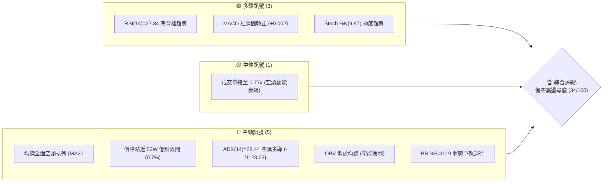
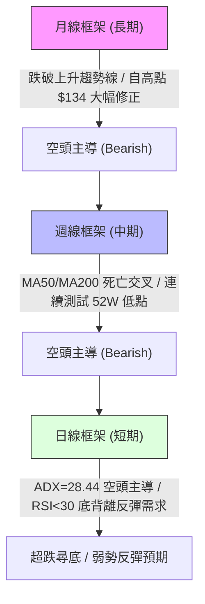
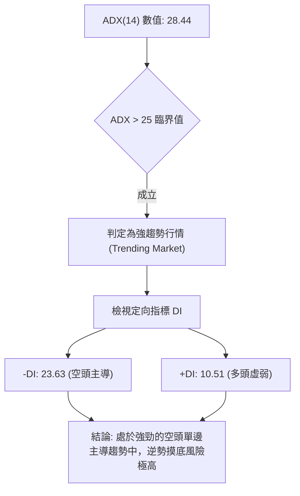
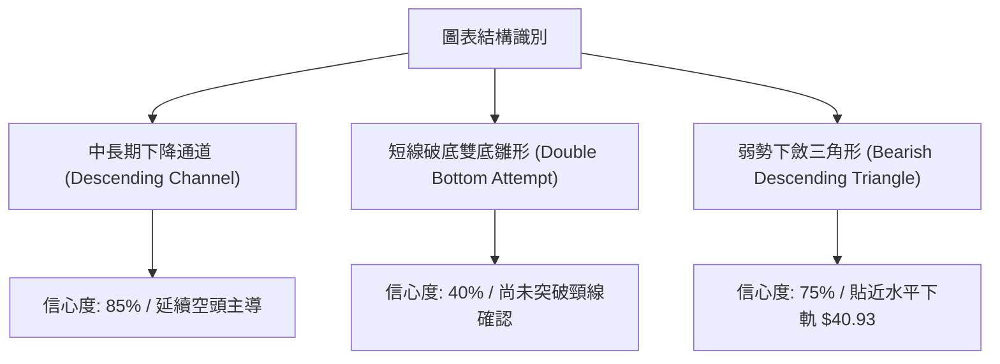
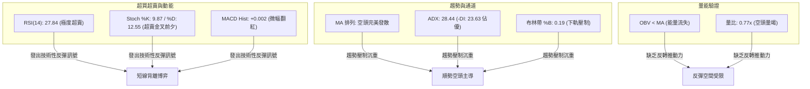
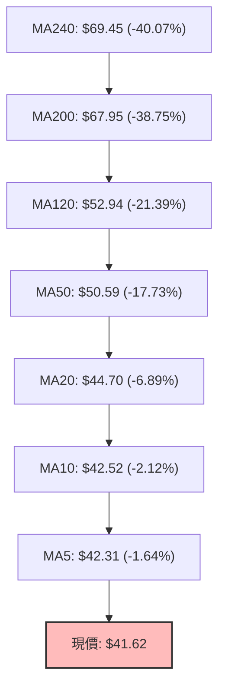
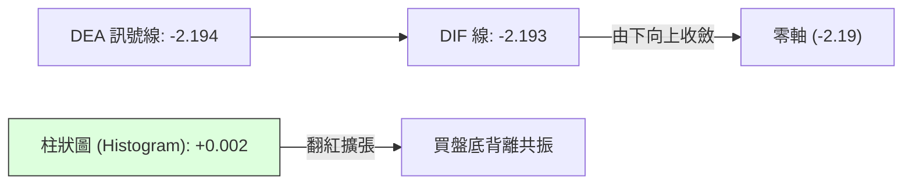
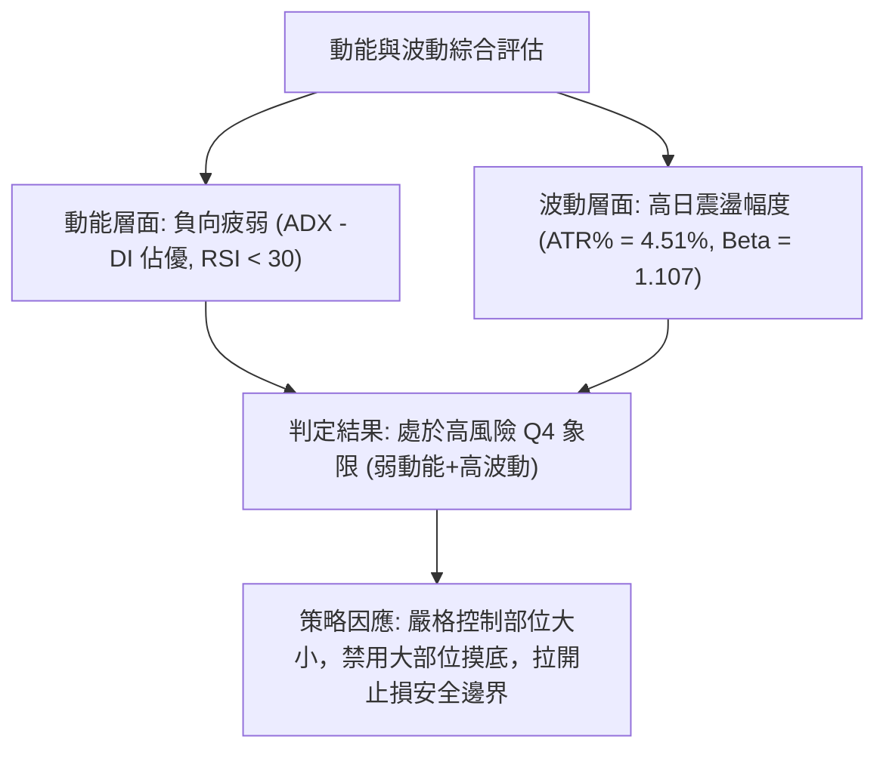
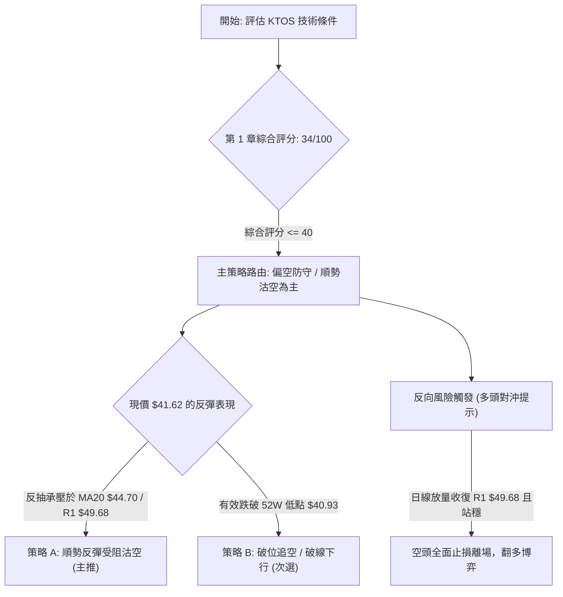
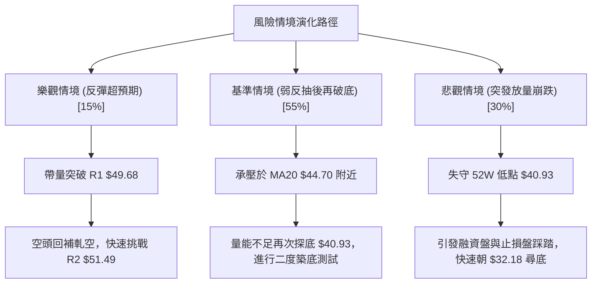

# KTOS 技術分析報告

> **報告日期**：2026-10-13 ｜ **語言**：繁體中文 ｜ **數據來源**：Yahoo Finance ｜ **當前價格**：$41.62

---

## 目錄

| 章節 | 內容 |
|------|------|
| [1. 技術面概覽](#1-技術面概覽) | 訊號儀表板、核心指標、評分卡 |
| [2. 趨勢分析](#2-趨勢分析) | 多時框趨勢、長中短期走勢 |
| [3. 圖表形態分析](#3-圖表形態分析) | 形態識別、K線組合、目標價 |
| [4. 支撐與阻力](#4-支撐與阻力) | 關鍵價位、斐波那契回調 |
| [5. 技術指標深度解讀](#5-技術指標深度解讀) | MA/RSI/MACD/布林/成交量 |
| [6. 動能與波動率](#6-動能與波動率) | 動能評估、ATR、Beta |
| [7. 多時框架總結](#7-多時框架總結) | 時框架評分矩陣 |
| [8. 交易策略建議](#8-交易策略建議) | 多空策略、風險報酬比 |
| [9. 風險提示與監控](#9-風險提示與監控) | 監控指標、風險場景 |

---

## 1. 技術面概覽

### 🎯 技術訊號儀表板



### 📊 核心指標速覽表

| 指標類別 | 指標名稱 | 當前數值 | 訊號 | 解讀 |
|----------|----------|----------|------|------|
| **價格** | 當前價格 | $41.62 | 🔴 | 位於 52 週極端低檔 (0.7% 百分位)，瀕臨前低 $40.93 |
| **均線** | MA20 | $44.70 | 🔴 | 現價低於 MA20 達 -6.89%，短期空頭壓制明顯 |
| **均線** | MA50 | $50.59 | 🔴 | 中期生命線大幅下彎，價差偏離達 -17.73% |
| **均線** | MA200 | $67.95 | 🔴 | 長期牛熊分界線遙不可及，價差高達 -38.75% |
| **動能** | RSI(14) | 27.84 | 🟢 | 進入 <30 極端超賣區，且已浮現底背離雛形 |
| **動能** | MACD | -2.193 | 🟢 | MACD 線與訊號線低檔金叉黏合金叉，柱狀圖 +0.002 翻紅 |
| **趨勢** | ADX(14) | 28.44 | 🔴 | ADX>25 顯示空頭強趨勢延續，-DI(23.63) 壓制 +DI(10.51) |
| **通道** | 布林通道 | %B = 0.19 | 🟡 | 價格貼近下軌 $39.81 與中軌 $44.70 之間，帶寬收斂 |
| **成交量** | 20日量比 | 0.77x | 🟡 | 日成交量 3.55M 低於均量 4.62M，殺跌動能鈍化 |
| **波動** | ATR(14) | $1.88 | 🟡 | 佔現價 4.51%，屬於防守型中等偏高日波動區間 |

### 🏆 技術評分卡

```
╔══════════════════════════════════════════════════════════════╗
║             技術評分卡 — KTOS (2026-10-13)                  ║
╠══════════════════════════════════════════════════════════════╣
║ 趨勢強度 (ADX/均線)   ████░░░░░░░░░░░░░░░░  20/100  🔴 強空趨勢 ║
║ 動能指標 (RSI/MACD)   ███████████░░░░░░░░░  55/100  🟡 底背離萌芽 ║
║ 支撐穩定度 (52W Low)  ██████░░░░░░░░░░░░░░  30/100  🔴 無結構低點 ║
║ 成交量配合 (OBV/量比) ███████░░░░░░░░░░░░░  35/100  🔴 量能渙散   ║
║ 形態完整度 (K線結構)  ██████░░░░░░░░░░░░░░  30/100  🔴 下跌中繼   ║
║ 均線排列 (短中長期)   ████░░░░░░░░░░░░░░░░  18/100  🔴 完美空頭   ║
╠══════════════════════════════════════════════════════════════╣
║ 綜合技術評分          ███████░░░░░░░░░░░░░  34/100  🔴 偏空弱勢   ║
╚══════════════════════════════════════════════════════════════╝
```

---

## 2. 趨勢分析

### 🌐 多時框趨勢分析



### 📈 長期趨勢 — 12個月走勢圖（Unicode）

KTOS 在過去 12 個月內經歷了戲劇性的派發與估值擠壓行情，自 2026 年 1 月的高點 $103.01 持續下瀉至當前的 $41.62。

```
KTOS 月線走勢圖（過去12個月：2025-11 至 2026-10）
價格軸 ($)
$105 ┤                 ● (2026-01: $103.01 最高峰)
$95  ┤             
$85  ┤                    ● (2026-02: $86.18)
$75  ┤ ● (2025-11: $76.10)
$75  ┤    ● (2025-12: $75.91)
$70  ┤                       ● (2026-03: $70.51)
$65  ┤                          ● (2026-04: $63.05)
$65  ┤                             ● (2026-05: $64.13)
$50  ┤                                ● (2026-06: $49.86)
$50  ┤                                   ● (2026-08: $50.98)
$45  ┤                                      ● (2026-07: $46.60)
$40  ┤                                         ● (2026-09: $42.69)
$40  ┤                                            ● (2026-10: $41.62 現價)
     └─────────────────────────────────────────────────────────────
       11   12   01   02   03   04   05   06   07   08   09   10  (月份)
```

#### 走勢特徵分析表格

| 階段區間 | 時間跨度 | 起訖價位 | 漲跌幅 | 走勢特徵與量價行為 |
|----------|----------|----------|--------|--------------------|
| **主升浪峰值** | 2025-11 → 2026-01 | $76.10 → $103.01 | +35.36% | 高位天量博弈，形成 52 週天花板區間 ($134.00 盤中峰值) |
| **首輪崩跌浪** | 2026-01 → 2026-03 | $103.01 → $70.51 | -31.55% | 機構大幅派發，失守百元大關與 MA50，形成多頭斷頭鍘 |
| **中繼整理區** | 2026-03 → 2026-05 | $70.51 → $64.13 | -9.05% | 於 $60.85 (斐波 78.6%) 附近弱勢抵抗，成交動能減弱 |
| **主跌加速浪** | 2026-05 → 2026-07 | $64.13 → $46.60 | -27.34% | 破位放量重挫，2026-06 跌破 $50 心理關卡 |
| **弱勢抵抗浪** | 2026-07 → 2026-08 | $46.60 → $50.98 | +9.40% | 短線空頭回補，受阻於 R1 $49.68 / R2 $51.49 壓力帶 |
| **陰跌探底浪** | 2026-08 → 2026-10 | $50.98 → $41.62 | -18.36% | 量縮破底，逼近 52 週最低點 $40.93，進入超賣鈍化區 |

### 📊 中期趨勢（週線分析）

從近 20 週數據觀察，KTOS 在 2026 年 8 月中旬反彈至 $64.58 (RSI 達 76.7) 後遭遇重挫，隨後展開長達 9 週的連續性下挫。

```
週線近期價格阻力與下行通道結構
$65.00 ┤        ▲ (2026-08-16 高點 $64.58)
$60.00 ┤      ▲
$55.00 ┤              阻力帶 R3 ($54.22) ────────────────────────────
$51.50 ┤                  阻力帶 R2 ($51.49) ────────────────────────
$49.70 ┤                      阻力帶 R1 ($49.68) ────────────────────
$45.00 ┤                          ▼      ▼
$41.62 ┤                                    ● 現價 ($41.62)
$40.93 ┤──────────────────────────────────────── 52W 低點支撐線
```

### ⚡ 趨勢強度評估（ADX 解讀）



#### ADX 強度與行情對照表

| 指標名稱 | 當前數值 | 門檻區間 | 當前市場狀態判定 |
|----------|----------|----------|------------------|
| **ADX(14)** | **28.44** | > 25 (強趨勢) | 市場具備明確趨勢動力，非窄幅無方向震盪 |
| **+DI** | **10.51** | < 15 (極度疲弱) | 買盤推升力量完全處於被壓制狀態 |
| **-DI** | **23.63** | > 20 (空頭主控) | 賣壓佔據盤面主導地位，下行趨勢明確 |
| **方向差距 (Spread)** | **-13.12** | 負差擴大 | 空頭動能穩定發散，任何反彈均屬技術性修正 |

---

## 3. 圖表形態分析

### 🔍 形態識別系統



#### 形態識別與信心度評估表

| 形態名稱 | 信心度 | 判斷依據（引用數據） | 完成度 | 目標價（附計算式） |
|----------|--------|----------------------|--------|--------------------|
| **下降通道 (Descending Channel)** | **85%** | 高點由 $64.58 → $50.98 下降；低點由 $46.03 → $41.62 下移 | 90% | 跌破通道下軌：依通道高度 ($50.98 - $41.62 = $9.36) 推算下移目標為 $32.26 |
| **水平下斂三角形** | **75%** | 壓力線由 R3($54.22) → R2($51.49) → R1($49.68) 斜向下壓，底部受制於 52W 低點 $40.93 | 85% | 跌破下軌計算：$40.93 - (R1 $49.68 - $40.93) = $32.18 |
| **潛在雙底反轉 (Double Bottom)** | **35%** | 數據不足，現價 $41.62 距 52W Low $40.93 僅 1.6%，未見放量回升與打底結構 | 20% | 訊號不足，僅做指標型超賣解讀，不預設雙底突破 |

### 🕯️ 重要K線形態分析

| 週期/月份 | 收盤價 | K線形態 | 解讀 | 訊號 |
|-----------|--------|---------|------|------|
| **2026-08** | $50.98 | 長上影倒轉錘頭 | 月線反彈受阻於 R2 $51.49 附近，多頭上攻遭遇沉重拋壓 | 🔴 強空 |
| **2026-09** | $42.69 | 中大陰線下挫 | 實體大陰線完全吞噬前期企穩跡象，成交量穩定擴大，破位確認 | 🔴 看空 |
| **2026-10 (至今)**| $41.62 | 窄幅縮量流星十字星 | 逼近前低 $40.93 處買賣雙方觀望，量能銳減，呈現下跌動能衰竭 | 🟡 觀望 |
| **近兩週日K** | $41.62 | 底部貼軌連續小實體陰陽交錯 | 價格黏於布林下軌 $39.81 上方，波動率受限，正在集聚突破動能 | 🟡 醞釀 |

### 📉 ASCII 走勢形態示意圖

下斂三角形破位邊緣示意圖：

```
KTOS 關鍵形態示意圖：日線/週線下斂三角形 (Descending Triangle)
$55.00 ┤ \
$52.00 ┤  \  下降壓力線 (Resistance Trendline)
$49.68 ┤   ●─────────────── (R1 壓力位 $49.68)
$46.00 ┤    \
$44.70 ┤     \ ──────────── (MA20 中軌 $44.70)
$41.62 ┤      \      ● (現價 $41.62 瀕臨破位)
$40.93 ┤════════════════════ (水平支撐：52W 低點 $40.93)
$38.00 ┤        :
$32.18 ┤        ▼ (若破位之理論形態跌幅滿足點: $32.18)
```

### 🎯 形態目標價計算

依據三角形幾何形態測量規則（三角形基底垂直高度投影）：
- **形態上軌起始點 (頸線高點)**：R1 = $49.68
- **形態下軌關鍵支撐點**：52W Low = $40.93
- **形態垂直高度 ($H$)**：$49.68 - $40.93 = $8.75
- **破位目標價 (Downside Target)**：
  $$\text{Target} = \text{支撐位} - H = \$40.93 - \$8.75 = \$32.18$$
- **向上假破突破目標價 (Upside Target)**：
  $$\text{Target} = \text{阻力位} + H = \$49.68 + \$8.75 = \$58.43$$

---

## 4. 支撐與阻力

### 🗺️ 關鍵價位分布圖（Unicode）

```
KTOS 價位結構分布圖 (由實際 OHLCV 與斐波那契點位計算)
═══════════════════════════════════════════════════════════════════
$60.85 ║██████████████████████████████║ 斐波那契 78.6% 回調位
$54.22 ║██████████████████████        ║ 強波段阻力 R3 (+30.27%)
$51.49 ║██████████████████            ║ 關鍵波段阻力 R2 (+23.71%)
$49.68 ║██████████████                ║ 近期波段阻力 R1 (+19.37%)
$44.70 ║──────────────────────────────║ 短期均線壓制 (MA20 / 布林中軌)
$41.62 ╠══════════════════════════════╣ ◄ 當前市價 ($41.62)
$40.93 ║▓▓▓▓▓▓▓▓▓▓▓▓▓▓▓▓▓▓▓▓▓▓▓▓▓▓▓▓▓▓║ 52週歷史最低點 (100.0% 回調位)
$39.81 ║░░░░░░░░░░░░░░░░░░░░░░        ║ 布林帶動態下軌 (動態超賣支撐)
(下方) ║數據中未偵測到近一年波段低點聚類║ 破位後進入歷史無量真空間
═══════════════════════════════════════════════════════════════════
```

### 🚧 阻力位分析表

阻力位嚴格引用系統計算之波段高點聚類數值：

| 阻力級別 | 價位 | 形成原因 | 突破難度 | 重要性 |
|----------|------|----------|----------|--------|
| **R1** | **$49.68** | 近一年波段高點聚類、布林帶上軌 ($49.59) 匯聚處 | ★★★★☆ | 極高（多頭扭轉短期頹勢的第一道鬼門關） |
| **R2** | **$51.49** | 近一年次級波段高點、MA60 均線 ($50.05) 上方密集成交區 | ★★★★☆ | 高（收復此處方能確認中期築底成功） |
| **R3** | **$54.22** | 近一年波段強阻力聚類、MA120 均線 ($52.94) 上方反壓區 | ★★★★★ | 核心中樞（中期多空分水嶺） |

### 🛡️ 支撐位分析表

支撐位嚴格引用系統既有之計算結果與客觀幾何點位：

| 支撐級別 | 價位 | 形成原因 | 守住機率 | 重要性 |
|----------|------|----------|----------|--------|
| **S1 (52W Low)** | **$40.93** | 斐波那契 100.0% 回調位、全年度最低價格防線 | 50% | 決定性生死線（失守將引發止損賣壓盤崩潰） |
| **S2 (動態支撐)**| **$39.81** | 日線布林通道下軌極限擴張位 | 60% | 具備短線技術性假突破抽頭之緩衝功能 |
| **次級支撐** | **數據中未偵測到** | 系統數據中當前價格下方無近一年波段低點聚類 | -- | -- |

### 📐 斐波那契回調位分析

依據 52 週波動極值區間（低點 $40.93 → 高點 $134.00）計算之精確回調點位：

```
斐波那契回調位階梯分布 (區間幅寬 $93.07)
0.0%  (52W High) ─────────────────────────── $134.00
23.6%            ─────────────────────────── $112.04
38.2%            ─────────────────────────── $ 98.45
50.0%            ─────────────────────────── $ 87.47
61.8%            ─────────────────────────── $ 76.48
78.6%            ─────────────────────────── $ 60.85
現價 ($41.62)    ────────► 處於 78.6% 與 100.0% 極端回調區間底部 (跌幅 99.3%)
100.0% (52W Low) ─────────────────────────── $ 40.93
```

#### 斐波那契結構解讀
1. **深度回撤結構**：KTOS 自高點回落已完全吞噬整波牛市漲幅，跌破了黃金分割的核心防線 61.8% ($76.48) 及深幅防線 78.6% ($60.85)。
2. **極限支撐考驗**：現價 $41.62 距 100.0% 回調位 $40.93 僅有 $0.69 (1.65%) 的空間。若 $40.93 告失，則原 52 週上升結構徹底歸零，將開啟下行價格空間的重新定價。

---

## 5. 技術指標深度解讀

### 🎛️ 指標訊號總覽



### 📈 移動平均線排列分析



均線系統呈現標準且發散的**完美空頭排列**（$MA5 < MA10 < MA20 < MA60 < MA120 < MA240$）：
- 價格受到短天期均線 MA5 ($42.31) 與 MA10 ($42.52) 的壓迫，每一次向上觸碰短均線皆遭遇即時拋售。
- 距離中期中樞 MA20 ($44.70) 乖離率達 -6.89%，呈現負乖離偏高，具備向 MA20 均值回歸的動力，但 MA20 扣高下行，壓制力量沉重。

### 📉 RSI(14) 分析

- **當前數值**：**27.84** 
- **狀態進度條**：
```
超賣區 (<30)              中性區 (50)              超買區 (>70)
[██████████░░░░░░░░░░░░░░░░░░░░░░░░░░░░░░░░░░░░░░░░] 27.84
```
- **背離判斷（Bullish Divergence）**：
  - **週線與日線訊號**：2026-09-06 週收盤價為 $47.82，對應 RSI 為 11.7；2026-10-18 當前價位下行至 $41.62（跌幅 -12.96%），但 RSI 讀數卻抬升至 27.84。
  - **結論**：價格創下波段新低，但 RSI 指標未創新低反而逆勢走高，構成顯著的**日/週線級別底背離**。這表明空方殺跌的邊際加速度正在迅速減弱，反彈動能正在積聚。

### 📊 MACD(12/26/9) 訊號解讀



- **MACD 線**：-2.193
- **Signal 線**：-2.194
- **柱狀圖 (Histogram)**：**+0.002**
- **交叉分析**：MACD 在極端深水區（負值區深處）發生金叉黏合，柱狀圖經歷了長達數週的負值收斂後首度翻正 (+0.002)。這印證了 RSI 的底背離現象，屬於典型的動能衰竭型金叉。然而，由於雙線深處零軸下方，此訊號目前僅能定義為**弱勢技術性超跌反彈**，非牛市反轉。

### 📦 布林通道分析

```
KTOS 日線布林通道分布示意圖
$49.59 ┤═══════════════════════════════════════ 上軌 ($49.59) ─ 強壓區
$47.00 ┤
$44.70 ┤─────────────────────────────────────── 中軌/MA20 ($44.70) ─ 多空分水嶺
$42.00 ┤
$41.62 ┤        ● 現價 ($41.62, %B = 0.19)
$39.81 ┤═══════════════════════════════════════ 下軌 ($39.81) ─ 邊界防線
```

- **帶寬與位置**：通道上軌為 $49.59，中軌為 $44.70，下軌為 $39.81。
- **%B 指標**：當前數值為 **0.19**，位於下軌（0.0）與中軌（0.5）之間的弱勢下半區。現價逼近下軌支撐 $39.81，顯示通道持續向下傾斜開口，但開口擴張速率趨緩，進入帶狀邊界擠壓狀態。

### 💹 成交量分析（量價配合度）

1. **量能縮減**：最新成交量為 3,548,000 股，相較於 20 日均量 4,619,750 股，量比僅為 **0.77x**。在跌破關鍵支撐帶時並未引發大規模爆量恐慌，屬於縮量陰跌。
2. **OBV 指標驗證**：OBV 持續運行於其移動平均線下方（OBV < MA），證實資金仍呈現淨流出狀態。雖然日線動能指標出現底背離，但**量能尚未顯現機構大筆抄底回補的增量跡象**，量價配合度處於「量價俱疲」狀態。

---

## 6. 動能與波動率

### ⚡ 動能評估四象限

| 象限 | 動能維度 | 波動率維度 | 當前狀態判定 | 特徵解析與交易指引 |
|------|----------|------------|--------------|--------------------|
| **Q1** | 強動能 (Bullish) | 低波動 (Low Vol) | -- | 穩健上升趨勢，最佳順勢持股環境 |
| **Q2** | 弱動能 (Bearish) | 低波動 (Low Vol) | -- | 底部無量盤整，資金關注度極低 |
| **Q3** | 強動能 (Bullish) | 高波動 (High Vol) | -- | 投機性主升浪，高風險高回報 |
| **Q4** | **弱動能 (Bearish)** | **高波動 (High Vol)** | **✓ (KTOS 歸屬)** | **下行空頭趨勢伴隨劇烈日波幅，逆勢操作極易觸發止損** |



### 📊 ATR 波動率分析

- **ATR(14) 絕對值**：**$1.88**
- **ATR 波動百分比**：$$\frac{\$1.88}{\$41.62} = 4.51\%$$
- **止損距離建議**：
  - *短期防守止損（1.0 × ATR）*：$\$1.88$，對應現價空間為 $\$39.74$
  - *常規波段止損（1.5 × ATR）*：$\$2.82$，對應現價空間為 $\$38.80$
  - *寬幅結構止損（2.0 × ATR）*：$\$3.76$，對應現價空間為 $\$37.86$

### 📐 Beta 與市場相關性

- **Beta 係數**：**1.107**
- **市場彈性解讀**：KTOS 的系統性風險略高於標普 500 指數（彈性係數 1.107x）。在當前個股技術面極端偏空的情況下，若大盤整體遭遇回調，KTOS 由於 Beta > 1 且缺乏內生買盤支撐，極易成為機構被動拋售的重災區。

---

## 7. 多時框架總結

### 📋 時框架評分表

| 時框架 | 趨勢方向 | 動能指標 | 均線排列 | 圖表形態 | 綜合評分 | 戰術建議 |
|--------|----------|----------|----------|----------|----------|----------|
| **月線 (長期)** | 🔴 強烈看空 | 偏弱 (自高位持續回調) | 跌破短期均線 | 下行波段破位 | 25/100 | 長線資金觀望，禁止左側重倉 |
| **週線 (中期)** | 🔴 空頭主導 | 負向擴張 (-DI 佔優) | 空頭排列 | 下斂三角形逼近下軌 | 30/100 | 逢反彈至阻力區建立對沖防護 |
| **日線 (短期)** | 🟡 偏空震盪 | 🟢 底背離超賣修正 | 完美空頭排列 | 貼軌縮量鈍化 | 45/100 | 僅限激進型極小部位博弈反彈 |

### 🔲 綜合訊號矩陣

```
┌──────────────┬───────────────────┬───────────────────┬───────────────────┐
│ 分析維度     │ 短期 (1-5日)      │ 中期 (1-4週)      │ 長期 (1-6個月)    │
├──────────────┼───────────────────┼───────────────────┼───────────────────┤
│ 趨勢方向     │ 🟡 尋底震盪       │ 🔴 明確下行通道   │ 🔴 空頭定價週期   │
│ 動能信號     │ 🟢 RSI/MACD 底背離│ 🔴 ADX=28.44 空主導│ 🔴 資金持續流出   │
│ 均線系統     │ 🔴 受阻於 MA5/10  │ 🔴 MA20/50 蓋頭反壓│ 🔴 遠低於 MA200   │
│ 量能結構     │ 🟡 殺跌動能萎縮   │ 🔴 OBV 弱勢下行   │ 🔴 機構買盤缺席   │
├──────────────┼───────────────────┼───────────────────┼───────────────────┤
│ 權重收斂取向 │ 短期技術超跌修正  │ 順勢空頭主導格局  │ 戰略性防守觀望    │
└──────────────┴───────────────────┴───────────────────┴───────────────────┘
```

### ⚖️ 多時框收斂結論

依據多時框收斂規則第 14 條：
1. **趨勢/盤整判定**：當前日線 $ADX(14) = 28.44 > 25$，且 $-DI(23.63) > +DI(10.51)$，確認當前市場處於**強趨勢行情（空頭單邊主導）**，非無方向震盪。
2. **優先級收斂原則**：在強趨勢行情下，必須以**中長期（週線/MA50、MA200）方向為最高主導準則**。日線級別浮現的 RSI 底背離及 MACD 翻紅金叉，在優先級上**僅能定義為尋找空頭回補點或超跌反彈的高難度進場時機**，絕對不得覆蓋中長期的空頭主趨勢。
3. **最終方向性結論**：**偏空（主基調為空頭防守，逢反彈減碼或順勢沽空，極短線僅允嚴格停損之輕倉博反彈）**。本結論與第 8 章之空頭主導策略保持嚴格收斂一致。

---

## 8. 交易策略建議

### 🗺️ 策略決策流程圖



### 🧭 策略路由

**當前主策略方向 = 偏空順勢防守 / 逢高沽空（依綜合評分 34/100，評級 ≤ 40 嚴格觸發空頭策略路由）**

### 🎯 價格情境階梯（Price Scenarios）

價位嚴格引用系統計算之實際波段點位：

| 觸發條件 | 下一目標 | 後續延伸 | 情境含義 |
|----------|----------|----------|----------|
| **向上突破 R1 $49.68** | R2 **$51.49** | R3 **$54.22** | 短線超跌反彈升級為中期築底轉強 |
| **承壓於 MA20 $44.70 ~ R1 $49.68** | 52W Low **$40.93** | 布林下軌 **$39.81** | 空頭中繼弱勢震盪，尋底未完成 |
| **放量跌破 52W Low $40.93** | 布林下軌 **$39.81** | 形態推算目標 **$32.18** | 中期支撐崩塌，開啟新一輪主跌段 |

### 📊 情境機率分佈

| 情境劇本 | 機率 | 主要依據 |
|----------|------|----------|
| **弱勢反抽後回落再探底** | **55%** | 均線空頭排列完備，ADX=28.44 空方主控，OBV 顯示買盤動能未銜接 |
| **直接破位加速下行** | **30%** | 現價距 $40.93 僅 1.6%，缺乏結構低點緩衝，Beta=1.107 易放大賣壓 |
| **強勢 V 型反轉站上 R1** | **15%** | 僅依靠 RSI 底背離與 MACD 柱狀翻正，在無量環境下極難直接跨越 R1 $49.68 |

### 🔴 主策略詳情（空頭主導策略）

依據評分卡 34/100 路由，主推兩套空頭風控與操作策略：

| 策略要素 | 策略 A（反彈受阻沽空 - 主推） | 策略 B（跌破 52W 低點追空 - 次選） |
|----------|---------------------------------|--------------------------------------|
| **策略類型** | 順勢高拋空頭策略 | 關鍵破位右側追空策略 |
| **進場條件** | 價格反抽至 MA20 附近遇阻，出現長上影線 | 日線實體收盤價正式跌破 52W 低點 $40.93 |
| **進場價格** | **$44.70** (MA20 與布林中軌處) | **$40.80** (跌破 $40.93 後 0.3% 確認) |
| **目標價 T1** | **$40.93** (52W 低點，潛在獲利 +8.43%) | **$39.81** (布林下軌，潛在獲利 +2.43%) |
| **目標價 T2** | **$32.18** (形態推算目標，獲利 +27.99%) | **$32.18** (形態推算目標，獲利 +21.13%) |
| **止損價格** | **$47.52** (進場價 + 1.5 × ATR $1.88) | **$42.68** (進場價 + 1.0 × ATR $1.88) |
| **風險報酬比** | **1 : 2.99** (以目標 T2 計算) | **1 : 4.58** (以目標 T2 計算) |
| **成功機率** | **65%** | **55%** |
| **建議倉位** | **8%** (非主升浪，防禦性空單) | **5%** (追空需防假突破抽頭) |

### 🟢 反向風險觸發點（對沖提示）

若出現以下情境，則本報告主推之空頭策略**立即失效**，空單應全數停損並轉向防守觀望：
1. **反轉關鍵價位**：日線強勢收盤**站穩 R1 $49.68 之上**。
2. **指標確認信號**：日線成交量突破 50 日均量（> 4.07M）達到 1.5 倍以上，且 RSI(14) 強勢突破 50 中軸線。
3. **風控動作**：空頭頭寸無條件市價平倉；進取型投資者可轉換為多頭頭寸，以止損位設於 $44.70，向上博弈 R2 $51.49 與 R3 $54.22。

### ⭐ 整體訊號強度評星

```
做多訊號強度：★★☆☆☆  (2.0/5星 - 僅存底背離，大趨勢壓制)
做空訊號強度：★★★★☆  (4.0/5星 - 順應週線強趨勢與均線發散)
整體可信度：  ★★★★☆  (4.0/5星 - 價位精確收斂，多時框指引明確)
```

---

## 9. 風險提示與監控

### ✅ 關鍵監控指標 Checklist

```
╔══════════════════════════════════════════════════════════════╗
║               KTOS 每日交易監控清單 Checklist                ║
╠══════════════════════════════════════════════════════════════╣
║ [ ] 52W 低點防守線: 盤中是否跌破 $40.93？                    ║
║ [ ] RSI 動能觀察: RSI(14) 能否突破 30 脫離極端超賣區？      ║
║ [ ] 成交量能監測: 單日成交量是否放大突破 20日均量 (4.62M)？   ║
║ [ ] 均線動態反壓: 價格回抽 MA5 ($42.31) 是否產生實體陽線吞噬？║
║ [ ] MACD 柱狀走向: MACD Histogram 能否連續 3 日維持正值擴張？║
║ [ ] 布林通道狀態: 價格是否脫離下軌 (%B 是否穩定大於 0.20)？   ║
╚══════════════════════════════════════════════════════════════╝
```

### ⚠️ 風險場景分析



### 🛡️ 風險管理重要提醒

1. **左側摸底的致命誘惑**：目前 RSI 位於 27.84，雖然具備底背離與極端超賣特徵，但在 ADX=28.44 的強空頭趨勢中，**指標「鈍化」常會導致超賣之後還有更極端的超賣**。絕對不可因為「跌幅已深」而進行無止損的重倉摸底。
2. **止損紀律的不可妥協性**：由於下方缺乏近一年的密集波段成交量支撐（歷史數據顯示已破位至 52 週最低點），一旦 $40.93 失守，下方將面臨真空流動性風險。無論持有多頭或空頭部位，必須嚴格執行基於 ATR 計算的止損指令。
3. **倉位管理防線**：當前個股波動率 ATR% 高達 4.51%，建議單一標的之風險曝險額（Risk Capital）不得超過總投資組合淨值的 **1.0%**。換算為持倉部位，KTOS 的總配置比例在趨勢未扭轉前應嚴格壓低在 **5% - 8%** 以內。

---

## 📋 報告總結

```
╔══════════════════════════════════════════════════════════════════╗
║                    KTOS 技術分析報告總結                         ║
╠══════════════════════════════════════════════════════════════════╣
║ 報告日期：2026-10-13                                             ║
║ 當前價格：$41.62                                                 ║
║ 分析評級：🔴 偏空弱勢 (綜合評分: 34/100，空頭趨勢主導)           ║
║                                                                  ║
║ 關鍵結論：                                                       ║
║ ├─ 長期趨勢：🔴 空頭主導 (自高點 $134.00 深度回撤達 68.9%)       ║
║ ├─ 中期趨勢：🔴 下行通道 (均線完全空頭排列，ADX 28.44 強空)      ║
║ ├─ 短期趨勢：🟡 超跌反彈蓄勢 (RSI 27.84 底背離，MACD 翻紅金叉)  ║
║ ├─ 關鍵支撐：S1 $40.93 (52W 低點) ｜ S2 $39.81 (布林下軌)        ║
║ ├─ 關鍵阻力：R1 $49.68 ｜ R2 $51.49 ｜ R3 $54.22                 ║
║ └─ 分析師共識：Strong Buy ($99.57) 與當前技術面呈現嚴重撕裂脫節   ║
║                                                                  ║
║ 最優策略組合：                                                   ║
║ 1. 🥇 最佳機會：等待反抽至 MA20 ($44.70) 附近遇阻，順勢建立空單  ║
║ 2. 🥈 次選機會：跌破 52W 低點 ($40.93) 確認後，右側輕倉追空      ║
║ 3. 🥉 保守選擇：場外空倉觀望，直至價格有效突破 R1 ($49.68)       ║
╚══════════════════════════════════════════════════════════════════╝
```

---

> ⚠️ **免責聲明**：本報告為 AI 自動生成之技術分析，所有數據及估算均基於客觀歷史價格資訊與經典技術指標運算模型。本報告**僅供研究與學術參考**，**不構成任何形式之個人化投資建議或買賣邀約**。金融市場投資具備固有本金虧損風險，投資人應獨立評估自身財務承受能力並嚴格執行風控紀律。

---

*報告生成時間：2026-10-13 ｜ 數據來源：Yahoo Finance ｜ 分析框架：多時框技術分析體系*