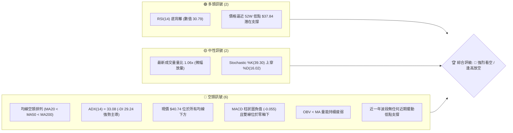
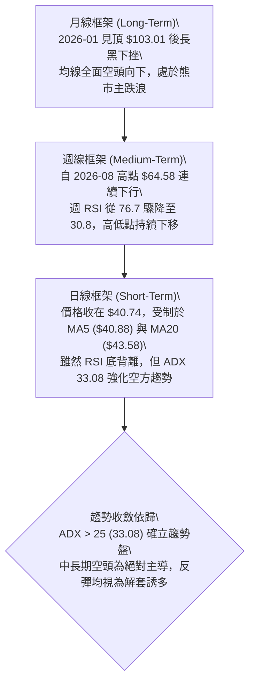
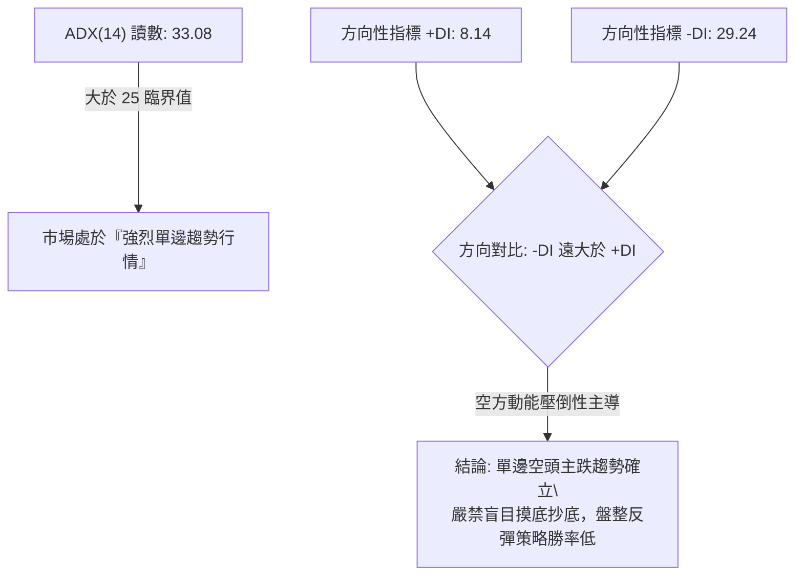
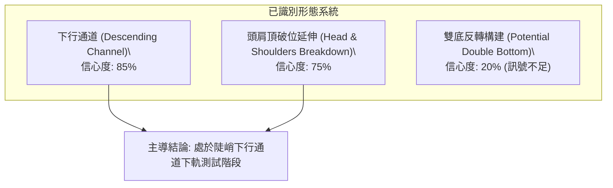
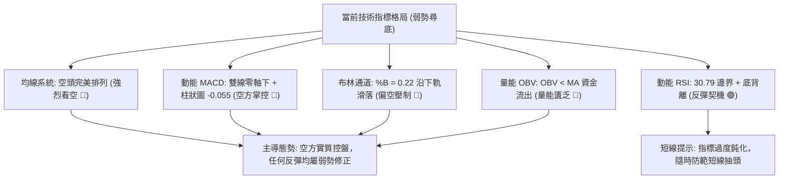
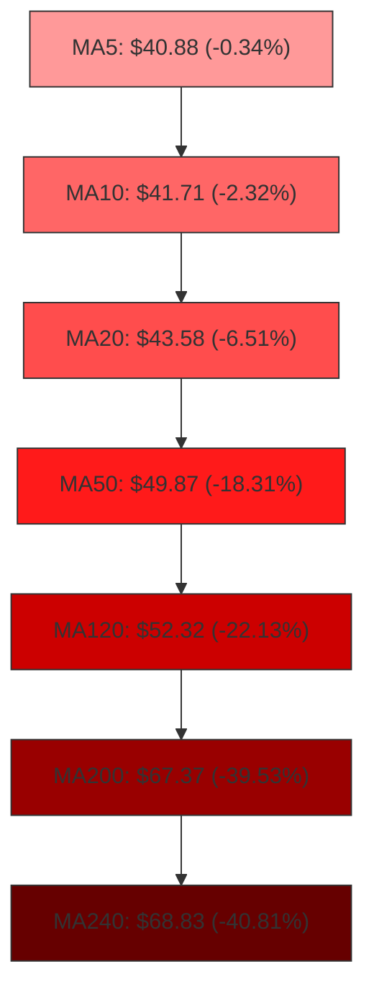
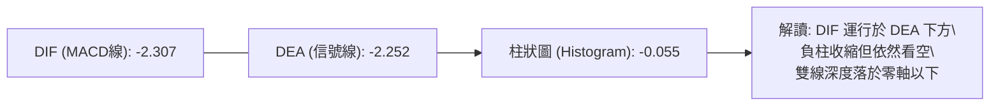
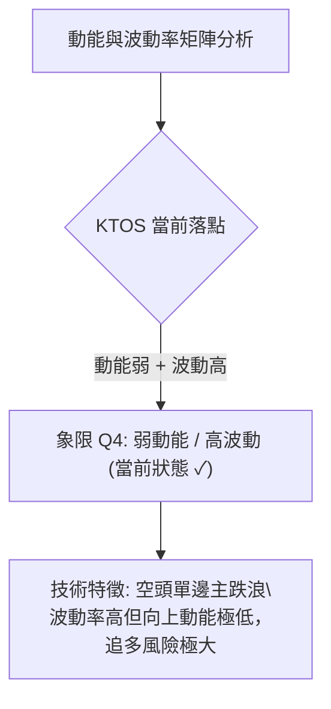
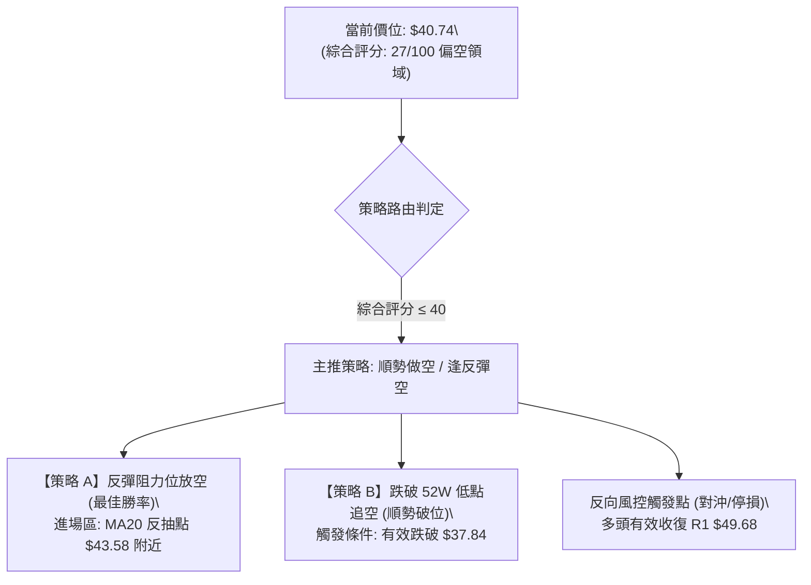
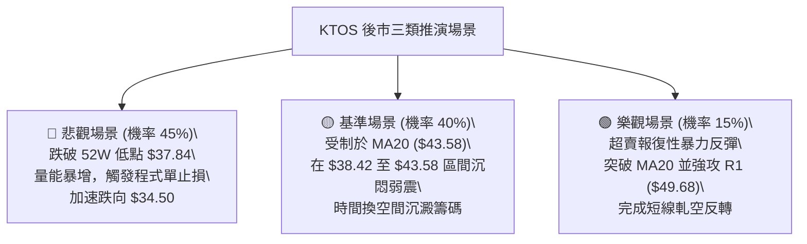

# KTOS 技術分析報告

> **報告日期**：2026-10-16 ｜ **語言**：繁體中文 ｜ **數據來源**：Yahoo Finance ｜ **當前價格**：$40.74

---

## 目錄

| 章節 | 內容 |
|------|------|
| [1. 技術面概覽](#1-技術面概覽) | 訊號儀表板、核心指標、評分卡 |
| [2. 趨勢分析](#2-趨勢分析) | 多時框趨勢、長中短期走勢、ADX解讀 |
| [3. 圖表形態分析](#3-圖表形態分析) | 形態識別、K線組合、目標價推算 |
| [4. 支撐與阻力](#4-支撐與阻力) | 關鍵價位、斐波那契回調結構 |
| [5. 技術指標深度解讀](#5-技術指標深度解讀) | 均線系統、RSI底背離、MACD、布林通道、OBV |
| [6. 動能與波動率](#6-動能與波動率) | 動能四象限、ATR波動度、Beta分析 |
| [7. 多時框架總結](#7-多時框架總結) | 時框架矩陣、訊號一致性、趨勢收斂 |
| [8. 交易策略建議](#8-交易策略建議) | 策略路由、情境階梯、主推交易計畫 |
| [9. 風險提示與監控](#9-風險提示與監控) | 風險監控清單、場景推演、資金控管 |

---

## 1. 技術面概覽

### 🎯 技術訊號儀表板



### 📊 核心指標速覽表

| 指標類別 | 指標名稱 | 當前數值 | 訊號 | 解讀 |
|----------|----------|----------|------|------|
| **價格** | 當前價格 | $40.74 | 🔴 | 位於 52 週區間 3.0% 低檔，處於極弱勢尋底階段 |
| **均線** | MA20 | $43.58 | 🔴 | 價格低於 MA20 達 -6.51%，短期下行趨勢顯著 |
| **均線** | MA50 | $49.87 | 🔴 | 價格低於 MA50 達 -18.31%，中期空頭壓制力道強勁 |
| **均線** | MA200 | $67.37 | 🔴 | 價格低於 MA200 達 -39.53%，長期結構完全走空 |
| **動能** | RSI(14) | 30.79 | 🟡 | 逼近超賣界限 (30)，日線出現潛在底背離訊號 |
| **動能** | MACD(12,26,9) | -2.307 | 🔴 | DIF 與 DEA 深度沉於零軸之下，柱狀圖 -0.055 延續弱勢 |
| **動能** | Stochastic | %K 39.30 / %D 16.02 | 🟡 | 短線低檔金叉，存在技術性乖離修正與反彈需求 |
| **趨勢** | ADX(14) | 33.08 | 🔴 | ADX > 25 確立強趨勢，-DI (29.24) 遠高於 +DI (8.14) |
| **通道** | 布林通道 %B | 0.22 | 🔴 | 價格貼近下軌 ($38.42)，通道向下傾斜發散 |
| **量能** | OBV | OBV < MA | 🔴 | 資金持續淨流出，量能結構尚未確認任何底部反轉 |
| **波動** | ATR(14) | $1.93 | 🟡 | 日均波動幅度達 4.73%，短線下行波動風險偏高 |

### 🏆 技術評分卡

```
╔══════════════════════════════════════════════════════════════╗
║              技術評分卡 — KTOS (2026-10-16)                  ║
╠══════════════════════════════════════════════════════════════╣
║ 趨勢強度 (Trend)     ████░░░░░░░░░░░░░░░░  20/100  🔴 極度疲弱 ║
║ 動能指標 (Momentum)  ███████░░░░░░░░░░░░░  35/100  🔴 動能低迷 ║
║ 支撐穩定度 (Support) █████░░░░░░░░░░░░░░░  25/100  🔴 底部懸空 ║
║ 成交量配合 (Volume)  ████████░░░░░░░░░░░░  40/100  🟡 缺乏買盤 ║
║ 形態完整度 (Pattern) ██████░░░░░░░░░░░░░░  30/100  🔴 下行通道 ║
║ 均線排列 (Moving Av) ██░░░░░░░░░░░░░░░░░░  10/100  🔴 空頭排列 ║
╠══════════════════════════════════════════════════════════════╣
║ 綜合評分             █████░░░░░░░░░░░░░░░  27/100  🔴 強烈看空 ║
╚══════════════════════════════════════════════════════════════╝
```

---

## 2. 趨勢分析

### 🌐 多時框趨勢分析



### 📈 長期趨勢 — 12個月走勢圖（Unicode）

KTOS 在過去 12 個月經歷了劇烈的暴漲後腰斬行情報告，2026 年 1 月一度創下月收盤價 $103.01 的歷史高峰（52W 高點為 $134.00），隨後展開無情且持續的單邊殺跌。

```
KTOS 月線走勢圖（過去12個月：2025-11 至 2026-10）
價格軸 ($)
$105 ┤               ● $103.01 (2026-01 波段峰頂)
$95  ┤
$85  ┤                    ● $86.18
$75  ┤ ● $76.10  ● $75.91
$65  ┤                         ● $70.51  ● $63.05  ● $64.13
$55  ┤                                                       ● $50.98
$45  ┤                                             ● $49.86  ● $46.60
$35  ┤                                                                 ● $42.69  ● $40.74 (現價)
     └──────────────────────────────────────────────────────────────────────────
       25-11    25-12    26-01    26-02    26-03    26-04    26-05    26-06    26-07    26-08    26-09    26-10
```

#### 走勢特徵分析表格

| 階段區間 | 時間跨度 | 起點/終點收盤價 | 區間漲跌幅 | 主要走勢特徵與量價結構 |
|----------|----------|-----------------|------------|------------------------|
| **主升末段** | 2025-11 ~ 2026-01 | $76.10 → $103.01 | +35.36% | 月線加速趕頂，爆量推升至 $103.01，確立最後多頭狂歡 |
| **首波潰敗** | 2026-01 ~ 2026-04 | $103.01 → $63.05 | -38.79% | 高檔獲利了結盤湧出，跌破所有短期均線，呈現無支撐單邊回落 |
| **弱勢盤整** | 2026-04 ~ 2026-05 | $63.05 → $64.13 | +1.71% | 跌勢暫緩，於 $63 附近展開月線級別的抵抗性橫盤 |
| **次級下殺** | 2026-05 ~ 2026-07 | $64.13 → $46.60 | -27.34% | 橫盤破位，跌破 $50 心理整數關卡，停損賣壓大舉湧現 |
| **死貓反彈** | 2026-07 ~ 2026-08 | $46.60 → $50.98 | +9.40% | 8月中旬週線曾衝刺至 $64.58，但月線僅收在 $50.98，留下長上影線 |
| **破底探底** | 2026-08 ~ 2026-10 | $50.98 → $40.74 | -20.09% | 跌破前低，直奔 52 週低點 $37.84，空頭排列徹底定型 |

### 📊 中期趨勢（週線分析）

從近 20 週收盤走勢觀察，KTOS 中期呈現典型的「下行高低點下移（Lower Highs & Lower Lows）」結構：
- **波段反彈頂點**：2026-08-16 收盤 $64.58（週 RSI 達 76.7，MACD 柱達 +1.743），隨後遭空頭強力反噬。
- **波段主跌段**：自 2026-08-16 起連續 5 週重挫，2026-09-06 收盤重摔至 $47.82（週 RSI 驟降至 11.7 的極度超賣區）。
- **當前抵抗區**：近 4 週（2026-09-27 至 2026-10-18）收盤價依序為 $45.62 → $43.07 → $42.36 → $40.74，跌勢未見收斂，週成交量維持在 1,800 萬至 2,600 萬股，顯示主動性賣盤依然源源不絕。

```
近期週線壓力與支撐階梯示意圖
[壓力] $64.58 ──────────────────────── (08-16 反彈頂部頸線)
         │
[壓力] $51.49 ───────────── (R2 聚類阻力)
         │
[壓力] $49.68 ─────── (R1 聚類阻力 / MA50: $49.87)
         │
[現價] $40.74 ◄── (目前位置)
         │
[支撐] $38.42 ─── (日線布林下軌)
         │
[支撐] $37.84 ─────── (52W 最低點 / 100% 斐波那契位)
```

### ⚡ 趨勢強度評估（ADX 解讀）



#### ADX 趨勢強度對照表

| 指標變數 | 當前讀數 | 門檻區間 | 趨勢屬性判定 | 交易策略導向 |
|----------|----------|----------|--------------|--------------|
| **ADX 數值** | **33.08** | > 25 (強趨勢) | 趨勢性強烈，非區間震盪 | 順勢交易為主，逆勢抓底風險極高 |
| **+DI 指標** | **8.14** | < 15 (極度萎縮) | 多頭買盤動能枯竭 | 缺乏推動價格向上反轉的買力 |
| **-DI 指標** | **29.24** | > 25 (強烈主導) | 空頭實質掌控市場節奏 | 賣壓強勁，下行阻力最小途徑向下 |
| **綜合研判** | **強烈空頭趨勢** | 差值 -21.10 | 典型單邊崩跌形態 | 僅能尋求「逢均線反彈做空」機會 |

---

## 3. 圖表形態分析

### 🔍 形態識別系統



#### 形態識別與信心度評估表

| 形態名稱 | 信心度 | 判斷依據（引用數據） | 完成度 | 目標價（附計算式） |
|----------|--------|----------------------|--------|--------------------|
| **陡峭下行通道** | **85%** | 自 08-16 高點 $64.58 與 08-09 高點 $60.77 連線為軌道頂部；09-06 低點 $47.82 與當前 $40.74 為軌道底部，斜率持續向下。 | 90% | 通道下軌下探目標：$37.84（平 52W 低點）。若跌破，通道延伸測幅為 $34.50。 |
| **大型頭肩頂破位** | **75%** | 左肩 2025-09 收盤 $91.37，頭部 2026-01 收盤 $103.01，右肩 2026-02 收盤 $86.18。頸線約落在 2025-11 低點 $76.10。 | 100% (已完全破位) | 形態高度 = $103.01 - $76.10 = $26.91。<br>破位測幅目標 = $76.10 - $26.91 = **$49.19**（已於 2026-06 跌破並達標，目前進入超跌延伸浪）。 |
| **雙底形態** | **20%** | 目前僅有 52W 低點 $37.84 單一底部，現價 $40.74 尚未觸碰且未出現任何反轉收紅結構。 | 10% | **數據不足**，無頸線支撐，依規則不得視為有效反轉形態。 |

### 🕯️ 重要K線形態分析

| 週期/月份 | 收盤價 | K線形態名稱 | 形態結構解讀 | 訊號強度 |
|-----------|--------|-------------|--------------|----------|
| **2026-01** | $103.01 | 高檔墓碑十字星變體 | 盤中創 $134.00 天價後收盤大幅回落至 $103.01，留下超長上影線，主力出貨確立 | 🔴🔴🔴 極度看空 |
| **2026-08** | $50.98 | 長上影倒錘頭陰線 | 8月中旬多頭週線一度反撲至 $64.58，但月末全數回吐收長黑影線，確認反彈結束 | 🔴🔴 強烈看空 |
| **2026-09** | $42.69 | 光腳中長黑K棒 | 月線直接以大跌 -16.26% 實體陰線收盤，幾乎收在全月最低點，殺多動能充足 | 🔴🔴 看空延續 |
| **2026-10 (當前)** | $40.74 | 低檔延續性陰實體 | 跌破 9 月低點，目前月K線無下影線支撐，呈現空頭單向貫壓特徵 | 🔴 看空 |

### 📉 ASCII 走勢形態示意圖

```
KTOS 中短期下行通道形態示意圖 (2026-08 ~ 2026-10)
價位 ($)
$65 ┤       ● (08-16 峰頂 $64.58)
$60 ┤        \
$55 ┤         \   下行軌道上軌（壓制線）
$50 ┤          \        ● (R1 聚類阻力 $49.68 / MA50: $49.87)
$45 ┤           \        \
$40 ┤            \        \      ● $40.74 (現價測試通道下軌)
$35 ┤             \        \    /
    └──────────────●────────●──●────────────────────
                 09-06    10-11  10-18 (時間週)
                 $47.82   $42.36  支撐目標: 52W Low $37.84
```

### 🎯 形態目標價計算

依據標準幾何測量法推導下行延伸目標：
1. **陡峭下行通道測幅**：
   - 通道上軌近期反彈次高點（09-20 週）：$47.46
   - 通道下軌下破支撐測幅高度（以近一月跌幅振幅計算）：
     $$\text{測幅差值} = \$47.46 - \$42.36 = \$5.10$$
     $$\text{短線破位目標} = \$42.36 - \$5.10 = \mathbf{\$37.26}$$
   - 此數值直接貼合 52 週最低點 **$37.84**，形成該區域強烈的磁吸效應。
2. **反彈修正頸線目標**：
   - 若短線在 $37.84 出現背離式弱勢反彈，形態修正的理論頸線壓力位為突破日線 MA20 之位置，即 **$43.58**。

---

## 4. 支撐與阻力

### 🗺️ 關鍵價位分布圖（Unicode）

```
KTOS 價位結構分布圖 (由 OHLCV 與斐波那契精確推導)
═══════════════════════════════════════════════════════════════
$54.22 ║████████████████████████████████████║ 強阻力 R3 (波段高點聚類)
$51.49 ║████████████████████████████        ║ 阻力 R2 (近一年高點聚類)
$49.68 ║████████████████████████████████████║ 關鍵阻力 R1 (MA60重合區)
$43.58 ║------------------------------------║ 動態壓力 (日線 MA20 均線)
$40.74 ╠════════════════════════════════════╣ ◄ 現價 ($40.74)
$38.42 ║▓▓▓▓▓▓▓▓▓▓▓▓▓▓▓▓                    ║ 近期支撐 S1 (日線布林下軌)
$37.84 ║████████████████████████████████████║ 終極強支撐 S2 (52W最低點 / Fib 100%)
(下方) ║░░░░░░░░░░░░░░░░░░░░░░░░░░░░░░░░░░░░║ (數據中未偵測到任何下方擺動低點)
═══════════════════════════════════════════════════════════════
```

### 🚧 阻力位分析表

所有價位均嚴格引用 OHLCV 聚類高點數據：

| 阻力級別 | 價位 | 形成原因與技術重合性 | 突破難度 | 重要性 |
|----------|------|----------------------|----------|--------|
| **R1** | **$49.68** | 近一年波段高點聚類處；高度重合 MA60 ($49.69) 與 MA50 ($49.87) | ★★★★☆ | **極高**。空頭波段防守大本營，反彈至此具極高空頭性價比。 |
| **R2** | **$51.49** | 近一年波段次級高點聚類；接近 MA120 半年線 ($52.32) | ★★★★☆ | **高**。中期多空分水嶺，非特大基本面利多無法企及。 |
| **R3** | **$54.22** | 近一年波段結構性高點聚類；2026-06-21 當週收盤價 ($54.21) 密集套牢區 | ★★★★★ | **極高**。多頭長期被套牢籌碼峰頂，具備極強解套賣壓。 |

*註：短期動態第一道阻力位為日線 MA20 之 **$43.58**（現價距此 +6.97%）。*

### 🛡️ 支撐位分析表

數據明確顯示「no swing-low support detected below current price」（現價下方未偵測到任何擺動低點支撐聚類），僅能依據布林極限軌道與歷史極值錨定：

| 支撐級別 | 價位 | 形成原因與技術重合性 | 守住機率 | 重要性 |
|----------|------|----------------------|----------|--------|
| **S1** | **$38.42** | 日線布林通道下軌極限支撐 (BB Lower Band) | 45% | **中等**。通道極限常引發短線乖離收斂，但單邊行情容易沿下軌鈍化。 |
| **S2** | **$37.84** | 52 週最低點 (52W Low) 兼 100.0% 斐波那契回調終極錨定點 | 40% | **絕對核心**。全市場心理防線，一旦帶量跌破將引發無底洞式流動性風險。 |
| **S3** | *無* | **數據中未偵測到**（若 $37.84 失守，下方將無任何歷史聚類低點可循） | 0% | — |

### 📐 斐波那契回調位分析

依據 52 週完整波動區間（高點 $134.00 → 低點 $37.84，落差 $96.16）之黃金分割架構：

| 回調比例 (%) | 價位 | 技術結構意義與現況解讀 |
|--------------|------|------------------------|
| **0.0% (52W High)** | **$134.00** | 歷史狂熱牛市頂部，長期估值泡沫頂點 |
| **23.6%** | **$111.31** | 首輪牛市回調防守點，早已於 2026 年初全面破位 |
| **38.2%** | **$97.27** | 弱勢反彈極限位，頭部籌碼套牢區間 |
| **50.0%** | **$85.92** | 歷史中軸均衡線，2026-02 收盤 $86.18 曾於此短暫掙扎 |
| **61.8%** | **$74.57** | 黃金分割強防守位，2025 年底平台支撐（已徹底崩解） |
| **78.6%** | **$58.42** | 空頭最後防守底線，2026-08 反彈失敗後確認失守 |
| **100.0% (52W Low)**| **$37.84** | **全波段起漲點兼 52 週最低價** |

#### 現價位置定位解讀
- **現價位置**：目前現價 **$40.74**，落於 **78.6% ($58.42) 至 100.0% ($37.84)** 之間，且已回撤全波段的 **96.98%**。
- **技術含義**：當資產價格回撤超過 78.6% 且逼近 100% 時，在道氏理論與技術分析中代表前一輪牛市推動浪的結構已被**完全摧毀**。目前價格距離終極歸零起點 $37.84 僅剩 **$2.90 (距今 -7.12%)**，市場正在對該絕對低點進行二次壓力測試。

---

## 5. 技術指標深度解讀

### 🎛️ 指標訊號總覽



### 📈 移動平均線排列分析



#### 均線數據狀態解析
- **完美空頭排列**：從極短期的 MA5 ($40.88) 到超長期的 MA240 ($68.83)，數值大小呈現絕對階梯狀遞增（$40.88 < $41.71 < $43.58 < $49.69 < $52.32 < $67.37 < $68.83），無任何一條均線向上拐頭。
- **乖離率檢視**：
  - 現價距 MA20 乖離率為 **-6.51%**，屬於正常下行擴展範圍，尚未達到極端乖離（一般需 < -10% 才易引發強力報復性反彈）。
  - 現價距 MA200 乖離率深達 **-39.53%**，確立長期深層熊市。
  - 短期動態反壓重心落在 MA10 ($41.71) 與 MA20 ($43.58)。

### 📉 RSI(14) 分析與背離判讀

```
RSI(14) 動能進度條：
[██████░░░░░░░░░░░░░░] 30.79% (接近超賣區閥值 30)
```

- **當前數值**：日線 RSI(14) 最新收在 **30.79**，徘徊於超賣臨界點。
- **背離形態確認（⚠️ 底背離 Bullish Divergence）**：
  - **價格走勢**：KTOS 日線價格在 10 月持續下挫，從 10-04 的 $43.07、10-11 的 $42.36 連續刷出新低至今日的 **$40.74**。
  - **指標走勢**：RSI 指標在 10-11 創下低點 25.9 後，今日並未跟隨價格破底，反而抬升至 **30.79**。
  - **技術結論**：日線圖上已清晰形成**標準底背離（Price Lower Lows vs RSI Higher Lows）**。
  - **背離約束**：在強趨勢市場中（ADX = 33.08 > 25），底背離通常**無法逆轉大級別空頭趨勢**，其技術效益多以「弱勢橫盤消化」或「短線向 MA20 靠攏之技術性反抽」方式呈現，不宜過度過早押注大底反轉。

### 📊 MACD(12/26/9) 訊號解讀



- **數值關係**：DIF (-2.307) < DEA (-2.252)，兩者皆位於 -2.0 以下的深水區。
- **動能演繹**：MACD 柱狀圖為 **-0.055**，呈現負值微幅收斂格局，表明雖然空方砸盤動能邊際減弱，但尚未出現任何多頭黃金交叉訊號。零軸下方的黏合甚至微幅翻紅往往屬於「空頭中繼」弱勢修復。

### 📦 布林通道分析

```
KTOS 布林通道寬度與價格位置示意圖 (BB 20, 2)
$48.73 ┬────────────────────────────────────────── 布林上軌 (Upper Band)
       │
$43.58 ┼────────────────────────────────────────── 布林中軌 (MA20 Baseline)
       │
$40.74 ┤            ● 現價 ($40.74, %B = 0.22)
$38.42 ┴────────────────────────────────────────── 布林下軌 (Lower Band)
```

- **通道參數**：上軌 $48.73，中軌 $43.58，下軌 $38.42，帶寬 (Bandwidth) = $10.31 (25.3%)。
- **%B 位置解讀**：當前 %B 為 **0.22**（0.22 代表價格位於下軌與中軌之間，且明顯偏向下軌）。
- **通道形態**：三軌維持開口向下發散的傾斜狀態，現價受到下壓的中軌 ($43.58) 剛性推擠，價格沿著下軌與中軌下半區單邊漂移，屬於典型「帶狀下行」特徵。

### 💹 成交量分析（量價配合度）

- **量價配合度**：
  - 最新單日成交量為 **5,088,900 股**。
  - 20 日均量為 **4,794,170 股**（量比為 **1.06x**）。
  - 50 日均量為 **4,003,424 股**。
- **量能評估**：量比僅微幅放大至 1.06 倍，但價格持續創下收盤新低，呈現「量平價跌」與「陰跌」走勢。
- **OBV（能量潮）走勢**：數據明確標記「OBV < MA → 量能疲弱」。這表明在過去兩週的價格下探過程中，伴隨的是主動性賣單離場，資金並未趁低點進場承接，缺乏多頭「量增價揚」的吸籌確認。

---

## 6. 動能與波動率

### ⚡ 動能評估四象限



| 象限 | 動能維度 | 波動維度 | KTOS 判定 | 戰術應對評估 |
|------|----------|----------|-----------|--------------|
| **Q1** | 強 (High) | 低 (Low) | — | 最佳牛市穩步攀升機會 |
| **Q2** | 弱 (Low) | 低 (Low) | — | 窄幅低波動盤整，觀望等待 |
| **Q3** | 強 (High) | 高 (High) | — | 多空劇烈博弈，短線高風險高報酬 |
| **Q4** | **弱 (Low)** | **高 (High)** | **✓ (符合)** | **下行主趨勢確立，空頭波動放大，應嚴格避免逆勢抄底** |

### 📊 ATR 波動率分析

```
ATR(14) 波動強度進度條：
[█████████████░░░░░░░] 4.73% of Price (屬於中高日均波動度)
```

- **ATR(14) 絕對值**：**$1.93**。
- **波動佔比**：相較於現價 $40.74，每日真實波動區間佔比達 **4.73%**。這意味著在一個正常交易日內，KTOS 的上下振幅約在 $2.00 左右。
- **風控止損空間設定指導**：
  - **防守止損距離（1.5 倍 ATR）**：$1.93 \times 1.5 = \mathbf{\$2.90}$。
  - **寬鬆止損距離（2.0 倍 ATR）**：$1.93 \times 2.0 = \mathbf{\$3.86}$。
  - **啟示**：在當前價位建立任何反彈或做空倉位，必須給予至少 $2.90 的緩衝空間，否則極易被日內正常的下行波動或假突破掃出場。

### 📐 Beta 與市場相關性

- **Beta 數值**：**1.107**。
- **解讀**：KTOS 相對標普 500 指數具備輕度的高波動性（波動幅度較大盤高出約 10.7%）。
- **市場環境交互**：當前工業與國防軍工板塊受到宏觀市場情緒牽動，在當前大盤震盪環境下，1.107 的 Beta 使得 KTOS 容易放大向下修正的動能。

---

## 7. 多時框架總結

### 📋 時框架評分表

| 時框架 | 趨勢方向 | 動能狀態 | 均線排列 | 形態結構 | 綜合評分 | 操作建議導向 |
|--------|----------|----------|----------|----------|----------|--------------|
| **月線 (長期)** | 🔴 強烈看空 | 🔴 崩跌延伸 | 🔴 空頭排列初成 | 頭肩頂破位下殺 | 15/100 | 長期遠離，持股者逢高減碼 |
| **週線 (中期)** | 🔴 明確看空 | 🔴 RSI 30.8 沉淪 | 🔴 均線死叉向下 | 陡峭下降軌道運行 | 25/100 | 中期波段做空，順勢下看 |
| **日線 (短期)** | 🟡 跌勢鈍化 | 🟢 底背離初現 | 🔴 完全空頭壓制 | 貼布林下軌尋底 | 38/100 | 短線醞釀超跌反抽，忌追空 |

### 🔲 綜合訊號矩陣

```
╔══════════════════════════════════════════════════════════════╗
║               KTOS 多時框綜合訊號矩陣                        ║
╠════════════════╦══════════════╦══════════════╦═══════════════╣
║ 分析維度       ║ 短期 (日線)  ║ 中期 (週線)  ║ 長期 (月線)   ║
╠════════════════╬══════════════╬══════════════╬═══════════════╣
║ 趨勢方向       ║ 🔴 單邊下行  ║ 🔴 階梯破位  ║ 🔴 熊市確認   ║
║ 動能指標       ║ 🟢 底背離反彈║ 🔴 負向加速  ║ 🔴 極度虛弱   ║
║ 均線系統       ║ 🔴 全線反壓  ║ 🔴 空頭排列  ║ 🔴 高檔死叉   ║
║ 成交量配合     ║ 🟡 量平價跌  ║ 🔴 賣壓主導  ║ 🔴 主力出貨   ║
║ 波動率狀態     ║ 🟡 ATR: $1.93║ 🔴 破位擴張  ║ 🔴 巨幅震盪   ║
╠════════════════╬══════════════╬══════════════╬═══════════════╣
║ 訊號一致性評估 ║ 弱共振 (短期具超賣修正衝突，但中長期高度一致走空)║
╚════════════════╩══════════════════════════════════════════════╝
```

### ⚖️ 多時框收斂結論

依據多時框收斂最高規則：
1. **行情性質判定**：當前 ADX(14) 數值為 **33.08 > 25**，確立市場處於**強烈趨勢行情**而非震盪盤整。
2. **主導層級裁決**：在趨勢行情下，中長期（週線 / MA50 / MA200）方向為絕對主導，日線層級僅能用於「精確尋找進場時機與點位優化」，**絕對不可用日線的短線底背離訊號來推翻週月線級別的空頭主趨勢**。
3. **最終方向性結論**：**【強烈偏空（逢反彈放空）】**。
   日線 RSI 底背離所釋放的潛在反彈動能，只會帶來向日線 MA20 ($43.58) 靠攏的超跌修復機會，該反抽為空頭提供極佳的加碼做空點位，而非趨勢反轉買點。

---

## 8. 交易策略建議

### 🗺️ 策略決策流程圖



### 🧭 策略路由（依評分卡分流）

> **當前主策略方向 = 【空頭策略（逢反彈放空為主，破位追空為輔）】**  
> （依據第 1 章技術評分卡總分 **27/100**，進入嚴格空頭路由。多頭反彈僅作為空頭進場點或多單風控對沖參考，不主推多頭左側摸底。）

### 🎯 價格情境階梯（Price Scenarios）

所有價位均嚴格引用第 4 章確定的真實數據：

| 觸發條件 | 下一目標 | 後續延伸 | 情境含義與技術應對 |
|----------|----------|----------|--------------------|
| **反彈受阻於 MA20 ($43.58)** | S1 ($38.42) | S2 ($37.84) | **基準情境**：超賣背離修復完成，空頭重啟跌勢下測 52W 底 |
| **強勢突破 R1 ($49.68)** | R2 ($51.49) | R3 ($54.22) | **多頭逆轉**：站上 MA60 壓力，空頭結構破壞，空單必須全數停損 |
| **跌破 S1 ($38.42)** | S2 ($37.84) | 測幅低點 ($37.26) | **弱勢加速**：布林下軌失守，直奔 52 週最低點進行大決戰 |
| **跌破 S2 ($37.84)** | 通道底 ($34.50) | 尋底真空區 | **極端潰敗**：破底引發停損融券湧出，進入無支撐真空下殺 |

### 📊 情境機率分佈

```
情境機率分佈進度條：
反彈後再度破底向下：███████████░░░░░░░░░  55%
弱勢區間低位震盪：  █████░░░░░░░░░░░░░░░  25%
直接加速破位下殺：  ████░░░░░░░░░░░░░░░░  20%
```

| 情境劃分 | 機率預估 | 主要技術依據 |
|----------|----------|--------------|
| **弱勢反彈受阻再探底** | **55%** | RSI 底背離醞釀短彈，但均線空頭排列（MA20 $43.58 壓頂），ADX 33.08 空方控盤。 |
| **區間震盪築底** | **25%** | 價格在布林下軌 $38.42 至 MA20 $43.58 之間橫盤消化賣壓，等待布林帶收斂。 |
| **直接摜破 52W 低點** | **20%** | OBV 持續低迷且賣壓不竭，直接跳水跌穿 $37.84，引發技術性停損狂潮。 |

### 🟢 主策略詳情（空頭主推操作計畫）

所有進場、止損、目標價嚴格錨定計算出的價位：

| 策略要素 | 策略 A（反彈高空 — 基準策略） | 策略 B（破位追空 — 順勢策略） |
|----------|--------------------------------|--------------------------------|
| **交易邏輯** | 借助 RSI 底背離反彈至均線壓力處佈空 | 跌破 52W 最低點後追隨動能順勢放空 |
| **進場條件** | 股價反彈至 MA20 附近出現上影線滯漲 | 實體日K線收盤價跌破 52W 低點 $37.84 |
| **進場價格** | **$43.58** (精確錨定 MA20 均線) | **$37.50** (確認跌破 $37.84 後進場) |
| **目標價 T1** | **$38.42** (布林下軌，報酬 +11.84%) | **$34.50** (通道等距測幅，報酬 +8.00%) |
| **目標價 T2** | **$37.84** (52W 低點，報酬 +13.17%) | **$32.00** (長期延伸整數關卡) |
| **止損價格** | **$46.48** ($43.58 + 1.5×ATR $2.90) | **$39.43** ($37.50 + 1.0×ATR $1.93) |
| **風險報酬比** | **1 : 1.98** (風險 $2.90 / 獲利 $5.74) | **1 : 1.55** (風險 $1.93 / 獲利 $3.00) |
| **勝率預估** | **65%** | **52%** |
| **建議倉位** | **總資金 8% ~ 10%** | **總資金 4% ~ 5%** |

### 🔴 反向風險觸發點（對沖與多頭警戒提示）

若發生非預期的市場反轉，以下為推翻空頭主策略的關鍵信號：
1. **多頭警戒線**：日線收盤價站上 **MA20 ($43.58)**，表明 RSI 底背離反彈力度超預期，空單應減半避險。
2. **多頭反轉翻多線**：日線帶量突破 **R1 ($49.68)** 且收盤站穩，說明空頭波段徹底瓦解，所有空單必須立即無條件止損，趨勢將重構為雙底反轉向上測試 R2 ($51.49)。

### ⭐ 整體訊號強度評星

```
做多訊號強度：★☆☆☆☆  (1/5星 — 僅存在短線超賣背離，逆勢操作風險極大)
做空訊號強度：★★★★☆  (4/5星 — 順應全時框空頭趨勢與 ADX 強動能)
整體可信度：  ★★★★☆  (4/5星 — 價量均線形態共振走空，數據結構清晰)
```

---

## 9. 風險提示與監控

### ✅ 關鍵監控指標 Checklist

```
╔══════════════════════════════════════════════════════════════╗
║               KTOS 日常交易風控監控清單                      ║
╠══════════════════════════════════════════════════════════════╣
║ [ ] 監控 52W 低點 $37.84 防守強度：盤中是否出現放量貫穿    ║
║ [ ] 監控 MA20 動態反壓 ($43.58)：反彈是否觸頂即回落          ║
║ [ ] 監控 RSI(14) 底背離有效性：指標是否跌破 25.9 宣告背離失敗 ║
║ [ ] 監控 成交量突變：日成交量是否異常超越 50日均量 (400萬) 2倍║
║ [ ] 監控 MACD 柱狀圖：柱狀圖負值是否跌破 -0.15 擴大綠柱       ║
║ [ ] 監控 布林下軌開口 ($38.42)：是否呈現喇叭口向下加速擴張    ║
╚══════════════════════════════════════════════════════════════╝
```

### ⚠️ 風險場景分析



### 🛡️ 風險管理重要提醒

1. **拒絕左側逆勢接飛刀**：
   儘管 RSI 出現 30.79 的潛在底背離，但本檔標的空頭排列極度標準（MA5 < MA10 < MA20 < MA50 < MA200），且 ADX 高達 33.08。在強勢空頭行情中，底背離常會出現「背離再背離」的鈍化殺戮，切勿因股價跌幅已深而盲目抄底。
2. **嚴控個股部位曝險**：
   KTOS 日均 ATR 達到 $1.93 (4.73%)，波動性較高。單一策略部位損失上限不得超過投資組合總權益的 **1.0%**。以策略 A（止損幅度 $2.90）計算，若總資金為 10 萬美元，單筆交易虧損上限設為 1,000 美元，則最大建立倉位不得超過：
   $$\text{最大股數} = \frac{\$1,000}{\$2.90} \approx 344 \text{ 股（約佔總資金 \$14,000，即 14% 倉位以內）}$$
3. **分析師目標價乖離陷阱**：
   市場分析師平均目標價給出 $99.57（高達 23 位分析師維持 Strong Buy），但技術面上股價正在持續尋底。基本面評價與技術面趨勢出現巨大割裂，操作上務必以盤面資金所走出的**真實價格走勢為唯一依歸**，切忌按分析師目標價抱股硬抗。

---

## 📋 報告總結

```
╔══════════════════════════════════════════════════════════════════╗
║                   KTOS 技術分析報告總結                          ║
╠══════════════════════════════════════════════════════════════════╣
║ 報告日期：2026-10-16                                            ║
║ 當前價格：$40.74                                                 ║
║ 分析評級：🔴 強烈看空 / 逢高偏空放空 (技術評分: 27/100)        ║
╠══════════════════════════════════════════════════════════════════╣
║ 關鍵結論：                                                       ║
║ ├─ 長期趨勢：🔴 崩跌熊市，頭肩頂破位後深層回調，跌穿 78.6% 回撤 ║
║ ├─ 中期趨勢：🔴 下降通道壓制，高低點持續下移，空頭主導          ║
║ ├─ 短期趨勢：🟡 弱勢尋底中，RSI 底背離蘊釀反彈，但受制於 MA20   ║
║ ├─ 關鍵支撐：S1: $38.42 (布林下軌) / S2: $37.84 (52W 最低點)    ║
║ ├─ 關鍵阻力：MA20: $43.58 / R1: $49.68 (波段高點/MA50重合)      ║
║ └─ 趨勢強度：ADX = 33.08 (-DI: 29.24)，確立單邊空頭趨勢        ║
╠══════════════════════════════════════════════════════════════════╣
║ 最優策略組合：                                                   ║
║ 1. 🥇 最佳機會：【反彈高空】反抽 MA20 ($43.58) 佈空，目標 $37.84║
║ 2. 🥈 次選機會：【破位追空】放量跌穿 52W 底 ($37.84) 追空看 $34.5║
║ 3. 🥉 保守選擇：【觀望空倉】耐心等待 $37.84 測試結果，不立危牆下║
╚══════════════════════════════════════════════════════════════════╝
```

---

> ⚠️ **免責聲明**：本報告為依據客觀量化技術指標與價格數據產出之技術分析，所有數據及估算均基於市場歷史行情。本報告**僅供研究與學術參考**，**不構成任何買賣要約或投資建議**。市場具有極高不確定性與波動風險，投資人應依據個人風險承受力審慎決策，自負投資盈虧。

---

*報告生成時間：2026-10-16 ｜ 數據來源：Yahoo Finance ｜ 分析框架：多時框技術分析模型*