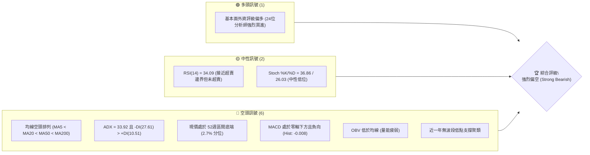
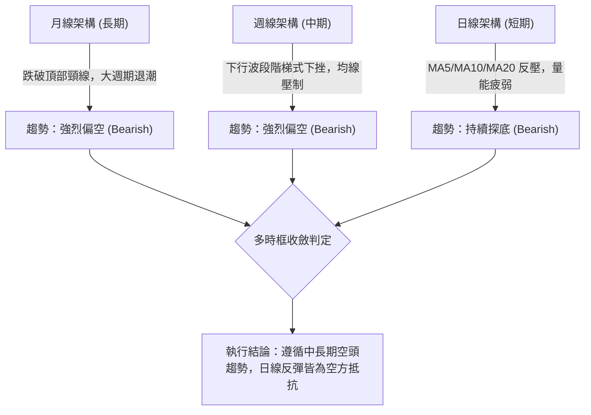
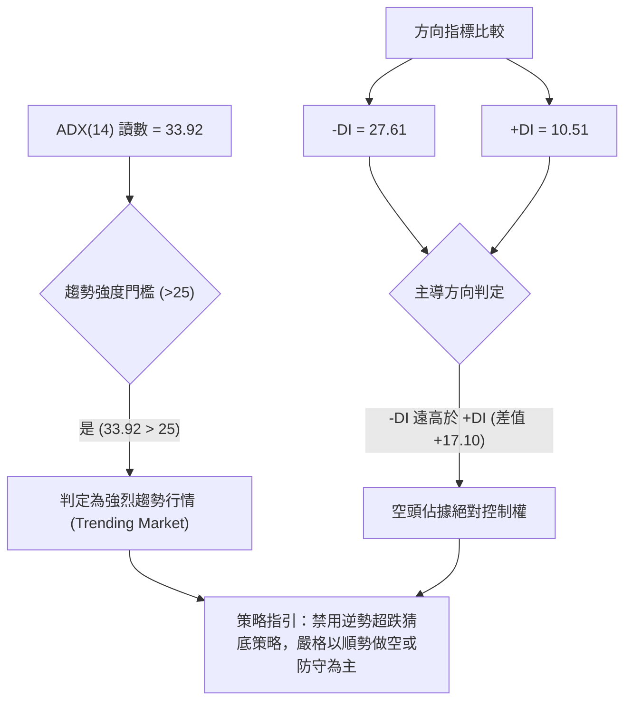
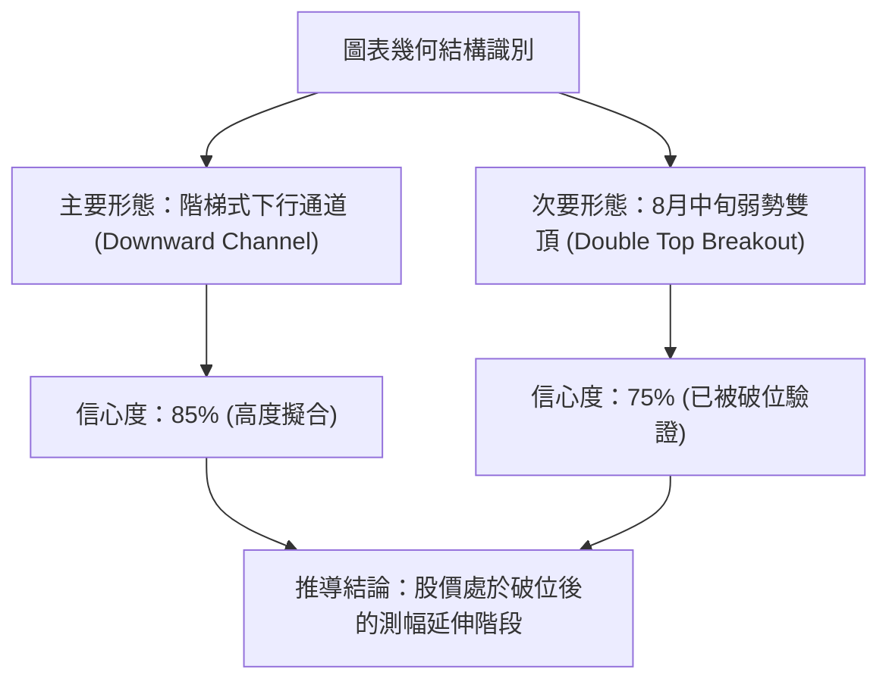
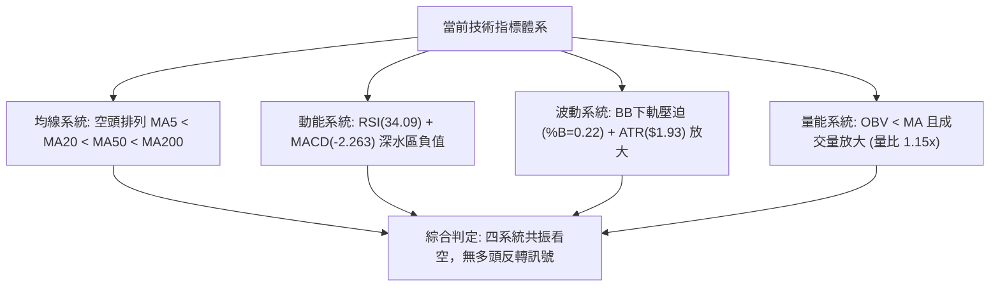
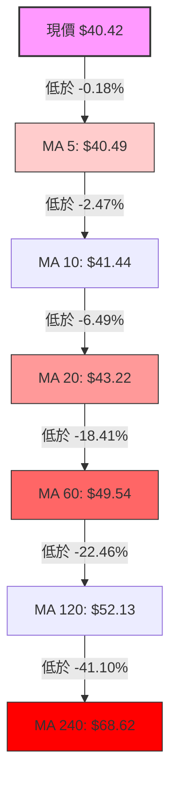
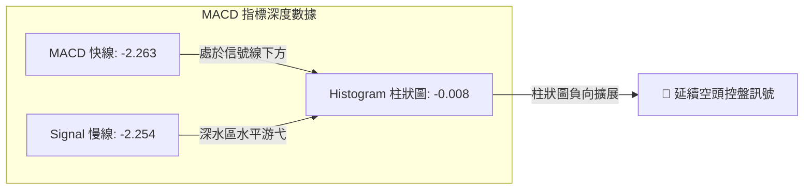
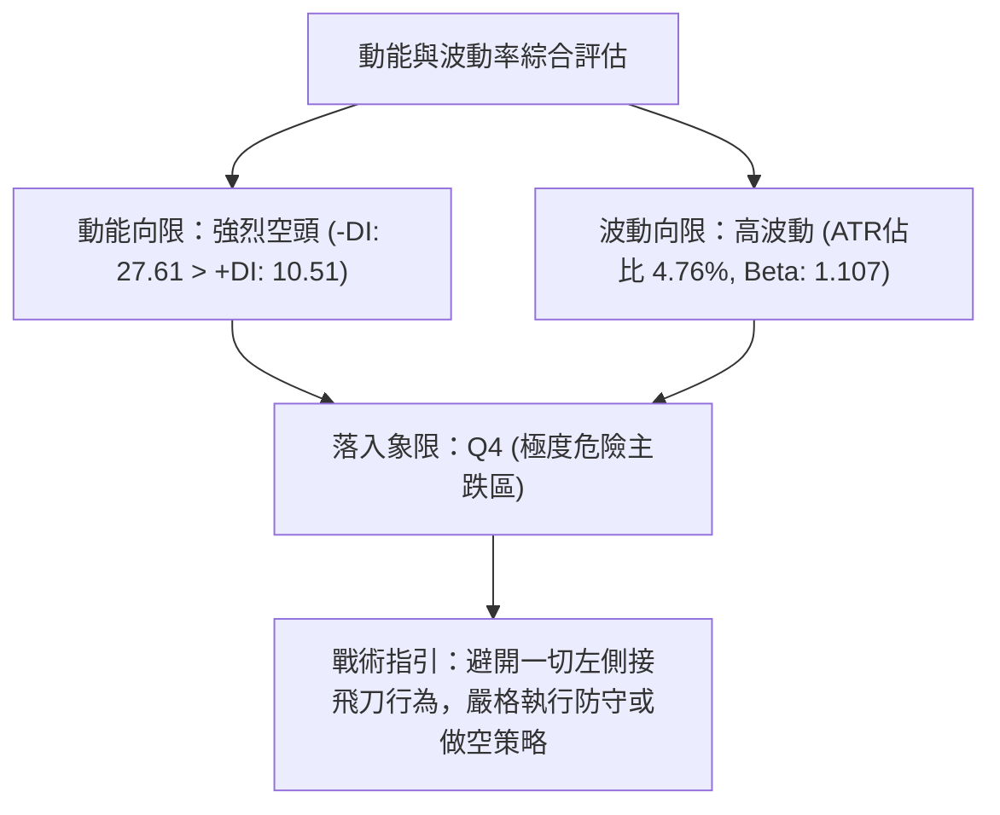
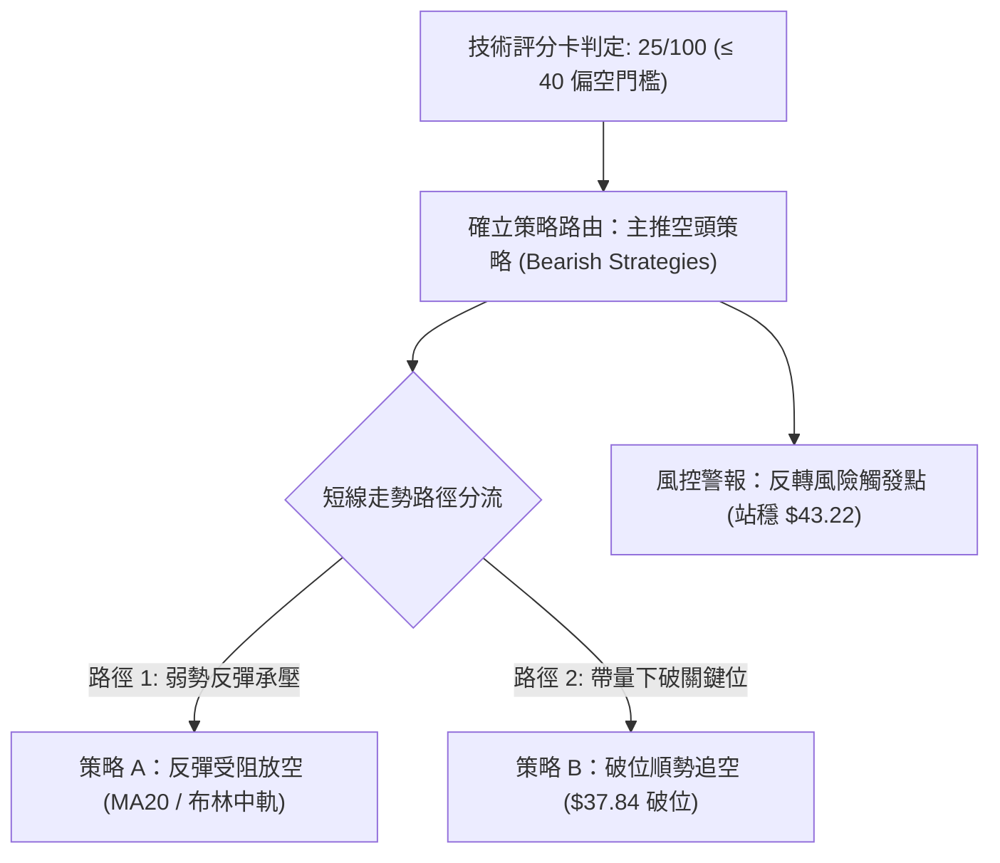
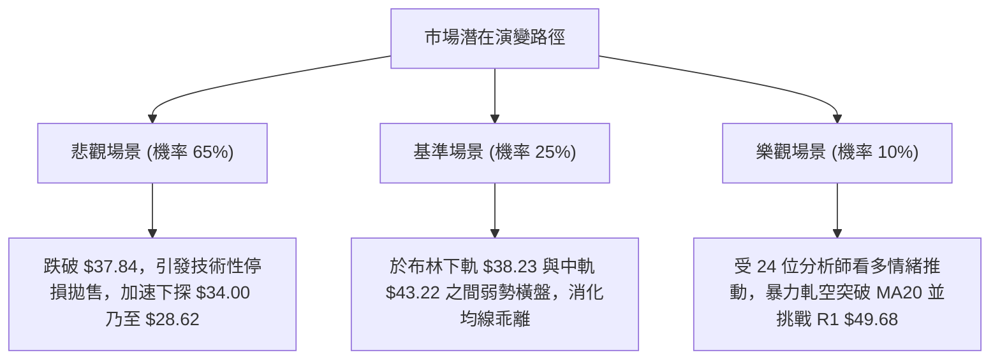

# KTOS 技術分析報告

> **報告日期**：2026-10-19 ｜ **語言**：繁體中文 ｜ **數據來源**：Yahoo Finance ｜ **當前價格**：$40.42

---

## 目錄

| 章節 | 內容 |
|------|------|
| [1. 技術面概覽](#1-技術面概覽) | 訊號儀表板、核心指標、評分卡 |
| [2. 趨勢分析](#2-趨勢分析) | 多時框趨勢、長中短期走勢 |
| [3. 圖表形態分析](#3-圖表形態分析) | 形態識別、K線組合、目標價 |
| [4. 支撐與阻力](#4-支撐與阻力) | 關鍵價位、斐波那契回調 |
| [5. 技術指標深度解讀](#5-技術指標深度解讀) | MA/RSI/MACD/布林/成交量 |
| [6. 動能與波動率](#6-動能與波動率) | 動能評估、ATR、Beta |
| [7. 多時框架總結](#7-多時框架總結) | 時框架評分矩陣 |
| [8. 交易策略建議](#8-交易策略建議) | 多空策略、風險報酬比 |
| [9. 風險提示與監控](#9-風險提示與監控) | 監控指標、風險場景 |
| [📋 報告總結](#-報告總結) | 總體結論與操作指引 |

---

## 1. 技術面概覽

### 🎯 技術訊號儀表板



### 📊 核心指標速覽表

| 指標類別 | 指標名稱 | 當前數值 | 訊號 | 解讀 |
|----------|----------|----------|------|------|
| **價格** | 當前價格 | $40.42 | 🔴 | 位於 52週區間 2.7% 分位，極度逼近 52週新低點 $37.84 |
| **均線** | MA20 | $43.22 | 🔴 | 價格低於 MA20 (-6.49%)，短期下行趨勢顯著 |
| **均線** | MA50 | $49.53 | 🔴 | 價格低於 MA50 (-18.39%)，中期趨勢完全被空方壓制 |
| **均線** | MA200 | $67.20 | 🔴 | 價格遠低於 MA200 (-39.85%)，長期牛熊分界線失守 |
| **動能** | RSI(14) | 34.09 | 🟡 | 位於弱勢中性區間 (30-70)，尚未出現指標超賣鈍化 |
| **動能** | MACD | -2.263 | 🔴 | MACD線與Signal線(-2.254)均處深水區，Histogram為-0.008 |
| **動能** | Stoch %K/%D | 36.86 / 26.03 | 🟡 | %K 上穿 %D 低檔反彈，但未脫離弱勢震盪格局 |
| **趨勢** | ADX(14) | 33.92 | 🔴 | ADX > 25 確立強趨勢，-DI(27.61) 遠高於 +DI(10.51) 彰顯空頭主導 |
| **通道** | 布林 %B | 0.22 | 🔴 | 價格運行於布林下軌($38.23)與中軌($43.22)之間，貼近下軌滑落 |
| **波動** | ATR(14) | $1.93 | 🔴 | 佔股價 4.76%，每日波動風險偏高，波幅放大加劇持倉風險 |
| **量能** | 量比 (Volume Ratio) | 1.15x | 🔴 | 成交量 5.51M 突破 20日均量 4.79M，呈放量下行態勢 |
| **量能** | OBV 趨勢 | OBV < MA | 🔴 | 能量潮低於其均線，主力資金持續處於淨流出階段 |

### 🏆 技術評分卡

```
╔══════════════════════════════════════════════════════════════╗
║                技術評分卡 — KTOS (2026-10-19)                ║
╠══════════════════════════════════════════════════════════════╣
║ 趨勢強度 (空頭)  ████████████████░░░░  80/100  🔴 強烈看空   ║
║ 動能指標        ██████░░░░░░░░░░░░░░  30/100  🔴 動能低迷   ║
║ 支撐穩定度      ████░░░░░░░░░░░░░░░░  20/100  🔴 無結構支撐 ║
║ 成交量配合      ████████░░░░░░░░░░░░  40/100  🟡 空頭放量   ║
║ 形態完整度      ██████████████░░░░░░  70/100  🔴 下行通道   ║
║ 均線排列        ██░░░░░░░░░░░░░░░░░░  10/100  🔴 完美空頭   ║
╠══════════════════════════════════════════════════════════════╣
║ 綜合評分        █████░░░░░░░░░░░░░░░  25/100  🔴 強烈偏空   ║
╚══════════════════════════════════════════════════════════════╝
```

---

## 2. 趨勢分析

### 🌐 多時框趨勢分析



### 📈 長期趨勢 — 12個月走勢圖（Unicode）

KTOS 在過去 12 個月經歷了從歷史高位快速崩落的宏觀下行週期。2026年1月股價見頂於 $103.01（盤中最高觸及 $134.00），隨後展開了連續 9 個月的猛烈下跌浪潮。

```
KTOS 月線走勢圖（過去12個月：2025-11 至 2026-10）
價格軸 ($)
$105 ┤               ● $103.01 (M3)
$100 ┤
$95  ┤
$90  ┤
$85  ┤                    ● $86.18 (M4)
$80  ┤
$75  ┤ ● $76.10  ● $75.91
$70  ┤ (M1)      (M2)          ● $70.51 (M5)
$65  ┤                              ● $63.05  ● $64.13
$60  ┤                              (M6)      (M7)
$55  ┤
$50  ┤                                             ● $49.86       ● $50.98
$45  ┤                                             (M8)   ● $46.60(M10)
$40  ┤                                                    (M9)         ● $42.69  ● $40.42 (現價)
$35  ┤                                                                 (M11)     (M12)
     └──────────────────────────────────────────────────────────────────────────
       25-11   25-12   26-01   26-02   26-03   26-04   26-05   26-06   26-07   26-08   26-09   26-10
        M1      M2      M3      M4      M5      M6      M7      M8      M9     M10     M11     M12
```

**走勢特徵分析表格**：

| 週期階段 | 起訖月份 | 收盤區間 | 漲跌幅 | 價量特徵與形態解讀 |
|----------|----------|----------|--------|--------------------|
| 衝頂出貨期 | 2025-11 ~ 2026-01 | $76.10 → $103.01 | +35.36% | 月線加速趕頂，於 $134.00 形成流星高點，成交量巨大且換手劇烈 |
| 破位加速期 | 2026-01 ~ 2026-04 | $103.01 → $63.05 | -38.79% | 連續三個月收長黑實體，失守 $85.92（50% 斐波那契回調位） |
| 中繼盤整期 | 2026-04 ~ 2026-05 | $63.05 → $64.13 | +1.71% | 於 $64 附近縮量構築弱勢中繼平台，未能站上 MA60 |
| 次級崩跌期 | 2026-05 ~ 2026-07 | $64.13 → $46.60 | -27.33% | 跌破 $58.42（78.6% 回調位），月成交量暴增至 45.38M，主力奪路拋售 |
| 弱勢抵抗期 | 2026-07 ~ 2026-08 | $46.60 → $50.98 | +9.40% | 8月中旬週線一度反彈至 $64.58，但受阻於下降均線，留下長上影線 |
| 尋底破位期 | 2026-08 ~ 2026-10 | $50.98 → $40.42 | -20.71% | 連續跌破各短期支撐，目前逼近 52週最低位 $37.84 |

### 📊 中期趨勢（週線分析）

從近 20 週的收盤軌跡觀察，中期結構呈現標準的「高點降低 (Lower Highs)、低點降低 (Lower Lows)」的空頭通道走勢：

```
中期週線下行壓力軌道示意：
$65.00 ┤              ▲ 2026-08-16 高點 $64.58 (被下降趨勢線精準壓制)
$60.00 ┤             / \
$55.00 ┤   ▲        /   \
$50.00 ┤  / \      /     \       ▲ R1: $49.68 / R2: $51.49 / R3: $54.22
$45.00 ┤ /   \    /       \     / \
$40.00 ┤/     ▼--▼         ▼---▼   ● 現價 $40.42 (逼近 52W 低點 $37.84)
$35.00 ┤_____________________________ 支撐線：$37.84 (100.0% 斐波那契)
       └──────────────────────────────────────────────────────────
        06-07  07-05   08-16  09-06   10-18 (週別)
```

- **高點下移**：由 06-07 的 $58.52，反彈至 08-16 的 $64.58，隨後在 09-20 僅微彈至 $47.46，高點呈現壓制性遞減。
- **低點破位**：06-28 創下 $47.21 低點（伴隨 45.38M 天量），07-19 跌至 $46.03，至 10-18 當週收於 $40.42，持續刷新下行邊界。

### ⚡ 趨勢強度評估（ADX 解讀）



| 指標 | 數值 | 參考標準 | 解讀結論 |
|------|------|----------|----------|
| **ADX(14)** | **33.92** | > 25 強趨勢；> 30 極強趨勢 | 市場處於極度明朗的單邊趨勢行情，波動並非無序震盪 |
| **-DI** | **27.61** | 數值越高空方動能越強 | 空方力量全面主導盤面結構 |
| **+DI** | **10.51** | 數值低於 15 代表多方衰竭 | 多方力量幾無組織性抵抗 |
| **ADX 趨向** | 上揚中 | ADX 伴隨價格破位而抬頭 | 預示下行趨勢正在進一步強化，尚未出現趨勢竭盡信號 |

---

## 3. 圖表形態分析

### 🔍 形態識別系統



**形態信心度與目標價評估表**：

| 形態類別 | 信心度 | 判斷依據（引用數據） | 完成度 | 目標價（附嚴謹計算式） |
|----------|--------|----------------------|--------|------------------------|
| **下行通道 (Downward Channel)** | **85%** | 上軌由 08-16 高點 $64.58 與 09-20 高點 $47.46 連接；下軌對齊 06-28 $47.21 與現價 $40.42 | 90% | 通道下軌下探目標：$37.84（數據源中之 52週低點 / 100% 斐波那契位） |
| **雙重頂形態 (Double Top)** | **75%** | 08-09 收盤 $60.77 與 08-16 收盤 $64.58 構成頂部區間（頸線為 08-02 收盤 $46.60） | 100% | 依頸線 $46.60 減去頭部高度 ($64.58 - $46.60 = $17.98)，推算理論極限目標：$46.60 - $17.98 = $28.62（註：下方第一客觀支撐先看 $37.84） |
| **頭肩底 / 雙底形態** | **0%** | 近期無任何波段低點抬高（Higher Lows）聚類 | 0% | **數據不足，未偵測到任何底部結構反轉信號** |

### 🕯️ 重要K線形態分析

| 週別 / 日期 | 收盤價 | K線形態名稱 | 技術特徵解讀 | 訊號 |
|-------------|--------|-------------|--------------|------|
| **2026-08-16** | $64.58 | **長上影倒轉錘頭線** | 測試 MA60 及波段壓力，量能未能延續（19.03M 較前週萎縮），主力拉高出貨 | 🔴 |
| **2026-08-30** | $52.00 | **長黑貫穿線 (Bearish Marubozu)** | 一舉吞噬前兩週整理區間，RSI 驟降至 25.0，MACD 柱狀圖由正翻負 (-1.211) | 🔴 |
| **2026-09-06** | $47.82 | **跳空低走大陰線** | 成交量 16.65M，RSI 下挫至極端低點 11.7，確立中期空頭新一輪主跌段 | 🔴 |
| **2026-09-27** | $45.62 | **墓碑十字線 (Gravestone Doji)** | 週內多次向上試探 $47 均遭空方重挫壓回，長上影線預示反彈力竭 | 🔴 |
| **2026-10-18** | $40.42 | **光腳陰線 (Closing Marubozu)** | 本週以最低價區域收盤，無下影線支撐，伴隨 24.47M 穩定放量，賣壓沉重 | 🔴 |

### 📉 ASCII 走勢形態示意圖

```
KTOS 週線等級雙頂破位與通道延展圖：
$65.00 ┤            頂1: $60.77  頂2: $64.58 (08-16)
$60.00 ┤               ╭───╮     ╭───╮
$55.00 ┤───────────────╯   ╰─────╯   ╰────────────────────────────── 下行通道上軌壓制線
$50.00 ┤                                  ╲
$46.60 ┤================ 頸線位置 ($46.60) =========================
$45.00 ┤                                     ╲      ╭─╮ (09-20 假反彈 $47.46)
$43.22 ┤--------------------------------------╲-----│-│----- 短期 MA20 / BB中軌
$40.42 ┤                                       ╲    │ ╰── 現價 $40.42 (光腳收陰)
$37.84 ┤_________________________________________╲__│______ 關鍵支撐線：$37.84 (52W Low)
       └────────────────────────────────────────────────────────
        2026-07          2026-08               2026-09        2026-10
```

### 🎯 形態目標價計算

1. **通道破位測幅**：
   - 通道震盪上軌為 $49.68（阻力位 R1），中軌 MA20 位於 $43.22。現價 $40.42 脫離中軌向通道下緣尋找支撐。
   - 第一目標價指向 52週最低點 **$37.84**。
2. **雙重頂測幅滿足點**：
   - 形態頸線：$46.60
   - 形態高點：$64.58
   - 形態垂直高度：$64.58 - $46.60 = $17.98
   - 形態理論目標價 = 頸線 - 形態高度 = $46.60 - $17.98 = **$28.62**（若 $37.84 實質跌破後的長期測幅位）。

---

## 4. 支撐與阻力

### 🗺️ 關鍵價位分布圖（Unicode）

```
KTOS 價位結構分布圖（依 OHLCV 與斐波那契回調精確標記）
══════════════════════════════════════════════════════════════════
$134.00 ║██████████████████████████████║ 52W 最高點 (0.0% 斐波那契)
$111.31 ║████████████████████████      ║ 23.6% 斐波那契回調位
$97.27  ║████████████████████          ║ 38.2% 斐波那契回調位
$85.92  ║██████████████████            ║ 50.0% 斐波那契回調位
$74.57  ║████████████████              ║ 61.8% 斐波那契回調位
$67.20  ║██████████████                ║ 長期牛熊線 MA200
$58.42  ║████████████                  ║ 78.6% 斐波那契回調位
$54.22  ║██████████                    ║ 強波段阻力 R3
$51.49  ║████████                      ║ 中期波段阻力 R2
$49.68  ║██████                        ║ 近期關鍵阻力 R1 (MA50: $49.53)
$43.22  ║████                          ║ 短期動態反壓 BB中軌 / MA20
$40.42  ╠══════════════════════════════╣ ◄ 當前市價 ($40.42)
$38.23  ║▓▓▓▓▓                         ║ 布林帶下軌動態支撐
$37.84  ║██████████████████████████████║ 關鍵絕對支撐 52W Low (100.0% 斐波那契)
(下方)  ║░░░░░░░░░░░░░░░░░░░░░░░░░░░░░░║ 近一年波段低點聚類：無任何結構支撐
══════════════════════════════════════════════════════════════════
```

### 🚧 阻力位分析表

阻力位嚴格引用技術數據聚類與均線反壓：

| 阻力級別 | 價位 | 形成原因 | 突破難度 | 重要性 |
|----------|------|----------|----------|--------|
| **短期動態** | **$43.22** | 20日均線 (MA20) 與布林通道中軌共振，短線空方防守線 | 🟡 中等 | 短期止跌回穩的最低門檻 |
| **R1** | **$49.68** | 近一年波段高點聚類位，且高度貼合 MA50 ($49.53) 與 MA60 ($49.54) | 🔴 極高 | 中期轉向關鍵分水嶺，空頭核心堡壘 |
| **R2** | **$51.49** | 近一年波段次高密集聚類區，接近 120日均線 ($52.13) | 🔴 極高 | 中期空頭陷阱回補壓力帶 |
| **R3** | **$54.22** | 2026年6月中旬反彈平台高點聚類 | 🔴 堅不可摧 | 多空長期牛熊防線，未站上前維持大空頭 |

### 🛡️ 支撐位分析表

數據明確顯示：`支撐位 (Support) — (no swing-low support detected below current price)`。因此現價下方僅剩指標動態與歷史極值支撐：

| 支撐級別 | 價位 | 形成原因 | 守住機率 | 重要性 |
|----------|------|----------|----------|--------|
| **動態支撐** | **$38.23** | 布林通道下軌動態包絡線，跌破將引發通道外超賣開口 | 45% | 短線日內減速器，跌破引發空頭加速 |
| **S1 (唯一)** | **$37.84** | 52週絕對最低價 (52W Low) 及 100.0% 斐波那契回調位 | 35% | 多方最後一道心理防線，失守將直墜真空層 |
| **次級支撐** | **無** | **數據中未偵測到現價下方近一年任何波段低點聚類** | 0% | 一旦跌破 $37.84，下方將進入長線技術真空期 |

### 📐 斐波那契回調位分析

依據 52週區間 $37.84 → $134.00 精確計算之斐波那契回調結構如下：

- **0.0% (52W High)**：$134.00
- **23.6%**：$111.31
- **38.2%**：$97.27
- **50.0%**：$85.92
- **61.8%**：$74.57（黃金分割破位點，長期結構性走熊點）
- **78.6%**：$58.42（深幅回撤臨界點，於 2026年6月跌破）
- **100.0% (52W Low)**：$37.84

**現價區間解讀**：
當前價格 **$40.42** 正好運行於 **78.6% 回調位 ($58.42)** 與 **100.0% 回調位 ($37.84)** 之間，且極度貼近 $37.84（距低點僅剩 **$2.58** 或 **-6.38%** 空間）。
從斐波那契原理分析，當價格跌破 78.6% 極限回調位後，通常意味著先前的上漲浪潮已被 100% 完全回吐。目前價格跌向 100% 位置尋求雙底或跌破，是極端弱勢的熊市表現。

---

## 5. 技術指標深度解讀

### 🎛️ 指標訊號總覽



### 📈 移動平均線排列分析



均線系統呈現教科書式的**完全標準空頭排列 (Perfect Bearish Alignment)**。從極短期的 MA5 至超長期的 MA240，每一條均線皆呈現負斜率下彎走勢。
- 短期反壓 MA20 位於 **$43.22**，已連續壓制價格達 8 週之久。
- 中期反壓 MA50 ($49.53) 與 MA60 ($49.54) 形成極強的雙重均線天花板。
- 偏離度分析：現價遠離年線 MA240 達 **-41.10%**，雖然呈現一定程度的負向乖離，但在 ADX 強趨勢背景下，均線將持續發揮強大的動態向下牽引力。

### 📉 RSI(14) 分析

進度條展示：
```
RSI(14) 讀數：34.09  [ 弱勢區間 ]
0  ░░░░░░░░░░ 30 [████░░░░░░░░░░░░░░░░░░░░░░░░░░] 70 ░░░░░░░░░░ 100
當前水準：34.09% (位於 30 超賣線上方臨界點)
```

- **區間解讀**：RSI 讀數為 34.09，處於 30 至 70 之間。雖然數值偏低，但**尚未進入 30 以下的超賣鈍化區**，意味著空頭拋壓仍有釋放空間，並未引發技術性被動買盤。
- **背離判斷**：
  - 價格由 2026-09-20 的 $47.46 連續下挫至當前的 $40.42，呈現不斷創新低的態勢。
  - 週線 RSI 由 23.0 略微回升至 34.1，但在日線級別上，RSI 走勢與價格走勢同步向下方延伸，數據明確指出：`RSI 背離: 無明顯背離`。
  - **結論**：指標如實反映價格下跌動能，不存在底背離反轉條件。

### 📊 MACD(12/26/9) 訊號解讀



- **絕對值分析**：MACD 快線 (-2.263) 與 Signal 線 (-2.254) 均處於遠低於零軸的深海區，表明中長線動能完全由空頭鎖定。
- **交叉狀態**：快線向下貫穿慢線，Histogram 為 **-0.008**，呈現負向綠柱。雖然數值細微，但表明多頭在過去一週的微弱抵抗已被再次瓦解，空方動能重啟主導權。
- **背離分析**：MACD 快慢線並未出現向上抬升的底部背離特徵，與日線價格破位呈現一致性，確認空頭趨勢強烈。

### 📦 布林通道分析

```
布林通道當前運行結構示意：
$48.22 ┤-------------------------------------- BB 上軌 ($48.22)
$45.00 ┤
$43.22 ┤-------------------------------------- BB 中軌 / MA20 ($43.22)
$41.00 ┤           現價 $40.42 (BB %B = 0.22)
$40.42 ┤            ▼
$38.23 ┤====================================== BB 下軌 ($38.23)
       └──────────────────────────────────────────────────────────
```

- **通道參數**：上軌 **$48.22**，中軌 **$43.22**，下軌 **$38.23**，通道帶寬為 $9.99。
- **當前位置 (%B)**：%B 為 **0.22**，表示價格位於中軌至下軌空間的 22% 分位，呈現明顯的弱勢貼軌走勢（Riding the lower band）。
- **帶寬趨向**：布林通道在經歷前期的震盪後，下軌呈現開口向下擴張姿態，顯示價格向下尋求波動率釋放，若帶量跌破下軌 $38.23，將加速引發通道下軌單邊暴跌行情。

### 💹 成交量分析（量價配合度）

- **量比與均量對比**：最新單日成交量為 **5,511,100 股**，相較於 20日均量 **4,787,280 股**，量比達到 **1.15x**；相較於 50日均量 **4,008,296 股** 則顯著放大 37.5%。
- **量價配合判定**：在價格跌向 52週新低區間的過程中，成交量高於 20日與 50日均線，屬於標準的**「放量下挫」**，顯示機構拋盤持續涌出，並非無量空跌。
- **能量潮 OBV 解讀**：數據指示 `OBV < MA → 量能疲弱`。OBV 能量潮持續運行於其均線下方，且 slope 保持負值，證明籌碼正在由大戶向散戶發散，資金淨流出格局未變。

---

## 6. 動能與波動率

### ⚡ 動能評估四象限

| 象限代號 | 動能特徵 | 波動率特徵 | 當前狀態匹配 | 市場環境與操作評估 |
|----------|----------|------------|--------------|--------------------|
| **Q1 (最佳機會區)** | 強動能 (多頭) | 低波動 | ❌ | 多頭趨勢穩健推進，適合持股待漲 |
| **Q2 (謹慎觀望區)** | 弱動能 (無方向) | 低波動 | ❌ | 窄幅橫盤築底期，適合區間高拋低吸 |
| **Q3 (高風險博弈區)** | 強動能 (多頭) | 高波動 | ❌ | 主升浪或主力出貨期，適合短線突破追逐 |
| **Q4 (極度危險區)** | **強動能 (空頭)** | **高波動** | **✔ 符合當前狀態** | **ADX=33.92 (空頭強趨勢)，ATR=4.76% (高波動)，股價尋底放量，禁止抄底** |



### 📊 ATR 波動率分析

- **ATR(14) 絕對值**：**$1.93**
- **波動佔比**：ATR 佔當前價格 $40.42 的比例高達 **4.76%**。這意味著在正常的單日交易中，KTOS 的平均震幅接近 $2.00。
- **風控止損測算**：
  - **保守交易者 (1.5x ATR)**：保護性止損間距為 $1.93 × 1.5 = **$2.90**。
  - **進取交易者 (1.0x ATR)**：止損間距為 $1.93 × 1.0 = **$1.93**。
  - **應用於做空交易**：若以現價 $40.42 建立空單，上方止損位應設於 $40.42 + $2.80 = **$43.22**（恰好與 MA20/布林中軌完美重合）。

### 📐 Beta 與市場相關性

- **Beta 係數**：**1.107**
- **市場特徵解讀**：KTOS 的系統性風險略高於標普500大盤（Beta > 1.0）。當宏觀市場走弱或國防板塊調整時，該股將呈現出約 1.11 倍的槓桿式下跌效應。
- **籌碼結構補充**：機構持股比例高達 **85.6%**，內部人持股僅 1.3%，做空比例 (Short % Float) 為 **6.0%**，Short Ratio 2.46。雖然 24 位分析師給予 Strong Buy 評級，但機構高持股搭配放量下跌，顯示機構內部出現嚴重的調倉分歧，多頭籌碼正在鬆動。

---

## 7. 多時框架總結

### 📋 時框架評分表

| 時框架 | 趨勢方向 | 動能狀態 | 均線排列 | 圖表形態 | 綜合評分 | 戰術建議 |
|--------|----------|----------|----------|----------|----------|----------|
| **長期 (月線)** | 🔴 強烈看空 | 🔴 深水下行 | 🔴 MA240反壓 | 雙頂大週期破位 | **20/100** | 戰略減倉，多頭離場觀望 |
| **中期 (週線)** | 🔴 強烈看空 | 🔴 空方主導 | 🔴 跌破MA50/60 | 下行通道延伸中 | **25/100** | 逢反彈至阻力位建立空單 |
| **短期 (日線)** | 🔴 弱勢探底 | 🟡 接近超賣 | 🔴 MA5/10/20下壓 | 逼近前低無支撐 | **30/100** | 嚴禁逆勢抄底，等待破位 |

### 🔲 綜合訊號矩陣

```
╔══════════════════════════════════════════════════════════════════╗
║               KTOS 多時框架技術共振矩陣 (2026-10-19)            ║
╠═════════════╦══════════════╦══════════════╦══════════════════════╣
║ 分析維度    ║ 短期 (日線)  ║ 中期 (週線)  ║ 長期 (月線)          ║
╠═════════════╬══════════════╬══════════════╬══════════════════════╣
║ 趨勢方向    ║ 🔴 下跌尋底  ║ 🔴 階梯走低  ║ 🔴 宏觀退潮          ║
║ 均線系統    ║ 🔴 空頭排列  ║ 🔴 完美壓制  ║ 🔴 遠低於 MA240      ║
║ 動能指標    ║ 🟡 RSI 34.09 ║ 🔴 MACD 負值 ║ 🔴 動能深度衰退      ║
║ 量價關係    ║ 🔴 放量走低  ║ 🔴 OBV 破線  ║ 🔴 換手出貨          ║
║ 波動狀態    ║ 🔴 ATR 放大  ║ 🔴 通道擴口  ║ 🔴 極度下傾          ║
╠═════════════╩══════════════╩══════════════╩══════════════════════╣
║ 時框收斂性  ║ 🔴 高度一致性共振偏空 (High Bearish Confluence)     ║
╚══════════════════════════════════════════════════════════════════╝
```

### ⚖️ 多時框收斂結論

依據多時框收斂規則第 14 條：
1. **行情性質判定**：當前 ADX(14) 讀數為 **33.92**，遠高於 25 的趨勢分界線，行情明確歸類為**「趨勢行情 (Trending Market)」**，而非盤整行情。
2. **時框優先級收斂**：在趨勢行情下，嚴格以中長期（週線、MA50 $49.53、MA200 $67.20）方向為主導，日線僅作為順勢尋找進場時機的工具。中長期均線與形態全面偏空，日線無任何反轉形態。
3. **方向性結論**：
   **唯一方向性結論：強烈偏空 (Strong Bearish)**。
   此結論與第 1 章綜合評分 (25/100)、第 2 章多時框趨勢完全一致。主策略確立為**空頭順勢策略**，多頭策略僅作為短線極端超賣的反抽對沖參考。

---

## 8. 交易策略建議

### 🗺️ 策略決策流程圖



### 🧭 策略路由

**當前主策略方向 = 空頭策略 (依綜合評分 25/100 確立，全面看空)**

### 🎯 價格情境階梯（Price Scenarios）

價位嚴格引用關鍵價位聚類與斐波那契回調位：

| 觸發條件 | 下一目標 | 後續延伸 | 情境含義 |
|----------|----------|----------|----------|
| **向上反彈突破 R1 $49.68** | R2 $51.49 | R3 $54.22 | 中期空頭遭遇強力抵抗，日線架構短暫修復 |
| **弱勢反抽 MA20 $43.22** | R1 $49.68 | — | 正常技術性回抽，空頭中繼結構不變 |
| **維持於現價 $40.42 震盪** | $38.23 (BB下軌) | $37.84 (52W Low) | 空方蓄勢，下軌壓迫尋底 |
| **跌破 S1 $37.84 (52W Low)** | 理論測幅 $28.62 | 技術真空層 | 52週低點失守，引發多頭止損潮與加速下行 |

### 📊 情境機率分佈

| 情境類別 | 機率估算 | 主要指標依據 |
|----------|----------|--------------|
| **下探尋底 / 破位新低** | **65%** | ADX=33.92 (強趨勢)、-DI=27.61 (空頭控盤)、均線完美空頭排列、現價位於52W區間2.7%極度弱勢 |
| **區間弱勢震盪 ($38.23~$43.22)** | **25%** | RSI=34.09 接近超賣區可能出現短線降速、布林下軌 $38.23 具備日內暫時支撐效應 |
| **大幅向上反彈 (> $49.68)** | **10%** | 24位分析師給予 Strong Buy 目標價 $98.33 的基本面背書，可能引發消息面突發脈衝，但技術面極度受阻 |

### 🟢 主策略詳情（空頭進場規劃）

所有點位嚴格依據 ATR($1.93)、MA20($43.22)、R1($49.68) 及 52W Low($37.84) 精確計算：

| 策略要素 | 策略 A (反彈受阻高空 - 穩健型) | 策略 B (破位順勢追空 - 突破型) |
|----------|--------------------------------|--------------------------------|
| **進場條件** | 價格反彈至 MA20 附近出現上影線受阻確認 | 價格實質帶量跌破 52週最低點 $37.84 |
| **進場價格** | **$43.22** (MA20 / 布林中軌反壓點) | **$37.50** (確認跌破 $37.84 關鍵支撐後) |
| **目標價 T1** | **$37.84** (52週最低點支撐測試) | **$34.00** (依 $37.84 減 2x ATR $3.86 測算) |
| **目標價 T2** | **$28.62** (雙重頂形態理論推算目標) | **$28.62** (雙頂終極測幅滿足點) |
| **止損價格** | **$45.15** (進場價 + 1.0x ATR $1.93) | **$39.43** (進場價 + 1.0x ATR $1.93) |
| **風險報酬比** | **2.79 : 1** (風險 $1.93，獲利空間 $5.38) | **1.81 : 1** (風險 $1.93，獲利空間 $3.50) |
| **成功機率** | **70%** (順應中長期均線趨勢) | **65%** (順應破位動能) |
| **建議倉位** | **15%** (標準波段倉位) | **10%** (破位追單倉位) |

### 🔴 反向風險觸發點（對沖提示）

- **關鍵反轉點位**：若日線收盤價**強勢帶量站上 MA20 ($43.22)**，且 RSI(14) 向上突破 50，代表短期空頭趨勢衰竭，所有主動空單必須立即無條件止損出局。
- **波段多頭進場唯一條件**：價格必須有效突破並站穩 **R1 ($49.68)**，同時成交量突破 20日均量 1.5 倍以上，方可判定中期底部確立，屆時可翻多進場，上看 R2 ($51.49) 與 R3 ($54.22)。

### ⭐ 整體訊號強度評星

```
╔══════════════════════════════════════════════╗
║ 做多訊號強度：★☆☆☆☆  (1.0/5星 - 極弱，嚴禁盲目抄底) 
║ 做空訊號強度：★★★★☆  (4.5/5星 - 極強，趨勢結構完整) 
║ 整體可信度：  ★★★★☆  (4.0/5星 - 多指標高度共振)     
╚══════════════════════════════════════════════╝
```

---

## 9. 風險提示與監控

### ✅ 關鍵監控指標 Checklist

```
╔══════════════════════════════════════════════════════════════════╗
║               KTOS 每日盤面關鍵風控監控清單                      ║
╠══════════════════════════════════════════════════════════════════╣
║ [ ] 監控 $37.84 (52W Low)：盤中跌破是否伴隨量能突破 5M 股       ║
║ [ ] 監控 MA20 動態位 ($43.22)：反彈是否形成精確長上影受阻       ║
║ [ ] 監控 ADX 走勢：ADX(33.92) 若持續攀升，意味單邊跌勢加速      ║
║ [ ] 監控 RSI 底背離：若跌破 $37.84 時 RSI > 30，需警惕技術反抽   ║
║ [ ] 監控 布林下軌 ($38.23)：開口角度是否進一步垂直向下擴張      ║
║ [ ] 監控 OBV 能量潮：是否出現主力資金低位承接之反轉向上拐點     ║
╚══════════════════════════════════════════════════════════════════╝
```

### ⚠️ 風險場景分析



### 🛡️ 風險管理重要提醒

1. **基本面與技術面嚴重背離風險**：
   目前華爾街 24 位分析師給予 Strong Buy 評級，平均目標價高達 $98.33（最高 $150.00），近期 Macquarie、Goldman Sachs 均重申買進。然而技術面卻呈現標準的大空頭破位排列。**在技術分析紀律中，「價格反映一切」**，切勿因分析師目標價而逆勢硬接下墜之飛刀，必須尊重市場盤面資金的真實流向。
2. **波動率與資金管理**：
   KTOS 當前 ATR 高達 4.76%，屬於高波動性資產。在持倉管理上，任何單筆空頭交易的風險敞口（止損金額）不得超過投資組合總淨值的 **1.0%**。單一策略倉位上限嚴格控制在 **10% ~ 15%** 以內。
3. **52週低點防禦真空**：
   數據明確警告現價下方無任何波段低點聚類支撐。若跌破 $37.84，盤面將不存在任何可供參考的密集成交區，極易出現流動性真空引發的閃崩式下跌，務必設置嚴格的硬性止損單（Stop-Loss Orders）。

---

## 📋 報告總結

```
╔══════════════════════════════════════════════════════════════════╗
║                    KTOS 技術分析報告總結                         ║
╠══════════════════════════════════════════════════════════════════╣
║ 報告日期：2026-10-19                                             ║
║ 當前價格：$40.42                                                 ║
║ 分析評級：🔴 強烈偏空 / 逢高做空 (Strong Bearish / Sell on Rally) ║
╠══════════════════════════════════════════════════════════════════╣
║ 關鍵結論：                                                       ║
║ ├─ 長期趨勢：🔴 跌破大週期頸線，處於 $134.00 見頂後的去泡沫退潮  ║
║ ├─ 中期趨勢：🔴 處於完整下行通道，週線高點與低點階梯式下移      ║
║ ├─ 短期趨勢：🔴 均線完全空頭排列，現價運行於 52週區間 2.7% 低位 ║
║ ├─ 關鍵支撐：$38.23 (布林下軌)、$37.84 (52W Low / 100% 斐波)    ║
║ ├─ 關鍵阻力：$43.22 (MA20 反壓)、$49.68 (近一年密集阻力位 R1)   ║
║ └─ 分析師目標：$98.33 (與技術面嚴重割裂，警惕機構籌碼鬆動)      ║
╠══════════════════════════════════════════════════════════════════╣
║ 最優策略組合：                                                   ║
║ 1. 🥇 最佳機會：策略 A (反彈高空) — 於 $43.22 放空，止損 $45.15   ║
║                  第一目標 $37.84，終極目標 $28.62 (風報比 2.79:1)║
║ 2. 🥈 次選機會：策略 B (破位追空) — 跌破 $37.84 後順勢空至 $34.00 ║
║ 3. 🥉 保守選擇：多頭全面空倉觀望，嚴禁左側抄底，靜待築底形態確認 ║
╚══════════════════════════════════════════════════════════════════╝
```

---

> ⚠️ **免責聲明**：本報告為技術分析研究，所有數據及估算均嚴格基於歷史量價與技術指標公式計算。本報告**僅供研究與學術參考**，**不構成任何要約、招攬或投資建議**。市場有風險，交易需嚴格執行停損紀律。

---

*報告生成時間：2026-10-19 ｜ 數據來源：Yahoo Finance ｜ 分析框架：多時框技術分析體系*