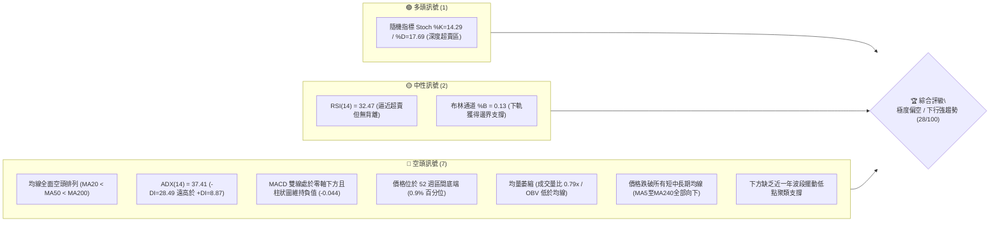
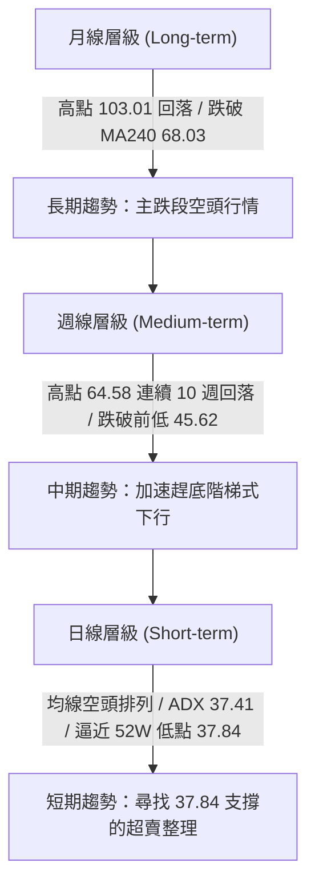
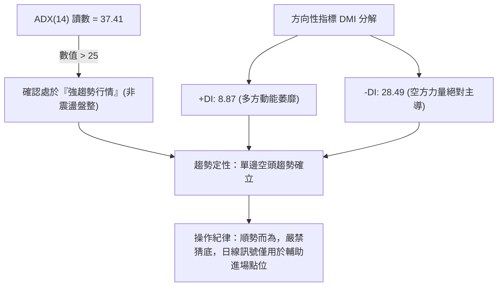
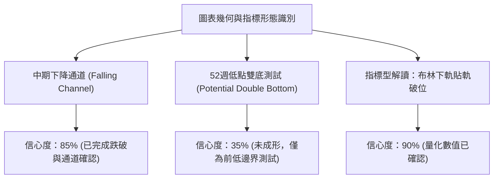
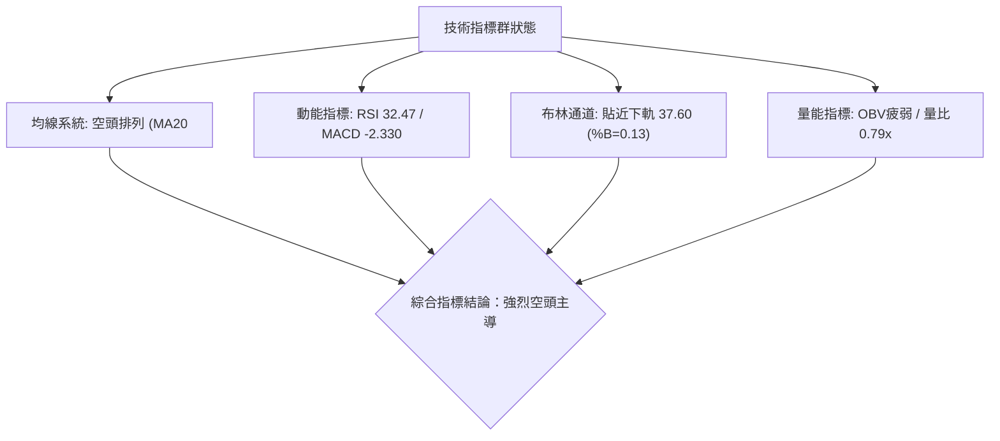
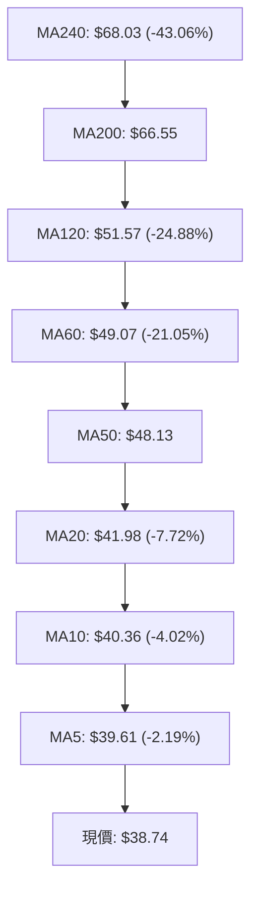
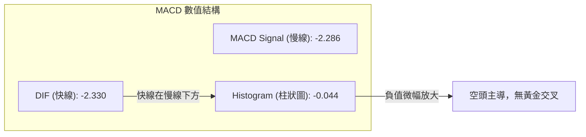
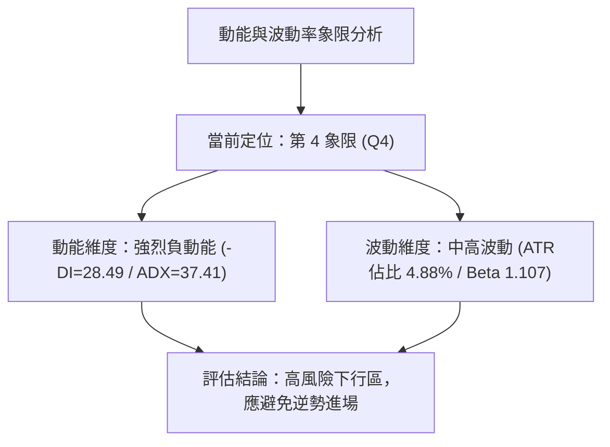
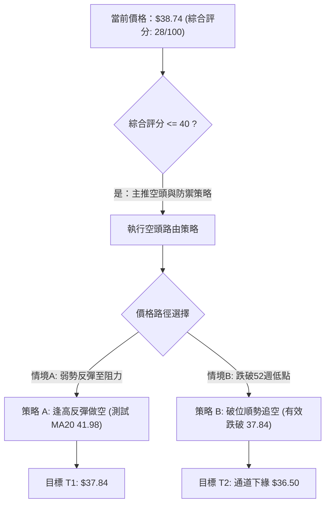
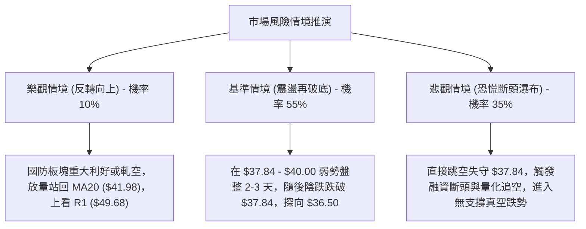

# KTOS 技術分析報告

> **報告日期**：2026-10-22 ｜ **語言**：繁體中文 ｜ **數據來源**：Yahoo Finance ｜ **當前價格**：$38.74

---

## 目錄

| 章節 | 內容 |
|------|------|
| [1. 技術面概覽](#1-技術面概覽) | 訊號儀表板、核心指標、評分卡 |
| [2. 趨勢分析](#2-趨勢分析) | 多時框趨勢、長中短期走勢、ADX強度 |
| [3. 圖表形態分析](#3-圖表形態分析) | 形態識別、K線組合、信心度評估 |
| [4. 支撐與阻力](#4-支撐與阻力) | 關鍵價位、斐波那契回調結構 |
| [5. 技術指標深度解讀](#5-技術指標深度解讀) | 均線系統、RSI、MACD、布林通道、量價 |
| [6. 動能與波動率](#6-動能與波動率) | 動能四象限、ATR風控、Beta特徵 |
| [7. 多時框架總結](#7-多時框架總結) | 時框架矩陣、趨勢收斂規則驗證 |
| [8. 交易策略建議](#8-交易策略建議) | 策略路由、階梯情境、交易計劃 |
| [9. 風險提示與監控](#9-風險提示與監控) | 監控清單、情境推演、風控紀律 |

---

## 1. 技術面概覽

### 🎯 技術訊號儀表板



### 📊 核心指標速覽表

| 指標類別 | 指標名稱 | 當前數值 | 訊號 | 解讀 |
|:---|:---|:---|:---:|:---|
| **價格結構** | 現價 vs 52W 高低 | $38.74 ($37.84 - $134.00) | 🔴 | 位於全年度價格區間底端 0.9% 位置，逼近年度低點 |
| **短期均線** | MA20 (月線) | $41.98 | 🔴 | 價格低於 MA20 達 -7.72%，斜率持續向下壓制 |
| **中期均線** | MA50 (季線) | $48.13 | 🔴 | 中期空頭防線，與現價負乖離達 -19.51% |
| **長期均線** | MA200 (年線) | $66.55 | 🔴 | 長期空頭格局，MA20 < MA50 < MA200 形成完美空頭排列 |
| **動能指標** | RSI(14) | 32.47 | 🟡 | 弱勢偏空，位於 30-40 弱勢整理區間，無明顯底背離 |
| **趨勢動能** | MACD (12,26,9) | 差離: -2.330 / 訊號: -2.286 | 🔴 | 雙線深陷零軸下，柱狀圖 -0.044，空方動能主導 |
| **擺動指標** | Stochastic %K/%D | %K: 14.29 / %D: 17.69 | 🟢 | 進入 20 以下超賣區，存在技術性弱反彈需求 |
| **趨勢強度** | ADX(14) / DMI | ADX: 37.41 (+DI: 8.87 / -DI: 28.49) | 🔴 | ADX > 25 且 -DI 絕對主導，確認為強勁單邊下跌趨勢 |
| **通道指標** | 布林通道 (20,2) | 帶寬: $37.60 - $46.36 (%B: 0.13) | 🟡 | 現價緊貼下軌運行，通道開口放大，呈現空頭下軌推升走勢 |
| **量能指標** | 成交量 / OBV | 3.67M (20日均量 4.65M / 量比 0.79x) | 🔴 | 量縮陰跌，OBV < MA，反彈無買盤跟進 |
| **波動指標** | ATR(14) | $1.89 (佔現價 4.88%) | 🟡 | 每日平均波動幅度約 $1.89，風控止損需預留充足空間 |

### 🏆 技術評分卡

```
╔══════════════════════════════════════════════════════════════════╗
║                   技術評分卡 — KTOS (2026-10-22)                 ║
╠══════════════════════════════════════════════════════════════════╣
║ 趨勢強度 (Trend)       ████████████████░░░░  80/100  🔴 (空頭強趨勢) ║
║ 動能指標 (Momentum)    █████░░░░░░░░░░░░░░░  25/100  🔴 (空方壓制)   ║
║ 支撐穩定度 (Support)   ████░░░░░░░░░░░░░░░░  20/100  🔴 (破底邊緣)   ║
║ 成交量配合 (Volume)    ██████░░░░░░░░░░░░░░  30/100  🔴 (量價背離)   ║
║ 形態完整度 (Pattern)   ████████░░░░░░░░░░░░  40/100  🟡 (下降通道中) ║
║ 均線排列 (Moving Avg)  ░░░░░░░░░░░░░░░░░░░░  00/100  🔴 (完美空頭)   ║
╠══════════════════════════════════════════════════════════════════╣
║ 綜合技術評分           █████░░░░░░░░░░░░░░░  28/100  🔴 強烈偏空     ║
╚══════════════════════════════════════════════════════════════════╝
```

---

## 2. 趨勢分析

### 🌐 多時框趨勢分析



### 📈 長期趨勢 — 12個月走勢圖（Unicode）

KTOS 在過去 12 個月經歷了劇烈的由盛轉衰過程。2025 年末至 2026 年初股價創下 $103.01 的歷史高檔收盤，隨後展開了長達 9 個月的主跌浪潮，現已跌破所有均線系統，跌幅達 -62.39%。

```
KTOS 月線走勢圖（過去12個月：2025-11 至 2026-10）
價格軸 ($)
$105 ┤               ● (2026-01: $103.01)
$95  ┤
$85  ┤                   ● (2026-02: $86.18)
$75  ┤ ● (2025-11: $76.10)
$70  ┤                       ● (2026-03: $70.51)
$65  ┤                           ● (2026-05: $64.13)
$50  ┤                                   ● (2026-08: $50.98)
$45  ┤                                       ● (2026-07: $46.60)
$40  ┤                                           ● (2026-09: $42.69)
$35  ┤━━━━━━━━━━━━━━━━━━━━━━━━━━━━━━━━━━━━━━━━━━━━━━━● 現價 $38.74 (2026-10)
     └─────────────────────────────────────────────────────────
       11   12   01   02   03   04   05   06   07   08   09   10  (月份)
```

**12 個月走勢特徵分析表**：

| 時間階段 | 期間起止價 | 漲跌幅 | 走勢特徵與量價型態 |
|:---|:---|:---:|:---|
| **頂部構築期** (2025-11 ~ 2026-01) | $76.10 → $103.01 | +35.36% | 最後加速噴出浪，突破百元關卡見頂，成交動能見頂釋放。 |
| **首輪下跌浪** (2026-01 ~ 2026-04) | $103.01 → $63.05 | -38.79% | 頂部破位，連續三個月長陰摜破中期均線，形成頭肩頂雛形。 |
| **中期反彈弱整理** (2026-04 ~ 2026-08) | $63.05 → $50.98 | -19.14% | 5月至8月在 $46 - $64 區間震盪，8月中旬週線衝高 $64.58 受阻回落。 |
| **加速探底段** (2026-08 ~ 2026-10) | $50.98 → $38.74 | -24.01% | 跌破 $45.00 平台支撐，呈現連續陰跌，直逼 52 週低點 $37.84。 |

### 📊 中期趨勢（週線分析）

從近 20 週的週收盤數據觀察，KTOS 自 2026-08-16 的高點 $64.58 下跌以來，呈現極其標準的階梯式下挫格局：

```
中期週線下行壓力結構圖
$65 ┤       ● 週高點 $64.58 (2026-08-16)
$60 ┤          \
$55 ┤           ● 次高點 $57.17 (2026-08-23)
$50 ┤              \        
$45 ┤               ●────● 反彈失敗點 $47.46 (2026-09-20)
$40 ┤                     \
$37 ┤                      ● 現價 $38.74 逼近年度底線 $37.84
    └──────────────────────────────────────────────────────
```

- **週線 MACD**：自 2026-08-23 翻負後（柱狀圖 -0.181 至 -1.318），持續維持在零軸下方的弱勢收斂結構（最新 -0.044），尚未出現黃金交叉。
- **週線 RSI**：9月上旬一度砸入 11.7 的極端超賣，隨後反彈僅修復至 38.3 即再度回落，目前位於 32.5，顯示中期多頭反抗力道極端脆弱。

### ⚡ 趨勢強度評估（ADX 解讀）



| 指標項目 | 當前讀數 | 門檻區間 | 趨勢定性 | 操作指引 |
|:---|:---:|:---:|:---:|:---|
| **ADX(14)** | **37.41** | > 25 (強趨勢) | 空頭強趨勢加速推進中 | 遵循多時框收斂規則，以中長期空頭方向為主導 |
| **+DI (多方動能)** | **8.87** | < 15 (極弱) | 多頭攻擊意願接近冰點 | 不可輕易預測V型反轉 |
| **-DI (空方動能)** | **28.49** | > 25 (強勢) | 空方牢牢掌控盤面主導權 | 任何反彈未突破阻力均視為逢高調節機會 |

---

## 3. 圖表形態分析

### 🔍 形態識別系統

在多時框結構中，KTOS 呈現經典的中期下降通道與短期末端收斂形態。依據嚴格數據紀律，針對圖表形態進行信心度驗證：



**形態信心度評估表**：

| 形態名稱 | 信心度 | 判斷依據（引用數據） | 完成度 | 目標價（附計算式） |
|:---|:---:|:---|:---:|:---|
| **中期下降通道** | **85%** | 連續20週受阻於週線高點連線（$64.58 → $57.17 → $47.46），下軌沿下影線下移。 | 90% | 通道下軌投射目標：約 **$36.50**（推算：以通道上軌 $47.46 減去垂直通道寬度 $10.96，即 $47.46 - $10.96 = $36.50）。 |
| **潛在 52W 低點雙底** | **35%** | 現價 $38.74 逼近 52W Low $37.84。目前僅為第一次回踩，尚未出現放量陽線確認。 | 20% | **訊號不足，不予預設上行目標價**。若守穩，以頸線 MA20 $41.98 為第一測試位。 |
| **均線死叉發散排列** | **95%** | MA5 ($39.61) < MA10 ($40.36) < MA20 ($41.98) < MA50 ($48.13) < MA200 ($66.55)。 | 100% | 指標型空頭延續，下方無波段低點支撐，直指 $37.84。 |

### 🕯️ 重要 K 線形態分析

| 週期/月份 | 收盤價 | K 線形態特徵 | 技術解讀 | 訊號 |
|:---|:---:|:---|:---|:---:|
| **2026-08 (月線)** | $50.98 | 長上影十字陰線 | 月中上探 $64.58 後大幅跳水，確認 $60 以上強阻力區存在主力出貨。 | 🔴 |
| **2026-09 (月線)** | $42.69 | 中大陰線實體 | 帶量摜破 7月收盤價 $46.60 平台，打破區間震盪格局，開啟破位浪。 | 🔴 |
| **2026-10-18 (週線)** | $40.42 | 光腳小陰線 | 毫無買盤承接，週線收於最低點附近，確立空頭推進節奏。 | 🔴 |
| **2026-10-25 (當前週)** | $38.74 | 連續探底陰線 | 週成交量萎縮至 9.85M，顯示下挫中買盤持續缺席，測試 $37.84 低點。 | 🔴 |

### 📉 ASCII 走勢形態示意圖

```
KTOS 中期下降通道與破位形態示意圖
價格 ($)
$65 ┤      ▲ 8月中高點 $64.58
$60 ┤       \ 
$55 ┤        \   ▲ 次高點 $57.17
$50 ┤         \   \        ═══ 下降通道上軌阻力線
$45 ┤          \   \  ▲ 9月高點 $47.46
$40 ┤           \   \  \
$38 ┤            \   \  \───► 現價 $38.74
$37 ┤─────────────\───\────── 52週絕對低點支撐 $37.84 (測試中)
$35 ┤              ▼   ▼ 潛在通道下緣延伸帶
    └────────────────────────────────────────────────────────
     2026-08     2026-09     2026-10
```

### 🎯 形態目標價計算

依據幾何下降通道破位與箱體下行投射原理計算：
1. **中期破位箱體高度**：
   - 2026年7月至9月橫盤整理箱頂為 $50.98（8月收盤價），箱底為 $46.60（7月收盤價），箱體震盪高度 $H = \$50.98 - \$46.60 = \$4.38$。
   - 箱體向下破位第一度量目標：$\$46.60 - H = \$46.60 - \$4.38 = \mathbf{\$42.22}$（已於10月跌破實現）。
2. **第二度量下行目標**：
   - 次級延伸目標：$\$42.22 - H = \$42.22 - \$4.38 = \mathbf{\$37.84}$（精確重合 52 週低點及 100.0% 斐波那契回調位）。
   - **結論**：現價 $38.74 距離度量目標 $37.84 僅有 $0.90 的空間，空頭目標已極為接近完成，該位置將面臨空頭回補與多頭抄底的最後防線決戰。

---

## 4. 支撐與阻力

### 🗺️ 關鍵價位分布圖（Unicode）

依據 OHLCV 歷史計算，KTOS 現價 $38.74 處於極度危險的「無波段低點支撐聚類」區域，下方僅剩 52 週最低點 $37.84 作為硬防線；上方則堆疊了密集的波段套牢籌碼峰。

```
KTOS 價位結構分布圖
═════════════════════════════════════════════════════════════════
$54.22 ║████████████████████████████████║ 強阻力 R3 (+39.96%)
$51.49 ║████████████████████████        ║ 阻力 R2 (+32.91%)
$49.68 ║████████████████████            ║ 關鍵波段阻力 R1 (+28.24%)
$46.36 ║▓▓▓▓▓▓▓▓▓▓▓▓                    ║ 布林上軌 / 密集阻力區
$41.98 ║▓▓▓▓▓▓▓▓                        ║ MA20 / 布林中軌動態壓力
$38.74 ╠════════════════════════════════╣ ◄ 現價 $38.74
$37.84 ║████████████████████████████████║ 52W 最低點 / Fib 100.0% 終極支撐 S1
(下方) ║░░░░░░░░░░░░░░░░░░░░░░░░░░░░░░░░║ 數據中未偵測到近一年波段低點聚類 (無支撐真空區)
═════════════════════════════════════════════════════════════════
```

### 🚧 阻力位分析表

所有價位均嚴格引用提供之 OHLCV 計算結果：

| 阻力級別 | 價位 | 形成原因（近一年波段高點聚類） | 突破難度 | 重要性 |
|:---|:---:|:---|:---:|:---:|
| **R1** | **$49.68** | 2026年9月反彈高點聚類，與 MA60 ($49.07) 高度重合 | 極高 | 🔴 核心反轉樞紐（需放量站上才可扭轉空頭格局） |
| **R2** | **$51.49** | 2026年8月回落平台頸線，與 MA120 ($51.57) 共振 | 極高 | 🔴 中期多空分水嶺 |
| **R3** | **$54.22** | 2026年6月中旬反彈波段高點聚類 | 難以逾越 | 🔴 強阻力壁壘 |

### 🛡️ 支撐位分析表

依據提供的量化數據，目前價格下方「未偵測到近一年波段低點聚類（no swing-low support detected below current price）」，因此僅能依據 52 週極限低點進行錨定：

| 支撐級別 | 價位 | 形成原因 | 守住機率 | 重要性 |
|:---|:---:|:---|:---:|:---:|
| **S1 (年度底線)** | **$37.84** | **52 週最低點 (52W Low)**，亦為 52 週回調 100.0% 斐波那契位 | 45% | 🔴 終極防線（跌破將進入無支撐價格真空區） |
| **S2 (動態下界)** | **$37.60** | **日線布林通道下軌** 動態極限位 | 50% | 🟡 超賣緩衝線 |
| **S3 (真空區)** | 數據未偵測到 | 數據中無更低歷史波段聚類 | — | 跌破 $37.84 後將觸發停損盤，下行空間不可測 |

### 📐 斐波那契回調位分析

依據 52 週區間最高點 $134.00 至最低點 $37.84 的量化計算，完整黃金分割回調結構如下：

| 斐波那契比率 | 價位 | 當前狀態與技術意義 |
|:---|:---:|:---|
| **0.0% (52W High)** | **$134.00** | 全年歷史頂部，多頭週期終點 |
| **23.6%** | **$111.31** | 長期深層回撤第一道阻力 |
| **38.2%** | **$97.27** | 頂部破位頸線 |
| **50.0%** | **$85.92** | 多空絕對平衡中軸（已失守逾8個月） |
| **61.8%** | **$74.57** | 黃金分割強防守位（失守確認走入漫長熊市） |
| **78.6%** | **$58.42** | 最後牛市回撤防線（2026年8月跌破後加速尋底） |
| **100.0% (52W Low)** | **$37.84** | **現價 ($38.74) 目前位於 78.6% ($58.42) 與 100.0% ($37.84) 之間** |

- **回調位深度解讀**：現價距離 100.0% 回調位 $37.84 僅有 **2.38%** 的距離。在技術分析中，當資產全數回吐 52 週漲幅並測試 100.0% 斐波那契位時，通常代表原有上行週期徹底毀滅，正在進行週期重置。若 $37.84 被實體陰線有效跌破，技術面將面臨「破底翻失敗後的瀑布型下跌」。

---

## 5. 技術指標深度解讀

### 🎛️ 指標訊號總覽



### 📈 移動平均線排列分析

KTOS 展現了極端教科書級別的「完全空頭排列」，短、中、長期均線無一例外全部向下俯衝，且價格受制於每一條均線：



- **均線乖離率**：
  - 現價相對於 MA5：-2.19%
  - 現價相對於 MA20：-7.72%
  - 現價相對於 MA60：-21.05%
  - 現價相對於 MA240：-43.06%
- **解讀**：空頭排列極度緊密，短期均線斜率極陡，MA5 ($39.61) 構成即時動態反壓，MA20 ($41.98) 構成第一道波段反壓。在突破 MA20 前，任何上漲皆定性為技術性反抽。

### 📉 RSI(14) 分析

```
RSI(14) 當前數值：32.47
0 ░░░░░░░░░░ 20 ░░░░░ 30 [███████████████░░░░░░░░░░░░░░░░░░░░░░░░░] 70 ░░░░░░░░░░ 100
                         ▲ 32.47 (逼近超賣界線 30)
```

- **超買超賣狀態**：RSI(14) 當前讀數為 **32.47**，處於 30 至 70 正常區間的下邊緣，逼近 30 超賣線，但尚未進入 20 以下的極端拋售竭盡區。
- **背離判斷**：
  - 價格在 2026-10-11 收盤 $42.36，RSI 為 25.9。
  - 價格在 2026-10-18 收盤 $40.42，RSI 回升至 34.1。
  - 價格在 2026-10-25 下探 $38.74，RSI 降至 32.5。
  - **結論：無明顯底背離**。雖然 10月中旬 RSI 出現輕微抵抗，但隨著價格破底，RSI 迅速拐頭下行，指標並未展現出價格破新低而指標顯著墊高的底背離特徵，空頭動能仍未枯竭。

### 📊 MACD(12,26,9) 訊號解讀



- **數值關係**：DIF (-2.330) 小於 Signal (-2.286)，雙線深陷在零軸下方（負值達 -2 以上），柱狀圖為 **-0.044**。
- **解讀**：MACD 柱狀圖在零軸下方持續收縮至微小負值，但始終無法形成向上的有效金叉。在強烈的下行趨勢中，零軸下方的弱勢金叉往往只是「假突破」或短暫的停頓整理，隨後極易演變為「零軸下二次死叉」帶來新一輪崩跌。

### 📦 布林通道分析

```
KTOS 布林通道 (20, 2) 結構圖
$46.36 ┼──────────────────────────────── 上軌 (Upper)
       │
$41.98 ┼ - - - - - - - - - - - - - - - - 中軌 (MA20)
       │
$38.74 ┼================================ 現價 (%B = 0.13)
$37.60 ┼──────────────────────────────── 下軌 (Lower)
```

- **通道參數**：
  - BB 上軌：**$46.36**
  - BB 中軌 (MA20)：**$41.98**
  - BB 下軌：**$37.60**
  - %B 數值：**0.13**（0 代表下軌，0.5 代表中軌，1 代表上軌）
- **形態分析**：現價 $38.74 緊貼下軌運行（%B = 0.13），通道寬度顯著擴張，呈現典型的「走通道下軌（Riding the Lower Band）」形態。這屬於典型的趨勢加速下跌特徵，下軌 $37.60 僅能提供微弱的動態緩衝，無法提供強固的底部支撐。

### 💹 成交量分析（量價配合度）

- **量比與均量**：最新單日成交量為 **3,670,700 股**，對比 20 日均量 **4,647,800 股**，量比僅為 **0.79x**（萎縮 21%）。
- **量價背離現象**：
  - 在價格破位下行的過程中，成交量出現「量縮陰跌」。
  - 在技術分析中，主跌段的量縮陰跌表明「市場並未出現多空激烈換手的恐慌拋售潮（Capitulation）」，亦即**恐慌盤與潛在買盤均未進場**。缺乏成交量放大的洗盤，往往意味著底部遠未成形，陰跌走勢可能延長。
- **OBV (能量潮)**：數據明確顯示 **OBV < MA**，量能持續自市場流出，資金處於淨流失狀態，不支持任何持續性的上升反彈。

---

## 6. 動能與波動率

### ⚡ 動能評估四象限

將 KTOS 置於「趨勢動能（Directional Momentum）」與「歷史波動率（Volatility）」的四象限分析中：



| 象限 | 動能方向與強度 | 波動率水準 | 當前狀態 | 評估與策略 |
|:---|:---|:---|:---:|:---|
| **Q1** | 正向強動能 | 低波動 | — | 最佳多頭牛市機會，穩健加碼 |
| **Q2** | 弱動能 / 震盪 | 低波動 | — | 盤整蓄勢，適合區間網格操作 |
| **Q3** | 正向強動能 | 高波動 | — | 多頭加速主升段，警惕高位分歧 |
| **Q4** | **負向強動能** | **中高波動** | **✓ (KTOS 所在)** | **下行加速區，多頭風險極高，嚴禁盲目摸底** |

### 📊 ATR 波動率分析

- **ATR(14) 數值**：**$1.89**。
- **ATR 相對比率**：佔現價 $38.74 的 **4.88%**，屬於防禦型/工業軍工類股中偏高的日波動水準。
- **風控止損空間指引**：
  - 日內雜訊安全過濾距離（1.0 × ATR）：$1.89。
  - 波段交易防守止損距離（1.5 × ATR）：$1.89 × 1.5 = **$2.84**。
  - 保守型交易防守止損距離（2.0 × ATR）：$1.89 × 2.0 = **$3.78**。
  - **結論**：若在當前點位嘗試建立任何頭寸，必須預留至少 $2.84 的價格緩衝空間，否則極易被日常波動掃地出場。

### 📐 Beta 與市場相關性

- **Beta 係數**：**1.107**。
- **市場特徵**：Beta > 1.0 表明 KTOS 的波動性高於標普 500 大盤約 10.7%。在大盤下行或避險情緒升溫的市場環境中，KTOS 將承受更大的下行彈性；而當前公司基本面出現營業利潤率為負（-0.2%）及自由現金流為負（-$118.29M）的財務壓力，高 Beta 特性進一步放大了股價破位下殺的空頭效應。

---

## 7. 多時框架總結

### 📋 時框架評分表

| 時框架 | 趨勢方向 | 動能狀態 | 均線排列 | 圖表形態 | 綜合評分 | 建議方向 |
|:---|:---:|:---:|:---:|:---|:---:|:---:|
| **月線 (長期)** | 🔴 強烈看空 | 弱勢破位 | MA240 失守 | 頂部百元大假突破後的主跌段 | 20/100 | 強烈避險 / 減碼 |
| **週線 (中期)** | 🔴 強烈看空 | -DI 主導 | 完全空頭 | 階梯式下行通道，反彈均受阻 | 25/100 | 順勢偏空 / 逢高做空 |
| **日線 (短期)** | 🔴 弱勢探底 | 逼近超賣 | 緊貼 MA5 | 沿布林下軌滑落，逼近 52W 低點 | 30/100 | 觀望 / 尋求止跌訊號 |

### 🔲 綜合訊號矩陣

| 維度指標 | 長期 (月線) | 中期 (週線) | 短期 (日線) | 多時框一致性解讀 |
|:---|:---:|:---:|:---:|:---|
| **趨勢方向 (Trend)** | 🔴 空頭 | 🔴 空頭 | 🔴 空頭 | **三時框完全共振看空** |
| **動能強度 (ADX/MACD)**| 🔴 負動能擴張 | 🔴 MACD負值 | 🔴 ADX=37.41 | **空方趨勢動能極強** |
| **量價關係 (Volume)** | 🔴 放量破位 | 🔴 量縮陰跌 | 🔴 買盤匱乏 | **無機構進場承接跡象** |
| **通道/均線位置** | 🔴 遠低於均線 | 🔴 沿軌下移 | 🟡 貼近下軌超賣 | **僅短期存在超賣修復可能** |

### ⚖️ 多時框收斂結論

依據多時框收斂規則第 14 條：
1. **行情定性**：當前 ADX(14) 讀數為 **37.41 > 25**，且 -DI (28.49) 遠大於 +DI (8.87)，系統明確判定當前為**「強趨勢行情（空頭單邊驅動）」**，絕非區間盤整行情。
2. **時框主導權**：在趨勢行情下，嚴格以**中長期方向（週線 / MA50 / MA200）為主導**。日線層級出現的隨機指標 Stoch 超賣（%K=14.29）僅能作為短期技術性反抽的時機參考，絕對不可用於逆勢重倉猜底。
3. **唯一收斂結論**：**極度偏空（Strongly Bearish）**。
   - 任何短線向上反抽，在未放量有效突破 MA20 ($41.98) 之前，均視為空頭趨勢中的修正波；後續行情極大概率向下測試 52 週低點 **$37.84**。

---

## 8. 交易策略建議

### 🗺️ 策略決策流程圖



### 🧭 策略路由（依評分卡分流）

> **當前主策略方向 = 強烈偏空 / 逢高做空或觀望（依綜合評分 28/100，低於40分門檻）**

依據評分卡規則，綜合評分僅 28 分，屬於強烈偏空區間，本報告**主推順勢做空策略與空手觀望防禦**。多頭策略僅作為極短線極端超賣的反抽對沖提示，不作為主力建倉推薦。

### 🎯 價格情境階梯（Price Scenarios）

價位嚴格引用 OHLCV 計算之關鍵高低點與技術位：

| 觸發條件 | 下一目標 | 後續延伸 | 技術情境含義 |
|:---|:---:|:---:|:---|
| **放量突破 R1 $49.68** | R2 $51.49 | R3 $54.22 | 中期趨勢扭轉，多頭強勢反轉（機率極低） |
| **反彈站上 MA20 $41.98** | 布林上軌 $46.36 | R1 $49.68 | 短線超賣修復，測試中期均線壓力帶 |
| **維持在現價 $38.74 震盪** | $37.84 (測試) | $41.98 (反抽) | 52週低點邊緣弱勢弱抵抗 |
| **有效跌破 S1 $37.84** | 形態推算 $36.50 | 進入真空區 | 52週支撐崩塌，引發機構止損斷頭盤 |

### 📊 情境機率分佈

| 預期情境 | 發生機率 | 主要量化與技術依據 |
|:---|:---:|:---|
| **回落再破底 / 測試 $37.84** | **55%** | ADX 高達 37.41，-DI 絕對主導，均線呈現完全空頭排列，OBV持續低迷。 |
| **弱勢弱反彈 / 測試 MA20** | **35%** | Stoch %K=14.29 極端超賣，布林通道下軌邊界效應，短線存在均值回歸拉力。 |
| **反轉向上挑戰 R1 $49.68** | **10%** | 上方套牢籌碼沉重，成交量顯著萎縮（量比 0.79x），目前完全缺乏大資金逆轉動能。 |

### 🟢 主策略詳情（空頭主導路由）

本報告提供兩套在嚴格風控下的執行策略：**策略 A（反彈高空，首選）** 與 **策略 B（破位追空，次選）**。

| 策略要素 | 策略 A：阻力位反彈放空 (Bounce-Fade Short) | 策略 B：跌破 52W 低點順勢追空 (Breakdown Short) |
|:---|:---|:---|
| **交易邏輯** | 趁指標超賣引發的弱反彈，在均線反壓位建立空單 | 52週最低點支撐跌破，順應強趨勢擴張建立空單 |
| **進場條件** | 價格反彈至 MA20 附近出現上影線或陰線吞噬確認 | 日K線收盤價實體跌破 $37.84 且次日未收復 |
| **進場價格** | **$41.50 - $41.98** (MA20 動態反壓區) | **$37.50** (確認跌破 $37.84 後順勢觸發) |
| **目標價 T1** | **$37.84** (52W 低點支撐區) | **$36.50** (由下降通道垂直高度推算之目標價) |
| **目標價 T2** | **$36.50** (通道下緣推算目標) | **$34.06** (以 52W 區間跌破推算之 1.272 擴展位) |
| **止損價格** | **$43.87** (進場價 + 1.0×ATR，突破布林中軌止損) | **$39.39** (停損設於進場價 + 1.0×ATR，拉回 $37.84 上方) |
| **風險報酬比 (R/R)**| **1 : 1.94** (以 T2 計算達 **1 : 2.62**) | **1 : 1.58** (以 T2 計算達 **1 : 2.21**) |
| **模型勝率預估** | **65%** | **55%** |
| **建議配置倉位** | **總資金之 10% - 15%** | **總資金之 5% - 8%** (突破追單需更為輕倉) |

### 🔴 反向風險觸發點（對沖與多頭進場提示）

若出現以下技術訊號，代表原有空頭趨勢受到實質挑戰，必須立刻撤銷空頭計劃，空單停損或轉為多頭觀察：
1. **價格強勢收復 MA20 ($41.98)**：日線級別以大陽線收盤站穩 $41.98 之上，且成交量放大至 20日均量 1.5 倍（> 7.0M 股）。
2. **MACD 於零軸下方形成結構性底背離金叉**：價格守住 $37.84 且 MACD DIF 線由下往上穿破 Signal 線。
3. **突破 R1 關鍵高點聚類 ($49.68)**：若此價位被突破，中期空頭結構徹底破壞，應全面轉為多頭思維。

### ⭐ 整體訊號強度評星

```
做多訊號強度：★☆☆☆☆  (1.0/5星 — 僅存在指標極端超賣，趨勢與量能完全不支持)
做空訊號強度：★★★★☆  (4.0/5星 — 均線空頭排列，ADX=37.41，順勢交易優勢明確)
整體分析可信度：★★★★☆  (4.5/5星 — 多時框指標高度共振收斂，關鍵價位定義精確)
```

---

## 9. 風險提示與監控

### ✅ 關鍵監控指標 Checklist

```
╔══════════════════════════════════════════════════════════════════╗
║                    每日技術面關鍵監控清單 (Checklist)             ║
╠══════════════════════════════════════════════════════════════════╣
║ [ ] 52W 低點保衛戰：收盤價是否跌破 $37.84？                     ║
║ [ ] 均線動態反壓：價格能否向上碰觸並挑戰 MA5 ($39.61)？          ║
║ [ ] 布林通道走勢：價格是否脫離下軌 ($37.60) 向上軌收斂？        ║
║ [ ] RSI(14) 動能：數值是否跌破 30 進入極度超賣或拐頭向上？       ║
║ [ ] 成交量異動：成交量是否突破 4.65M (20日均量) 出現爆量長針？    ║
║ [ ] MACD 柱狀圖：柱狀圖能否翻紅 (> 0) 出現短期金叉？            ║
╚══════════════════════════════════════════════════════════════════╝
```

### ⚠️ 風險場景分析



### 🛡️ 風險管理重要提醒

1. **基本面與技術面共振風險**：
   - KTOS 雖然營收年增 30.5%，但營業利潤率為負（-0.2%），自由現金流為負（-$118.29M），且 P/E 高達 227.88，高估值在緊縮環境下极易受到殺估值懲罰。技術面破位往往是聰明資金提前反應基本面惡化，切勿以「基本面良好」為藉口盲目抄底。
2. **嚴格禁止逆勢金字塔加碼攤平**：
   - 在 ADX = 37.41 的強烈空頭趨勢中，下跌空間難以預測。跌破 52 週低點後下方不存在歷史籌碼支撐，若出現浮虧嚴禁加碼攤平成本。
3. **倉位與止損紀律**：
   - 任何短線搶反彈之多頭倉位，嚴格限制在總資本的 **3% - 5%** 以內，且止損點必須設於 $37.84 破位之時（最大虧損嚴格控制在 1.0×ATR 即 $1.89 內）。
   - 空頭交易應嚴格遵循策略 A 與 B 之停損價位執行，杜絕情緒化交易。

---

## 📋 報告總結

```
╔══════════════════════════════════════════════════════════════════╗
║                   KTOS 技術分析報告總結                          ║
╠══════════════════════════════════════════════════════════════════╣
║ 報告日期：2026-10-22                                             ║
║ 當前價格：$38.74                                                 ║
║ 分析評級：🔴 強烈偏空 / 下行強趨勢 (Bearish Strong Trend)         ║
║ 綜合技術得分：28 / 100                                            ║
╠══════════════════════════════════════════════════════════════════╣
║ 關鍵結論：                                                       ║
║ ├─ 長期趨勢：🔴 空頭主跌段，月線跌破 MA240 ($68.03) 且下行角度陡峭 ║
║ ├─ 中期趨勢：🔴 階梯式通道下跌，近10週連續受阻，反彈高點不斷墊低 ║
║ ├─ 短期趨勢：🔴 沿布林下軌滑落，均線全數向下，逼近 52W 低點       ║
║ ├─ 關鍵支撐：$37.84 (52W Low / Fib 100.0%)                       ║
║ ├─ 關鍵阻力：$41.98 (MA20) ｜ $49.68 (波段高點 R1)               ║
║ └─ 華爾街目標價：$96.88 (與當前技術盤面嚴重背離，暫不可作交易依據)║
╠══════════════════════════════════════════════════════════════════╣
║ 最優策略組合：                                                   ║
║ 1. 🥇 最佳機會：策略 A — 反彈至 MA20 ($41.50-$41.98) 逢高建立空單 ║
║ 2. 🥈 次選機會：空手防禦 — 耐心等待 $37.84 破位或底部結構放量確立║
║ 3. 🥉 嚴格規避：左側逆勢抄底 — 在 ADX>35 且未見底背離前嚴禁摸底   ║
╚══════════════════════════════════════════════════════════════════╝
```

---

> ⚠️ **免責聲明**：本報告為依據量化技術指標與價格行為模型生成之專業研究報告，所有數據及推演均基於提供之市場公開歷史資訊。本報告**僅供學術研究與投資風控參考**，**不構成任何要約、招攬或具體投資買賣建議**。金融市場具有高度不確定性，交易者應獨立評估風險並嚴格執行資金管理。

---

*報告生成時間：2026-10-22 ｜ 數據來源：Yahoo Finance ｜ 分析框架：多時框技術分析體系*