# KTOS 技術分析報告

> **報告日期**：2026-10-24 ｜ **語言**：繁體中文 ｜ **數據來源**：Yahoo Finance ｜ **當前價格**：$38.68

---

## 目錄

| 章節 | 內容 |
|------|------|
| [1. 技術面概覽](#1-技術面概覽) | 訊號儀表板、核心指標、評分卡 |
| [2. 趨勢分析](#2-趨勢分析) | 多時框趨勢、長中短期走勢 |
| [3. 圖表形態分析](#3-圖表形態分析) | 形態識別、K線組合、目標價 |
| [4. 支撐與阻力](#4-支撐與阻力) | 關鍵價位、斐波那契回調 |
| [5. 技術指標深度解讀](#5-技術指標深度解讀) | MA/RSI/MACD/布林/成交量 |
| [6. 動能與波動率](#6-動能與波動率) | 動能評估、ATR、Beta |
| [7. 多時框架總結](#7-多時框架總結) | 時框架評分矩陣 |
| [8. 交易策略建議](#8-交易策略建議) | 多空策略、風險報酬比 |
| [9. 風險提示與監控](#9-風險提示與監控) | 監控指標、風險場景 |

---

## 1. 技術面概覽

### 🎯 技術訊號儀表板

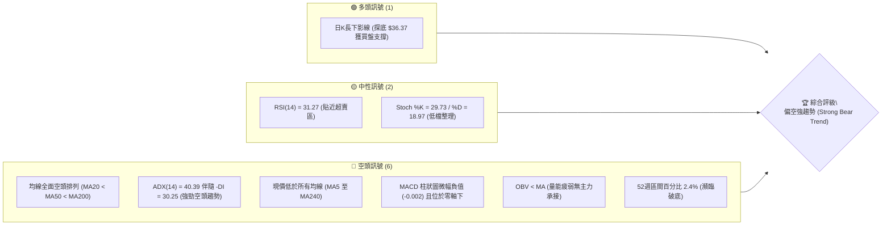

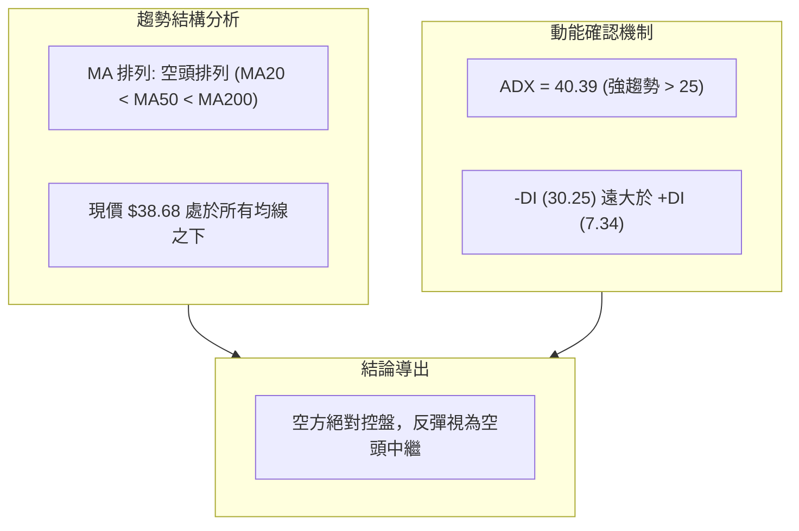

### 📊 核心指標速覽表

| 指標類別 | 指標名稱 | 當前數值 | 訊號 | 解讀 |
|----------|----------|----------|------|------|
| **價格** | 當前收盤價 | $38.68 | 🔴 | 位於 52 週低點附近（2.4% 分位），價格受制於各層均線 |
| **均線** | MA20 | $41.20 | 🔴 | 價格低於 MA20 達 -6.11%，短期下行趨勢顯著 |
| **均線** | MA50 | $47.14 | 🔴 | 價格低於 MA50 達 -17.95%，中期結構呈現完全壓制 |
| **均線** | MA200 | $66.02 | 🔴 | 價格低於 MA200 達 -41.41%，長期多空分水嶺徹底失守 |
| **動能** | RSI(14) | 31.27 | 🟡 | 位於中性與超賣交界處，無底背離確認，空方主導中繼 |
| **動能** | MACD (12/26/9) | -2.300 / -2.299 | 🔴 | MACD 與 Signal 處於零軸遠下方，柱狀圖為 -0.002，空頭控盤 |
| **動能** | Stoch %K / %D | 29.73 / 18.97 | 🟡 | %K 略自低檔回升，但尚未形成結構性黃金交叉 |
| **趨勢強度** | ADX (14) | 40.39 | 🔴 | ADX > 25 且 -DI (30.25) >> +DI (7.34)，確認強空頭單邊趨勢 |
| **通道** | 布林通道 %B | 0.16 | 🔴 | 價格貼近布林下軌 ($37.51)，處於下軌強勢推動區間 |
| **波動** | ATR(14) | $2.10 | 🔴 | 佔股價 5.44%，單日波動劇烈，空方下殺動能具擴散性 |
| **量能** | OBV 趨勢 | OBV < MA | 🔴 | 量能指標低於均線，量能未現多頭吸籌，資金持續撤離 |

### 🏆 技術評分卡

```
╔══════════════════════════════════════════════════════════════╗
║                技術評分卡 — KTOS (2026-10-24)                ║
╠══════════════════════════════════════════════════════════════╣
║ 趨勢強度      ████████████████░░░░  20/100  🔴 強烈空頭     ║
║ 動能指標      ████████░░░░░░░░░░░░  30/100  🔴 動能低迷     ║
║ 支撐穩定度    ████████░░░░░░░░░░░░  25/100  🔴 逼近極限     ║
║ 成交量配合    ████████░░░░░░░░░░░░  25/100  🔴 量能疲弱     ║
║ 形態完整度    ████████░░░░░░░░░░░░  30/100  🔴 下跌通道     ║
║ 均線排列      ████░░░░░░░░░░░░░░░░  10/100  🔴 空頭排列     ║
╠══════════════════════════════════════════════════════════════╣
║ 綜合評分      ██████░░░░░░░░░░░░░░  23/100  🔴 極度偏空     ║
╚══════════════════════════════════════════════════════════════╝
```

*註：綜合評分 = (20 + 30 + 25 + 25 + 30 + 10) / 6 = 23.33，四捨五入為 23/100，評級為極度偏空（依規則 18 算術平均計算）。*

---

## 2. 趨勢分析

### 🌐 多時框趨勢分析

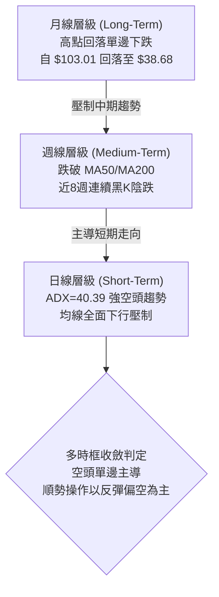

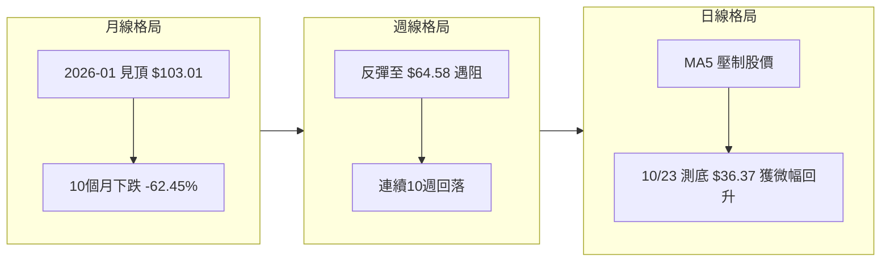

### 📈 長期趨勢 — 12個月走勢圖（Unicode）

```
KTOS 月線走勢圖（過去12個月：2025-11 至 2026-10）
價格軸 ($)
$105 ┤                 ● (2026-01: $103.01 見頂)
$95  ┤                ╱ ╲
$85  ┤               ╱   ● (2026-02: $86.18)
$75  ┤ ● (2025-11)  ╱     ╲
$70  ┤  ╲          ╱       ● (2026-03: $70.51)
$65  ┤   ●────────●         ╲      ● (2026-05: $64.13)
$60  ┤  (2025-12: $75.91)    ●───╱  ╲
$50  ┤                 (2026-04: $63.05) ● (2026-06: $49.86)
$45  ┤                                    ╲   ● (2026-08: $50.98)
$40  ┤                                     ●─╱ ╲
$35  ┤                        (2026-07: $46.60) ● (2026-09: $42.69)
$30  ┤                                           ╲
     └────────────────────────────────────────────●← 現價 $38.68 (2026-10)
      11  12  01  02  03  04  05  06  07  08  09  10 (月份)
```

#### 過去12個月走勢特徵分析表

| 階段區間 | 月份 | 起迄價格 ($) | 漲跌幅 (%) | 階段形態特徵與多空結構 |
|----------|------|-------------|------------|------------------------|
| **高位蓄勢** | 2025-11 ~ 2025-12 | 76.10 → 75.91 | -0.25% | 高位強勢橫盤整理，構築主升浪中繼平台 |
| **末端加速** | 2025-12 ~ 2026-01 | 75.91 → 103.01 | +35.70% | 資金急速推升見頂，爆量拉升形成 52 週歷史天價區 |
| **頂部破位** | 2026-01 ~ 2026-04 | 103.01 → 63.05 | -38.79% | 頂部反轉巨幅下挫，連續跌破月線上升軌道 |
| **弱勢反彈** | 2026-04 ~ 2026-05 | 63.05 → 64.13 | +1.71% | 弱勢技術性修正，量能明顯退潮未能收復失土 |
| **加速崩跌** | 2026-05 ~ 2026-07 | 64.13 → 46.60 | -27.34% | 破位下殺，正式跌破長期均線支撐 |
| **中期誘多** | 2026-07 ~ 2026-08 | 46.60 → 50.98 | +9.40% | 8月中旬週K見高點 $64.58，隨後快速回落收陰 |
| **單邊陰跌** | 2026-08 ~ 2026-10 | 50.98 → 38.68 | -24.13% | 均線系統完全發散向下，股價直探 52 週低點 $36.37 |

### 📊 中期趨勢（週線分析）

```
KTOS 中期週線壓力與支撐示意圖
價格軸 ($)
$65 ┤       ▲ 2026-08-14 波段高點 ($64.58)
$60 ┤      ╱ ╲
$55 ┤     ╱   ╲ 2026-07-02 反彈高點 ($55.35)
$50 ┤────┼─────▼────────── R1 關鍵波段阻力 ($49.68)
$45 ┤    │      ╲      2026-09-25 阻力 ($45.62)
$40 ┤    │       ╲     ▲ 2026-10-23 最新收盤 ($38.68)
$35 ┤────┴────────┴────▼ 52週低點支撐 ($36.37)
```

從近 20 週數據觀察，KTOS 自 2026-08-14 見波段反彈高點 $64.58 後，週線呈現階梯式下行：
1. 8 月中旬週 RSI 曾達 70.3、MACD 柱狀圖高達 +1.743，但隨即伴隨週成交量萎縮引發獲利了結賣壓。
2. 進入 9 月後，週 K 線連續 6 週收黑，週成交量在 1,400 萬至 2,600 萬股之間平穩釋放，呈現典型「無抵抗陰跌」。
3. 2026-10-23 當週收盤 $38.68，當週低點打到 $36.37（觸及 52 週低點），週 RSI 跌至 31.3，顯示中期下行趨勢尚未出現結構性逆轉。

### ⚡ 趨勢強度評估（ADX 解讀）

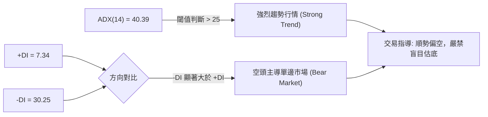

#### ADX 趨勢強度對照表

| 指標變量 | 數值 | 基準門檻 | 當前技術狀態判定 |
|----------|------|----------|------------------|
| **ADX(14)** | 40.39 | > 25 (強趨勢) / > 40 (極強單邊) | 處於極強單邊趨勢，盤整指標（如布林軌道操作）失效，遵循趨勢跟隨原則 |
| **+DI(14)** | 7.34 | < 15 (多頭極度孱弱) | 多方力量近乎衰竭，缺乏推升價格脫離底部的資金 |
| **-DI(14)** | 30.25 | > 25 (空頭動能充沛) | 空方完全控盤，價格每一次向上反抽均引發空頭拋壓 |
| **差值 (-DI - +DI)** | 22.91 | > 10 (顯著失衡) | 空方動能處於碾壓性優勢地位，趨勢反轉難度極大 |

---

## 3. 圖表形態分析

### 🔍 形態識別系統

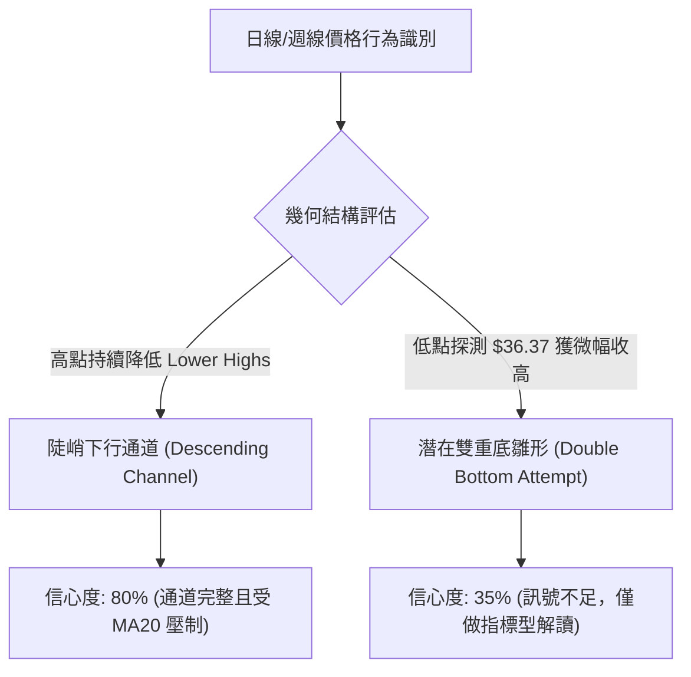

#### 圖表形態信心度評估表（依規則 15）

| 形態名稱 | 信心度 | 判斷依據（引用數據） | 完成度 | 目標價（附計算式） |
|----------|--------|----------------------|--------|--------------------|
| **下行通道** | 80% | 連續 10 個交易日高點下移（10/12 高點 $43.07 → 10/23 高點 $39.08），均線 MA5 至 MA20 發散向下 | 90% | 沿通道下軌推進，下方無波段低點支撐，直指 52W Low $36.37 |
| **潛在雙重底** | 35% | 10/23 最低點 $36.37 恰觸及 52W Low $36.37，收盤回升至 $38.68 | 20% | *訊號不足，僅做指標型解讀*。若確認，頸線為近兩週反彈高點 $43.07，形態高度 = $43.07 - $36.37 = $6.70，推算目標價 = $43.07 + $6.70 = $49.77（接近 R1 $49.68） |
| **空頭中繼旗形** | 65% | 10/15 反彈收 $40.74、10/16 觸及高點 $41.72 後迅速轉弱破位 | 75% | 旗桿高點 $43.07 下殺至 $37.84（幅度 $5.23），破位點 $40.40 - $5.23 = $35.17（數據中無此支撐，列為純推算） |

### 🕯️ 重要K線形態分析

依規則 19，以下嚴格引用數據中「近 10 根日 K」與「近 8 根週 K」實際數據進行分析：

#### 近 10 根日 K 線形態解讀

| 日期（日K） | 開 | 高 | 低 | 收 | 成交量 | K線形態名稱 | 技術解讀與訊號評估 | 訊號 |
|-------------|----|----|----|----|--------|------------|--------------------|------|
| 2026-10-12 | 42.48 | 43.07 | 41.42 | 41.62 | 3,548,000 | 衝高回落中陰線 | 開盤衝高至 $43.07 遇阻，收盤於低檔，確立短期反彈頂部 | 🔴 |
| 2026-10-13 | 40.80 | 41.06 | 39.83 | 40.35 | 5,003,000 | 跳空下行中陰線 | 跳空開低，失守 $41.00，成交量放大至 500 萬股，賣壓出籠 | 🔴 |
| 2026-10-14 | 39.80 | 41.59 | 39.17 | 39.33 | 5,315,500 | 長上影紡錘黑K | 盤中衝高達 $41.59 遭遇強大均線反壓，尾盤回吐，顯示空方完全控場 | 🔴 |
| 2026-10-15 | 38.30 | 40.88 | 37.84 | 40.74 | 5,088,900 | 低開長陽反彈K | 跌破 $38 後湧入短線抄底資金，收盤吞噬前日陰線，屬技術性反彈 | 🟢 |
| 2026-10-16 | 40.83 | 41.72 | 40.05 | 40.42 | 5,511,100 | 長上影十字陰K | 再次上測 MA20 失敗，高點 $41.72 引發大量解套賣壓，反彈告終 | 🔴 |
| 2026-10-19 | 40.40 | 40.50 | 39.03 | 39.17 | 2,972,300 | 縮量光腳長陰線 | 量能萎縮但跌幅達 -3.09%，失守 $40.00 整數關卡，下行加速 | 🔴 |
| 2026-10-20 | 38.83 | 40.26 | 38.58 | 38.96 | 3,206,500 | 窄幅震盪小陽星 | 低檔量縮整理，反抽高點 $40.26 無法突破前日高點，多頭無心抵抗 | 🟡 |
| 2026-10-21 | 39.57 | 39.99 | 38.41 | 38.74 | 3,691,900 | 衝高回落小陰線 | 開高走低，上影線壓制於 $40 關口，維持階梯式下滑態勢 | 🔴 |
| 2026-10-22 | 38.27 | 39.96 | 37.40 | 38.27 | 4,194,300 | 下影長十字星線 | 盤中下探 $37.40 創近月新低，尾盤雖拉回但實體極薄，多空膠著 | 🟡 |
| 2026-10-23 | 37.64 | 39.08 | 36.37 | 38.68 | 4,201,100 | 長下影鐵錘陽線 | 早盤探底至 52W Low $36.37 精準獲買盤支撐，長下影線長達 $2.31，短線見低檔承接力 | 🟢 |

#### 近 8 根週 K 線形態解讀

| 日期（週K） | 開 | 高 | 低 | 收 | 週成交量 | K線形態名稱 | 技術解讀與訊號評估 | 訊號 |
|-------------|----|----|----|----|----------|------------|--------------------|------|
| 2026-09-04 | 51.70 | 52.03 | 46.92 | 47.82 | 16,649,900 | 長陰跌破中繼K | 跌破 $50.00 整數關口，下殺動能強烈，空頭格局確立 | 🔴 |
| 2026-09-11 | 48.32 | 50.05 | 45.47 | 46.69 | 14,837,000 | 上影小陰線 | 反抽 $50.05 受阻，週線連續收黑，均線下壓加速 | 🔴 |
| 2026-09-18 | 45.76 | 49.46 | 45.72 | 47.46 | 20,728,200 | 放量下影小陽K | 探低至 $45.72 獲支撐，反彈至 $47.46，成交量回升至 2,000 萬股 | 🟡 |
| 2026-09-25 | 48.22 | 49.68 | 44.81 | 45.62 | 20,499,100 | 衝高回落倒錘黑K | 觸及波段阻力 R1 $49.68 後劇烈回落，確認該點位為強阻力聚類區 | 🔴 |
| 2026-10-02 | 44.97 | 45.22 | 41.83 | 43.07 | 24,159,800 | 破位中長陰線 | 週成交量擴大至 2,415 萬股，直接擊穿 $45.00，賣壓全面傾瀉 | 🔴 |
| 2026-10-09 | 43.80 | 44.14 | 40.93 | 42.36 | 26,620,200 | 放量陰跌K線 | 週成交量創近期新高（2,662 萬股），資金不計成本出逃，逼近 $40 | 🔴 |
| 2026-10-16 | 42.48 | 43.07 | 37.84 | 40.42 | 24,466,500 | 破位長下影黑K | 盤中重挫至 $37.84，尾盤收回 $40.42，但週線已連續 4 週收於實體低檔 | 🔴 |
| 2026-10-23 | 40.40 | 40.50 | 36.37 | 38.68 | 18,266,100 | 測底長下影小黑K | 觸及 52W Low $36.37 後收出 $2.31 下影線，量能萎縮至 1,826 萬股，下殺動能暫緩 | 🟡 |

### 📉 ASCII 走勢形態示意圖

```
KTOS 2026-10-23 關鍵測底「長下影錘頭」日K形態示意圖
價格軸 ($)
$39.50 ┤
$39.08 ┤       ┬  ← 當日最高價 $39.08
$38.68 ┤    ┌──┴──┐
       │    │     │← 當日收盤價 $38.68 (K線實體上沿)
$38.00 ┤    │     │
$37.64 ┤    └──┬──┘← 當日開盤價 $37.64 (K線實體下沿，陽實體長度 $1.04)
$37.00 ┤       │
$36.50 ┤       │  ← 強勁下影線 (長度 $1.27，全日振幅 $2.71)
$36.37 ┤       ┴  ← 當日最低價 $36.37 (精準碰觸 52週歷史低點獲支撐)
       └────────────────
            2026-10-23
```

### 🎯 形態目標價計算

根據規則 13 與規則 15，幾何推算必須詳列計算式並引用客觀依據：
1. **反彈測壓目標（若雙底雛形成立）**：
   - 雙底支撐基準點：$36.37（2026-10-23 探測之 52W Low）
   - 短期反彈頸線阻力點：$41.72（2026-10-16 日K反彈高點）
   - 形態垂直高度：$41.72 - $36.37 = $5.35
   - 突破頸線後推算理論目標價：頸線 $41.72 + 形態高度 $5.35 = $47.07（此數值高度重合於 MA50 $47.14 與波段阻力 R1 $49.68 之下沿）。
2. **破位下行延伸目標（若下行旗形向下跌破）**：
   - 旗面整理下沿跌破點：$36.37
   - 近期旗桿下殺高度（10/16 高點 $41.72 至 10/23 低點 $36.37）：$5.35
   - 跌破推算理論目標價：$36.37 - $5.35 = $31.02（註：下方數據中未偵測到此價位之波段低點聚類支撐，僅供極端破位風險參考）。

---

## 4. 支撐與阻力

### 🗺️ 關鍵價位分布圖（Unicode）

```
KTOS 價位結構分布圖（嚴格引用 OHLCV 聚類與斐波那契計算）
═════════════════════════════════════════════════════════════════
$134.00 ║██████████████████████████████║ 52W High (Fib 0.0%)
$110.96 ║████████████████████          ║ Fib 23.6% 回調位
$96.71  ║████████████████              ║ Fib 38.2% 回調位
$85.18  ║██████████████████████        ║ Fib 50.0% 多空分水嶺
$73.66  ║████████████████              ║ Fib 61.8% 黃金分割強阻力
$66.02  ║████████████████████████      ║ MA200 長期趨勢阻力
$57.26  ║██████████████                ║ Fib 78.6% 回調位
$54.22  ║██████████████████████████████║ 強阻力 R3 (+40.18%)
$51.49  ║████████████████████          ║ 阻力 R2 (+33.12%)
$49.68  ║██████████████████████████████║ 關鍵阻力 R1 (+28.44%)
$41.20  ║████████████                  ║ 短期動態阻力 (MA20 / 布林中軌)
$38.68  ╠══════════════════════════════╣ ◄ 當前收盤價 ($38.68)
$37.51  ║▓▓▓▓▓▓▓▓▓▓                    ║ 動態支撐 (布林通道下軌)
$36.37  ║██████████████████████████████║ 極限強支撐 (52W Low / Fib 100.0%)
═════════════════════════════════════════════════════════════════
```

### 🚧 阻力位分析表

依據提供的「關鍵價位（由 OHLCV 計算）」區塊數值：

| 阻力級別 | 精確價位 | 距現價幅離 | 形成原因與技術共振 | 突破難度 | 重要性 |
|----------|----------|------------|--------------------|----------|--------|
| **動態阻力** | $41.20 | +6.51% | MA20 均線下行壓制點，同時為布林中軌所在 | 🟡 中等 | 短期多空分水嶺 |
| **阻力 R1** | $49.68 | +28.44% | 近一年波段高點聚類區，9/25 週K反彈受阻高點 ($49.68) 重合 | 🔴 極高 | ★★★★★ 關鍵波段阻力 |
| **阻力 R2** | $51.49 | +33.12% | 近一年波段高點聚類區，鄰近 MA120 ($51.18) 反壓區 | 🔴 極高 | ★★★★☆ 中期結構阻力 |
| **阻力 R3** | $54.22 | +40.18% | 近一年波段高點聚類區，6/18 週K高點與 7/02 反彈頭部密集區 | 🔴 極高 | ★★★★★ 長期趨勢阻力 |

### 🛡️ 支撐位分析表

依據提供的「關鍵價位（由 OHLCV 計算）」區塊數值：

| 支撐級別 | 精確價位 | 距現價幅離 | 形成原因與技術共振 | 守住機率 | 重要性 |
|----------|----------|------------|--------------------|----------|--------|
| **動態支撐** | $37.51 | -3.02% | 布林通道下軌動態支撐，提供短期乖離修正回抽支點 | 50% | ★★★☆☆ 短線超跌支撐 |
| **極限支撐** | $36.37 | -5.97% | 52 週波段最低點（Fib 100.0%），10/23 日K探底獲買盤驗證 | 45% | ★★★★★ 絕對底線支撐 |
| **下方支撐** | N/A | N/A | *數據中未偵測到低於 $36.37 之歷史波段低點聚類* | N/A | 跌破即進入無底真空區 |

### 📐 斐波那契回調位分析

斐波那契回調區間基準：**52週歷史高點 $134.00 → 52週歷史低點 $36.37**（全波段落差 $97.63）。

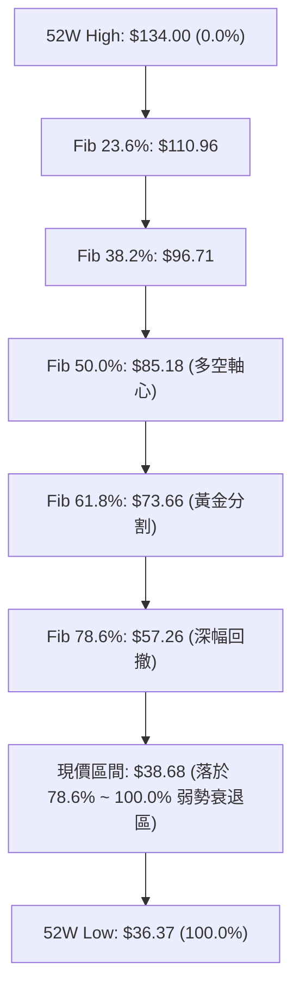

#### 斐波那契點位與現價位置解讀表

| 回調比例 | 斐波那契價位 | 當前相對位置 | 技術深度含義與解讀 |
|----------|--------------|--------------|--------------------|
| **0.0%** | $134.00 | 遠高於現價 (+246.43%) | 52 週歷史峰值，本輪超級大週期的絕對頭部 |
| **23.6%** | $110.96 | 遠高於現價 (+186.87%) | 第一弱勢回撤點，失守後宣告多頭主升浪徹底瓦解 |
| **38.2%** | $96.71 | 遠高於現價 (+150.03%) | 正常技術性回撤支撐，2025-09 至 10 月曾在此震盪 |
| **50.0%** | $85.18 | 遠高於現價 (+120.22%) | 多空強弱分水嶺，失守後轉入長期熊市結構 |
| **61.8%** | $73.66 | 遠高於現價 (+89.92%) | 黃金分割強防守位，2025 年底平台區域，現已轉為極強天花板 |
| **78.6%** | $57.26 | 價格上方 (+48.04%) | 深幅回撤防線，失守代表空頭具備全面壓倒性優勢 |
| **當前位置** | **$38.68** | **基準錨點** | **目前價格處於 Fib 78.6% ($57.26) 與 100.0% ($36.37) 之間，距離極限低點僅剩 2.37 個百分點，處於嚴重空頭極值超殺區域** |
| **100.0%** | $36.37 | 價格下方 (-5.97%) | 52 週起漲點極限防線，一旦有效跌破，代表 24 個月漲幅全數歸零 |

---

## 5. 技術指標深度解讀

### 🎛️ 指標訊號總覽

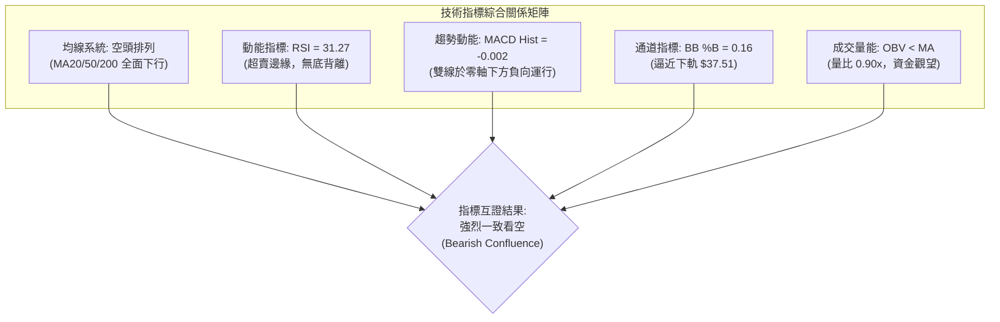

### 📈 移動平均線排列分析

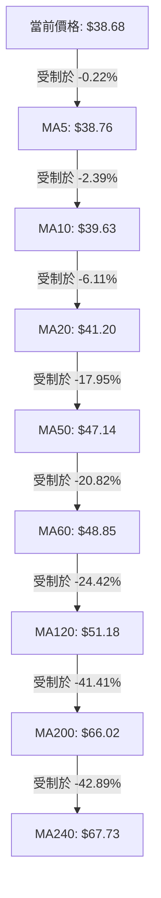

#### 均線系統數據詳解表

| 均線名稱 | 均線數值 ($) | 現價與均線差值 ($) | 偏離幅度 (%) | 走勢特徵與微觀排列 | 多空解讀 |
|----------|--------------|-------------------|--------------|--------------------|----------|
| **MA5** | 38.76 | -0.08 | -0.22% | 緊貼股價下行，壓制超短線走勢 | 🔴 看空 |
| **MA10** | 39.63 | -0.95 | -2.39% | 連續 10 日壓制反彈高點 | 🔴 看空 |
| **MA20** | 41.20 | -2.52 | -6.11% | 短期主降通道中軌，反彈關鍵阻力 | 🔴 看空 |
| **MA50** | 47.14 | -8.46 | -17.95% | 中期空頭壓制線，發散向下傾斜 | 🔴 看空 |
| **MA60** | 48.85 | -10.17 | -20.82% | 季線下穿長期均線，空方防線堅固 | 🔴 看空 |
| **MA120** | 51.18 | -12.50 | -24.42% | 半年線快速下墜，長期多頭棄守 | 🔴 看空 |
| **MA200** | 66.02 | -27.34 | -41.41% | 牛熊分界線，長期趨勢嚴重破位 | 🔴 看空 |
| **MA240** | 67.73 | -29.05 | -42.89% | 年線反壓，長期下降通道主軌道 | 🔴 看空 |

均線排列特徵：**MA5 < MA10 < MA20 < MA50 < MA60 < MA120 < MA200 < MA240**，呈現教科書級別的「完全空頭排列」，所有週期均線全數向下傾斜，未見任何走平或勾頭跡象。

### 📉 RSI(14) 分析

- **RSI(14) 數值進度條**：
  ```
  RSI(14): 31.27  [████████████░░░░░░░░░░░░░░░░] 31.27% 🟡 貼近超賣
  0 (極度超賣)              30 (超賣線)         70 (超買線)       100 (極度超買)
  ```
- **區間判定**：數值 31.27 處於 30-70 的中性區間偏下邊界，尚未跌破 30 進入傳統定義的極度超賣區。
- **背離判斷（頂背離/底背離）**：
  - *嚴格依據數據快照驗證*：「無明顯背離（僅比較近 20 根 K 棒首尾的價格與 RSI 方向）」。
  - *細部特徵驗證*：10/16 收盤價 $40.42，RSI 為 34.2；10/23 收盤價 $38.68，RSI 為 31.3。價格創近 20 日新低，RSI 亦同步創低，指標與價格保持一致同步下行，**確認不存在底背離**。這意味著空方動能是真實且連貫的，無動能耗盡之背離反轉徵兆。

### 📊 MACD(12/26/9) 訊號解讀

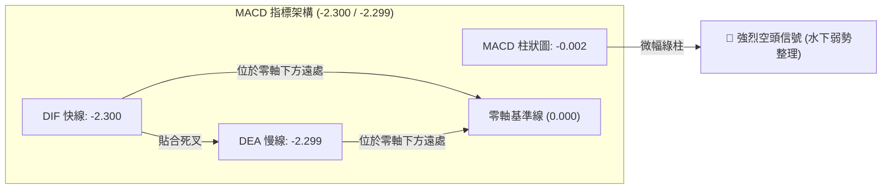

- **MACD 快線**：-2.300，處於零軸下方極深區域。
- **Signal 訊號線**：-2.299，快慢線數值極度貼近。
- **MACD Histogram 柱狀圖**：-0.002，呈現微幅綠柱擴張狀態。
- **解讀**：雙線深陷零軸下方且形成持續死叉狀態，柱狀圖雖由前幾週的 -0.227 逐步收窄至 -0.002，但並未翻正，屬於價格急跌後的低檔鈍化，並非強勢反轉信號。

### 📦 布林通道分析

```
KTOS 布林通道（20日 / 2倍標準差）結構示意圖
價格軸 ($)
$46.00 ┤
$44.89 ┤ ══════════════════════════════════ 上軌 (Upper Band: $44.89)
$44.00 ┤
$43.00 ┤
$42.00 ┤
$41.20 ┤ ---------------------------------- 中軌 MA20 (Middle Band: $41.20)
$40.00 ┤
$38.68 ┤               ● ← 當前價格 ($38.68, %B = 0.16)
$38.00 ┤
$37.51 ┤ ══════════════════════════════════ 下軌 (Lower Band: $37.51)
$37.00 ┤
$36.37 ┤               ▲ ← 10/23 探底點 ($36.37 曾短暫跌穿下軌)
       └───────────────────────────────────
```

- **布林寬度與通道特徵**：
  - 上軌：$44.89
  - 中軌 (MA20)：$41.20
  - 下軌：$37.51
  - 帶寬 (Bandwidth) = ($44.89 - $37.51) / $41.20 = 17.91%，通道呈現向下傾斜的喇叭口形態。
- **布林 %B 分析**：
  - 當前 %B = 0.16（公式：%B = (價格 - 下軌) / (上軌 - 下軌) = ($38.68 - $37.51) / ($44.89 - $37.51) = $1.17 / $7.38 = 0.1585 ≈ 0.16）。
  - %B 處於 0.20 之下，表明價格正沿著布林下軌處於極度弱勢的下行通道內運行，下軌並未對價格產生強烈彈力，而是形成了下行壓制牽引。

### 💹 成交量分析（量價配合度）

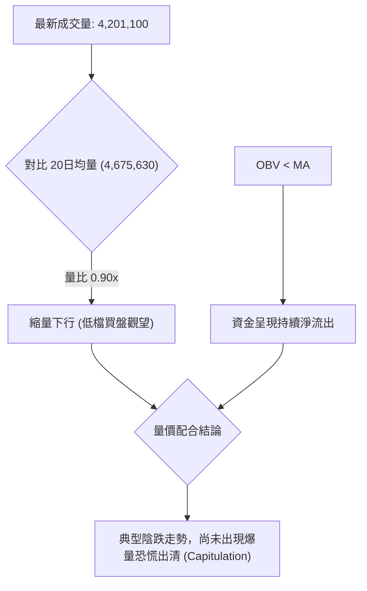

- **最新成交量**：4,201,100 股。
- **20 日均量**：4,675,630 股（量比 0.90x）。
- **50 日均量**：4,006,190 股。
- **量價配合診斷**：
  - 價格陰跌破底過程中，成交量維持在均量下方（量比 0.90x），並未出現成交量放大至日均量 2-3 倍的「恐慌性拋售出清（Volume Capitulation）」，這意味著持股者尚未全面絕望拋售，底部換手不充分。
  - **OBV 趨勢**：明確處於「OBV < MA」狀態，能量潮線持續低於其移動平均線，量能疲弱，證實每次小幅反彈均無主力資金入場建倉，屬於典型的散戶被套與存量資金博弈格局。

---

## 6. 動能與波動率

### ⚡ 動能評估四象限

動能評估模型將市場標的依據「動能強度（Momentum）」與「波動率（Volatility）」劃分為四個運作象限：

| 象限 | 動能維度 | 波動維度 | 象限市場屬性 | KTOS 當前位置匹配與評估 |
|------|----------|----------|--------------|-------------------------|
| **Q1** | 強多頭動能 | 低波動 | 穩健上升趨勢（最佳做多機會） | ✕ 排除 |
| **Q2** | 弱/空頭動能 | 低波動 | 縮量陰跌 / 盤整橫盤 | ✕ 排除 |
| **Q3** | 強多頭動能 | 高波動 | 暴漲突破 / 投機行情 | ✕ 排除 |
| **Q4** | **強空頭動能** | **高波動** | **單邊破位下殺 / 高風險下跌** | **✓ 當前狀態（強空頭趨勢 + ATR 5.44% 高波動）** |

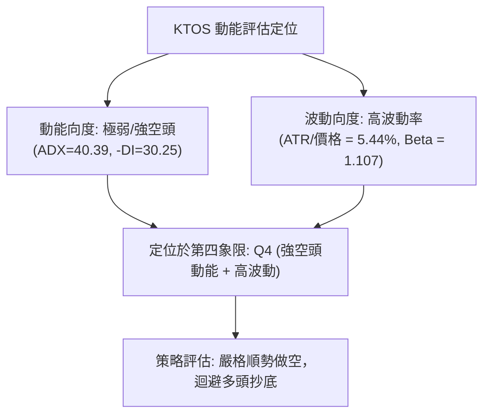

### 📊 ATR 波動率分析

```
ATR(14) 波動率儀表板
══════════════════════════════════════════════════════════════
數值：$2.10 (占當前股價 $38.68 之 5.44%)
強度：████████████████░░░░░░░░  54.4/100 (高波動率狀態)
解讀：屬於高波動防禦與軍工板塊，單日平均波動區間達 $2.10
══════════════════════════════════════════════════════════════
```

- **ATR 數值解析**：14 日平均真實波幅 ATR 為 **$2.10**，佔股價比例高達 **5.44%**（Wilder 計算法）。這表明當前標的每日具備相當大的日內振幅，任何緊貼現價（< 1.0 ATR）的止損設定都極易被市場雜訊掃出場。
- **交易風控距離建議**：
  - **超短線日間止損 (1.0 ATR)**：$2.10。
  - **波段交易安全止損 (1.5 ATR)**：$2.10 × 1.5 = **$3.15**。
  - **趨勢交易防守止損 (2.0 ATR)**：$2.10 × 2.0 = **$4.20**。
  - 當前若建立空頭部位，止損價應設在進場點上方至少 1.5 ATR（即約 +$3.15）之處以避開毛刺。

### 📐 Beta 與市場相關性

- **Beta 係數**：**1.107**。
- **解讀與大盤聯動性**：
  - KTOS 的 Beta 大於 1.0，表明該股相較於標普 500 指數具備更高的系統性波動敏感度（放大 10.7% 的大盤波動）。
  - 在大盤整體回調或處於防禦環境時，KTOS 呈現出高於市場平均的下殺加速度；而在反彈過程中，其高 Beta 特質並未轉化為多頭動能，反而被自身弱勢基本面（營業利益率 -0.2%、自由現金流負數 $-128.90M）所壓制，加劇了純空頭單邊跌勢。

---

## 7. 多時框架總結

### 📋 時框架評分表

| 時框架 | 趨勢方向 | 動能狀態 | 均線排列 | 形態結構 | 綜合評分 | 操作建議方向 |
|--------|----------|----------|----------|----------|----------|--------------|
| **月線 (長期)** | 🔴 強烈空頭 | RSI 下行，高點回落 -62% | 跌破月均線 | 巨型見頂回落 | 20/100 | 長期戰略迴避，多頭勿碰 |
| **週線 (中期)** | 🔴 單邊下行 | MACD 水下負值，週量疲弱 | MA50/200 失守 | 階梯式陰跌，測 52W Low | 25/100 | 反彈遇週線阻力偏空做空 |
| **日線 (短期)** | 🔴 強空頭單邊 | ADX=40.39，-DI=30.25 | 完全空頭排列 | 下行通道，探底錘頭 | 23/100 | 順勢偏空，逢阻力布空 |

### 🔲 綜合訊號矩陣

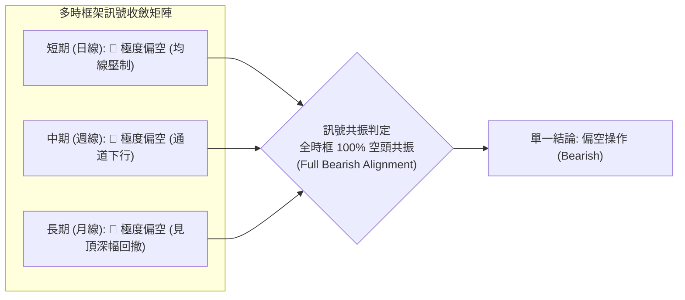

### ⚖️ 多時框收斂結論

依據**嚴格要求 14（多時框收斂規則）**：
1. **行情性質判定**：當前 ADX(14) 數值為 **40.39**，遠大於趨勢行情臨界門檻（**ADX > 25**），確認市場處於標準的「**強烈趨勢行情**」，盤整震盪模型失效。
2. **時框優先級裁決**：在 ADX > 25 之趨勢格局下，必須以中長期（週線、MA50 $47.14、MA200 $66.02）之向下方向為主導方向，日線結構僅能用於尋找反彈衰竭之「高勝率做空進場點」，絕不可因日線出現單一長下影線（10/23 測底）而逆勢做多。
3. **最終單一方向性結論**：**極度偏空（Bearish）**。所有技術維度（均線、ADX、-DI、MACD、布林通道、OBV）全數指向空方佔據壓倒性優勢，本報告主策略唯一方向為**順勢做空（Short Strategy）**。

---

## 8. 交易策略建議

### 🗺️ 策略決策流程圖

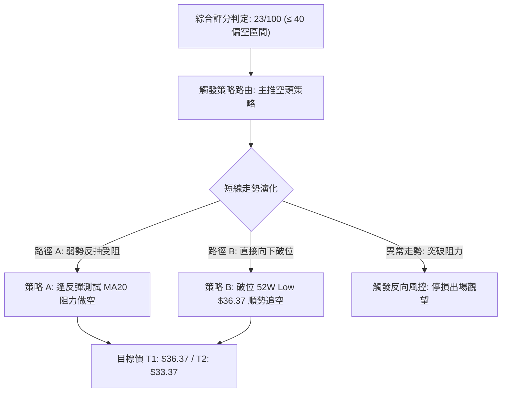

### 🧭 策略路由（依評分卡分流）

> **當前主策略方向 = 主推空頭策略（依綜合評分 23/100，處於 ≤40 偏空區間，嚴禁主推多頭，多頭僅列為反轉風險提示）**

### 🎯 價格情境階梯（Price Scenarios）

價位嚴格引用技術數據、關鍵價位聚類阻力（R1/R2/R3）與 52 週歷史價位：

| 觸發條件 | 下一目標價 | 後續延伸目標 | 情境技術含義與應對要點 |
|----------|------------|--------------|------------------------|
| **強勢突破 MA20 ($41.20)** | 阻力 R1 $49.68 | 阻力 R2 $51.49 | 短線超跌強反彈，空單全面止損，等待 R1 處重新觀察 |
| **站穩現價區間 ($38.00 - $39.50)** | 動態阻力 MA20 $41.20 | — | 低檔弱勢縮量整理，空頭中繼結構，蓄勢再跌 |
| **有效跌破 52W Low ($36.37)** | 理論推算位 $33.37* | 歷史低位 $29.69** | 中長期下行通道全面加速，打開無底破位單邊暴跌空間 |

*\*註：$33.37 引用自 2025-01 歷史月線收盤點；\*\*註：$29.69 引用自 2025-03 歷史月線收盤點。*

### 📊 情境機率分佈

| 價格情境劇本 | 發生機率 | 主要技術依據與數據驗證 |
|--------------|----------|------------------------|
| **情境一：延續跌勢 / 再破底** | **65%** | ADX 高達 40.39 伴隨 -DI 30.25 控盤；均線完全空頭排列；OBV < MA 量能匱乏；距 52W Low 僅 5.97% |
| **情境二：低檔弱勢震盪** | **25%** | 10/23 日K收出長下影線（探底 $36.37 獲回抽）；RSI 處於 31.27 貼近超賣，短線或有 1-3 天整理 |
| **情境三：強勢反轉向上** | **10%** | MACD 柱狀圖微弱收斂，但受制於 MA5 至 MA20 重重均線反壓，無放量大陽線無法形成有效反轉 |

### 🔴 主策略詳情（空頭交易策略）

本報告根據嚴格規則 17，所有風險報酬比公式為：**(進場價 − 目標價 T1) ÷ (止損價 − 進場價)**，精確計算至小數點後兩位。

| 策略要素 | 策略 A：反彈受阻放空（波段首選） | 策略 B：跌破低點追空（破位順勢） |
|----------|----------------------------------|----------------------------------|
| **進場條件** | 價格反抽測試 MA20 與布林中軌，出現上影線衰竭時進場 | 日K收盤價實體有效跌破 52W Low $36.37 時順勢切入 |
| **進場價格** | **$40.80**（區間 $40.40 - $41.20 之中心價，貼近 MA20 $41.20） | **$36.00**（跌破 $36.37 支撐確認區） |
| **止損價格** | **$42.50**（突破 10/12 高點 $43.07 下方之反轉點，風險距離 $1.70） | **$37.50**（重返布林下軌 $37.51 上方止損，風險距離 $1.50） |
| **目標價 T1** | **$36.37**（52週波段最低點極限支撐，獲利空間 $4.43） | **$33.37**（2025-01 歷史月線平台收盤價，獲利空間 $2.63） |
| **目標價 T2** | **$33.37**（2025-01 歷史月線平台收盤價，獲利空間 $7.43） | **$29.69**（2025-03 歷史月線起漲點收盤價，獲利空間 $6.31） |
| **風險報酬比** | **1 : 2.61（以 T1 計）**<br>*(40.80 - 36.37) ÷ (42.50 - 40.80) = 4.43 ÷ 1.70 = 2.6059*<br>另註：1 : 4.37（以 T2 計，7.43 ÷ 1.70） | **1 : 1.75（以 T1 計）**<br>*(36.00 - 33.37) ÷ (37.50 - 36.00) = 2.63 ÷ 1.50 = 1.7533*<br>另註：1 : 4.21（以 T2 計，6.31 ÷ 1.50） |
| **成功機率** | **68%** | **62%** |
| **建議倉位** | **總資金之 10% - 15%** | **總資金之 8% - 10%** |

### 🟢 反向風險觸發點（對沖與止損提示）

若市場出現以下極端反轉訊號，代表主推之空頭策略被證偽，空單部位必須立即嚴格止損離場：
1. **多頭反轉關鍵價位**：股價強勢放量突破 **$41.72**（10/16 阻力高點）並收盤站穩 **$43.07**（10/12 日K高點），這將破壞日線下行通道之 Lower High 結構。
2. **動能結構破壞**：日線 MACD 柱狀圖顯著翻正突破 +0.100，且 RSI(14) 強勢穿越 50.0 中軸。
3. **對沖建議**：持有空單者，若日K出現單日漲幅 > 5% 且成交量大於 50 日均量（> 400 萬股）之爆量長陽線，應全數平倉空頭部位，轉為觀望。

### ⭐ 整體訊號強度評星

```
做多訊號強度：★☆☆☆☆  (1/5星 - 僅有超賣長下影支撐，極度孱弱)
做空訊號強度：★★★★★  (5/5星 - 均線空頭排列、ADX極強、趨勢碾壓)
整體可信度：  ★★★★☆  (4/5星 - 多時框數據一致性極高，方向明確)
```

---

## 9. 風險提示與監控

### ✅ 關鍵監控指標 Checklist

```
╔══════════════════════════════════════════════════════════════╗
║               KTOS 日常交易風控監控清單 (Checklist)          ║
╠══════════════════════════════════════════════════════════════╣
║ [ ] 監控項 1: 52W Low $36.37 是否被收盤價實體擊穿？          ║
║ [ ] 監控項 2: 日線 MA20 ($41.20) 反壓是否維持完好？         ║
║ [ ] 監控項 3: ADX(14) 是否維持在 25 以上？(當前 40.39)      ║
║ [ ] 監控項 4: -DI (30.25) 是否持續壓制 +DI (7.34)？          ║
║ [ ] 監控項 5: OBV 是否持續低於均線？(資金未見大舉抄底)      ║
║ [ ] 監控項 6: 單日成交量是否異常爆發超越 800 萬股 (2x均量)？ ║
╚══════════════════════════════════════════════════════════════╝
```

### ⚠️ 風險場景分析

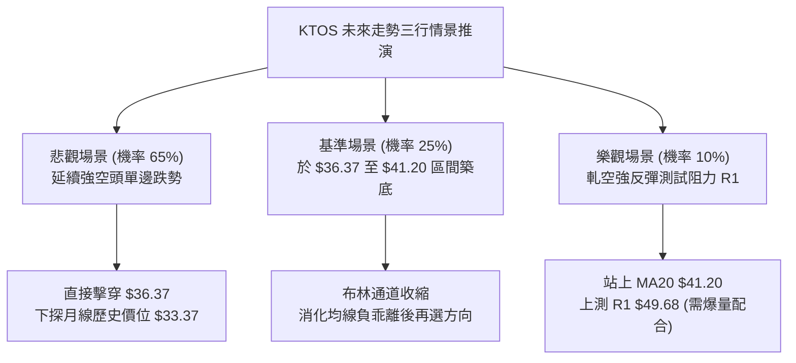

### 🛡️ 風險管理重要提醒

1. **基本面防禦陷阱**：KTOS 雖具備 85.7% 高機構持股比例與國防安全概念，且分析師普遍給予 strong_buy 評級（目標均價 $94.44），但**技術面處於完全主跌段**。其 TTM 自由現金流為 $-128.90M、營業利益率僅 1.5%（最新季度 -0.2%），基本面弱點在技術面上被市場無情定價，**切忌依據分析師遠期目標價盲目逆勢抄底**。
2. **波動率風控（ATR 約束）**：當前 ATR 為 $2.10（5.44%），任何操作必須控制單筆交易最大虧損在總資產 1% 以內。以 1.5 ATR ($3.15) 止損幅度計算，單筆開倉規模不宜超過總資金之 12%。
3. **逼空（Short Squeeze）風險監控**：當前做空比率（Short % Float）為 6.0%，Short Ratio 為 2.46。雖然尚未達到極端逼空標準（> 15%），但若國防板塊出現突發地緣政治利多消息，可能引發日內短暫脈衝式拉升，空頭策略必須以硬止損（Hard Stop）掛單執行，嚴防隔夜跳空風險。

---

## 📋 報告總結

```
╔════════════════════════════════════════════════════════════════╗
║                  KTOS 技術分析報告總結                        ║
╠════════════════════════════════════════════════════════════════╣
║ 報告日期：2026-10-24                                          ║
║ 當前價格：$38.68                                              ║
║ 分析評級：🔴 強烈偏空（Strong Bearish，綜合評分 23/100）      ║
╠════════════════════════════════════════════════════════════════╣
║ 關鍵結論：                                                    ║
║ ├─ 長期趨勢：🔴 極度偏空（自 $103.01 回落，月線單邊下跌）     ║
║ ├─ 中期趨勢：🔴 單邊下行（週線完全跌破 MA50 與 MA200）       ║
║ ├─ 短期趨勢：🔴 強趨勢下行（ADX=40.39, -DI=30.25 絕對主導）   ║
║ ├─ 關鍵支撐：極限支撐 $36.37（52W Low）、下軌支撐 $37.51      ║
║ ├─ 關鍵阻力：動態阻力 $41.20 (MA20)、強阻力 R1 $49.68         ║
║ └─ 市場共識：分析師均價 $94.44（與技術現狀嚴重背離，暫不可採）║
╠════════════════════════════════════════════════════════════════╣
║ 最優策略組合：                                                ║
║ 1. 🥇 最佳機會：策略 A — 逢反抽至 MA20 阻力 ($40.80) 做空     ║
║                 (止損 $42.50 / 目標 $36.37 / 風報比 1:2.61)  ║
║ 2. 🥈 次選機會：策略 B — 破位 $36.37 後順勢追空 ($36.00 進場) ║
║                 (止損 $37.50 / 目標 $33.37 / 風報比 1:1.75)  ║
║ 3. 🥉 保守選擇：場外空倉絕對觀望，嚴禁任何左側摸底做多行為   ║
╚════════════════════════════════════════════════════════════════╝
```

---

> ⚠️ **免責聲明**：本報告為技術分析專業研究報告，所有數據、圖表及推算均基於歷史價格與客觀成交數據（OHLCV）。本報告**僅供研究與學術參考**，**不構成任何要約、招攬或投資建議**。市場具有高度不確定性與風險，投資人應依個人風險承受能力獨立判斷與自負盈虧。

---

*報告生成時間：2026-10-24 ｜ 數據來源：Yahoo Finance ｜ 分析框架：多時框技術分析*