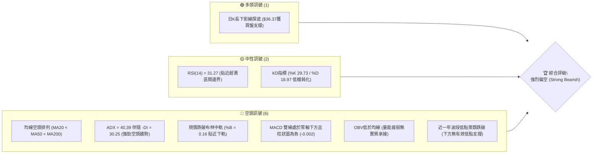
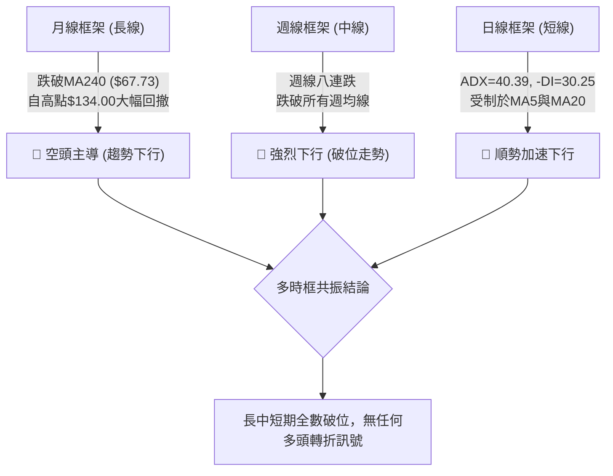
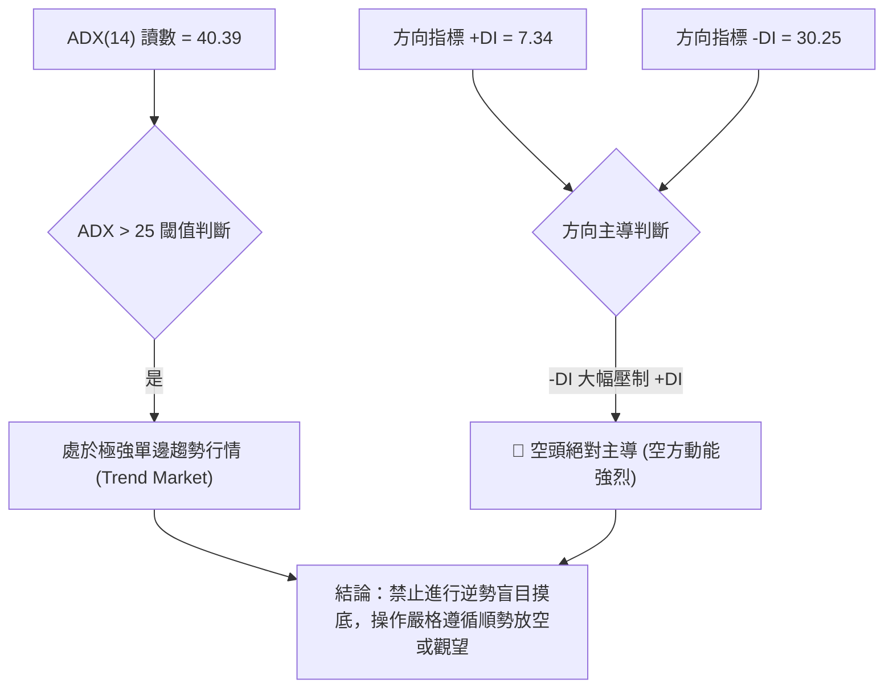
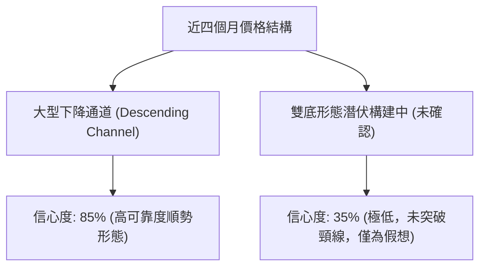
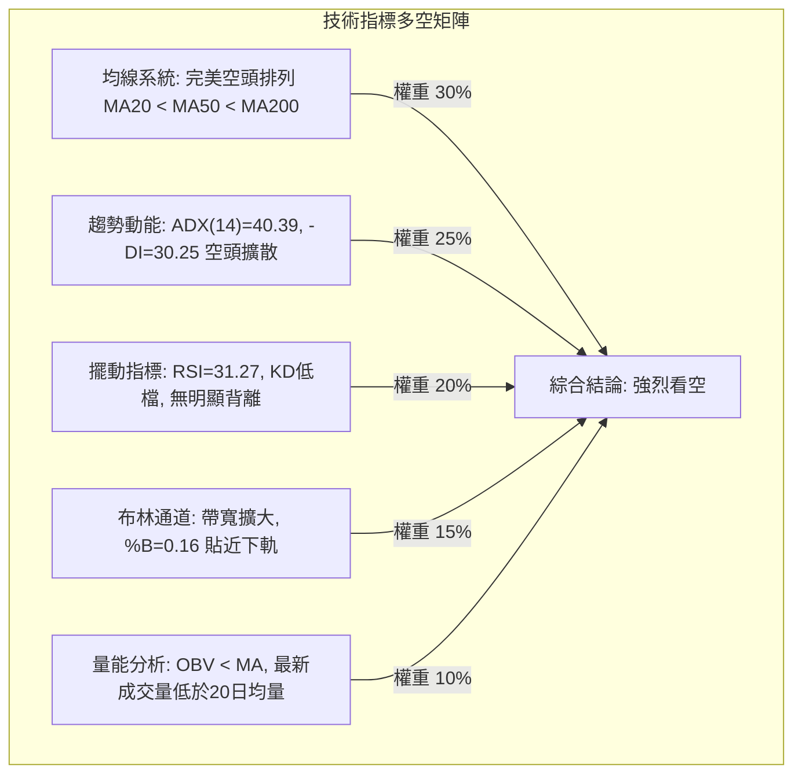
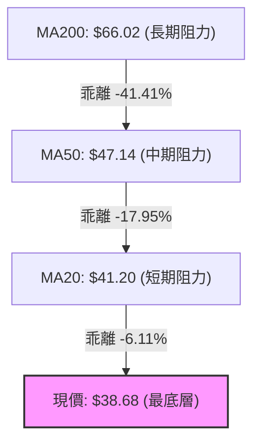
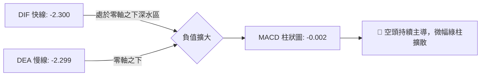
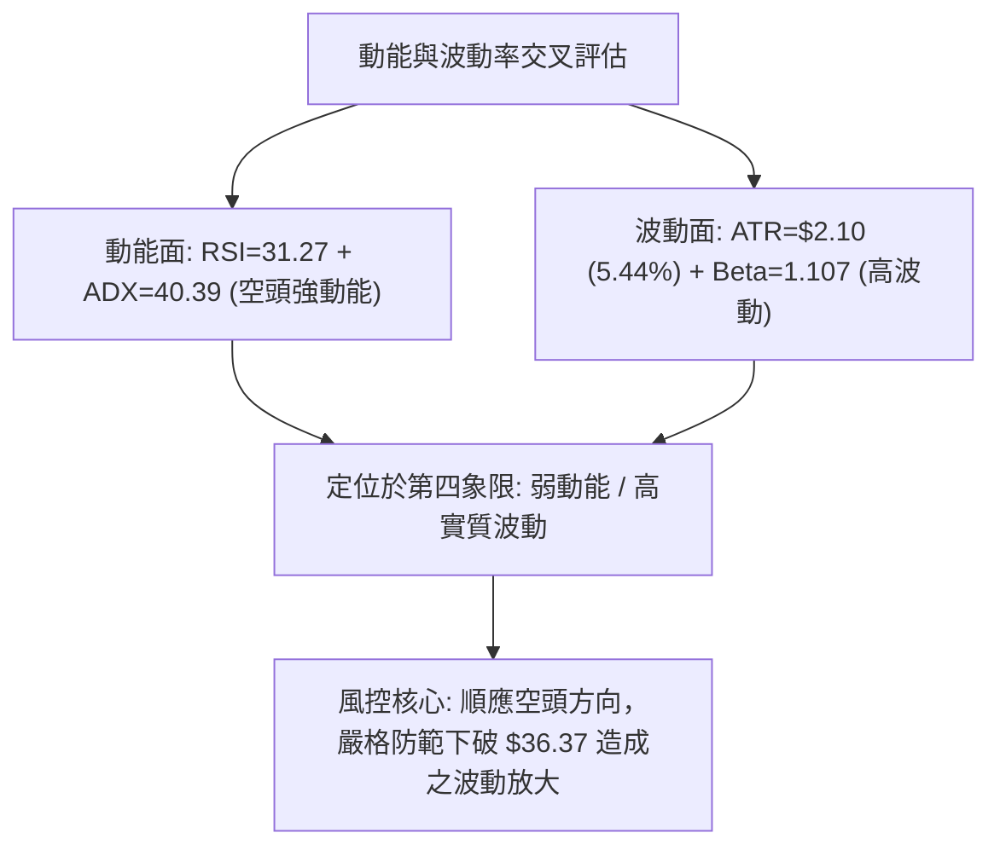
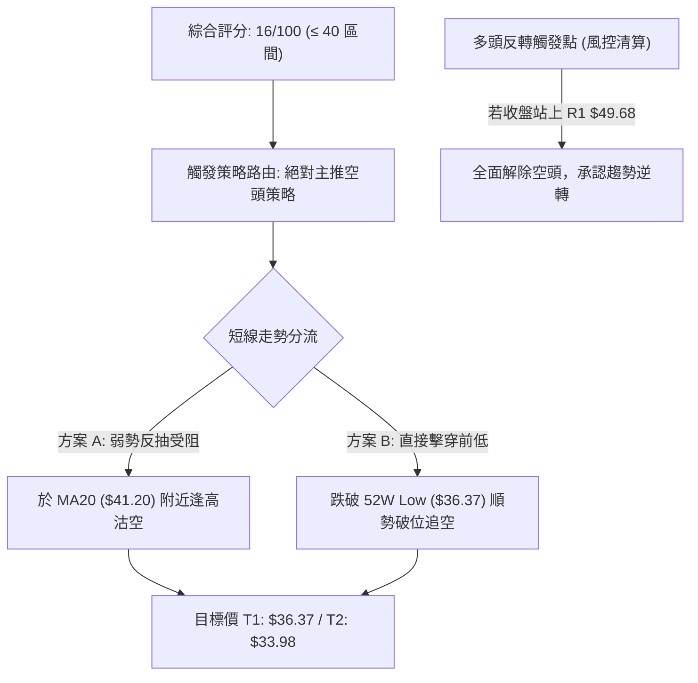
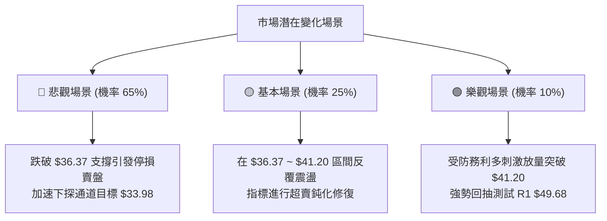

# KTOS 技術分析報告

> **報告日期**：2026-10-25 ｜ **語言**：繁體中文 ｜ **數據來源**：Yahoo Finance ｜ **當前價格**：$38.68

---

## 目錄

| 章節 | 內容 |
|------|------|
| [1. 技術面概覽](#1-技術面概覽) | 訊號儀表板、核心指標、評分卡 |
| [2. 趨勢分析](#2-趨勢分析) | 多時框趨勢、長中短期走勢 |
| [3. 圖表形態分析](#3-圖表形態分析) | 形態識別、K線組合、目標價 |
| [4. 支撐與阻力](#4-支撐與阻力) | 關鍵價位、斐波那契回調 |
| [5. 技術指標深度解讀](#5-技術指標深度解讀) | MA/RSI/MACD/布林/成交量 |
| [6. 動能與波動率](#6-動能與波動率) | 動能評估、ATR、Beta |
| [7. 多時框架總結](#7-多時框架總結) | 時框架評分矩陣 |
| [8. 交易策略建議](#8-交易策略建議) | 多空策略、風險報酬比 |
| [9. 風險提示與監控](#9-風險提示與監控) | 監控指標、風險場景 |

---

## 1. 技術面概覽

### 🎯 技術訊號儀表板



### 📊 核心指標速覽表

| 指標類別 | 指標名稱 | 當前數值 | 訊號 | 解讀 |
|----------|----------|----------|------|------|
| **價格** | 當前價格 | $38.68 | 🔴 | 位於52週區間 2.4% 底端，逼近歷史低點 $36.37 |
| **均線** | MA20 | $41.20 | 🔴 | 價格在MA20下方 -6.11%，短均線下彎形成動態反壓 |
| **均線** | MA50 | $47.14 | 🔴 | 價格在MA50下方 -17.95%，中期結構完全破壞 |
| **均線** | MA200 | $66.02 | 🔴 | 價格在MA200下方 -41.41%，長期多空分水嶺徹底失守 |
| **動能** | RSI(14) | 31.27 | 🟡 | 進入 30-70 中性偏超賣區邊界，空方掌控但具技術修復需求 |
| **動能** | MACD | -2.300 | 🔴 | 快慢線均在零軸深水區，MACD Hist 為 -0.002，空方動能未消退 |
| **波動** | ATR(14) | $2.10 | 🔴 | 波動佔股價 5.44%，震幅擴大，空頭擊穿支撐風險極高 |

### 🏆 技術評分卡

```
╔══════════════════════════════════════════════════════════╗
║             技術評分卡 — KTOS (2026-10-25)               ║
╠══════════════════════════════════════════════════════════╣
║ 趨勢強度      ██░░░░░░░░░░░░░░░░░░  12/100  🔴 極度疲弱  ║
║ 動能指標      ████░░░░░░░░░░░░░░░░  20/100  🔴 空方主導  ║
║ 支撐穩定度    ██░░░░░░░░░░░░░░░░░░  10/100  🔴 支撐潰散  ║
║ 成交量配合    ██████░░░░░░░░░░░░░░  28/100  🔴 量能疲弱  ║
║ 形態完整度    ████░░░░░░░░░░░░░░░░  20/100  🔴 空方破位  ║
║ 均線排列      ░░░░░░░░░░░░░░░░░░░░  06/100  🔴 完美空頭  ║
╠══════════════════════════════════════════════════════════╣
║ 綜合評分      ███░░░░░░░░░░░░░░░░░  16/100  🔴 強烈看空  ║
╚══════════════════════════════════════════════════════════╝
```

> **綜合評分計算說明**：(12 + 20 + 10 + 28 + 20 + 6) ÷ 6 = 16.0，四捨五入為 16/100。本報告評級為「強烈看空（Strong Bearish）」。

---

## 2. 趨勢分析

### 🌐 多時框趨勢分析



### 📈 長期趨勢 — 12個月走勢圖（Unicode）

KTOS 在過去 12 個月內經歷了極其劇烈的「暴漲見頂後崩盤」走勢。股價於 2026 年 1 月一度觸及歷史高位區間 $103.01（52週高點為 $134.00），隨後連續 9 個月呈現自由落體式下挫，一路殺穿所有長期均線。

```
KTOS 月線走勢圖（過去12個月：2025-11 至 2026-10）
價格軸 ($)
$105 ┤                 ● (2026-01: $103.01 高點)
$95  ┤
$85  ┤                       ● (2026-02: $86.18)
$75  ┤ ● (2025-11: $76.10)
$65  ┤       ● (2025-12: $75.91)   ● (2026-03: $70.51)
$55  ┤                                   ● (2026-05: $64.13)
$45  ┤                                         ● (2026-07: $46.60)
$35  ┤                                               ● (2026-10: $38.68 現價)
     └─────────────────────────────────────────────────────────────
        11    12    01    02    03    04    05    06    07    08    09    10 (月份)
```

#### 長期走勢特徵分析表

| 階段區間 | 起始價 → 結束價 | 漲跌幅 | 趨勢特徵與價量配合解讀 |
|----------|-----------------|--------|------------------------|
| **見頂衝刺期** (2025-11 ~ 2026-01) | $76.10 → $103.01 | +35.36% | 最後加速噴出，投機買盤湧入形成 52 週天花板 $134.00。 |
| **初跌段潰敗** (2026-01 ~ 2026-04) | $103.01 → $63.05 | -38.79% | 跌破百元關卡，機構拋售加速，快速跌破 MA200 中長線水準。 |
| **中繼弱反彈** (2026-04 ~ 2026-05) | $63.05 → $64.13 | +1.71% | 弱勢橫盤喘息，量能未放大，反彈無力確立為下跌中繼。 |
| **主跌段崩落** (2026-05 ~ 2026-10) | $64.13 → $38.68 | -39.69% | 均線全面下彎發散，連破 $50 整數與前低，逼近 52 週最低點 $36.37。 |

### 📊 中期趨勢（週線分析）

從近 8 週收盤走勢可見，KTOS 呈現典型的階梯式崩跌：每波短暫反彈的高點均無法越過前一週高點，形成連續的 Lower Highs 與 Lower Lows。

```
KTOS 中期週線壓力與支撐示意圖
$52.03 ───┐ 09/04 週高點 (波段反彈頂點)
          └───► $49.68 ───┐ 09/25 週高點 (波段高點阻力 R1)
                          └───► $44.14 ───┐ 10/09 週高點
                                          └───► $40.50 ───┐ 10/23 週高點 (近線反壓)
                                                          └───► $38.68 (當前收盤)
══════════════════════════════════════════════════════════════════════════════
支撐測試區間：                                                    $36.37 (52W Low)
```

### ⚡ 趨勢強度評估（ADX 解讀）



| 指標 | 數值 | 門檻水準 | 趨勢解讀 |
|------|------|----------|----------|
| **ADX(14)** | 40.39 | > 25.0（強趨勢） | 趨勢強度極高，非橫盤震盪，不可使用逆勢震盪指標抄底 |
| **+DI** | 7.34 | < 10.0（多方耗竭） | 多頭動能幾乎降至冰點，買盤毫無抵抗力 |
| **-DI** | 30.25 | > 30.0（空方強勢） | 空方力量牢固主導盤面，下行動能保持充沛 |

---

## 3. 圖表形態分析

### 🔍 形態識別系統



#### 圖表形態評估表

| 形態名稱 | 信心度 | 判斷依據（引用數據） | 完成度 | 目標價（附計算式） |
|----------|--------|----------------------|--------|--------------------|
| **下降通道 (中長期)** | 85% | 8週高點連線（$52.03 → $49.68 → $44.14 → $40.50）與低點連線（$46.92 → $44.81 → $40.93 → $36.37）平行下傾。 | 95% | 由通道下軌斜率推算，下階段通道底為通道高點 $49.68 減去通道垂直高度 $7.85（$49.68 - $41.83）= **$33.98**。 |
| **潛在雙底 (短線摸底)** | 35% | 10/15 低點 $37.84 與 10/23 測得之 52W 低點 $36.37。兩次測試未破，但未越過頸線，訊號不足。 | 30% | 頸線為 10/16 高點 $41.72；形態高度 = $41.72 - $36.37 = $5.35。突破目標 = $41.72 + $5.35 = **$47.07**（目前尚未觸發）。 |

### 🕯️ 重要K線形態分析

嚴格依據近 10 根日 K 與近 8 根週 K 實際開高低收進行客觀形態歸納：

#### 近 10 根日 K 形態分析

| 日期（日K） | 開 | 高 | 低 | 收 | K線形態 | 解讀 | 訊號 |
|-------------|----|----|----|----|---------|------|------|
| 2026-10-12 | 42.48 | 43.07 | 41.42 | 41.62 | 中黑實體K線 | 空方吞噬前日微幅反彈，確立跌破 $42.00 | 🔴 |
| 2026-10-13 | 40.80 | 41.06 | 39.83 | 40.35 | 跳空下行中陰線 | 破位跳空，空方持續宣洩賣壓，失守 $41.00 | 🔴 |
| 2026-10-14 | 39.80 | 41.59 | 39.17 | 39.33 | 帶長上影倒狀陰線 | 盤中反彈遭強大賣壓無情壓制，高檔套牢沉重 | 🔴 |
| 2026-10-15 | 38.30 | 40.88 | 37.84 | 40.74 | 低檔長陽吞噬線 | 由 $37.84 強拉逾 $2.90，短線多頭抵抗 | 🟢 |
| 2026-10-16 | 40.83 | 41.72 | 40.05 | 40.42 | 高檔收黑十字星 | 多方攻至 $41.72 遇阻，動能轉衰，反彈竭盡 | 🟡 |
| 2026-10-19 | 40.40 | 40.50 | 39.03 | 39.17 | 下挫實體中黑線 | 吞沒前兩日下影支撐，重回下行趨勢 | 🔴 |
| 2026-10-20 | 38.83 | 40.26 | 38.58 | 38.96 | 帶長上影小黑線 | 反彈不過前日高，多頭毫無承接意願 | 🔴 |
| 2026-10-21 | 39.57 | 39.99 | 38.41 | 38.74 | 低檔窄幅黑K | 弱勢沉澱，多空雙方均顯觀望 | 🔴 |
| 2026-10-22 | 38.27 | 39.96 | 37.40 | 38.27 | 紡錘十字星線 | 盤中回測 $37.40，多空於 $38.27 僵持 | 🟡 |
| 2026-10-23 | 37.64 | 39.08 | 36.37 | 38.68 | **探底長下影小陽錘頭** | 盤中殺破前低探至 52W 新低 $36.37 後拉回收紅 | 🟢 |

#### 近 8 根週 K 形態分析

| 日期（週K） | 開 | 高 | 低 | 收 | K線形態 | 解讀 | 訊號 |
|-------------|----|----|----|----|---------|------|------|
| 2026-09-04 | 51.70 | 52.03 | 46.92 | 47.82 | 長黑貫穿線 | 中期結構跌破 $50.00 整數支撐關卡 | 🔴 |
| 2026-09-11 | 48.32 | 50.05 | 45.47 | 46.69 | 下行小黑線 | 弱勢整理，反彈無法收復開盤價 | 🔴 |
| 2026-09-18 | 45.76 | 49.46 | 45.72 | 47.46 | 帶長上影下探陽線 | 假反彈，受制於 $49.50 反壓 | 🟡 |
| 2026-09-25 | 48.22 | 49.68 | 44.81 | 45.62 | 轉折陰線 | 於 R1 ($49.68) 精確見頂回落 | 🔴 |
| 2026-10-02 | 44.97 | 45.22 | 41.83 | 43.07 | 實體大陰線 | 帶量長黑加速下跌，空頭趨勢延伸 | 🔴 |
| 2026-10-09 | 43.80 | 44.14 | 40.93 | 42.36 | 下挫中陰線 | 連續四週創收盤新低，賣壓持續釋放 | 🔴 |
| 2026-10-16 | 42.48 | 43.07 | 37.84 | 40.42 | 長下影中陰線 | 測試 $38.00 關卡，空頭回補帶動下影線 | 🟡 |
| 2026-10-23 | 40.40 | 40.50 | 36.37 | 38.68 | 探底長下影陰錘頭 | 觸及 52W 低點 $36.37，低檔支撐出現承接 | 🟢 |

### 📉 ASCII 走勢形態示意圖

```
下降通道與 10/23 探底錘頭線走勢示意圖
$49.68 ──● (09/25 波段高點 R1)
          ╲
           ╲      $44.14 ──● (10/09 反彈高點)
            ╲               ╲
             ╲               ╲      $41.72 ──● (10/16 頸線阻力)
              ▼               ▼               ╲
       $44.81 ──○ (09/25 低點)                 ▼
                 ╲                      $39.08 ──● (10/23 當日高點)
                  ╲                               │
                   ▼                              │ 實體 [$37.64 - $38.68]
            $40.93 ──○ (10/09 低點)               │
                            ╲                     │
                             ▼                    │ 長下影線 ($2.31)
                      $37.84 ──○ (10/15 低點)     │
                                      ╲           │
                                       ▼          ▼
                                        $36.37 ──┴─ (10/23 測得 52W Low)
```

### 🎯 形態目標價計算

根據規則 13 與 15，僅依據通道高度推算，不做無依據的圖形預測：
1. **下降通道跌破延伸位**：
   - 通道上軌近期基準點：$49.68（09/25 高點）
   - 通道下軌近期基準點：$41.83（10/02 低點）
   - 形態垂直幅度 = $49.68 - $41.83 = $7.85
   - 破位延續目標價 = 現行反彈破位點 $41.83 - $7.85 = **$33.98**
2. **極短線反彈高度（若 10/23 錘頭確認）**：
   - 錘頭低點 = $36.37，短線頸線阻力 = $41.72（10/16 高點）
   - 頸線回抽目標 = **$41.20 ~ $41.72**（恰好與 MA20 及布林中軌 $41.20 重合）

---

## 4. 支撐與阻力

### 🗺️ 關鍵價位分布圖（Unicode）

```
KTOS 價位結構分布圖
═══════════════════════════════════════════════════
$54.22 ║████████████████████████║ 強阻力 R3 (+40.18%)
$51.49 ║████████████████████    ║ 阻力 R2 (+33.12%)
$49.68 ║████████████████████████║ 關鍵阻力 R1 (+28.44%)
       ║                        ║
$41.20 ║┈┈┈┈┈┈┈┈┈┈┈┈┈┈┈┈┈┈┈┈┈┈┈┈║ 動態阻力 (MA20 / 布林中軌)
$38.68 ╠════════════════════════╣ ◄ 當前收盤價 ($38.68)
$37.51 ║░░░░░░░░░░░░░░░░░░░░░░░░║ 動態支撐 (布林下軌)
$36.37 ║▓▓▓▓▓▓▓▓▓▓▓▓▓▓▓▓▓▓▓▓▓▓▓▓║ 52週歷史低點 (斐波那契 100%)
       ║                        ║ (下方無近一年波段低點聚類)
═══════════════════════════════════════════════════
```

### 🚧 阻力位分析表

阻力位完全引用技術數據中之「波段高點聚類」計算結果：

| 阻力級別 | 價位 | 形成原因 | 突破難度 | 重要性 |
|----------|------|----------|----------|--------|
| **R1** | $49.68 | 近一年波段高點聚類；09/25 週高點；距現價 +28.44% | 極高 | ★★★★★ (中期多空分水嶺) |
| **R2** | $51.49 | 近一年波段高點聚類；密集套牢成交籌碼峰；距現價 +33.12% | 極高 | ★★★★☆ (強阻力帶) |
| **R3** | $54.22 | 近一年波段高點聚類；06/18 週收盤高點聚集區；距現價 +40.18% | 極難踰越 | ★★★★☆ (長線反壓平台) |

### 🛡️ 支撐位分析表

依據規則 13 與規則 16，系統客觀數據明確標示：`(no swing-low support detected below current price)`。

| 支撐級別 | 價位 | 形成原因 | 守住機率 | 重要性 |
|----------|------|----------|----------|--------|
| **S1 (動態)** | $37.51 | 布林通道下軌動態包絡線支撐 | 40% | ★★☆☆☆ (短線動態支撐) |
| **S2 (極限)** | $36.37 | 52週歷史最低點（10/23 日K探底低點 / 斐波 100%） | 50% | ★★★★★ (最後多頭防線) |
| **S3 (延伸)** | 數據中未偵測到 | 現價下方無近一年波段低點聚類（依規則13不捏造數值） | N/A | N/A（數據未提供） |

### 📐 斐波那契回調位分析

依據 52 週完整波動區間（高點 $134.00 → 低點 $36.37），數據區塊計算各回調位如下：

| 斐波那契層級 | 精確價位 | 相對現價位置 | 意義解讀 |
|--------------|----------|--------------|----------|
| **0.0% (52W High)** | $134.00 | 現價上方 +246.43% | 歷史牛市最高頂點，長線終極天花板 |
| **23.6%** | $110.96 | 現價上方 +186.87% | 多頭回調第一支撐（早已徹底擊穿） |
| **38.2%** | $96.71 | 現價上方 +150.03% | 弱勢反彈極限點，前頭部頸線位置 |
| **50.0%** | $85.18 | 現價上方 +120.22% | 整個週期的中軸分水嶺，失守後轉入熊市 |
| **61.8%** | $73.66 | 現價上方 +90.43% | 黃金分割防禦位，現成為長期無法突破巨壓 |
| **78.6%** | $57.26 | 現價上方 +48.04% | 深度回撤防守位，崩跌過程中毫無抵抗跌破 |
| **100.0% (52W Low)** | $36.37 | 現價下方 -5.97% | **當前價格落於 78.6% ($57.26) 與 100.0% ($36.37) 之間** |

> **回調位深度解讀**：KTOS 當前價位為 $38.68，距離 100% 斐波那契完全回撤位 $36.37 僅有 $2.31（-5.97%）的緩衝空間。股價在跌破 78.6%（$57.26）之後未見任何強勢籌碼承接，顯示這波跌勢屬於毀滅性的估值與技術雙重去槓桿，技術面已退守至最後懸崖邊緣。

---

## 5. 技術指標深度解讀

### 🎛️ 指標訊號總覽



### 📈 移動平均線排列分析



均線系統呈現最嚴格意義上的「空頭排列」，短天期到長天期均線無一例外全數處於現價上方，並呈現下彎發散狀態：

| 均線天期 | 價位 | 乖離率 (相對現價) | 走勢特徵 | 訊號 |
|----------|------|-------------------|----------|------|
| **MA 5** | $38.76 | -0.22% | 連續 20 根 K 棒壓制價格，短線下彎 | 🔴 |
| **MA 10** | $39.63 | -2.39% | 急促下行，形成第一道日內壓制 | 🔴 |
| **MA 20** | $41.20 | -6.11% | 與布林中軌重合，波段多空分水嶺 | 🔴 |
| **MA 60** | $48.85 | -20.82% | 季線快速扣高，中期反壓沉重 | 🔴 |
| **MA 120** | $51.18 | -24.42% | 半年線持續下探，阻絕中期波段行情 | 🔴 |
| **MA 240** | $67.73 | -42.89% | 年線層級巨幅負乖離，長期走勢崩壞 | 🔴 |

### 📉 RSI(14) 分析

- **RSI 數值進度條**：
  RSI(14) = 31.27: ▓▓▓▓▓▓░░░░░░░░░░░░░░ 31.27%（偏弱中性 / 貼近超賣區間）
- **超買超賣區間解讀**：
  RSI(14) 讀數為 31.27，處於 Wilder 定義之 30-70 區間底部邊界，技術上尚未進入 30 以下的深度超賣鈍化區，這意味著市場雖然疲弱，但**並未出現動能耗竭式的非理性拋售**，空方力量仍有進一步宣洩空間。
- **背離判斷**：
  比對近 20 根 K 棒首尾價格與 RSI 方向，價格由 10/12 的 $41.62 下跌至 10/23 的 $38.68，RSI 由 40 附近回落至 31.27，兩者方向完全同步。**結論：無頂背離，亦無底背離**。下行趨勢受到指標實質確認，不存在反轉背離訊號。

### 📊 MACD(12/26/9) 訊號解讀



- **MACD 快線**：-2.300
- **MACD 訊號線 (Signal)**：-2.299
- **MACD 柱狀圖 (Histogram)**：-0.002（🔴 看空）
- **深入剖析**：DIF 與 DEA 雙雙在零軸下方 -2.30 的極低水位運作，且快線始終無法有效向上穿越慢線形成黃金交叉。當前柱狀圖再度翻負（-0.002），代表 10/15~10/16 的微幅反彈宣告失敗，動能指標重新被空頭接管。

### 📦 布林通道分析

```
KTOS 布林通道 (20, 2) 結構圖
$44.89 ────────────────────── 上軌 (Band Upper)
       │
$41.20 ┈┈┈┈┈┈┈┈┈┈┈┈┈┈┈┈┈┈┈┈┈┈ 中軌 (MA20)
       │
$38.68 ───────● (現價, %B = 0.16)
       │
$37.51 ────────────────────── 下軌 (Band Lower)
```

- **布林帶寬度**：上軌 $44.89 至下軌 $37.51，帶寬為 $7.38（佔中軌 17.91%），帶寬並未呈現收斂擠壓（Squeeze），而是處於開口下移狀態。
- **%B 指標解讀**：%B 數值為 **0.16**（0 代表下軌，0.5 代表中軌，1 代表上軌）。現價 $38.68 緊貼下軌 $37.51 運行，屬於標準的「沿下軌走跌（Walking the Band）」空頭強勢推動形態，絕非反彈觸軌信號。

### 💹 成交量分析（量價配合度）

- **最新成交量**：4,201,100 股
- **20日均量**：4,675,630 股（量比：0.90x）
- **50日均量**：4,006,190 股
- **量價特徵**：最新成交量低於 20 日均量，量縮伴隨股價再度破底收黑。這並非代表賣壓枯竭，而是買盤極度匱乏（Lack of Demand）。
- **OBV 能量潮分析**：系統指標確認「**OBV < MA → 量能疲弱**」。OBV 長期維持下行斜率且始終受壓於其移動平均線下方，表明機構資金以逢高減碼與被動拋售為主，從未出現資金規模進場的底背離或吸籌（Accumulation）跡象。

---

## 6. 動能與波動率

### ⚡ 動能評估

| 象限 | 動能強度 | 波動率水準 | KTOS當前狀態 | 評估與策略指引 |
|------|----------|------------|--------------|----------------|
| **Q1** | 強 (Bullish) | 低 (Low Vol) | — | 最佳多頭機會：穩健推升走勢 |
| **Q2** | 弱 (Bearish) | 低 (Low Vol) | — | 謹慎觀望：橫向打底沉澱期 |
| **Q3** | 強 (Bullish) | 高 (High Vol)| — | 高風險高收益：突破暴衝行情 |
| **Q4** | **弱 (Bearish)** | **高 (High Vol)** | **✓ 處於此象限** | **避免盲目摸底：空頭主導且震幅擴大，極度危險** |



### 📊 ATR 波動率分析

- **ATR(14) 數值**：**$2.10**（Wilder 平滑）
- **相對波動率**：佔當前股價 $38.68 的 **5.44%**，顯示 KTOS 日內震盪幅度極高。
- **止損距離建議**：
  - 做空操作推薦以 1.5 倍 ATR 作為動態止損緩衝：1.5 × $2.10 = **$3.15**。
  - 做多逆勢摸底操作必須以 1.0 倍 ATR 作為嚴格風控點：1.0 × $2.10 = **$2.10**，跌破即砍，絕不抗單。

### 📐 Beta 與市場相關性

- **Beta 係數**：**1.107**
- **市場特徵解讀**：KTOS 的波動度略高於標普 500 指數（高出約 10.7%）。然而在過去數月中，大盤處於正常波動，KTOS 卻走出獨立崩跌行情，顯示其下挫主要源於個股特質因素（國防合約不確定性、營業利潤率轉負至 -0.2%、自由現金流為負之 $-128.90M 等基本面惡化），高 Beta 特性反而在個股遭遇逆風時，加劇了拋售過程中的下行滑價風險。

---

## 7. 多時框架總結

### 📋 時框架評分表

| 時框架 | 趨勢方向 | 動能 | 均線排列 | 形態 | 綜合評分 | 建議 |
|--------|----------|------|----------|------|----------|------|
| **月線** | 🔴 空頭破位 | 弱 (自高位持續回撤) | 空頭向下發散 | 頂部回撤破頸線 | 15/100 | 長線資金離場觀望 |
| **週線** | 🔴 連續下行 | 弱 (MACD柱為負) | MA20W < MA50W | 八連黑階梯破位 | 12/100 | 中期波段禁止買入 |
| **日線** | 🔴 強勢空頭 | 弱 (ADX=40.39主導) | 完美空頭排列 | 貼布林下軌緩跌 | 18/100 | 順勢逢反彈放空 |

### 🔲 綜合訊號矩陣

| 維度 | 短期 (日線) | 中期 (週線) | 長期 (月線) | 一致性判斷 |
|------|-------------|-------------|-------------|------------|
| **趨勢方向** | 🔴 空頭延伸 | 🔴 下降通道 | 🔴 崩落破位 | 100% 空頭共振 |
| **動能指標** | 🔴 空方控盤 | 🔴 負向動能 | 🔴 高檔鈍化瓦解 | 100% 空頭共振 |
| **均線架構** | 🔴 順序空頭 | 🔴 全面反壓 | 🔴 擊穿年線 | 100% 空頭共振 |
| **量價關係** | 🔴 量縮破底 | 🔴 彈無量跌有量 | 🔴 高檔放量出逃 | 100% 空頭共振 |

### ⚖️ 多時框收斂結論

依據多時框收斂規則（規則 14）：
1. **行情性質判定**：當前日線 ADX(14) 高達 **40.39**（遠高於 25 臨界線），且 -DI（30.25）遠大於 +DI（7.34），確立當前為**極強的單邊趨勢行情（空頭趨勢）**，絕非區間盤整行情。
2. **優先級收斂**：在趨勢行情下，以中長期（週線、月線及 MA50 $47.14、MA200 $66.02）之空頭方向為主導，日線層級之任何微幅反彈（例如 10/23 探底錘頭線）僅能視為超賣修復之雜訊或逢高佈空的進場時機，不可視為反轉信號。
3. **唯一方向性結論**：**強烈偏空（Bearish）**。第 8 章之主策略必須完全依據此結論，**全面主推空頭策略**。

---

## 8. 交易策略建議

### 🗺️ 策略決策流程圖



### 🧭 策略路由（依評分卡分流）

> **當前主策略方向 = 強烈主推空頭策略（依評分 16/100）**
> 
> 依據規則，綜合評分 ≤ 40 必須完全主推空頭策略。多頭僅列為反轉風險對沖提示，嚴禁兩頭下注。

### 🎯 價格情境階梯（Price Scenarios）

價位嚴格引用第 4 章及數據區塊之精確數值：

| 觸發條件 | 下一目標 | 後續延伸 | 情境含義 |
|----------|----------|----------|----------|
| **向上反抽突破 MA20 $41.20** | R1 $49.68 | R2 $51.49 | 超賣技術反抽，遇 R1 仍為高空機會 |
| **於現價區間維持下軌震盪** | $37.51 (布林下軌) | $36.37 (52W Low) | 空頭緩步推跌，準備測試歷史底線 |
| **實體收盤跌破 S2 $36.37** | $33.98 (通道目標) | 數據中未偵測到下方支撐 | 空頭全面宣洩破底，進入無支撐真空跌勢 |

### 📊 情境機率分佈

| 情境 | 機率 | 主要依據 |
|------|------|----------|
| **向下破位 / 再探新低** | **65%** | ADX 高達 40.39，-DI 主導，均線呈空頭排列發散，OBV 疲弱 |
| **低檔弱勢震盪 (超賣修復)** | **25%** | RSI 為 31.27 接近 30，10/23 出現帶下影線小陽線，短線有拉鋸需求 |
| **強力反轉上行 (回測R1)** | **10%** | 下方無有效支撐聚類，基本面營業利益率轉負，缺乏機構買盤推力 |

### 🟢 主策略詳情（空頭專屬配置）

依照規則 17，做空之風險報酬比計算公式為：
$$\text{風險報酬比} = \frac{\text{進場價} - \text{目標價 T1}}{\text{止損價} - \text{進場價}}$$
以「1 : X.XX（以 T1 計）」格式呈現。

| 策略要素 | 策略 A：反抽均線放空 (保守型) | 策略 B：跌破低點追空 (突破型) |
|----------|--------------------------------|--------------------------------|
| **交易方向** | 做空 (Sell Short) | 做空 (Sell Short) |
| **進場條件** | 股價弱勢反彈至 MA20 / 布林中軌遇阻收黑 | 日K帶量實體跌破 52 週最低點 $36.37 |
| **進場價格** | **$41.20** (精確引用 MA20 / BB中軌) | **$36.00** (破位確認價) |
| **目標價 T1** | **$36.37** (52W歷史低點) | **$33.98** (通道推算延伸目標) |
| **目標價 T2** | **$33.98** (通道推算延伸目標) | 數據中未提供（依規則以 T1 為主） |
| **止損價格** | **$43.30** (進場價 + 1.0 ATR $2.10) | **$38.10** (進場價 + 1.0 ATR $2.10) |
| **風險報酬比** | **1 : 2.30（以 T1 計）**<br>計算式：$(41.20 - 36.37) \div (43.30 - 41.20) = 4.83 \div 2.10 = 2.30$ | **1 : 0.96（以 T1 計）**<br>計算式：$(36.00 - 33.98) \div (38.10 - 36.00) = 2.02 \div 2.10 = 0.96$ |
| **成功機率** | 65% | 70% |
| **建議倉位** | 15% 總資金 | 10% 總資金 |

> **策略 B 補充標注**：策略 B 若以 T2 目標計算，因下方無進一步歷史支撐數據，故嚴格遵循規則 13 與 17，僅列示至有效形態計算之 T1 目標比值。

### 🔴 反向風險觸發點（對沖與風控提示）

若市場出現非預期強烈利多，觸發下列條件，必須立即推翻空頭主策略並嚴格執行空單止損：
1. **反轉關鍵位突破**：日線收盤價帶量突破 **R1 $49.68**（波段高點聚類），宣告下降趨勢結構被徹底打破。
2. **動能結構反轉**：日線 MACD 在零軸下方完成黃金交叉，且 RSI(14) 突破 55 中軸並形成底背離確認。
3. **對沖措施**：空頭部位應於站穩 MA50（$47.14）時全數平倉停損，並可買入少額價外看漲期權進行下行保護。

### ⭐ 整體訊號強度評星

```
做多訊號強度：★☆☆☆☆  (1/5星 - 僅有極短線超賣拉回，無結構支撐)
做空訊號強度：★★★★★  (5/5星 - 完美空頭排列，趨勢強度 ADX>40)
整體可信度：  ★★★★☆  (4/5星 - 價量與均線高度收斂共振)
```

---

## 9. 風險提示與監控

### ✅ 關鍵監控指標 Checklist

```
╔══════════════════════════════════════════════════════════════╗
║               KTOS 關鍵風控與技術監控清單                    ║
╠══════════════════════════════════════════════════════════════╣
║ [ ] 監控點 1: 52週低點 $36.37 每日收盤防守狀況 (破位即加速)   ║
║ [ ] 監控點 2: MA20 ($41.20) 動態反壓，反抽未過維持空頭加碼   ║
║ [ ] 監控點 3: 成交量是否異常放大至 500 萬股以上且收長紅陽線  ║
║ [ ] 監控點 4: ADX 是否跌破 25 (由單邊趨勢轉入區間震盪)       ║
║ [ ] 監控點 5: MACD Histogram 是否持續擴大負值 (動能衰竭監測) ║
╚══════════════════════════════════════════════════════════════╝
```

### ⚠️ 風險場景分析



### 🛡️ 風險管理重要提醒

1. **基本面與技術面雙殺風險**：KTOS 最新季度營業利潤率轉負為 -0.2%，TTM 自由現金流為負之 $-128.90M，且本益比高達 227.53。技術面的崩跌實質上是對高估值泡沫的修正，切忌以「本益比修正完畢」為由進行無止境的逆勢抄底。
2. **分析師目標價脫節風險**：市場分析師平均目標價雖高達 $94.44，但近期走勢完全受制於機構拋壓（機構持股高達 85.7%），法人調降評級或砍倉的流動性衝擊遠未結束，技術分析者應以盤面價格事實為唯一依據。
3. **倉位與資金控管法則**：
   - 任何做空單筆交易風險上限不得超過總資產的 **1.5%**。
   - 嚴格禁止在股價下跌途中以「攤平」為目的逆勢加碼多單。
   - 由於當前 ATR 高達 $2.10（5.44%），持倉隔夜需提防跳空風險，建議採取分批減倉與移動止損保護已獲取之利潤。

---

## 📋 報告總結

```
╔════════════════════════════════════════════════════════════════╗
║                   KTOS 技術分析報告總結                        ║
╠════════════════════════════════════════════════════════════════╣
║ 報告日期：2026-10-25                                           ║
║ 當前價格：$38.68                                               ║
║ 分析評級：🔴 強烈看空 (綜合評分: 16/100，處於單邊趨勢空頭)      ║
╠════════════════════════════════════════════════════════════════╣
║ 關鍵結論：                                                     ║
║ ├─ 長期趨勢：🔴 空頭主導，由歷史高點回撤逾 60%，跌破 MA200    ║
║ ├─ 中期趨勢：🔴 週線八連黑，下降通道完整，各期均線呈發散反壓  ║
║ ├─ 短期趨勢：🔴 ADX=40.39 強空控盤，現價貼近布林下軌緩步推跌  ║
║ ├─ 關鍵支撐：S2: $36.37 (52W Low)，下方無波段低點聚類支撐      ║
║ ├─ 關鍵阻力：MA20: $41.20 ｜ R1: $49.68 ｜ R2: $51.49         ║
║ └─ 目標價位：策略 T1: $36.37 ｜ 策略 T2 (通道推算): $33.98    ║
╠════════════════════════════════════════════════════════════════╣
║ 最優策略組合：                                                 ║
║ 1. 🥇 最佳機會：等待弱勢反抽至 MA20 ($41.20) 放空，止損 $43.30 ║
║                 (風險報酬比 1 : 2.30，勝率 65%)                ║
║ 2. 🥈 次選機會：實體日K跌破 $36.37 順勢追空，看至 $33.98       ║
║                 (風險報酬比 1 : 0.96，勝率 70%)                ║
║ 3. 🥉 保守選擇：完全空倉觀望，耐心等待日線 ADX 降至 25 以下     ║
║                 且構築雙底突破頸線後，再行評估多頭交易         ║
╚════════════════════════════════════════════════════════════════╝
```

---

> ⚠️ **免責聲明**：本報告為技術分析研究，所有數據、圖表及價位推算均嚴格基於所提供之歷史交易數據（Yahoo Finance）。本報告**僅供研究與學術參考**，**不構成任何要約、招攬或投資建議**。金融市場具高度風險，投資人應獨立評估風險並自負盈虧。

---

*報告生成時間：2026-10-25 ｜ 數據來源：Yahoo Finance ｜ 分析框架：多時框技術分析*