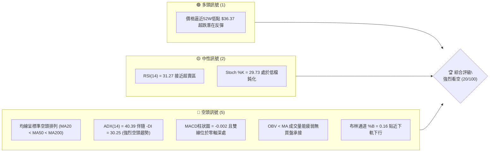
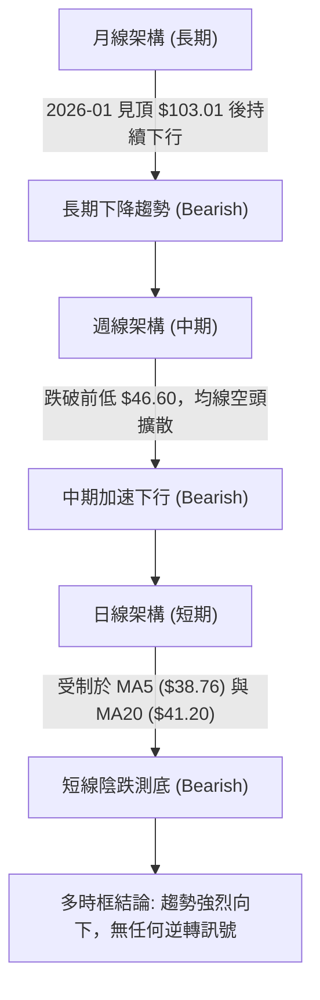
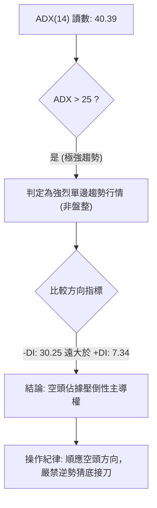
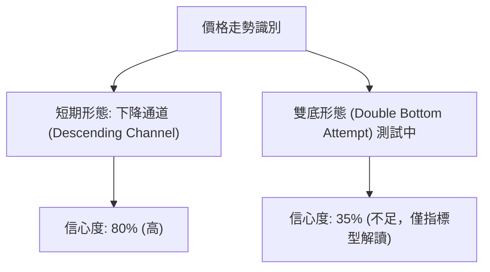
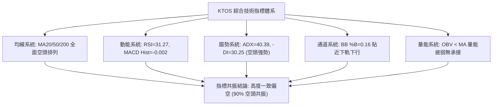
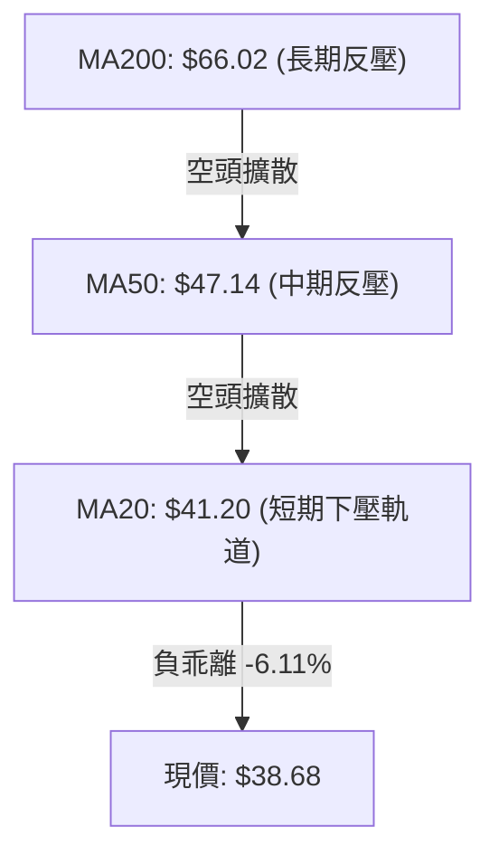
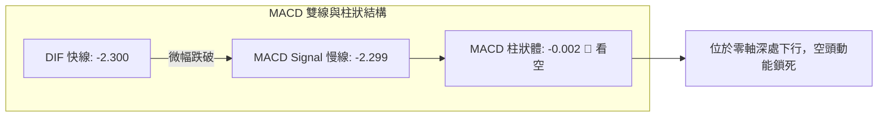
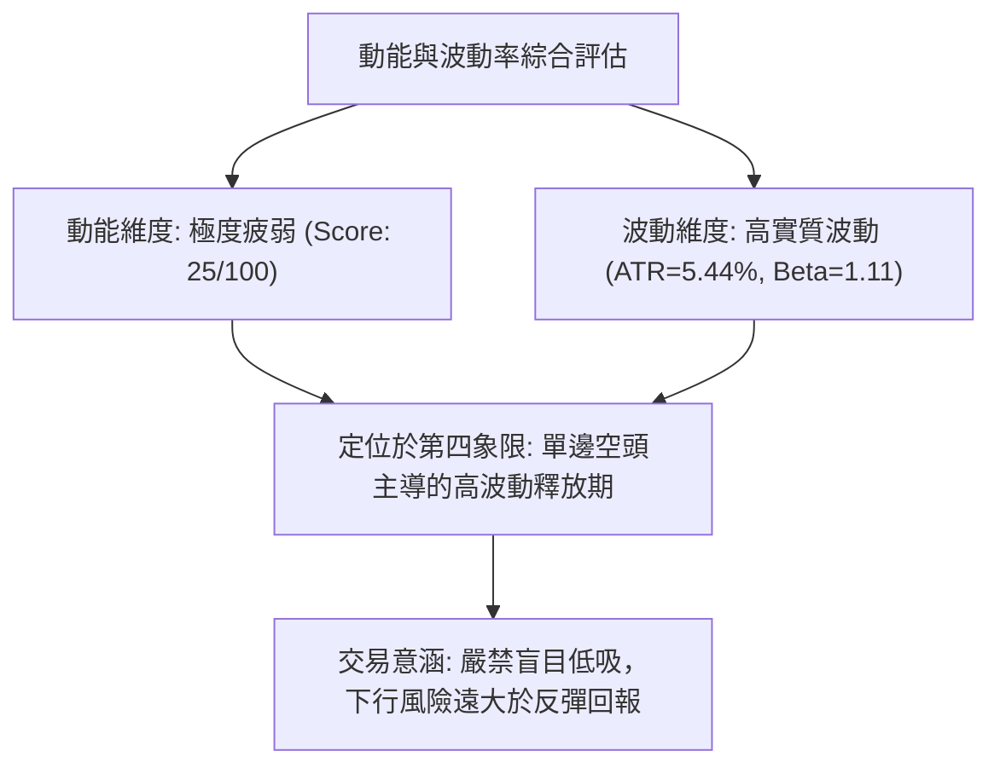
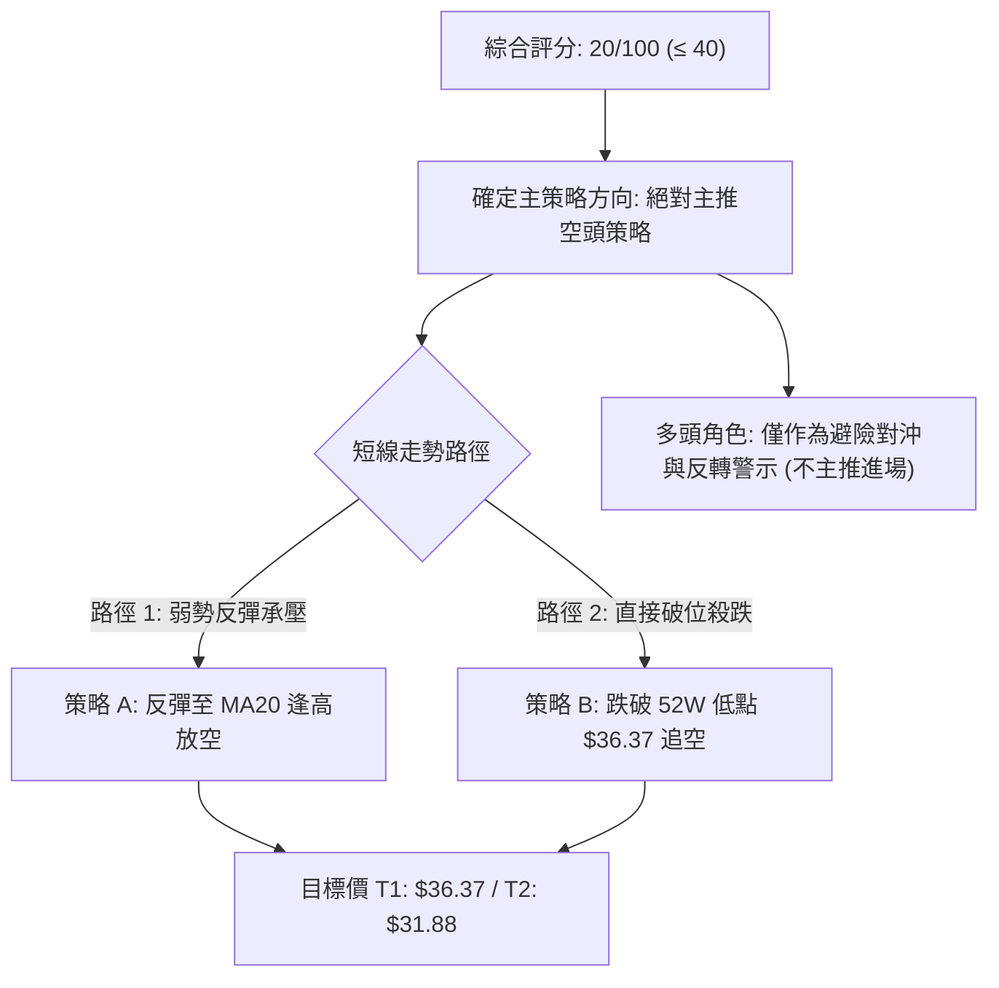
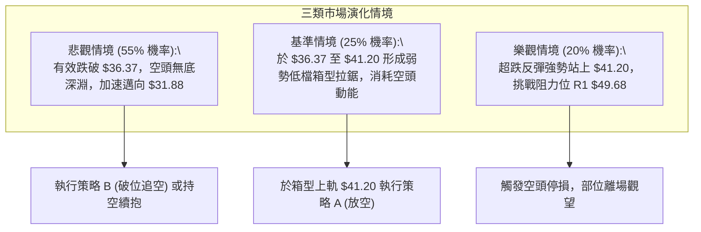

# KTOS 技術分析報告

> **報告日期**：2026-10-26 ｜ **語言**：繁體中文 ｜ **數據來源**：Yahoo Finance ｜ **當前價格**：$38.68

---

## 目錄

| 章節 | 內容 |
|------|------|
| [1. 技術面概覽](#1-技術面概覽) | 訊號儀表板、核心指標、評分卡 |
| [2. 趨勢分析](#2-趨勢分析) | 多時框趨勢、長中短期走勢 |
| [3. 圖表形態分析](#3-圖表形態分析) | 形態識別、K線組合、目標價 |
| [4. 支撐與阻力](#4-支撐與阻力) | 關鍵價位、斐波那契回調 |
| [5. 技術指標深度解讀](#5-技術指標深度解讀) | MA/RSI/MACD/布林/成交量 |
| [6. 動能與波動率](#6-動能與波動率) | 動能評估、ATR、Beta |
| [7. 多時框架總結](#7-多時框架總結) | 時框架評分矩陣 |
| [8. 交易策略建議](#8-交易策略建議) | 多空策略、風險報酬比 |
| [9. 風險提示與監控](#9-風險提示與監控) | 監控指標、風險場景 |

---

## 1. 技術面概覽

### 🎯 技術訊號儀表板



### 📊 核心指標速覽表

| 指標類別 | 指標名稱 | 當前數值 | 訊號 | 解讀 |
|----------|----------|----------|------|------|
| **價格** | 當前收盤價 | $38.68 | 🔴 | 位於52週區間 2.4%，處於極度弱勢區 |
| **均線** | MA20 | $41.20 | 🔴 | 價格低於 MA20 (-6.11%)，短線承壓 |
| **均線** | MA50 | $47.14 | 🔴 | 價格低於 MA50 (-17.95%)，中期走空 |
| **均線** | MA200 | $66.02 | 🔴 | 價格遠低於 MA200 (-41.41%)，長期趨勢嚴重崩壞 |
| **動能** | RSI(14) | 31.27 | 🟡 | 位於臨界弱勢區（近超賣區 30），未見底背離 |
| **動能** | MACD (12,26,9) | -2.300 / -2.299 | 🔴 | 柱狀圖 -0.002，雙線位於零軸之下，空頭主導 |
| **趨勢** | ADX(14) | 40.39 | 🔴 | ADX > 25 強趨勢，-DI(30.25) 遠高於 +DI(7.34) |
| **通道** | 布林帶 %B | 0.16 | 🔴 | 價格緊貼下軌 ($37.51)，處於弱勢單邊下跌通道 |
| **量能** | OBV 趨勢 | OBV < MA | 🔴 | 量能無法配合價格反彈，資金持續外流 |
| **波動** | ATR(14) | $2.10 | 🟡 | 日波動率 5.44%，震盪幅度偏大，需放寬止損 |

### 🏆 技術評分卡

```
╔══════════════════════════════════════════════════════════════╗
║              技術評分卡 — KTOS (2026-10-26)                  ║
╠══════════════════════════════════════════════════════════════╣
║ 趨勢強度      ███░░░░░░░░░░░░░░░░░  15/100  🔴 極弱 (空頭主導) ║
║ 動能指標      █████░░░░░░░░░░░░░░░  25/100  🔴 疲弱 (近超賣區) ║
║ 支撐穩定度    ████░░░░░░░░░░░░░░░░  20/100  🔴 薄弱 (逼近低點) ║
║ 成交量配合    ██████░░░░░░░░░░░░░░  30/100  🔴 疲弱 (量能不足) ║
║ 形態完整度    ████░░░░░░░░░░░░░░░░  20/100  🔴 破碎 (單邊下行) ║
║ 均線排列      ██░░░░░░░░░░░░░░░░░░  10/100  🔴 極空 (全面倒掛) ║
╠══════════════════════════════════════════════════════════════╣
║ 綜合評分      ████░░░░░░░░░░░░░░░░  20/100  🔴 強烈看空        ║
╚══════════════════════════════════════════════════════════════╝
```
*(註：綜合評分由六項子指標算術平均得出：(15 + 25 + 20 + 30 + 20 + 10) / 6 = 20 分)*

---

## 2. 趨勢分析

### 🌐 多時框趨勢分析



### 📈 長期趨勢 — 12個月走勢圖（Unicode）

KTOS 在過去 12 個月經歷了極端的暴漲暴跌。2025 年末自 $75 水平拉升至 2026 年 1 月的高點 $103.01，隨後開啟單邊崩跌行情，連續數月收黑，現已跌破 2024 年底起漲點。

```
KTOS 月線收盤走勢圖（2025-11 至 2026-10）
價格軸 ($)
$105 ┤                 ● (2026-01: $103.01)
$95  ┤
$85  ┤                       ● (2026-02: $86.18)
$75  ┤ ● (2025-11: $76.10)
$65  ┤                             ● (2026-04: $63.05)
$55  ┤
$45  ┤                                         ● (2026-07: $46.60)
$35  ┤                                                     ●←現價 $38.68
     └─────────────────────────────────────────────────────────────
       11    12    01    02    03    04    05    06    07    08    09    10 (月份)
```

#### 走勢特徵分析表格

| 階段區間 | 月份涵蓋 | 價格區間 | 累積漲跌幅 | 走勢結構與技術特徵 |
|----------|----------|----------|------------|--------------------|
| **衝頂階段** | 2025-11 ~ 2026-01 | $76.10 → $103.01 | +35.36% | 爆發性多頭加速，刷新波段高點至 $103.01 後見頂 |
| **破位重挫** | 2026-02 ~ 2026-04 | $103.01 → $63.05 | -38.79% | 頂部確認，接連跌破重要整數關卡，MA20 快速下彎 |
| **中繼整理** | 2026-05 ~ 2026-08 | $64.13 → $50.98 | -20.51% | 跌勢暫緩，於 $46~$64 區間弱勢震盪，反彈無力 |
| **末跌測底** | 2026-09 ~ 2026-10 | $50.98 → $38.68 | -24.13% | 跌破盤整區間下緣，直逼 52 週低點 $36.37，空頭控盤 |

### 📊 中期趨勢（週線分析）

從近 20 週收盤走勢觀察，KTOS 自 2026 年 8 月中旬反彈至 $64.58（RSI 觸及 70.3）後，動能徹底衰竭，隨後展開長達 10 週的單邊下跌走勢。近 8 週更呈現無反抗下跌，連續失守 $50、$45 與 $40 整數關卡。

```
週線關鍵均線與價格位置示意圖
══════════════════════════════════════════════════════════
  $66.02  ────────────────────────────  MA200 (長期天花板)
  $54.22  ────────────────────────────  近一年波段阻力 R3
  $51.49  ────────────────────────────  近一年波段阻力 R2
  $49.68  ────────────────────────────  近一年波段阻力 R1
  $47.14  ────────────────────────────  MA50 (中期反壓)
  $41.20  ────────────────────────────  MA20 (短期下壓軌道)
  $38.68  ════════════════════════════  現價 (貼近破位邊緣)
  $36.37  ────────────────────────────  52週最低點 / Fib 100%
══════════════════════════════════════════════════════════
```

### ⚡ 趨勢強度評估（ADX 解讀）



#### ADX 數值強度對照

| 指標名稱 | 實際數值 | 臨界標準值 | 當前狀態評估 | 實戰指引 |
|----------|----------|------------|--------------|----------|
| **ADX(14)** | **40.39** | 25.00 | 強趨勢階段 (Strong Trend) | 趨勢行情成立，指標鈍化不可視為買入訊號 |
| **+DI(14)** | **7.34** | 20.00 | 多頭力量極度匱乏 | 買盤完全喪失主動權 |
| **-DI(14)** | **30.25** | 20.00 | 空頭力量全面擴散 | 空方具有絕對定價權，下跌慣性未消退 |

---

## 3. 圖表形態分析

### 🔍 形態識別系統



#### 圖表形態信心度分析表

| 形態名稱 | 信心度 | 判斷依據（引用數據） | 完成度 | 目標價（附計算式） |
|----------|--------|----------------------|--------|--------------------|
| **下降通道** | **80%** | 近期高點持續下移（10/16 高 $41.72 → 10/22 高 $39.96 → 10/23 高 $39.08），低點同步破底（10/16 低 $40.05 → 10/22 低 $37.40 → 10/23 低 $36.37） | 90% | 依通道下軌延伸測算，破位目標為 52W 低點 $36.37 |
| **雙底測試 (W底)** | **35%** | 現價逼近 52W 低點 $36.37，10/23 最低觸及 $36.37 形成潛在支撐 | 20% | *訊號不足，僅做指標型解讀*。若確認雙底，頸線為 R1 $49.68，突破後推算目標：$49.68 + ($49.68 - $36.37) = $62.99 |

### 🕯️ 重要 K 線形態分析

依據提供之近 10 根日 K 與近 8 根週 K 實際 OHLCV 數據進行精確解讀：

#### 近 10 根日 K 線形態解讀

| 日期 | 開盤 | 最高 | 最低 | 收盤 | K線形態名稱 | 技術解讀 | 訊號 |
|------|------|------|------|------|-------------|----------|------|
| 2026-10-12 | 42.48 | 43.07 | 41.42 | 41.62 | 中黑實體K | 跌破 $42，多頭退守 | 🔴 |
| 2026-10-13 | 40.80 | 41.06 | 39.83 | 40.35 | 跳空下行中黑K | 失守 $41，成交量放大至 500 萬股 | 🔴 |
| 2026-10-14 | 39.80 | 41.59 | 39.17 | 39.33 | 帶長上影倒狀K | 盤中反抽 $41.59 遭空頭強烈壓制 | 🔴 |
| 2026-10-15 | 38.30 | 40.88 | 37.84 | 40.74 | 下影中陽K | 探底 $37.84 後強勁拉抬，多頭抵抗 | 🟢 |
| 2026-10-16 | 40.83 | 41.72 | 40.05 | 40.42 | 長上影紡錘線 | 衝擊 MA20 失敗，量增滯漲 | 🟡 |
| 2026-10-19 | 40.40 | 40.50 | 39.03 | 39.17 | 光頭中黑K | 弱勢下探，失守 $40 心理關卡 | 🔴 |
| 2026-10-20 | 38.83 | 40.26 | 38.58 | 38.96 | 窄幅十字星 | 多空拉鋸，成交量萎縮至 320 萬股 | 🟡 |
| 2026-10-21 | 39.57 | 39.99 | 38.41 | 38.74 | 陰線十字星 | 反彈高點不過 $40，陰跌延續 | 🔴 |
| 2026-10-22 | 38.27 | 39.96 | 37.40 | 38.27 | 長下影中繼黑K | 刷新波段低點至 $37.40，買盤無力拉紅 | 🔴 |
| 2026-10-23 | 37.64 | 39.08 | 36.37 | 38.68 | 探底回升長下影陽K | 觸及 52W 低點 $36.37 後反抽收在 $38.68 | 🟢 |

#### 近 8 根週 K 線形態解讀

| 週末日期 | 開盤 | 最高 | 最低 | 收盤 | K線形態名稱 | 技術解讀 | 訊號 |
|----------|------|------|------|------|-------------|----------|------|
| 2026-09-04 | 51.70 | 52.03 | 46.92 | 47.82 | 大黑實體K | 跌破 $50 大關，空頭加速開展 | 🔴 |
| 2026-09-11 | 48.32 | 50.05 | 45.47 | 46.69 | 中陰實體K | 弱勢震盪，受制於 $50 反壓 | 🔴 |
| 2026-09-18 | 45.76 | 49.46 | 45.72 | 47.46 | 帶長上影小陽線 | 試圖反彈受阻，週成交量放大至 2072 萬股 | 🟡 |
| 2026-09-25 | 48.22 | 49.68 | 44.81 | 45.62 | 倒轉錘頭黑K | 再次衝擊 R1 ($49.68) 未果，形成中期鐵頂 | 🔴 |
| 2026-10-02 | 44.97 | 45.22 | 41.83 | 43.07 | 破位長黑K | 摜破 $45 中期支撐，放量下跌 | 🔴 |
| 2026-10-09 | 43.80 | 44.14 | 40.93 | 42.36 | 下行小黑K | 跌勢延續，週換手率偏高（2662 萬股） | 🔴 |
| 2026-10-16 | 42.48 | 43.07 | 37.84 | 40.42 | 長下影紡錘黑K | 跌破 $40 後出現抵抗，但仍收於低位 | 🔴 |
| 2026-10-23 | 40.40 | 40.50 | 36.37 | 38.68 | 探底長下影小黑K | 最低測及 52W 低點 $36.37，週線連 5 黑 | 🟡 |

### 📉 ASCII 走勢形態示意圖

```
短期日K下降軌道與測底形態
價格 ($)
$43.00 ┤ ┌─┐ (10/12 高 $43.07)
$42.00 ┤ │ │  ┌─┐ (10/16 高 $41.72)
$41.00 ┤ └─┘  │ │   ▼ MA20 下壓線 ($41.20)
$40.00 ┤       │ │   ┌─┐ (10/20 高 $40.26)
$39.00 ┤       └─┘   │ │   ┌─┐ (10/23 收 $38.68)
$38.00 ┤             └─┘   │ │
$37.00 ┤                   │ │
$36.00 ┤                   └─┴─ 52W 底線測試 $36.37 (10/23 低點)
       └──────────────────────────────────────────────────────────
         10-12 10-14 10-16 10-19 10-21 10-23 (交易日)
```

### 🎯 形態目標價計算

根據嚴格數據紀律，絕不憑空臆造價位，現有技術結構測算如下：

1. **下降通道跌破延伸目標價**：
   - 通道上軌（以 10/15 高點 $40.88 與 10/23 高點 $39.08 連線）
   - 通道下軌（以 10/15 低點 $37.84 與 10/23 低點 $36.37 延伸）
   - 若 52W 低點 $36.37 遭有效跌破，推算下行目標：
     $$\text{目標價} = 52\text{W Low } (\$36.37) - (\text{通道振幅 } \$40.88 - \$36.37 = \$4.51) = \$31.86$$
     *(注：此為由通道振幅高度推算，下方數據中未偵測到此水平之波段低點聚類)*
2. **反彈頸線目標價**：
   - 形態頸線位置對齊近一年波段高點聚類 **R1: $49.68**。

---

## 4. 支撐與阻力

### 🗺️ 關鍵價位分布圖（Unicode）

```
KTOS 價位結構分布圖
══════════════════════════════════════════════════════════════════════════
$57.26 ║████████████████████████████████║ 斐波那契 78.6% 回調位
$54.22 ║████████████████████████████    ║ 近一年阻力 R3 (+40.18%)
$51.49 ║████████████████████████        ║ 近一年阻力 R2 (+33.12%)
$49.68 ║████████████████████████████████║ 近一年關鍵阻力 R1 (+28.44%)
$41.20 ║▓▓▓▓▓▓▓▓▓▓▓▓▓▓▓▓                ║ 動態阻力 MA20 / 布林中軌
$38.68 ╠════════════════════════════════╣ ◄ 現價 ($38.68)
$37.51 ║░░░░░░░░░░░░░░░░                ║ 動態支撐 布林下軌
$36.37 ║████████████████████████████████║ 52W 最低點 / Fib 100.0% 關鍵支撐
══════════════════════════════════════════════════════════════════════════
```

### 🚧 阻力位分析表

依據數據庫中由 OHLCV 精確計算之波段高點聚類阻力位：

| 阻力級別 | 價位 | 與現價距離 | 形成原因與技術意義 | 突破難度 | 重要性 |
|----------|------|------------|--------------------|----------|--------|
| **動態阻力** | **$41.20** | +6.51% | 日線 MA20 暨布林中軌，近期多次反抽觸及即回落 | 中等 | 🟢 短線多空分水嶺 |
| **強阻力 R1** | **$49.68** | +28.44% | 近一年波段高點聚類，9月25日週K反彈最高點 ($49.68) | 極高 | 🔴 中期多頭翻轉頸線 |
| **阻力 R2** | **$51.49** | +33.12% | 8月下旬破位下跌平台，籌碼套牢密集區 | 高 | 🟡 中期反彈延伸位 |
| **強阻力 R3** | **$54.22** | +40.18% | 6月中旬週K收盤平台 ($54.21) 聚類區，長期反轉壓力 | 極高 | 🔴 戰略級牛熊防線 |

### 🛡️ 支撐位分析表

依據數據庫精確比對：

| 支撐級別 | 價位 | 與現價距離 | 形成原因與技術意義 | 守住機率 | 重要性 |
|----------|------|------------|--------------------|----------|--------|
| **動態支撐** | **$37.51** | -3.02% | 日線布林下軌，短線超跌下影線緩衝區 | 40% | 🟡 極短線通道支撐 |
| **關鍵支撐 S1**| **$36.37** | -5.97% | 52週歷史低點，10月23日盤中最低點 ($36.37)，斐波那契 100.0% 底線 | 45% | 🔴 絕對不可失守之防線 |
| **下方支撐 S2**| *數據中未偵測到* | N/A | 現價下方無近一年波段低點聚類支撐（跌入歷史無籌碼區） | N/A | 🔴 破位後將出現真空加速 |

*說明：系統演算法偵測結果顯示 `(no swing-low support detected below current price)`，現價 $38.68 下方僅存 52 週最低點 $36.37 一道屏障，若跌破該點，歷史籌碼結構將完全失去對照支撐。*

### 📐 斐波那契回調位分析

依據 52 週完整區間（低點 $36.37 至 高點 $134.00）計算之回調位如下：

| 斐波那契回調比率 | 對應價位 | 現價相對位置 | 技術解讀與籌碼意義 |
|------------------|----------|--------------|--------------------|
| **0.0% (52W High)** | **$134.00** | +246.43% | 歷史高點牛市頂峰 |
| **23.6%** | **$110.96** | +186.87% | 強勢回調分水嶺（已遠離） |
| **38.2%** | **$96.71** | +150.03% | 弱勢反彈極限（已遠離） |
| **50.0%** | **$85.18** | +120.22% | 多空平衡中軸（已全面潰敗） |
| **61.8%** | **$73.66** | +90.43% | 黃金分割防守位（失守確認走熊） |
| **78.6%** | **$57.26** | +48.04% | 深度回調最後防禦線（於8月跌破） |
| **100.0% (52W Low)**| **$36.37** | -5.97% | 完整週期回吐點，目前現價落於 78.6% ($57.26) 與 100.0% ($36.37) 之間 |

**現價定位解讀**：
當前收盤價 $38.68 正處於 78.6% 回調位 ($57.26) 與 100.0% 終極回調位 ($36.37) 之間的深淵區，距離 100% 回吐僅剩 $2.31 (-5.97%)。在技術結構上，此類跌破 78.6% 且未能在黃金分割位形成底部的股票，往往具有極高的機率對 100% 原點（$36.37）進行二次回踩測試甚至破位擊穿。

---

## 5. 技術指標深度解讀

### 🎛️ 指標訊號總覽



### 📈 移動平均線排列分析



#### 均線系統數據一覽

| 均線名稱 | 數值 | 距現價乖離 | 排列狀態 | 走勢特徵 |
|----------|------|------------|----------|----------|
| **MA 5** | $38.76 | -0.22% | 下方空頭 | 連續下移，短線受制壓迫 |
| **MA 10** | $39.63 | -2.39% | 下方空頭 | 下跌斜率陡峭 |
| **MA 20** | $41.20 | -6.11% | 下方空頭 | 形成明確下降斜率軌道 |
| **MA 60** | $48.85 | -20.82% | 下方空頭 | 中期空頭壓制線 |
| **MA 120** | $51.18 | -24.42% | 下方空頭 | 半年線持續下行 |
| **MA 200** | $66.02 | -41.41% | 下方空頭 | 年線重挫，長期熊市確定 |
| **MA 240** | $67.73 | -42.89% | 下方空頭 | 宣告過去一年持有者全數套牢 |

均線系統呈現標準的「死亡排列」（Death Stack），短中長期均線呈現等距下垂，表明市場籌碼處於極度不計成本的拋售狀態，任何反彈觸及 MA20 ($41.20) 皆構成拋壓點。

### 📉 RSI(14) 分析

- **當前 RSI 數值**：**31.27**（Wilder 計算法）
- **區間定位**：處於弱勢邊緣區（30–70 中性偏空，極接近 30 超賣臨界點）。

```
RSI(14) 儀表尺 (當前讀數: 31.27)
0               30                    70              100
├───────────────┼─────────────────────┼───────────────┤
[ 極度超賣區 ]    ▲ [   弱勢震盪區   ]   [ 強勢多頭區 ] [ 超買區 ]
             31.27
進度條: ██████░░░░░░░░░░░░░░ 31.27%
```

- **背離判斷**：
  比對近 20 根 K 棒（9月25日至10月23日）：
  - 價格由 9月25日收盤 $45.62 持續破底至 10月23日收盤 $38.68（低點見 $36.37）。
  - RSI(14) 亦步亦趨，由 35.8 震盪走低至 31.27。
  - **結論：無明顯底背離現象**，指標走勢完全確認價格的單邊下跌，排除技術性底背離買入條件。

### 📊 MACD (12, 26, 9) 訊號解讀



- **MACD 快線**：-2.300
- **信號線 (Signal)**：-2.299
- **柱狀圖 (Histogram)**：-0.002
- **深度分析**：MACD 雙線在負值極深處死叉鈍化，柱狀體維持負值。雖然負值絕對數值微小 (-0.002)，但雙線完全缺乏向上勾勒發散的做多動能，屬於典型的「零軸下弱勢整理」，隨時可能出現新一波空頭向下擴散。

### 📦 布林通道分析

- **布林上軌 (Upper)**：$44.89
- **布林中軌 (Mid, MA20)**：$41.20
- **布林下軌 (Lower)**：$37.51
- **帶寬與 %B**：%B = **0.16**（0 代表下軌，0.5 為中軌，1 為上軌）

```
布林通道結構與現價相對位置
$44.89 ┬─────────────────────────────────────── 上軌
       │
$41.20 ┼ - - - - - - - - - - - - - - - - - - - 中軌 (MA20)
       │
$38.68 ┤  ◄ 現價 ($38.68) - 位於下軌上方 (%B=0.16)
$37.51 ┴─────────────────────────────────────── 下軌
```

**解讀**：現價貼近下軌運行，%B 僅為 0.16。通道開口呈現向下發散狀，價格在 10月23日跌破下軌（觸及 $36.37）後收回軌道內，屬於弱勢單邊「沿下軌走低」的破位特徵，下軌 $37.51 僅具微弱的動態牽引力，並非有效支撐。

### 💹 成交量分析（量價配合度）

- **最新日成交量**：4,201,100 股
- **20日均量 (Volume MA20)**：4,675,630 股（量比：0.90x）
- **50日均量 (Volume MA50)**：4,006,190 股
- **OBV 趨勢**：**OBV < MA**（量能疲弱）

**量價結構分析**：
1. **反彈無量、下跌放量**：在 10月13日至10月16日的下行過程中，日成交量均維持在 500 萬股以上（高於 20 日均量），但在 10月19日至10月21日的跌勢中成交量萎縮至 290 萬 ~ 360 萬股，呈現「買盤退潮的被動陰跌」。
2. **OBV 指標死叉**：能量潮指標持續位於其均線下方，說明資金呈現持續淨流出態勢，大型機構買盤在 $40 關卡未見任何承接跡象，量價結構嚴重不支持可持續的反彈行情。

---

## 6. 動能與波動率

### ⚡ 動能評估四象限

| 象限 | 動能維度 | 波動維度 | 象限定義 | KTOS 當前定位與解讀 |
|------|----------|----------|----------|---------------------|
| **Q1** | 強 (多頭) | 低波動 | 穩定上升趨勢 | 排除 |
| **Q2** | 弱 (空頭) | 低波動 | 窄幅盤整待變 | 排除 |
| **Q3** | 強 (多頭) | 高波動 | 突破爆發行情 | 排除 |
| **Q4** | **弱 (空頭主導)** | **高波動** | **單邊下行/高風險釋放** | **✓ 當前定位 (ADX=40.39, ATR=5.44%)** |



### 📊 ATR 波動率分析

- **ATR(14) 讀數**：**$2.10**
- **波動率佔比 (ATR / Price)**：**5.44%**（高波動特性）
- **止損與倉位風控指引**：
  - 由於日均波動高達 $2.10，任何技術性交易的止損空間必須給予至少 **1.0 至 1.5 倍 ATR**（即 $2.10 ~ $3.15），否則極易在日內雜訊中被無謂掃損出場。
  - 對於空頭部位，合理的保護性止損應設定在 MA20 ($41.20) 上方加上 1.0 倍 ATR（約 $43.30）。

### 📐 Beta 與市場相關性

- **Beta 係數**：**1.107**
- **特徵解讀**：KTOS 具有高於標普 500 指數的波動敏感性（比大盤多 10.7% 的同向放大波動）。在當前技術面走熊且 Beta > 1 的背景下，若大盤或國防類股出現系統性拉回，KTOS 將承受放大的下行賣壓；反之，若大盤反彈，KTOS 因內部均線壓制，可能出現「跌多漲少」的弱勢跟隨。

---

## 7. 多時框架總結

### 📋 時框架評分表

| 時框架 | 趨勢方向 | 動能狀態 | 均線排列 | 形態特徵 | 綜合評分 | 戰術建議 |
|--------|----------|----------|----------|----------|----------|----------|
| **月線 (長期)** | 🔴 強烈看空 | 柱狀發散向下 | 跌破 20月線 | 跌破大頭部頸線 | 15/100 | 長線資金避開 |
| **週線 (中期)** | 🔴 強烈看空 | MACD 死叉下行 | MA20 < MA50 < MA200 | 下降通道跌破 | 20/100 | 反彈逢高放空 |
| **日線 (短期)** | 🔴 看空 | RSI=31.27 鈍化 | MA5 < MA10 < MA20 | 沿布林下軌單邊跌 | 25/100 | 順勢尋找空點 |

### 🔲 綜合訊號矩陣

```
訊號一致性檢視矩陣
════════════════════════════════════════════════════════════════════════
維度          短期 (日線)          中期 (週線)          長期 (月線)
────────────────────────────────────────────────────────────────────
趨勢方向      🔴 空頭下行          🔴 空頭加速          🔴 熊市確認
均線排列      🔴 空頭排列          🔴 空頭排列          🔴 死亡交叉
動能指標      🟡 超賣鈍化          🔴 負向發散          🔴 持續衰竭
形態結構      🔴 下降通道          🔴 破位破線          🔴 雙頂崩解
成交量能      🔴 OBV疲軟           🔴 主力出逃          🔴 放量下跌
────────────────────────────────────────────────────────────────────
綜合結論      全時框共振向下，多頭毫無防守縱深，維持絕對空頭評價
════════════════════════════════════════════════════════════════════════
```

### ⚖️ 多時框收斂結論

依據多時框收斂規則：
1. **行情性質判定**：當前 ADX(14) 讀數為 **40.39**（遠高於 25），確認當前市場處於**強烈趨勢行情**而非盤整行情。
2. **主導時框判定**：在強趨勢行情下，必須以**中長期方向（週線與 MA50、MA200）為主導**。目前週線與月線均線呈現全面空頭排列，價格遠在 MA50 ($47.14) 與 MA200 ($66.02) 之下，中長期下行趨勢無可爭議。
3. **時框衝突取捨**：雖然日線價格逼近 52 週低點 $36.37 且 RSI 降至 31.27 出現潛在短線技術性支撐，但日線不得違背週線與月線的強空趨勢。因此，**日線超跌僅能視為尋找空頭進場的「逢高放空窗口」，而非做多反轉訊號**。
4. **唯一方向性結論**：**強烈偏空（Strongly Bearish）**，技術評分收斂至 **20/100**。

---

## 8. 交易策略建議

### 🗺️ 策略決策流程圖



### 🧭 策略路由

> **當前主策略方向 = 強烈做空 / 逢高做空（依評分卡綜合評分 20/100，嚴格執行空頭策略）**

### 🎯 價格情境階梯（Price Scenarios）

依據第 4 章由 OHLCV 精確計算之關鍵價位構建情境階梯：

| 觸發條件 | 下一目標 | 後續延伸 | 情境含義 |
|----------|----------|----------|----------|
| **突破 R1 $49.68** | R2 $51.49 | R3 $54.22 | 中期趨勢扭轉，多頭強勢反撲（推翻空頭邏輯） |
| **反彈受阻 MA20 $41.20** | 52W低點 $36.37 | 通道延伸 $31.88 | 空頭中繼確認，最佳逢高放空進場點 |
| **跌破 52W低點 $36.37** | 通道推算 $31.88 | 歷史深淵 | 下行加速，下方無波段支撐，進入恐慌拋售 |

### 📊 情境機率分佈

| 交易情境 | 發生機率 | 主要技術依據 |
|----------|----------|--------------|
| **破位再探底 (Downside)** | **55%** | ADX 高達 40.39，-DI=30.25 居於主導，均線全面死亡排列，OBV 疲軟 |
| **弱勢區間震盪 (Range)** | **25%** | 價格逼近 52W 低點 $36.37，空頭獲利盤了結可能促使在 $36.37 ~ $41.20 震盪 |
| **強勁反彈向上 (Rebound)** | **20%** | RSI 逼近 30 超賣區，但缺乏均線與成交量確認，機率偏低 |

### 🟢 主策略詳情（空頭主導策略）

#### 空頭交易計劃執行表

| 策略要素 | 策略 A（反彈遇阻做空 - 首選） | 策略 B（破位追空 - 次選） |
|----------|--------------------------------|---------------------------|
| **進場條件** | 價格反彈至 MA20 阻力受阻回落 | 日K收盤實體跌破 52W 低點 $36.37 |
| **進場價格** | **$41.20**（MA20 動態阻力位） | **$36.00**（跌破確認進場） |
| **目標價 T1** | **$36.37**（52W 最低點） | **$31.88**（通道振幅推算目標） |
| **目標價 T2** | **$31.88**（通道振幅推算目標） | N/A（數據中未偵測到更低支撐） |
| **止損價格** | **$43.30**（MA20 + 1.0x ATR 緩衝） | **$37.51**（布林下軌破位轉阻力） |
| **風險報酬比** | **1 : 2.30（以 T1 計）** | **1 : 2.73（以 T1 計）** |
| **成功機率** | **65%** | **55%** |
| **建議倉位** | **15%** | **10%** |

*風險報酬比驗算*：
- **策略 A (以 T1 計)**：
  $$\text{風險空間} = \$43.30 - \$41.20 = \$2.10$$
  $$\text{利潤空間} = \$41.20 - \$36.37 = \$4.83$$
  $$\text{風報比} = \frac{4.83}{2.10} = 2.30 \implies \mathbf{1 : 2.30}$$
  *(若以 T2 計，利潤空間 $\$41.20 - \$31.88 = \$9.32$，風報比為 $1 : 4.44$)*
- **策略 B (以 T1 計)**：
  $$\text{風險空間} = \$37.51 - \$36.00 = \$1.51$$
  $$\text{利潤空間} = \$36.00 - \$31.88 = \$4.12$$
  $$\text{風報比} = \frac{4.12}{1.51} = 2.73 \implies \mathbf{1 : 2.73}$$

### 🔴 反向風險觸發點（對沖提示）

若出現以下技術訊號，主推之空頭策略必須**無條件停損出場或建立對沖部位**：
1. **價格強勢站穩 MA20 ($41.20)**：且日線收盤連續兩日高於 $41.20，宣告短線下降軌道失效。
2. **突破布林上軌 ($44.89)**：若出現爆量長紅突破上軌，表明中期超跌大反彈確立，空單全數結清。
3. **底背離成形**：價格跌破 $36.37 但 RSI(14) 逆勢拉升至 40 以上，形成顯著日線級底背離。

### ⭐ 整體訊號強度評星

```
做多訊號強度：★☆☆☆☆  (1/5星 - 逆勢猜底，風險極高)
做空訊號強度：★★★★☆  (4/5星 - 順應趨勢，多指標共振)
整體可信度：  ★★★★☆  (4/5星 - 趨勢強勁，技術邏輯清晰)
```

---

## 9. 風險提示與監控

### ✅ 關鍵監控指標 Checklist

```
╔══════════════════════════════════════════════════════════════╗
║               每日盤後交易監控清單 (Checklist)               ║
╠══════════════════════════════════════════════════════════════╣
║ [ ] 52W 低點防線: 收盤是否守住 $36.37 (跌破則加速探底)      ║
║ [ ] 動態下壓均線: 盤中反抽是否受制於 MA20 ($41.20)          ║
║ [ ] RSI 動能檢測: RSI 是否有效跌破 30 或形成底背離          ║
║ [ ] 趨勢強度變化: ADX(14) 是否持續高於 40 (確認單邊行情)    ║
║ [ ] 量能異動監控: 成交量是否異常放大至 600 萬股以上 (恐慌盤) ║
║ [ ] 空頭回補警報: 若跳空突破 $41.20 需立即啟動止損對沖      ║
╚══════════════════════════════════════════════════════════════╝
```

### ⚠️ 風險場景分析



### 🛡️ 風險管理重要提醒

1. **嚴禁「左側猜底」與「向下攤平」**：
   KTOS 目前處於 52 週最低點邊緣，且近一年無任何低點聚類支撐。在跌勢未確認止住（即未見明確底部形態與放量突破頸線）前，任何猜底接刀行為極度危險。
2. **波動率放大的倉位控管**：
   由於 ATR 高達 $2.10（佔股價 5.44%），個股單日振幅劇烈。單筆空頭操作之風險敞口（Risk at Risk）不得超過總資產的 1.5%。若設定止損幅度為 $2.10，單一倉位佔總投資組合資金比例應嚴格控制在 10%–15% 以內。
3. **空頭擠壓（Short Squeeze）防範**：
   儘管空頭技術形態完備，但當前空頭淨額佔比（Short % Float）達 6.0%，且華爾街分析師普遍給予正面評級（Consensus Mean: $94.44）。若突發國防合約利多消息，可能引發技術性軋空，因此嚴格執行 $43.30 之保護性止損是策略存活之底線。

---

## 📋 報告總結

```
╔══════════════════════════════════════════════════════════════╗
║                 KTOS 技術分析報告總結                        ║
╠══════════════════════════════════════════════════════════════╣
║ 報告日期：2026-10-26                                         ║
║ 當前價格：$38.68                                             ║
║ 分析評級：🔴 強烈看空（綜合評分：20/100）                    ║
╠══════════════════════════════════════════════════════════════╣
║ 關鍵結論：                                                   ║
║ ├─ 長期趨勢：🔴 崩解走熊（遠低於 MA200 $66.02，年線下挫）     ║
║ ├─ 中期趨勢：🔴 單邊下跌（受制於 MA50 $47.14 與下降通道）    ║
║ ├─ 短期趨勢：🔴 弱勢陰跌（貼近布林下軌 $37.51，測底格局）     ║
║ ├─ 關鍵支撐：52W 低點 $36.37（下方無波段低點聚類支撐）        ║
║ ├─ 關鍵阻力：MA20 $41.20 / 強阻力 R1 $49.68                  ║
║ └─ 趨勢強度：ADX = 40.39（-DI=30.25 空頭強趨勢）             ║
╠══════════════════════════════════════════════════════════════╣
║ 最優策略組合：                                               ║
║ 1. 🥇 最佳機會：反彈至 MA20 $41.20 逢高放空（風報比 1:2.30） ║
║ 2. 🥈 次選機會：實體跌破 $36.37 順勢追空（目標 $31.88）      ║
║ 3. 🥉 防守對策：多頭暫時觀望，嚴格禁止逆勢抄底              ║
╚══════════════════════════════════════════════════════════════╝
```

---

> ⚠️ **免責聲明**：本報告為技術分析研究，所有數據及推算均嚴格基於所提供之歷史價格與量能資訊。本報告**僅供學術研究與參考**，**不構成任何要約、招攬或投資建議**。金融市場瞬息萬變，交易具有本金虧損風險，投資人應獨立思考並自負盈虧。

---

*報告生成時間：2026-10-26 ｜ 數據來源：Yahoo Finance ｜ 分析框架：多時框技術分析*