# KTOS 技術分析報告

> **報告日期**：2026-10-27 ｜ **語言**：繁體中文 ｜ **數據來源**：Yahoo Finance ｜ **當前價格**：$40.43 USD

---

## 目錄

| 章節 | 內容 |
|------|------|
| [1. 技術面概覽](#1-技術面概覽) | 訊號儀表板、核心指標、評分卡 |
| [2. 趨勢分析](#2-趨勢分析) | 多時框趨勢、長中短期走勢 |
| [3. 圖表形態分析](#3-圖表形態分析) | 形態識別、K線組合、目標價 |
| [4. 支撐與阻力](#4-支撐與阻力) | 關鍵價位、斐波那契回調 |
| [5. 技術指標深度解讀](#5-技術指標深度解讀) | MA/RSI/MACD/布林/成交量 |
| [6. 動能與波動率](#6-動能與波動率) | 動能評估、ATR、Beta |
| [7. 多時框架總結](#7-多時框架總結) | 時框架評分矩陣 |
| [8. 交易策略建議](#8-交易策略建議) | 多空策略、風險報酬比 |
| [9. 風險提示與監控](#9-風險提示與監控) | 監控指標、風險場景 |

---

## 1. 技術面概覽

### 🎯 技術訊號儀表板

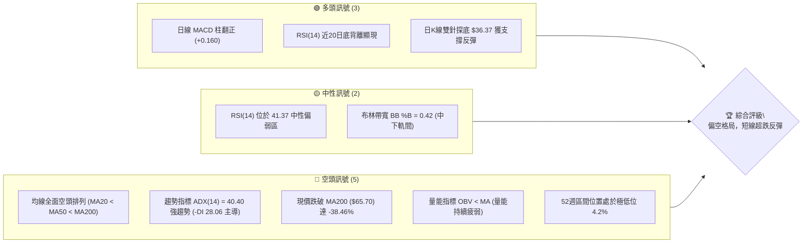

### 📊 核心指標速覽表

| 指標類別 | 指標名稱 | 當前數值 | 訊號 | 解讀 |
|----------|----------|----------|------|------|
| **價格** | 當前收盤價 | $40.43 | 🔴 | 位於 52 週低位附近（4.2%分位），極度承壓 |
| **均線** | MA20 | $41.01 | 🔴 | 價格低於 MA20（-1.41%），短期均線下彎形成動態壓制 |
| **均線** | MA50 | $46.66 | 🔴 | 價格低於 MA50（-13.35%），中期空方趨勢確立 |
| **均線** | MA200 | $65.70 | 🔴 | 價格深幅折價 MA200（-38.46%），處於長期熊市下行通道 |
| **動能** | RSI(14) | 41.37 | 🟡 | 脫離超賣區，具備近20根K棒首尾底背離型態 |
| **動能** | MACD (12,26,9) | 柱狀體 +0.160 | 🟢 | 快線 -2.098 穿越慢線 -2.259 形成黃金交叉，柱狀體翻正 |
| **趨勢** | ADX(14) | 40.40 | 🔴 | 強趨勢（ADX > 25），且 -DI(28.06) 遠高於 +DI(11.86)，空方掌控 |
| **通道** | 布林帶 %B | 0.42 | 🟡 | 股價運行於中軌（$41.01）與下軌（$37.57）之間 |
| **量能** | 成交量比 | 0.75x | 🔴 | 最新量 3.48M 低於 20 日均量 4.62M，反彈未獲量能放量確認 |
| **波動** | ATR(14) | $2.11 | 🟡 | 佔現價 5.21%，每日波幅適中偏高，短線止損需拉寬 |

### 🏆 技術評分卡

```
╔══════════════════════════════════════════════════════════════════╗
║               技術評分卡 — KTOS (2026-10-27)                    ║
╠══════════════════════════════════════════════════════════════════╣
║ 趨勢強度 (Trend)     ████████░░░░░░░░░░░░  38/100  🔴 空方強趨勢 ║
║ 動能指標 (Momentum)  ██████████░░░░░░░░░░  52/100  🟡 底背離初現 ║
║ 支撐穩定度 (Support) ██████░░░░░░░░░░░░░░  30/100  🔴 歷史支撐孤立 ║
║ 成交量配合 (Volume)  ████████░░░░░░░░░░░░  40/100  🔴 量能呈疲弱 ║
║ 形態完整度 (Pattern) ██████████░░░░░░░░░░  50/100  🟡 潛在打底結構 ║
║ 均線排列 (MovingAvg) ████░░░░░░░░░░░░░░░░  20/100  🔴 典型空頭排列 ║
╠══════════════════════════════════════════════════════════════════╣
║ 綜合評分 (Overall)   ███████░░░░░░░░░░░░░  38/100  🔴 偏空弱勢格局 ║
╚══════════════════════════════════════════════════════════════════╝
```
*(註：綜合評分為六項子評分之算術平均值：(38 + 52 + 30 + 40 + 50 + 20) ÷ 6 = 38.33，四捨五入為 38/100)*

---

## 2. 趨勢分析

### 🌐 多時框趨勢分析

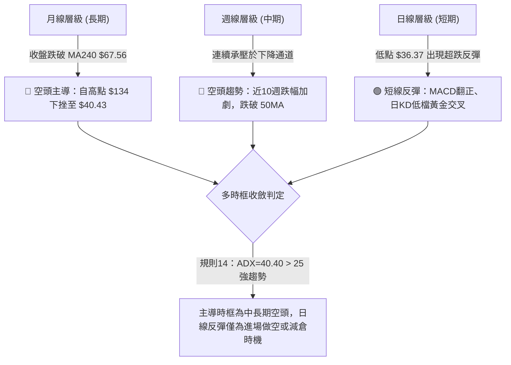

### 📈 長期趨勢 — 12個月走勢圖（Unicode）

KTOS 過去 12 個月自歷史高點階梯式走低，呈現出劇烈的拋售行情：

```
KTOS 月線走勢圖（過去12個月：2025-11 至 2026-10）
價格軸 ($)
$110 ┤
$100 ┤            ● $103.01 (2026-01 波段峰值)
 $90 ┤
 $80 ┤● $76.10 
 $70 ┤    ● $75.91      ● $86.18 (次高)
 $60 ┤                      ● $70.51  ● $63.05  ● $64.13
 $50 ┤                                              ● $49.86  ● $50.98
 $40 ┤                                                   ● $46.60  ● $42.69  ● $40.43 (當前收盤)
 $30 ┤                                                                              └─ 52W Low: $36.37
     └──────────────────────────────────────────────────────────────────────────
       25-11 25-12 26-01  26-02  26-03  26-04  26-05  26-06  26-07  26-08  26-09  26-10
```

**12個月價格走勢特徵分析表**：

| 時間區間 | 起始價 ($) | 結束價 ($) | 區間漲跌幅 | 趨勢性質 | 特徵分析 |
|----------|------------|------------|------------|----------|----------|
| 2025-11 ~ 2026-01 | $76.10 | $103.01 | +35.36% | 末升段暴衝 | 衝擊至波段高點 $103.01 後成交動能衰竭 |
| 2026-01 ~ 2026-04 | $103.01 | $63.05 | -38.79% | 主跌第一波 | 跌破所有短期均線，呈現無支撐潰退 |
| 2026-04 ~ 2026-05 | $63.05 | $64.13 | +1.71% | 弱勢橫盤 | 跌勢暫歇，形成換手整理中繼平台 |
| 2026-05 ~ 2026-07 | $64.13 | $46.60 | -27.33% | 主跌第二波 | 帶量跌破 MA60、MA120，結構徹底破位 |
| 2026-07 ~ 2026-08 | $46.60 | $50.98 | +9.40% | 跌深抽頭 | 反彈觸及 R1/R2 下緣後無功而返 |
| 2026-08 ~ 2026-10 | $50.98 | $40.43 | -20.69% | 末跌探底波 | 探測 52 週最低點 $36.37，現暫收 $40.43 |

### 📊 中期趨勢（週線分析）

從近 20 週收盤走勢來看，KTOS 呈現標準的下降常態分佈：
- 2026-08-14 達到反彈頂峰收盤 $64.58（RSI 70.3，MACD 柱 +1.743），隨後週線連跌 10 週。
- 2026-10-23 當週下探 $36.37（收盤 $38.68，週成交量縮至 18.26M）。
- 本週（2026-10-26）微幅反彈至 $40.43，但尚未收復前一週跌幅，週線 MACD 仍位於負值區間（-0.002 ~ +0.160）。

```
週線級別價格壓力結構示意圖：
$64.58 ─────────────── 中期波段反彈頂部（8月中旬）
   │
$54.22 ─────────────── 強阻力 R3（波段高點聚類）
   │
$51.49 ─────────────── 阻力 R2（MA120 動態重合區間）
   │
$49.68 ─────────────── 關鍵阻力 R1（9月下旬震盪頸線）
   │
$40.43 ◀═══════════════ 當前收盤價位（試圖築底）
   │
$36.37 ─────────────── 52W Low / 斐波那契 100.0% 關鍵防線
```

### ⚡ 趨勢強度評估（ADX 解讀）

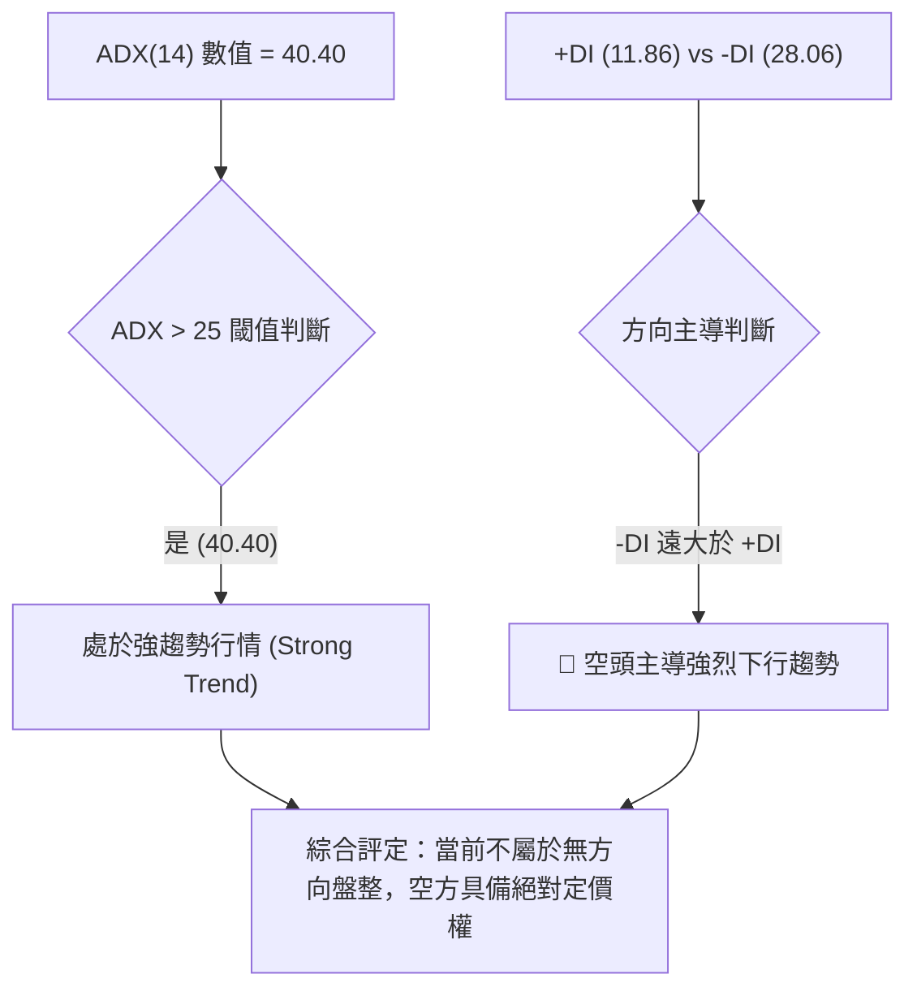

| 指標名稱 | 數值 | 門檻區間 | 解讀結論 | 訊號強度 |
|----------|------|----------|----------|----------|
| **ADX(14)** | 40.40 | > 25 為趨勢，> 40 為極強趨勢 | 市場具有極強單邊趨勢，盤整假突破機率低 | 🔴 空方趨勢極強 |
| **+DI(14)** | 11.86 | < 20 偏弱 | 多頭上攻能量萎縮，買盤意願低落 | 🔴 多方乏力 |
| **-DI(14)** | 28.06 | > 25 偏強 | 空方拋壓持續沉重，逢高賣壓顯著 | 🔴 空方掌控 |

---

## 3. 圖表形態分析

### 🔍 形態識別系統

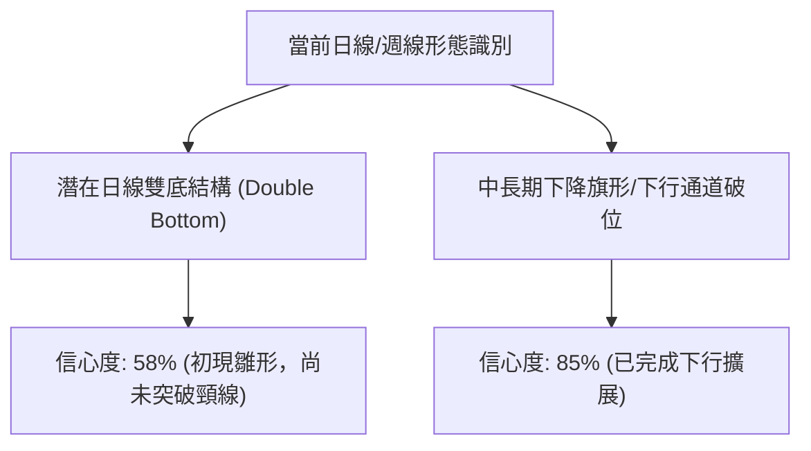

**形態信心度與目標價計算表**（依規則 15、規則 17 評估）：

| 形態名稱 | 信心度 | 判斷依據（引用數據） | 完成度 | 目標價（附計算式） |
|----------|--------|----------------------|--------|--------------------|
| **潛在日線雙底** | 58% | 2026-10-15 低點 $37.84 與 2026-10-23 低點 $36.37 形成低檔雙支撐結構 | 45% | 由形態推算：突破頸線 $41.72 後，目標價 = 頸線 $41.72 + (頸線 $41.72 − 最低點 $36.37) = **$47.07** |
| **下行通道收斂** | 85% | 週線連續自 $64.58 順沿 MA20 下滑，目前受制於 R1 $49.68 壓制 | 90% | 下跌測幅已觸及 52W Low $36.37，反彈測幅上限為 R1 **$49.68** |

### 🕯️ 重要 K 線形態分析

依規則 19，完全基於提供的「近10根日K」與「近8根週K」四價數據進行專業識別：

| 日期（層級） | 開盤價 | 最高價 | 最低價 | 收盤價 | K線形態名稱 | 技術解讀 | 訊號強度 |
|--------------|--------|--------|--------|--------|-------------|----------|----------|
| **10-15 (日K)** | 38.30 | 40.88 | 37.84 | 40.74 | 下影長陽線 | 低點 $37.84 遇買盤承接，實體長且收於全日高位 | 🟢 轉多 |
| **10-16 (日K)** | 40.83 | 41.72 | 40.05 | 40.42 | 倒轉鎚頭/孕線 | 衝擊頸線 $41.72 失敗回落，留長上影線 | 🔴 受阻 |
| **10-20 (日K)** | 38.83 | 40.26 | 38.58 | 38.96 | 弱勢十字星 | 實體極窄（0.13），量縮觀望，承壓續跌 | 🟡 中性 |
| **10-22 (日K)** | 38.27 | 39.96 | 37.40 | 38.27 | 長下影紡錘線 | 盤中殺跌至 $37.40 後收復，空方動能減弱 | 🟡 止跌 |
| **10-23 (日K)** | 37.64 | 39.08 | 36.37 | 38.68 | 探底長下影錘頭 | 刷出 52 週新低 $36.37 後強力彈升，長下影線驗證支撐 | 🟢 強看多 |
| **10-26 (日K)** | 38.68 | 40.57 | 38.43 | 40.43 | 實體大陽線 | 跳空開出並收在波段高點附近，確認 $36.37 底部有效性 | 🟢 看多 |
| **10-16 (週K)** | 42.48 | 43.07 | 37.84 | 40.42 | 長下影破位陰線 | 測試 $37.84，實體依舊收陰，空頭慣性延續 | 🔴 偏空 |
| **10-23 (週K)** | 40.40 | 40.50 | 36.37 | 38.68 | 帶長下影流星逆轉錘 | 週線低點打出 $36.37，賣壓獲初步吸收 | 🟡 初步止跌 |

### 📉 ASCII 走勢形態示意圖

**日線「雙針探底」潛在雙底反彈結構**：

```
日線潛在雙底雛形示意圖：
$41.72 ───────────────┬───────────────────────────── 頸線壓力 (10-16 高點)
                      │             /\
                      │            /  \       /\  ◄ 當前推進至 $40.43
                      │     /\    /    \     /
$39.00 ───────────────┼────/──\──/──────\───/──────────────────────
                      │   /    \/        \ /
$37.84 ───────────────┴──● (10-15 低點)   │
                                          │
$36.37 ───────────────────────────────────● (10-23 低點，52W新低)
```

### 🎯 形態目標價計算

1. **潛在雙底形態測幅目標**：
   - 形態底部低點：$36.37（2026-10-23 確切最低點）
   - 形態頸線阻力：$41.72（2026-10-16 確切最高點）
   - 形態垂直高度：$41.72 − $36.37 = $5.35
   - **等距突破目標價** = 頸線 $41.72 + 形態高度 $5.35 = **$47.07**
2. **與關鍵阻力位之關係**：
   - 第一道阻力 R1 為 **$49.68**，雙底理論測幅價 $47.07 恰好位於現價與 R1 之間，具備合理的技術反彈空間。

---

## 4. 支撐與阻力

### 🗺️ 關鍵價位分布圖（Unicode）

```
KTOS 價位結構分布圖
═══════════════════════════════════════════════════════════════════
$54.22 ║████████████████████████║ 強阻力 R3（近一年波段高點聚類）
$51.49 ║████████████████████    ║ 阻力 R2（近一年波段高點聚類）
$49.68 ║████████████████████████║ 關鍵阻力 R1（近一年波段高點聚類）
       ║                        ║
$41.01 ║────────────────────────║ 短期壓制（BB中軌 / MA20）
$40.43 ╠════════════════════════╣ ◄ 現價 (2026-10-26 收盤價)
$37.57 ║▓▓▓▓▓▓▓▓▓▓▓▓▓▓▓▓        ║ 短線動態支撐（BB下軌）
$36.37 ║████████████████████████║ 核心防守位（52W Low / 斐波 100%）
═══════════════════════════════════════════════════════════════════
```

### 🚧 阻力位分析表

*(價位嚴格引用技術數據「關鍵價位」區塊之 OHLCV 計算結果)*

| 阻力級別 | 價位 | 與現價距離 | 形成原因與技術意涵 | 突破難度 | 重要性 |
|----------|------|------------|--------------------|----------|--------|
| **R1** | $49.68 | +22.88% | 近一年波段高點聚類；9月下旬跳空跌破區間底部的結構頸線 | 🔴 高 | ★★★★★ |
| **R2** | $51.49 | +27.36% | 近一年波段高點聚類；與 MA120 ($51.02) 形成複合強阻力區 | 🔴 極高 | ★★★★☆ |
| **R3** | $54.22 | +34.11% | 近一年波段高點聚類；6月高點密集套牢籌碼峰 | 🔴 極高 | ★★★★☆ |

### 🛡️ 支撐位分析表

*(依據規則 13 及數據披露：系統在現價下方未偵測到近一年波段低點聚類)*

| 支撐級別 | 價位 | 與現價距離 | 形成原因與技術意涵 | 守住機率 | 重要性 |
|----------|------|------------|--------------------|----------|--------|
| **S1 (動態)** | $37.57 | -7.07% | 布林通道下軌動態支撐位；短線極限乖離防線 | 🟡 60% | ★★★☆☆ |
| **S2 (極值)** | $36.37 | -10.04% | 52 週最低點 (52W Low) 及 斐波那契 100.0% 終極回調位 | 🟡 55% | ★★★★★ |
| **S3 (聚類)** | N/A | N/A | **數據中未偵測到**（依據數據披露：no swing-low support detected below current price） | N/A | N/A |

### 📐 斐波那契回調位分析

*(基準區間：52週最高點 $134.00 跌至 52週最低點 $36.37，總跌幅 $97.63)*

| 回調比率 | 價位 | 當前狀態 | 技術意義解析 |
|----------|------|----------|--------------|
| **0.0% (52W High)** | $134.00 | 遠方阻力 | 歷史多頭起點，當前不具短線指導意義 |
| **23.6%** | $110.96 | 遠方阻力 | 長期下降通道上軌阻力 |
| **38.2%** | $96.71 | 遠方阻力 | 長期多空分水嶺 |
| **50.0%** | $85.18 | 遠方阻力 | 心理強分水嶺 |
| **61.8%** | $73.66 | 遠方阻力 | 黃金分割強壓力位 |
| **78.6%** | $57.26 | 中期阻力 | 中期反彈若能越過此位，方可宣告熊市終結 |
| **100.0% (52W Low)**| $36.37 | 核心基石 | 全年最低價位，跌破將引發無支撐自由落體 |

**當前落點解讀**：
- 現價 **$40.43** 緊貼於 **100.0% ($36.37)** 與 **78.6% ($57.26)** 之間，位處於整個 52 週大波段的極端底部（區間 4.2% 位置）。
- 由於現價與 78.6% ($57.26) 尚有 +41.6% 空間，短線反彈的首要關卡為聚類阻力 R1 ($49.68)，多頭若無法回補至 $49.68 之上，整體格局依然屬於「跌深技術性修正」而非反轉。

---

## 5. 技術指標深度解讀

### 🎛️ 指標訊號總覽

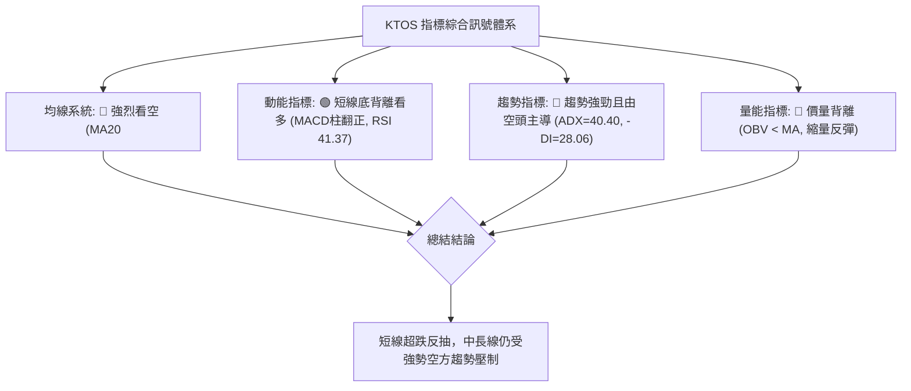

### 📈 移動平均線排列分析

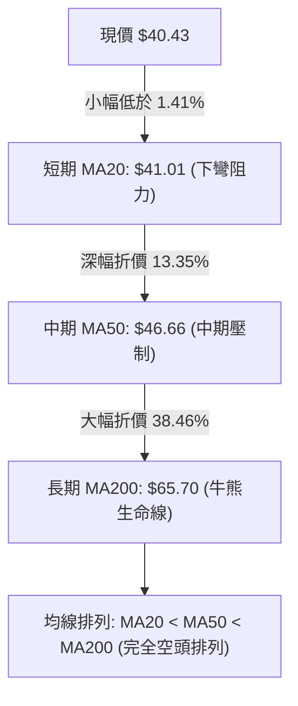

**移動平均線詳細狀態對照表**：

| 均線週期 | 價位 | 現價相對距離 | 趨勢方向 | 多空評估 |
|----------|------|--------------|----------|----------|
| **MA 5** | $39.02 | +3.62% | ▲ 上揚 | 🟢 短線穿透，提供極短線支撐 |
| **MA 10** | $39.51 | +2.33% | ▲ 上揚 | 🟢 短線交叉走平，有助於反抽 |
| **MA 20** | $41.01 | -1.43% | ▼ 下彎 | 🔴 短線第一道蓋頭反壓（布林中軌） |
| **MA 60** | $48.75 | -17.06% | ▼ 下彎 | 🔴 中期籌碼套牢均線 |
| **MA 120** | $51.02 | -20.75% | ▼ 下彎 | 🔴 中長期重要阻力（與 R2 $51.49 共振） |
| **MA 240** | $67.56 | -40.16% | ▼ 下彎 | 🔴 長期下降主趨勢線 |

### 📉 RSI(14) 分析

- **當前數值**：41.37（Wilder 計算法）
- **狀態進度條**：
  ```
  超賣 [0] ░░░░░░░░░░████████████░░░░░░░░░░░░░░░░░░ [100] 超買
                       ▲ RSI = 41.37 (中性偏弱區)
  ```
- **背離判斷**：
  - **確認存在底背離 (Bullish Divergence)**。
  - **背離細節**：近 20 根 K 棒中，價格自 10-15 低點 $37.84 下殺至 10-23 低點 $36.37（價格破底創 52 週新低）；然而日線 RSI 指標首尾比對並未破底，反而由 31 附近抬升至 41.37。此訊號明確反映出**空方殺跌力道減弱，多方動能正在低檔悄然凝聚**。

### 📊 MACD(12,26,9) 訊號解讀

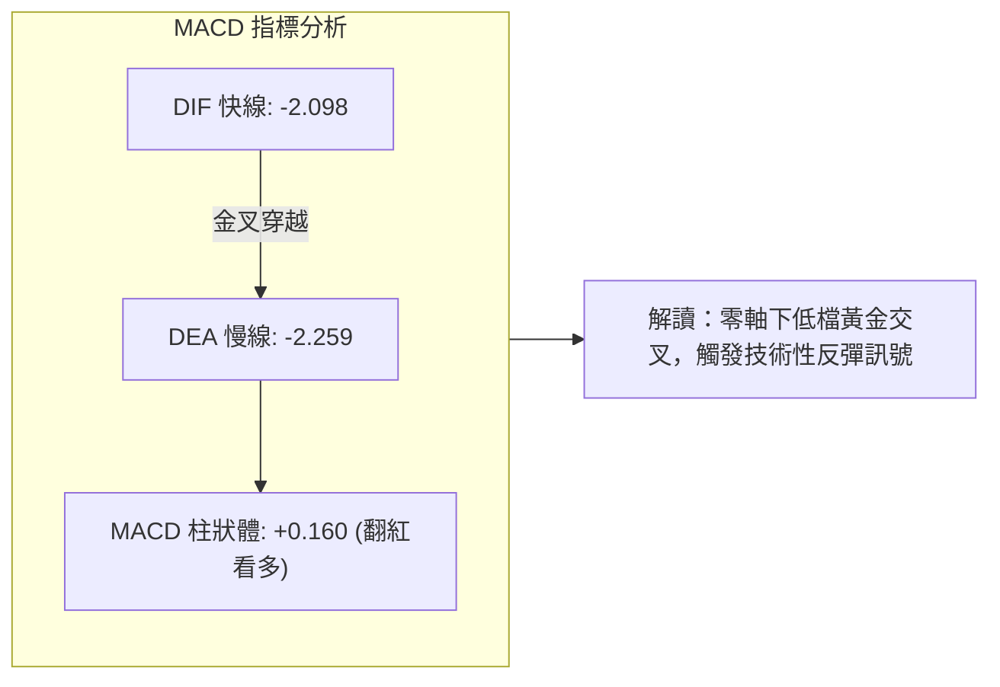

- **絕對位置**：快慢線均在零軸下方極深處（-2.0 之下），屬於「弱勢區間的金叉」。這意味著這波上攻屬於**跌深後的技術性修正反彈**，不可盲目視為牛市反轉。
- **隨機指標共振**：Stoch %K (60.24) 向上貫穿 Stoch %D (34.29)，短線動能指針全面朝上，支持現價向布林中軌發起進攻。

### 📦 布林通道分析

```
布林通道結構與現價相對位置 (ASCII 示意圖)：
$44.46 ────────────────────────────────────── BB 上軌 (Upper Band)
                         
$41.01 ───────────────────▲────────────────── BB 中軌 (Middle Band / MA20)
                         │ (現價距中軌僅 -1.41%)
$40.43 ◄═════════════════●═══════════════════ 當前收盤價 (BB %B = 0.42)
                         
$37.57 ────────────────────────────────────── BB 下軌 (Lower Band)
```

- **帶寬與位置特徵**：
  - BB %B 數值為 **0.42**，顯示價格脫離了先前貼著下軌重挫的「破帶下行」狀態，目前正向中軌 $41.01 靠攏。
  - 通道上下軌間距為 $44.46 − $37.57 = $6.89（佔股價約 17%），帶寬保持張開，說明前期單邊波動仍未完全沉澱。現價若無法帶量有效收復中軌 $41.01，將隨時在中軌附近遭遇二度拋壓。

### 💹 成交量分析（量價配合度）

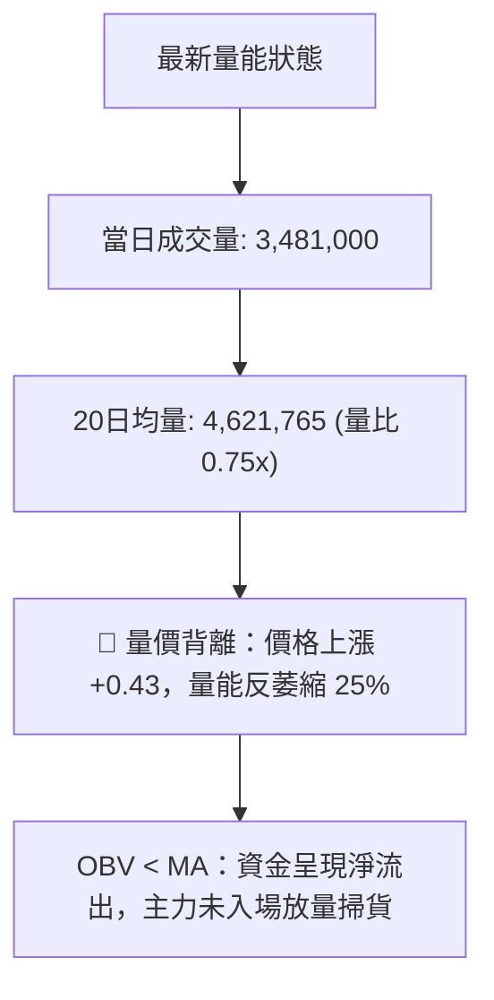

- **量價分析解讀**：
  - 2026-10-26 股價大漲收在 $40.43，但成交量僅 3.48M，相較於前數日下跌時的 4.2M ~ 5.5M 明顯量縮，呈現典型的「**反彈無量**」。
  - **OBV 指標持續低於其移動平均線**，代表籌碼面上機構買盤依然駐足觀望，當前漲幅多數由空頭回補（Short Covering）驅動，尚未形成多頭建倉推升的主升結構。

---

## 6. 動能與波動率

### ⚡ 動能評估四象限

| 象限 | 動能強度 | 波動率水準 | 當前狀態標註 | 技術意涵與操作評估 |
|------|----------|------------|--------------|--------------------|
| **Q1** | 強動能 | 低波動 | — | 穩定單邊推升，最佳順勢加碼區 |
| **Q2** | 弱動能 | 低波動 | — | 底部/頂部平淡盤整，適宜觀望 |
| **Q3** | 強動能 | 高波動 | — | 主升浪或主跌浪，高風險高利潤 |
| **Q4** | 弱動能 | 高波動 | **✓ KTOS 當前位置** | **處於超跌震盪修正期，反彈脆弱且易生大幅回撤，避免重倉追高** |

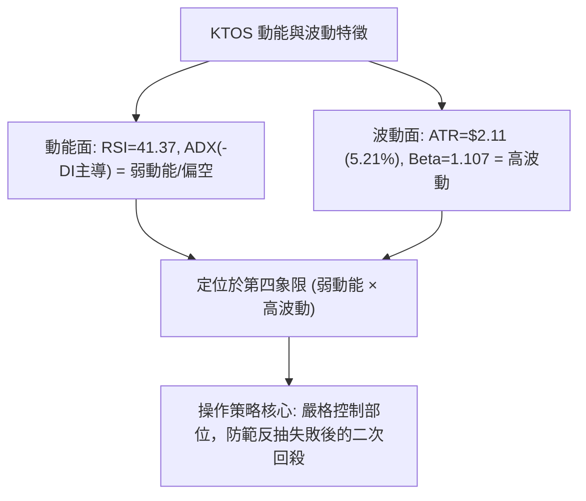

### 📊 ATR 波動率分析

- **ATR(14) 數值**：**$2.11**（佔現價 $40.43 之 **5.21%**，Wilder 平滑法）。
- **日內波幅解讀**：KTOS 當前單日正常理論波動區間即達 ±$2.11。
- **動態止損與風險控制建議**：
  - **短線交易止損距離**：建議設定為 1.0 倍 ATR = **$2.11**。
  - **波段交易止損距離**：建議設定為 1.5 ~ 2.0 倍 ATR = **$3.17 ~ $4.22**。
  - 由於 5.21% 的日波幅偏高，若止損區間小於 $2.00，極易被正常的日內噪音掃地出場。

### 📐 Beta 與市場相關性

- **Beta 係數**：**1.107**。
- **市場敏感度分析**：KTOS 的波動幅度比標普 500 大盤高出約 10.7%，屬於略高於大盤的高敏感標的。在大盤下挫時，KTOS 傾向於出現放大效應的補跌；反之，若大盤展開強力反彈，KTOS 的彈升爆發力亦將高於平均值。

---

## 7. 多時框架總結

### 📋 時框架評分表

| 時框架 | 趨勢方向 | 動能狀態 | 均線排列 | 圖表形態 | 綜合評分 | 操作建議 |
|--------|----------|----------|----------|----------|----------|----------|
| **月線 (長期)** | 🔴 強烈看空 | 疲弱 (-DI主導) | 空頭排列 (破MA240) | 自 $103 大幅回落 | 25/100 | 嚴格防守，不宜長線做多 |
| **週線 (中期)** | 🔴 空頭下行 | 弱勢修正中 | 空頭排列 (破MA50) | 連續10週走低後的流星錘 | 35/100 | 逢反彈至阻力位減倉或做空 |
| **日線 (短期)** | 🟢 弱勢反彈 | MACD金叉/底背離 | 短期走平，受制MA20 | 潛在雙底探底回升 | 55/100 | 短線超跌博弈反彈，快進快出 |

### 🔲 綜合訊號矩陣

| 維度 | 短期（日線） | 中期（週線） | 長期（月線） | 訊號收斂性評估 |
|------|--------------|--------------|--------------|----------------|
| **方向一致性** | 偏多反彈 | 偏空下行 | 空頭主導 | ❌ 多時框出現明顯矛盾（短多長空） |
| **指標確認度** | RSI底背離、MACD紅柱 | 週MACD零軸下游動 | ADX 40.40 空方趨勢 | ⚠️ 僅有短線技術指標支持反彈 |
| **量能支撐度** | 量縮 (0.75x) | 週量能萎縮至 18M | 籌碼高檔潰散流出 | 🔴 全週期量能均不支持反轉 |

### ⚖️ 多時框收斂結論

> **依據規則 14 進行優先級嚴格收斂**：
> 1. 當前趨勢指標 **ADX(14) 為 40.40，遠高於 25 臨界線**，確認市場處於標準的「**強趨勢行情**」而非無方向盤整。
> 2. 依規則：**在 ADX > 25 的趨勢行情中，必須以中長期（週線/MA50、MA200）方向為主導，日線訊號僅能用於尋找順勢交易的進場時機或超跌修正之逆勢短打**。
> 3. **唯一收斂方向結論**：**偏空弱勢格局（空頭主導下的短線技術性超跌反彈）**。
> 4. 中長期的強空頭壓制了日線上檔空間，日線之 MACD 金叉與底背離僅能視為反彈波，遇 R1 阻力將面臨空頭強烈阻擊。

---

## 8. 交易策略建議

### 🗺️ 策略決策流程圖

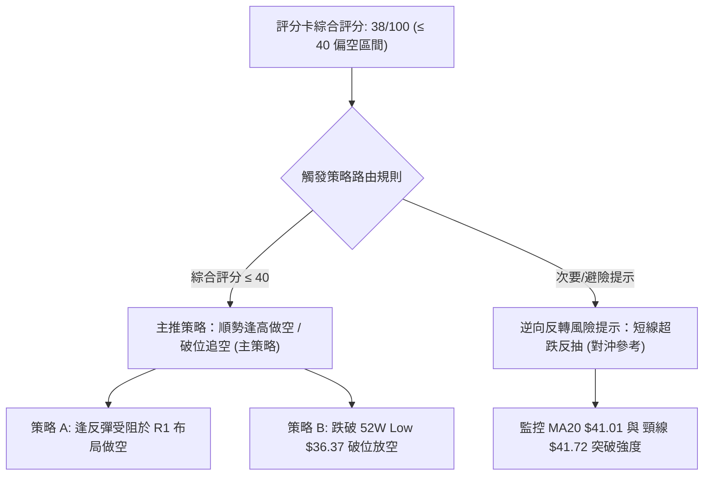

### 🧭 策略路由（依評分卡分流）

- **當前主策略方向**：**主推空頭策略（依技術評分卡綜合評分 38/100，處於 ≤ 40 之偏空弱勢區間）**。
- **戰術原則**：中長線趨勢極弱，日線層級的反彈均為空方提供更具性價比的逢高放空點位。除非日線以放量長陽連續收復 R1 ($49.68)，否則不輕易改變空頭思路。

---

### 🎯 價格情境階梯（Price Scenarios）

*(所有價位嚴格引用技術數據中之計算值)*

| 觸發條件 | 下一目標 | 後續延伸 | 技術情境含義與因應措施 |
|----------|----------|----------|------------------------|
| **向上突破 R1 $49.68** | R2 $51.49 | R3 $54.22 | 短線強勢逆轉，空頭停損觀望，中級反彈展開 |
| **受阻於中軌或 R1** | 跌回現價 $40.43 | 測試 S2 $36.37 | 反抽結束，重回下降通道，最佳做空契機 |
| **跌破 S2 $36.37** | 尋找新低支撐 | 自由落體探底 | 52週新低破位，觸發停損盤，空頭主跌擴展 |

---

### 📊 情境機率分佈

| 預期情境 | 發生機率 | 主要技術指標依據 |
|----------|----------|------------------|
| **遇阻回落 / 二次探底** | **55%** | ADX 40.40 空方強勢、均線完全空頭排列、反彈無量 (0.75x) |
| **超跌弱勢反彈 (測R1)** | **30%** | 日線 MACD 翻正 (+0.160)、RSI 底背離、Stoch 金叉 |
| **區間橫向窄幅震盪** | **15%** | 短線在 MA20 ($41.01) 與 52W Low ($36.37) 之間沉澱 |

---

### 🔴 主策略詳情（空頭交易策略）

*(風險報酬比嚴格依規則 17 計算：空頭 R/R = (進場價 − 目標價 T1) ÷ (止損價 − 進場價))*

| 策略要素 | 策略 A（逢高沽空 / 順勢放空） | 策略 B（破位追空 / 弱勢貫穿） |
|----------|--------------------------------|--------------------------------|
| **策略類型** | 順應中長空頭，反彈受阻放空 | 跌破歷史防線順勢追空 |
| **進場條件** | 反彈至 R1 遇阻收上影線或回落跌破 MA20 | 實體日 K 跌破 52W Low $36.37 確認破位 |
| **進場價格** | **$49.68** (R1 阻力位) | **$36.37** (52W Low 破位點) |
| **目標價 T1** | **$40.43** (當前價格位) | **$30.00** (由整數關卡與跌幅推算) |
| **目標價 T2** | **$36.37** (52W 最低點) | **$26.39** (歷史 2025-02 低點) |
| **止損價格** | **$54.22** (R3 強阻力位) | **$38.48** (以 1.0 ATR $2.11 計算之防守位) |
| **風險報酬比** | **1 : 2.04（以 T1 計）** *(算式見註1)* | **1 : 3.02（以 T1 計）** *(算式見註2)* |
| **模型成功機率** | 65% | 55% |
| **建議配置倉位** | 15% ~ 20% | 10% |

- *註1：策略 A 之 R/R = ($49.68 − $40.43) ÷ ($54.22 − $49.68) = $9.25 ÷ $4.54 = **1 : 2.04（以 T1 計）**；若以 T2 計則為 ($49.68 − $36.37) ÷ $4.54 = **1 : 2.93（以 T2 計）**。*
- *註2：策略 B 之 R/R = ($36.37 − $30.00) ÷ ($38.48 − $36.37) = $6.37 ÷ $2.11 = **1 : 3.02（以 T1 計）**。*

---

### 🟢 反向風險觸發點（對沖與空頭止損提示）

若持空頭部位，出現下列情境須立即執行風險對沖或停損離場：
1. **站穩 MA20 並放量突破頸線 $41.72**：若日線成交量放大至 50 日均量（> 4.0M）且收盤站上 $41.72，確認雙底成型，短線空單應立即獲利或平倉了結。
2. **強勢突破 R1 $49.68**：若價格強勢貫穿 R1，代表週線級別的大反彈全面展開，所有空頭頭寸必須無條件停損。

---

### ⭐ 整體訊號強度評星

```
做多訊號強度：★★☆☆☆  (2/5星 - 僅屬短線超跌技術背離)
做空訊號強度：★★★★☆  (4/5星 - 中長線趨勢與均線完全偏空)
整體可信度：  ★★★☆☆  (3/5星 - 當前處於底部爭奪期，波動加劇)
```

---

## 9. 風險提示與監控

### ✅ 關鍵監控指標 Checklist

```
╔══════════════════════════════════════════════════════════════════╗
║               KTOS 交易風險即時監控清單 (Checklist)              ║
╠══════════════════════════════════════════════════════════════════╣
║ [ ] 1. MA20 動態反壓：收盤價能否帶量站上 $41.01                 ║
║ [ ] 2. 頸線攻防線：10-16 高點 $41.72 能否被多頭實體陽線突破     ║
║ [ ] 3. 終極防守線：52W Low $36.37 是否被跌破 (跌破即轉自由落體)  ║
║ [ ] 4. 成交量配合度：日成交量是否回升至 20 日均量 4.62M 之上    ║
║ [ ] 5. MACD 柱狀體：紅柱 (+0.160) 能否持續擴張，避免假金叉      ║
║ [ ] 6. 財報事件風險：預計於 11-05 召開 Q3 財報會，提防跳空波動   ║
╚══════════════════════════════════════════════════════════════════╝
```

### ⚠️ 風險場景分析

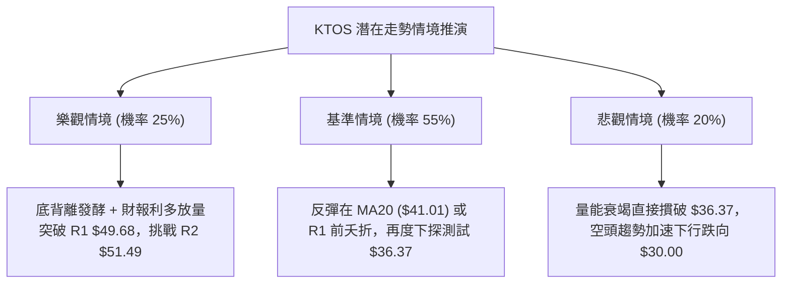

### 🛡️ 風險管理重要提醒

1. **財報前夕之二元波動風險**：KTOS 已排定於 2026-11-05 發布第三季財報。由於公司近期營業利潤率微弱（最新一季為 -0.2%，TTM 自由現金流為 -$128.90M），財報發布極易引發跳空行情。建議在財報公布前 48 小時將總倉位壓縮至 10% 以下。
2. **高 ATR 波動下的部位縮減原則**：KTOS 之 ATR 高達 $2.11（5.21%），遠高於一般工業股。在進行任何交易時，單筆交易的最大資金風險應嚴格控制在總資產的 1.0% 以內，換算之持倉股數需根據止損距離進行嚴謹倒推。

---

## 📋 報告總結

```
╔══════════════════════════════════════════════════════════════════╗
║                    KTOS 技術分析報告總結                         ║
╠══════════════════════════════════════════════════════════════════╣
║ 報告日期：2026-10-27                                             ║
║ 當前價格：$40.43 USD                                             ║
║ 技術評分：38 / 100 (算術平均值)                                  ║
║ 分析評級：🔴 偏空弱勢格局（空頭主導下之短線超跌反彈）            ║
║                                                                  ║
║ 關鍵維度結論：                                                   ║
║ ├─ 長期趨勢：🔴 極度看空 (價格低於 MA200 達 -38.46%)             ║
║ ├─ 中期趨勢：🔴 空頭主導 (ADX=40.40，-DI=28.06 強勢主導)        ║
║ ├─ 短期趨勢：🟢 弱勢反彈 (RSI底背離，MACD柱翻正至 +0.160)       ║
║ ├─ 關鍵支撐：$37.57 (BB下軌) / $36.37 (52W Low / 斐波 100%)      ║
║ ├─ 關鍵阻力：$49.68 (R1) / $51.49 (R2) / $54.22 (R3)             ║
║ └─ 外部分析師平均目標價：$94.44 (共識評級為 Strong Buy)          ║
║                                                                  ║
║ 最優策略指引：                                                   ║
║ 1. 🥇 最佳機會：逢反彈遇阻於 R1 ($49.68) 順勢建立空頭避險倉位   ║
║ 2. 🥈 次選機會：若貫穿 52W Low $36.37，順勢追空至 $30.00         ║
║ 3. 🥉 保守選擇：在股價未有效突破 $41.72 前，空手觀望，靜待財報 ║
╚══════════════════════════════════════════════════════════════════╝
```

---

> ⚠️ **免責聲明**：本報告為技術分析研究成果，所有數據、圖表及推算結論均嚴格基於歷史量價及已披露財務資訊。本報告**僅供研究與學術參考**，**不構成任何要約、招攬或投資建議**。市場具有高度不確定性，投資人應獨立評估風險並自負盈虧。

---

*報告生成時間：2026-10-27 ｜ 數據來源：Yahoo Finance ｜ 分析框架：多時框技術分析模型*