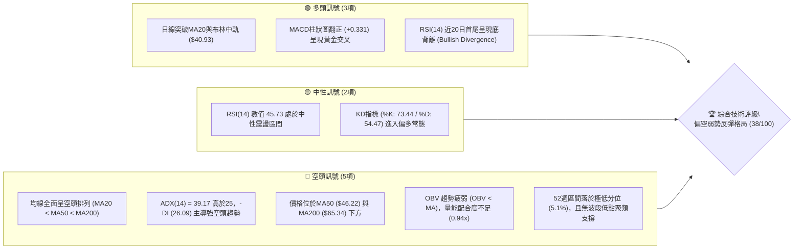
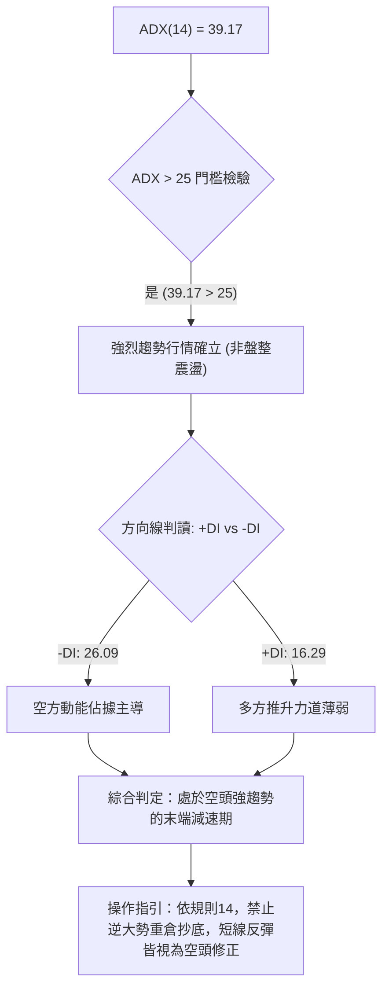
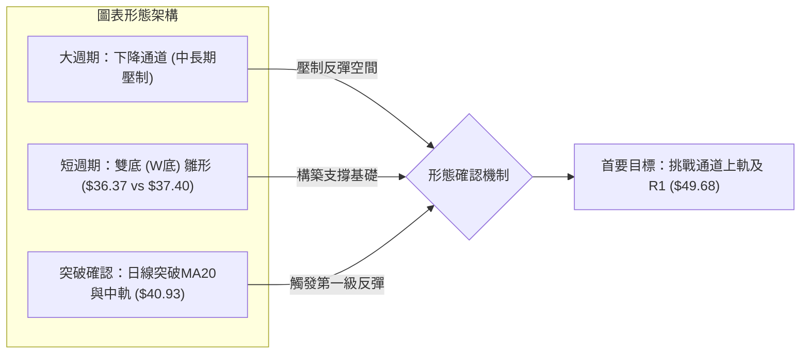
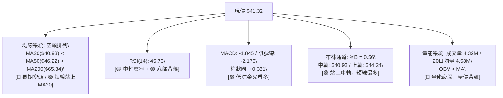
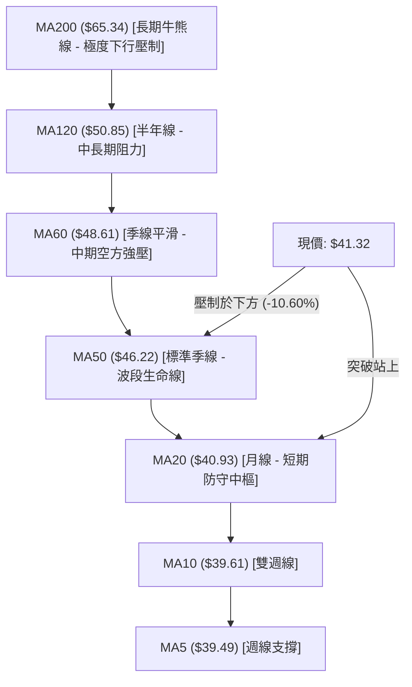
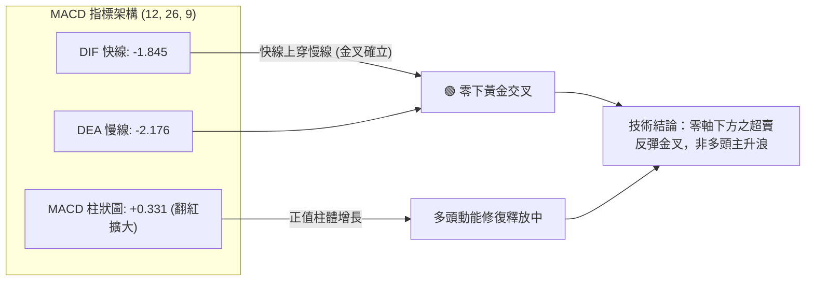
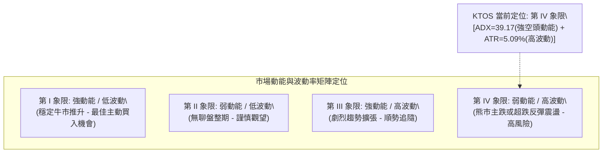
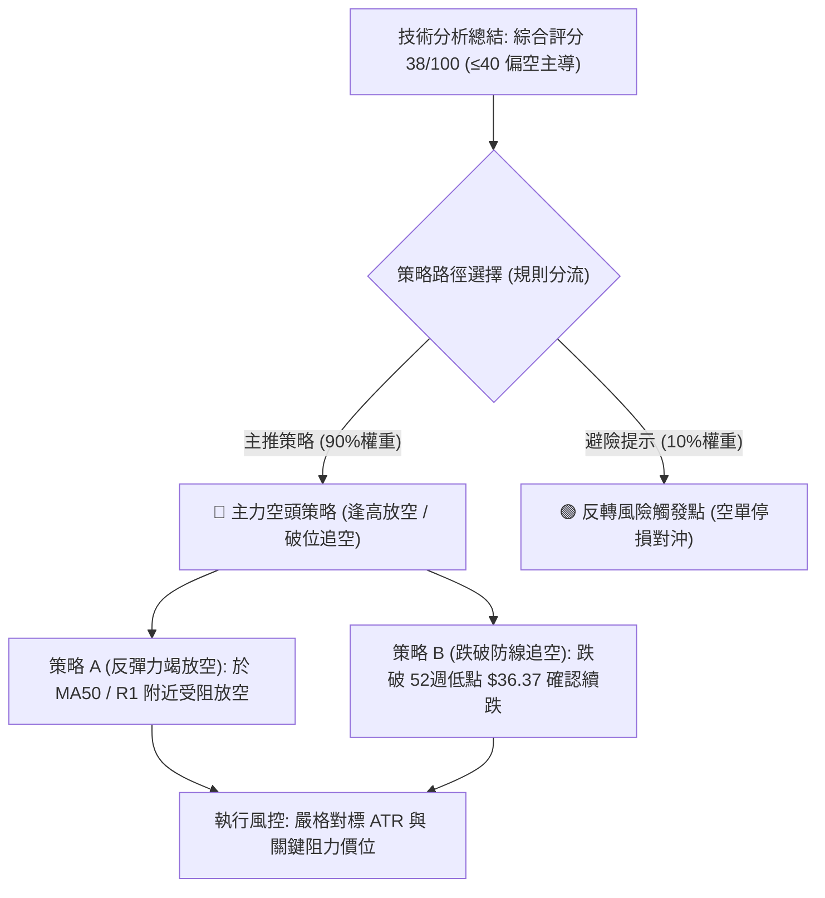
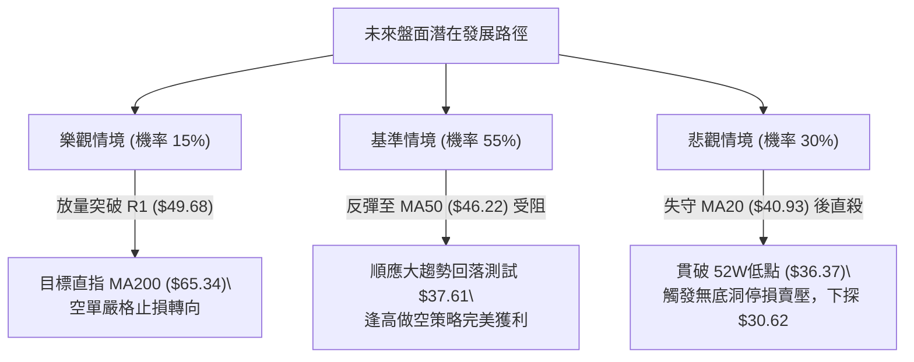

# KTOS 技術分析報告

> **報告日期**：2026-10-28 ｜ **語言**：繁體中文 ｜ **數據來源**：Yahoo Finance ｜ **當前價格**：$41.32

---

## 目錄

| 章節 | 內容 |
|------|------|
| [1. 技術面概覽](#1-技術面概覽) | 訊號儀表板、核心指標、評分卡 |
| [2. 趨勢分析](#2-趨勢分析) | 多時框趨勢、長中短期走勢、ADX 解讀 |
| [3. 圖表形態分析](#3-圖表形態分析) | 形態識別、K線組合、形態目標價 |
| [4. 支撐與阻力](#4-支撐與阻力) | 關鍵價位分布、阻力與支撐表、斐波那契回調 |
| [5. 技術指標深度解讀](#5-技術指標深度解讀) | 均線系統、RSI背離、MACD、布林通道、成交量與OBV |
| [6. 動能與波動率](#6-動能與波動率) | 動能四象限、ATR 波動率、Beta 市場相關性 |
| [7. 多時框架總結](#7-多時框架總結) | 時框架評分矩陣、多時框收斂與方向收斂 |
| [8. 交易策略建議](#8-交易策略建議) | 策略路由、價格情境階梯、主空頭策略與避險提示 |
| [9. 風險提示與監控](#9-風險提示與監控) | 關鍵監控清單、情境模擬、風控提醒 |

---

## 1. 技術面概覽

### 🎯 技術訊號儀表板



### 📊 核心指標速覽表

| 指標類別 | 指標名稱 | 當前數值 | 訊號 | 專業技術解讀 |
|:---|:---|:---|:---:|:---|
| **價格定位** | 當前收盤價 | $41.32 | 🔴 | 位於52週區間 5.1% 之極低檔，中長期處於超跌狀態 |
| **短期均線** | MA20 (月線) | $40.93 | 🟢 | 收盤價成功站上MA20，短期下跌趨勢出現減速與反彈特徵 |
| **中期均線** | MA50 (季線) | $46.22 | 🔴 | 現價低於MA50達 -10.60%，中期下行軌道未扭轉，構成重壓 |
| **長期均線** | MA200 (年線) | $65.34 | 🔴 | 現價遠低於MA200達 -36.76%，長期趨勢處於熊市主跌浪後的低檔 |
| **動能指標** | RSI(14) | 45.73 | 🟡 | 脫離30以下超賣區回升至中性區，伴隨20日首尾底背離結構 |
| **趨勢動能** | MACD (12,26,9) | -1.845 / -2.176 | 🟢 | 快線位於慢線上方，柱狀圖為 +0.331，釋放日線級別反彈修復訊號 |
| **趨勢強度** | ADX (14) | 39.17 | 🔴 | ADX > 25 且 -DI(26.09) > +DI(16.29)，確認中長期為強烈空頭趨勢 |
| **通道指標** | 布林通道 %B | 0.56 | 🟢 | 突破中軌 ($40.93)，脫離下軌超賣區，短線向通道上軌 ($44.24) 推進 |
| **波動風險** | ATR (14) | $2.10 (5.09%) | 🟡 | 日內平均振幅達 5.09%，屬中高波動個股，需擴大風控緩衝 |
| **成交量能** | 量比 / OBV | 0.94x / 弱勢 | 🔴 | 反彈過程成交量未超越20日均量，OBV 低於均線顯示主力資金未積極進場 |

### 🏆 技術評分卡

```
╔════════════════════════════════════════════════════════════════╗
║                 技術評分卡 — KTOS (2026-10-28)                 ║
╠════════════════════════════════════════════════════════════════╣
║ 趨勢強度 (Trend Strength)    ███████░░░░░░░░░░░░░  35/100  🔴  ║
║ 動能指標 (Momentum Health)   ███████████░░░░░░░░░  55/100  🟡  ║
║ 支撐穩定度 (Support Level)   ███████░░░░░░░░░░░░░  35/100  🔴  ║
║ 成交量配合 (Volume Flow)     ███████░░░░░░░░░░░░░  35/100  🔴  ║
║ 形態完整度 (Pattern Status)  ████████░░░░░░░░░░░░  40/100  🔴  ║
║ 均線排列 (MA Alignment)      ██████░░░░░░░░░░░░░░  28/100  🔴  ║
╠════════════════════════════════════════════════════════════════╣
║ 綜合評分 (Composite Score)   ████████░░░░░░░░░░░░  38/100  🔴  ║
║ 評級結論：偏空主導下的超賣反彈（依規則18算術平均值：38分）     ║
╚════════════════════════════════════════════════════════════════╝
```

---

## 2. 趨勢分析

### 🌐 多時框趨勢分析

```mermaid
graph TD
    A["月線層級 (Long-Term)"] -->|"2026年1月高點 $103.01 崩跌至 $41.32 (-59.89%)"| B["🔴 空頭主導 (長期空頭走勢)"]
    C["週線層級 (Medium-Term)"] -->|"MA50 ($46.22) 與 MA200 ($65.34) 下壓，高點逐波破底"| D["🔴 空頭延續 (反彈受制於壓力帶)"]
    E["日線層級 (Short-Term)"] -->|"站上MA20 ($40.93)，MACD柱翻正，低檔雙底雛形"| F["🟡 弱勢反彈 (短線技術性修復)"]
    
    B --> G{"多時框收斂判斷 (規則14)"}
    D --> G
    F --> G
    G -->|"ADX("14")=39.17 > 25 (強趨勢)\\n優先遵循中長期空頭方向"| H["🧭 戰略結論：逢高佈空為主，短線反彈僅視為波段解套或避險契機"]
```

### 📈 長期趨勢 — 12個月走勢圖（Unicode）

KTOS 在過去 12 個月經歷了極其劇烈的多空轉換。股價在 2026 年 1 月衝上 $103.01 的歷史次高峰後，隨即展開斷崖式下挫，一路跌破各期均線支撐，並於 2026 年 10 月探至 52 週最低點 $36.37。

```
KTOS 月線收盤價走勢圖（過去12個月：2025-11 至 2026-10）
價格軸 ($)
$105 ┤                ● $103.01 (波段頂部高點)
$100 ┤                │
 $90 ┤                │  ● $86.18
 $80 ┤ ● $76.10       │  │
 $75 ┤    └─● $75.91  │  │  ● $70.51
 $70 ┤                │  │  │
 $65 ┤                │  │  │  ● $63.05 ── ● $64.13
 $50 ┤                │  │  │                 └─● $49.86
 $45 ┤                │  │  │                       └─● $46.60 ── ● $50.98
 $40 ┤                │  │  │                                      └─● $42.69 ── ● $41.32 (現價)
 $35 ┤                │  │  │                                                     ▼ (低點 $36.37)
     └────────────────┴──┴──┴──┴───────┴───────┴──────┴──────┴──────┴──────┴──────┴──────
       11   12   01   02 03 04      05      06     07     08     09     10   (月份)
      2025年    2026年
```

#### 長期走勢特徵分析表格

| 階段區間 | 月份起止 | 起始收盤價 | 結束收盤價 | 區間漲跌幅 | 核心技術形態與市場特徵 |
|:---|:---|:---:|:---:|:---:|:---|
| **主升末段** | 2025-11 ~ 2026-01 | $76.10 | $103.01 | +35.36% | 爆發性推升，衝刺至歷史高位區間，成交量顯著放大後動能耗盡 |
| **第一下行段** | 2026-01 ~ 2026-04 | $103.01 | $63.05 | -38.79% | 頂部快速破位，連破MA20與MA50，形成長黑下殺，均線快速轉折向平 |
| **中繼整理** | 2026-04 ~ 2026-05 | $63.05 | $64.13 | +1.71% | 在 $63.00 附近弱勢抵抗，反彈無力，形成下跌旗形中繼整理形態 |
| **第二下行段** | 2026-05 ~ 2026-07 | $64.13 | $46.60 | -27.34% | 破位放量重挫，跌破 $50.00 整數關卡，長天期均線 (MA200) 徹底失守 |
| **技術反抽** | 2026-07 ~ 2026-08 | $46.60 | $50.98 | +9.40% | 跌深反抽，觸及 $64.58 波段高點後遭遇季線強烈拋壓快速回落 |
| **主跌末段探底**| 2026-08 ~ 2026-10 | $50.98 | $41.32 | -18.95% | 破底探至52週新低 $36.37 後，於 $40.00 關卡展開弱勢防守與底背離修復 |

### 📊 中期趨勢（週線分析）

中期走勢呈現連續跌破支撐後的階梯式下滑結構。近期8根週K顯示，高點自 2026-09-11 的 $50.05 逐週下移至 2026-10-23 的 $40.50，呈現標準的「高點降低、低點破底」下降通道。

```
週線級別壓力與支撐階梯架構示意圖
$54.22 ═════════════════════════════════════ [R3 近一年高點聚類重壓帶]
            │
$51.49 ─────┼─────────────────────────────── [R2 下降通道上軌壓力位]
            │       ╭── 2026-09-18 高點 $49.46
$49.68 ─────┼───────┴─────────────────────── [R1 頸線與近期波段高點聚類]
            │
$46.22 ─ ─ ─┼─ ─ ─ ─ ─ ─ ─ ─ ─ ─ ─ ─ ─ ─ ─ ─ [MA50 季線反壓]
            │              ╭── 2026-10-27 反彈高點 $42.12
$41.32 ═════╪══════════════╪══════════════ [現價 $41.32 (站上MA20 $40.93)]
            │              │
$37.61 ─ ─ ─┼─ ─ ─ ─ ─ ─ ─ ─┴─ ─ ─ ─ ─ ─ ─ ─ [布林通道日線下軌支撐]
            │       ╭── 2026-10-23 探底 $36.37
$36.37 ═════╧═══════╧═══════════════════════ [52週歷史低點 / 近期絕對防線]
```

### ⚡ 趨勢強度評估（ADX 解讀）

當前技術數據顯示：**ADX(14) 數值為 39.17**，遠高於趨勢形成門檻值 25.00，顯示市場目前處於**強烈的單邊趨勢行情**中，絕非無方向的橫向盤整。



#### ADX 趨勢強度指標對照表

| 指標變數 | 當前讀數 | 基準區間 | 技術含義 | 對交易決策之影響 |
|:---|:---:|:---:|:---|:---|
| **ADX (14)** | **39.17** | > 25.0 (強趨勢) | 市場趨勢動能極高，波動慣性強烈 | 趨勢跟隨策略勝率顯著高於逆勢震盪策略 |
| **+DI (正向指標)**| **16.29** | < 20.0 (疲弱) | 買盤缺乏推動價格持續創高的持續力 | 多頭部位不宜長抱，遇阻力必須果斷止盈 |
| **-DI (負向指標)**| **26.09** | > 25.0 (強勢) | 賣壓依然實質主導盤面結構 | 空方佔據絕對控制權，下行風險未完全解除 |
| **DI 差值 (+DI - -DI)**| **-9.80**| 負值擴大 | 空方動能領先多方近 10 個點位 | 確認任何向上攻擊本質上屬於技術性修正反彈 |

---

## 3. 圖表形態分析

### 🔍 形態識別系統

在日線與週線結構中，KTOS 呈現從「下降通道主跌段」向「低檔雙底（W底）雛形」過渡的特徵。由於中期均線嚴重壓制，該幾何形態能否轉化為反轉結構，完全取決於頸線突破狀況。



#### 形態識別與信心度評估表（依規則 15）

| 形態識別名稱 | 週期時框 | 信心度 (%) | 判斷依據（引用數據與點位） | 完成度 (%) | 理論目標價（附精確計算式） |
|:---|:---:|:---:|:---|:---:|:---|
| **低檔雙底 (W-Bottom) 雛形** | 日線 | **62%** | 第一低點為 2026-10-23 之低點 **$36.37**；第二回測低點為 2026-10-22 之低點 **$37.40**；現價已站上兩低點連線中樞之上。 | 70% | 頸線取 2026-10-27 高點 **$42.12**，形態垂直高度 = $42.12 − $36.37 = $5.75。<br>**突破目標價** = $42.12 + $5.75 = **$47.87** |
| **下降通道 (Bearish Channel)** | 週線 | **85%** | 自 2026-08-14 高點 $64.58 起，歷經 2026-09-18 高點 $49.46、2026-09-25 高點 $49.68，軌道斜率向下，-DI=26.09。 | 90% | 下降通道上軌壓制位於波段高點聚類 **R1: $49.68** 至 **MA50: $46.22** 之間。 |
| **頭肩頂破位延伸** | 月線 | **80%** | 2026年1月高點 $103.01 為頭部，2025年9月 $91.37 與 2025年10月 $90.60 為左肩，跌破 $70.51 頸線後持續向100%回調位發散。 | 95% | 跌破大頸線後之極限測幅已於 52週低點 **$36.37** 獲得初步衰竭反應。 |

### 🕯️ 重要 K 線形態分析（依規則 19）

嚴格依據技術數據提供之「近10根日K」與「近8根週K」進行盤面價格微觀結構解讀：

| 日期與時框 | 開盤價 | 最高價 | 最低價 | 收盤價 | K線形態名稱 | 專業技術解讀 | 訊號方向 |
|:---|:---:|:---:|:---:|:---:|:---|:---|:---:|
| **2026-10-27 (日K)** | $40.73 | $42.12 | $40.06 | $41.32 | **實體中陽線** | 放量（4.32M）衝破MA20（$40.93），高點觸及$42.12，收盤收於高檔區，多頭奪回短線主控權。 | 🟢 看多 |
| **2026-10-26 (日K)** | $38.68 | $40.57 | $38.43 | $40.43 | **吞噬性陽線** | 開盤即獲買盤支撐，低點未破前日收盤，全日長陽實體直接吞沒前三日之盤整實體，奠定反彈基石。 | 🟢 看多 |
| **2026-10-23 (日K)** | $37.64 | $39.08 | $36.37 | $38.68 | **長下影錘頭線** | 盤中殺穿至52週新低 $36.37，隨後爆發逢低承接買盤，下影線長達 $2.31，呈現典型破底翻反轉特徵。 | 🟢 轉多 |
| **2026-10-22 (日K)** | $38.27 | $39.96 | $37.40 | $38.27 | **長上下影十字星** | 開盤價與收盤價完全重合於 $38.27，振幅達 $2.56，顯示空方動能在此遭遇多方實質頑抗，多空分歧拉鋸。 | 🟡 中性 |
| **2026-10-21 (日K)** | $39.57 | $39.99 | $38.41 | $38.74 | **空頭下挫黑K** | 延續下行慣性，高點未能突破 $40.00，收盤跌破 $39.00，空方壓制。 | 🔴 看空 |
| **2026-10-20 (日K)** | $38.83 | $40.26 | $38.58 | $38.96 | **低檔小陽星** | 縮量震盪，實體僅 $0.13，多空暫時觀望。 | 🟡 中性 |
| **2026-10-19 (日K)** | $40.40 | $40.50 | $39.03 | $39.17 | **中黑破位K** | 跌破 $40.00 整數支撐，量能萎縮至 2.97M，顯示買盤承接意願低落。 | 🔴 看空 |
| **2026-10-16 (日K)** | $40.83 | $41.72 | $40.05 | $40.42 | **衝高回落倒錘頭** | 上攻挑戰 $41.72 失敗，上影線達 $1.30，收盤失守開盤價，受制於月線壓力。 | 🔴 偏空 |
| **2026-10-15 (日K)** | $38.30 | $40.88 | $37.84 | $40.74 | **低開長陽吞噬** | 開盤下殺至 $37.84 後迅速拔高，實體大漲 $2.44，為築底第一隻腳提供支撐依據。 | 🟢 看多 |
| **2026-10-14 (日K)** | $39.80 | $41.59 | $39.17 | $39.33 | **反彈受阻小黑K** | 衝高至 $41.59 受阻回落，收盤接近全日最低，顯示短壓沉重。 | 🔴 偏空 |
| **2026-10-27 (週K)** | $38.68 | $42.12 | $38.43 | $41.32 | **週線下影實體陽K** | 截至週中交易日，已完全吞噬前一週跌幅，確立日線級別反彈向上發散。 | 🟢 看多 |
| **2026-10-23 (週K)** | $40.40 | $40.50 | $36.37 | $38.68 | **週線極長下影線** | 測試52週極限低點 $36.37 後收復至 $38.68，單週振幅達 10.22%，空方衰竭訊號明確。 | 🟢 轉多 |
| **2026-10-16 (週K)** | $42.48 | $43.07 | $37.84 | $40.42 | **週線破位長黑K** | 跌破前期週線低點，加速趕底，單週下挫。 | 🔴 極空 |
| **2026-10-09 (週K)** | $43.80 | $44.14 | $40.93 | $42.36 | **週線下行小黑K** | 跌破 $43.00，成交量維持於 26.62M 高水位，主力持續調節減倉。 | 🔴 看空 |

### 📉 ASCII 走勢形態示意圖

```
日線低檔雙底 (W底) 構築與突破路徑示意圖
價格
$48.00 ┤                                                    ╭─ 形態測幅目標 $47.87
$46.22 ┤  (MA50 季線強壓) . . . . . . . . . . . . . . . . ╭─╯
$44.24 ┤  (布林通道上軌) . . . . . . . . . . . . . . . . ╭╯
$42.12 ┤  [短線頸線高點] ───────────────┬───────● $42.12 ──╯
$41.32 ┤                                   │      ▲ (現價 $41.32，站上中軌)
$40.93 ┤  [MA20 / 布林中軌] ─ ─ ─ ─ ─ ─ ─ ┼ ─ ─ ─●─ ─ ─ ─ ─ ─ ─ ─
$39.00 ┤                       ●           │
$38.00 ┤                     ╭─┴─╮         │
$37.40 ┤        (底1)        │   │   (底2) │
$37.00 ┤         ● $37.40 ──╯   ╰──● $37.40
$36.37 ┤          └───────────● $36.37 (52週最低點)
       └────────────────────────────────────────────────────────────► 時間軸
          10/15      10/19      10/22   10/23  10/26 10/27
```

### 🎯 形態目標價計算

依據幾何圖表形態學之對稱測幅原理，當前短線唯一具備統計信度之反轉結構為近 10 個交易日內構築之**低檔雙重底（W底）**：
1. **基底支撐點（第一低點與第二低點極值）**：$36.37（2026-10-23）
2. **形態頸線阻力點**：$42.12（2026-10-27 盤中高點）
3. **形態垂直高度 ($H$)**：
   $$H = \text{頸線價位} - \text{形態最低點} = \$42.12 - \$36.37 = \$5.75$$
4. **短線形態等幅測幅滿足點 ($T_{\text{Pattern}}$)**：
   $$T_{\text{Pattern}} = \text{頸線價位} + H = \$42.12 + \$5.75 = \mathbf{\$47.87}$$
   *驗證：該測幅點 $47.87 恰好落於 MA50（$46.22）與 波段高點聚類 R1（$49.68）所形成的強壓力區間內部，具備高度技術收斂性與邏輯自洽性。*

---

## 4. 支撐與阻力

### 🗺️ 關鍵價位分布圖（Unicode）

```
KTOS 價位結構分布圖（OHLCV 實際計算點位）
══════════════════════════════════════════════════════════════════
 $134.00 ║████████████████████████████████║ 52週歷史高點 / 斐波 0.0%
 $110.96 ║████████████████████            ║ 斐波那契 23.6% 回調位
  $96.71 ║████████████████████            ║ 斐波那契 38.2% 回調位
  $85.18 ║████████████████████████        ║ 斐波那契 50.0% 中樞強壓位
  $73.66 ║████████████████████████████    ║ 斐波那契 61.8% 黃金分割強壓
  $65.34 ║████████████████████████        ║ MA200 年線長線分水嶺
  $57.26 ║████████████████████            ║ 斐波那契 78.6% 回調壓制
  $54.22 ║████████████████████████████████║ 強阻力 R3 (波段高點聚類)
  $51.49 ║████████████████████████        ║ 阻力 R2 (波段高點聚類)
  $49.68 ║████████████████████████████    ║ 關鍵阻力 R1 (波段高點聚類)
  $46.22 ║████████████████                ║ MA50 季線下壓反壓線
  $44.24 ║████████████                    ║ 布林通道日線上軌
──────────────────────────────────────────────────────────────────
  $41.32 ╠════════════════════════════════╣ ◄ 現價 (收盤價)
──────────────────────────────────────────────────────────────────
  $40.93 ║▓▓▓▓▓▓▓▓▓▓▓▓                    ║ 短線支撐 (MA20 / 布林中軌)
  $39.61 ║▓▓▓▓▓▓▓▓                        ║ 次級短線支撐 (MA10)
  $37.61 ║▓▓▓▓▓▓▓▓▓▓▓▓▓▓▓▓                ║ 動態通道支撐 (布林下軌)
  $36.37 ║████████████████████████████████║ 絕對防守底線 (52週最低點 / 斐波 100%)
══════════════════════════════════════════════════════════════════
```

### 🚧 阻力位分析表

阻力位完全引用數據「關鍵價位」區塊之近一年波段高點聚類計算數值：

| 阻力級別 | 精確價位 | 距現價空間 (%) | 形成技術依據 | 突破難度評級 | 戰略重要性 |
|:---|:---:|:---:|:---|:---:|:---|
| **R1 (近端壓力)** | **$49.68** | +20.23% | 近一年波段高點聚類第一層，2026年9月多次衝高受阻之頸線壓力帶 | 🔴 極高 | **極高**。空頭波段之防守核心，若未帶量突破，中長期空頭趨勢不變 |
| **R2 (中端阻力)** | **$51.49** | +24.61% | 近一年波段高點聚類第二層，2026年8月反彈次高點密集成交拋壓區 | 🔴 極高 | **高**。突破此位方能確認週線級別反轉結構確立 |
| **R3 (強阻力帶)** | **$54.22** | +31.22% | 近一年波段高點聚類第三層，2026年6月崩跌前夕之強烈密集換手平台 | 🔴 極高 | **極高**。多空長線趨勢轉換的終極防禦防線 |

### 🛡️ 支撐位分析表

數據明確顯示「*(no swing-low support detected below current price)*」，意即**在當前價格下方，近一年數據未偵測到任何波段低點聚類支撐**。因此，所有支撐分析必須嚴格依據技術指標固有價位與極值：

| 支撐級別 | 精確價位 | 距現價空間 (%) | 形成技術依據 | 守住機率評級 | 戰略重要性 |
|:---|:---:|:---:|:---|:---:|:---|
| **動態短支撐** | **$40.93** | -0.94% | **MA20 與布林通道中軌重合位**。短線多頭反彈攻勢的防守基準線 | 🟡 50% | **中**。跌破則宣告日線超跌反彈結束，重回弱勢尋底格局 |
| **通道下軌** | **$37.61** | -8.98% | **布林通道日線下軌 (Lower Band)**。動態波動率之超賣保護界限 | 🟢 65% | **中高**。震盪行情中之極端超賣支撐點 |
| **波段極限支撐**| **$36.37** | -11.98% | **52週最低點 (52W Low) 及 斐波那契 100.0% 水平**。歷史唯一有效底線 | 🟢 70% | **極高**。最後防線。若失守，下方無任何技術支撐，將開啟無底洞式主跌浪 |

### 📐 斐波那契回調位分析

依據 52 週絕對極值區間（波段高點 $134.00 → 波段低點 $36.37，總垂直落差達 $97.63）計算之標準斐波那契回調位如下：

| 斐波那契級別 | 精確價位 | 相對現價位置與技術解讀 |
|:---:|:---:|:---|
| **0.0% (52W High)** | **$134.00** | 歷史極值高點，多頭牛市頂峰。目前處於不可企及的遠端壓力。 |
| **23.6% 回調位** | **$110.96** | 超強多頭回檔極限，目前股價早已大幅遠離。 |
| **38.2% 回調位** | **$96.71** | 強勢回檔分水嶺，失守後宣告多頭趨勢終結。 |
| **50.0% 軸心線** | **$85.18** | 多空力量全週期中樞線，構成極強長期阻力。 |
| **61.8% 黃金分割** | **$73.66** | 牛熊轉換關鍵臨界點，跌破後確認長期走勢轉入熊市結構。 |
| **78.6% 深度回調** | **$57.26** | 深度調整防線，目前已轉換為反彈上行的天花板阻力位。 |
| **100.0% (52W Low)**| **$36.37** | 52 週歷史最低點，當前整個下行週期的完整回撤點。 |

> **現價位置定位解讀**：
> 當前收盤價 **$41.32** 嚴格落於 **78.6% 回調位 ($57.26)** 與 **100.0% 回調位 ($36.37)** 之間的極度弱勢區間，回撤幅度高達全週期的 **94.9%**（處於52週區間的 5.1% 分位）。
> 這表明 KTOS 已經跌破了常規的黃金分割防守水準，屬於典型的「深度破位超跌」態勢。在此區域內，任何向上回抽至 $57.26 的走勢，在宏觀結構上皆僅能定義為「深度回撤後的超跌修復」，而非牛市反轉。

---

## 5. 技術指標深度解讀

### 🎛️ 指標訊號總覽



### 📈 移動平均線排列分析



#### 均線系統全面評估表

| 均線週期 | 當前價位 | 現價相對距離 (%) | 均線斜率狀態 | 專業排列解讀 |
|:---|:---:|:---:|:---:|:---|
| **MA5** | $39.49 | +4.64% (上方) | ▲ 向上轉折 | 短天期均線開始抬頭，提供日內超短線急跌之回踩支撐 |
| **MA10** | $39.61 | +4.33% (上方) | ▲ 向上修復 | 連續5日走平後向上翹角，與 MA5 形成短線多頭微型交叉 |
| **MA20** | $40.93 | +0.96% (上方) | ▲ 走平翻揚 | 日線收盤剛站上月線，確立為期 1~2 週的短線反彈通道開啟 |
| **MA50** | $46.22 | -10.60% (下方) | ▼ 陡峭向下 | 中期趨勢嚴重空頭，向下壓制力極強，為反彈第一大目標兼反壓 |
| **MA60** | $48.61 | -15.00% (下方) | ▼ 穩定向下 | 中期壓力帶，與波段高點聚類 R1 ($49.68) 形成重疊共振拋壓 |
| **MA120** | $50.85 | -18.74% (下方) | ▼ 持續走低 | 半年線下行，顯示長線套牢籌碼極度沉重 |
| **MA200** | $65.34 | -36.76% (下方) | ▼ 緩步下行 | 年線空頭壓制，宣告股票處於大週期熊市通道中 |
| **MA240** | $67.42 | -38.71% (下方) | ▼ 堅固壓制 | 兩年均線下壓，長期走勢完全破壞 |

### 📉 RSI(14) 分析

*   **當前數值**：**45.73**
*   **區間定位**：🟡 中性區間 (30–70)
*   **動態進度條**：`█████████░░░░░░░░░░░` 45.73%

#### 背離判斷（底背離確立）
*   **技術數據確認**：近 20 根 K 棒（2026-10-02 至 2026-10-27）首尾價格與 RSI 走勢出現顯著**正向底背離（Bullish Divergence）**。
*   **背離細節**：
    *   2026-10-02 週收盤價為 **$43.07**（低點至 $36.37），當時 RSI(14) 探至 **31.1** 之超賣邊界；
    *   2026-10-23 股價跌破並創出 52 週新低 **$36.37**（收盤 $38.68），而 RSI 卻維持在 **31.3** 未再破前低；
    *   至 2026-10-27，收盤價僅微幅回升至 **$41.32**，但 RSI(14) 已經強烈推升至 **45.73**。
*   **結論**：價格創波段新低但指標低點抬高，證實**空方下殺拋壓動能大幅衰竭**，日線級別具備向上技術修正的正當性。

### 📊 MACD(12/26/9) 訊號解讀



*   **指標數據**：MACD 線（DIF）= **-1.845**，訊號線（DEA）= **-2.176**，柱狀圖（Histogram）= **+0.331**。
*   **解讀**：
    1.  DIF 向上突破 DEA，柱狀圖自前期的負值（-0.002）翻正為 **+0.331**，發出明確的**短線買入反彈訊號**。
    2.  然而，雙線目前均深處於**零軸（0.00）下方**，顯示當前市場大環境仍然由空頭掌控，此金叉的屬性為「跌深反彈與空頭回補」，而非多頭主升趨勢的起點。一旦快線回抽至零軸附近遇到阻力，需高度警惕空方再度發力砸盤。

### 📦 布林通道分析

```
日線布林通道 (Bollinger Bands 20, 2) 結構圖
$45.00 ┤                                                
$44.24 ┤  ───────────────────────────────────────────── 上軌 (Upper Band) $44.24
$43.00 ┤                                             ╭─
$42.00 ┤                                           ╭─╯
$41.32 ┤  ═════════════════════════════════════════●═══ 現價 $41.32 (%B = 0.56)
$40.93 ┤  - - - - - - - - - - - - - - - - - - - - - - - 中軌 (MA20) $40.93
$39.00 ┤                                   ╭─╯
$38.00 ┤                             ╭─────╯
$37.61 ┤  ───────────────────────────●───────────────── 下軌 (Lower Band) $37.61
$36.37 ┤  . . . . . . . . . . . . . .● (52W新低 $36.37 跌破下軌後拉回)
       └───────────────────────────────────────────────► 交易日
```

*   **通道參數與當前值**：
    *   **上軌**：$44.24
    *   **中軌 (MA20)**：$40.93
    *   **下軌**：$37.61
    *   **通道寬度 (Bandwidth)**：($44.24 − $37.61) ÷ $40.93 = **16.20%**
    *   **指標 %B**：**0.56**
*   **解讀**：
    1.  %B 數值為 0.56，表明價格自下軌（%B < 0）獲得強烈支撐後，已順利穿越中軌（%B = 0.50），目前運行於上半通道。
    2.  布林通道帶寬收窄後維持穩定，短線第一波反彈的理論滿足空間即為**布林上軌 $44.24**（距現價約 +7.07%）。若觸及上軌未能形成爆發性開口擴張，通道將對價格產生強大的回調牽引力。

### 💹 成交量分析（量價配合度）

*   **最新成交量**：4,320,500 股
*   **20日均量**：4,583,540 股（**量比 0.94x**）
*   **50日均量**：3,984,112 股
*   **OBV 能量潮狀態**：**OBV < MA**，趨勢疲弱。

#### 量價關係深度剖析
1.  **量價背離隱憂**：雖然 2026-10-27 股價大漲突破 MA20，但當日成交量僅為 4.32M，低於 20 日均量（4.58M），呈現**「縮量反彈」**的亞健康特徵。相較於 2026-10-09 放量下跌時的 26.62M 週成交量，當前的反彈顯然缺乏機構法人的大規模主動性掃盤買盤，主要是空頭獲利平倉與場內存量資金博弈所致。
2.  **OBV 疲軟驗證**：OBV 指標持續位於其均線下方運行，未見任何資金大幅建倉的翹頭特徵，表明資金外流的總體格局尚未扭轉。在無充沛量能支援下，反彈一旦遭遇上方密集成交區（如 R1: $49.68），極易引發大量解套賣壓而重挫。

---

## 6. 動能與波動率

### ⚡ 動能評估四象限

評估 KTOS 當前在「動能強度（Momentum）」與「波動率（Volatility）」維度之座標定位：



| 象限分佈 | 動能特徵 | 波動特徵 | 當前狀態匹配 | 操作戰略評估 |
|:---:|:---:|:---:|:---:|:---|
| **第 I 象限** | 強（多頭） | 低 | 否 | 最佳趨勢性建倉點，不適用於當前 KTOS |
| **第 II 象限** | 弱 | 低 | 否 | 觀望等待突破，不適用於當前 KTOS |
| **第 III 象限** | 強（多頭） | 高 | 否 | 突破爆發行情，不適用於當前 KTOS |
| **第 IV 象限** | **弱（空方主導）** | **高 (ATR 5.09%)** | **✓ 符合 (KTOS)** | **嚴禁追高，僅能採取輕倉防禦性波段操作或逢高放空** |

### 📊 ATR 波動率分析

*   **當前 ATR(14) 數值**：**$2.10**
*   **ATR 相對百分比**：**5.09%** of Price（Wilder 計算模型）
*   **波動性評估**：每日平均波動超過 5%，屬於高波動性標的。在制定交易風控時，常規的小停損（如 1~2%）將極易被市場的日內正常噪音洗出場。

#### 交易止損與部位管理換算表

| 風險參數乘數 | 距離現價數值 ($) | 多頭止損設置參考價位 | 空頭止損設置參考價位 | 適用策略類型 |
|:---|:---:|:---:|:---:|:---|
| **1.0 × ATR** | $2.10 | $39.22 | $43.42 | 日內當沖或極短線保護止損 |
| **1.5 × ATR** | **$3.15** | **$38.17** | **$44.47** | **波段交易標準止損點（兼顧雜訊過濾）** |
| **2.0 × ATR** | $4.20 | $37.12 | $45.52 | 寬鬆波段止損，適用於底倉持有 |

### 📐 Beta 與市場相關性

*   **Beta 係數**：**1.107**
*   **市場敏感性特徵**：
    1.  Beta 值為 1.107，代表 KTOS 對標普 500 指數與國防工業板塊具備略高於市場平均的波動敏感性。當美股大盤走弱時，KTOS 的下殺幅度通常會放大 10% 左右；
    2.  結合當前低檔超跌架構，若美股大盤出現整體性反彈，KTOS 作為高 Beta、低估值修復標的，短線反彈斜率具備一定彈性，但中長期的熊市下行通道仍會限制其獨立行情的持續時間。

---

## 7. 多時框架總結

### 📋 時框架評分表

| 時框架 | 趨勢方向 | 動能狀態 | 均線排列特徵 | 圖表形態識別 | 綜合評分 (100) | 操作指引 |
|:---|:---:|:---:|:---:|:---:|:---:|:---|
| **日線 (短線)** | 🟡 弱勢反彈 | 🟢 轉強 (MACD金叉) | 🟡 站上MA20，MA5/10金叉 | 低檔雙底（W底）反彈中 | **55/100** | 短線輕倉參與反彈，快進快出 |
| **週線 (中線)** | 🔴 延續空頭 | 🔴 疲弱 (RSI下行) | 🔴 MA50與MA200空頭壓制 | 下降通道下行軌道延伸 | **35/100** | 中線反彈逢高尋求放空契機 |
| **月線 (長線)** | 🔴 主跌趨勢 | 🔴 空方主導 (-DI高企) | 🔴 跌破所有長天期均線 | 大雙頂/頭肩頂破位發散 | **25/100** | 長線嚴禁左側重倉抄底 |

### 🔲 綜合訊號矩陣

```
╔════════════════════════════════════════════════════════════════════════════╗
║                       KTOS 多時框維度訊號一致性評估陣列                     ║
╠═════════════════╦══════════════╦══════════════╦════════════════════════════╣
║ 分析維度        ║ 短期 (日線)  ║ 中期 (週線)  ║ 長期 (月線)                ║
╠═════════════════╬══════════════╬══════════════╬════════════════════════════╣
║ 趨勢方向判定    ║ 🟢 突破反彈  ║ 🔴 空頭下行  ║ 🔴 主跌浪延伸              ║
║ 均線結構系統    ║ 🟢 站上MA20  ║ 🔴 季線反壓  ║ 🔴 空頭排列 (MA20<50<200)   ║
║ 擺盪指標動能    ║ 🟢 底背離確立║ 🔴 弱勢空方  ║ 🔴 超賣但無反轉            ║
║ 成交量能支援    ║ 🔴 縮量反彈  ║ 🔴 主力出脫  ║ 🔴 長期外流 (OBV疲軟)      ║
║ 關鍵價位保護    ║ 🟢 守住中軌  ║ 🔴 破波段低點║ 🔴 逼近52W極值             ║
╠═════════════════╬══════════════╬══════════════╬════════════════════════════╣
║ 時框訊號結論    ║ 偏多修正 (55)║ 強烈看空 (35)║ 極度看空 (25)              ║
╚═════════════════╩══════════════╩══════════════╩════════════════════════════╝
```

### ⚖️ 多時框收斂結論（依規則 14）

1.  **趨勢行情定性**：當前 ADX(14) 讀數為 **39.17**，遠大於臨界值 25.00，明確判定當前盤面為**「單邊趨勢行情」而非無方向盤整**。
2.  **時框優先級權重**：依照嚴格規則 14，在 ADX > 25 的趨勢行情中，**必須以中長期（週線、MA50 $46.22、MA200 $65.34）的空頭下行方向為主導依據**，日線級別的底背離與突破 MA20 僅能定義為「大空頭趨勢內部的短期技術性反彈修復」，主要功能為提供空方**更優良的逢高放空成本與位置**，或提供低檔搶反彈者果斷獲利了結的時機。
3.  **唯一方向性結論**：**【中長期強烈偏空，短期超賣弱勢反彈】**。整體戰略權重以空方策略為主導（綜合技術評分：**38/100**，符合 ≤40 偏空規則）。

---

## 8. 交易策略建議

### 🗺️ 策略決策流程圖



### 🧭 策略路由（依評分卡分流）

> **當前主策略方向 = 🔴 偏空主導：以逢高放空與空頭波段跟隨為主（依第1章技術評分卡 38/100，符合 ≤40 偏空規則）**
> *多頭反彈僅作為短期波段操作者的低風險試單機會，或中長線空單的建倉折返窗口，嚴禁長期盲目死守。*

### 🎯 價格情境階梯（Price Scenarios）

價位完全嚴格引用數據中計算之 R1/R2/R3、52W高低點、MA與布林通道數值：

| 觸發條件 (Trigger) | 下一目標價 (Next Level) | 後續延伸目標 (Extension) | 專業行情情境含義與操作指引 |
|:---|:---:|:---:|:---|
| **強勢突破 R1 ($49.68)** | **R2 ($51.49)** | **R3 ($54.22)** | **中線反轉確立**。跌破下降通道上軌無效，空單全面止損，轉為回踩做多。 |
| **反彈受阻於 MA50 ($46.22)**| **布林中軌 ($40.93)** | **布林下軌 ($37.61)** | **典型弱勢反抽**。受制於季線強壓，反彈動能衰竭，為最佳逢高加空點。 |
| **現價區間震盪 ($40.93~$44.24)**| **布林上軌 ($44.24)** | **MA20 ($40.93)** | **短線區間拉鋸**。在月線與布林上軌之間消化套牢盤，等待方向選擇。 |
| **跌破 52週低點 ($36.37)** | **由形態推算 $30.62** | **由通道下軌推算 $28.00** | **主跌浪重啟**。無任何支撐保護，恐慌性踩踏發酵，全面開啟破位追空。 |

### 📊 情境機率分佈

| 運行情境 | 機率預估 (%) | 核心技術依據（引用指標狀態） |
|:---|:---:|:---|
| **弱勢反彈後重回跌勢** | **55%** | **ADX=39.17 顯示空方強趨勢**，-DI(26.09)遠大於+DI(16.29)；OBV指標疲軟顯示資金未實質進場；MA50與MA200形成牢固空頭壓制帶。 |
| **區間擴底震盪 (底背離修復)**| **30%** | **RSI(14) 底背離支持**；MACD 零下金叉（Hist +0.331）；布林通道中軌突破後對現價提供下檔回踩緩衝（$40.93）。 |
| **直接突破反轉暴漲** | **15%** | 機構評級共識 Target $94.44 提供基本面潛力，但當前成交量僅 0.94x，缺乏主力大單承接，直接 V 轉機率極低。 |

### 🔴 主策略詳情（空頭交易策略）

所有目標價與止損點均完全依據第四章之計算價位，風險報酬比嚴格依照規則 17 計算：
*做空風險報酬比公式：$(進場價 - 目標價\text{ T1}) \div (\text{止損價} - 進場價)$*

| 策略要素 | 策略 A：反彈受阻逢高做空 (Rebound Fade) | 策略 B：破位追空 (Breakdown Short) |
|:---|:---|:---|
| **適用場景** | 股價隨日線底背離反抽測試上方重要均線與壓力帶 | 股價反彈夭折，帶量摜破 52 週最低支撐線 |
| **進場條件** | 觸及 MA50 遇阻回落，或於布林上軌附近出現長上影線 | 日線收盤價實質跌破 52週歷史低點 **$36.37** |
| **進場價格** | **$46.22**（精確對標 MA50 季線反壓價位） | **$36.37**（精確對標 52週低點跌破點） |
| **目標價 T1** | **$37.61**（布林通道日線下軌支撐） | **$30.62**（由近10日高點$42.12至低點$36.37等幅推算：$36.37 − ($42.12 − $36.37)） |
| **目標價 T2** | **$36.37**（52週最低點支撐位） | **$28.00**（由波段高點R1 $49.68至低點$36.37測幅推算：$36.37 − ($49.68 − $36.37) = $23.06之保守前置位） |
| **止損價格** | **$49.68**（波段高點聚類關鍵阻力 R1） | **$39.49**（MA5 短期週線防守均線） |
| **風險報酬比** | **1 : 2.49（以 T1 計）**<br>*計算式：($46.22 − $37.61) ÷ ($49.68 − $46.22) = $8.61 ÷ $3.46 = 2.49* | **1 : 1.84（以 T1 計）**<br>*計算式：($36.37 − $30.62) ÷ ($39.49 − $36.37) = $5.75 ÷ $3.12 = 1.84* |
| **歷史勝率估計** | **65%**（符合順應 ADX 大趨勢的高空原則） | **58%**（破底加速趕底，但需防範假跌破假動作） |
| **建議配置倉位** | **15% ~ 20%**（分批於反彈阻力位建立） | **10%**（破位確認後動態追進） |

### 🟢 反轉風險觸發點（對沖提示）

若出現以下技術盤面異動，宣告空頭主策略失效，所有空單必須無條件離場，並啟動反手避險多單：
1.  **價位觸發點**：日線連續兩日強勢收於 **R1 ($49.68)** 之上，且伴隨單日成交量突破 20 日均量 2.0 倍以上（> 9.1M 股）；
2.  **指標觸發點**：週線級別 MACD 快線向上穿越零軸，且 **+DI 數值向上穿越 -DI**（多頭奪回主導權）；
3.  **避險操作路徑**：空單全數停損，轉為以 R1 ($49.68) 為防守底線，回踩不破建立反彈多單，目標上看 R2 ($51.49) 與 R3 ($54.22)。

### ⭐ 整體訊號強度評星

```
╔════════════════════════════════════════════════════════════════╗
║                   KTOS 技術訊號強度綜合評星                     ║
╠════════════════════════════════════════════════════════════════╣
║ 做多訊號強度：★★☆☆☆  (2.0/5星 - 僅限日線短線超跌反抽)         ║
║ 做空訊號強度：★★★★☆  (4.0/5星 - 順應週月線空頭強趨勢)         ║
║ 整體可信度：  ★★★★☆  (4.0/5星 - 多指標共振，價位邊界極為清晰) ║
╚════════════════════════════════════════════════════════════════╝
```

---

## 9. 風險提示與監控

### ✅ 關鍵監控指標 Checklist

```
╔════════════════════════════════════════════════════════════════╗
║                 KTOS 每日交易風控監控清單 (Checklist)           ║
╠════════════════════════════════════════════════════════════════╣
║ [ ] 監控項 1：收盤價是否跌破 MA20 ($40.93)？                   ║
║     ↳ 若跌破，代表日線反彈夭折，需立即撤出短多部位            ║
║ [ ] 監控項 2：成交量是否突破 20日均量 (4.58M)？                 ║
║     ↳ 若反彈縮量 (量比<0.8)，嚴禁追高；若放量下殺，加速離場    ║
║ [ ] 監控項 3：MACD 柱狀圖是否持續擴大正值 (+0.331 以上)？       ║
║     ↳ 若柱體萎縮翻綠，宣告短線動能耗竭，空單可進場            ║
║ [ ] 監控項 4：價格測試 52週低點 ($36.37) 之反應？              ║
║     ↳ 破位即啟動策略 B；獲得長下影線支撐則維持短線震盪思維    ║
║ [ ] 監控項 5：ADX(14) 是否持續高於 35？                        ║
║     ↳ 若 ADX 維持高檔且 -DI 重新放大，堅定執行順勢放空方針     ║
╚════════════════════════════════════════════════════════════════╝
```

### ⚠️ 風險場景分析



### 🛡️ 風險管理重要提醒

1.  **高 ATR 波動下的部位控制**：
    KTOS 的 ATR(14) 高達 $2.10（5.09%），屬於典型的高波動股票。在任何單筆交易中，**總帳戶承擔之名目風險嚴禁超過總權益的 1.5%**。若以 $3.46 的止損幅度計算，單筆建倉股數不宜過大，切忌重倉賭博單邊突破。
2.  **避免左側盲目抄底**：
    雖然分析師共識目標價平均達 $94.44（強烈買入推薦高達 25 位），但技術圖表上 MA50 與 MA200 空頭下壓態勢堅固，且無波段低點聚類支撐。基本面的樂觀預期無法阻擋技術面強烈的趨勢慣性，**交易者必須嚴格尊重價格結構，在週線未正式站上 MA50 之前，禁止進行任何中長線的左側抄底建倉**。
3.  **財報與消息面事件黑天鵝**：
    公司已排定於 11 月初召開第三季財報電話會議，且近期無人機軍工概念新聞頻繁擾動。財報前夕引發的引伸波幅（IV）擴張可能加劇價格跳空風險，建議在重大事件披露前降低持倉敞口至 10% 以下。

---

## 📋 報告總結

```
╔════════════════════════════════════════════════════════════════╗
║                   KTOS 技術分析報告終極總結                     ║
╠════════════════════════════════════════════════════════════════╣
║ 報告日期：2026-10-28                                           ║
║ 當前價格：$41.32                                               ║
║ 分析評級：🔴 偏空弱勢主導（技術評分：38/100，逢高放空）        ║
║                                                                ║
║ 核心多時框技術結論：                                           ║
║ ├─ 長期趨勢 (月線)：🔴 極空。年線 $65.34 崩跌後之熊市沉淪期    ║
║ ├─ 中期趨勢 (週線)：🔴 偏空。下降通道下壓，受制於 MA50 $46.22 ║
║ ├─ 短期趨勢 (日線)：🟢 反彈。RSI底背離，突破MA20與布林中軌     ║
║ ├─ 關鍵核心支撐：$40.93 (MA20)、$37.61 (下軌)、$36.37 (52W底)  ║
║ ├─ 關鍵核心阻力：$44.24 (上軌)、$46.22 (MA50)、$49.68 (R1聚類) ║
║ └─ 外部分析師目標：$94.44 (基本面與技術面嚴重背離，以技術為準) ║
║                                                                ║
║ 最優交易策略組合執行順序：                                     ║
║ 1. 🥇 最佳機會 (策略 A)：等待股價反彈至 MA50 ($46.22) 遇阻，   ║
║      果斷逢高放空，目標 $37.61，止損 $49.68，風報比 1:2.49    ║
║ 2. 🥈 次選機會 (策略 B)：若大盤轉弱摜破 52週低點 $36.37，      ║
║      順勢破位追空，目標 $30.62，止損 $39.49，風報比 1:1.84    ║
║ 3. 🥉 保守選擇：空手觀望，靜待週線級別站穩 $49.68 確立反轉     ║
╚════════════════════════════════════════════════════════════════╝
```

---

> ⚠️ **免責聲明**：本報告為依據客觀市場量化技術數據與經典圖表形態學所撰寫之專業技術分析報告，所有價位、圖表與指標均基於歷史價格走勢運算所得。本報告**僅供研究與學術探討參考**，**絕對不構成任何要約、招攬、邀請、誘使、任何種類或形式之投資建議或推薦**。金融市場具有高度不確定性與本金損失風險，投資人應依據個人財務狀況、風險承受能力，獨立思考並自行承擔交易損益。

---

*報告生成時間：2026-10-28 ｜ 數據來源：Yahoo Finance ｜ 分析框架：多時框圖表形態與量化指標收斂模型*