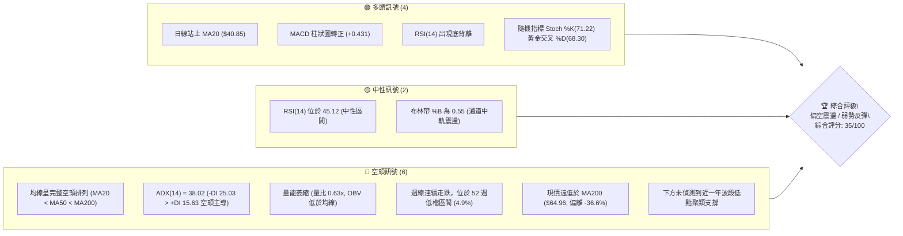
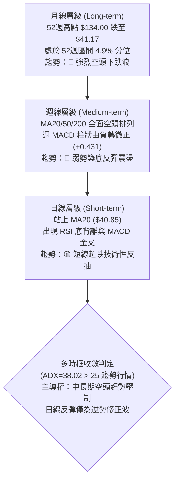
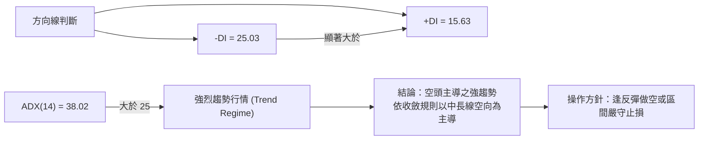
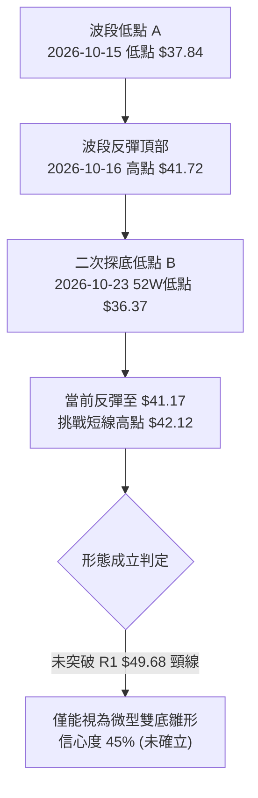
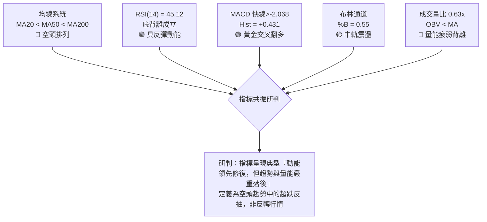
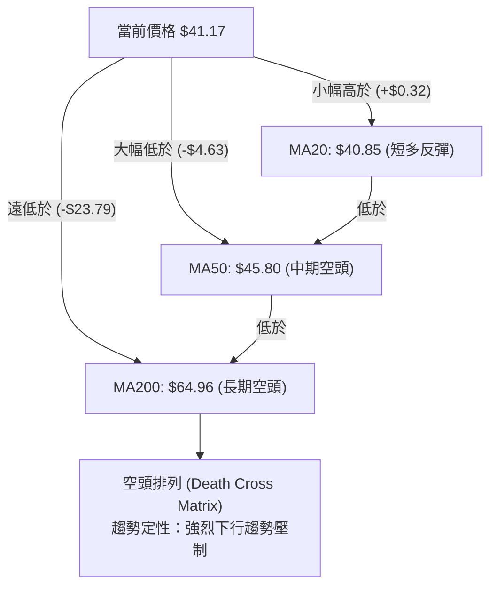
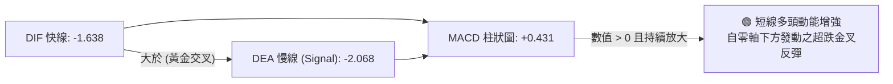
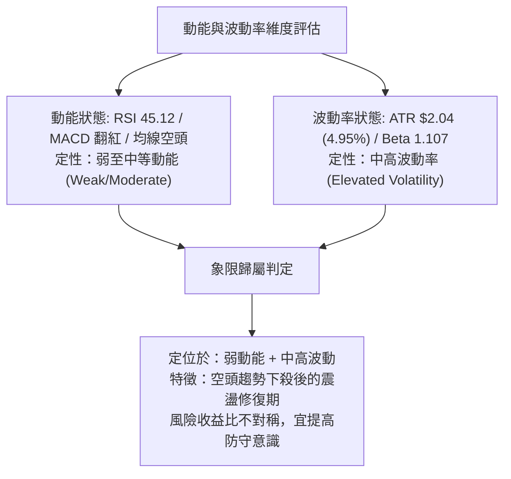
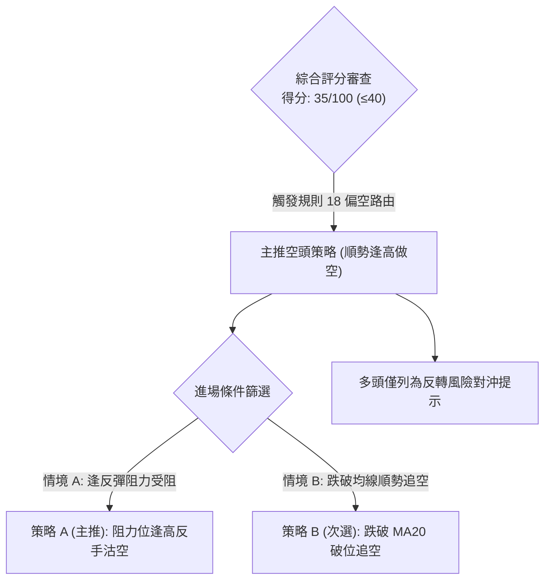
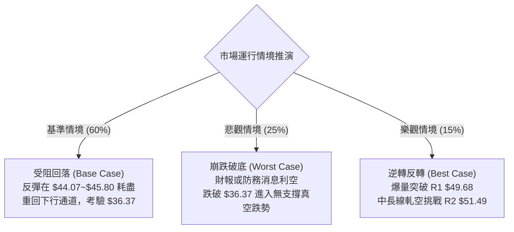

# KTOS 技術分析報告

> **報告日期**：2026-10-29 ｜ **語言**：繁體中文 ｜ **數據來源**：Yahoo Finance ｜ **當前價格**：$41.17

---

## 目錄

| 章節 | 內容 |
|------|------|
| [1. 技術面概覽](#1-技術面概覽) | 訊號儀表板、核心指標、評分卡 |
| [2. 趨勢分析](#2-趨勢分析) | 多時框趨勢、長中短期走勢 |
| [3. 圖表形態分析](#3-圖表形態分析) | 形態識別、K線組合、目標價 |
| [4. 支撐與阻力](#4-支撐與阻力) | 關鍵價位、斐波那契回調 |
| [5. 技術指標深度解讀](#5-技術指標深度解讀) | MA/RSI/MACD/布林/成交量 |
| [6. 動能與波動率](#6-動能與波動率) | 動能評估、ATR、Beta |
| [7. 多時框架總結](#7-多時框架總結) | 時框架評分矩陣 |
| [8. 交易策略建議](#8-交易策略建議) | 多空策略、風險報酬比 |
| [9. 風險提示與監控](#9-風險提示與監控) | 監控指標、風險場景 |

---

## 1. 技術面概覽

### 🎯 技術訊號儀表板



### 📊 核心指標速覽表

| 指標類別 | 指標名稱 | 當前數值 | 訊號 | 解讀 |
|----------|----------|----------|------|------|
| **價格** | 當前價格 | $41.17 | 🔴 | 位於 52 週區間 4.9% 極低分位，中長期處於弱勢空頭格局 |
| **均線** | MA20 | $40.85 | 🟢 | 價格短線站上 20 日均線（+$0.32, +0.78%），觸發超跌反彈 |
| **均線** | MA50 | $45.80 | 🔴 | 價格低於 50 日均線（-$4.63, -10.11%），中期均線持續下彎壓制 |
| **均線** | MA200 | $64.96 | 🔴 | 價格遠低於牛熊分界線 200 日均線（-$23.79, -36.62%），長期空頭確立 |
| **動能** | RSI(14) | 45.12 | 🟡 | 脫離超賣區回升至中性區，近 20 根 K 棒顯現日線底背離跡象 |
| **動能** | MACD(12,26,9) | Hist: +0.431 | 🟢 | 快線 (-1.638) 交叉慢線 (-2.068)，柱狀圖翻紅，短線多頭反彈動能凝聚 |
| **趨勢** | ADX(14) | 38.02 | 🔴 | ADX > 25 且 -DI(25.03) > +DI(15.63)，呈現明確的空頭主導強趨勢 |
| **通道** | 布林通道 | %B: 0.55 | 🟡 | 突破中軌 $40.85，運行於中軌至上軌 ($44.07) 之間，波動收窄 |
| **量能** | 成交量 / OBV | 2,805,700 | 🔴 | 量比僅 0.63x，低於 20 日均量 (4.46M)，OBV < MA 量能疲弱 |
| **波動** | ATR(14) | $2.04 | 🟡 | 佔股價 4.95%，單日震盪幅度中等偏高，利於設定動態停損 |

### 🏆 技術評分卡

```
╔══════════════════════════════════════════════════════════════════╗
║                   技術評分卡 — KTOS (2026-10-29)                 ║
╠══════════════════════════════════════════════════════════════════╣
║ 趨勢強度 (Trend)     █████░░░░░░░░░░░░░░░  25/100 🔴 空頭主導強趨勢   ║
║ 動能指標 (Momentum)  ███████████░░░░░░░░░  55/100 🟡 底背離短線修復   ║
║ 支撐穩定度 (Support) ███████░░░░░░░░░░░░░  35/100 🔴 缺乏聚類支撐     ║
║ 成交量配合 (Volume)  ██████░░░░░░░░░░░░░░  30/100 🔴 縮量反彈無追價   ║
║ 形態完整度 (Pattern) █████████░░░░░░░░░░░  45/100 🟡 築底雛形未確認   ║
║ 均線排列 (Moving Avg)████░░░░░░░░░░░░░░░░  20/100 🔴 典型空頭排列     ║
╠══════════════════════════════════════════════════════════════════╣
║ 綜合評分             ███████░░░░░░░░░░░░░  35/100 🔴 評級：偏空 (SELL)║
╚══════════════════════════════════════════════════════════════════╝
```
*(註：綜合評分由六項子評分算術平均得出：(25 + 55 + 35 + 30 + 45 + 20) ÷ 6 = 210 ÷ 6 = 35 分，評級定為偏空。)*

---

## 2. 趨勢分析

### 🌐 多時框趨勢分析



### 📈 長期趨勢 — 12個月走勢圖（Unicode）

KTOS 於過去一年經歷了從百元大關雪崩式下跌的過程。高點出現於 2026 年 1 月的 $103.01，隨後呈現逐波走低的流暢下降通道。

```
KTOS 月線走勢圖（過去12個月：2025-11 至 2026-10）
價格軸 ($)
$105 ┤               ●(2026-01: $103.01 高點)
$95  ┤              / \
$85  ┤             /   ●(2026-02: $86.18)
$75  ┤ ●(76.10)   /     \
$65  ┤   \──●(75.91)     \        ●(05: $64.13)
$55  ┤                    ●(70.51) \
$45  ┤                      \       \──●(04: $63.05)  ●(08: $50.98)
$35  ┤                       ●(49.86)   \──●(46.60)   \──●(42.69)
$25  ┤                                                    ●←現價 ($41.17)
     └─────────────────────────────────────────────────────────────
       11   12   01   02   03   04   05   06   07   08   09   10 (月份)
```

**12個月走勢特徵分析表格**：

| 階段時間 | 起始價 → 結束價 | 漲跌幅 (%) | 趨勢性質 | 特徵與技術意義 |
|----------|-----------------|------------|----------|----------------|
| **2025-11 ~ 2026-01** | $76.10 → $103.01 | +35.36% | 末端主升段衝頂 | 創下波段高點 $103.01（52週極限高點為 $134.00），多頭力竭 |
| **2026-01 ~ 2026-04** | $103.01 → $63.05 | -38.79% | 頂部崩跌第一浪 | 連續長黑貫穿短中期均線，正式跌破長期趨勢防線 |
| **2026-04 ~ 2026-06** | $63.05 → $49.86 | -20.92% | 弱勢反彈後續跌 | 5月反彈至 $64.13 受阻於均線，6月大幅破位摜破 $50 整數關卡 |
| **2026-06 ~ 2026-08** | $49.86 → $50.98 | +2.25%  | 低檔弱勢拉鋸 | 7月探底 $46.60 後於 8月出現短暫反抽，但動能未能延續 |
| **2026-08 ~ 2026-10** | $50.98 → $41.17 | -19.24% | 破位尋底陰跌 | 連續跌破各均線，2026-10 創下波段低位 $36.37 後暫時弱勢收在 $41.17 |

### 📊 中期趨勢（週線分析）

從近 20 週收盤走勢觀察，KTOS 自 2026-08-14 創下週收盤高點 $64.58 後，週線連續 8 週下滑至 2026-10-23 的低點 $38.68。
當前最新週線收盤為 $41.17（截至 2026-10-28），MACD 週柱狀圖自連續數週的負值（-0.227、-0.013、-0.008、-0.002）於本週翻正至 +0.431，RSI 亦自 31.3 低點反彈回 45.1，顯示中期下行速率正在放緩，但尚未擺脫均線空頭排列之反壓。

```
週線近期架構示意圖：
阻力位 R1 $49.68  ─────────── 強勁週線前波跌破頸線與波段高點
阻力位 MA50 $45.80 ─────────── 中期均線下壓防線
現價 $41.17        ═══════════ 短線反彈測試中
52W Low $36.37    ─────────── 2026-10-23 創下的極限防守位
```

### ⚡ 趨勢強度評估（ADX 解讀）



**ADX 趨勢強度對照表**：

| ADX 數值區間 | 趨勢狀態 | KTOS 當前讀數 | 解讀結論 |
|--------------|----------|---------------|----------|
| **0 ~ 20**   | 無趨勢 / 盤整區間 | — | 非盤整無方向狀態 |
| **20 ~ 25**  | 趨勢萌芽 / 微弱趨勢 | — | 趨勢動能已充分活化 |
| **25 ~ 40**  | **強烈單邊趨勢** | **38.02 🔴** | **空頭方向力量極為強勁，趨勢尚未衰竭** |
| **40 以上**  | 極端超強趨勢 / 即將衰竭 | — | 未進入極端衰竭期，下行趨勢慣性依然存在 |

---

## 3. 圖表形態分析

### 🔍 形態識別系統

在日線與週線的結構中，KTOS 呈現長期下跌通道與低檔潛在「雙底雛形（Double Bottom Attempt）」，但形態並未突破頸線，僅處於指標共振的修復階段。



**形態識別與信心度評估表（依規則 15）**：

| 形態名稱 | 信心度 | 判斷依據（引用數據） | 完成度 | 目標價（附計算式） |
|----------|--------|----------------------|--------|--------------------|
| **微型雙底 (Daily W-Bottom)** | 45% | 10-15 低點 $37.84 與 10-23 低點 $36.37 形成低檔雙觸，但頸線尚未有效越過 | 50% | 依局部形態：若突破局部高點 $42.12，高低差為 $42.12 - $36.37 = $5.75；推算目標價 = $42.12 + $5.75 = $47.87 |
| **長期下降通道 (Down Channel)** | 85% | 2026-01 高點 $103.01 逐月下滑至 2026-10 $41.17，高點低點持續墊低 | 90% | 順勢通道下軌已觸及 52W 低點 $36.37，通道中軌阻力位於 MA50 ($45.80) |
| **旗形整合 (Bear Flag)** | 55% | 自 10-23 低點 $36.37 反彈至 10-27 高點 $42.12，成交量由 4.2M 降至 2.8M，呈現典型反彈縮量 | 60% | 訊號不足以確認突破，依規則僅做指標型解讀（布林中軌震盪） |

### 🕯️ 重要K線形態分析

根據提供的「近10根日K」與「近8根週K」實際數據，嚴格列出開、高、低、收進行組合形態解析（依規則 19）：

| 日期（週期） | 開盤價 | 最高價 | 最低價 | 收盤價 | K線形態名稱 | 技術解讀與意涵 | 訊號 |
|--------------|--------|--------|--------|--------|-------------|----------------|------|
| **10-15 (日K)** | $38.30 | $40.88 | $37.84 | $40.74 | 下影長陽線 | 探底 $37.84 後強力拉升，收長實體陽線，展現逢低買盤介入 | 🟢 |
| **10-16 (日K)** | $40.83 | $41.72 | $40.05 | $40.42 | 高檔倒轉陰十 | 衝高 $41.72 遇阻回落，成交量擴大至 5.51M，顯示上方短線賣壓沉重 | 🔴 |
| **10-22 (日K)** | $38.27 | $39.96 | $37.40 | $38.27 | 破底平盤十字 | 跌破 10-15 低點創 $37.40 新低，多空激烈交戰，收盤持平開盤 | 🟡 |
| **10-23 (日K)** | $37.64 | $39.08 | $36.37 | $38.68 | 探底錘頭長下影 | 摜破出 52 週最低點 $36.37，下影線長達 $1.27，終場收高形成單日反轉 | 🟢 |
| **10-26 (日K)** | $38.68 | $40.57 | $38.43 | $40.43 | 轉強實體陽線 | 跳空高走，實體陽線收復 $40 關卡，確認 10-23 之低點具備防守力道 | 🟢 |
| **10-27 (日K)** | $40.73 | $42.12 | $40.06 | $41.32 | 衝高受阻小陽 | 創反彈新高 $42.12，但上影線留有 $0.80 壓力，收盤站上 MA20 | 🟡 |
| **10-28 (日K)** | $41.38 | $41.56 | $40.40 | $41.17 | 縮量黑 K 孕線 | 開高走低收黑，成交量萎縮至 2.80M，為前一日 K 線包覆之內困孕線 | 🟡 |
| **10-23 (週K)** | $40.40 | $40.50 | $36.37 | $38.68 | 週探底長下影十字 | 週內摜壓至 $36.37 極限低位後抽腳回升，宣告中期超賣獲支撐 | 🟢 |
| **10-28 (週K)** | $38.68 | $42.12 | $38.43 | $41.17 | 週實體陽線反彈 | 週開 $38.68、收 $41.17，突破前週高點 $40.50，週線級別超跌反彈確立 | 🟢 |

### 📉 ASCII 走勢形態示意圖

```
KTOS 近期雙重探底與反彈受阻日線結構示意圖：
價格 ($)
$42.50 ┤                       ● 10-27 高點 $42.12 (受阻回落)
$41.50 ┤         ● 10-16 ($41.72) \
$41.00 ┤        / \                ●← 10-28 收盤現價 $41.17 (MA20: $40.85)
$40.00 ┤  ●────/   \        ●─────/
$39.00 ┤ /          \      /
$38.00 ┤● 10-15      ●────● 10-22 ($38.27)
$37.00 ┤ ($37.84)      \
$36.00 ┤                ● 10-23 創 52W 低點 $36.37 (下影長針)
       └─────────────────────────────────────────────────────────────
         10-15  10-16  10-19  10-21  10-23  10-26  10-27  10-28 (日K)
```

### 🎯 形態目標價計算

根據形態學標準測量規則，推算潛在目標路徑：
1. **微型雙底形態推算**：
   - 形態底部低點：以 2026-10-23 低點 $36.37 為基準。
   - 局部形態頸線位：以 2026-10-27 波段高點 $42.12 為基準。
   - 形態垂直高度：$42.12 - $36.37 = $5.75。
   - **等幅向上測距目標價** = 頸線 $42.12 + 形態高度 $5.75 = **$47.87**（此價位貼近 60日均線 MA60 的 $48.44 與 阻力位 R1 $49.68 區域）。

---

## 4. 支撐與阻力

### 🗺️ 關鍵價位分布圖（Unicode）

```
KTOS 價位結構分布圖
═══════════════════════════════════════════════════════════════════
$54.22 ║████████████████████████████████║ 強阻力 R3 (近一年波段高點聚類)
$51.49 ║████████████████████████        ║ 次級阻力 R2 (近一年波段高點聚類)
$49.68 ║████████████████████████████████║ 關鍵阻力 R1 (波段高點聚類 / 頸線)
$45.80 ║▒▒▒▒▒▒▒▒▒▒▒▒▒▒▒▒▒▒▒▒            ║ 中期動態均線阻力 (MA50)
$44.07 ║░░░░░░░░░░░░░░░░                ║ 短線通道壓制 (布林上軌)
$41.17 ╠════════════════════════════════╣ ◄ 當前價格 (收盤價)
$40.85 ║▓▓▓▓▓▓▓▓▓▓▓▓                    ║ 短期動態支撐 (MA20 / 布林中軌)
$37.64 ║▓▓▓▓▓▓▓▓▓▓▓▓▓▓▓▓                ║ 下軌通道防線 (布林下軌)
$36.37 ║████████████████████████████████║ 極限防守位 (52週最低點 / Fib 100%)
═══════════════════════════════════════════════════════════════════
```

### 🚧 阻力位分析表

依據數據「關鍵價位（由 OHLCV 計算）」區塊中嚴格提取之波段高點聚類阻力位：

| 阻力級別 | 價位 | 形成原因 | 突破難度 | 重要性 |
|----------|------|----------|----------|--------|
| **阻力 R1** | **$49.68** | 近一年波段高點聚類；與 2026-09-25 週高點 $49.68 精確吻合，距現價 +20.67% | ★★★★☆ | 極高。為多頭扭轉中期跌勢之第一道關鍵頸線 |
| **阻力 R2** | **$51.49** | 近一年波段高點聚類；位於 MA120 ($50.72) 上方，距現價 +25.07% | ★★★☆☆ | 高。此處為密集成交拋壓區 |
| **阻力 R3** | **$54.22** | 近一年波段高點聚類；貼近 2026-06-18 週高點 $54.21，距現價 +31.70% | ★★★★★ | 核心中樞。若未能越過，中長期下降趨勢不變 |

### 🛡️ 支撐位分析表

依據數據「關鍵價位」區塊之嚴格客觀檢驗：

| 支撐級別 | 價位 | 形成原因 | 守住機率 | 重要性 |
|----------|------|----------|----------|--------|
| **動態支撐** | **$40.85** | MA20 / 布林中軌共振位；日線連續站上 3 日 | 50% | 短線多空強弱分界，跌破則反彈夭折 |
| **通道支撐** | **$37.64** | 布林通道下軌；10-23 探底時的開盤價附近 ($37.64) | 60% | 極度超賣下的技術性緩衝區 |
| **極限支撐** | **$36.37** | **52 週低點 (52W Low)**，斐波那契 100.0% 回調位 | 70% | **最後防線**。跌破將引發無支撐之加速探底 |
| **波段聚類支撐** | **無** | **數據中未偵測到現價下方之近一年波段低點聚類支撐** | N/A | 現價處於歷史邊界，下方缺乏長期結構密集成交支撐 |

### 📐 斐波那契回調位分析

依據數據提供之 52 週完整區間（$36.37 → $134.00）計算之精確斐波那契回調位：

```
斐波那契回調結構階梯（區間 $36.37 至 $134.00）：
0.0%  (52W High) ────────── $134.00
23.6%            ────────── $110.96
38.2%            ────────── $96.71
50.0%            ────────── $85.18
61.8%            ────────── $73.66 (黃金分割防線)
78.6%            ────────── $57.26 (深幅回調防線)
100.0% (52W Low) ────────── $36.37 (波段極限低點)
```

**回調位深度解讀**：
- **現價位置**：當前價格 $41.17 位於 **78.6% 回調位 ($57.26)** 與 **100.0% 回調位 ($36.37)** 之間的極度弱勢區間。
- **技術意義**：股票跌破 61.8% ($73.66) 與 78.6% ($57.26) 後，代表過去 52 週的多頭主升循環已遭到徹底破壞，當前價格已回吐了前波牛市的絕大部分漲幅，正處於貼近 100% 歸零回撤點 ($36.37) 的築底確認階段。$36.37 作為 100% 斐波那契位，為唯一的硬性技術底限。

---

## 5. 技術指標深度解讀

### 🎛️ 指標訊號總覽



### 📈 移動平均線排列分析



**移動平均線數值與乖離率一覽**：

| 均線名稱 | 數值 | 價格與均線差額 | 乖離率 (%) | 均線走勢軌跡 | 訊號解讀 |
|----------|------|----------------|------------|--------------|----------|
| **MA 5** | $39.97 | +$1.20 | +2.99% | 短線急速上翹 | 超跌急彈，短線提供下檔浮動支撐 |
| **MA 10** | $39.79 | +$1.38 | +3.47% | 走平回勾 | 短天期底部形成 |
| **MA 20** | $40.85 | +$0.32 | +0.78% | 趨緩走平 | 成功收復，短線轉為震盪反彈格局 |
| **MA 50** | $45.80 | -$4.63 | -10.11% | 持續陡峭下行 | 中期強大蓋頭反壓，反彈主要獲利了結區 |
| **MA 60** | $48.44 | -$7.27 | -15.00% | 穩定下行 | 季線阻力，壓制反彈空間 |
| **MA 120**| $50.72 | -$9.55 | -18.83% | 下行斜率未變 | 半年線壓制 |
| **MA 200**| $64.96 | -$23.79 | -36.62% | 穩定下行 | 牛熊分水嶺，長期趨勢嚴重偏空 |
| **MA 240**| $67.27 | -$26.10 | -38.80% | 長期下彎 | 年線位置，長線空頭格局明確 |

### 📉 RSI(14) 分析

當前 Wilder RSI(14) 讀數為 **45.12**，處於 30 至 70 的中性區間。

```
RSI(14) 動能強度進度條：
0  [超賣] 30            50            70 [超買] 100
├────────┼─────────────┼─────────────┼────────┤
██████████████████░░░░░░░░░░░░░░░░░░░░  45.12 (中性回升)
```

**背離深度判定**：
- **訊號狀態**：⚠️ **確認出現日線底背離 (Bullish Divergence)**。
- **數據佐證**：比較近 20 根 K 棒走勢，價格於 2026-10-15 創下 $37.84、2026-10-23 破底創下 52 週新低 $36.37（價格創新低）；而對應的 RSI 指標自 10 月中旬低點約 31.1~34.2 處回升，並未跟隨跌破，反而在 10-28 達到 45.12（指標底部抬高）。
- **結論**：底背離確認短線空頭下殺動能竭盡，觸發短線技術性修復，但底背離在空頭排列中往往以「弱勢反彈」呈現，尚未構成大級別反轉。

### 📊 MACD(12/26/9) 訊號解讀



- **MACD 線**：-1.638，深處零軸之下。
- **訊號線 (Signal)**：-2.068。
- **柱狀圖 (Histogram)**：+0.431。柱狀圖自負值翻正，確認由快線向上穿越慢線形成黃金交叉。然而，由於雙線仍在零軸下方極深位置（-1.6 以下），此金叉屬於「零下弱勢金叉」，本質上為下跌通道中的乖離修正，遇零軸反壓容易再度受阻。

### 📦 布林通道分析

```
KTOS 日線布林通道 (20, 2) 結構圖：
$44.07 ┬─────────────────────────────── 上軌 (Upper Band)
       │
$42.12 ┼                 ● 10-27 反彈高點受阻
$41.17 ┼───────────────●──────────────── 現價位置 (%B = 0.55)
$40.85 ┼─────────────────────────────── 中軌 (Middle Band, MA20)
       │
$37.64 ┴─────────────────────────────── 下軌 (Lower Band)
```

- **通道參數**：上軌 $44.07、中軌 $40.85、下軌 $37.64。
- **通道指標 %B**：**0.55**（處於中軌 $40.85 略上方）。
- **帶寬與位置意涵**：布林帶帶寬收窄至 $6.43 ($44.07 - $37.64)，現價自 10-23 觸及下軌後反彈站回中軌，當前受到中軌支撐，短線上行目標為上軌 $44.07。若無法放量突破上軌，價格將在 $37.64 ~ $44.07 區間內收斂震盪。

### 💹 成交量分析（量價配合度）

- **最新成交量**：2,805,700 股。
- **均量對比**：相較於 20 日均量（4,457,535 股），最新**量比僅為 0.63x**；相較於 50 日均量（3,984,712 股），量能亦顯著萎縮。
- **OBV (能量潮指標) 走勢**：**OBV < MA**。在股價自 $36.37 反彈至 $41.17 的過程中，成交量反向萎縮（從 4.2M 降至 2.8M），顯示機構主力並未在此處大舉進場追價，呈現典型的「**量價背離（縮量反抽）**」，為反彈動能衰竭的預警訊號。

---

## 6. 動能與波動率

### ⚡ 動能評估四象限

評估 KTOS 在「動能強度」與「波動率」兩大維度的分布定位：



**動能評估四象限分析表**：

| 象限 | 動能維度 | 波動維度 | 當前狀態標註 | 評估與戰略意義 |
|------|----------|----------|--------------|----------------|
| **Q1 (最佳擴張)** | 強動能 | 低波動 | — | 穩定突破趨勢，最適追隨 |
| **Q2 (震盪洗盤)** | **弱/反彈動能** | **中高波動** | **✓ (當前定位)** | **下行趨勢中的超跌反抽，波動劇烈但方向持續性弱，需謹慎嚴控停損** |
| **Q3 (極端博弈)** | 強動能 | 高波動 | — | 投機性單邊行情，高風險高收益 |
| **Q4 (低迷死水)** | 弱動能 | 低波動 | — | 無量無波動盤整，觀望為主 |

### 📊 ATR 波動率分析

- **ATR(14) 讀數**：**$2.04**（採用 Wilder 平滑法）。
- **價格百分比**：ATR 佔收盤價比例為 **4.95%**，顯示 KTOS 具備高度日內價格彈性。
- **交易止損設定指引**：
  - **極短線動態止損 (1.0 × ATR)**：距進場點 **$2.04**。
  - **波段標準止損 (1.5 × ATR)**：距進場點 **$3.06**。
  - **寬幅防守止損 (2.0 × ATR)**：距進場點 **$4.08**。

### 📐 Beta 與市場相關性

- **Beta 係數**：**1.107**。
- **意涵解讀**：KTOS 的系統性風險略高於標普 500 指數（高出約 10.7%）。當國防板塊或大盤走弱時，KTOS 往往會出現放大級別的拋售潮；反之，在大盤強勁反彈時，其 Beta 特性有助於短線投機性反抽，但難以單憑個股對抗整體市場逆風。

---

## 7. 多時框架總結

### 📋 時框架評分表

| 時框架 | 趨勢方向 | 動能指標 | 均線排列 | 形態特徵 | 綜合評分 | 戰略建議 |
|--------|----------|----------|----------|----------|----------|----------|
| **月線 (長期)** | 🔴 強烈空頭 | RSI 疲弱，年線遠在上方 | MA240 下彎壓制 | 自高點回撤 69.3% 單邊下跌 | 20/100 | 長線嚴禁盲目摸底加碼 |
| **週線 (中期)** | 🔴 弱勢尋底 | 週 MACD 柱微翻正 (+0.431) | MA20/50/200 空頭 | 52週低點長下影十字暫獲喘息 | 35/100 | 反彈遇 MA50 阻力宜逢高減倉 |
| **日線 (短期)** | 🟢 弱勢反彈 | RSI 45 底背離，MACD 金叉 | 突破 MA20，MA50 下壓 | 局部微型雙底雛形，反彈縮量 | 55/100 | 僅供敏捷交易者短線快進快出 |

### 🔲 綜合訊號矩陣

```
綜合訊號矩陣一覽：
┌──────────────┬─────────────┬─────────────┬─────────────┐
│ 分析維度     │ 短期 (日線) │ 中期 (週線) │ 長期 (月線) │
├──────────────┼─────────────┼─────────────┼─────────────┤
│ 趨勢方向     │ 🟢 弱勢偏多 │ 🔴 偏空     │ 🔴 極度偏空 │
│ 均線架構     │ 🟢 站上MA20 │ 🔴 均線反壓 │ 🔴 空頭排列 │
│ 動能振盪     │ 🟢 金叉翻多 │ 🟡 跌勢趨緩 │ 🔴 處於低谷 │
│ 量價結構     │ 🔴 縮量背離 │ 🔴 量能渙散 │ 🔴 出貨格局 │
│ 支撐防守     │ 🟡 暫守MA20 │ 🔴 破位尋底 │ 🔴 逼近底限 │
└──────────────┴─────────────┴─────────────┴─────────────┘
一致性結論：短中期訊號存在嚴重衝突（日線反彈 vs 中長期大空頭）。
```

### ⚖️ 多時框收斂結論

**依據多時框收斂規則（嚴格要求 14）進行裁決**：
1. **行情模式判定**：KTOS 當前 **ADX(14) 讀數為 38.02**，遠大於臨界閾值 25，且 -DI(25.03) 顯著高於 +DI(15.63)，**技術架構完全符合「趨勢行情（空頭強趨勢）」之定義**。
2. **時框優先級權重**：依規則，趨勢行情下必須**以中長期（週線、MA50、MA200）方向為最高主導原則**，日線級別的指標金叉與站上 MA20 僅能定義為次級折返走勢（Counter-trend Oversold Retracement），絕不可定性為牛熊反轉。
3. **最終唯一收斂結論**：**【中長期偏空主導，短線超跌反抽逢高布空】**。
   日線的 RSI 底背離雖提供了數日的反彈喘息窗口，但在 MA50 ($45.80) 與 R1 ($49.68) 的沉重壓制下，中期破底風險依然居高不下。第 8 章的交易策略必須堅決順應此空頭主導方向。

---

## 8. 交易策略建議

### 🗺️ 策略決策流程圖



### 🧭 策略路由（依評分卡分流）

> **當前主策略方向 = 順勢逢高做空（依綜合評分 35/100，落於 ≤40 偏空區間，主推空頭策略）**

### 🎯 價格情境階梯（Price Scenarios）

價位嚴格引用技術數據中已計算之實際阻力與支撐：

| 觸發條件 | 下一目標 | 後續延伸 | 情境含義 |
|----------|----------|----------|----------|
| **反彈受阻於 R1 $49.68 或 MA50 $45.80** | 回測 MA20 $40.85 | 再次下探 52W 低點 $36.37 | 典型反彈結束、重回主跌浪 |
| **強勢突破 R1 $49.68** | 阻力 R2 $51.49 | 阻力 R3 $54.22 | 扭轉中期頹勢，空頭策略失效 |
| **跌破動態支撐 MA20 $40.85** | 布林下軌 $37.64 | 52W 低點 $36.37 | 短線反彈夭折，重啟尋底 |
| **摜破 52W 低點 $36.37** | 尋找未知新低 | 無支撐加速下挫 | 空頭目標達成，極度恐慌拋售 |

### 📊 情境機率分佈

| 情境類別 | 機率預估 | 主要技術依據 |
|----------|----------|--------------|
| **受阻回落 / 再探低點 (主情境)** | **60%** | ADX 38.02 強空頭趨勢、MA 全面空頭排列、成交量比僅 0.63x 縮量反彈 |
| **區間弱勢震盪 (次情境)** | **25%** | 布林帶寬收窄，RSI 底背離與 MACD 翻紅提供短線下檔支撐 |
| **強勢突破反轉 (低機率)** | **15%** | 需放量長陽連續越過 MA50 ($45.80) 與 R1 ($49.68)，目前毫無量能支持 |

### 🔴 主策略詳情（順勢空頭主推）

嚴格依據規則 17 計算風險報酬比：做空 RR = (進場價 − 目標價) ÷ (止損價 − 進場價)。

| 策略要素 | 策略 A（主推：反彈遇阻做空） | 策略 B（次選：破位追空） |
|----------|------------------------------|--------------------------|
| **操作方向** | 做空 (Sell Short) | 做空 (Sell Short) |
| **進場條件** | 反彈至 MA50 與布林上軌附近出現滯漲黑 K | 跌破 MA20 支撐位並確認收破 |
| **進場價格** | **$44.07** (布林上軌壓力位) | **$40.40** (跌破 MA20 $40.85 後之實體確認點) |
| **止損價格** | **$45.80** (MA50 阻力線上方) | **$41.56** (10-28 日高點阻力) |
| **目標價 T1** | **$37.64** (布林通道下軌) | **$37.64** (布林通道下軌) |
| **目標價 T2** | **$36.37** (52 週最低點) | **$36.37** (52 週最低點) |
| **風險報酬比 (T1)** | **1 : 3.72（以 T1 計）**<br/>計算式：($44.07 - $37.64) ÷ ($45.80 - $44.07)<br/>= $6.43 ÷ $1.73 = 3.72 | **1 : 2.38（以 T1 計）**<br/>計算式：($40.40 - $37.64) ÷ ($41.56 - $40.40)<br/>= $2.76 ÷ $1.16 = 2.38 |
| **風險報酬比 (T2)** | **1 : 4.45（以 T2 計）**<br/>計算式：($44.07 - $36.37) ÷ ($45.80 - $44.07)<br/>= $7.70 ÷ $1.73 = 4.45 | **1 : 3.47（以 T2 計）**<br/>計算式：($40.40 - $36.37) ÷ ($41.56 - $40.40)<br/>= $4.03 ÷ $1.16 = 3.47 |
| **成功機率** | 65% | 60% |
| **建議倉位** | 10% ~ 15% 總資金 | 8% ~ 10% 總資金 |

### 🟢 反向風險觸發點（對沖提示）

若出現以下情境，宣告主策略空頭邏輯失效，投資人應即刻平倉空單或啟動對沖：
1. **多頭反轉確認點**：日線連續 2 日帶量突破關鍵阻力位 **R1 ($49.68)**，且週線 MACD 站上零軸。
2. **短線對沖觸發價**：價格強勢突破 **MA50 ($45.80)**，觸發空頭停損線，短線投機者可轉向搶反彈至 R1。

### ⭐ 整體訊號強度評星

```
╔══════════════════════════════════════════════════════════════════╗
║ 做多訊號強度：★★☆☆☆  (2/5 星 - 僅屬短線超跌反抽，空間受限)     ║
║ 做空訊號強度：★★★★☆  (4/5 星 - 順應中長線大空頭趨勢，勝率較高) ║
║ 整體可信度：  ★★★★☆  (4/5 星 - ADX 與均線系統高度一致收斂)     ║
╚══════════════════════════════════════════════════════════════════╝
```

---

## 9. 風險提示與監控

### ✅ 關鍵監控指標 Checklist

```
╔══════════════════════════════════════════════════════════════════╗
║               交易員日常風險監控清單 (Checklist)                 ║
╠══════════════════════════════════════════════════════════════════╣
║ [ ] 監控 MA20 ($40.85) 支撐穩定度：收盤跌破即確認短線反彈終結   ║
║ [ ] 監控成交量變化：若成交量放大突破 5.5M 股，警惕主力吸籌反轉   ║
║ [ ] 監控布林上軌 ($44.07) 與 MA50 ($45.80)：空頭預備進場壓制區   ║
║ [ ] 監控 52W 低點 ($36.37)：終極防守線，跌破恐引發斷頭賣壓      ║
║ [ ] 監控 RSI 是否跌破 40：若跌破則底背離結構正式失效破壞        ║
║ [ ] 監控 2026-11-05 財報電話會議：重大基本面事件風險將放大波動   ║
╚══════════════════════════════════════════════════════════════════╝
```

### ⚠️ 風險場景分析



### 🛡️ 風險管理重要提醒

1. **基本面重大事件風險**：
   根據最新資訊，Kratos 已排定於 **2026-11-05（下週）召開第三季度財報電話會議**。財報發布往往伴隨巨大的跳空缺口（Gap Risk），可能直接穿透技術性止損位。建議在財報公布前大幅縮減倉位或嚴禁過度留倉。
2. **流動性與縮量假突破風險**：
   當前成交量比僅 0.63x，處於嚴重的縮量狀態。縮量狀態下的價格突破容易形成「牛市陷阱（Bull Trap）」或「假突破」，在未見巨量確認前，切勿過度解讀向上突破信號。
3. **嚴格執行倉位控制**：
   鑑於 ATR 高達 4.95%，單一方向波動作動劇烈，單筆交易的最大資金承擔風險應嚴格控制在總投資組合的 **1.0% ~ 1.5%** 以內。

---

## 📋 報告總結

```
╔════════════════════════════════════════════════════════════════════╗
║                   KTOS 技術分析報告總結                            ║
╠════════════════════════════════════════════════════════════════════╣
║ 報告日期：2026-10-29                                               ║
║ 當前價格：$41.17                                                   ║
║ 分析評級：🔴 偏空 (SELL) ｜ 綜合評分：35 / 100                     ║
╠════════════════════════════════════════════════════════════════════╣
║ 關鍵結論：                                                         ║
║ ├─ 長期趨勢：🔴 極度偏空 (自高點雪崩回撤，遠低於 MA200: $64.96)    ║
║ ├─ 中期趨勢：🔴 弱勢尋底 (MA50: $45.80 持續下彎壓制，ADX=38.02)     ║
║ ├─ 短期趨勢：🟢 超跌反抽 (日線站上 MA20: $40.85，MACD金叉，底背離) ║
║ ├─ 關鍵阻力：R1 $49.68 ｜ 次要阻力：布林上軌 $44.07 / MA50 $45.80  ║
║ ├─ 關鍵支撐：動態 MA20 $40.85 ｜ 終極支撐：52W 低點 $36.37         ║
║ └─ 分析師目標：均價 $94.44 (共識 strong_buy，低檔 $50 / 高檔 $150)  ║
╠════════════════════════════════════════════════════════════════════╣
║ 最優策略組合：                                                     ║
║ 1. 🥇 最佳機會：順勢做空策略 A (反彈至布林上軌 $44.07 遇阻做空，   ║
║                止損 $45.80，目標 $37.64，風險報酬比 1:3.72)       ║
║ 2. 🥈 次選機會：破位做空策略 B (失守 MA20 至 $40.40 順勢追空，     ║
║                止損 $41.56，目標 $37.64，風險報酬比 1:2.38)       ║
║ 3. 🥉 保守選擇：空手觀望，靜待 2026-11-05 財報明朗及雙底結構確立 ║
╚════════════════════════════════════════════════════════════════════╝
```

---

> ⚠️ **免責聲明**：本報告為技術分析研究，所有數據、價位計算及走勢研判均基於歷史量價客觀資訊。本報告**僅供研究與學術參考**，**不構成任何買賣要約或投資建議**。市場存在高度不確定性與風險，投資人應獨立評估自身風險承受能力並自行承擔交易結果。

---

*報告生成時間：2026-10-29 ｜ 數據來源：Yahoo Finance ｜ 分析框架：多時框技術分析體系*