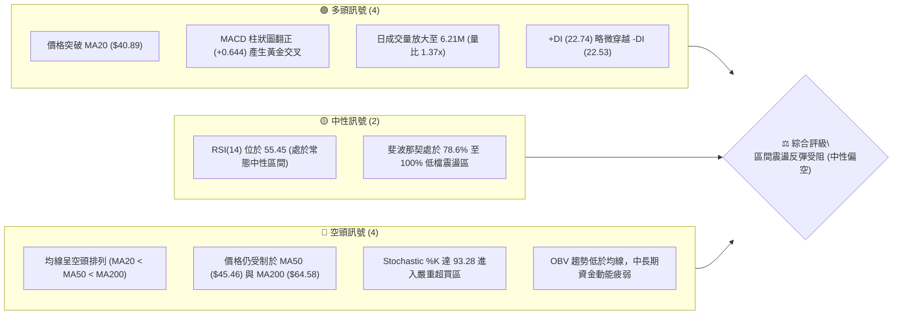
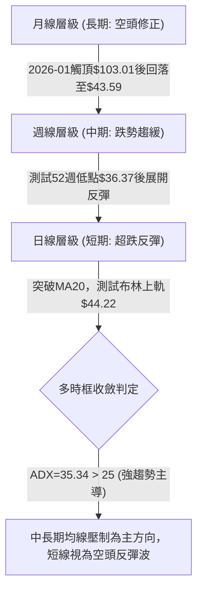
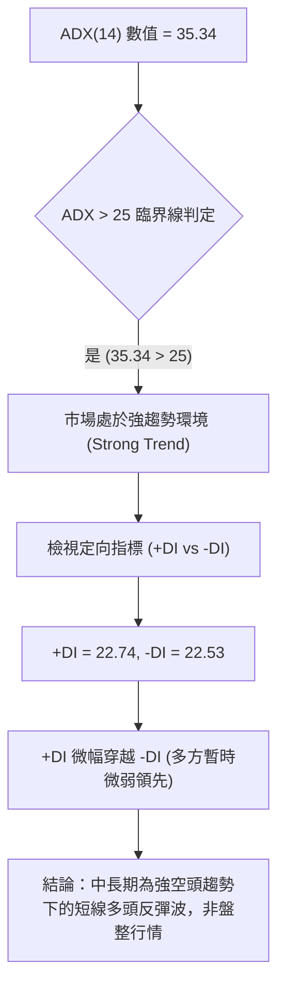
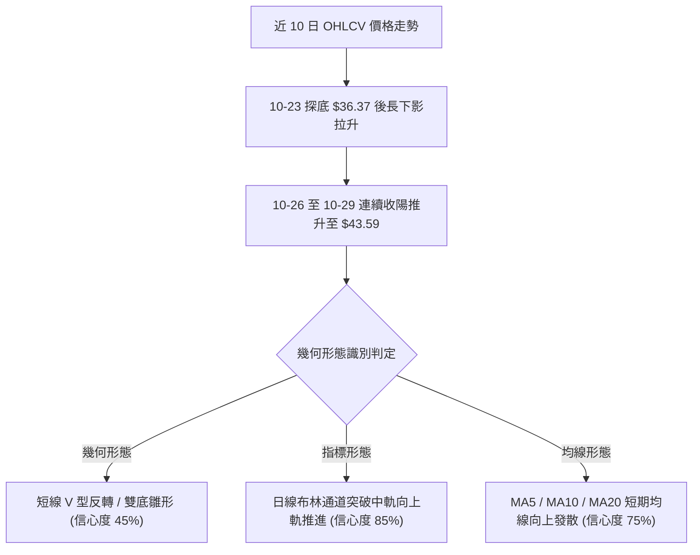
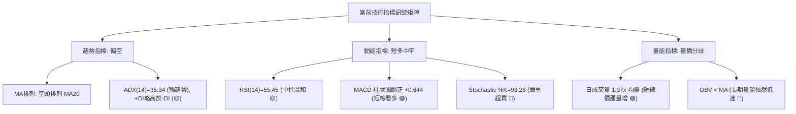
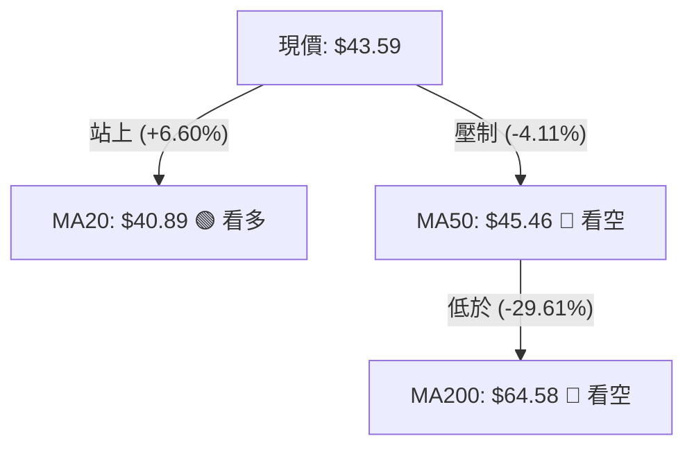
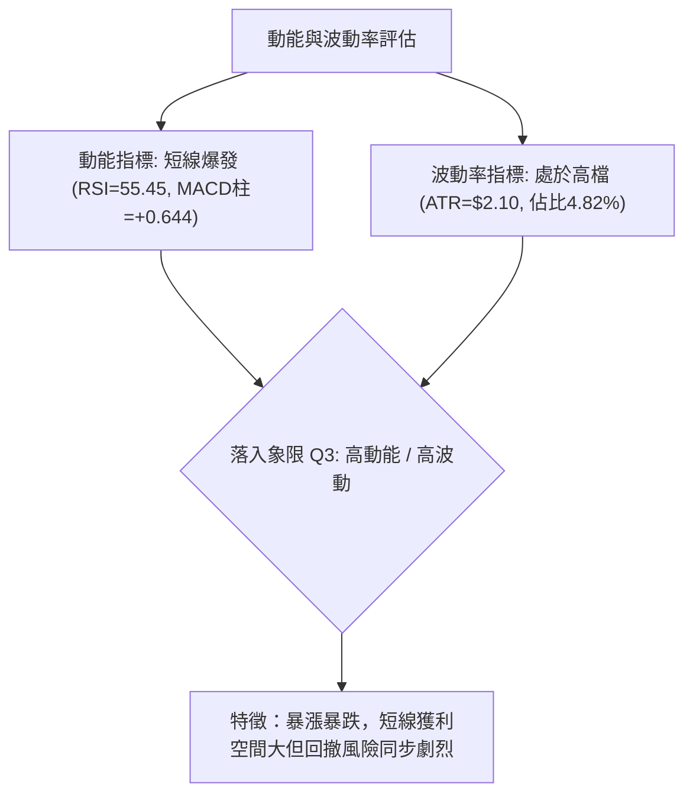
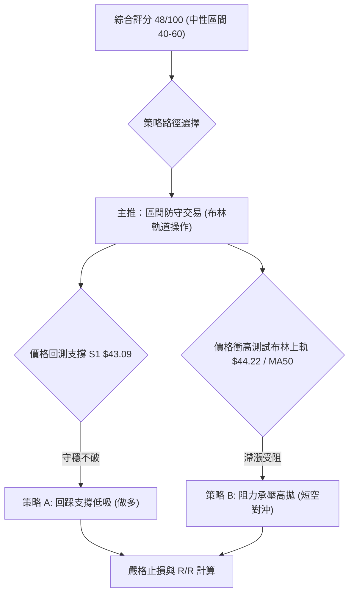
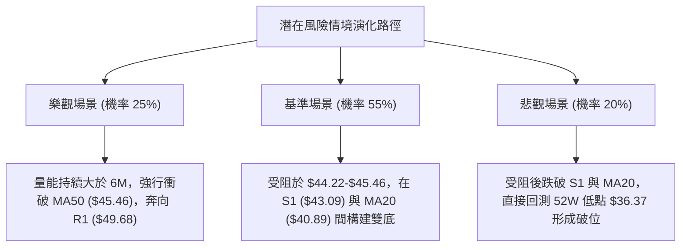

# KTOS 技術分析報告

> **報告日期**：2026-10-30 ｜ **語言**：繁體中文 ｜ **數據來源**：Yahoo Finance ｜ **當前價格**：$43.59

---

## 目錄

| 章節 | 內容 |
|------|------|
| [1. 技術面概覽](#1-技術面概覽) | 訊號儀表板、核心指標、評分卡 |
| [2. 趨勢分析](#2-趨勢分析) | 多時框趨勢、長中短期走勢 |
| [3. 圖表形態分析](#3-圖表形態分析) | 形態識別、K線組合、目標價 |
| [4. 支撐與阻力](#4-支撐與阻力) | 關鍵價位、斐波那契回調 |
| [5. 技術指標深度解讀](#5-技術指標深度解讀) | MA/RSI/MACD/布林/成交量 |
| [6. 動能與波動率](#6-動能與波動率) | 動能評估、ATR、Beta |
| [7. 多時框架總結](#7-多時框架總結) | 時框架評分矩陣 |
| [8. 交易策略建議](#8-交易策略建議) | 多空策略、風險報酬比 |
| [9. 風險提示與監控](#9-風險提示與監控) | 監控指標、風險場景 |

---

## 1. 技術面概覽

### 🎯 技術訊號儀表板



### 📊 核心指標速覽表

| 指標類別 | 指標名稱 | 當前數值 | 訊號 | 解讀 |
|----------|----------|----------|------|------|
| **價格** | 當前收盤價 | $43.59 | 🟡 | 站上布林中軌，逼近布林上軌 ($44.22) |
| **均線** | MA20 | $40.89 | 🟢 | 現價位於 MA20 上方 +6.60%，短線底部確立 |
| **均線** | MA50 | $45.46 | 🔴 | 現價位於 MA50 下方 -4.11%，中線承壓 |
| **均線** | MA200 | $64.58 | 🔴 | 現價遠低於 MA200 -32.50%，長期架構處於空頭 |
| **動能** | RSI(14) | 55.45 | 🟡 | Wilder 算法，自超賣區回升至中性溫和區間 |
| **動能** | MACD(12,26,9) | -1.263 / -1.907 | 🟢 | 快線於零軸下方金叉慢線，柱狀圖為 +0.644 看多 |
| **動能** | KD(14,3,3) | %K 93.28 / %D 79.31 | 🔴 | 隨機指標進入極端超買區，慎防短線追高回踩 |
| **趨勢** | ADX(14) | 35.34 | 🔴 | ADX > 25 表明處於強趨勢（空頭趨勢反彈波） |
| **波動** | ATR(14) | $2.10 | 🟡 | 佔現價 4.82%，波動度處於中等偏高水準 |
| **量能** | 當日成交量 | 6,211,800 | 🟢 | 高於 20 日均量 1.37 倍，反彈伴隨短線量增 |

### 🏆 技術評分卡

```
╔══════════════════════════════════════════════════════════════════╗
║                技術評分卡 — KTOS (2026-10-30)                   ║
╠══════════════════════════════════════════════════════════════════╣
║ 趨勢強度 (Trend)     ██████████░░░░░░░░░░  48/100  🟡 中性震盪   ║
║ 動能指標 (Momentum)  ████████████░░░░░░░░  62/100  🟢 短線偏多   ║
║ 支撐穩定度 (Support) ██████████░░░░░░░░░░  52/100  🟡 考驗支撐   ║
║ 成交量配合 (Volume)  █████████░░░░░░░░░░░  46/100  🟡 量價分歧   ║
║ 形態完整度 (Pattern) █████████░░░░░░░░░░░  44/100  🟡 築底初期   ║
║ 均線排列 (MAs)       ███████░░░░░░░░░░░░░  36/100  🔴 空頭排列   ║
╠══════════════════════════════════════════════════════════════════╣
║ 綜合評分             ██████████░░░░░░░░░░  48/100  🟡 中性觀望   ║
║ 評分定義：六項算術平均 (48+62+52+46+44+36)/6 = 48.0 (四捨五入 48)║
╚══════════════════════════════════════════════════════════════════╝
```

---

## 2. 趨勢分析

### 🌐 多時框趨勢分析



### 📈 長期趨勢 — 12個月走勢圖（Unicode）

KTOS 過去 12 個月經歷了劇烈的拋物線趕頂與隨後的單邊下挫。以下為 2025-11 至 2026-10 的月線收盤價格軌跡：

```
KTOS 月線走勢圖（過去12個月）
價格軸 ($)
$105 ┤               ● $103.01 (2026-01 頂部)
$100 ┤              ╱ ╲
 $90 ┤             ╱   ╲
 $80 ┤            ╱     ● $86.18
 $75 ┤● $76.10   ● $75.91╲
 $70 ┤                     ● $70.51
 $65 ┤                       ╲
 $60 ┤                        ● $63.05  ● $64.13
 $50 ┤                                  ╲      ● $50.98
 $45 ┤                                   ● $49.86 ╲    ● $43.59 (現價)
 $40 ┤                                    ● $46.60 ● $42.69
     └─┬────┬────┬────┬────┬────┬────┬────┬────┬────┬────┬────┬──
     11月 12月 01月 02月 03月 04月 05月 06月 07月 08月 09月 10月
     (2025)   (--------------------- 2026 ---------------------)
```

**12個月走勢特徵分析表格**：

| 階段區間 | 時間跨度 | 起訖收盤價 | 區間漲跌幅 | 主要技術特徵 |
|----------|----------|------------|------------|--------------|
| **末端加速趕頂** | 2025-11 至 2026-01 | $76.10 → $103.01 | +35.36% | 動能爆發並創波段歷史高點，月線層級出現極端超買 |
| **高位破位殺跌** | 2026-01 至 2026-04 | $103.01 → $63.05 | -38.79% | 跌破多道短期均線，呈現階梯式下挫，成交量放大 |
| **中繼橫盤掙扎** | 2026-04 至 2026-06 | $63.05 → $49.86 | -20.92% | 反彈受阻於 $65 關卡，隨後失守 $50 大關，空頭吞噬 |
| **探底震盪修復** | 2026-06 至 2026-10 | $49.86 → $43.59 | -12.57% | 於 10 月 23 日下探 52 週最低點 $36.37 後展開收斂反彈 |

### 📊 中期趨勢（週線分析）

週線層級目前顯示 KTOS 正在構築短期超跌反彈結構。過去 8 週走勢由 9 月中的 $47 區間逐步盤跌，至 10 月 23 日當週最低跌至 $36.37，隨後本週長陽拉升至 $43.59，週線 RSI 由超賣區 31.3 翻升至 55.4。

```
週線關鍵壓力與支撐示意圖：
  $54.22 ─────────────────────────── [R3 近一年波段高點阻力聚類]
  $51.49 ─────────────────────────── [R2 強阻力位]
  $49.68 ─────────────────────────── [R1 頸線阻力 / 9月反彈高點聚類]
  $45.46 --------------------------- [MA50 中期生命線壓力]
  $43.59 ═══════════════════════════ ◄ 現價位置 (測試布林上軌)
  $43.09 ─────────────────────────── [S1 近一年波段低點聚類支撐]
  $36.37 ─────────────────────────── [52W Low 終極防線]
```

### ⚡ 趨勢強度評估（ADX 解讀）



**ADX 趨勢強度對照解讀**：
- **ADX(14) = 35.34**：確認當前行情具備高定向趨勢特徵，市場波動具備延續性，並非無方向的橫向低波動盤整。
- **+DI (22.74) 與 -DI (22.53)**：兩者在 22.6 附近激烈纏繞，顯示短線多空力量進入均勢博弈，多頭短線動能略微勝出，但尚未拉開安全距離。

---

## 3. 圖表形態分析

### 🔍 形態識別系統



**形態信心度與目標價評估表**（依規則 15）：

| 形態類別 | 信心度 | 判斷依據（嚴格引用數據） | 完成度 | 目標價（附計算式） |
|----------|--------|--------------------------|--------|--------------------|
| **短底反彈雛形** | 45% | 10-23 觸及 $36.37 後反彈，但在 R1 之前未有第二隻腳確認，幾何型態樣本不足 | 50% | 訊號不足，僅做指標型解讀（不提供延伸推算目標） |
| **布林帶向上突破** | 85% | 10-29 收盤價 $43.59 站穩中軌 $40.89，%B 達 0.91 逼近上軌 $44.22 | 90% | 上軌目標：即為布林上軌 $44.22，若帶量突破看至 R1 $49.68 |
| **短期均線金叉** | 75% | MA5 ($41.04) 與 MA10 ($40.07) 金叉並向上穿越 MA20 ($40.89) | 80% | 第一阻力目標：MA50 所在位置 $45.46 |

### 🕯️ 重要K線形態分析

嚴格依據數據中「近 10 根日 K」與「近 8 根週 K」之開高低收進行客觀解讀：

#### 1. 近 10 根日 K 線形態明細

| 日期 | 開盤價 | 最高價 | 最低價 | 收盤價 | K線形態名稱 | 形態解讀與市場心理 | 訊號 |
|------|--------|--------|--------|--------|-------------|--------------------|------|
| 2026-10-16 | $40.83 | $41.72 | $40.05 | $40.42 | 帶上下影短黑K | 圍繞 $40 關卡窄幅拉鋸，空方稍佔優勢 | 🔴 |
| 2026-10-19 | $40.40 | $40.50 | $39.03 | $39.17 | 中陰線 | 破位跌穿 $40 心理關卡，賣壓加劇 | 🔴 |
| 2026-10-20 | $38.83 | $40.26 | $38.58 | $38.96 | 假陽十字星 | 嘗試上探 $40.26 未果，低位弱勢抵抗 | 🟡 |
| 2026-10-21 | $39.57 | $39.99 | $38.41 | $38.74 | 陰線 | 反彈不過前高，空方主導並向下測試 | 🔴 |
| 2026-10-22 | $38.27 | $39.96 | $37.40 | $38.27 | 長下影紡錘線 | 盤中殺低至 $37.40 見抄底盤介入，收平盤 | 🟡 |
| 2026-10-23 | $37.64 | $39.08 | $36.37 | $38.68 | 探底錘頭線 (Hammer) | 創 52 週新低 $36.37 後強勁拉起，形成極重要轉折點 | 🟢 |
| 2026-10-26 | $38.68 | $40.57 | $38.43 | $40.43 | 光腳實體長陽線 | 確認 10-23 支撐有效，大漲收復 $40 關卡 | 🟢 |
| 2026-10-27 | $40.73 | $42.12 | $40.06 | $41.32 | 續漲跳空陽線 | 向上突破 MA20，高見 $42.12，買盤承接力強 | 🟢 |
| 2026-10-28 | $41.38 | $41.56 | $40.40 | $41.17 | 高位縮量紡錘星 | 上攻節奏放緩，量能縮減至 2.80M，健康換手 | 🟡 |
| 2026-10-29 | $41.28 | $44.11 | $41.20 | $43.59 | 帶量突破大陽線 | 成交量激增至 6.21M，實體大陽線收在 $43.59 高位 | 🟢 |

#### 2. 近 8 根週 K 線形態明細

| 日期 (週末) | 開盤價 | 最高價 | 最低價 | 收盤價 | K線形態名稱 | 形態解讀與市場心理 | 訊號 |
|-------------|--------|--------|--------|--------|-------------|--------------------|------|
| 2026-09-11 | $48.32 | $50.05 | $45.47 | $46.69 | 上影陰線 | 測試 $50 心理關卡受阻，空方壓回 | 🔴 |
| 2026-09-18 | $45.76 | $49.46 | $45.72 | $47.46 | 震盪陽十字 | 45-49 區間震盪，多空暫時均衡 | 🟡 |
| 2026-09-25 | $48.22 | $49.68 | $44.81 | $45.62 | 吞噬中陰線 | 再次受阻於 $49.68 (R1)，下破前週低點 | 🔴 |
| 2026-10-02 | $44.97 | $45.22 | $41.83 | $43.07 | 連續下行陰線 | 空頭慣性延續，放量跌破 $44 關卡 | 🔴 |
| 2026-10-09 | $43.80 | $44.14 | $40.93 | $42.36 | 下跌延伸陰線 | 均線反壓沉重，成交量維持高位 26.62M | 🔴 |
| 2026-10-16 | $42.48 | $43.07 | $37.84 | $40.42 | 長下影長陰破位 | 最低殺至 $37.84，下影線透露買盤試探 | 🔴 |
| 2026-10-23 | $40.40 | $40.50 | $36.37 | $38.68 | 底部假陰錘頭 | 刷新 52 週低點 $36.37 後收窄跌幅，形成拋補低點 | 🟡 |
| 2026-10-29 | $38.68 | $44.11 | $38.43 | $43.59 | 底部包覆大長陽 | 本週低開高走，週線實體完全吞噬前兩週收盤價 | 🟢 |

### 📉 ASCII 走勢形態示意圖

```
KTOS 近 10 日走勢與局部底部突破示意圖：
價格
$45.00 ┤                                      ▲ 阻力 R1 $49.68
$44.00 ┤                                     [10-29] 高 $44.11 / 收 $43.59
$43.00 ┤                                    ╱  ◄ 突破 S1 $43.09
$42.00 ┤                           [10-27] ●
$41.00 ┤                         ╱    [10-28] ●
$40.00 ┤[10-16] ●             [10-26] ●
$39.00 ┤         ╲ [10-19] ● ╱
$38.00 ┤           ● [10-20] ╲ [10-22] ●
$37.00 ┤             [10-21]   ● 錘頭線最低 $36.37 (10-23)
       └─┬──────┬──────┬──────┬──────┬──────┬──────┬──────┬──────┬──────┬──
       10-16  10-19  10-20  10-21  10-22  10-23  10-26  10-27  10-28  10-29
```

### 🎯 形態目標價計算

依據 2026-10-23 最低點 $36.37 至 10-29 收盤價 $43.59 的短線強勢反彈波段：
- 形態依據：日線層級超跌反彈（以布林中軌為支撐基底）。
- 關鍵阻力目標：若現價 $43.59 能有效突破布林通道上軌 $44.22，向上拓展空間之目標價嚴格錨定為系統波段高點聚類數值 **R1 = $49.68**。
- 第二目標：若 R1 獲得放量突破，則進一步挑戰上方波段高點聚類 **R2 = $51.49**。

---

## 4. 支撐與阻力

### 🗺️ 關鍵價位分布圖（Unicode）

```
KTOS 價位結構分布圖
═══════════════════════════════════════════════════
$54.22 ║████████████████████████║ 強阻力 R3 (+24.39%)
$51.49 ║████████████████████    ║ 阻力 R2 (+18.12%)
$49.68 ║████████████████████████║ 關鍵阻力 R1 (+13.97%)
$45.46 ║░░░░░░░░░░░░░░░░░░░░    ║ MA50 生命線阻力
$44.22 ║▒▒▒▒▒▒▒▒▒▒▒▒▒▒▒▒▒▒▒▒    ║ 布林通道上軌
$43.59 ╠════════════════════════╣ ◄ 現價 (收盤價)
$43.09 ║▓▓▓▓▓▓▓▓▓▓▓▓▓▓▓▓        ║ 近期波段支撐 S1 (-1.15%)
$40.89 ║░░░░░░░░░░░░░░░░░░░░    ║ MA20 / 布林中軌動態支撐
$36.37 ║████████████████████████║ 52週最低點防線 (100.0% Fib)
═══════════════════════════════════════════════════
```

### 🚧 阻力位分析表

阻力價位嚴格引用自數據之「關鍵價位」與移動平均線數值：

| 阻力級別 | 價位 | 距離現價 | 形成原因與技術意涵 | 突破難度 | 重要性 |
|----------|------|----------|--------------------|----------|--------|
| **短線動態阻力** | $44.22 | +1.45% | 布林通道上軌，短線超買擴張極限 | 🟡 中等 | ★★★☆☆ |
| **均線心理阻力** | $45.46 | +4.29% | MA50 移動平均線，中期空頭防守陣線 | 🔴 較高 | ★★★★☆ |
| **阻力 R1** | $49.68 | +13.97% | 近一年波段高點聚類、9月下旬震盪頂部 | 🔴 很高 | ★★★★★ |
| **阻力 R2** | $51.49 | +18.12% | 近一年波段高點聚類、MA120 ($50.60) 密集區 | 🔴 極高 | ★★★★☆ |
| **阻力 R3** | $54.22 | +24.39% | 近一年波段高點聚類、6月中旬反彈頭部 | 🔴 極高 | ★★★☆☆ |

### 🛡️ 支撐位分析表

支撐價位嚴格引用自數據之「關鍵價位」與特定技術結構：

| 支撐級別 | 價位 | 距離現價 | 形成原因與技術意涵 | 守住機率 | 重要性 |
|----------|------|----------|--------------------|----------|--------|
| **支撐 S1** | $43.09 | -1.15% | 近一年波段低點聚類，轉化為當前第一道短線支撐 | 65% | ★★★★☆ |
| **動態支撐** | $40.89 | -6.19% | MA20 與布林中軌重合點，多頭反彈生命線 | 75% | ★★★★★ |
| **支撐 S2** | 數據中未偵測到 | N/A | 原生演算法未標記特定低點聚類 | N/A | N/A |
| **支撐 S3** | 數據中未偵測到 | N/A | 原生演算法未標記特定低點聚類 | N/A | N/A |
| **終極防線** | $36.37 | -16.56% | 52 週最低點 (10-23 低點)，斐波那契 100.0% 位 | 85% | ★★★★★ |

### 📐 斐波那契回調位分析

依據 52 週區間波段（高點 $134.00 → 低點 $36.37）之黃金分割比率分析：

| 斐波那契比例 | 基準價位 | 距現價差距 | 技術解讀與價位地位 |
|--------------|----------|------------|--------------------|
| **0.0% (52W High)** | $134.00 | +207.41% | 歷史牛市最高頂點 |
| **23.6%** | $110.96 | +154.55% | 深度回調的第一道長線極限阻力 |
| **38.2%** | $96.71 | +121.86% | 2025 年 9-10 月平台整理區 |
| **50.0%** | $85.18 | +95.41% | 長期多空分水嶺，接近 2026-02 反彈高點 |
| **61.8%** | $73.66 | +68.98% | 黃金分割強壓力位，跌破後確認熊市主跌浪 |
| **78.6%** | $57.26 | +31.36% | 下跌波段重要中繼點，位於現價上方 |
| **當前價格落點** | **$43.59** | **0.00%** | **位於 78.6% ($57.26) 與 100.0% ($36.37) 之間** |
| **100.0% (52W Low)**| $36.37 | -16.56% | 52 週循環底部，技術性回調的絕對終點 |

**斐波那契結構解讀**：
當前收盤價 $43.59 處於斐波那契 78.6% ($57.26) 至 100.0% ($36.37) 的低檔超跌弱勢區間。股價在 $36.37 處獲得 100% 回調位支撐後展開反彈，若要扭轉長線熊市架構，首要條件是回補至 78.6% ($57.26) 之上；在此之前，所有向上的拉升均屬於深跌後的次級反彈走勢。

---

## 5. 技術指標深度解讀

### 🎛️ 指標訊號總覽



### 📈 移動平均線排列分析



**移動平均線體系狀態解讀**：
- **短期均線**：MA5 ($41.04)、MA10 ($40.07)、MA20 ($40.89) 呈現底部翻揚並多頭排列，股價連續 4 個交易日站穩短期均線，表明短線買盤強勢。
- **中長期均線**：MA50 ($45.46) 與 MA200 ($64.58) 仍呈經典空頭排列（MA20 < MA50 < MA200），且長期均線斜率向下發散（MA240 達 $67.15）。短線走勢屬於「反彈遇阻」性質，MA50 ($45.46) 將是極具威脅的空方防守線。

### 📉 RSI(14) 分析

進度條展示 RSI(14) 狀態：
```
RSI(14): 55.45 ▓▓▓▓▓▓▓▓▓▓▓▓▓░░░░░░░ 55.45% (中性偏多區間)
0            30(超賣)         50(多空中軸)      70(超買)       100
├────────────┼────────────────┼───────────────┼────────────┤
             │                ▲ 現價位置      │            
```
- **數值解讀**：RSI(14) 由 10 月 23 日的極端超賣區（約 31.3）迅速回升至 55.45，成功穿越 50 多空中軸，進入常態偏強多方掌控區，但未達 70 超買警戒線。
- **背離分析**：
  - 根據近 20 根 K 棒的首尾比對與官方數據判定：**無明顯背離**。
  - 價格自 $36.37 低點回升，RSI 同步自 31 上揚至 55，動能與價格同向運動，未見頂背離或底背離徵兆。

### 📊 MACD(12/26/9) 訊號解讀


- **解讀**：MACD 快慢線雖然仍處於零軸下方（反映中長期弱勢格局），但快線已於水下向上黃金交叉訊號線，柱狀圖（Histogram）達到 +0.644，表明短線空頭力竭，多頭反彈動能正處於爆發擴張期。

### 📦 布林通道分析

```
KTOS 布林通道 (20, 2) 結構示意圖：
$45.00 ┤                                
$44.22 ┼─────────────────────────────── [BB 上軌]
$43.59 ┼                     ● [現價: 位於上軌附近, %B = 0.91]
$43.00 ┤                    
$42.00 ┤                   
$40.89 ┼─────────────────────────────── [BB 中軌 (MA20)]
$40.00 ┤                 
$39.00 ┤                
$38.00 ┤               
$37.56 ┼─────────────────────────────── [BB 下軌]
       └───────────────────────────────
```
- **BB %B = 0.91**：價格已極度逼近布林通道上軌（$44.22），代表短線波動率向上極限擴張。
- **通道形態**：中軌維持在 $40.89。價格自下軌 $37.56 連續貫穿中軌，直撲上軌，短線進入技術性超買防守點。若未能帶量衝破上軌，將面臨回踩中軌 $40.89 的壓力。

### 💹 成交量分析（量價配合度）

- **量能激增**：10 月 29 日成交量衝高至 6,211,800 股，相較於 20 日均量（4,530,275 股）量比達到 **1.37x**，相較於 50 日均量（4,052,054 股）量比達 **1.53x**。此舉呈現典型的「帶量長紅破阻」形態。
- **OBV 趨勢檢視**：
  - 數據明確顯示：`OBV < MA → 量能疲弱`。
  - **解讀**：日線單日的量能放大尚未能修復過去數月資金持續流出的總體失衡。長期資金（OBV）依然低於其移動平均線，說明此波上攻主要由短線空頭回補與超跌抄底盤主導，缺乏大型機構投資者的長期累積籌碼跡象。

---

## 6. 動能與波動率

### ⚡ 動能評估四象限

| 象限 | 動能強度 | 波動率水準 | KTOS 當前狀態 | 策略意涵 |
|------|----------|------------|---------------|----------|
| **Q1 (最佳機會)** | 強 (RSI>50, MACD>0) | 低 (ATR% < 3%) | — | 趨勢穩健增長，適合順勢重倉 |
| **Q2 (謹慎觀望)** | 弱 (RSI<50, MACD<0) | 低 (ATR% < 3%) | — | 無方向沉悶橫盤，資金效率低 |
| **Q3 (高風險反彈)**| **強 (短線動能爆發)** | **高 (ATR% = 4.82%)** | **✓ (KTOS 當前落點)** | **超跌強反彈，波動巨大，宜快進快出** |
| **Q4 (主跌殺戮)** | 弱 (空頭排列) | 高 (ATR% > 5%) | — | 主跌浪單邊暴跌，嚴禁左側抄底 |



### 📊 ATR 波動率分析

- **ATR(14) 數值**：**$2.10**，佔當前收盤價之 **4.82%**（Wilder 算法）。
- **日內波動幅度**：每日平均振幅超過 $2 美元，說明該標的具有極高的短線交易彈性。
- **止損距離建議**：
  - **保守型止損 (2.0 × ATR)**：$2.10 × 2.0 = $4.20。若自現價回測，容許波動範圍至 $39.39。
  - **標準型止損 (1.5 × ATR)**：$2.10 × 1.5 = $3.15。對應止損空間至 $40.44。
  - **緊密型止損 (1.0 × ATR)**：$2.10 × 1.0 = $2.10。對應止損點為 $41.49。

### 📐 Beta 與市場相關性

- **Beta 係數**：**1.107**。
- **市場敏感度解讀**：KTOS 的 Beta 略高於大盤基準（1.0），代表其對美股整體市場（如標普 500、工業與國防軍工板塊）的波動具有放大的聯動效應。在市場多頭環境下該股具備超額彈性，但在大盤回調或風險偏好收縮時，面臨的被動拋售壓力亦顯著大於防禦型類股。

---

## 7. 多時框架總結

### 📋 時框架評分表

| 時框架 | 趨勢方向 | 動能狀態 | 均線排列 | 圖表形態 | 綜合評分 | 操作建議 |
|--------|----------|----------|----------|----------|----------|----------|
| **短期 (日線)** | 偏多反彈 | 偏強 (RSI 55.45) | 突破 MA20 / 受阻 MA50 | 布林帶上軌測試 | 65/100 🟢 | 逢高減磅，等待回測低吸 |
| **中期 (週線)** | 空頭趨緩 | 弱勢反彈 (MACD柱剛轉正)| 均線向下發散 | 52週低點長陽包覆 | 45/100 🟡 | 視為反彈波，嚴格設定停利 |
| **長期 (月線)** | 明確空頭 | 疲弱 (自百元崩跌) | 空頭排列 (MA200下方) | 階梯式下挫崩塌 | 35/100 🔴 | 長線趨勢未反轉，禁止定投 |

### 🔲 綜合訊號矩陣

```
時框架訊號收斂分析陣列：
╔══════════════╦══════════════╦══════════════╦══════════════╗
║ 評估維度     ║ 短期 (Daily) ║ 中期 (Weekly)║ 長期 (Month) ║
╠══════════════╬══════════════╬══════════════╬══════════════╣
║ 趨勢軌道     ║ 🟢 突破上行  ║ 🔴 空頭下行  ║ 🔴 熊市主跌  ║
║ 動能狀態     ║ 🟢 MACD金叉  ║ 🟡 築底初期  ║ 🔴 動能渙散  ║
║ 均線架構     ║ 🟢 站上MA20  ║ 🔴 受制MA50  ║ 🔴 遠低MA200 ║
║ 支撐強度     ║ 🟢 S1 $43.09 ║ 🟡 $36.37    ║ 🔴 78.6% Fib ║
║ 成交量能     ║ 🟢 放量 1.37x║ 🟡 低位換手  ║ 🔴 OBV 疲軟  ║
╚══════════════╩══════════════╩══════════════╩══════════════╝
```

### ⚖️ 多時框收斂結論

依據多時框收斂規則（規則 14）：
1. **行情性質判定**：當前 **ADX(14) = 35.34 > 25**，市場被定義為「**強趨勢行情**」。
2. **主導時框優先級**：在強趨勢環境下，中長期均線（週線 / MA50 $45.46 與 MA200 $64.58）主導核心方向，日線訊號僅用於尋找次級折返點或精準進場時機。
3. **矛盾化解與收斂方向**：日線雖然呈現帶量長陽、MACD 金叉等強多訊號，但週線與月線均線空頭排列完好，且上方立即面臨 MA50 ($45.46) 與布林上軌 ($44.22) 之雙重鐵壁。因此，日線的多頭動能僅能定義為**中長線空頭框架下的「超跌強反彈波」**。
4. **唯一方向性結論**：**【中性偏弱反彈受阻】**。短線進入阻力密集區，切勿於 $43.59 以上盲目追多，交易主軸以「區間高拋低吸、防守反彈波結束」為主。

---

## 8. 交易策略建議

### 🗺️ 策略決策流程圖



### 🧭 策略路由（依評分卡分流）

> **當前主策略方向 = 區間震盪操作（依評分 48/100，落於 40–60 中性區間，以布林通道上下軌與關鍵支撐為交易邊界，等待突破確認）。**

由於中長期趨勢依舊偏空，但短線日線動能強勁反彈，市場正處於「短線反彈動能」與「中期均線阻力」激烈碰撞的拉鋸期，故採取精準區間定位策略。

### 🎯 價格情境階梯（Price Scenarios）

價位嚴格引用第 4 章已確認之數值：

| 觸發條件 | 下一目標 | 後續延伸 | 情境技術含義 |
|----------|----------|----------|--------------|
| **強勢突破 MA50 ($45.46)** | 阻力 R1 $49.68 | 阻力 R2 $51.49 | 短線反彈轉為中期反轉，空頭全面停損 |
| **受阻於布林上軌 ($44.22)** | 支撐 S1 $43.09 | MA20 ($40.89) | 反彈動能耗盡，回歸布林帶寬震盪整理 |
| **失守波段支撐 S1 ($43.09)**| MA20 ($40.89) | 52W Low $36.37 | 反彈失敗，空方重新控盤向下回補 |

### 📊 情境機率分佈

| 情境劇本 | 發生機率 | 主要依據與指標佐證 |
|----------|----------|--------------------|
| **情境一：受阻震盪回調** | **50%** | Stochastic %K 達 93.28 處於嚴重超買，價格緊貼布林上軌 $44.22，MA50 ($45.46) 壓制力道沉重 |
| **情境二：延續反彈衝刺** | **35%** | MACD 柱狀圖翻正 (+0.644)，成交量突破 6.21M (1.37x)，+DI 略為領先 -DI |
| **情境三：深度下破尋底** | **15%** | 雖然 OBV 疲弱且 MA200 空頭排列，但短線 10-23 之錘頭線支撐強勁，短期間直接破底機率偏低 |

### 🟢 主策略詳情（方向：區間多空雙向精準操作）

依據規則 17，風險報酬比嚴格定義為：**風險報酬比 = (目標價 T1 − 進場價) ÷ (進場價 − 止損價)**，做空時反向計算。

| 策略要素 | 策略 A（保守型：回踩支撐低吸做多） | 策略 B（順勢型：阻力位反轉受阻短空） |
|----------|-------------------------------------|---------------------------------------|
| **操作方向** | 多頭 (Long) | 空頭 (Short) |
| **進場條件** | 回測 S1 獲支撐且出現 15分/日K 止跌訊號 | 衝高觸及布林上軌或 MA50 出現長上影線 |
| **進場價格** | **$43.09** (精確依據 S1 支撐位) | **$45.46** (精確依據 MA50 阻力位) |
| **目標價 T1** | **$49.68** (精確依據 R1 阻力位) | **$40.89** (精確依據 MA20 / 布林中軌) |
| **目標價 T2** | **$51.49** (精確依據 R2 阻力位) | **$36.37** (精確依據 52W Low) |
| **止損價格** | **$40.89** (精確依據 MA20 動態支撐) | **$49.68** (精確依據 R1 阻力位突破) |
| **風險報酬比** | **1 : 3.00（以 T1 計）**<br>*(49.68-43.09)/(43.09-40.89) = 6.59/2.20 = 2.995*<br>*(以 T2 計: 8.40/2.20 = 1 : 3.82)* | **1 : 1.08（以 T1 計）**<br>*(45.46-40.89)/(49.68-45.46) = 4.57/4.22 = 1.083*<br>*(以 T2 計: 9.09/4.22 = 1 : 2.15)* |
| **成功機率** | **55%** | **45%** |
| **建議倉位** | **15% - 20%** | **10%** |

### 🔴 反向風險觸發點（對沖提示）

- **多頭止損與對沖觸發**：若收盤價跌破 **$40.89**（MA20 / 布林中軌），意味短線反彈形態徹底被破壞，多頭部位必須無條件全數止損離場，並可啟動做空對沖機制。
- **空頭止損與認錯觸發**：若日 K 帶量強勢收於 **$45.46**（MA50）之上，且次日站穩，意味中期空頭結構發生質變，所有反向空單部位必須立即平倉認賠。

### ⭐ 整體訊號強度評星

```
做多訊號強度：★★★☆☆  (3.0/5星 - 短線動能充足但阻力重重)
做空訊號強度：★★☆☆☆  (2.5/5星 - 順應大趨勢但遭遇短線逼空)
整體可信度：  ★★★☆☆  (3.5/5星 - 震盪格局需嚴格執行紀律)
```

---

## 9. 風險提示與監控

### ✅ 關鍵監控指標 Checklist

```
╔══════════════════════════════════════════════════════════════════╗
║                    交易風控監控清單 (Checklist)                  ║
╠══════════════════════════════════════════════════════════════════╣
║ [ ] 監控 MA50 ($45.46) 壓制力道：能否被長紅帶量突破？            ║
║ [ ] 監控布林上軌 ($44.22) 穿越情況：%B 是否在 >1.0 處形成鈍化？   ║
║ [ ] 監控 Stochastic 超買鈍化風險：%K (93.28) 是否死叉 %D？      ║
║ [ ] 監控回踩 S1 ($43.09) 支撐力道：成交量是否呈現健康萎縮？     ║
║ [ ] 監控動態防守位 MA20 ($40.89)：多頭最後生命線是否穩固？       ║
║ [ ] 監控大盤板塊氛圍：國防軍工板塊是否出現集體防禦性資金回流？  ║
╚══════════════════════════════════════════════════════════════════╝
```

### ⚠️ 風險場景分析



### 🛡️ 風險管理重要提醒

1. **ATR 波動風險管控**：
   - KTOS 之 ATR(14) 達 $2.10（佔比 4.82%），日內走勢極具爆發力。任何單筆交易之單邊虧損金額，切勿超過總投資帳戶淨值的 1.5%。
2. **超買修正預警**：
   - 隨機指標 %K 高達 93.28，屬於典型的「技術面極度超買」。歷史數據表明，當 KTOS 在中長期均線下方出現 KD 極端超買時，極易引發快速而劇烈的日內洗盤，嚴禁在 $43.59 以上市價追買。
3. **財報與基本面事件防範**：
   - 公司預計於 11 月 5 日召開第三季財報電話會議，基本面現金流為負（FCF 收益率 -1.57%），財報前夕引發的引伸波幅（IV）擴張可能加劇價格震盪，建議在財報公佈前將倉位縮減至 10% 以下。

---

## 📋 報告總結

```
KTOS 技術分析報告總結
════════════════════════════════════════════════════════
報告日期：2026-10-30
當前價格：$43.59
分析評級：⚖️ 中性觀望 / 區間震盪 (綜合評分: 48/100)

關鍵結論：
├─ 長期趨勢：🔴 空頭排列 (MA200 = $64.58 呈現向下壓制)
├─ 中期趨勢：🟡 跌勢趨緩 (週線長陽包覆，嘗試築底)
├─ 短期趨勢：🟢 強勁反彈 (站穩 MA20 $40.89，MACD 金叉)
├─ 關鍵支撐：S1 $43.09 / MA20 $40.89 / 52W Low $36.37
├─ 關鍵阻力：布林上軌 $44.22 / MA50 $45.46 / R1 $49.68
└─ 分析師目標：均價 $93.44 (最低 $50.00 / 最高 $150.00)

最優策略組合：
1. 🥇 最佳機會 (策略 A)：耐心等待股價回踩波段支撐 S1 ($43.09) 企穩後
   進場建立多頭部位，止損設於 MA20 ($40.89)，目標鎖定 R1 ($49.68)，
   風險報酬比高達 1 : 3.00。
2. 🥈 次選機會 (策略 B)：若現價衝高至 MA50 ($45.46) 出現量價背離滯漲，
   可輕倉介入做空對沖，目標回看布林中軌 ($40.89)，止損設於 R1 ($49.68)。
3. 🥉 保守選擇：完全空倉觀望，等待日 K 線收盤確認有效突破 MA50 
   ($45.46) 或回測 $36.37 形成大級別二次底後，再行順勢進場。
════════════════════════════════════════════════════════
```

---

> ⚠️ **免責聲明**：本報告為 AI 自動生成之技術分析，所有數據及估算均基於提供的歷史價格資訊。本報告**僅供研究與學術參考**，**不構成任何投資建議**。投資有風險，入市需謹慎。

---

*報告生成時間：2026-10-30 ｜ 數據來源：Yahoo Finance ｜ 分析框架：多時框技術分析*