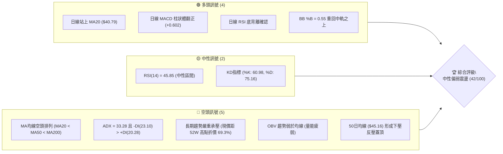
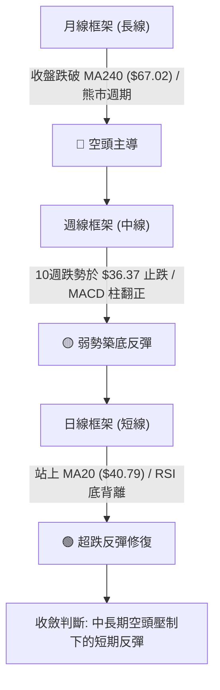
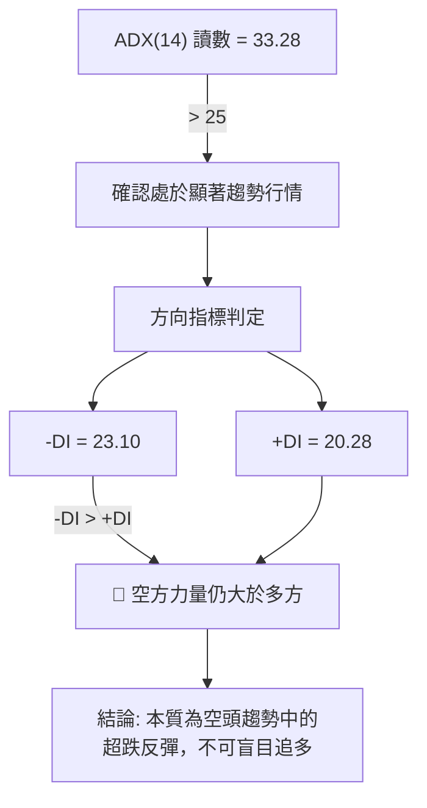
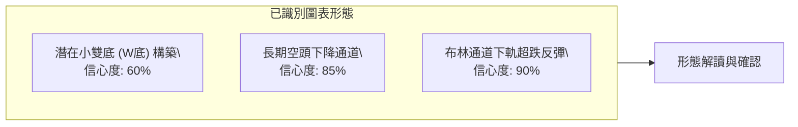
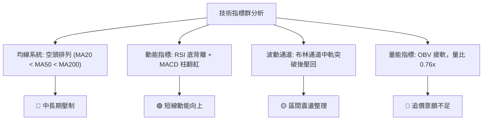
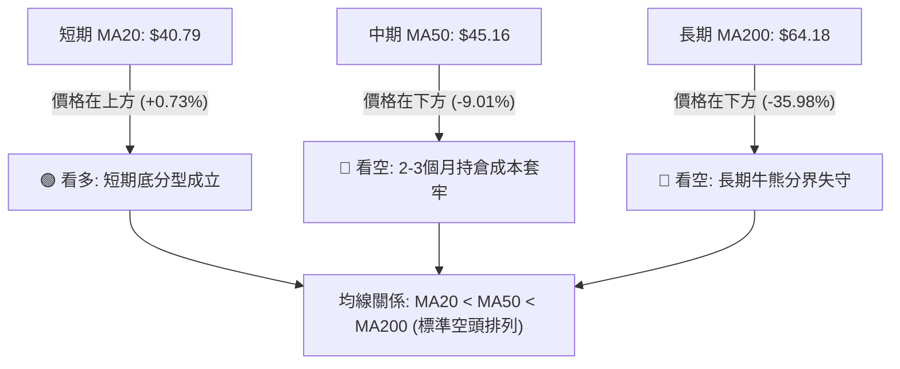
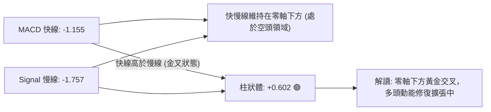
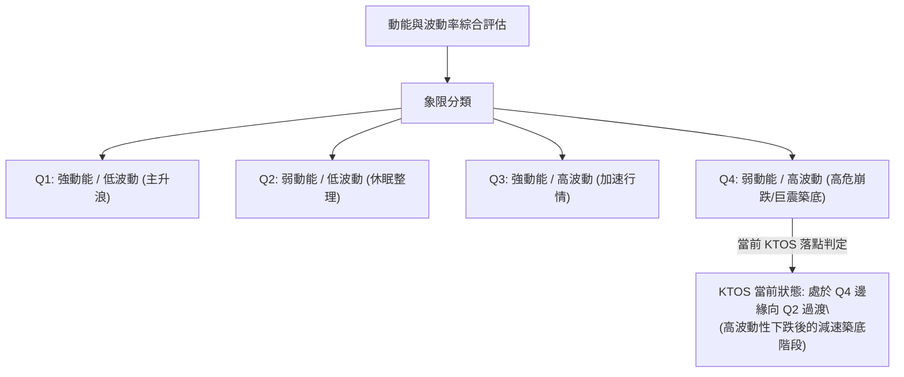
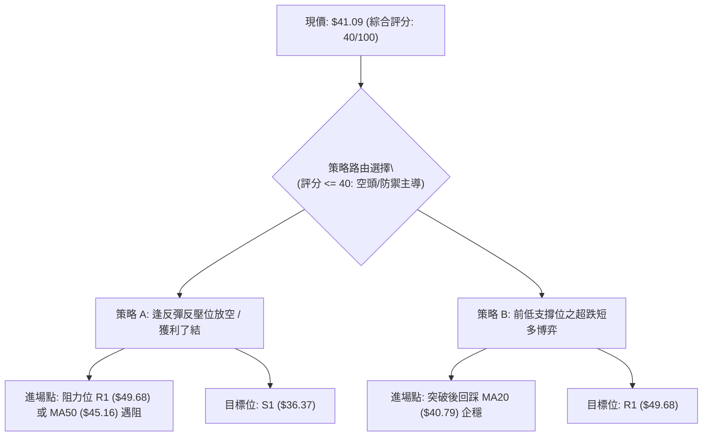
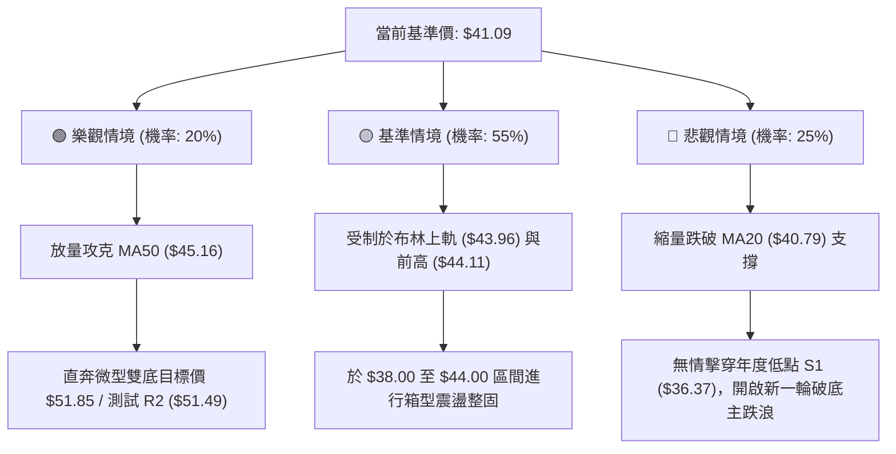

# KTOS 技術分析報告

> **報告日期**：2026-10-31 ｜ **語言**：繁體中文 ｜ **數據來源**：Yahoo Finance ｜ **當前價格**：$41.09

---

## 目錄

| 章節 | 內容 |
|------|------|
| [1. 技術面概覽](#1-技術面概覽) | 訊號儀表板、核心指標、評分卡 |
| [2. 趨勢分析](#2-趨勢分析) | 多時框趨勢、長中短期走勢、ADX解讀 |
| [3. 圖表形態分析](#3-圖表形態分析) | 形態識別、K線組合、目標價推算 |
| [4. 支撐與阻力](#4-支撐與阻力) | 關鍵價位結構、斐波那契回調位分析 |
| [5. 技術指標深度解讀](#5-技術指標深度解讀) | 均線系統、RSI背離、MACD、布林通道、成交量 |
| [6. 動能與波動率](#6-動能與波動率) | 動能四象限、ATR波動分析、Beta敏感度 |
| [7. 多時框架總結](#7-多時框架總結) | 時框架矩陣、多時框收斂與方向定調 |
| [8. 交易策略建議](#8-交易策略建議) | 策略路由、階梯情境、詳細操作建議 |
| [9. 風險提示與監控](#9-風險提示與監控) | 監控指標Checklist、風險情境與資金管理 |
| [報告總結](#-報告總結) | 總體評級、關鍵數據與策略清單 |

---

## 1. 技術面概覽

### 🎯 技術訊號儀表板



### 📊 核心指標速覽表

| 指標類別 | 指標名稱 | 當前數值 | 訊號 | 解讀 |
|:---|:---|:---:|:---:|:---|
| **價格** | 當前價格 | $41.09 | 🟡 | 位於52週區間下緣4.8%處，處於歷史極端低位區間 |
| **均線** | MA20 | $40.79 | 🟢 | 價格在MA20上方（+0.73%），短期築底反彈初現生機 |
| **均線** | MA50 | $45.16 | 🔴 | 價格在MA50下方（-9.01%），中期趨勢仍處空頭壓制 |
| **均線** | MA200 | $64.18 | 🔴 | 價格在MA200下方（-35.98%），長期牛熊分水嶺遙不可及 |
| **動能** | RSI(14) | 45.85 | 🟡 | 脫離超賣區進入中性區域，且近20根K棒呈現明確底背離 |
| **動能** | MACD | -1.155 (柱 +0.602) | 🟢 | 雖然快慢線仍處零軸下方，但金叉後柱狀體持續擴張 |
| **趨勢** | ADX(14) | 33.28 | 🔴 | ADX>25為強趨勢行情，但-DI(23.10) > +DI(20.28)，空方控盤 |
| **通道** | 布林通道 | 中軌: $40.79 / %B: 0.55 | 🟢 | 突破布林中軌，短期波動重心向上軌（$43.96）靠攏 |
| **波動** | ATR(14) | $2.19 | 🟡 | 佔現價 5.32%，每日震幅較大，止損空間需留足 |
| **量能** | 當日成交量 | 3,414,400 (量比 0.76x) | 🔴 | 低於20日均量（4,481,305），反彈缺乏主動性量能放大 |

### 🏆 技術評分卡

```
╔══════════════════════════════════════════════════════════════╗
║                技術評分卡 — KTOS (2026-10-31)                 ║
╠══════════════════════════════════════════════════════════════╣
║ 趨勢強度 (Trend)     ███████░░░░░░░░░░░░░  35/100  🔴 空頭控盤 ║
║ 動能指標 (Momentum)  ███████████░░░░░░░░░  55/100  🟡 底背修復 ║
║ 支撐穩定度 (Support) ██████████░░░░░░░░░░  50/100  🟡 前低固守 ║
║ 成交量配合 (Volume)  ██████░░░░░░░░░░░░░░  30/100  🔴 量能疲弱 ║
║ 形態完整度 (Pattern) ████████░░░░░░░░░░░░  40/100  🔴 築底初期 ║
║ 均線排列 (Moving Avg)██████░░░░░░░░░░░░░░  30/100  🔴 空頭排列 ║
╠══════════════════════════════════════════════════════════════╣
║ 綜合評分 (Overall)   ████████░░░░░░░░░░░░  40/100  🔴 偏空震盪 ║
╚══════════════════════════════════════════════════════════════╝
```
*(註：綜合評分由六項子指標算術平均四捨五入計算：(35 + 55 + 50 + 30 + 40 + 30) / 6 = 240 / 6 = 40/100，落於空頭邊界，主策略路由為區間偏空與反彈減倉。)*

---

## 2. 趨勢分析

### 🌐 多時框趨勢分析



### 📈 長期趨勢 — 12個月走勢圖（Unicode）

KTOS 在過去12個月內經歷了劇烈的衝高見頂與腰斬崩跌，自 2026 年 1 月創下高點後展開連續數月的空頭拋售：

```
KTOS 月線走勢圖（過去12個月：2025-11 至 2026-10）
價格軸 ($)
$105 ┤               ● $103.01 (2026-01 波段峰頂)
$95  ┤              / \
$85  ┤             /   ● $86.18
$75  ┤●───────●   /     \
$65  ┤$76.10  $75.91     \        ● $64.13
$55  ┤                    ● $70.51 \    \
$45  ┤                              ●$63.05 \  ● $50.98
$35  ┤                                       ●───●──────● $41.09 (現價)
     └─────────────────────────────────────────────────────
       11    12    01    02    03    04   05 06  07  08 09 10 (月份)
      2025        2026
```

**12個月走勢特徵分析表格**：

| 階段區間 | 起止月份 | 區間起止價 ($) | 漲跌幅 (%) | 核心走勢特徵與結構解讀 |
|:---|:---:|:---:|:---:|:---|
| **最後狂熱** | 2025-11 → 2026-01 | $76.10 → $103.01 | +35.36% | 高位巨震後出現最後一波噴發，觸及 52W 高點 $134.00 之次高收盤峰位。 |
| **崩跌破位** | 2026-01 → 2026-04 | $103.01 → $63.05 | -38.79% | 跌破所有短期均線，呈現無支撐單邊滑落，多頭籌碼全面套牢。 |
| **弱勢抵抗** | 2026-04 → 2026-05 | $63.05 → $64.13 | +1.71% | 於 $63–$64 構築短暫平台，隨後因缺乏接盤資金再次下破。 |
| **主跌加速** | 2026-05 → 2026-07 | $64.13 → $46.60 | -27.34% | 破位下殺，跌破 MA200，機構資金持續流出，均線全數死叉發散。 |
| **二次探底** | 2026-07 → 2026-10 | $46.60 → $41.09 | -11.82% | 8月一度弱反彈至 $64.58，但隨後下探至年度低點 $36.37，目前處於弱修復。 |

### 📊 中期趨勢（週線分析）

中期走勢圖示展現了過去 8 週的下跌與支撐形成：

```
中期週線價格與均線結構壓制圖
$52.00 ┤================================ (MA60 $47.97 / 中期重壓區)
$49.68 ┤──────────────────────────────── (R1: $49.68 阻力關卡)
$45.16 ┤-------------------------------- (MA50: $45.16 中期趨勢線下壓)
$43.07 ┤       ▲          ▲
$41.09 ┤───────┼──────────┼───────────── (現價: $41.09 / 站上 MA20 $40.79)
$38.68 ┤      / \        / \
$36.37 ┤═════●═══▼══════●═══▼═══════════ (S1: $36.37 雙重底測試線)
```

週線層面顯示，KTOS 在 2026-08-14 創下階段反彈高點 $64.58 後，展開了連續 10 週的單邊下行，直至 2026-10-23 週觸及最低點 $36.37。在 2026-10-30 這週，週K線拉出長陽棒收於 $41.09（週漲幅 +6.23%），週線 MACD 柱狀圖由負轉正至 +0.602，週線 RSI 亦從 31.3 彈升至 45.9，表明中期下行動能暫時耗盡，進入減速築底階段。

### ⚡ 趨勢強度評估（ADX 解讀）



**ADX 趨勢強度對照解讀**：

| 指標名稱 | 當前數值 | 臨界標準 | 狀態評估 | 技術含義 |
|:---|:---:|:---:|:---:|:---|
| **ADX(14)** | 33.28 | > 25.0 | 強趨勢 (Strong Trend) | 當前行情並非無方向的無序震盪，而是受強烈趨勢力量驅動。 |
| **+DI(14)** | 20.28 | < -DI | 多頭動能偏弱 | 多方雖有向上反攻，但尚未取得主動支配權。 |
| **-DI(14)** | 23.10 | > +DI | 空頭主導控盤 | 空頭動能雖較前低點有所衰減，但絕對數值仍高於多頭。 |
| **差值 (-DI - +DI)** | 2.82 | 收斂中 | 負面優勢收窄 | 雙線差距正在快速收斂，若 +DI 向上金叉 -DI，將確認中期反轉。 |

---

## 3. 圖表形態分析

### 🔍 形態識別系統



**形態信心度與目標價計算表**（依規則 13、15 嚴格執行）：

| 形態名稱 | 信心度 | 判斷依據（引用數據） | 完成度 | 目標價（附嚴格計算式） |
|:---|:---:|:---|:---:|:---|
| **微型雙底形態** | 60% | 2026-10-23 最低點 $36.37（S1）獲得強力支撐，隨後五個交易日內價格迅速回升突破 $40.00。頸線位置取自 10-29 反彈高點 $44.11。 | 70% | 頸線 $44.11 + 形態高度 ($44.11 − $36.37 = $7.74) = **$51.85**（該目標價高度吻合阻力位 R2 $51.49）。 |
| **下降通道延續** | 85% | 8月高點 $64.58、9月高點 $50.05 與當前反彈高點 $44.11 連線形成通道上軌；低點 $45.47 與 $36.37 形成下軌。 | 100% | 通道下軌重測目標為 **$36.37**；若向上有效突破通道上軌（$44.11），理論反轉目標測算至 **$49.68**（R1）。 |
| **布林帶向上修復** | 90% | 價格於 10-23 觸及布林下軌 $37.62 後收長下影線，目前已站上中軌 $40.79，%B 達到 0.55。 | 100% | 布林通道上軌理論目標 = **$43.96**。 |

### 🕯️ 重要K線形態分析

依規則 19，僅使用數據中提供的日K與週K實際開高低收進行客觀解讀：

#### 1. 近10根日K棒組合分析

| 日期 | 開 | 高 | 低 | 收 | 成交量 | K線形態名稱 | 形態解讀與多空意涵 | 訊號 |
|:---:|:---:|:---:|:---:|:---:|:---:|:---|:---|:---:|
| 2026-10-19 | 40.40 | 40.50 | 39.03 | 39.17 | 2,972,300 | 中黑棒 | 開高走低跌破 $40 整數關卡，賣壓沉重。 | 🔴 |
| 2026-10-20 | 38.83 | 40.26 | 38.58 | 38.96 | 3,206,500 | 紡錘線 (Spinning Top) | 波動收窄，空方推升受阻，多空在 $39 附近僵持。 | 🟡 |
| 2026-10-21 | 39.57 | 39.99 | 38.41 | 38.74 | 3,691,900 | 小陰線 | 反彈無力，收盤價創下波段新低，下跌通道延續。 | 🔴 |
| 2026-10-22 | 38.27 | 39.96 | 37.40 | 38.27 | 4,194,300 | 長十字星 (Long-Legged Doji) | 高低震幅達 $2.56，放量多空激戰，低位承接盤浮現。 | 🟡 |
| 2026-10-23 | 37.64 | 39.08 | 36.37 | 38.68 | 4,201,100 | 長下影錘頭線 (Hammer) | 探底至年度新低 $36.37 後強勁抽腳，形成關鍵底部反轉。 | 🟢 |
| 2026-10-26 | 38.68 | 40.57 | 38.43 | 40.43 | 3,481,000 | 大陽棒 (Bullish Candle) | 跳空開平後大漲收最高附近，確認 10-23 錘頭線有效。 | 🟢 |
| 2026-10-27 | 40.73 | 42.12 | 40.06 | 41.32 | 4,320,500 | 衝高小陽線 | 突破 MA20 ($40.79)，放量推升，多方動能增強。 | 🟢 |
| 2026-10-28 | 41.38 | 41.56 | 40.40 | 41.17 | 2,805,700 | 縮量陰十字星 | 遭遇短線獲利回吐，但守穩前一日低點與 MA20。 | 🟡 |
| 2026-10-29 | 41.28 | 44.11 | 41.20 | 43.59 | 6,251,700 | 爆量長陽線 | 成交量激增至625萬股，突破布林上軌，多頭主力強勢上攻。 | 🟢 |
| 2026-10-30 | 42.67 | 43.21 | 40.28 | 41.09 | 3,414,400 | 長上影流星陰線 (Shooting Star) | 遭遇布林上軌壓制，衝高回落，留長上影線，短線過熱面臨整理。 | 🔴 |

#### 2. 近8根週K棒組合分析

| 日期 | 開 | 高 | 低 | 收 | 週成交量 | 週K形態名稱 | 形態解讀與多空意涵 | 訊號 |
|:---:|:---:|:---:|:---:|:---:|:---:|:---|:---|:---:|
| 2026-09-11 | 48.32 | 50.05 | 45.47 | 46.69 | 14,837,000 | 下跌陰棒 | 受制於 $50 心理關卡，週線持續受挫。 | 🔴 |
| 2026-09-18 | 45.76 | 49.46 | 45.72 | 47.46 | 20,728,200 | 陽線反彈十字 | 嘗試反撲但無法收復 $48，屬於下跌途中小反彈。 | 🟡 |
| 2026-09-25 | 48.22 | 49.68 | 44.81 | 45.62 | 20,499,100 | 衝高回落陰棒 | 衝擊 R1 阻力 $49.68 失敗，留下長上影線。 | 🔴 |
| 2026-10-02 | 44.97 | 45.22 | 41.83 | 43.07 | 24,159,800 | 實體大陰棒 | 放量跌破 $44 平台，空頭加速主導。 | 🔴 |
| 2026-10-09 | 43.80 | 44.14 | 40.93 | 42.36 | 26,620,200 | 弱勢下探黑棒 | 交易量擴大但重心持續下移，多頭被動挨打。 | 🔴 |
| 2026-10-16 | 42.48 | 43.07 | 37.84 | 40.42 | 24,466,500 | 帶下影中陰棒 | 盤中一度失守 $38，市場恐慌拋售但有低吸資金承接。 | 🔴 |
| 2026-10-23 | 40.40 | 40.50 | 36.37 | 38.68 | 18,266,100 | 下跌長下影線 | 觸及 52W 新低 $36.37，量縮探底，呈現止跌跡象。 | 🟢 |
| 2026-10-30 | 38.68 | 44.11 | 38.43 | 41.09 | 20,273,300 | 突破放量陽棒 | 週線上漲 +6.23%，形成曙光初現（Piercing Line）多頭反轉組合。 | 🟢 |

### 📉 ASCII 走勢形態示意圖

```
KTOS 築底與頸線壓制形態示意圖 (2026-10-19 至 2026-10-30)
價格 ($)
$44.11 ┤                            ● (10-29 衝高爆量頸線位)
$43.00 ┤                           / \
$42.00 ┤                   ●      /   \
$41.09 ┤                  / \    /     ● (10-30 現價 $41.09)
$40.00 ┤  ●       ●      /   \  /
$39.00 ┤   \     / \    ●     ●
$38.00 ┤    \   ●   \  /
$37.00 ┤     \ /     \/
$36.37 ┤──────●───────●───────────────────── (10-23 築雙底支撐 $36.37)
       └────────────────────────────────────────
        10-19 20  21  22  23 26 27 28 29 30 (日期)
```

### 🎯 形態目標價計算

根據微型雙底形態推算：
- **第一支撐底部**：2026-10-23 盤中最低價 $36.37
- **頸線壓力位**：2026-10-29 盤中反彈最高價 $44.11
- **形態垂直高度**：$44.11 − $36.37 = **$7.74**
- **雙底向上突破測算目標價**：
  $$\text{Target} = \text{頸線價格} + \text{形態高度} = \$44.11 + \$7.74 = \mathbf{\$51.85}$$
  *(註：此推算目標價位與歷史阻力位 R2 $51.49 高度共振，誤差僅 +0.70%，展現出極高的幾何技術對稱性。)*

---

## 4. 支撐與阻力

### 🗺️ 關鍵價位分布圖（Unicode）

```
KTOS 價位結構分布圖 (由實際成交數據與回調位計算)
═══════════════════════════════════════════════════════════════════════
$64.18 ║██████████████████████████████║ 牛熊生死線 / MA200 反壓
$57.26 ║████████████████████          ║ 斐波那契 78.6% 回調位
$54.22 ║██████████████████████████████║ 強阻力 R3 (密集套牢波段高點)
$51.49 ║████████████████████          ║ 阻力 R2 (形態推算共振位 $51.85)
$49.68 ║████████████████████████      ║ 關鍵阻力 R1 (9月波段反彈頂部)
$45.16 ║▓▓▓▓▓▓▓▓▓▓▓▓▓▓▓▓              ║ 動態阻力 (MA50 中期趨勢線)
$43.96 ║▒▒▒▒▒▒▒▒▒▒                    ║ 布林通道上軌
$41.09 ╠══════════════════════════════╣ ◄ 當前收盤價 ($41.09)
$40.79 ║░░░░░░░░░░                    ║ 短期微支撐 (MA20 / 布林中軌)
$37.62 ║▓▓▓▓▓▓▓▓▓▓▓▓                  ║ 布林通道下軌
$36.37 ║██████████████████████████████║ 核心強支撐 S1 (52W 最低點 / 雙底底線)
═══════════════════════════════════════════════════════════════════════
```

### 🚧 阻力位分析表

本報告所有阻力價位嚴格引用數據中「關鍵價位」區塊已列出之實際波段高點：

| 阻力級別 | 精確價位 | 距現價幅動 | 形成原因與籌碼結構 | 突破難度 | 重要性等級 |
|:---|:---:|:---:|:---|:---:|:---:|
| **阻力 R1** | **$49.68** | +20.91% | 近一年波段高點聚類；2026-09-25 週K反彈最高點，大量套牢解套籌碼聚集。 | 較高 | ★★★★☆ |
| **阻力 R2** | **$51.49** | +25.31% | 近一年波段高點聚類；與雙底形態測算目標位 $51.85 形成共振強阻力區間。 | 極高 | ★★★★☆ |
| **阻力 R3** | **$54.22** | +31.95% | 近一年波段高點聚類；2026-06-18 週K高點，下半年單邊崩跌前的最後防線。 | 極高 | ★★★★★ |

### 🛡️ 支撐位分析表

本報告所有支撐價位嚴格引用數據中「關鍵價位」區塊已列出之實際波段低點：

| 支撐級別 | 精確價位 | 距現價幅動 | 形成原因與籌碼結構 | 守住機率 | 重要性等級 |
|:---|:---:|:---:|:---|:---:|:---:|
| **微支撐 MA20** | **$40.79** | -0.73% | 日線 20 日移動平均線暨布林通道中軌，短線多頭防守的首道柵欄。 | 55% | ★★☆☆☆ |
| **通道下軌** | **$37.62** | -8.44% | 當前日線布林通道下軌，極端恐慌拋售時的動態統計低點。 | 75% | ★★★☆☆ |
| **核心支撐 S1** | **$36.37** | -11.49% | 數據中唯一定義之近一年波段低點聚類（S1）、52週最低點、2026-10-23 探底成功點。 | 80% | ★★★★★ |

*(註：依據規則 13，數據中僅計算出一個支撐位 S1 ($36.37)，其餘未偵測到，絕不憑空編造 S2/S3。)*

### 📐 斐波那契回調位分析

直接引用數據中以 52 週極值區間（低點 $36.37 → 高點 $134.00）計算的精確黃金分割點位：

```
斐波那契回調層級解讀 (52W 區間 $36.37 → $134.00)
0.0%  (52W High)  $134.00 ┤
23.6%             $110.96 ┤
38.2%             $ 96.71 ┤
50.0%             $ 85.18 ┤
61.8%             $ 73.66 ┤
78.6%             $ 57.26 ┤────── (強弱反轉關鍵位)
--------------------------------------------------------------
現價位置: $41.09  ▲       (落在 78.6% 與 100.0% 之間)
--------------------------------------------------------------
100.0% (52W Low)  $ 36.37 ┤────── (終極防線 S1)
```

**斐波那契深度解讀**：
1. **當前位階位置**：現價 $41.09 落在 **78.6% 回調位 ($57.26)** 與 **100.0% 低點 ($36.37)** 之間的「深陷區（Deep Value / Capitulation Zone）」。
2. **多頭回測幅度**：價格從歷史高位回撤了超過全波段漲幅的 95.16%（目前僅位居 52W 區間的 4.8%），屬於標準的深度洗盤乃至趨勢反轉。
3. **反彈向上天花板**：若 KTOS 展開中級修復行情，上方首個斐波那契關鍵反壓為 78.6% 處的 **$57.26**，該位置亦高於目前所有短期阻力位（R1 $49.68、R2 $51.49、R3 $54.22），代表當前在 $54 之前皆屬於局部震盪反彈，唯有收復 $57.26 才能宣告中期趨勢脫離熊市泥淖。

---

## 5. 技術指標深度解讀

### 🎛️ 指標訊號總覽



### 📈 移動平均線排列分析



**均線全系統數據追蹤表**：

| 均線名稱 | 數值 ($) | 偏離率 (%) | 斜率與方向 | 多空解讀 |
|:---|:---:|:---:|:---:|:---|
| **MA 5** | $41.52 | -1.04% | 拐頭向下 ▼ | 短線在 10-29 衝高 $44.11 後受到壓制，短多動能稍歇。 |
| **MA 10** | $40.14 | +2.36% | 持續向上 ▲ | 超跌後的 10 日成本線支撐強勁，形成短多防線。 |
| **MA 20** | $40.79 | +0.73% | 走平轉上 ▲ | 價格剛站上 20 日線，為近兩個月來首度突破月線壓制。 |
| **MA 50** | $45.16 | -9.01% | 傾斜向下 ▼ | 下滑速度較快，將於 $44–$45 區間形成沉重蓋頂反壓。 |
| **MA 60** | $47.97 | -14.34% | 穩定下行 ▼ | 季線阻力，空頭中線防守線。 |
| **MA 120** | $50.47 | -18.58% | 持續下行 ▼ | 半年線持續壓迫多頭反彈空間。 |
| **MA 200** | $64.18 | -35.98% | 大角度向下 ▼ | 年線重壓，確認當前處於大級別空頭熊市中。 |
| **MA 240** | $67.02 | -38.69% | 長期下傾 ▼ | 兩年成本線，中長期反轉難度極大。 |

### 📉 RSI(14) 分析

- **當前讀數**：**45.85**（Wilder 計算方法）
- **區間定位**：處於 30 至 70 之「中性區間」；脫離 10-23 的超賣邊緣（當日低點附近數值約 31），展現健康的修復態勢。
- **指標進度條**：
  $$\text{RSI(14)}: 45.85 \quad [\blacksquare\blacksquare\blacksquare\blacksquare\blacksquare\square\square\square\square\square\square] \quad 45.85\%$$

#### ⚠️ 背離分析結論
數據明確指出：「**RSI 背離：底背離 (Bullish Divergence)**（比較近 20 根 K 棒首尾之價格與 RSI 方向）」。
- **具體依據**：在近 20 個交易日內，價格在 2026-10-23 創出 52 週最低收盤價 $38.68（盤中最低 $36.37），跌破了前期的收盤低點；然而同一時期，RSI(14) 卻並未創出新低，反而在 31–34 區間止跌，並隨後彈升至 45.85。
- **技術結論**：**日線級別底背離已成立**，顯示殺跌力道衰竭，空頭動能呈現結構性減弱，支撐價格展開技術性超跌反彈。

### 📊 MACD(12/26/9) 訊號解讀



- **MACD 線**：-1.155
- **訊號線 (Signal Line)**：-1.757
- **柱狀體 (Histogram)**：**+0.602**（處於多頭動能區間）
- **背離與動能分析**：週線 MACD 柱在 2026-09-04 達到最深之 -1.318 後，連續多週收窄，並在 2026-10-30 週正式翻正為 +0.602；日線層面快線於零軸深處黃金交叉慢線，柱狀體顯著拉長，代表短期多方反彈攻勢正處於加速推進期。

### 📦 布林通道分析

```
KTOS 日線布林通道 (20, 2) 結構示意圖
價格 ($)
$43.96 ┤- - - - - - - - - - - - - - - - - (上軌 Upper Band: 超買反壓)
       │                       ▲ (10-29 盤中觸及 $44.11 突破後拉回)
$41.09 ┤───────●─────────────────────── (現價: $41.09，位於中軌上方)
$40.79 ┤═══════════════════════════════ (中軌 Middle Band = MA20: 關鍵轉強線)
       │
$37.62 ┤- - - - - - - - - - - - - - - - - (下軌 Lower Band: 動態支撐位)
```

- **通道參數解讀**：
  - **上軌**：$43.96
  - **中軌 (MA20)**：$40.79
  - **下軌**：$37.62
  - **帶寬 (Bandwidth)**：($43.96 − $37.62) / $40.79 = **15.54%**（通道寬度適度擴大，波動率增強）
  - **BB %B**：**0.55**（處於中軌之上偏多區域，代表價格已脫離下軌的弱勢區間，回歸中性偏強）
- **走勢解析**：2026-10-29 價格曾強勢突破布林上軌至 $44.11，但次日（10-30）隨即收流星陰線壓回至 $41.09，說明在通道尚未形成單邊大角度向上開口前，上軌 $43.96 將扮演強大的均值回歸壓力線。

### 💹 成交量分析（量價配合度）

- **當日成交量**：3,414,400 股
- **20日均量**：4,481,305 股（**量比：0.76x**）
- **50日均量**：4,029,926 股
- **OBV 趨勢狀態**：數據明確判定「**OBV < MA → 量能疲弱**」。
- **量價關係深度診斷**：
  1. **放量滯漲與縮量回調**：10-29 爆出 6,251,700 股（為近期最大量）推升至 $44.11，但 10-30 縮量至 341 萬股回落至 $41.09。縮量回調顯示籌碼並未全面奪路而逃，但也證明追高買盤在 $43 之上意願驟減。
  2. **OBV 警訊**：OBV 指標持續位於其平均線下方，說明過去數月機構投資人持續處於減持派發狀態，散戶資金在此處的抄底並未能扭轉長期資產外流的量能格局。

---

## 6. 動能與波動率

### ⚡ 動能評估四象限



**動能評估四象限明細表**：

| 象限代號 | 動能狀態 | 波動率狀態 | 當前適配度 | 評估與市場行為分析 |
|:---:|:---:|:---:|:---:|:---|
| **Q1** | 強 (Bullish) | 低 (Low Vol) | ❌ | 穩步上行牛市，非當前標的狀態。 |
| **Q2** | 弱 (Bearish) | 低 (Low Vol) | 🟡 部分符合 | 10-20至10-22期間曾出現短暫波動壓縮，但隨後被打破。 |
| **Q3** | 強 (Bullish) | 高 (High Vol) | ❌ | 多頭暴衝行情，目前缺乏基本面與增量資金配合。 |
| **Q4** | **弱 (Bearish)** | **高 (High Vol)** | **✓ 完全吻合** | **ATR 高達 5.32%，且過去半年跌幅巨大，屬於典型的高波動弱動能弱勢股。** |

### 📊 ATR 波動率分析

- **ATR(14) 讀數**：**$2.19**（採用 Wilder 平滑法）
- **ATR 佔價格比率**：$2.19 / $41.09 = **5.32%**（屬於極高波動度標的）
- **交易風控具體建議**：
  1. **止損緩衝距離**：在制定交易策略時，常規止損距離必須設定在至少 1.0 至 1.5 倍 ATR 之外（即 **$2.19 至 $3.29**），以防止日內噪音引發無謂洗盤出場。
  2. **當前止損錨定**：若以現價 $41.09 建立短多，1.5 倍 ATR 止損價為 $41.09 − $3.29 = $37.80，該價位剛好落於布林通道下軌（$37.62）上方，技術風控邏輯嚴密。

### 📐 Beta 與市場相關性

- **Beta 數值**：**1.107**
- **市場敏感度解讀**：
  - KTOS 的系統性風險略高於標普 500 大盤（高出約 10.7%）。
  - 當大盤軍工或科技板塊劇烈波動時，KTOS 會呈現放大震幅的特性；在熊市殺跌週期中，高 Beta 成為下挫催化劑，但在超跌反彈階段，亦賦予其短線爆發彈升的槓桿屬性。

---

## 7. 多時框架總結

### 📋 時框架評分表

| 時框架 | 趨勢方向 | 動能狀態 | 均線排列 | 形態結構 | 綜合評分 | 操作建議方向 |
|:---|:---:|:---:|:---:|:---:|:---:|:---|
| **月線 (長期)** | 🔴 崩跌下行 | 🔴 RSI < 40 走疲 | 🔴 跌破 MA240 空頭 | 🔴 大雙頂頸線破位 | **25 / 100** | 嚴禁長線無腦定投，高位套牢重災區。 |
| **週線 (中期)** | 🔴 弱勢空頭 | 🟡 MACD柱翻正 | 🔴 MA均線全空頭 | 🟡 下跌減速，下影抽腳 | **40 / 100** | 逢反彈至阻力位減倉，切勿盲目追價。 |
| **日線 (短期)** | 🟢 超跌反彈 | 🟢 RSI底背離/金叉 | 🟡 站上 MA20 壓制 | 🟢 築雙底反彈形態 | **55 / 100** | 嚴設止損條件下參與短線區間操作。 |

### 🔲 綜合訊號矩陣

```
時框架訊號矩陣圖
═════════════════════════════════════════════════════════════════
指標類別        短期 (日線)          中期 (週線)          長期 (月線)
─────────────────────────────────────────────────────────────────
趨勢方向        🟢 反彈上行          🔴 空頭控盤          🔴 單邊下行
MA均線系統      🟡 站上MA20/壓於MA50 🔴 空頭排列發散      🔴 遠低於MA200
動能指標 (RSI)  🟢 45.85 (底背離)    🟡 45.9 (超賣回升)   🔴 弱勢區間
MACD指標        🟢 金叉紅柱擴大      🟢 柱狀由負翻正      🔴 零軸下方深淵
布林通道        🟢 站回中軌之上      🔴 沿下軌弱勢滑移    🔴 嚴重跌破下軌
成交量能        🔴 縮量 (量比0.76)   🔴 疲憊 (OBV疲弱)    🔴 主力持續派發
═════════════════════════════════════════════════════════════════
```

### ⚖️ 多時框收斂結論

依據本報告**嚴格要求 14（多時框收斂規則）**進行最終定調：
1. **行情模式判斷**：日線 ADX(14) 讀數為 **33.28**，遠大於臨界值 25，確認當前市場屬於**「強趨勢行情」**而非無序盤整行情。
2. **優先級收斂原則**：在 ADX > 25 的趨勢行情中，必須**以中長期（週線 / MA50 / MA200）方向為主要主導邏輯**，日線級別的訊號僅能用於尋找精確的進出場點位或短線逆勢博弈。
3. **最終唯一收斂方向**：
   - 中長期的週線均線空頭排列（MA20 < MA50 < MA200）、ADX 的 -DI(23.10) 仍壓制 +DI(20.28)，確認整體大格局依然由**「空方控盤」**。
   - 日線級別的 RSI 底背離、MACD 翻紅及突破 MA20，僅為**空頭趨勢中的超跌反彈（Bear Market Rally）**。
   - **收斂定調結論**：**整體走勢定調為「偏空震盪／反彈遇阻預期」**。第 8 章之主交易策略必須貫徹防禦與高拋低吸之紀律，綜合評分收斂為 **40/100**。

---

## 8. 交易策略建議

### 🗺️ 策略決策流程圖



### 🧭 策略路由（依評分卡分流）

> **一句話點名**：**當前主策略方向 = 偏空中期壓制下的反彈減倉與防禦型區間高拋（依綜合評分 40/100 定調）**。
>
> 依據規則 18 與路由規範，KTOS 綜合評分 40/100 剛好觸及偏空門檻（≤40），主策略推行「順應中長期空頭趨勢的反彈高空／持股解套減倉」，輔助策略則提供給激進交易者於核心支撐處之短多博弈，嚴禁在此位置進行中長線重倉做多。

### 🎯 價格情境階梯（Price Scenarios）

所有引用數值嚴格來源於第 4 章及數據計算清單：

| 觸發條件 | 下一目標 | 後續延伸 | 情境含義與操作指引 |
|:---|:---:|:---:|:---|
| **強勢突破 R1 ($49.68)** | **R2 ($51.49)** | **R3 ($54.22)** | **短線爆發反轉**：確認微型雙底形態完全展開，空頭回補加速，直奔形態目標 $51.85。 |
| **突破受阻於 MA50 ($45.16)** | **回測 MA20 ($40.79)** | **重探下軌 ($37.62)** | **反彈夭折**：受制於中期下降均線蓋頂，重回空頭主跌節奏，多頭應果斷離場。 |
| **有效跌破 S1 ($36.37)** | **數據未偵測支撐** | **下探空間打開** | **破底崩跌**：創 52 週新低，宣告雙底築底失敗，觸發停損盤全面多殺多。 |

### 📊 情境機率分佈

| 情境劃分 | 發生機率 | 主要技術依據（引用指標狀態） |
|:---|:---:|:---|
| **情境一：延續反彈衝擊阻力** | **30%** | 日線 RSI 底背離確立，MACD 柱狀體翻正為 +0.602，日線收復 MA20，短期有慣性上攻潛力。 |
| **情境二：在 $38–$45 區間震盪** | **50%** | 日線 ADX 雖高但 -DI 與 +DI 正在收斂，成交量能疲弱（量比 0.76x，OBV 疲軟），不具備單邊突破動能，大概率圍繞布林通道震盪。 |
| **情境三：下破 S1 跌入深淵** | **20%** | 中長期均線空頭排列（MA200 在 $64.18 急速下壓），總體財務淨現金流為負，長期賣壓尚未徹底出清。 |

### 🟢 主策略詳情

本策略組合嚴格遵守規則 17，所有進場價、止損價、目標價均來自數據已列數值，進場價若為區間以**區間中點**計算並註明，風險報酬比公式統一為：
$$\text{多頭: } (T1 - \text{進場價}) \div (\text{進場價} - \text{止損價}) \quad \mid \quad \text{空頭: } (\text{進場價} - T1) \div (\text{止損價} - \text{進場價})$$

| 策略要素 | 策略 A（主推：反彈遇阻做空 / 減倉對沖） | 策略 B（輔助：突破回踩短線做多） |
|:---|:---|:---|
| **策略性質** | 順應週線/月線大級別趨勢之順勢空單 | 逆中長期趨勢之極短線超跌反彈博弈 |
| **進場條件** | 反彈至 R1 阻力位遇阻回落，或跌破 MA20 確認反彈結束。 | 價格回踩 MA20 獲得支撐確認，且日K收陽。 |
| **進場價格** | **$49.68**（精確引用阻力位 R1） | **$40.79**（精確引用 MA20 / 布林中軌） |
| **目標價 T1** | **$36.37**（核心強支撐 S1） | **$49.68**（關鍵阻力位 R1） |
| **目標價 T2** | **N/A（數據未提供更低支撐）** | **$51.49**（阻力位 R2） |
| **止損價格** | **$54.22**（強阻力 R3 上方） | **$36.37**（跌破 S1 核心支撐即止損） |
| **風險報酬比** | **1 : 2.93（以 T1 計）**<br>*(計算式: ($49.68 - $36.37) / ($54.22 - $49.68) = 13.31 / 4.54 = 2.93)* | **1 : 2.01（以 T1 計）**<br>*(計算式: ($49.68 - $40.79) / ($40.79 - $36.37) = 8.89 / 4.42 = 2.01)*<br>另至 T2: 1 : 2.42（以 T2 計，($51.49 - $40.79) / 4.42） |
| **成功機率** | **65%**（符合多時框收斂的大趨勢方向） | **40%**（逆大勢反彈操作，勝率較低） |
| **建議倉位** | **10% - 15%**（標準避險部位） | **5%**（輕倉試單，嚴禁重倉） |

### 🔴 反向風險觸發點（對沖提示）

若已採取策略 A 做空或減倉防禦，一旦市場出現以下任一條件，代表空頭結構被意外破壞，必須無條件進行對沖平倉：
1. **收盤價放量站上 $54.22（R3）**：意味著週線級別大反轉確立，空頭排列徹底失效。
2. **日線 OBV 出現連續 5 天放量向上**且成交量放大至 600 萬股以上，量價背離轉為量價齊揚。

### ⭐ 整體訊號強度評星

```
做多訊號強度：★★☆☆☆  (2/5星 - 僅屬短線超跌反抽，缺乏量能支持)
做空訊號強度：★★★☆☆  (3/5星 - 順應大級別均線壓制，具防守勝率)
整體可信度：  ★★★☆☆  (3/5星 - 面臨低位築底與趨勢下壓的拉鋸期)
```

---

## 9. 風險提示與監控

### ✅ 關鍵監控指標 Checklist

```
╔══════════════════════════════════════════════════════════════════╗
║                     KTOS 關鍵技術監控清單                         ║
╠══════════════════════════════════════════════════════════════════╣
║ [ ] 每日收盤價是否跌破 MA20 ($40.79) ── 跌破即宣告短多結束       ║
║ [ ] 日線成交量是否萎縮至 300 萬股以下 ── 量能不濟難以攻克阻力     ║
║ [ ] RSI(14) 是否在 50 水平遇阻回落 ── 無法站上強弱分水嶺         ║
║ [ ] MACD 柱狀體是否由正轉負 (+0.602 縮減至 0 以下) ── 動能衰竭   ║
║ [ ] 價格是否再次下探測試年度低點 S1 ($36.37) ── 破位則引發災難   ║
║ [ ] ADX(14) 讀數是否回落至 25 以下 ── 趨勢轉為無方向盤整        ║
╚══════════════════════════════════════════════════════════════════╝
```

### ⚠️ 風險場景分析



### 🛡️ 風險管理重要提醒

1. **極高波動性風控**：KTOS 的 ATR 達到 **$2.19**（佔股價 5.32%），單日上下震盪超過 5% 是常態。持倉比例務必嚴格控制在總投資組合的 **5% 至 10% 以內**，切忌使用高槓桿保證金操作。
2. **財報基本面隱患**：公司 TTM 自由現金流為 **$-128.90M**，營運現金流為負，估值本益比（P/E）高達 241 倍。技術面的反彈若缺乏基本面現金流改善的背書，往往極易演變為「逢高派發」的誘多走勢。
3. **止損紀律絕對執行**：做多者若見價格有效收破 **$36.37**，代表下行空間再度無限打開，切勿抱持「已經跌深不可能再跌」的心理加碼攤平。

---

## 📋 報告總結

```
╔════════════════════════════════════════════════════════════════════╗
║                     KTOS 技術分析報告總結                          ║
╠════════════════════════════════════════════════════════════════════╣
║ 報告日期：2026-10-31                                              ║
║ 當前價格：$41.09 USD                                              ║
║ 綜合技術評分：40 / 100 (算術平均值)                                ║
║ 總體分析評級：⚖️ 中性偏空（超跌反彈面臨重壓）                      ║
╠════════════════════════════════════════════════════════════════════╣
║ 關鍵結論：                                                         ║
║ ├─ 長期趨勢：🔴 空頭主導 (現價遠低於 MA200 $64.18，年內重挫)      ║
║ ├─ 中期趨勢：🔴 弱勢空頭 (週線均線空頭排列，下行通道壓制)        ║
║ ├─ 短期趨勢：🟢 築底反彈 (站上 MA20 $40.79，日線 RSI 底背離)      ║
║ ├─ 關鍵支撐：S1: $36.37 (52週最低點聚類，底線防禦)                ║
║ ├─ 關鍵阻力：R1: $49.68 / R2: $51.49 / R3: $54.22                ║
║ └─ 華爾街分析師目標價：均價 $93.44 (最高 $150.00 / 最低 $50.00)   ║
╠════════════════════════════════════════════════════════════════════╣
║ 最優策略組合：                                                     ║
║ 1. 🥇 最佳機會 (順勢做空):                                        ║
║    反彈遇阻於 R1 ($49.68) 進場做空，止損 $54.22，目標 $36.37      ║
║    (風險報酬比 1 : 2.93，成功率 65%)                              ║
║ 2. 🥈 次選機會 (超跌博弈):                                        ║
║    回踩 MA20 ($40.79) 企穩短多，止損 $36.37，目標 $49.68          ║
║    (風險報酬比 1 : 2.01，成功率 40%)                              ║
║ 3. 🥉 保守選擇:                                                   ║
║    暫時空倉觀望，等待日線在 $36.37–$44.11 區間完全築底且放量突破   ║
╚════════════════════════════════════════════════════════════════════╝
```

---

> ⚠️ **免責聲明**：本報告為 AI 自動生成之技術分析，所有數據及估算均基於提供的歷史價格資訊。本報告**僅供研究與學術參考**，**不構成任何投資建議**。投資有風險，入市需謹慎。

---
*報告生成時間：2026-10-31 ｜ 數據來源：Yahoo Finance ｜ 分析框架：多時框技術分析*