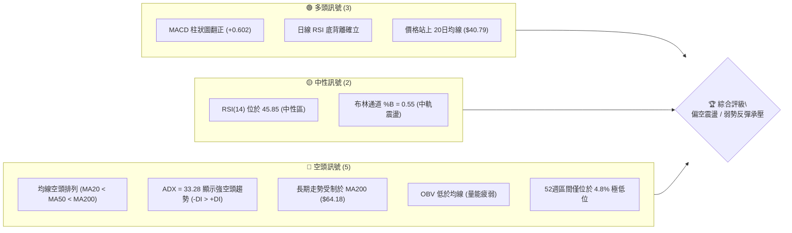
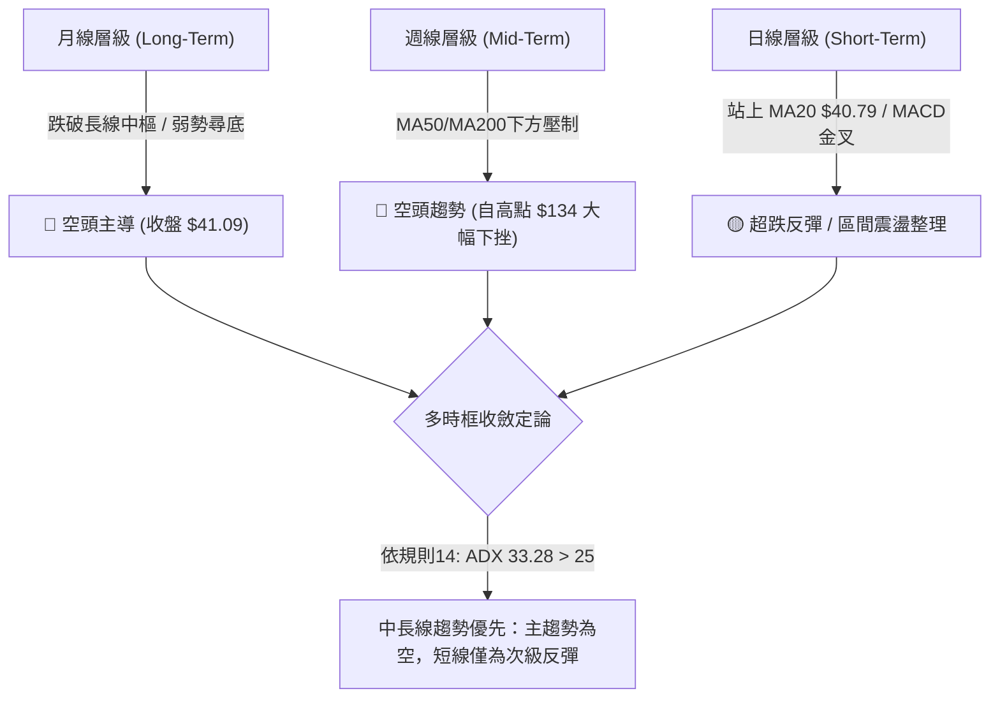
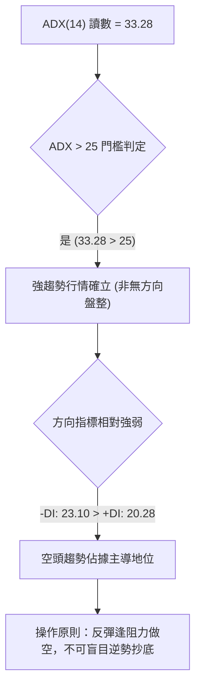
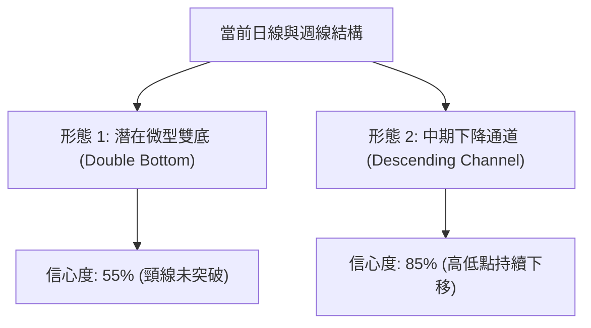
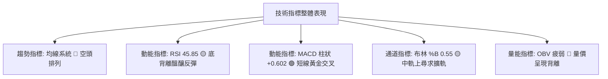
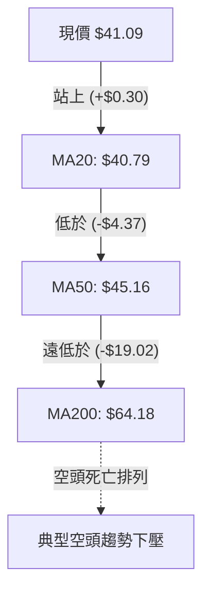
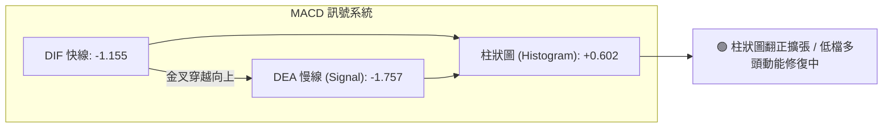
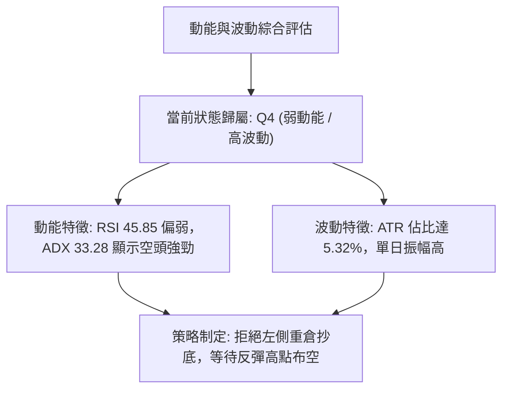
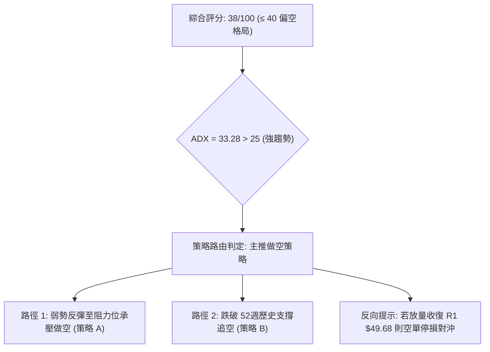
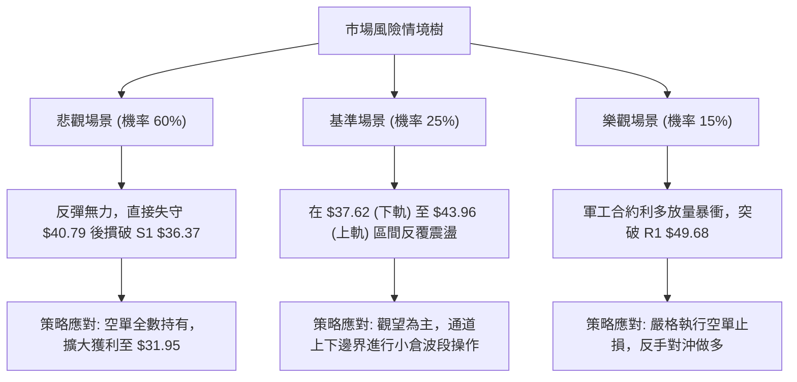

# KTOS 技術分析報告

> **報告日期**：2026-11-01 ｜ **語言**：繁體中文 ｜ **數據來源**：Yahoo Finance ｜ **當前價格**：$41.09

---

## 目錄

| 章節 | 內容 |
|------|------|
| [1. 技術面概覽](#1-技術面概覽) | 訊號儀表板、核心指標、評分卡 |
| [2. 趨勢分析](#2-趨勢分析) | 多時框趨勢、長中短期走勢、ADX強度 |
| [3. 圖表形態分析](#3-圖表形態分析) | 形態識別、K線組合、目標價計算 |
| [4. 支撐與阻力](#4-支撐與阻力) | 關鍵價位分布、斐波那契回調結構 |
| [5. 技術指標深度解讀](#5-技術指標深度解讀) | 均線系統、RSI背離、MACD、布林通道、量價 |
| [6. 動能與波動率](#6-動能與波動率) | 動能四象限、ATR波動分析、Beta風險 |
| [7. 多時框架總結](#7-多時框架總結) | 時框架矩陣、多時框收斂定論 |
| [8. 交易策略建議](#8-交易策略建議) | 策略路由、價格情境階梯、風報比明細 |
| [9. 風險提示與監控](#9-風險提示與監控) | 監控清單、風險情境樹、倉位控管準則 |

---

## 1. 技術面概覽

### 🎯 技術訊號儀表板



### 📊 核心指標速覽表

| 指標類別 | 指標名稱 | 當前數值 | 訊號 | 解讀 |
|----------|----------|----------|------|------|
| **價格** | 當前收盤價 | $41.09 | 🔴 | 位於52週區間 4.8%，長期下行趨勢顯著 |
| **均線** | MA20 | $40.79 | 🟢 | 收盤價站上MA20（+$0.30），短線具築底反彈跡象 |
| **均線** | MA50 | $45.16 | 🔴 | 價格遠在MA50下方（-$4.07），中期承壓沈重 |
| **均線** | MA200 | $64.18 | 🔴 | 價格遠在MA200下方（-$23.09），長期多空分水嶺失守 |
| **動能** | RSI(14) | 45.85 | 🟡 | 位於30-70中性區，脫離超賣區，具底背離反彈訊號 |
| **動能** | MACD(12,26,9) | -1.155 / -1.757 | 🟢 | 快線位於慢線上方，Hist柱狀圖為 +0.602，多頭動能修復中 |
| **動能** | Stoch %K / %D | 60.98 / 75.16 | 🟡 | 隨機指標進入中高區間，短線反彈動能面臨短頂減速 |
| **趨勢** | ADX(14) | 33.28 | 🔴 | ADX > 25 屬強趨勢，-DI (23.10) > +DI (20.28)，空頭主導 |
| **通道** | Bollinger Bands | $37.62 - $43.96 | 🟡 | %B = 0.55，價格回到中軌上方，朝上軌 $43.96 測試 |
| **量能** | 成交量 / 20MA | 3,414,400 / 4,481,305 | 🔴 | 量比 0.76x，反彈未獲買盤放量支持，OBV < MA |
| **波動** | ATR(14) | $2.19 | 🟡 | 佔股價 5.32%，單日波動幅度顯著，需寬幅止損防護 |

### 🏆 技術評分卡

```
╔══════════════════════════════════════════════════════════════╗
║                 技術評分卡 — KTOS (2026-11-01)               ║
╠══════════════════════════════════════════════════════════════╣
║ 趨勢強度      ██████░░░░░░░░░░░░░░  32/100  🔴 空頭主導強趨勢║
║ 動能指標      ██████████░░░░░░░░░░  50/100  🟡 RSI底背離修復 ║
║ 支撐穩定度    ████████░░░░░░░░░░░░  44/100  🟡 52W低點初步有守║
║ 成交量配合    ███████░░░░░░░░░░░░░  34/100  🔴 量能萎縮背離  ║
║ 形態完整度    ████████░░░░░░░░░░░░  40/100  🟡 弱勢雙底成形中║
║ 均線排列      █████░░░░░░░░░░░░░░░  28/100  🔴 典型空頭排列  ║
╠══════════════════════════════════════════════════════════════╣
║ 綜合評分      ███████░░░░░░░░░░░░░  38/100  🔴 評級：偏空格局║
║ 評分規則：38/100 ＝ 六項子指標算術平均值 (228 ÷ 6)          ║
╚══════════════════════════════════════════════════════════════╝
```

---

## 2. 趨勢分析

### 🌐 多時框趨勢分析



### 📈 長期趨勢 — 12個月走勢圖（ASCII）

```
KTOS 月線走勢圖（2025-11 至 2026-10）
價格軸 ($)
$110 ┤
$100 ┤                   ● $103.01 (2026-01 高點)
 $90 ┤
 $80 ┤ ● $76.10    ● $75.91    ● $86.18
 $70 ┤                               ● $70.51
 $60 ┤                                     ● $63.05  ● $64.13
 $50 ┤                                                         ● $49.86  ● $46.60  ● $50.98
 $40 ┤                                                                                     ● $42.69  ● $41.09 ◄ 現價
 $30 ┤
     └─┬─────────┬─────────┬─────────┬─────────┬─────────┬─────────┬─────────┬─────────┬─────────┬─────────┬─────────┬─────────
     2025-11   2025-12   2026-01   2026-02   2026-03   2026-04   2026-05   2026-06   2026-07   2026-08   2026-09   2026-10
```

#### 走勢特徵分析表格

| 階段區間 | 時間跨度 | 起訖收盤價 | 區間漲跌幅 | 形態與量價特徵 |
|----------|----------|------------|------------|----------------|
| **高位築頂** | 2025-11 至 2026-01 | $76.10 → $103.01 | +35.36% | 創下波段歷史極限天價，隨後放量滯漲見頂 |
| **首輪暴跌** | 2026-01 至 2026-04 | $103.01 → $63.05 | -38.79% | 頂部破位下殺，跌破多條長期均線支撐 |
| **中繼盤整** | 2026-04 至 2026-05 | $63.05 → $64.13 | +1.71% | 縮量橫盤，形成中期下降通道旗形中繼 |
| **加速崩跌** | 2026-05 至 2026-07 | $64.13 → $46.60 | -27.33% | 均線系統形成空頭發散，市場賣壓洶湧 |
| **弱勢反抽** | 2026-07 至 2026-08 | $46.60 → $50.98 | +9.40% | 8月中旬衝高至週收盤 $64.58 後快速遭空頭摜壓 |
| **末跌測底** | 2026-08 至 2026-10 | $50.98 → $41.09 | -19.40% | 創下52週新低 $36.37，月末小幅弱勢抽腳 |

### 📊 中期趨勢（週線分析）

```
KTOS 近期週線壓力與支撐架構示意圖
$64.58 ────────────────────────── (2026-08-14 波段反彈高點 / 巨量長黑頂部)
  │
$54.22 ────────────────────────── (R3 強阻力聚類區間)
  │
$51.49 ────────────────────────── (R2 中期下降趨勢反壓)
  │
$49.68 ────────────────────────── (R1 近期波段高點聚類阻力)
  │
$41.09 ══════════════════════════ ◄ 現價 ($41.09)
  │
$36.37 ────────────────────────── (S1 52週歷史低點 / 唯一確認支撐)
```

週線在 2026-08-14 創下反彈高點 $64.58 後連續 11 週維持在弱勢空頭格局中。近四週收盤價分別為 $43.07、$42.36、$40.42、$38.68，直至 2026-10-30 當週才拉出收盤 $41.09 的陽線，形成跌勢暫緩格局。

### ⚡ 趨勢強度評估（ADX 解讀）



#### ADX 趨勢強度對照表

| 指標變數 | 當前數值 | 參考臨界線 | 狀態解讀 |
|----------|----------|------------|----------|
| **ADX (14)** | 33.28 | 25.00 | 強烈趨勢運作中，表明目前單邊市場動能充沛 |
| **+DI** | 20.28 | 20.00 | 多頭方向線低位微升，顯示短線買盤有些微介入 |
| **-DI** | 23.10 | 20.00 | 空頭方向線處於高位主導，空方掌控中長線發球權 |
| **趨勢形態** | 空方趨勢 | DI差值為空 | 趨勢行情下以週線/MA50為準，日線反彈為次要雜訊 |

---

## 3. 圖表形態分析

### 🔍 形態識別系統



#### 形態識別與信心度評估表（依規則 15）

| 形態名稱 | 信心度 | 判斷依據（引用數據） | 完成度 | 目標價（附精確計算式） |
|----------|--------|----------------------|--------|------------------------|
| **短線雙重底 (潛在)** | 55% | 2026-10-23 低點 $36.37 與前波低點群測試，日線收盤重回 $40 上方 | 60% | 頸線以日線高點 $44.11 計算：$44.11 + ($44.11 - $36.37) = **$51.85**（由雙底高度 $7.74 推算） |
| **中期下降通道** | 85% | 週線波段高點（08/14的$64.58、09/11的$50.05、09/25的$49.68）與低點（10/23的$36.37）呈階梯下移 | 90% | 下降通道下軌測幅支撐：早已抵達 S1 **$36.37**；通道上軌反壓約在 R1 **$49.68** |
| **頭肩底形態** | 0% | 數據中未偵測到左右肩完整幾何結構 | 0% | 訊號不足，僅做指標型解讀 |

### 🕯️ 重要 K 線形態分析

依據規則 19，本節嚴格僅針對數據中「近 10 根日 K」與「近 8 根週 K」之開高低收進行精確解讀：

#### 近 10 根日 K 線形態解讀表

| 日期（日K） | 開 | 高 | 低 | 收 | K線形態 | 解讀 | 訊號 |
|-------------|----|----|----|----|---------|------|------|
| 2026-10-19 | 40.40 | 40.50 | 39.03 | 39.17 | 中黑下挫 | 開高走低，實體跌破 $40 整數關卡 | 🔴 |
| 2026-10-20 | 38.83 | 40.26 | 38.58 | 38.96 | 震盪紡錘 | 帶上下影線之小陰線，空方推進趨緩 | 🟡 |
| 2026-10-21 | 39.57 | 39.99 | 38.41 | 38.74 | 弱勢下探 | 連續三日收盤創新低，重心持續下移 | 🔴 |
| 2026-10-22 | 38.27 | 39.96 | 37.40 | 38.27 | 假陽十字 | 最低探至 $37.40，多空於低檔劇烈拉鋸 | 🟡 |
| 2026-10-23 | 37.64 | 39.08 | 36.37 | 38.68 | 探底長下影陽線 | 盤中觸及52W低點 $36.37 後強烈抽腳，下影線長達 $2.31，展現強大低接支撐 | 🟢 |
| 2026-10-26 | 38.68 | 40.57 | 38.43 | 40.43 | 光頭大陽線 | 開盤即最低，實體穿透 $40.00，多頭發起反彈確認信號 | 🟢 |
| 2026-10-27 | 40.73 | 42.12 | 40.06 | 41.32 | 續揚紅K | 站穩 $41.00，成交量擴增至 4.32M，多頭推升順暢 | 🟢 |
| 2026-10-28 | 41.38 | 41.56 | 40.40 | 41.17 | 高位孕線黑子 | 量縮至 2.80M，高檔承壓窄幅整固 | 🟡 |
| 2026-10-29 | 41.28 | 44.11 | 41.20 | 43.59 | 衝高放量實體陽線 | 衝高至 $44.11，爆出 6.25M 大量，多頭展現攻擊企圖 | 🟢 |
| 2026-10-30 | 42.67 | 43.21 | 40.28 | 41.09 | 長上影流星陰線 | 開高走低，上影線 $0.54，自高點壓回，短線獲利回吐賣壓顯著 | 🔴 |

#### 近 8 根週 K 線形態解讀表

| 日期（週K） | 開 | 高 | 低 | 收 | K線形態 | 解讀 | 訊號 |
|-------------|----|----|----|----|---------|------|------|
| 2026-09-11 | 48.32 | 50.05 | 45.47 | 46.69 | 長黑回落 | 跌破 $50 整數心理關卡，下行趨勢成型 | 🔴 |
| 2026-09-18 | 45.76 | 49.46 | 45.72 | 47.46 | 弱勢反彈陽十字 | 上攻 $49.46 遭阻，量增至 20.72M 但收盤未脫盤局 | 🟡 |
| 2026-09-25 | 48.22 | 49.68 | 44.81 | 45.62 | 覆蓋陰線 | 衝刺 R1 未果反破低點，空頭延續 | 🔴 |
| 2026-10-02 | 44.97 | 45.22 | 41.83 | 43.07 | 破位中長黑 | 放量 24.16M 跌破 $44 關卡，下行加速 | 🔴 |
| 2026-10-09 | 43.80 | 44.14 | 40.93 | 42.36 | 連續陰線 | 放量 26.62M 賣壓傾瀉，持續創波段低 | 🔴 |
| 2026-10-16 | 42.48 | 43.07 | 37.84 | 40.42 | 恐慌長下影陰線 | 最低下探 $37.84，下影線開始引發超跌買盤 | 🟡 |
| 2026-10-23 | 40.40 | 40.50 | 36.37 | 38.68 | 終極探底鎚頭線 | 刷出52W低點 $36.37 後收盤 $38.68，築底形態初顯 | 🟢 |
| 2026-10-30 | 38.68 | 44.11 | 38.43 | 41.09 | 週線破底翻紅K | 週漲幅 +6.23%，站回 $41，MACD週柱翻正，超跌反彈成型 | 🟢 |

### 📉 ASCII 走勢形態示意圖

```
KTOS 10月日線築底與衝高回落形態圖
$44.11 ──────────────────────────────────────┬─ ● (10-29 衝高受阻)
                                             │
$42.00 ─────────────────────────────┬──●───●─┼─ (回吐賣壓區)
                                    │  │   │ │
$40.00 ──────────●───●──────●───────┼──┼───┼─┼──● $41.09 (10-30 收盤)
                 │   │      │       │  │   │
$38.00 ────●─────┼───┼──────┼──●────┼──┴───┴───── (反彈起漲點)
           │     │   │      │  │    │
$36.37 ────┴─────┴───┴──────┴──┼────┴──────────── S1 52週支撐 (10-23 最低點)
          10-19 10-20 10-21 10-22 10-23 10-26 10-27 10-28 10-29 10-30
```

### 🎯 形態目標價計算

根據 2026-10-23 低點 $36.37 至 2026-10-29 盤中高點 $44.11 形成之短線潛在雙底／波段反彈形態計算：
- **形態底點**：$36.37
- **形態頸線**：$44.11（10-29 實體最高價）
- **形態垂直高度**：$44.11 - $36.37 = **$7.74**
- **理論向上突破目標價**：$44.11 + $7.74 = **$51.85**（此點位高度貼近阻力位 R2 $51.49，具備高度技術共振意義）
- **跌破形態向下測幅目標價**：若失守底點 $36.37，等幅下測目標 = $36.37 - $7.74 = **$28.63**

---

## 4. 支撐與阻力

### 🗺️ 關鍵價位分布圖（ASCII）

```
KTOS 價位結構分布圖 (OHLCV 計算確認)
═══════════════════════════════════════════════════════════
$54.22 ║██████████████████████████████║ 強阻力 R3 (+31.95%)
$51.49 ║██████████████████████        ║ 中期反壓 R2 (+25.31%)
$49.68 ║████████████████████████      ║ 關鍵波段阻力 R1 (+20.91%)
───────╫──────────────────────────────╫───────────────────
$43.96 ║▓▓▓▓▓▓▓▓▓▓                    ║ 布林通道上軌
$41.09 ╠══════════════════════════════╣ ◄ 現價 ($41.09)
$40.79 ║▒▒▒▒▒▒▒▒▒▒▒▒▒▒                ║ 布林中軌 / MA20
───────╫──────────────────────────────╫───────────────────
$37.62 ║▓▓▓▓▓▓▓▓▓▓                    ║ 布林通道下軌
$36.37 ║██████████████████████████████║ 核心波段支撐 S1 (-11.49%)
═══════════════════════════════════════════════════════════
```

### 🚧 阻力位分析表

依據數據「關鍵價位（由 OHLCV 計算）」區塊嚴格引用：

| 阻力級別 | 精確價位 | 距現價幅離 | 形成原因與技術意義 | 突破難度 | 重要性評級 |
|----------|----------|------------|--------------------|----------|------------|
| **R1** | **$49.68** | +20.91% | 近一年波段高點聚類、2026-09-25週線高點反壓 | 偏高 | 🔴 核心波段阻力 |
| **R2** | **$51.49** | +25.31% | 下降通道中軸與歷史密集套牢成交籌碼帶 | 極高 | 🔴 強力趨勢阻力 |
| **R3** | **$54.22** | +31.95% | 2026-06-18 週線破位起跌點，多空轉換終極壁壘 | 固若金湯 | 🔴 極強分水嶺 |

### 🛡️ 支撐位分析表

依據數據「關鍵價位（由 OHLCV 計算）」區塊嚴格引用：

| 支撐級別 | 精確價位 | 距現價幅離 | 形成原因與技術意義 | 守住機率 | 重要性評級 |
|----------|----------|------------|--------------------|----------|------------|
| **S1** | **$36.37** | -11.49% | 52週波段歷史最低點（2026-10-23觸底確認點） | 65% | 🟢 生死防線 |
| **S2** | 數據中未偵測到 | N/A（數據未提供） | 歷史OHLCV數據中未提供進一步聚類支撐 | N/A | ⚪ 暫無歷史聚類 |
| **S3** | 數據中未偵測到 | N/A（數據未提供） | 歷史OHLCV數據中未提供進一步聚類支撐 | N/A | ⚪ 暫無歷史聚類 |

*注：次級動態支撐可參考布林通道下軌 $37.62 與 20日均線 $40.79。*

### 📐 斐波那契回調位分析

依據 52 週歷史波動區間（$36.37 至 $134.00）計算之精確斐波那契回檔架構：

| 斐波那契比例 | 精確對應價位 | 現價相對位置 | 技術解讀與籌碼意涵 |
|--------------|--------------|--------------|--------------------|
| **0.0% (52W High)** | $134.00 | +226.11% | 歷史極限頂部，目前完全不具備可操作性 |
| **23.6%** | $110.96 | +170.04% | 長期空頭回撤第一結構防線（已徹底破位） |
| **38.2%** | $96.71 | +135.36% | 中期牛熊轉換籌碼中樞 |
| **50.0%** | $85.18 | +107.30% | 歷史波段多空平衡對稱軸線 |
| **61.8% (黃金分割)** | $73.66 | +79.26% | 關鍵防禦位，失守後宣告多頭結構崩解 |
| **78.6%** | $57.26 | +39.35% | 極深回撤反彈壓力位，落於 R3 $54.22 上方 |
| **100.0% (52W Low)**| $36.37 | -11.49% | 完整回撤基底支撐點（即當前波段低點 S1） |

#### 現價區間解讀
當前收盤價 **$41.09** 正精確座落於 **78.6% 回調位 ($57.26)** 與 **100.0% 回調位 ($36.37)** 之間的極深回撤末端區間。該區間通常代表市場歷經大幅度戴維斯雙殺，股價下行空間受到 100% 底部支撐的被動約束，但上方反彈空間面臨層層深套解套賣壓，屬於弱勢反彈與震盪打底的典型殘局。

---

## 5. 技術指標深度解讀

### 🎛️ 指標訊號總覽



### 📈 移動平均線排列分析



#### 移動平均線數據明細表

| 均線名稱 | 當前價位 | 現價相對距離 | 當前斜率與走勢狀態 | 多空訊號 |
|----------|----------|--------------|--------------------|----------|
| **MA 5** | $41.52 | -1.04% | 短線下傾，收盤暫跌破 | 🔴 短空 |
| **MA 10** | $40.14 | +2.36% | 下方金叉向上，提供超短線托底 | 🟢 短多 |
| **MA 20** | $40.79 | +0.73% | 走平微升，多頭防守核心 | 🟢 中短偏多 |
| **MA 50** | $45.16 | -9.01% | 持續向下傾斜，構成強大動態阻力 | 🔴 中空格局 |
| **MA 60** | $47.97 | -14.34% | 穩定下行，壓制中期反彈浪 | 🔴 空方主導 |
| **MA 120**| $50.47 | -18.58% | 空頭發散中 | 🔴 空方主導 |
| **MA 200**| $64.18 | -35.98% | 長期下傾，標誌長期熊市結構 | 🔴 絕對空頭 |
| **MA 240**| $67.02 | -38.69% | 年線級重壓，中長期估值天花板 | 🔴 絕對空頭 |

**解讀**：均線呈現絕對的「MA20 < MA50 < MA200」空頭排列。雖然收盤價 $41.09 勉強站上 MA20（$40.79），但上方 MA50（$45.16）與 MA60（$47.97）壓制力道沉重，在均線未扭轉為多頭交叉前，任何反彈均應視為空頭格局下的均線回抽修復（Pullback）。

### 📉 RSI(14) 分析

- **當前數值**：45.85 (Wilder)
- **強度進度條**：`█████████░░░░░░░░░░░` 45.85% (中性區 30-70)
- **區間判定**：脫離 30 以下超賣區，未觸及 70 超買區，處於中性平衡過渡帶。
- **背離判斷**：⚠️ **確立底背離 (Bullish Divergence)**
  - *依據*：近 20 根 K 棒首尾觀察，股價自 10-19 的 $39.17 探底至 10-23 的 $36.37，價格創下波段新低；然而 RSI 指標在此期間未創低反而自低位抬升至 45.85。價格與指標形成顯著首尾底背離，為短線反彈提供充足動能支撐。

### 📊 MACD(12,26,9) 訊號解讀



- **MACD 快線**：-1.155
- **MACD 訊號線**：-1.757
- **柱狀圖**：**+0.602**（看多訊號）
- **解讀**：DIF 向上突破 DEA 形成低位黃金交叉，且柱狀圖自負值翻正至 +0.602，顯示空頭殺跌動能已衰竭，短線多頭反彈動能正在積極釋放。但兩線仍深陷零軸（0.00）下方，本質上仍屬於零軸下的弱勢金叉，切勿過度樂觀解讀為長期牛市反轉。

### 📦 布林通道分析

```
KTOS 布林通道 (Bollinger Bands 20, 2) 結構圖
$43.96 ────────────────────────────── 布林上軌 (Upper Band)
  │
$41.09 ══════════════════════════════ ◄ 現價 ($41.09, %B = 0.55)
$40.79 ------------------------------ 布林中軌 (MA20)
  │
$37.62 ────────────────────────────── 布林下軌 (Lower Band)
```

- **通道帶寬**：上軌 $43.96 − 下軌 $37.62 = **$6.34**（帶寬比 15.4%）
- **%B 指標**：0.55（價格略高於中軌 0.50）
- **通道走勢解讀**：
  價格自下軌 $37.62 成功獲得支撐反彈，目前已回升至中軌 $40.79 之上。依據布林通道常態波動原理，在通道未出現極端單邊擴軌前，現價具備向通道上軌 **$43.96** 推進的空間，但上軌附近將面臨通道邊界與 10-29 高點 $44.11 的雙重疊加阻力。

### 💹 成交量分析（量價配合度）

- **最新成交量**：3,414,400 股
- **20日均量**：4,481,305 股（量比：0.76x，萎縮 24%）
- **50日均量**：4,029,926 股
- **OBV 趨勢**：OBV < MA → 量能疲弱
- **量價關係判定**：🔴 **量價背離（價漲量縮 / 衝高遭挫）**
  - 在 10-29 股價暴衝至 $44.11 時，單日爆出 6,251,700 股大量；然而 10-30 價格回落至 $41.09，量能驟降至 3.41M，量比僅 0.76x。
  - OBV 能量潮持續運行於均線下方，證明主流機構資金並未進場大舉建倉，當前反彈主要源自空頭回補而非增量買盤推動，反彈延續性存疑。

---

## 6. 動能與波動率

### ⚡ 動能評估四象限

| 象限 | 動能狀態 | 波動率狀態 | 當前股票歸屬 | 特徵評估與操作意涵 |
|------|----------|------------|--------------|--------------------|
| **Q1** | 強 (High) | 低 (Low) | — | 穩定多頭主升段，最佳順勢加碼點 |
| **Q2** | 弱 (Low) | 低 (Low) | — | 無方向盤整期，流動性枯竭 |
| **Q3** | 強 (High) | 高 (High) | — | 極度投機與多空洗盤，高風險高收益 |
| **Q4** | **弱 (Low)** | **高 (High)** | **✓ (KTOS 歸屬)** | **下行趨勢空頭主導，波動劇烈，逢反彈做空優先** |



### 📊 ATR 波動率分析

- **ATR(14)**：**$2.19**（佔當前價格 $41.09 的 **5.32%**）
- **波動位階**：高波動性防禦型軍工股標的。
- **止損距離建議**：
  - *超短線交易（1.0 × ATR）*：保護距離為 $2.19
  - *波段交易（1.5 × ATR）*：保護距離為 **$3.29**
  - *趨勢防護（2.0 × ATR）*：保護距離為 **$4.38**
- **風險指引**：由於每日平均震幅高達 $2.19，交易者進場時若止損設置小於 $2.50，極易遭到日常日內雜訊掃損出場。

### 📐 Beta 與市場相關性

- **Beta 係數**：**1.107**
- **市場敏感度解讀**：
  - Beta > 1.0 表明 KTOS 的系統性波動幅度高於美股大盤（S&P 500）。當標普指數下跌 1% 時，KTOS 理論上將擴大下跌 1.11%。
  - 在大盤整體面臨宏觀利率高企與流動性收縮環境下，高 Beta 特質將放大 KTOS 股價下探風險，難以走出獨立防禦行情。

---

## 7. 多時框架總結

### 📋 時框架評分表

| 時框架 | 趨勢方向 | 動能狀態 | 均線排列 | 關鍵形態 | 綜合評分 | 戰略建議 |
|--------|----------|----------|----------|----------|----------|----------|
| **日線 (Daily)** | 🟡 震盪反彈 | 🟢 MACD金叉 / 底背離 | 🔴 MA20平 / MA50下 | 弱雙底衝高受阻 | 48/100 | 短線反彈減磅 |
| **週線 (Weekly)** | 🔴 明確下行 | 🟡 週柱翻正 | 🔴 均線死叉壓制 | 下降通道測底 | 34/100 | 中期反彈逢高沽空 |
| **月線 (Monthly)**| 🔴 深度回撤 | 🔴 遠離高位中樞 | 🔴 跌破長期均線 | 52週低檔極限回撤 | 32/100 | 長線規避被動持股 |

### 🔲 綜合訊號矩陣

```
時框與指標共振分析矩陣
┌──────────────┬─────────────┬─────────────┬─────────────┐
│ 技術維度     │ 日線 (短期) │ 週線 (中期) │ 月線 (長期) │
├──────────────┼─────────────┼─────────────┼─────────────┤
│ 趨勢方向     │ 🟡 弱反彈   │ 🔴 空頭下行 │ 🔴 空頭主導 │
│ 動能 (Moment)│ 🟢 金叉反彈 │ 🟡 跌勢趨緩 │ 🔴 動能流失 │
│ 均線系統     │ 🟡 站上MA20 │ 🔴 遠低MA50 │ 🔴 遠低MA200│
│ 量能結構     │ 🔴 價增量縮 │ 🔴 週量疲弱 │ 🔴 機構流出 │
│ 支撐測試     │ 🟢 S1有守   │ 🟡 下軌反抽 │ 🔴 破位尋底 │
└──────────────┴─────────────┴─────────────┴─────────────┘
```

### ⚖️ 多時框收斂結論

依據本報告最核心之**多時框收斂規則（規則 14）**：
1. **趨勢性檢驗**：當前 ADX(14) 讀數高達 **33.28（遠高於 25 臨界值）**，且 -DI (23.10) 顯著高於 +DI (20.28)，市場嚴格定義為**「強烈空頭趨勢行情」**，絕非無方向的低波動盤整。
2. **時框優先級收斂**：在趨勢行情下，交易策略必須以**中長期方向（週線 / MA50 $45.16、MA200 $64.18 向下壓制）為主導**；日線級別出現的 RSI 底背離與 MACD 金叉，僅能判定為空頭趨勢中尋找逢高進場做空的次級回抽時機。
3. **唯一方向性結論**：**偏空（Bearish Bias）**。任何向上衝刺均為逢阻力沽空之契機，嚴禁在均線空頭發散狀態下進行長線左側抄底。

---

## 8. 交易策略建議

### 🗺️ 策略決策流程圖



### 🧭 策略路由（依評分卡分流）

**當前主策略方向 = 主推空頭策略（依評分 38/100，規則 8 & 18 定義 ≤40 分流）**
*說明：KTOS 綜合技術評分僅 38 分，均線呈現典型空頭排列，中長線賣壓巨大，策略上不建議逆勢做多，主推反彈逢高沽空與破位順勢做空兩套方案。*

### 🎯 價格情境階梯（Price Scenarios）

價位完全嚴格引用本報告第 4 章及數據庫真實運算數值：

| 觸發條件 | 下一目標 | 後續延伸 | 情境技術含義 |
|----------|----------|----------|--------------|
| **強勢突破 R1 $49.68** | 測試 R2 $51.49 | 衝擊 R3 $54.22 | 空頭結構被破壞，短線技術性轉強，空單全面停損 |
| **承壓於現價至 R1 區間** | 回測中軌 $40.79 | 下探 S1 $36.37 | 反彈動能衰竭，空頭主導下行中繼，最可能演變路徑 |
| **跌破 S1 $36.37** | 下測 $31.95 (推算) | 探底 $27.58 (推算) | 創52週新低，開啟無支撐加速探底主跌浪 |

### 📊 情境機率分佈

| 情境劇本 | 發生機率 | 主要技術指標依據 |
|----------|----------|------------------|
| **反彈受阻回落 (再探底)** | **60%** | ADX 33.28 空頭主導、均線空頭排列、OBV 量能背離渙散 |
| **區間狹幅震盪 (以時間換空間)** | **25%** | 布林通道帶寬收窄、MACD 柱狀翻正對沖空頭殺跌力道 |
| **強勢向上反轉 (突破R1)** | **15%** | RSI 底背離推動，但缺乏放量配合，難以突破 MA50 巨量套牢區 |

### 🟢 主策略詳情（方向：做空主導）

所有價位均嚴格取自數據庫關鍵價位或具備精確公式之推算值；風險報酬比嚴格依據規則 17 運算：

| 策略要素 | 策略 A：反彈阻力位沽空（首選） | 策略 B：跌破關鍵支撐順勢放空 |
|----------|--------------------------------|------------------------------|
| **策略邏輯** | 逢反彈至強阻力 R1 滯漲回落進場 | 跌破 52週低點 S1 順勢追空 |
| **進場條件** | 價格反彈至 R1 遇阻收上影線陰K時進場 | 日K收盤跌破 S1 $36.37 確立破位 |
| **進場價格** | **$49.68**（引用關鍵阻力 R1） | **$36.37**（引用關鍵支撐 S1 破位點） |
| **止損價格** | **$51.49**（引用關鍵阻力 R2） | **$40.79**（引用 MA20 / 布林中軌） |
| **目標價 T1** | **$41.09**（引用當前收盤價/短線支撐） | **$31.95**（由 S1 減去 MA20箱體高度等幅推算）* |
| **目標價 T2** | **$36.37**（引用波段最低支撐 S1） | **$27.58**（由 S1 減去 MA50箱體高度等幅推算）** |
| **風險報酬比** | **1 : 4.75（以 T1 計）** | **1 : 1.00（以 T1 計）** |
| **風報比明細** | 風險: 51.49-49.68 = 1.81<br>利潤: 49.68-41.09 = 8.59<br>8.59 ÷ 1.81 = 4.75 | 風險: 40.79-36.37 = 4.42<br>利潤: 36.37-31.95 = 4.42<br>4.42 ÷ 4.42 = 1.00 |
| **成功機率** | 65% | 60% |
| **建議倉位** | 10% 總資金倉位 | 5% 總資金倉位 |

*\*策略 B 之 T1 計算式：S1 $36.37 - (MA20 $40.79 - S1 $36.37) = $36.37 - $4.42 = $31.95*  
*\*\*策略 B 之 T2 計算式：S1 $36.37 - (MA50 $45.16 - S1 $36.37) = $36.37 - $8.79 = $27.58；T2之風報比為 1 : 1.99（以 T2 計，8.79 ÷ 4.42）*

### 🔴 反向風險觸發點（多頭對沖提示）

- **停損對沖價位**：**$49.68 (R1)**
- **觸發條件**：若股價受國防利多消息刺激，以大陽線放量（單日成交量 > 6.0M 股）強勢突破並站穩 $49.68 之上，將宣告雙底形態成立並打破下降通道。此時所有空單必須無條件止損離場，空倉者可順勢以極小倉位跟進反彈，上看 R2 **$51.49** 及形態測幅目標 **$51.85**。

### ⭐ 整體訊號強度評星

```
做多訊號強度：★★☆☆☆  (2/5星 — 僅屬超跌反彈雜訊)
做空訊號強度：★★★★☆  (4/5星 — 順應長中時框空頭趨勢)
整體可信度：  ★★★★☆  (4/5星 — 指標共振收斂一致)
```

---

## 9. 風險提示與監控

### ✅ 關鍵監控指標 Checklist

```
╔══════════════════════════════════════════════════════════════╗
║               KTOS 日常交易風控監控清單 (Checklist)           ║
╠══════════════════════════════════════════════════════════════╣
║ [ ] 價格是否跌破 20日均線 ($40.79)？                          ║
║     → 若失守，短線反彈終結，將直接回測 S1 $36.37            ║
║ [ ] RSI(14) 是否在 50 附近受阻回落？                          ║
║     → 若未能攻克 50 強弱分水嶺，底背離動能即宣告耗竭        ║
║ [ ] MACD 柱狀圖是否出現縮頭（低於 +0.602）？                  ║
║     → 柱狀線衰減代表反彈動能衰退，做空賣點浮現              ║
║ [ ] 成交量是否突破 20日均量 (4.48M)？                         ║
║     → 缺乏放量的反彈均為誘多，若爆量滯漲則空頭加碼          ║
║ [ ] 52週波段低點 S1 ($36.37) 是否被觸碰？                     ║
║     → 若破位即刻啟動順勢追空策略 B                          ║
╚══════════════════════════════════════════════════════════════╝
```

### ⚠️ 風險場景分析



### 🛡️ 風險管理重要提醒

1. **ATR 波動防護**：KTOS 的 ATR 達 **$2.19**，相當於股價的 5.32%。無論多空，絕不可使用低於 $2.50 的超短止損，否則將極高機率被市場日內巨幅波動洗出場。
2. **資金配比原則**：由於 KTOS 處於長期空頭走勢，逆勢多頭操作單筆承擔風險不得超過總資產的 1.0%；順勢空頭主策略配置資金上限控制在總資產的 10%–15%，嚴禁在同一點位一次性滿倉建倉。
3. **重大基本面干擾防範**：國防軍工板塊易受政府國防撥款預算審批、NASA 或軍方重大無人機標案公告影響（如近期的 SR-1 核動力太空船合約等）。在財報發布日前後應主動將倉位降低至 5% 以下或平倉避險，防範跳空破位風險。

---

## 📋 報告總結

```
╔══════════════════════════════════════════════════════════════════╗
║                   KTOS 技術分析報告總結                          ║
╠══════════════════════════════════════════════════════════════════╣
║ 報告日期：2026-11-01                                             ║
║ 當前價格：$41.09                                                 ║
║ 分析評級：🔴 偏空格局 / 弱勢反彈尋找做空點 (綜合評分: 38/100)    ║
╠══════════════════════════════════════════════════════════════════╣
║ 關鍵結論：                                                       ║
║ ├─ 長期趨勢：🔴 空頭主導 (自高點 $134 大幅下挫，遠低於 MA200)    ║
║ ├─ 中期趨勢：🔴 弱勢尋底 (受制於下降通道，MA50 構成沉重反壓)     ║
║ ├─ 短期趨勢：🟡 超跌反彈 (RSI底背離、MACD金叉，收復 MA20)       ║
║ ├─ 關鍵支撐：$36.37 (S1 / 52週歷史低點)                          ║
║ ├─ 關鍵阻力：$49.68 (R1 / 波段高點聚類)                          ║
║ └─ 分析師目標：$91.96 (投行共識，但當前技術結構完全背馳)         ║
╠══════════════════════════════════════════════════════════════════╣
║ 最優策略組合：                                                   ║
║ 1. 🥇 最佳機會：策略 A (反彈至阻力位 R1 $49.68 做空，風報比 1:4.75)║
║ 2. 🥈 次選機會：策略 B (跌破支撐位 S1 $36.37 追空，目標 $31.95)   ║
║ 3. 🥉 保守選擇：完全空倉觀望，等待日線與週線趨勢重新收斂同向    ║
╚══════════════════════════════════════════════════════════════════╝
```

---

> ⚠️ **免責聲明**：本報告為 AI 自動生成之量化技術分析，所有數據及估算均嚴格基於所提供的歷史價格與 OHLCV 計算。本報告**僅供研究與學術參考**，**不構成任何形式的投資買賣建議**。金融市場投資具有極高風險，交易者應獨立評估自身財務狀況並自行承擔交易損益。

---

*報告生成時間：2026-11-01 ｜ 數據來源：Yahoo Finance ｜ 分析框架：多時框架量化技術分析*