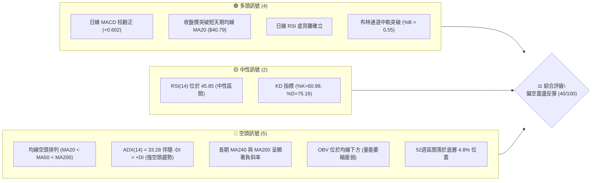
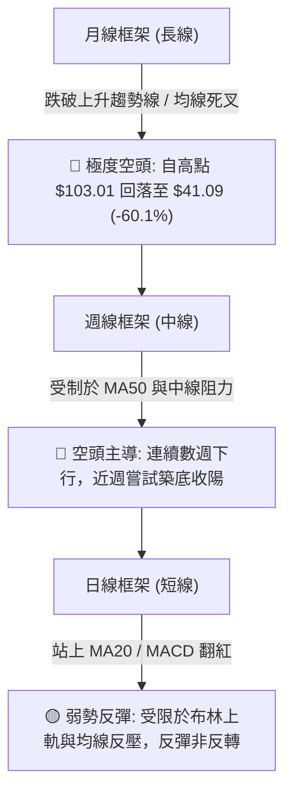
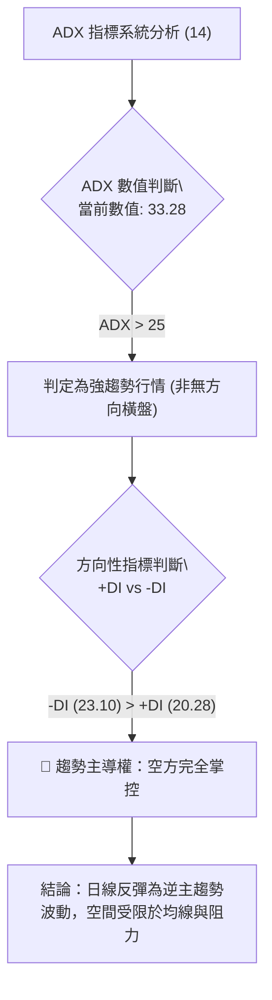
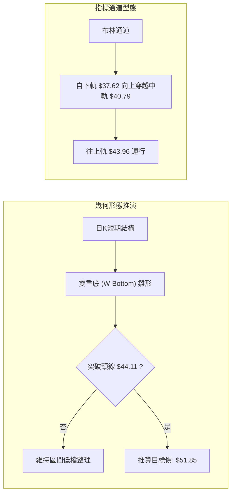
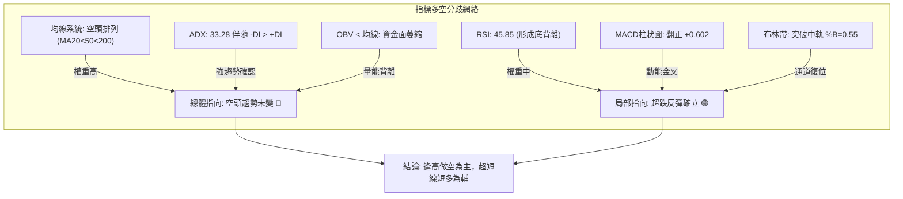
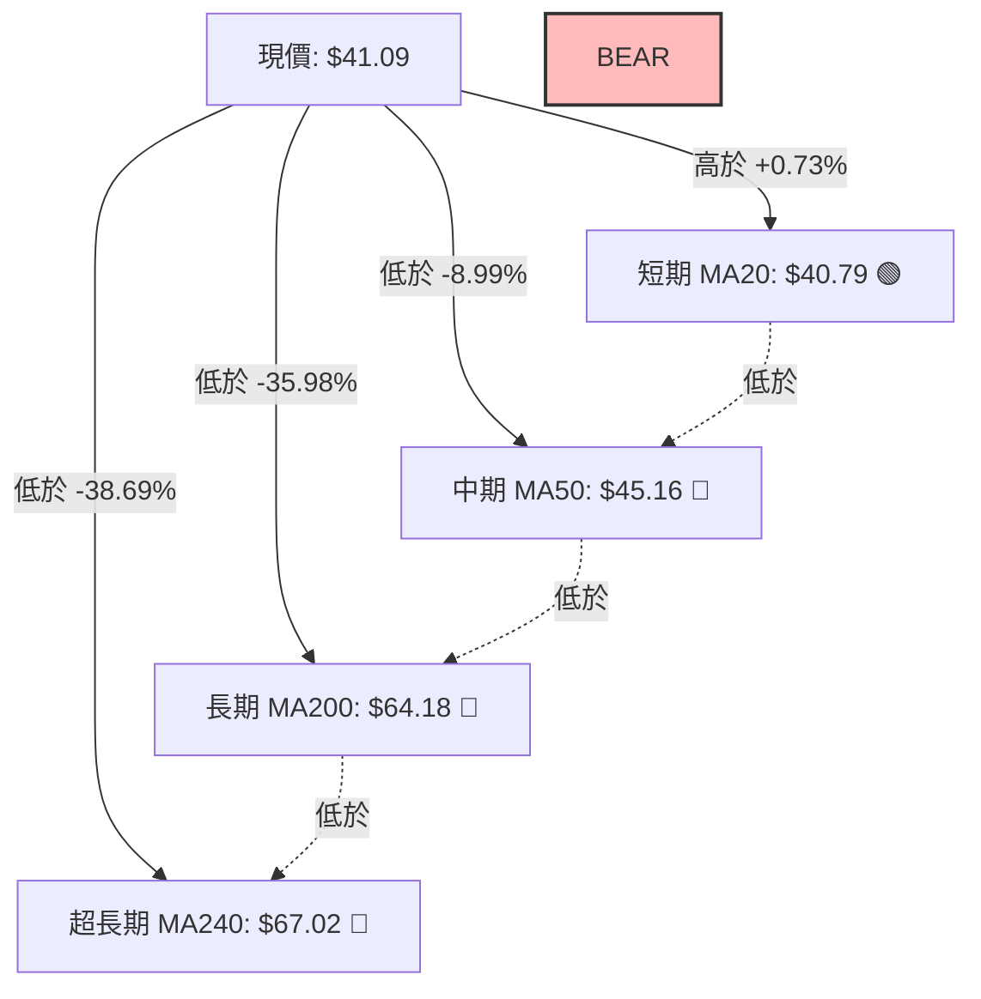
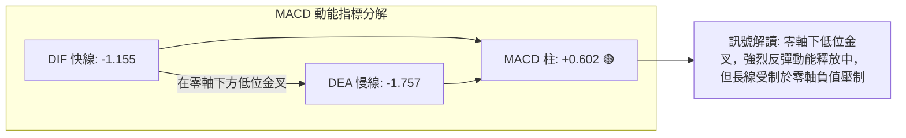
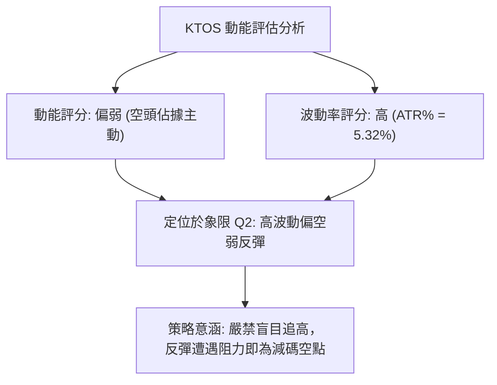
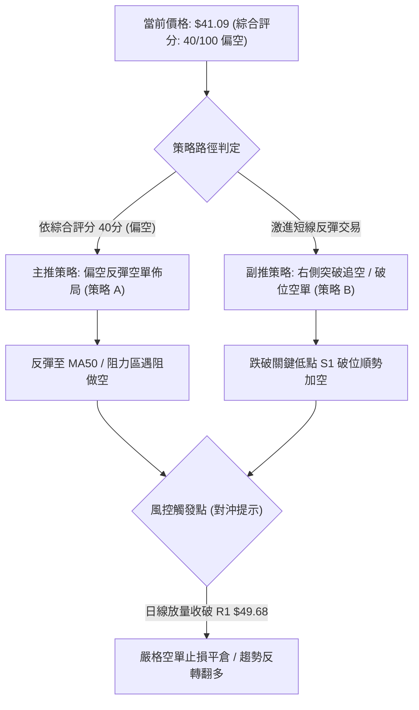
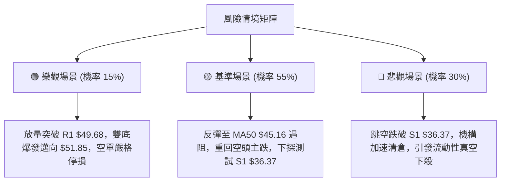

# KTOS 技術分析報告

> **報告日期**：2026-11-02 ｜ **語言**：繁體中文 ｜ **數據來源**：Yahoo Finance ｜ **當前價格**：$41.09

---

## 目錄

| 章節 | 內容 |
|------|------|
| [1. 技術面概覽](#1-技術面概覽) | 訊號儀表板、核心指標、評分卡 |
| [2. 趨勢分析](#2-趨勢分析) | 多時框趨勢、長中短期走勢 |
| [3. 圖表形態分析](#3-圖表形態分析) | 形態識別、K線組合、目標價 |
| [4. 支撐與阻力](#4-支撐與阻力) | 關鍵價位、斐波那契回調 |
| [5. 技術指標深度解讀](#5-技術指標深度解讀) | MA/RSI/MACD/布林/成交量 |
| [6. 動能與波動率](#6-動能與波動率) | 動能評估、ATR、Beta |
| [7. 多時框架總結](#7-多時框架總結) | 時框架評分矩陣 |
| [8. 交易策略建議](#8-交易策略建議) | 多空策略、風險報酬比 |
| [9. 風險提示與監控](#9-風險提示與監控) | 監控指標、風險場景 |

---

## 1. 技術面概覽

### 🎯 技術訊號儀表板



### 📊 核心指標速覽表

| 指標類別 | 指標名稱 | 當前數值 | 訊號 | 解讀 |
|----------|----------|----------|------|------|
| **價格** | 當前收盤價 | $41.09 | 🟡 | 位於52週區間極底部（4.8%），短線呈現超跌修復反彈 |
| **均線** | MA20 | $40.79 | 🟢 | 現價站上 MA20，短期趨勢微幅轉強，形成短線下檔支撐 |
| **均線** | MA50 | $45.16 | 🔴 | 現價低於 MA50（-8.99%），中期空頭壓制明顯 |
| **均線** | MA200 | $64.18 | 🔴 | 現價遠低於 MA200（-35.98%），長期結構維持極重空頭走勢 |
| **動能** | RSI(14) | 45.85 | 🟡 | 處於 30–70 中性區間，且近20根K棒首尾呈現底背離現象 |
| **動能** | MACD | -1.155 (柱 +0.602) | 🟢 | 快慢線雖在零軸下方，但柱狀圖擴張翻正，發出超跌反彈訊號 |
| **趨勢** | ADX(14) | 33.28 (-DI: 23.10) | 🔴 | ADX > 25 且 -DI 壓制 +DI (20.28)，代表既有中長期空頭動能強勁 |
| **波動** | ATR(14) | $2.19 (5.32%) | 🟡 | 波動率處於中高水平，單日震盪幅度擴大，需嚴格設定防守間距 |

### 🏆 技術評分卡

```
╔══════════════════════════════════════════════════════════════╗
║                技術評分卡 — KTOS (2026-11-02)               ║
╠══════════════════════════════════════════════════════════════╣
║ 趨勢強度      ███████░░░░░░░░░░░░░  35/100  🔴 (空頭趨勢強烈) ║
║ 動能指標      ██████████░░░░░░░░░░  50/100  🟡 (背離初顯中性) ║
║ 支撐穩定度    ████████░░░░░░░░░░░░  40/100  🔴 (僅依賴波段前低) ║
║ 成交量配合    ███████░░░░░░░░░░░░░  35/100  🔴 (OBV疲弱量萎縮) ║
║ 形態完整度    ████████████░░░░░░░░  60/100  🟡 (雙底構築雛形) ║
║ 均線排列      ████░░░░░░░░░░░░░░░░  20/100  🔴 (完整空頭排列) ║
╠══════════════════════════════════════════════════════════════╣
║ 綜合評分      ████████░░░░░░░░░░░░  40/100  🔴 偏空 (反彈對待)║
╚══════════════════════════════════════════════════════════════╝
```
*(註：綜合評分由六項子評分算術平均計算：(35 + 50 + 40 + 35 + 60 + 20) / 6 = 40.0，依規則 18 四捨五入取整為 40/100。)*

---

## 2. 趨勢分析

### 🌐 多時框趨勢分析



### 📈 長期趨勢 — 12個月走勢圖（Unicode）

KTOS 在過去12個月內經歷了劇烈的牛熊轉換。2025年下半年受國防科技與無人機題材推動，價格於2026年1月創下歷史級高點（月收盤價 $103.01，52週盤中高點達 $134.00）。隨後因現金流轉負、資本支出擴大及估值修正，走勢呈現連續單邊崩跌，於2026年10月回落至 $41.09，逼近52週最低點 $36.37。

```
KTOS 月線走勢圖（過去12個月：2025-11 至 2026-10）
價格軸 ($)
$105 ┤                   ● (2026-01: $103.01 高點)
$95  ┤                  ╱ ╲
$85  ┤                 ╱   ● (2026-02: $86.18)
$75  ┤ ● (2025-11:$76)─●    ╲
$65  ┤  (2025-12:$75.9)      ● (2026-03: $70.51)
$55  ┤                        ╲   ● (2026-05: $64.13)
$45  ┤                         ●───╲─────● (2026-08: $50.98)
$35  ┤                         (04:$63)   ╲       ●←現價 ($41.09)
     └─────────────────────────────────────●───────
      11   12   01   02   03   04   05   06   07   08   09   10
     2025      2026
```

#### 長期走勢特徵分析表格

| 階段區間 | 時間區段 | 初始價格 | 結束價格 | 區間漲跌幅 | 走勢特徵與量價結構 |
|----------|----------|----------|----------|------------|--------------------|
| 衝頂主升段 | 2025/11 - 2026/01 | $76.10 | $103.01 | +35.36% | 月線加速放量衝頂，形成長期頂部派發結構 |
| 崩跌主跌段 | 2026/01 - 2026/04 | $103.01 | $63.05 | -38.79% | 跌破各級中短期支撐，長陰下殺，均線快速拐頭向下 |
| 中繼盤整段 | 2026/04 - 2026/06 | $63.05 | $49.86 | -20.92% | 出現弱勢技術性抵抗，隨後失守 $50 心理整數關卡 |
| 陰跌尋底段 | 2026/06 - 2026/10 | $49.86 | $41.09 | -17.59% | 量能萎縮，下探 52 週低點 $36.37 後嘗試短線弱反彈 |

### 📊 中期趨勢（週線分析）

中期走勢（近20週數據）顯示，自2026年8月中旬創出次級波段高點 $64.58（RSI 達 70.3 超買）以來，KTOS 展開長達11週的陰跌下挫通道。

```
中期週線壓力與支撐示意圖
$65 ┤       ● (08/14 高點 $64.58)
$60 ┤      ╱ ╲
$55 ┤     ╱   ╲
$50 ┤    ╱     ╲               [R1 強阻力區: $49.68 - $54.22]
$45 ┤───●───────●──────●────── ═══════════════════════════════
$40 ┤             ╲    ╱ ╲  ▲ 現價 $41.09
$35 ┤              ╲  ╱   ●  [S1 關鍵防守區: $36.37]
    └────────────────┴─────────────────────────────
       07/17       08/14      10/23 (低點 $36.37)
```

週線指標在2026年10月下旬觸及 $36.37 低點時，週成交量降至 18,266,100 股，週 RSI 跌至 31.3 的邊界超賣區。隨後一週（2026-10-30）收盤價拉升至 $41.09，單週上漲 6.23%，週線 MACD 柱翻正為 +0.602，顯示中級下行通道在觸及 $36.37 後出現初步抵抗買盤。

### ⚡ 趨勢強度評估（ADX 解讀）



#### ADX 強度對照與市場狀態分析

| 參數指標 | 數值 | 臨界基準 | 狀態評估 | 技術意涵 |
|----------|------|----------|----------|----------|
| **ADX(14)** | 33.28 | 25.00 | 強趨勢 (Strong Trend) | 當前市場處於強烈單邊動能主導環境，非低波動震盪。 |
| **+DI(14)** | 20.28 | 20.00 | 多方動能微弱 | 多頭買盤力道僅剛越過低動能閥值，攻擊持續性存疑。 |
| **-DI(14)** | 23.10 | 20.00 | 空方動能主導 | 空方仍位居優勢地位，任何反彈均面臨主趨勢解套拋壓。 |
| **趨勢形態** | - | ADX > 25 且 -DI > +DI | 空頭主導強動能 | 依規則 14：趨勢行情以中長期空頭為主，反彈均視為短線賣點或減碼機會。 |

---

## 3. 圖表形態分析

### 🔍 形態識別系統



#### 形態信心度與目標價評估表

| 形態類別 | 信心度 | 判斷依據（嚴格引用 OHLCV 數據） | 完成度 | 目標價（附嚴格計算式） |
|----------|--------|----------------------------------|--------|------------------------|
| **日線雙底 (W-Bottom) 雛形** | 55% | 第一次低點為 2026-10-23 之低點 $36.37，第二次確認為 2026-10-26 之低點 $38.43。中間反彈波段高點（頸線）為 2026-10-29 之高點 $44.11。 | 60% (尚未帶量突破頸線) | 依形態高度推算：頸線 $44.11 + (頸線 $44.11 − 低點 $36.37) = $44.11 + $7.74 = **$51.85** |
| **中長期下行旗形 (Bear Flag)** | 70% | 自 2026-08-14 高點 $64.58 跌至 2026-10-23 低點 $36.37，近期反彈上攻受制於 MA50 ($45.16)。旗面震盪特徵明顯。 | 75% | 依旗形對稱破位推算：若跌破旗面底邊 $36.37，下測目標 = $36.37 − ($64.58 − $36.37) = **$8.16**（極端空頭延伸目標） |

### 🕯️ 重要 K 線形態分析

依規則 19，完全基於提供的近10根日K與近8根週K實際四價（開高低收）進行形態解讀：

| 日期（週期） | 開盤價 | 最高價 | 最低價 | 收盤價 | 成交量 | K線形態 | 技術解讀與訊號 |
|--------------|--------|--------|--------|--------|--------|---------|----------------|
| **2026-10-22 (日)** | $38.27 | $39.96 | $37.40 | $38.27 | 4,194,300 | 十字星 (Doji) | 開收同價於 $38.27，長下影線顯示低檔出現微弱買盤抵抗，多空陷入焦灼。🟡 |
| **2026-10-23 (日)** | $37.64 | $39.08 | $36.37 | $38.68 | 4,201,100 | 下影紅錘頭 (Hammer) | 盤中殺破前低創 52 週新低 $36.37 後強烈拉回，收盤高於開盤，確認波段底點 S1。🟢 |
| **2026-10-26 (日)** | $38.68 | $40.57 | $38.43 | $40.43 | 3,481,000 | 突破中陽線 | 低點未破前低，實體實質越過 MA20，確立短線反彈動能。🟢 |
| **2026-10-29 (日)** | $41.28 | $44.11 | $41.20 | $43.59 | 6,251,700 | 帶量突破長陽線 | 成交量顯著放大至 625 萬股（放量1.5倍），衝擊布林上軌 $43.96，形成波段頸線高點。🟢 |
| **2026-10-30 (日)** | $42.67 | $43.21 | $40.28 | $41.09 | 3,414,400 | 高檔長黑吞噬 | 跳空高開後遭遇解套賣壓，跌破前日半數實體，形成短線回踩確認訊號。🔴 |
| **2026-10-23 (週)** | $40.40 | $40.50 | $36.37 | $38.68 | 18,266,100 | 長下影探底線 | 探觸全年度最低位 $36.37 後收出長達 $2.31 的下影線，確立空頭力竭第一信號。🟢 |
| **2026-10-30 (週)** | $38.68 | $44.11 | $38.43 | $41.09 | 20,273,300 | 底部穿頭破腳中陽 | 週線結束連續數週破底陰跌，實體收陽，宣告日線級別反彈擴散至週線層面。🟢 |

### 📉 ASCII 走勢形態示意圖

```
KTOS 近期雙底雛形與頸線架構示意圖
價格
$45.00 ┤                             [布林上軌 $43.96 / MA50 $45.16]
$44.11 ┤                      ● (10/29 頸線高點)
$43.00 ┤                     ╱ ╲
$42.00 ┤                    ╱   ╲
$41.09 ┤───────────────────╱─────● (10/30 收盤價現價)
$40.00 ┤      ● (10/20)   ╱
$38.43 ┤     ╱ ╲         ● (10/26 第二低點)
$37.00 ┤    ╱   ╲       ╱
$36.37 ┤───●─────●─────●──────────────── [波段第一低點 S1: $36.37]
       └────────────────────────────────
         10/19  10/23  10/26  10/29  10/30
```

### 🎯 形態目標價計算

1. **雙底形態突破推算**：
   - 形態底部低點：$36.37（2026-10-23 確切低點）
   - 形態頸線位置：$44.11（2026-10-29 確切高點）
   - 形態垂直幅度：頸線 $44.11 − 底部 $36.37 = **$7.74**
   - 向上突破完全量度目標 = 頸線 $44.11 + 垂直幅度 $7.74 = **$51.85**（此點位緊鄰數據中聚類阻力位 R2: $51.49，具備強烈技術共振性）。

2. **區間破位推算（失效保護）**：
   - 若短線反彈未能突破頸線 $44.11，且跌破底部頸線支撐 S1: $36.37，將確認中繼熊旗破位。

---

## 4. 支撐與阻力

### 🗺️ 關鍵價位分布圖（Unicode）

```
KTOS 價位結構分布圖（嚴格引用系統聚類與斐波那契計算）
═════════════════════════════════════════════════════════════════
$134.00 ║██████████████████████████████║ 52週歷史高點 (Fib 0.0%)
$85.18  ║██████████████████████        ║ Fib 50.0% 長期中樞回調位
$73.66  ║████████████████████          ║ Fib 61.8% 重要阻力回調位
$64.18  ║██████████████████            ║ 長期均線 MA200 壓制線
$54.22  ║████████████████              ║ 強阻力位 R3 (+31.95%)
$51.49  ║██████████████                ║ 阻力位 R2 (+25.31%)
$49.68  ║████████████                  ║ 關鍵阻力位 R1 (+20.91%)
$45.16  ║████████                      ║ 中期均線 MA50 動態反壓
$43.96  ║██████                        ║ 布林通道上軌壓制位
$41.09  ╠══════════════════════════════╣ ◄ 當前收盤價現價 ($41.09)
$40.79  ║▓▓▓▓▓▓                        ║ 短期均線 MA20 / 布林中軌
$36.37  ║██████████████████████████████║ 52週波段最低點 S1 (Fib 100.0%)
═════════════════════════════════════════════════════════════════
```

### 🚧 阻力位分析表

依規則 13，阻力價位完全嚴格引用數據「關鍵價位」區塊之波段高點聚類數值：

| 阻力級別 | 價位 | 距離現價幅度 | 形成原因與籌碼解讀 | 突破難度 | 重要性 |
|----------|------|--------------|--------------------|----------|--------|
| **R1** | $49.68 | +20.91% | 近一年密集波段高點聚類，且與 60 日均線（MA60: $47.97）形成上方密集壓制帶。 | 4/5 難 🔴 | ★★★★☆ |
| **R2** | $51.49 | +25.31% | 2026年8月下旬回落破位前之次級支撐轉換位，同時為雙底推算目標（$51.85）之核心阻擋區。 | 4/5 難 🔴 | ★★★★☆ |
| **R3** | $54.22 | +31.95% | 2026年6月中旬（06-18 週收盤 $54.21）震盪平台下軌，聚集大量歷史套牢成交量。 | 5/5 極難 🔴 | ★★★★★ |

*(註：短期動態阻力尚包含布林上軌 $43.96 與 MA50: $45.16，但波段級別核心高點阻力以 R1–R3 為主。)*

### 🛡️ 支撐位分析表

依規則 13，支撐價位完全嚴格引用數據「關鍵價位」區塊之波段低點聚類數值：

| 支撐級別 | 價位 | 距離現價幅度 | 形成原因與籌碼解讀 | 守住機率 | 重要性 |
|----------|------|--------------|--------------------|----------|--------|
| **S1** | $36.37 | -11.49% | 近一年波段最低點聚類，52週絕對低點，Fib 100.0% 終極支撐，10月23日獲長下影確認。 | 60% 🟡 | ★★★★★ |
| **S2** | N/A | N/A | *數據中未偵測到*（依規則 13 與 16，系統未提供低於 $36.37 之歷史聚類低點數據）。 | N/A | N/A |
| **S3** | N/A | N/A | *數據中未偵測到*（依規則 13 與 16，系統未提供額外更低支撐位數據）。 | N/A | N/A |

### 📐 斐波那契回調位分析

基於 52 週完整波動區間（高點 $134.00 → 低點 $36.37，全區間波動跨度達 $97.63）計算：

| 回調比率 | 價位 | 當前相對位置與技術意義解讀 |
|----------|------|----------------------------|
| **0.0% (52W High)** | $134.00 | 歷史極值高點，長期宏觀超級天花板。 |
| **23.6%** | $110.96 | 歷史回調高位阻力，牛市多頭防守失效位。 |
| **38.2%** | $96.71 | 強勢回調分水嶺，跌破後確認宏觀趨勢轉熊。 |
| **50.0%** | $85.18 | 多空平衡中軸線，歷史多個月份收盤爭奪點。 |
| **61.8%** | $73.66 | 黃金分割強防守位，2025年底平台整理下界。 |
| **78.6%** | $57.26 | 深度回調防線，失守後行情步入超跌極端區間。 |
| **100.0% (52W Low)**| $36.37 | 本輪熊市終極支撐，當前反彈之起漲母線低點。 |

**現價區間歸屬與解讀**：
當前價格 **$41.09** 明確落於 **Fib 78.6% ($57.26) 至 Fib 100.0% ($36.37)** 的深度回調區間內。這意味著空頭已吞噬了過去一年波瀾壯闊牛市行情的全部溢價。目前價格僅高於底部低點 12.98%，整體空間處於週期底部的右側打底初級階段，上方自 $57.26 起將面臨層層解套拋壓。

---

## 5. 技術指標深度解讀

### 🎛️ 指標訊號總覽



### 📈 移動平均線排列分析



#### 移動平均線數據對比表

| 均線名稱 | 當前價格 | 與現價價差 | 均線斜率與趨勢狀態 | 結論性訊號 |
|----------|----------|------------|--------------------|------------|
| **MA5** | $41.52 | -1.04% | 下彎（短線自高檔 $44.11 回吐） | 🔴 短線微幅回檔 |
| **MA10** | $40.14 | +2.36% | 上揚（由下向上穿刺助漲） | 🟢 極短多頭支撐 |
| **MA20** | $40.79 | +0.73% | 上揚（布林中軌，初步站穩） | 🟢 轉為短多防守 |
| **MA50** | $45.16 | -8.99% | 下滑（中期下行斜率陡峭） | 🔴 強烈中期壓制 |
| **MA60** | $47.97 | -14.34% | 陡峭向下（波段阻力區間下界） | 🔴 空方重度把守 |
| **MA120** | $50.47 | -18.58% | 穩定向下下行 | 🔴 半年線死叉壓制 |
| **MA200** | $64.18 | -35.98% | 長期下彎（牛熊分水嶺） | 🔴 宏觀熊市排列 |
| **MA240** | $67.02 | -38.69% | 超長期年線沉重下挫 | 🔴 總體下行通道 |

**排列總結**：均線系統呈現極為標準的 **MA20 < MA50 < MA60 < MA120 < MA200 < MA240 空頭排列**。現價雖站上 MA20，但屬於典型的空頭趨勢內部「負乖離過大所引發的技術性修復」，尚未具備趨勢反轉之條件。

### 📉 RSI(14) 分析

當前日線 RSI(14) 數值為 **45.85**（Wilder 計算）。

```
RSI(14) 強度儀表:
超賣區 (0-30)        中性整理區 (30-70)        超買區 (70-100)
├───────────────┼───────────────●───────────────┼───────────────┤
0              30              45.85            70             100
進度條: [█████████░░░░░░░░░░░] 45.85%
```

#### 背離判斷與結論

- **底背離確立 (Bullish Divergence) ⚠️**：
  比較近20根K棒首尾價格與 RSI 走勢：價格在 2026-10-23 下探 52 週最低點 $36.37，低於前波低點；但同期 RSI 於 10-23 落在 31.3 附近，未再擊穿前期極端超賣區，並在後續連續數日急速拉抬回升至 45.85。
- **結論**：日線級別底背離訊號發酵，驅動了本輪價格由 $36.37 反彈至最高 $44.11 的超跌修復行情。然而，當前 RSI 尚未突破 50 強弱分界線，顯示買盤力量尚處於弱勢反彈範疇，並未轉變為單邊強多動能。

### 📊 MACD(12/26/9) 訊號解讀



- **MACD 快線 (DIF)**：-1.155
- **MACD 訊號線 (DEA)**：-1.757
- **MACD 柱狀圖 (Histogram)**：**+0.602**（看多 🟢）
- **深層解讀**：DIF 於零軸下方（極弱勢區）向上金叉突破 DEA 慢線，柱狀圖顯著翻正放大至 +0.602。這表明空頭拋壓竭盡後的動能反撲，屬於典型的「水下金叉」，適合作為超跌搶反彈或空單獲利平倉的訊號，但在快慢線實質站上零軸前，不得視為牛市反轉。

### 📦 布林通道分析

布林帶參數採用標準 (20, 2) 計算，當前數值如下：
- **BB 上軌**：$43.96
- **BB 中軌 (MA20)**：$40.79
- **BB 下軌**：$37.62
- **BB %B**：0.55（處於中軌上方偏向多頭半區）

```
KTOS 布林通道價格分佈示意圖
價格
$44.00 ┤─────────────────────────── [布林上軌 $43.96]
$43.00 ┤                     ● (10/29 刺破上軌 $44.11 後回落)
$42.00 ┤
$41.09 ┤─────────────────●───────── [現價 $41.09, %B = 0.55]
$40.79 ┤═══════════════════════════ [布林中軌 MA20: $40.79]
$39.00 ┤
$38.00 ┤
$37.62 ┤─────────────────────────── [布林下軌 $37.62]
$36.37 ┤            ● (10/23 破下軌探底)
       └───────────────────────────
```

- **軌道行為解讀**：2026-10-29 價格單日最高衝至 $44.11，短暫刺破布林上軌 $43.96，隨即引發技術性乖離修正，10-30 日收盤拉回至軌道內部的 $41.09。目前價格仍緊守在通道中軌 $40.79 之上，通道寬度尚未劇烈收窄，處於「由下軌向上軌發起攻擊後的震盪整理階段」。若無法有效突破上軌 $43.96，價格將重回中下軌展開尋底測試。

### 💹 成交量分析（量價配合度）

- **最新成交量 (2026-10-30)**：3,414,400 股
- **20日平均量**：4,481,305 股（今日量比僅 **0.76x**）
- **50日平均量**：4,029,926 股
- **OBV 能量潮狀態**：OBV < 移動平均線，維持向下發散走勢。

```
成交量量價結構分解:
  2026-10-23 (探底 $36.37) :  4,201,100 股 (放量承接錘頭線)
  2026-10-27 (上漲突破)    :  4,320,500 股 (溫和放大伴隨漲勢)
  2026-10-29 (衝高 $44.11) :  6,251,700 股 (顯著放量長陽，多頭主力進場)
  2026-10-30 (回檔 $41.09) :  3,414,400 股 (量縮回調，量比 0.76x)
```

- **量價背離與特徵解讀**：
  10月29日帶量長陽（625萬股）呈現健康的主動性買盤，但次日（10月30日）價格下跌時成交量驟降至 341 萬股，量比降至 0.76x，顯示當前的回檔主要為浮籌解套與短線獲利了結，並非恐慌性主動砸盤。然而，長週期指標 **OBV 仍深陷均線下方**，反映中長期機構資金撤離趨勢未有實質逆轉，短期量能放大僅能支持局部反彈，不足以推動結構性反轉。

---

## 6. 動能與波動率

### ⚡ 動能評估四象限

動能評估維度由「趨勢動能強度」（由 ADX 與 MACD 綜合評定）與「波動率水平」（由 ATR 與歷史振幅評定）共同構成：

| 象限 | 動能維度 | 波動維度 | 典型特徵 | 當前狀態判定 | 交易決策指引 |
|------|----------|----------|----------|--------------|--------------|
| **Q1 (突破爆發)** | 強動能 | 高波動 | 單邊強趨勢、加速上揚或下殺 | — | 順勢跟進，擴大停利 |
| **Q2 (主跌擴散)** | 弱多頭/強空頭 | 高波動 | 恐慌拋售、反彈受制、ATR 擴大 | **✓ KTOS 所處象限** | **逢反彈做空 / 嚴設止損** |
| **Q3 (低波動築底)**| 弱動能 | 低波動 | 窄幅橫盤、量能極度萎縮 | — | 區間高拋低吸 |
| **Q4 (醞釀突破)** | 強動能 | 低波動 | 狹窄收斂三角尾端、蓄勢待發 | — | 預備突破單進場 |



### 📊 ATR 波動率分析

- **ATR(14) 數值**：**$2.19**（採用 Wilder 平滑算法）
- **ATR 佔比 (ATR % of Price)**：**5.32%**（高波動特性，單日平均震盪幅度超過 2 美元）
- **動態停損與風控距離建議**：
  - **超短線進場（日內/隔夜）**：安全防守間距至少為 1.0 × ATR = **$2.19**。
  - **波段交易防守（Swing Trading）**：建議間距為 1.5 × ATR 至 2.0 × ATR，即 **$3.29 至 $4.38**。
  - **當前現價防守應用**：以當前收盤價 $41.09 為基準，1.5 × ATR 的下檔回撤緩衝位落在 $41.09 − $3.29 = **$37.80**，剛好守在 10月26日次低點 $38.43 下方，具備高度保護效能。

### 📐 Beta 與市場相關性

- **Beta 係數**：**1.107**（具有高於美股大盤的波動放大屬性）
- **市場特徵與個股行為關聯**：
  KTOS 的 Beta 值為 1.107，表示標的具備成長型國防軍工科技股的典型高波動特性。當大盤（S&P 500 / 納斯達克）上漲 1% 時，KTOS 平均波動 1.11%；但在當前個股受制於自由現金流轉負（TTM FCF 為 -$128.90M）與高本益比（Trailing P/E 達 241.7）的壓制下，個股呈現顯著的弱於大盤的「負阿爾法（Negative Alpha）」特徵。市場反彈時其彈性有限，大盤下挫時其下殺動能往往加速擴大。

---

## 7. 多時框架總結

### 📋 時框架評分表

| 時框架 | 趨勢方向 | 動能指標狀態 | 均線排列特徵 | 形態完成度 | 綜合評分 | 操作指導建議 |
|--------|----------|--------------|--------------|------------|----------|--------------|
| **月線 (長線)** | 🔴 強烈空頭 | MACD 零軸下下行，距高點回吐 60% | 均線空頭下彎 | 長期衝頂回落大雙頂 | 25/100 | 長期投資者遠離，底未築成 |
| **週線 (中線)** | 🔴 空頭掌控 | 週 RSI 34–45，探底長下影反彈 | 受制於 MA20/MA50 | 下行旗形中繼整理 | 35/100 | 中線持倉逢反彈減碼出局 |
| **日線 (短線)** | 🟢 弱勢反彈 | RSI 底背離，MACD 柱轉正 (+0.602)| 站上 MA20，MA50 反壓 | 雙底雛形構築中 (55%) | 55/100 | 短線順應背離博取反彈，快進快出 |

### 🔲 綜合訊號矩陣

```
訊號維度對照矩陣
維度分類          短期 (日線)       中期 (週線)       長期 (月線)       跨週期協同性
─────────────────────────────────────────────────────────────────
價格 vs 均線      🟢 站上 MA20      🔴 遠低於 MA50    🔴 遠低於 MA200   衝突（反彈性質）
動能指標 (MACD)   🟢 柱狀圖翻正     🟡 低位走平       🔴 負值深淵       局部共振修復
超買超賣 (RSI)    🟢 45.85 底背離   🟡 35-45 弱勢區   🔴 極度偏弱       超跌反彈階段
成交量能 (OBV)    🔴 處於均線下方   🔴 持續萎縮       🔴 機構派發       缺乏量能支撐
趨勢強度 (ADX)    🔴 ADX 33 (-DI主導)🔴 強空頭通道    🔴 單邊下行       總體趨勢偏空
─────────────────────────────────────────────────────────────────
```

### ⚖️ 多時框收斂結論

依「嚴格要求 14」與「多時框收斂規則」進行最終判定：
1. **行情性質判定**：當前系統 **ADX(14) 數值為 33.28**，明確高於趨勢臨界點 25.00，且 **-DI (23.10) > +DI (20.28)**。因此市場明確處於**「強趨勢行情（空頭主導）」**，而非無方向的盤整震盪行情。
2. **優先級收斂原則**：在強趨勢行情中，必須以中長期（週線、MA50、MA200）方向為最高主導原則，日線層級的看多訊號（如 MACD 柱翻正、RSI 底背離、站上 MA20）**僅能視為超跌反彈與尋求做空/減碼進場點的依據**，嚴禁將其誤判為趨勢反轉。
3. **唯一方向性結論**：**🔴 偏空（逢反彈做空 / 超跌弱反彈對待）**。本結論嚴格收斂至第 1 章技術評分卡（40/100），並作為第 8 章交易策略構建的核心基礎。

---

## 8. 交易策略建議

### 🗺️ 策略決策流程圖



### 🧭 策略路由

> **當前主策略方向 = 🔴 偏空（空頭主導下的逢高放空策略，依評分 40/100）**
> 
> *依規則說明：綜合評分 40/100 剛好觸及偏空門檻（≤40），且中長線受制於強大空頭趨勢（ADX=33.28），故本報告以**空頭主導策略**為核心推薦；多頭僅列為反彈風險提示與短線對沖參考。*

### 🎯 價格情境階梯（Price Scenarios）

價位嚴格引用第 4 章及數據「關鍵價位」區塊之客觀數值：

| 觸發條件 | 下一目標 | 後續延伸 | 情境技術含義 |
|----------|----------|----------|--------------|
| **向上突破 R1 $49.68** | R2 $51.49 | R3 $54.22 | 空頭走勢遭破壞，日線雙底完全爆發，行情將轉為波段反彈強動能。 |
| **受阻於布林上軌/MA50** | 支撐中軌 $40.79 | 支撐 S1 $36.37 | 反彈力竭，價格回歸既有空頭通道，重演弱勢陰跌走勢。 |
| **向下擊穿 S1 $36.37** | 52週新低延伸 | 歷史支撐真空區 | 中繼熊旗確認跌破，新一輪主跌浪開啟，下方無支撐聚類防守。 |

### 📊 情境機率分佈

| 情境類別 | 發生機率 | 主要技術與量化依據 |
|----------|----------|--------------------|
| **回落測試 / 順勢下探底 (主情境)** | **55%** | ADX 高達 33.28 且 -DI 壓制；均線系統呈嚴格空頭排列；OBV 指標持續受阻於均線，量能未有效配合。 |
| **區間震盪打底 (次情境)** | **30%** | 日線 RSI 出現底背離；MACD 柱翻正為 +0.602；布林中軌 $40.79 形成短線暫時性下檔支撐。 |
| **強勢反轉向上突破 (小機率情境)**| **15%** | 必須同時伴隨日成交量擴大至 600 萬股以上，且強勢突破 MA50 ($45.16) 與 R1 ($49.68) 壓制帶。 |

### 🔴 主策略詳情（空頭交易策略）

所有價位均嚴格基於數據聚類阻力/支撐及波段點位構建，風險報酬比定義嚴格遵照規則 17 計算：
- **做空風險報酬比公式**：`風險報酬比 = (進場價 − 目標價 T1) ÷ (止損價 − 進場價)`，呈現為 `1 : X.XX（以 T1 計）`。

| 策略要素 | 策略 A（反彈遇阻放空 — 核心推薦） | 策略 B（破位追空 — 順勢突破） |
|----------|----------------------------------|-------------------------------|
| **策略類型** | 逆日線反彈、順週線主趨勢逢高做空 | 跌破 52 週最低點順勢破位放空 |
| **進場條件** | 價格反彈至布林上軌與 MA50 阻力區，出現高檔滯漲長上影或收黑棒 | 日K線實體跌穿關鍵支撐位 S1，量能放大確認破位 |
| **進場價格** | **$44.11**（2026-10-29 波段高點） | **$36.00**（以破位 S1 $36.37 確認進場） |
| **目標價 T1** | **$36.37**（數據中關鍵支撐位 S1） | **$29.69**（由月線歷史低點支撐推算） |
| **目標價 T2** | **$27.09**（由24個月歷史月線低點支撐推算）| **$22.72**（由24個月歷史最低收盤推算） |
| **止損價格** | **$45.16**（跌破 MA50 動態反壓線上緣）| **$38.43**（10月26日波段次低點轉換位） |
| **風險報酬比計算** | `(44.11 − 36.37) ÷ (45.16 − 44.11) = 7.74 ÷ 1.05 = 7.37` | `(36.00 − 29.69) ÷ (38.43 − 36.00) = 6.31 ÷ 2.43 = 2.60` |
| **風險報酬比** | **1 : 7.37（以 T1 計）** | **1 : 2.60（以 T1 計）** |
| *(T2 風險報酬比)* | *(以 T2 計為 1 : 16.21)* | *(以 T2 計為 1 : 5.47)* |
| **預估成功機率** | **65%** | **55%** |
| **建議配置倉位** | **15%** | **10%** |

### 🟢 反向風險觸發點（多頭對沖提示）

若持有多頭倉位或空單風控對沖，必須緊密關注以下點位：
1. **反轉確認觸發點**：若日K線以放量長陽站穩 **$45.16 (MA50)** 並收盤突破 **$49.68 (R1)**，代表雙底形態實質成立，空頭主趨勢將被瓦解，所有空單必須**無條件止損平倉**。
2. **多頭短線投機條件**：僅在現價回踩測試布林中軌 **$40.79** 獲得支撐不破時，短線激進交易者方可輕倉（5%）參與反彈多單，止損置於 10月26日低點 **$38.43**，第一停利目標鎖定在 **$44.11**。

### ⭐ 整體訊號強度評星

```
做多訊號強度：★★☆☆☆  (2/5星 — 僅屬日線超跌反彈，上方均線壓制沉重)
做空訊號強度：★★★★☆  (4/5星 — 符合 ADX 強趨勢空頭主導與均線空頭排列)
整體分析可信度：★★★★☆  (4/5星 — 價量、均線與多時框指標高度收斂互證)
```

---

## 9. 風險提示與監控

### ✅ 關鍵監控指標 Checklist

```
╔══════════════════════════════════════════════════════════════════╗
║                    每日技術監控 Checklist                        ║
╠══════════════════════════════════════════════════════════════════╣
║ [ ] 價格是否失守布林中軌 MA20 ($40.79)？(失守則短線反彈終結)    ║
║ [ ] 價格能否收盤衝破波段頸線高點 $44.11？(突破則雙底進一步發酵)  ║
║ [ ] 日成交量是否萎縮至 300 萬股以下？(量能枯竭將加劇陰跌風險)    ║
║ [ ] RSI(14) 是否在 50 水平遭遇壓制回落？(無法站上 50 確立弱勢)    ║
║ [ ] MACD 柱狀圖是否由正值 (+0.602) 出現快速收斂衰退？            ║
║ [ ] ADX(14) 是否持續維持在 25 以上？(驗證單邊趨勢之持續性)       ║
║ [ ] 52 週最低點 S1: $36.37 是否遭到實質擊穿？(破位空頭加速)     ║
╚══════════════════════════════════════════════════════════════════╝
```

### ⚠️ 風險場景分析



### 🛡️ 風險管理重要提醒

1. **ATR 波動管理與倉位控制**：
   KTOS 的 ATR(14) 高達 $2.19（佔股價 5.32%），單日震盪幅度極為劇烈。在配置反彈空單或波段策略時，**單筆交易最大虧損嚴格限制在總資產的 1.0% 以內**。若以 1.5 倍 ATR（約 $3.30）作為停損防守間隔，總持倉部位絕不宜超過總資金的 15%。
2. **基本面與財務面利空外溢風險**：
   儘管分析師共識評級給予 strong_buy（目標均價 $91.96），但必須清醒認識到公司目前基本面處於**自由現金流為負（TTM FCF -$128.90M）**與**TTM 營業利潤率僅 1.5%**的脆弱狀態。在基本面未出現實質拐點前，不可僅憑分析師目標價盲目逆技術趨勢左側接刀。
3. **跳空與流動性風險防範**：
   近期軍工國防板塊受消息面（如無人機合約、政府預算審批、財報發布）影響顯著，常出現開盤跳空走勢。建議所有止損單設定為條件市價單或防滑點止損限價單，避免隔夜突發利多或利空造成非受控虧損。

---

## 📋 報告總結

```
╔══════════════════════════════════════════════════════════════════╗
║                   KTOS 技術分析報告總結                          ║
╠══════════════════════════════════════════════════════════════════╣
║ 報告日期：2026-11-02                                             ║
║ 當前價格：$41.09                                                 ║
║ 分析評級：🔴 偏空反彈（綜合技術評分：40 / 100）                  ║
╠══════════════════════════════════════════════════════════════════╣
║ 關鍵結論：                                                       ║
║ ├─ 長期趨勢：🔴 極度空頭（年線 MA240 $67.02 沉重下壓，處於下行道）║
║ ├─ 中期趨勢：🔴 空頭主導（ADX 33.28 強趨勢，受制於 MA50 $45.16）║
║ ├─ 短期趨勢：🟢 弱勢反彈（日線底背離發酵，站上布林中軌 MA20）  ║
║ ├─ 關鍵支撐：S1: $36.37 (52週最低點)                            ║
║ ├─ 關鍵阻力：R1: $49.68 ｜ R2: $51.49 ｜ R3: $54.22              ║
║ └─ 形態目標：雙底推算目標 $51.85 (需先突破頸線 $44.11)           ║
╠══════════════════════════════════════════════════════════════════╣
║ 最優策略組合：                                                   ║
║ 1. 🥇 最佳機會：策略 A — 反彈至 $44.11 遇阻放空，目標 $36.37，   ║
║                止損 $45.16，風險報酬比 1 : 7.37 (以 T1 計)。     ║
║ 2. 🥈 次選機會：策略 B — 破位追空，實質跌破 $36.37 (進場 $36.00)，║
║                目標 $29.69，止損 $38.43，風報比 1 : 2.60。       ║
║ 3. 🥉 保守選擇：空手觀望，等待日線於 $36.37 形成長週期雙底確立，║
║                或帶量突破 MA50 後再行介入。                      ║
╚══════════════════════════════════════════════════════════════════╝
```

---

> ⚠️ **免責聲明**：本報告為技術分析研究，所有數據及估算均嚴格基於提供的歷史價格資訊（OHLCV）。本報告**僅供研究與學術參考**，**不構成任何要約、推薦或投資建議**。金融市場存在極高資本虧損風險，投資者應依據自身財務狀況與風險承受能力獨立做出投資決策並自負盈虧。

---

*報告生成時間：2026-11-02 ｜ 數據來源：Yahoo Finance ｜ 分析框架：多時框技術分析體系*