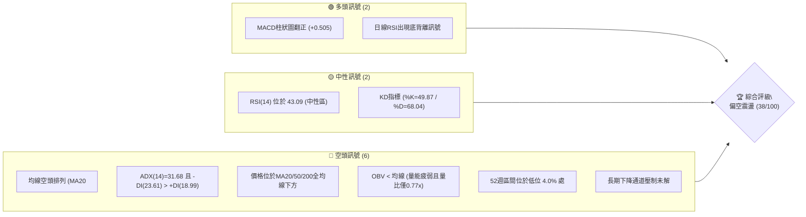
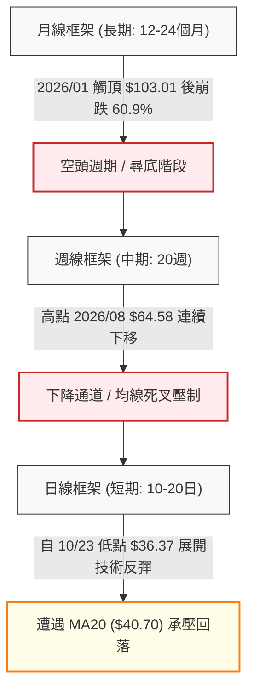
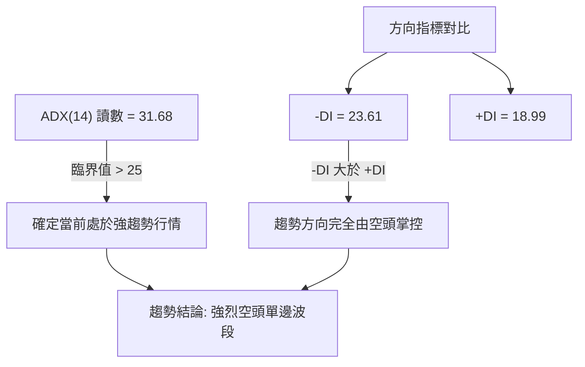
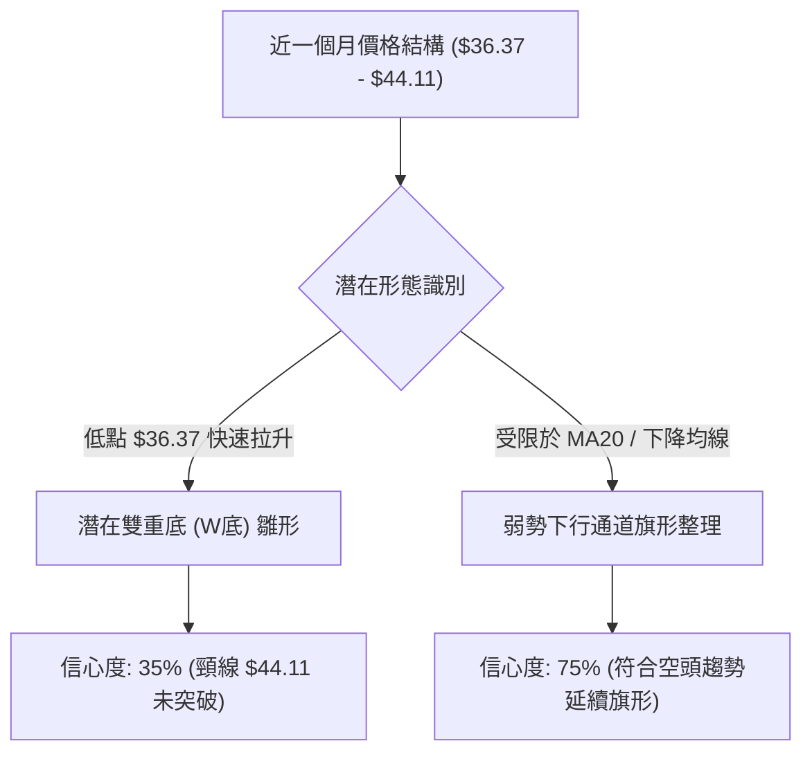
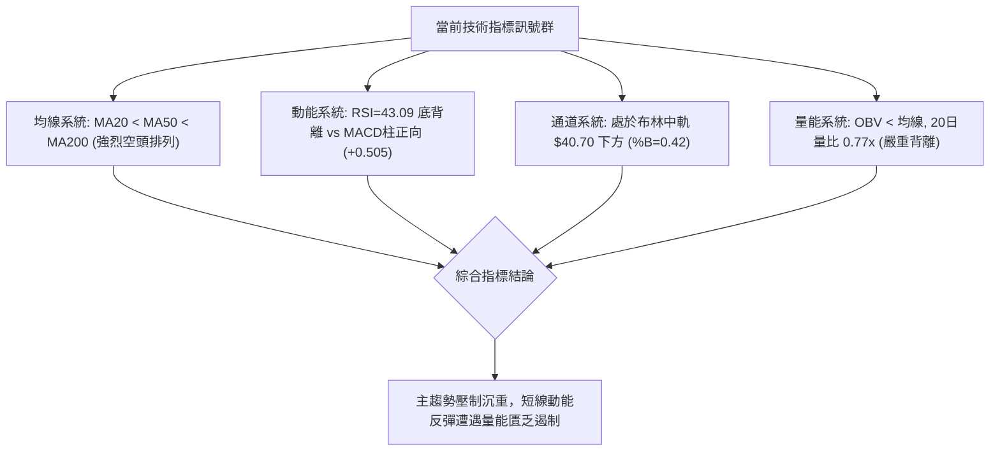
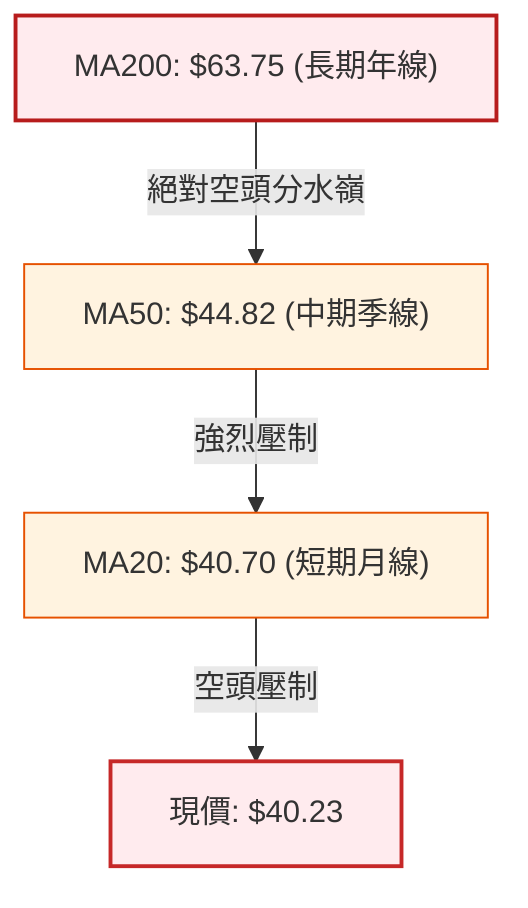
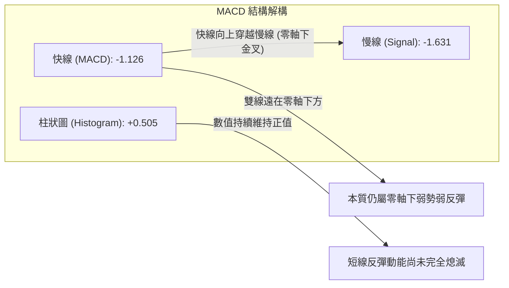
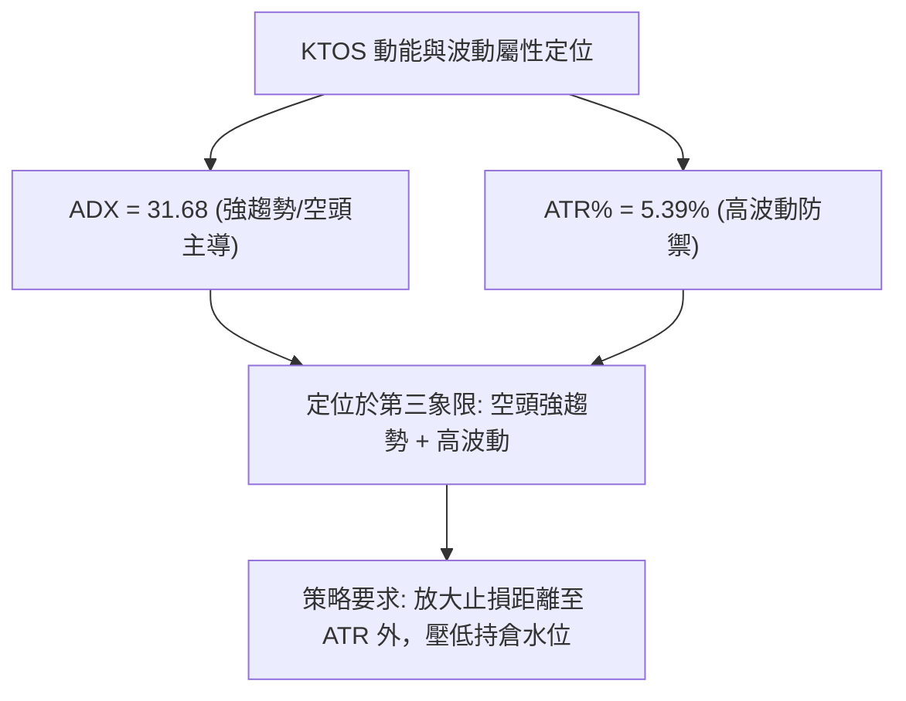
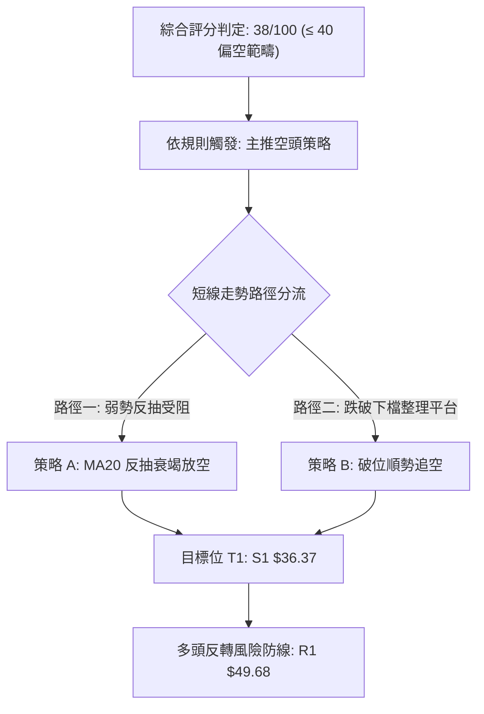
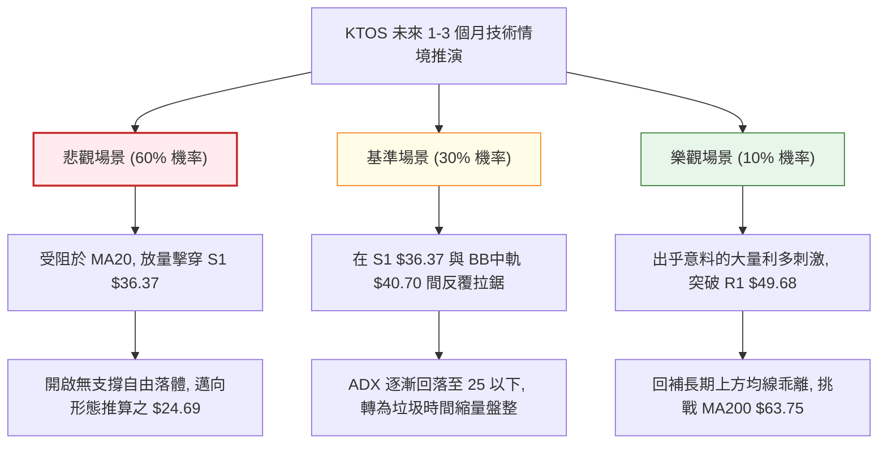

# KTOS 技術分析報告

> **報告日期**：2026-11-03 ｜ **語言**：繁體中文 ｜ **數據來源**：Yahoo Finance ｜ **當前價格**：$40.23

---

## 目錄

| 章節 | 內容 |
|------|------|
| [1. 技術面概覽](#1-技術面概覽) | 訊號儀表板、核心指標、評分卡 |
| [2. 趨勢分析](#2-趨勢分析) | 多時框趨勢、長中短期走勢、ADX解讀 |
| [3. 圖表形態分析](#3-圖表形態分析) | 形態識別、K線組合、目標價推算 |
| [4. 支撐與阻力](#4-支撐與阻力) | 關鍵價位、斐波那契回調結構 |
| [5. 技術指標深度解讀](#5-技術指標深度解讀) | 均線系統、RSI、MACD、布林通道、OBV |
| [6. 動能與波動率](#6-動能與波動率) | 動能四象限、ATR、Beta與波動風險 |
| [7. 多時框架總結](#7-多時框架總結) | 時框架評分矩陣、多時框收斂結論 |
| [8. 交易策略建議](#8-交易策略建議) | 策略路由、主策略詳情、風險報酬比 |
| [9. 風險提示與監控](#9-風險提示與監控) | 監控指標Checklist、情境分析與風控 |
| [📋 報告總結](#-報告總結) | 核心結論與執行路徑總結 |

---

## 1. 技術面概覽

### 🎯 技術訊號儀表板



### 📊 核心指標速覽表

| 指標類別 | 指標名稱 | 當前數值 | 訊號 | 解讀 |
|:---|:---|:---|:---:|:---|
| **價格** | 當前收盤價 | $40.23 | 🔴 | 位於 52 週高低區間之 4.0% 極低檔，弱勢尋底 |
| **均線** | MA20 (月線) | $40.70 | 🔴 | 股價位於 MA20 下方 (-1.16%)，短線反彈面臨即時反壓 |
| **均線** | MA50 (季線) | $44.82 | 🔴 | 股價顯著低於 MA50 (-10.24%)，中期趨勢嚴重走空 |
| **均線** | MA200 (年線) | $63.75 | 🔴 | 股價低於 MA200 (-36.89%)，長期多空分水嶺徹底失守 |
| **動能** | RSI(14) | 43.09 | 🟡 | 脫離超賣區進入中性偏弱區間，伴隨低檔底背離修復 |
| **動能** | MACD(12,26,9) | -1.126 / -1.631 | 🟢 | 快慢線處於零軸下，但差離柱 (+0.505) 持續放大收斂 |
| **趨勢** | ADX(14) | 31.68 | 🔴 | ADX > 25 確立趨勢行情；-DI (23.61) > +DI (18.99) 空方主導 |
| **通道** | 布林帶 (%B) | 0.42 | 🟡 | 價格處於中下軌之間 ($37.58 - $40.70)，短線壓制於中軌 |
| **成交量** | 20日均量比 | 0.77x (3.38M/4.37M) | 🔴 | 反彈成交量萎縮，量價出現背離，OBV 持續低於均線 |
| **波動** | ATR(14) | $2.17 (5.39%) | 🟡 | 處於中高波動狀態，單日振幅高達 5% 以上 |

### 🏆 技術評分卡

```
╔══════════════════════════════════════════════════════════════╗
║                技術評分卡 — KTOS (2026-11-03)                ║
╠══════════════════════════════════════════════════════════════╣
║ 趨勢強度      ███████░░░░░░░░░░░░░  35/100  🔴 空頭強趨勢      ║
║ 動能指標      ██████████░░░░░░░░░░  48/100  🟡 底背離醞釀中    ║
║ 支撐穩定度    ████████░░░░░░░░░░░░  42/100  🔴 僅依賴單一S1    ║
║ 成交量配合    ██████░░░░░░░░░░░░░░  32/100  🔴 量縮反彈缺動能  ║
║ 形態完整度    █████████░░░░░░░░░░░  45/100  🟡 弱勢箱型築底中  ║
║ 均線排列      █████░░░░░░░░░░░░░░░  26/100  🔴 完整空頭排列    ║
╠══════════════════════════════════════════════════════════════╣
║ 綜合評分      ████████░░░░░░░░░░░░  38/100  🔴 偏空弱勢 (規則18)║
╚══════════════════════════════════════════════════════════════╝
```
*註：綜合評分由六項子指標取算術平均：(35 + 48 + 42 + 32 + 45 + 26) ÷ 6 = 38.00（四捨五入為 38/100）。*

---

## 2. 趨勢分析

### 🌐 多時框趨勢分析



### 📈 長期趨勢 — 12個月走勢圖（Unicode）

KTOS 在過去 12 個月經歷了極其劇烈的暴漲與暴跌循環。股價於 2026 年 1 月見頂於月線收盤 $103.01（52 週盤中歷史高點達 $134.00），隨後受基本面現金流持續為負（TTM FCF 為 -$128.90M）以及估值泡沫修正影響，展開為期 10 個月的單邊下跌趨勢。

```
KTOS 過去 12 個月月線收盤價格走勢圖 ($)
$105 ┤              ● (2026-01: $103.01)
$95  ┤
$85  ┤                  ● (2026-02: $86.18)
$75  ┤●(11: 76.10) ●(12: 75.91)
$65  ┤                      ● (03: 70.51) ●(05: 64.13)
$55  ┤                          ● (04: 63.05)   ●(08: 50.98)
$45  ┤                                      ●   ●(07: 46.60)
$35  ┤                                      (06: 49.86) ●(09: 42.69) ●(10: 41.09) ●←現價($40.23)
     └─────────────────────────────────────────────────────────────
       11   12   01   02   03   04   05   06   07   08   09   10   11
     (2025)     (--------------------- 2026 ---------------------)
```

**長期月度走勢特徵分析表**：

| 時間區間 | 起訖收盤價 | 區間漲跌幅 | 主要走勢特徵 | 成交量與動能配合度 |
|:---|:---|:---:|:---|:---|
| **2025-11 ～ 2026-01** | $76.10 → $103.01 | +35.36% | 末升段加速噴出，創下歷史收盤高點 $103.01 | 量能爆發後迅速衰竭，見頂特徵顯著 |
| **2026-01 ～ 2026-06** | $103.01 → $49.86 | -51.60% | 斷頭式暴跌，接連跌破 MA20、MA50 與 MA120 | 恐慌性拋售，均線呈現發散下行 |
| **2026-06 ～ 2026-08** | $49.86 → $50.98 | +2.25% | 中級反彈波，8/14 創週波段反彈高點 $64.58 | 反彈觸及 MA200 後承壓，假突破 |
| **2026-08 ～ 2026-11** | $50.98 → $40.23 | -21.09% | 陰跌重啟，回測 52 週最低點 $36.37 尋求支撐 | 交易量萎縮，市場追價意願極度低迷 |

### 📊 中期趨勢（週線分析）

中期走勢完全受壓於週線級別的下降軌道線。自 2026 年 8 月高點回落以來，週 K 線連續 10 週無法收復 MA20 週均線。

```
週線級別壓力與支撐示意圖
價格 ($)
$65 ┤       ▲ (2026-08-14 週高 $64.58)
$60 ┤      / \
$55 ┤     /   \   
$50 ┤    /     \      [週線下行趨勢線]
$45 ┤   /       \───────────▼────────── R1: $49.68 (波段阻力聚類)
$40 ┤  /                     \   ● 現價: $40.23 (受阻於週線中軌)
$35 ┤ /                       \__▼_____ S1: $36.37 (52W最低點/強支撐)
    └────────────────────────────────────────────────────────
     07/26   08/14   08/28   09/18   10/09   10/23   11/02
```

### ⚡ 趨勢強度評估（ADX 解讀）



**ADX 指標強度對照分析**：

| 指標名稱 | 當前讀數 | 門檻區間 | 趨勢狀態判定 | 交易策略意涵 |
|:---|:---:|:---:|:---|:---|
| **ADX(14)** | **31.68** | > 25.0 | **強趨勢 (Strong Trend)** | 禁止使用震盪指標高出低進，以順勢空頭策略為主 |
| **+DI(14)** | **18.99** | < 20.0 | 多頭動能衰竭 | 多方無力推動波段，反彈僅屬技術性修正 |
| **-DI(14)** | **23.61** | > 20.0 | 空頭佔據主導優勢 | 賣盤持續掌控盤面，任何反彈均面臨主趨勢打壓 |
| **趨勢性質** | **空頭趨勢** | -DI > +DI 且 ADX 處於上升段 | 依規則 14：以中長期（週線/MA50、MA200）方向為首要指引 |

---

## 3. 圖表形態分析

### 🔍 形態識別系統



**圖表形態信心度與目標價評估表**（嚴格遵循規則 15 與規則 13）：

| 形態名稱 | 信心度 | 判斷依據（嚴格引用數據） | 形態完成度 | 理論目標價（附計算公式） |
|:---|:---:|:---|:---:|:---|
| **空頭下旗形 (Bear Flag)** | **75%** | 自 10/23 破底 $36.37 後，以量縮結構在 $36.37–$44.11 區間窄幅反彈，MA20 ($40.70) 形成頂蓋。 | 70% | 旗桿起跌點 09/25 高點 $49.68 跌至 10/23 低點 $36.37（跌幅 $13.31）。若跌破旗形底 $38.00，理論破底延伸目標 = $38.00 − $13.31 = **$24.69**。*(註：數據中波段支撐僅有 S1 $36.37，下方支撐未提供)* |
| **潛在雙底 (Double Bottom)** | **35%** | 10/23 觸及 52 週低點 $36.37 後反彈，10/29 摸高至 $44.11，但次日立即巨量長上影線回落，未能收復頸線。 | 30% | 形態未確立。若以頸線 10/29 高點 $44.11 計算（形態高度 = $44.11 − $36.37 = $7.74），突破頸線後目標 = $44.11 + $7.74 = **$51.85**（接近數據阻力聚類 R2 $51.49）。**因信心度 < 50%，僅供指標參考，不作主推策略依據。** |

### 🕯️ 重要 K 線形態分析

嚴格依據「近10根日K」與「近8根週K」之開高低收原始數據進行形態識別（規則 19）：

| 日期（週期） | 開盤價 | 最高價 | 最低價 | 收盤價 | K線形態名稱 | 技術解讀 | 訊號 |
|:---|:---:|:---:|:---:|:---:|:---|:---|:---:|
| **2026-10-23 (日K)** | 37.64 | 39.08 | 36.37 | 38.68 | **長下影錘頭線 (Hammer)** | 盤中殺破 52 週新低至 $36.37 後爆量強勁收腳，確立 S1 為極強短期支撐。 | 🟢 |
| **2026-10-26 (日K)** | 38.68 | 40.57 | 38.43 | 40.43 | **實體中陽線** | 確認前一日錘頭線支撐，收盤突破 5 日線，短線底背離買盤進場。 | 🟢 |
| **2026-10-27 (日K)** | 40.73 | 42.12 | 40.06 | 41.32 | **高開穿刺陽線** | 向上挑戰 MA20，但留有上影線，顯示上方解套賣壓沉重。 | 🟡 |
| **2026-10-28 (日K)** | 41.38 | 41.56 | 40.40 | 41.17 | **高位十字星 (Doji)** | 縮量至 2.80M，多空於 $41.00 關卡陷入僵持，反彈動能衰減。 | 🟡 |
| **2026-10-29 (日K)** | 41.28 | 44.11 | 41.20 | 43.59 | **巨量長上影大陽線** | 成交量暴增至 6.25M，衝高 $44.11 後遭空頭痛擊，實體雖紅但留下 $0.52 影線。 | 🟡 |
| **2026-10-30 (日K)** | 42.67 | 43.21 | 40.28 | 41.09 | **高開反包大陰線 (Bearish Engulfing)** | 開高走低重挫跌破開盤價，將前日漲幅悉數回吐，多頭反攻宣告受挫。 | 🔴 |
| **2026-11-02 (日K)** | 41.29 | 41.61 | 39.68 | 40.23 | **光腳陰線 (跌破MA20)** | 跌破 40 整數關卡與 MA20 ($40.70)，收盤收於最低價附近 ($40.23)，短線反彈終結。 | 🔴 |
| **2026-10-23 (週K)** | 40.40 | 40.50 | 36.37 | 38.68 | **探底長下影週K** | 測試歷史低點 $36.37 後單週收回近 $2.3，確立中期關鍵低點防線。 | 🟢 |
| **2026-10-30 (週K)** | 38.68 | 44.11 | 38.43 | 41.09 | **流星倒錘週K (Shooting Star)** | 單週高點 $44.11 遭遇沉重阻力，週線收出長達 $3.02 的上影線，反彈失敗。 | 🔴 |
| **2026-11-02 (週K)** | 41.29 | 41.61 | 39.68 | 40.23 | **開盤承壓小陰K** | 承接前一週倒錘賣壓，開盤即走弱，空方維持盤面主控權。 | 🔴 |

### 📉 ASCII 走勢形態示意圖

```
KTOS 近期反彈遇阻回落日K形態架構
價格 ($)
$44.50 ┤                       ▲ 10/29 盤中高點 $44.11 (遇阻暴跌)
$43.50 ┤                      / █
$42.50 ┤                     /  █   █ 10/30 高開實體陰線吞噬
$41.50 ┤             █  ┼───/───█───█
$40.50 ┤          █  █  █  MA20 ($40.70) ───────────────
$39.50 ┤       █  █  █  █                        █ 11/02 收盤跌破 $40.23
$38.50 ┤    █  █  █  █  █                        █ 
$37.50 ┤    █  │                                 ▼ (空頭下行旗形延續)
$36.50 ┤────┴──┴────────────────────────────────────── S1: $36.37 (10/23 絕對低點)
       └──────────────────────────────────────────────
           10/22 10/23 10/26 10/27 10/28 10/29 10/30 11/02 (日期)
```

---

## 4. 支撐與阻力

### 🗺️ 關鍵價位分布圖（Unicode）

本章節所有價位皆嚴格引用自輸入數據中的「關鍵價位」與「斐波那契回調」，絕無臆測編造。

```
KTOS 價位結構分布圖
════════════════════════════════════════════════════════════════
$134.00 ║██████████████████████████████║ 52W High (Fib 0.0%)
$110.96 ║████████████████████          ║ Fib 23.6% 回調位
$96.71  ║████████████████              ║ Fib 38.2% 回調位
$85.18  ║██████████████                ║ Fib 50.0% 中樞回調位
$73.66  ║██████████                    ║ Fib 61.8% 黃金分割回調位
$63.75  ║████████                      ║ MA200 年線生死線
$57.26  ║██████                        ║ Fib 78.6% 強阻力回調位
$54.22  ║██████████████████████████████║ 強阻力 R3 (波段高點聚類)
$51.49  ║████████████████████          ║ 阻力 R2 (波段高點聚類)
$49.68  ║████████████████████████      ║ 關鍵阻力 R1 (近一年波段高點聚類)
$40.70  ║──────────────────────────────║ BB中軌 / MA20 短線反壓
$40.23  ╠══════════════════════════════╣ ◄ 當前收盤價 ($40.23)
$37.58  ║░░░░░░░░░░░░░░░░░░░░░░        ║ BB下軌動態支撐
$36.37  ║██████████████████████████████║ 極強支撐 S1 / 52W Low (Fib 100.0%)
數據外  ║──────────────────────────────║ S2 / S3 數據中未偵測到 (規則13/16)
════════════════════════════════════════════════════════════════
```

### 🚧 阻力位分析表

阻力位完全引用數據中波段高點聚類計算之數值：

| 阻力級別 | 價位 | 形成原因 | 突破難度 | 重要性 |
|:---|:---:|:---|:---:|:---|
| **R1 (第一阻力)** | **$49.68** | 數據聚類：近一年波段反彈高點（2026/09/25 週高 $49.68 密集套牢區），距現價 +23.49%。 | 🔴 極高 | ★★★★☆<br>中期空翻多必須克服之首道結構性頸線 |
| **R2 (第二阻力)** | **$51.49** | 數據聚類：2026 年 8 月底急跌反抽之平台阻力密集帶，距現價 +27.99%。 | 🔴 極高 | ★★★☆☆<br>季線 MA60 ($47.63) 上方之強大籌碼套牢壁壘 |
| **R3 (第三阻力)** | **$54.22** | 數據聚類：2026 年 7 月初波段震盪平台高點密集區，距現價 +34.78%。 | 🔴 極度堅固 | ★★★★★<br>波段多空轉換樞紐，未站穩前長線皆為空頭 |

### 🛡️ 支撐位分析表

支撐位嚴格引用數據中近一年波段低點聚類計算之數值：

| 支撐級別 | 價位 | 形成原因 | 守住機率 | 重要性 |
|:---|:---:|:---|:---:|:---|
| **S1 (關鍵支撐)** | **$36.37** | 數據聚類：52 週最低點（2026/10/23 日K與週K絕對低點），距現價 -9.59%。 | 🟡 50% | ★★★★★<br>多頭最後馬奇諾防線，跌破將引發新一輪無底深淵拋售 |
| **S2 (次要支撐)** | **N/A** | **數據中未偵測到**（依規則 13 與 16，不憑空捏造無數據支撐之點位）。 | N/A | N/A |
| **S3 (深層支撐)** | **N/A** | **數據中未偵測到**（依規則 13 與 16，不憑空捏造無數據支撐之點位）。 | N/A | N/A |

### 📐 斐波那契回調位分析

依據 52 週完整波動區間（高點 $134.00 跌至低點 $36.37，總跌幅達 $97.63）計算之標準斐波那契回調位：

| 斐波那契回調水平 | 精確計算價位 | 與當前價格 ($40.23) 相對關係 | 技術意義解讀 |
|:---|:---:|:---:|:---|
| **0.0% (52W High)** | **$134.00** | +233.08% | 2026 年歷史極值頂部，泡沫化高峰 |
| **23.6% 回調位** | **$110.96** | +175.81% | 崩跌初期的失守點 |
| **38.2% 回調位** | **$96.71** | +140.40% | 長期強弱分水嶺 |
| **50.0% 中樞位** | **$85.18** | +111.73% | 估值中樞與多空平衡線 |
| **61.8% 黃金分割** | **$73.66** | +83.10% | 經典理論反彈極限阻力 |
| **78.6% 回調位** | **$57.26** | +42.33% | 中期下降波段防守點 |
| **100.0% (52W Low)**| **$36.37** | -9.59% | **當前行情之絕對底部基石 S1** |

> **現價位置深度解讀**：
> 當前收盤價 **$40.23** 處於 **100.0% ($36.37)** 與 **78.6% ($57.26)** 回調位之間的極深谷底區間（僅高於 52 週低點 3.96% 空間）。在斐波那契技術體系中，回調幅度超過 78.6% 且緊貼 100% 運行，標誌著原有的牛市結構已被徹底摧毀，此時不存在任何「多頭回調」邏輯，而是徹頭徹尾的「空頭尋底與超賣修復」週期。

---

## 5. 技術指標深度解讀

### 🎛️ 指標訊號總覽



### 📈 移動平均線排列分析



均線系統呈現完美的**空頭發散排列（MA20 < MA50 < MA200）**，且各天期均線斜率全部向下延伸：
- **MA5 ($41.48)**：短線反彈第一道天花板，11/02 日K跌破該線。
- **MA10 ($40.25)**：現價 ($40.23) 恰好受壓於 MA10 下方 2 美分。
- **MA20 ($40.70)**：近 20 日主力平均成本，10/29 曾短暫向上穿刺，但隨即於 10/30-11/02 被長陰線打回中軌下方，形成假突破。
- **MA60 ($47.63) 與 MA120 ($50.32)**：與數據阻力位 R1 ($49.68) 和 R2 ($51.49) 高度共振，構成中期牢不可破的重型套牢區。
- **MA200 ($63.75) 與 MA240 ($66.90)**：年線與兩年線距離現價達 -36% 至 -40%，長期空頭格局根深蒂固。

### 📉 RSI(14) 分析

當前日線 RSI(14) 讀數為 **43.09**。

```
RSI(14) 動能進度條
0 ──────── 30 ───────────────── 50 ─────── 70 ──────── 100
[超賣區]   │      當前: 43.09     │        │    [超買區]
░░░░░░░░░░▓▓▓▓▓▓▓▓▓▓▓▓░░░░░░░░░░░░░░░░░░░░░░░░░░░░░░░░░░ (43.09%)
```

- **超買超賣判定**：數值自 10/23 破底時的 30 附近震盪回升至 43.09，脫離超賣區，進入中性偏空區（30–50）。
- **背離診斷（極重要）**：
  - **日線級別底背離（⚠️ Bullish Divergence）成立**：對比近 20 根 K 棒，價格在 10/23 創下 52 週新低 $36.37（低於 10 月初之低點），但 RSI(14) 低點並未破前低，呈現指標底背離特徵。
  - **背離成效解讀**：該背離已經引發 10/23 至 10/29 自 $36.37 至 $44.11 的超跌技術反彈（漲幅 +21.28%）。然而，隨著 10/30 吞噬陰線出現，RSI 在 46–48 處受阻回落，顯示**底背離所能驅動之反彈動能已遭均線阻力消耗殆盡**，未轉化為趨勢反轉。

### 📊 MACD(12,26,9) 訊號解讀



- 快線 (MACD) = **-1.126**，慢線 (Signal) = **-1.631**。雙線在負值深水區形成黃金交叉。
- 柱狀圖 (Histogram) = **+0.505**，呈現正向擴張。
- **矛盾與風險警示**：雖然 MACD 柱維持綠色（看多），但日線價格已連續兩日收陰（10/30、11/02），且雙線仍受制於零軸下方負數區，屬於典型的「弱勢區金叉」，隨時可能因空頭趨勢打壓而在零軸下方再度鈍化或二次死叉。

### 📦 布林通道分析

布林帶寬度與軌道結構（日線參數 20, 2）：
- **BB 上軌**：$43.83
- **BB 中軌 (MA20)**：$40.70
- **BB 下軌**：$37.58
- **BB %B**：0.42

```
ASCII 布林通道位置示意圖
$44.00 ┬──────────────────────────────────────────── BB 上軌: $43.83 (10/29 高點刺破後回落)
$43.00 │
$42.00 │
$41.00 │ ─────────────────────────────────────────── BB 中軌 (MA20): $40.70
$40.00 │          ● 現價: $40.23 (%B = 0.42，跌入中下軌空頭區間)
$39.00 │
$38.00 │
$37.00 ┴──────────────────────────────────────────── BB 下軌: $37.58 (下檔動態保護)
```

**布林帶動態解讀**：
股價在 10/29 向上觸碰上軌 $43.83 附近（當日最高 $44.11）遭遇布林上軌極限壓制，隨後兩日內迅速跌破中軌 $40.70，%B 從接近 1.0 急墜至 0.42。布林帶通道開口並未放大向上，反而呈現走平收縮狀態，預示股價將於中軌 $40.70 至下軌 $37.58 之間展開弱勢探底。

### 💹 成交量分析（量價配合度）

- **最新成交量**：3,385,100 股
- **20日均量**：4,372,370 股（量比：**0.77x**）
- **50日均量**：4,034,746 股
- **OBV 趨勢**：**OBV < MA → 量能疲弱**

**量價結構深度診斷**：
1. **反彈無量，下跌放量**：在 10/29 反彈摸高時，成交量一度放大至 6.25M，但留下了極長上影線，屬於「衝高出貨量」；而 11/02 當日回落收在低點，量能萎縮至 3.38M，量比僅 0.77x，反映多頭買盤主力並未進場承接。
2. **OBV 線型空頭破位**：OBV 指標持續位於其均線下方運行，且創下近期新低，表明資金呈現持續淨流出態勢，量能完全不支持價格走出反轉行情。

---

## 6. 動能與波動率

### ⚡ 動能評估四象限

評估股票在「趨勢動能（ADX/-DI）」與「價格波動率（ATR%）」所處之技術象限：

| 象限代號 | 動能狀態 | 波動率狀態 | KTOS 當前位置 | 交易環境與策略應對 |
|:---:|:---:|:---:|:---:|:---|
| **第一象限 (Q1)** | 強動能 (多頭) | 低波動 | — | 最佳順勢突破買點 |
| **第二象限 (Q2)** | 弱動能 (無趨勢) | 低波動 | — | 狹幅盤整，觀望等待 |
| **第三象限 (Q3)** | **強動能 (空頭)** | **高波動 (5.39%)** | **✓ (當前所處象限)** | **高風險下行單邊市；禁止盲目抄底，以逢高做空或順勢做空為主** |
| **第四象限 (Q4)** | 弱動能 | 高波動 | — | 假突破頻繁，極易雙向被巴 |



### 📊 ATR 波動率分析

- **ATR(14)**：**$2.17**（採 Wilder 平滑計算）
- **波動率佔比**：佔當前收盤價 $40.23 的 **5.39%**

**風控止損參數設定**：
由於單日平均自然波動範圍高達 $2.17，任何過於緊密的止損（例如 1–2% 或小於 $1.00）極易被日常隨機雜訊掃出場。
- **多頭保守防守位**：若嘗試低接，止損點應設於 S1 ($36.37) 之下至少 0.5×ATR（約 $1.08），即不應隨意移動至脆弱區間。
- **空頭順勢防守位**：逢高建立空單時，止損位應設於關鍵反壓點之上 1.0×ATR 至 1.5×ATR（$2.17 – $3.25 緩衝區）。

### 📐 Beta 與市場相關性

- **Beta 係數**：**1.165**
- **市場特徵解讀**：
  KTOS 的系統性風險略高於標普 500 指數（Beta > 1.0）。當美股大盤出現下行震盪時，KTOS 往往會放大跌幅 16.5% 左右。考慮到其國防板塊屬性，近期其走勢嚴重脫離大盤牛市步伐，展現出強烈的**個股特定下行風險**（財務基本面營運現金流為負 -$39.60M、自由現金流 -$128.90M 之流動性折價），高 Beta 意味著下跌過程中的彈跳速度快，但向下破位的破壞力亦更強。

---

## 7. 多時框架總結

### 📋 時框架評分表

| 時框架 | 趨勢方向 | 動能狀態 | 均線排列狀態 | 圖表形態特徵 | 綜合評分 | 戰術建議 |
|:---|:---:|:---:|:---:|:---|:---:|:---|
| **長期 (月線)** | 🔴 極度偏空 | 弱勢下探 (連續10個月陰跌) | 長期均線轉折向下，年線遠在天際 | 頂部 $103.01 崩解，無任何打底跡象 | **20/100** | 絕對禁止長線買入現貨 |
| **中期 (週線)** | 🔴 偏空下行 | RSI=43.1, MACD週柱收斂 | 均線呈空頭發散，受壓於週 MA20 | 下降通道壓制，上週錄得流星倒錘線 | **32/100** | 逢反彈至週阻力線全力放空 |
| **短期 (日線)** | 🟡 弱勢反彈受阻 | RSI底背離修復接近尾聲 | MA20 破位，MA5/10 糾纏 | 空頭下行旗形整理，受制於 $40.70 | **45/100** | 僅供超短線日內快進快出 |

### 🔲 綜合訊號矩陣

```
訊號一致性診斷表
══════════════════════════════════════════════════════════════════
維度            長期 (月線)      中期 (週線)      短期 (日線)      收斂結論
──────────────────────────────────────────────────────────────────
趨勢方向        🔴 空頭          🔴 空頭          🟡 反彈承壓      🔴 空方全面掌控
動能指標        🔴 極弱          🔴 偏弱          🟢 弱反彈(背離)  🔴 反彈僅為技術性
均線位置        🔴 全線下方      🔴 全線下方      🔴 MA20下方      🔴 重重結構反壓
成交量量能      🔴 持續退潮      🔴 縮量陰跌      🔴 假突破量縮    🔴 缺乏主力增量
形態完整度      🔴 破位形態      🔴 下降通道      🟡 下旗形雛形    🔴 空頭中繼概率高
══════════════════════════════════════════════════════════════════
```

### ⚖️ 多時框收斂結論

嚴格遵循**規則 14（多時框收斂規則）**：
1. **趨勢市判定**：當前日線 ADX(14) 讀數為 **31.68 > 25.0**，確認當前市場處於**強趨勢行情**，而非無方向的盤整震盪。
2. **時框優先權取捨**：依據規則 14，在 ADX > 25 的趨勢行情中，**必須以中長期（週線、月線及 MA50、MA200）方向為絕對主導**；日線級別出現的 RSI 底背離及 MACD 翻正，僅能被定性為「強空頭主趨勢下的次級折返修復波（反彈）」，絕不可作為反轉建立多頭部位的依據。
3. **最終唯一收斂結論**：**【全面偏空】**。日線的反彈已在 MA20 ($40.70) 及布林帶中軌處遭遇明確阻力回落，交易策略全面以**逢高做空（反彈受阻做空）**為主軸，此結論與第 1 章技術評分卡（38/100，偏空）及後續交易策略完全一致。

---

## 8. 交易策略建議

### 🗺️ 策略決策流程圖



### 🧭 策略路由（依評分卡分流，嚴格依據規則 18）

> **當前主策略方向 = 【逢高做空 / 破位做空】（依綜合評分 38/100 確立）**
> 
> *依規則第 8 章指引：綜合評分 ≤ 40 屬於偏空範疇，必須主推空頭策略（完整進場／加碼／止損／目標）。多頭不予立項，僅列為「反轉風險觸發點（對沖提示）」，嚴禁兩頭下注。*

### 🎯 價格情境階梯（Price Scenarios）

所有價位階梯嚴格引用數據中計算好的關鍵價位（R1/R2/R3 及 S1）：

| 觸發條件 | 下一目標價 | 後續延伸目標 | 情境技術含義 |
|:---|:---:|:---:|:---|
| **強勢向上突破 R1 $49.68** | **R2 $51.49** | **R3 $54.22** | 空頭結構被實質破壞，中期轉強，空單全面止損離場 |
| **受阻於 MA20 ($40.70) 跌落** | **BB下軌 $37.58** | **S1 $36.37** | 典型的空頭旗形向下宣洩，波段探底加速 |
| **實體收盤跌破 S1 $36.37** | **數據中未偵測到 (尋求外推)** | **數據中未偵測到** | 跌破 52 週絕對低點，開啟新一輪無支撐單邊自由落體 |

### 📊 情境機率分佈

| 預測情境 | 機率 | 主要技術依據（引用原始指標狀態） |
|:---|:---:|:---|
| **下行破底 / 再探支撐 (回落)** | **60%** | ADX=31.68 強趨勢空方主導；均線空頭排列；OBV 指標持續低於均線且量縮。 |
| **區間弱勢震盪 ($37.58–$41.00)** | **30%** | 布林通道開口未顯著放大，布林帶下軌 $37.58 與中軌 $40.70 形成夾板區間。 |
| **強勢反彈突破 (逆轉向上)** | **10%** | 僅依賴 RSI 日線底背離修復，但面臨上方 R1 ($49.68) 重重籌碼套牢峰，極難跨越。 |

### 🔴 主策略詳情（空頭方向，嚴格依規則 17 計算風險報酬比）

本報告提供兩套精準量化的做空執行方案：
- **策略 A（反彈受阻放空）**：針對股價反抽測試 MA20 與布林中軌時建立空頭部位。
- **策略 B（跌破旗形底順勢放空）**：針對股價失去短期均線防守、向下跌破旗形下沿時順勢跟進。

| 策略要素 | 策略 A（反彈受阻空單） | 策略 B（破位追空單） |
|:---|:---|:---|
| **進場條件** | 股價弱勢反抽至 MA20 附近受阻，收出帶上影線陰K | 跌破 10/22 低點 $37.40 且日成交量放大 |
| **進場價格** | **$40.70** (精確以 MA20 阻力為準) | **$37.40** (精確跌破前波起漲低點) |
| **目標價 T1** | **$36.37** (關鍵支撐位 S1) | **$36.37** (關鍵支撐位 S1) |
| **目標價 T2** | **$24.69** (由旗形形態高度推算，見第3章) | **$24.69** (由旗形形態高度推算，見第3章) |
| **止損價格** | **$42.87** (MA20 + 1.0×ATR $2.17) | **$39.57** (進場點 + 1.0×ATR $2.17) |
| **止損空間 (風險)** | $42.87 − $40.70 = **$2.17** | $39.57 − $37.40 = **$2.17** |
| **獲利空間至 T1** | $40.70 − $36.37 = **$4.33** | $37.40 − $36.37 = **$1.03** |
| **風險報酬比** | **1 : 2.00（以 T1 計）**<br>*(4.33 ÷ 2.17 = 1.995 ≈ 2.00)* | **1 : 0.47（以 T1 計）**<br>*(1.03 ÷ 2.17 = 0.47)* |
| **風險報酬比 (T2)**| **1 : 7.38（以 T2 計）**<br>*((40.70−24.69) ÷ 2.17 = 7.38)* | **1 : 5.86（以 T2 計）**<br>*((37.40−24.69) ÷ 2.17 = 5.86)* |
| **勝率估計** | **65%** | **55%** |
| **建議總倉位** | **8%** (高波動環境防守型倉位) | **5%** (破位確認型輕倉) |

*說明：策略 B 若僅看至 T1，風險報酬比不具優勢（1:0.47），該策略本質為「破底博弈單」，必須在跌破 S1 $36.37 後將目標延伸至 T2 ($24.69)，此時以 T2 計算之風報比將躍升至 1 : 5.86。*

### 🔴 反向風險觸發點（對沖提示）

若市場出現以下情況，主空頭策略立即失效，空單必須無條件離場觀望：
1. **收盤價實體突破 R1 ($49.68)**：代表近兩個月之波段高點聚類被放量收復，空頭下行通道被徹底粉碎。
2. **週成交量連續兩週超越 50 日均量且週線連陽**：量能指標翻正，表明機構進行實質籌碼回補。
3. **對沖建議**：持有空單者，若價格突破 **$43.83 (布林上軌)**，應先減倉 50% 鎖定風險。

### ⭐ 整體訊號強度評星

```
做多訊號強度：★☆☆☆☆  (1/5星 - 僅存弱勢底背離修復，趨勢強烈反對做多)
做空訊號強度：★★★★☆  (4/5星 - 均線空頭排列 + ADX>25 空頭強趨勢)
整體可信度：  ★★★★☆  (4/5星 - 多時框趨勢指標與籌碼量能高度一致)
```

---

## 9. 風險提示與監控

### ✅ 關鍵監控指標 Checklist

```
╔══════════════════════════════════════════════════════════════════╗
║               技術分析風控每日監控清單 (Checklist)               ║
╠══════════════════════════════════════════════════════════════════╣
║ [ ] 監控項 1: 收盤價是否跌破 52W 低點 S1 ($36.37) (空頭加速信號) ║
║ [ ] 監控項 2: 價格是否重新站上 BB中軌/MA20 ($40.70) (空單預警點) ║
║ [ ] 監控項 3: ADX(14) 讀數是否維持在 25 以上 (趨勢行情延續性)    ║
║ [ ] 監控項 4: 日成交量是否超越 20日均量 4.37M (主力異動信號)     ║
║ [ ] 監控項 5: MACD 柱狀圖是否由正轉負 (動能衰竭信號)              ║
║ [ ] 監控項 6: 空頭止損硬性執行線: $42.87 (不得以任何理由撤銷)   ║
╚══════════════════════════════════════════════════════════════════╝
```

### ⚠️ 風險場景分析



### 🛡️ 風險管理重要提醒

1. **財務基本面流動性折價風險**：
   技術面之所以呈現近乎毀滅性的下行趨勢，核心源自基本面的嚴重失血（TTM 自由現金流為 -$128.90M，營運現金流為 -$39.60M）。即便分析師共識目標價給予 $89.76，但在負現金流未扭轉前，技術面隨時存在估值再壓縮的破底風險。
2. **空頭擠壓（Short Squeeze）風險**：
   當前 Short % of Float 為 5.9%，Short Ratio 為 2.07 天。雖然空頭借券比例不算極端，但若出現不可預期的國防突發訂單，高 Beta (1.165) 容易引發短線劇烈跳空高開。因此，**所有空頭策略必須以 ATR 設定硬性止損位（如 $42.87），絕對不可持死空心態過夜而不設防**。
3. **部位規模管理（Position Sizing）**：
   在 ATR 高達 5.39% 的高波動環境下，總倉位不得超過總投資組合的 8%–10%。單筆交易的風險暴險金額（即進場價與止損價之差額 × 股數）必須嚴格控制在總投資資本的 1.0% 以內。

---

## 📋 報告總結

```
╔══════════════════════════════════════════════════════════════════╗
║                    KTOS 技術分析報告終局總結                     ║
╠══════════════════════════════════════════════════════════════════╣
║ 報告日期：2026-11-03                                             ║
║ 當前價格：$40.23                                                 ║
║ 技術評級：🔴 偏空弱勢 (綜合評分: 38/100，規則18嚴格判定)          ║
╠══════════════════════════════════════════════════════════════════╣
║ 關鍵結構結論：                                                   ║
║ ├─ 長期趨勢 (月線)：🔴 空頭下行，自 $103.01 見頂崩跌逾 60%       ║
║ ├─ 中期趨勢 (週線)：🔴 空頭下降通道，MA20 週均線構成重度反壓    ║
║ ├─ 短期趨勢 (日線)：🟡 底背離反彈受阻於 MA20 ($40.70)，轉向陰跌  ║
║ ├─ 核心阻力位聚類：R1: $49.68 ｜ R2: $51.49 ｜ R3: $54.22        ║
║ ├─ 唯一支撐位數據：S1: $36.37 (52W最低點防線，下方數據未偵測到)  ║
║ └─ 趨勢強度指標  ：ADX(14)=31.68 (確立強趨勢)，-DI(23.61) 主導  ║
╠══════════════════════════════════════════════════════════════════╣
║ 最優交易策略執行路徑：                                           ║
║ 1. 🥇 首選策略 (策略 A)：逢反抽 MA20 ($40.70) 受阻放空           ║
║    進場: $40.70 ｜ 止損: $42.87 ｜ 目標 T1: $36.37               ║
║    風報比: 1 : 2.00（以 T1 計） ｜ 建議倉位: 8%                  ║
║ 2. 🥈 次選策略 (策略 B)：跌破 $37.40 順勢追空博弈破底            ║
║    進場: $37.40 ｜ 止損: $39.57 ｜ 目標 T2: $24.69 (形態延伸)   ║
║    風報比: 1 : 5.86（以 T2 計） ｜ 建議倉位: 5%                  ║
║ 3. 🥉 觀望防守策略     ：未站穩 R1 ($49.68) 前，堅決不盲目抄底  ║
╚══════════════════════════════════════════════════════════════════╝
```

---

> ⚠️ **免責聲明**：本報告為依據客觀市場量化技術數據所產出之研究報告，所有技術價位、形態判斷與指標解讀皆基於提供的歷史與即時價格資訊。報告內容**僅供學術研究與投資策略參考**，**不構成任何形式的證券買賣邀約或投資建議**。金融市場具高度風險，投資人應獨立評估個人風險承受度並嚴格執行風控紀律。

---

*報告生成時間：2026-11-03 ｜ 數據來源：Yahoo Finance ｜ 分析框架：資深多時框量化技術分析*