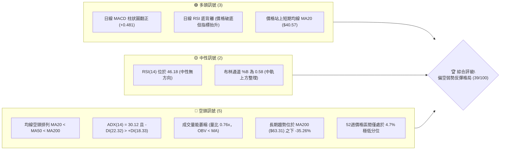
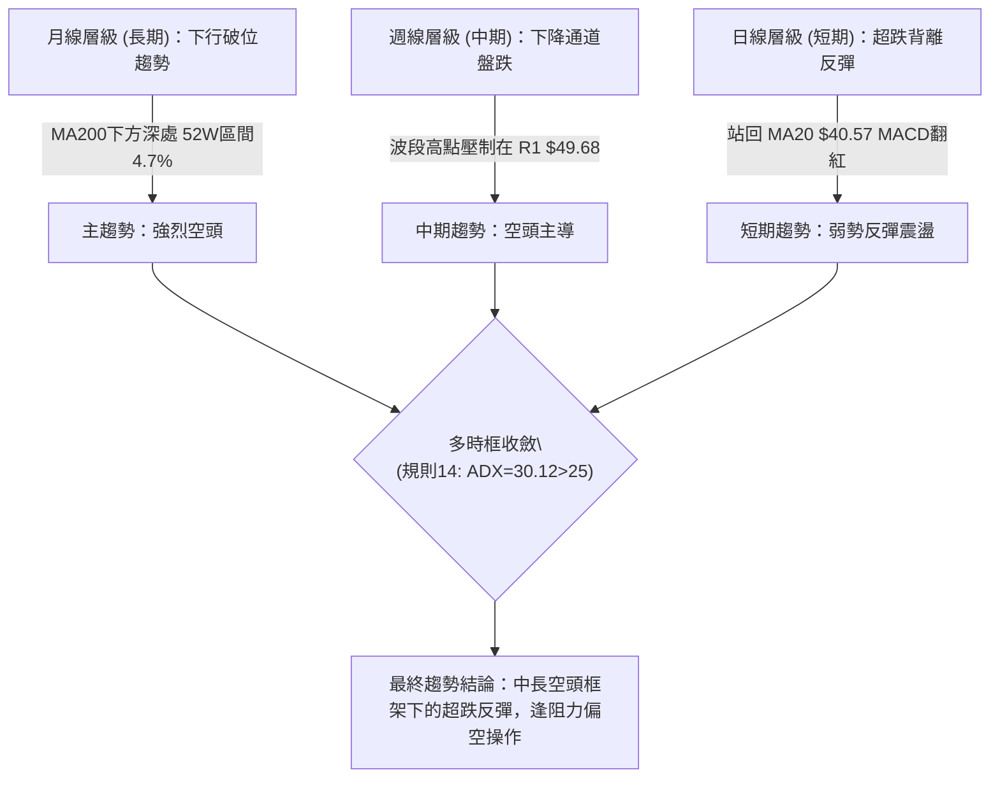
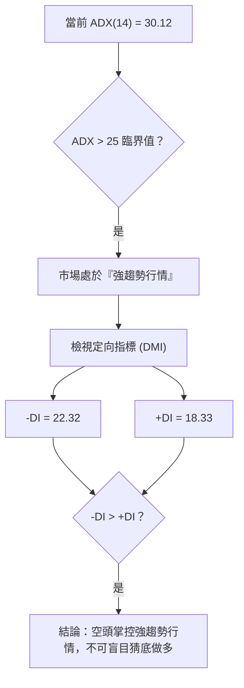
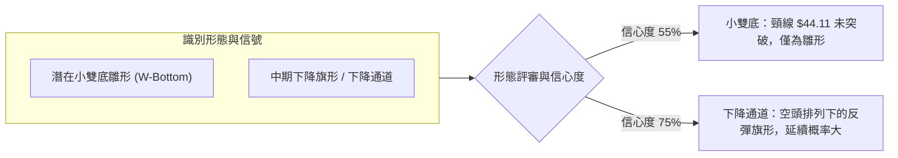
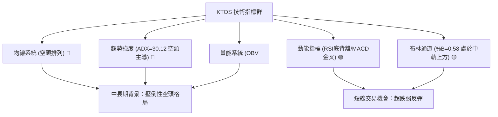
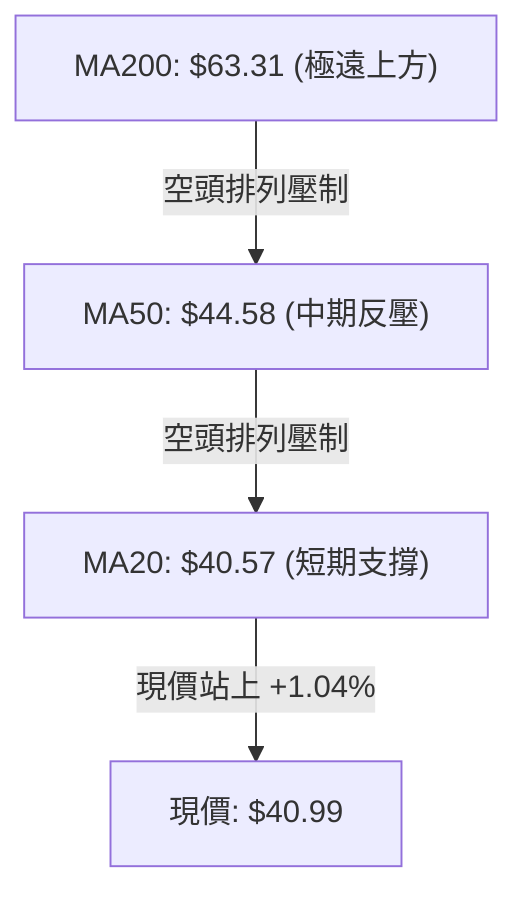
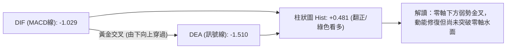
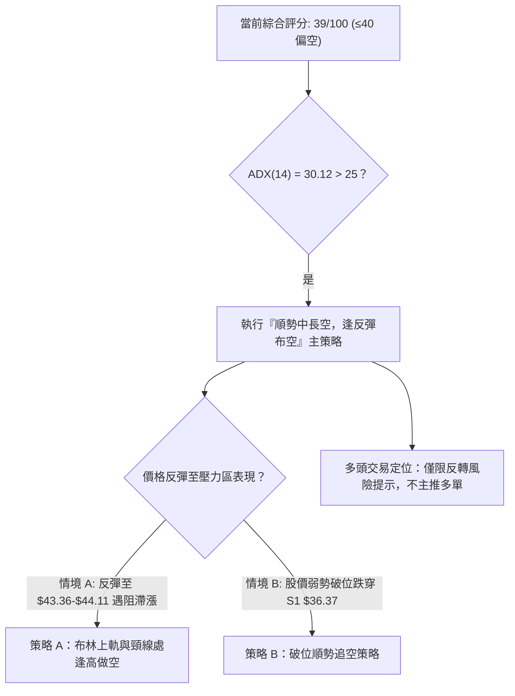
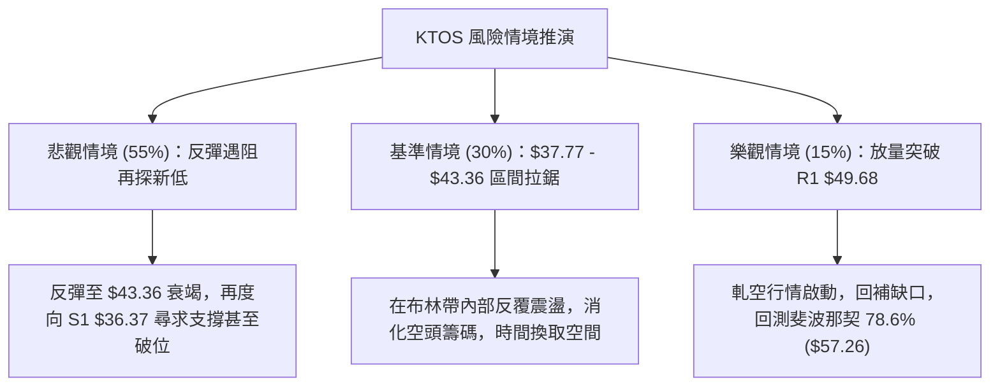

# KTOS 技術分析報告

> **報告日期**：2026-11-04 ｜ **語言**：繁體中文 ｜ **數據來源**：Yahoo Finance ｜ **當前價格**：$40.99

---

## 目錄

| 章節 | 內容 |
|------|------|
| [1. 技術面概覽](#1-技術面概覽) | 訊號儀表板、核心指標、評分卡 |
| [2. 趨勢分析](#2-趨勢分析) | 多時框趨勢、長中短期走勢 |
| [3. 圖表形態分析](#3-圖表形態分析) | 形態識別、K線組合、目標價 |
| [4. 支撐與阻力](#4-支撐與阻力) | 關鍵價位、斐波那契回調 |
| [5. 技術指標深度解讀](#5-技術指標深度解讀) | MA/RSI/MACD/布林/成交量 |
| [6. 動能與波動率](#6-動能與波動率) | 動能評估、ATR、Beta |
| [7. 多時框架總結](#7-多時框架總結) | 時框架評分矩陣 |
| [8. 交易策略建議](#8-交易策略建議) | 多空策略、風險報酬比 |
| [9. 風險提示與監控](#9-風險提示與監控) | 監控指標、風險場景 |
| [📋 報告總結](#-報告總結) | 綜合結論與最優策略 |

---

## 1. 技術面概覽

### 🎯 技術訊號儀表板



### 📊 核心指標速覽表

| 指標類別 | 指標名稱 | 當前數值 | 訊號 | 解讀 |
|----------|----------|----------|------|------|
| **價格** | 當前價格 | $40.99 | 🔴 | 位於 52 週低檔區（分位 4.7%），長期下行主導 |
| **均線** | MA20 | $40.57 | 🟢 | 價格收在 MA20 上方（+1.04%），短線具超跌反彈動能 |
| **均線** | MA50 | $44.58 | 🔴 | 價格在 MA50 下方（-8.05%），中期下降波段反壓沉重 |
| **均線** | MA200 | $63.31 | 🔴 | 價格遠在 MA200 下方（-35.26%），長期熊市結構確立 |
| **動能** | RSI(14) | 46.18 | 🟡 | 位於中性區，伴隨日線近 20 根 K 棒底背離警訊 |
| **動能** | MACD(12,26,9) | -1.029 (柱 +0.481) | 🟢 | 零軸下方黃金交叉，Hist 持續翻正，短線反彈修正中 |
| **趨勢強度**| ADX(14) / ±DI | 30.12 (-DI: 22.32) | 🔴 | ADX > 25 且 -DI 壓制 +DI，空頭強趨勢尚未逆轉 |
| **通道指標**| 布林通道 (%B) | 0.58 (軌寬 37.77-43.36) | 🟡 | 價格位於中軌 ($40.57) 上方，朝上軌 ($43.36) 測試 |
| **量能指標**| 成交量 / OBV | 3,235,100 (0.76x) | 🔴 | 成交量不及 20 日均量，OBV < MA，反彈無實質增量 |
| **波動** | ATR(14) | $2.13 (5.20%) | 🟡 | 日內波動幅度達 5.20%，交易時需設置寬幅保護性止損 |

### 🏆 技術評分卡

```
╔══════════════════════════════════════════════════════════════╗
║              技術評分卡 — KTOS (2026-11-04)                 ║
╠══════════════════════════════════════════════════════════════╣
║ 趨勢強度 (空頭主導)  ███████░░░░░░░░░░░░░  35/100  🔴 偏空  ║
║ 動能指標 (短線背離)  █████████░░░░░░░░░░░  48/100  🟡 中性  ║
║ 支撐穩定度 (S1測試)  ██████████░░░░░░░░░░  52/100  🟡 中性  ║
║ 成交量配合 (量能疲弱)██████░░░░░░░░░░░░░░  32/100  🔴 疲弱  ║
║ 形態完整度 (雙底雛形)████████░░░░░░░░░░░░  42/100  🟡 醞釀  ║
║ 均線排列 (空頭排列)  █████░░░░░░░░░░░░░░░  25/100  🔴 極弱  ║
╠══════════════════════════════════════════════════════════════╣
║ 綜合評分 (六項均值)  ███████░░░░░░░░░░░░░  39/100  🔴 偏空  ║
╚══════════════════════════════════════════════════════════════╝
```

*註：綜合評分 = (35 + 48 + 52 + 32 + 42 + 25) ÷ 6 = 39.0，四捨五入至整數為 39/100，落於偏空弱勢區間（≤40）。*

---

## 2. 趨勢分析

### 🌐 多時框趨勢分析



### 📈 長期趨勢 — 12個月走勢圖（Unicode）

KTOS 在過去 12 個月經歷了極其劇烈的盛衰循環。2025 年末至 2026 年初在國防與無人機題材激勵下，月線一度飆漲至 $103.01（歷史區間高點 $134.00），隨後因獲利了結與基本面估值過高，股價自高點雪崩式回落超過 60%。

```
KTOS 月線走勢圖（過去12個月：2025-11 至 2026-11）
價格 ($)
$105 ┤                 ● (2026-01: $103.01 波段峰值)
 $95 ┤
 $85 ┤                      ● (2026-02: $86.18)
 $75 ┤● (11: 76.10) ● (12: 75.91)
 $65 ┤                           ● (03: 70.51) ● (05: 64.13)
 $55 ┤                                ● (04: 63.05)   ● (08: 50.98)
 $45 ┤                                     ● (06: 49.86) ● (07: 46.60)
 $35 ┤                                                ● (09: 42.69) ● (10: 41.09) ● (現價 $40.99)
     └────────────────────────────────────────────────────────────►
      11   12   01   02   03   04   05   06   07   08   09   10   11 (月份)
      2025                             2026
```

#### 走勢特徵分析表格

| 階段區間 | 起始價 → 結束價 | 漲跌幅 | 趨勢性質 | 成交結構與特徵 |
|----------|-----------------|--------|----------|----------------|
| **2025-11 ~ 2026-01** | $76.10 → $103.01 | +35.36% | 主升爆發浪 | 創出波段收盤歷史高位，動能極度發散 |
| **2026-01 ~ 2026-04** | $103.01 → $63.05 | -38.79% | 頂部瓦解下殺 | 連續破位長黑，多頭停損賣壓湧現 |
| **2026-04 ~ 2026-08** | $63.05 → $50.98 | -19.14% | 中繼震盪下跌 | 5月反彈無力（$64.13），隨後續破前低 |
| **2026-08 ~ 2026-11** | $50.98 → $40.99 | -19.59% | 弱勢尋底階段 | 觸及 52 週低點 $36.37 後嘗試築底 |

### 📊 中期趨勢（週線分析）

中期走勢受制於下降通道上軌。近 20 週收盤走勢清晰顯示，股價自 2026 年 8 月高點 $64.58 連續 10 週下行，最低跌至 2026-10-23 當週的低點 $36.37。目前週線雖然在 2026-10-30 出現帶量反彈至 $41.09，但近 8 週最高點僅達 $49.68（2026-09-25），整體結構仍處於「一峰低於一峰」的典型下降空頭走勢。

```
週線支撐與阻力階梯示意：
$55.00 ┤------------------------------------
$50.00 ┤           [R1: $49.68 強阻力區]  ▼ 逢高反壓
$45.00 ┤      ▲ 反彈壓力區 ($44.11 - $44.58)
$40.99 ┼───────● 目前週線收盤價 ($40.99) ────────
$36.37 ┴───────[S1: $36.37 52W波段低點支撐] ───
```

### ⚡ 趨勢強度評估（ADX 解讀）



#### ADX 強度對照與解讀

| 指標名稱 | 當前數值 | 狀態評定 | 交易意義 |
|----------|----------|----------|----------|
| **ADX (14)** | 30.12 | 🟢 強趨勢 (>25) | 行情具備單邊持續性，震盪指標易鈍化，順勢指標更可靠 |
| **+DI (14)** | 18.33 | 🔴 買盤動能弱 | 多頭買盤力道偏低，無法主導趨勢 |
| **-DI (14)** | 22.32 | 🟢 空方優勢 | 賣盤控制中長線節奏，空頭趨勢延續中 |
| **綜合研判** | 空頭強趨勢 | 🔴 偏空定向 | 根據規則 14，ADX>25 必須以週線/MA50/MA200 方向為主導 |

---

## 3. 圖表形態分析

### 🔍 形態識別系統



#### 形態識別與信心度評估表

| 形態名稱 | 信心度 | 判斷依據（引用數據） | 完成度 | 目標價（附精確計算式） |
|----------|--------|----------------------|--------|------------------------|
| **短線潛在雙底 (Double Bottom)** | 55% | 第一次低點 2026-10-23 低點 $36.37，第二次低點 2026-10-26 低點 $38.43 未再破底；頸線為 2026-10-29 高點 $44.11 | 45% (未突破頸線) | 若突破頸線 $44.11，由形態高度推算：$44.11 + ($44.11 − $36.37) = **$51.85**（接近阻力位 R2 $51.49） |
| **中期下降通道 (Down Channel)** | 75% | 週線高點壓制聚類於 R1 $49.68 與 $44.11，波段低點於 S1 $36.37 形成下斜軌道 | 85% (進行中) | 跌破 S1 $36.37，通道等幅下測目標：$36.37 − ($44.11 − $36.37) = **$28.63**（通道延伸測幅） |

*註：由於股價尚未突破 $44.11 頸線，雙底信心度僅 55%，若無法放量衝破，該結構易演化為熊市旗形中繼。*

### 🕯️ 重要 K 線形態分析

依據規則 19，以下嚴格採用提供的**近 10 根日 K** 與**近 8 根週 K** 實際開高低收進行形態判讀：

#### 近 10 根日 K 形態解讀

| 日期 (日K) | 開 | 高 | 低 | 收 | K線形態 | 解讀 | 訊號 |
|------------|----|----|----|----|---------|------|------|
| **2026-10-21** | 39.57 | 39.99 | 38.41 | 38.74 | 實體黑K棒 | 延續破位跌勢，賣方主導壓低收盤 | 🔴 空頭 |
| **2026-10-22** | 38.27 | 39.96 | 37.40 | 38.27 | 紡錘十字線 | 低點見 $37.40，多空於低檔激烈換手 | 🟡 中性 |
| **2026-10-23** | 37.64 | 39.08 | 36.37 | 38.68 | 長下影錘頭線 | 探 52 週新低 $36.37 後強勁抽腳拉回，形成支撐 | 🟢 看多 |
| **2026-10-26** | 38.68 | 40.57 | 38.43 | 40.43 | 實體紅K吞噬 | 吞噬前日高點，確認低檔支撐買盤進場 | 🟢 看多 |
| **2026-10-27** | 40.73 | 42.12 | 40.06 | 41.32 | 續揚紅K棒 | 突破 $41.00 關卡，多頭推升測試上方阻力 | 🟢 看多 |
| **2026-10-28** | 41.38 | 41.56 | 40.40 | 41.17 | 縮量小黑十字 | 成交量急縮至 280 萬股，高檔動能猶豫 | 🟡 中性 |
| **2026-10-29** | 41.28 | 44.11 | 41.20 | 43.59 | 爆量長陽線 | 巨量（625萬股）衝擊高點 $44.11，形成短線頸線 | 🟢 看多 |
| **2026-10-30** | 42.67 | 43.21 | 40.28 | 41.09 | 長黑回吐流星 | 衝高回落吞沒前日漲幅一半，受制於布林上軌 | 🔴 空頭 |
| **2026-11-02** | 41.29 | 41.61 | 39.68 | 40.23 | 下挫中黑K | 跌破 $40.50，回踩 MA20 支撐，多頭後繼乏力 | 🔴 空頭 |
| **2026-11-03** | 40.41 | 41.72 | 40.10 | 40.99 | 弱陽下影線 | 守住 MA20 ($40.57)，在 $40-$41 間進入整固 | 🟡 中性 |

#### 近 8 根週 K 形態解讀

| 日期 (週末) | 開 | 高 | 低 | 收 | 週K形態 | 解讀 | 訊號 |
|-------------|----|----|----|----|---------|------|------|
| **2026-09-18** | 45.76 | 49.46 | 45.72 | 47.46 | 上影紅K | 反彈受阻於 $49.46，上檔拋壓沉重 | 🟡 中性 |
| **2026-09-25** | 48.22 | 49.68 | 44.81 | 45.62 | 長黑吞噬 | 創 R1 高點 $49.68 後長陰反噬，空頭啟動波段殺跌 | 🔴 空頭 |
| **2026-10-02** | 44.97 | 45.22 | 41.83 | 43.07 | 實體大黑K | 破位加速下行，均線呈現全面向下發散 | 🔴 空頭 |
| **2026-10-09** | 43.80 | 44.14 | 40.93 | 42.36 | 連續黑K棒 | 連續性賣盤湧出，週線成交量維持 2660 萬高檔 | 🔴 空頭 |
| **2026-10-16** | 42.48 | 43.07 | 37.84 | 40.42 | 帶下影黑K | 貫穿 $40 心理關卡，觸及 $37.84 | 🔴 空頭 |
| **2026-10-23** | 40.40 | 40.50 | 36.37 | 38.68 | 週線長下影線 | 見全年度最低點 $36.37 後收腳，空方力道衰竭 | 🟢 反彈 |
| **2026-10-30** | 38.68 | 44.11 | 38.43 | 41.09 | 週線長上影陽K | 週漲幅明顯，但高點 $44.11 遇阻回落，留長上影 | 🟡 震盪 |
| **2026-11-03** | 41.29 | 41.72 | 39.68 | 40.99 | 週初縮量十字 | 兩日交易窄幅拉鋸，等待進一步方向指引 | 🟡 中性 |

### 📉 ASCII 走勢形態示意圖

```
日線級別短線形態示意圖（2026-10-21 至 2026-11-03）
價格 ($)
$44.11 ┤                      ┌─ 頸線 / 高點阻力 ($44.11, 10-29)
$43.00 ┤                     ▲│▲
$42.00 ┤              ▲     ▲ │ │
$41.00 ┤             ▲ █   ▲  │ █  ▲ (現價 $40.99)
$40.00 ┤        ▲   ▲   ▲ ▲   │    █
$39.00 ┤   ▲   ▲ █ ▲          │
$38.00 ┤  ▲ █ ▲               │
$37.00 ┤ ▲                    │
$36.37 ┴─┴────────────────────┴────────────────────────
        底 1 (10-23)        底 2 雛形 (10-26: $38.43)
        [S1 支撐: $36.37]
```

### 🎯 形態目標價計算

1. **若潛在雙底突破成立**：
   - 頸線位：$44.11（2026-10-29 高點）
   - 形態底部：$36.37（2026-10-23 低點）
   - 形態垂直高度：$44.11 − $36.37 = $7.74
   - 理論向上測幅目標價 = 頸線 $44.11 + 形態高度 $7.74 = **$51.85**（高度吻合波段阻力 R2: $51.49）
2. **若反彈衰竭下破成立**：
   - 若股價再次跌破 S1 $36.37，將宣告築底失敗，向下延續等幅下跌。
   - 理論向下測幅目標價 = 支撐 $36.37 − 形態高度 $7.74 = **$28.63**。

---

## 4. 支撐與阻力

### 🗺️ 關鍵價位分布圖（Unicode）

```
KTOS 價位結構分布圖
════════════════════════════════════════════════════════════════
$54.22 ║██████████████████████████████████████║ 強阻力 R3 (+32.28%)
$51.49 ║██████████████████████████████        ║ 阻力 R2 (+25.62%)
$49.68 ║██████████████████████████████████████║ 關鍵阻力 R1 (+21.20%)
$44.11 ║▓▓▓▓▓▓▓▓▓▓▓▓▓▓▓▓▓▓                    ║ 近期波段頸線反壓
$43.36 ║▒▒▒▒▒▒▒▒▒▒▒▒▒▒▒▒                      ║ 布林通道上軌
$40.99 ╠══════════════════════════════════════╣ ◄ 現價 ($40.99)
$40.57 ║░░░░░░░░░░░░░░░░                      ║ 布林中軌 / MA20 短線支撐
$37.77 ║▒▒▒▒▒▒▒▒▒▒▒▒▒▒▒▒                      ║ 布林通道下軌
$36.37 ║██████████████████████████████████████║ 52W 低點強支撐 S1 (-11.27%)
════════════════════════════════════════════════════════════════
```

### 🚧 阻力位分析表

*嚴格引用數據中「關鍵價位（由 OHLCV 計算）」區塊數值：*

| 阻力級別 | 價位 | 形成原因 | 突破難度 | 重要性 |
|----------|------|----------|----------|--------|
| **R1** | **$49.68** | 近一年波段高點聚類位，2026-09-25 週線最高點 ($49.68) 與大量套牢密集區 | 🔴 極高 | 關鍵趨勢反轉分水嶺；未突破前中長線均為空方主控 |
| **R2** | **$51.49** | 近一年波段高點聚類第二層，接近 MA120 ($50.23) 與 2026 年 8 月底跌破之平台 | 🔴 高 | 中期重要阻力，反彈強勁時的極限停利點 |
| **R3** | **$54.22** | 近一年波段高點聚類第三層，2026 年 7 月初跳空反彈破位點 ($55.35 附近) | 🔴 極高 | 長期空頭防線，此價位之下維持空頭架構 |

### 🛡️ 支撐位分析表

*嚴格引用數據中「關鍵價位（由 OHLCV 計算）」區塊數值：*

| 支撐級別 | 價位 | 形成原因 | 守住機率 | 重要性 |
|----------|------|----------|----------|--------|
| **S1** | **$36.37** | 近一年波段低點聚類，52 週歷史最低價（2026-10-23 創出），長下影防線 | 🟡 60% | 多頭唯一具實質意義的最後堡壘，跌破將引發踩踏 |
| **S2 / S3**| N/A | *數據中未偵測到近一年波段低點聚類數值（數據未提供）* | N/A | 依規則 13，不憑空捏造不存在之 S2/S3 數據 |

### 📐 斐波那契回調位分析

*嚴格引用 52 週區間 $36.37（低點）→ $134.00（高點）計算之標準回調位：*

```
斐波那契回調層級（$36.37 → $134.00）
0.0%  (52W High) ────────────────────── $134.00
23.6%            ────────────────────── $110.96
38.2%            ────────────────────── $ 96.71
50.0%            ────────────────────── $ 85.18
61.8%            ────────────────────── $ 73.66
78.6%            ────────────────────── $ 57.26
[現價落點區間]    ◄── $40.99 位於 78.6% 至 100.0% 之間
100.0%(52W Low)  ────────────────────── $ 36.37
```

#### 斐波那契回調深度解讀

1. **極度弱勢區間**：現價 $40.99 深度跌破斐波那契黃金分割位 61.8% ($73.66) 與最後防守位 78.6% ($57.26)。在技術分析理論中，跌破 78.6% 代表原本的多頭上升浪已徹底瓦解，當前行情為完整的深度回撤或全新熊市週期。
2. **位置評估**：現價距離 100.0% 低點 ($36.37) 僅有 +12.70%（距現價 -11.27%），目前正處於測試 52 週最低點支撐的築底拉鋸區。若能有效守穩 $36.37，反彈的第一個理論強回調位為 78.6% ($57.26)，但中途將遭遇 R1 ($49.68) 與 R2 ($51.49) 的強大壓制。

---

## 5. 技術指標深度解讀

### 🎛️ 指標訊號總覽



### 📈 移動平均線排列分析



#### 均線系統深度解析

- **長短期均線數據一覽**：
  - MA 5: $41.41（▼ -1.02%）
  - MA 10: $40.45（▲ +1.33%）
  - MA 20: $40.57（▲ +1.04%）
  - MA 60: $47.27（▼ -13.28%）
  - MA120: $50.23（▼ -18.39%）
  - MA240: $66.77（▼ -38.61%）
- **均線排列狀態**：標準空頭排列（MA20 < MA50 < MA200，且 MA60、MA120、MA240 均呈現無懸念的向下傾斜）。
- **解讀**：現價 $40.99 雖然微幅站上 MA20 ($40.57)，但 MA5 ($41.41) 已在上方拐頭下彎，形成即時短壓。中期 MA50 ($44.58) 與 MA60 ($47.27) 形成兩道堅實天花板，在均線重重壓制下，此處的反彈空間極其受限。

### 📉 RSI(14) 分析

#### RSI 數值進度條
```
RSI(14): 46.18
[███████████████████████░░░░░░░░░░░░░░░] 46.18% (中性區間 30-70)
```

- **數值解讀**：RSI(14) 目前為 46.18，脫離了 10 月中旬的 30 附近超賣區，進入多空平衡的中性區。
- **背離判斷**：⚠️ **確立底背離 (Bullish Divergence)**。
  - **數據比對**：比較近 20 根 K 棒首尾，價格在 2026-10-23 創出波段新低 $36.37，但該日的 RSI 數值明顯高於 10 月初的水位，形成「價格創波段新低，RSI 未創新低」的底背離現象。
  - **結論**：底背離提示空頭殺跌動能暫時衰竭，容易引發技術性反抽，但由於缺乏大級別趨勢的配合，背離僅能視為超跌反彈訊號，並非牛市反轉信號。

### 📊 MACD(12,26,9) 訊號解讀



- **MACD 線**：-1.029
- **MACD Signal 線**：-1.510
- **MACD Histogram**：+0.481（🟢 看多）
- **背離與趨勢分析**：MACD 在零軸深處發生金叉，柱狀圖連續數日呈現正向放大（由近 20 週數據可見，10-23 當週 -0.002 收斂至 10-30 當週 +0.602）。這屬於典型的「超賣修復金叉」，然而兩條均線仍深陷在零軸負值區（-1.0 以下），說明市場大環境仍由空方定義，零軸附近將遭遇極大拋壓。

### 📦 布林通道分析

```
布林通道結構示意圖 (BB 20, 2)
$45.00 ┤
$43.36 ┼────────────────────────────── BB 上軌 ($43.36)
$42.00 ┤                     ▲ (10-29 衝高 $44.11 觸軌回落)
$40.99 ┼─────────────────────●── 現價 ($40.99)
$40.57 ┼────────────────────────────── BB 中軌 / MA20 ($40.57)
$39.00 ┤
$37.77 ┼────────────────────────────── BB 下軌 ($37.77)
$36.00 ┤         ▼ (10-23 破下軌見 $36.37 抽腳)
```

- **BB %B 指標**：0.58（處於中軌上方，朝向通道上半部運動）。
- **軌道狀態**：布林通道上下軌寬度為 $43.36 − $37.77 = $5.59。股價在 10-29 衝擊 $44.11 刺穿上軌後，次日立即收長黑流星線拉回通道內，顯示布林通道呈現橫向收斂走勢，股價短線將在 $37.77 至 $43.36 之間進行區間振盪。

### 💹 成交量分析（量價配合度）

- **最新成交量**：3,235,100
- **20日均量**：4,275,495（量比：**0.76x**）
- **50日均量**：4,030,790
- **OBV 趨勢**：**OBV < MA → 量能疲弱**。
- **量價背離診斷**：
  1. 股價自 $36.37 反彈至 $40.99 期間，除 10-29 當日因衝擊 $44.11 出現 625 萬股放量外，其餘交易日（如 10-28 僅 280 萬、11-03 僅 323 萬）均遠低於 20 日均量。
  2. OBV 持續低於其移動平均線，反映主力資金並未在大跌後大幅進場掃貨，反彈屬於「空頭回補與無量虛彈」，量價配合呈現**量價背離**（價漲量縮），隨時有再度回測低點的風險。

---

## 6. 動能與波動率

### ⚡ 動能評估四象限

```
動能與波動率象限分析表
┌─────────────────────────────────┬─────────────────────────────────┐
│ Q2: 弱動能 / 低波動             │ Q1: 強動能 / 低波動             │
│ (謹慎觀望，盤整醞釀)            │ (多頭最佳進場機會)              │
│                                 │                                 │
├─────────────────────────────────┼─────────────────────────────────┤
│ Q4: 弱動能 / 高波動             │ Q3: 強動能 / 高波動             │
│ [★ 當前 KTOS 定位點]           │ (高風險高收益波段)              │
│ • ATR% = 5.20% (高波動)         │                                 │
│ • ADX 空方主導，OBV疲弱 (弱動能)│                                 │
└─────────────────────────────────┴─────────────────────────────────┘
```

#### 動能評估說明

KTOS 目前明確落入 **第 Q4 象限（弱多頭動能 / 高波動率）**。
- **波動特徵**：股價單日振幅較大（ATR 達 $2.13），但缺乏向上的主動進攻量能。
- **操作啟示**：處於 Q4 象限的標的極度容易出現「假突破、真被套」的洗盤走勢，追高風險極大，應避免以追突破方式做多，策略上應以逢高布空或嚴設止損的區間交易為主。

### 📊 ATR 波動率分析

- **ATR(14)**：$2.13（佔當前股價比例為 **5.20%**，採 Wilder 演算法計算）。
- **波動度評級**：高波動股票。
- **止損與部位建議**：
  - 由於 1 倍 ATR 達 $2.13，日內雜訊波動極易掃掉過窄的止損。
  - 短線波段策略的保護性止損建議設定在 **1.5 至 2.0 倍 ATR**，即 $3.20 至 $4.26 左右的距離，避免在正常振盪中被洗出場。
  - 資金管理上，因單日波動超過 5%，單筆交易虧損風控建議控制在總資金的 1%~2% 以內，倉位不宜超過 20%。

### 📐 Beta 與市場相關性

- **Beta 係數**：**1.165**。
- **解讀**：KTOS 的波動性高於標普 500 大盤約 16.5%。作為國防與無人機概念股，其在市場下行或避險情緒升溫時常受到國防預算預期擾動，但較高的 Beta 值意味著一旦大盤出現回調，KTOS 往往會出現放大級別的下跌。

---

## 7. 多時框架總結

### 📋 時框架評分表

| 時框架 | 趨勢方向 | 動能狀態 | 均線排列 | 形態結構 | 綜合評分 | 操作建議 |
|--------|----------|----------|----------|----------|----------|----------|
| **月線 (長期)** | 🔴 強烈空頭 | 疲弱下行 | 空頭排列 (破 MA200) | 頂部瓦解尋底 | 20/100 | 長期遠離，禁止左側抄底 |
| **週線 (中期)** | 🔴 下行通道 | 超賣後弱反彈 | 空頭排列 (受制 MA50) | 下降通道壓制 | 35/100 | 反彈遇阻力逢高布空 |
| **日線 (短期)** | 🟡 弱勢反彈 | RSI底背離/MACD紅柱 | 站上 MA20 / MA5下彎 | 測試 S1 築雙底中 | 50/100 | 超跌反彈，嚴格區間操作 |

### 🔲 綜合訊號矩陣

```
綜合訊號一致性分析矩陣
┌──────────────┬──────────────┬──────────────┬──────────────┐
│ 分析維度     │ 短期 (日線)  │ 中期 (週線)  │ 長期 (月線)  │
├──────────────┼──────────────┼──────────────┼──────────────┤
│ 趨勢方向     │ 🟡 區間震盪  │ 🔴 單邊下行  │ 🔴 熊市結構  │
│ 動能 (MACD)  │ 🟢 柱狀收斂  │ 🔴 零下負值  │ 🔴 柱狀擴大  │
│ 均線架構     │ 🟢 站上 MA20 │ 🔴 低於 MA50 │ 🔴 低於 MA200│
│ 量能狀態     │ 🔴 量縮 0.76x│ 🔴 放量下跌  │ 🔴 籌碼流出  │
│ 形態判斷     │ 🟡 雙底雛形  │ 🔴 下降旗形  │ 🔴 大雙頂破位│
└──────────────┴──────────────┴──────────────┴──────────────┘
訊號矛盾度：高（短期反彈訊號與中長期空頭訊號衝突）
```

### ⚖️ 多時框收斂結論

依據本報告**嚴格要求 14（多時框收斂規則）**進行最終裁決：
1. **行情性質判定**：當前日線 ADX(14) 數值為 **30.12**，明確大於 25 臨界值，定義為**「強趨勢行情」**而非無方向盤整。
2. **主導優先級收斂**：在 ADX > 25 的趨勢行情中，必須以中長期（週線、MA50 $44.58、MA200 $63.31）方向為絕對主導，日線僅能作為尋找精確進場時機的工具，絕對不可將日線的短線超跌反彈誤判為中長期反轉。
3. **方向性結論**：**偏空（逢反彈高空為主要方向）**。第 1 章技術評分卡總分為 **39/100**（≤40 偏空區間），日線的 RSI 底背離與 MACD 翻紅僅構成中長線空頭框架下的「次級折返走勢（Counter-trend Rally）」，上檔受制於布林上軌 $43.36 與頸線 $44.11，整體交易主軸確立為**逢反彈測試壓力不過時建立空單**。

---

## 8. 交易策略建議

### 🗺️ 策略決策流程圖



### 🧭 策略路由（依評分卡分流）

> **當前主策略方向 = 主推空頭策略（依第 1 章技術評分卡綜合評分 39/100，落於 ≤40 偏空區間）**

依據規則，由於綜合評分低於 40 分，報告全面禁止主推大規模做多策略，策略核心為利用短線底背離引發的向上反彈，在阻力區逢高布局空單；多頭僅作為風控防禦與反轉風險對沖提示。

### 🎯 價格情境階梯（Price Scenarios）

*所有價位嚴格引用第 4 章及數據區塊數值：*

| 觸發條件 | 下一目標 | 後續延伸 | 情境含義 |
|----------|----------|----------|----------|
| **向上反彈受阻 $43.36 - $44.11** | 回測 MA20 $40.57 | 下探 S1 $36.37 | 短線反彈動能衰竭，重回空頭主跌波 |
| **強勢突破 R1 $49.68** | 測試 R2 $51.49 | 挑戰 R3 $54.22 | 空頭走勢遭破壞，趨勢轉強（觸發止損） |
| **向下有效跌破 S1 $36.37** | 延伸測幅 $28.63 | 尋找更低支撐 | 宣告 52 週低點失守，開啟新一輪恐慌破位 |

### 📊 情境機率分佈

| 情境 | 機率 | 主要依據 |
|------|------|----------|
| **反彈受阻回落 (空頭延續)** | **55%** | ADX=30.12 空頭主導，均線完整空頭排列，量比 0.76x 價量背離，OBV 疲弱 |
| **區間震盪整理 ($37.77 - $43.36)** | **30%** | 布林通道開口收斂，RSI 位於 46.18 中性區，MACD 翻紅支撐短線波動 |
| **強力反轉向上 (突破 R1 $49.68)** | **15%** | 缺乏大額買盤成交量支撐，MA50 ($44.58) 與 MA200 ($63.31) 雙重重壓 |

### 🟢 主策略詳情（主推空頭策略）

*嚴格遵循規則 17 規範之風險報酬比計算公式：做空時風險報酬比 = (進場價 − 目標價 T1) ÷ (止損價 − 進場價)*

| 策略要素 | 策略 A（逢反彈高空 — 首選） | 策略 B（跌破 S1 順勢追空） |
|----------|-----------------------------|----------------------------|
| **策略名稱** | 阻力位反彈遇阻做空 | 關鍵支撐破位順勢放空 |
| **進場條件** | 股價反彈至布林上軌與頸線區間滯漲，出現長上影線或黑K確認 | 股價實體跌破 52 週低點 S1 $36.37 且成交量放大 |
| **進場價格** | **$43.50**（區間 $43.00 - $44.00 之居中偏高位） | **$36.00**（確認破位 S1 $36.37 後追進） |
| **目標價 T1** | **$36.37**（S1 支撐位） | **$28.63**（形態等幅向下測幅目標） |
| **目標價 T2** | **$28.63**（跌破 S1 後的測幅目標） | N/A（數據未提供更低支撐，以移動停利追蹤） |
| **止損價格** | **$45.50**（突破 MA50 $44.58 及頸線 $44.11 之上方） | **$38.50**（假跌破回抽，站回 10-23 收盤價 $38.68 附近） |
| **風險報酬比** | **1 : 3.57（以 T1 計）**<br>*計算：(43.50 − 36.37) ÷ (45.50 − 43.50) = 7.13 ÷ 2.00 = 3.565*<br>另：1 : 7.44（以 T2 計） | **1 : 2.95（以 T1 計）**<br>*計算：(36.00 − 28.63) ÷ (38.50 − 36.00) = 7.37 ÷ 2.50 = 2.948* |
| **成功機率** | **65%** | **55%** |
| **建議倉位** | **15%** | **10%** |

### 🔴 反向風險觸發點（對沖提示）

若出現以下訊號，主推之空頭策略將被推翻，空單必須無條件止損離場，甚至反手對沖：
1. **價位警訊**：日線收盤價強勢突破 **$44.58（MA50）** 且伴隨單日成交量大於 600 萬股，代表短線 W 底突破成型。
2. **終極警訊**：週線級別有效站上 **R1 $49.68**，宣告中期下降通道徹底被多頭逆轉，空方必須全數撤退。

### ⭐ 整體訊號強度評星

```
╔══════════════════════════════════════════════╗
║  做多訊號強度：★★☆☆☆  (2/5星 - 僅屬超跌反彈)  ║
║  做空訊號強度：★★★★☆  (4/5星 - 順應中長大勢)  ║
║  整體可信度：  ★★★★☆  (4/5星 - 指標收斂明確)  ║
╚══════════════════════════════════════════════╝
```

---

## 9. 風險提示與監控

### ✅ 關鍵監控指標 Checklist

```
╔══════════════════════════════════════════════════════════════╗
║              交易風控關鍵監控清單 (Checklist)               ║
╠══════════════════════════════════════════════════════════════╣
║ [ ] 每日收盤是否跌破 MA20 ($40.57)？                         ║
║     → 若失守，確認短線反彈終結，提早向 S1 ($36.37) 尋底。    ║
║ [ ] 日成交量是否持續低於 400 萬股 (量縮)？                   ║
║     → 若持續量縮，確認反彈為無量誘多。                       ║
║ [ ] MACD Histogram 是否由正轉負 (紅柱縮短)？                ║
║     → 當日線柱狀圖再度下穿 0 軸，為波段空單加碼點。         ║
║ [ ] 價格觸及 S1 ($36.37) 時是否放量擊穿？                    ║
║     → 破位即啟動策略 B 追空，未破則空單止盈。               ║
║ [ ] 分析師評級與財報消息突發干擾                             ║
║     → 當前機構目標均價達 $89.76，留意財報發布帶來的跳空風險。║
╚══════════════════════════════════════════════════════════════╝
```

### ⚠️ 風險場景分析



### 🛡️ 風險管理重要提醒

1. **基本面估值背離風險**：KTOS 當前滾動市盈率（P/E TTM）高達 **241.12**，自由現金流為負（$-128.90M），營運利潤率極微薄（1.5%）。雖然分析師共識給予 Strong Buy 及高目標價（均價 $89.76），但極高的估值與疲弱的現金流是引發 2026 年股價大跌 60% 的核心因素。技術面切忌因「分析師目標價高」而盲目重倉長線死守。
2. **波動率控制**：單日 ATR 佔股價比重高達 5.20%，任何方向的交易若止損設定小於 $2.00 均容易遭遇假突破洗盤。建議嚴格執行「小倉位、大止損距離」的風控紀律。
3. **空頭對沖建議**：若持有底倉多頭現貨者，強烈建議在反彈至 $43.50 附近時，利用空頭策略 A 進行保護性對沖，防止股價二次探底跌破 $36.37 造成資本嚴重侵蝕。

---

## 📋 報告總結

```
KTOS 技術分析報告總結
════════════════════════════════════════════════════════
報告日期：2026-11-04
當前價格：$40.99
分析評級：🔴 偏空弱勢（綜合評分：39/100）

關鍵結論：
├─ 長期趨勢：🔴 熊市格局，價格深陷 MA200 ($63.31) 之下 -35.26%
├─ 中期趨勢：🔴 下降通道壓制，受制於 MA50 ($44.58) 與 R1 ($49.68)
├─ 短期趨勢：🟡 超跌反彈，RSI 底背離與 MACD 翻紅促成向 MA20 修正
├─ 關鍵支撐：S1: $36.37 (52週歷史新低)
├─ 關鍵阻力：R1: $49.68、R2: $51.49、短壓: $43.36-$44.11
└─ 分析師目標：均價 $89.76（與當前技術弱勢嚴重脫節，僅供參考）

最優策略組合：
1. 🥇 最佳機會：策略 A（逢反彈高空）— 於 $43.50 附近布空，
               止損設 $45.50，目標 T1 $36.37，風報比 1 : 3.57。
2. 🥈 次選機會：策略 B（破位追空）— 實體跌破 $36.37 追空，
               目標 T1 $28.63，風報比 1 : 2.95。
3. 🥉 保守選擇：空手觀望，靜待股價在 S1 ($36.37) 形成明確放量
               二次築底結構或突破 MA50 後再行介入。
════════════════════════════════════════════════════════
```

---

> ⚠️ **免責聲明**：本報告為 AI 自動生成之技術分析，所有數據及估算均基於提供的歷史價格資訊。本報告**僅供研究與學術參考**，**不構成任何投資建議**。投資有風險，入市需謹慎。

---

*報告生成時間：2026-11-04 ｜ 數據來源：Yahoo Finance ｜ 分析框架：多時框技術分析*