# KTOS 技術分析報告

> **報告日期**：2026-11-05 ｜ **語言**：繁體中文 ｜ **數據來源**：Yahoo Finance ｜ **當前價格**：$35.96

---

## 目錄

| 章節 | 內容 |
|------|------|
| [1. 技術面概覽](#1-技術面概覽) | 訊號儀表板、核心指標、評分卡 |
| [2. 趨勢分析](#2-趨勢分析) | 多時框趨勢、長中短期走勢 |
| [3. 圖表形態分析](#3-圖表形態分析) | 形態識別、K線組合、目標價 |
| [4. 支撐與阻力](#4-支撐與阻力) | 關鍵價位、斐波那契回調 |
| [5. 技術指標深度解讀](#5-技術指標深度解讀) | MA/RSI/MACD/布林/成交量 |
| [6. 動能與波動率](#6-動能與波動率) | 動能評估、ATR、Beta |
| [7. 多時框架總結](#7-多時框架總結) | 時框架評分矩陣 |
| [8. 交易策略建議](#8-交易策略建議) | 多空策略、風險報酬比 |
| [9. 風險提示與監控](#9-風險提示與監控) | 監控指標、風險場景 |

---

## 1. 技術面概覽

### 🎯 技術訊號儀表板

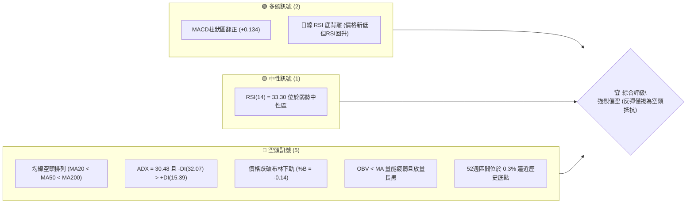

### 📊 核心指標速覽表

| 指標類別 | 指標名稱 | 當前數值 | 訊號 | 解讀 |
|----------|----------|----------|------|------|
| **價格** | 當前收盤價 | $35.96 | 🔴 | 創波段低點，距離52週低點 $35.71 僅 0.3% |
| **均線** | MA20 | $40.27 | 🔴 | 股價在MA20下方 -10.70%，短期趨勢向下 |
| **均線** | MA50 | $44.24 | 🔴 | 股價在MA50下方 -18.72%，中期趨勢確立走空 |
| **均線** | MA200 | $62.84 | 🔴 | 股價在MA200下方 -42.78%，長期熊市結構 |
| **動能** | RSI(14) | 33.30 | 🟡 | 位於弱勢中性邊界，出現微弱底背離但尚未越過50 |
| **動能** | MACD | -1.343 (柱 +0.134) | 🟢 | 雙線在零軸深處死叉鈍化，但柱狀圖微幅泛紅收斂 |
| **動能** | 隨機指標 %K/%D | %K: 2.98 / %D: 37.51 | 🔴 | %K 跌入個位數極端超賣區，存在空頭力道衰竭預警 |
| **趨勢** | ADX(14) | 30.48 | 🔴 | 強趨勢（ADX>25），-DI (32.07) 完全主導空頭方向 |
| **通道** | 布林通道 | 上 $43.66 / 下 $36.88 | 🔴 | 股價跌破下軌 (%B = -0.14)，呈空頭單邊擴軌跌勢 |
| **成交量** | 最新成交量 | 8,239,500 | 🔴 | 為20日均量 (4.37M) 之 1.88 倍，放量長黑破線 |
| **波動** | ATR(14) | $2.35 | 🔴 | 佔價格 6.55%，單日波動劇烈，向下風險溢價高 |

### 🏆 技術評分卡

```
╔══════════════════════════════════════════════════════════════╗
║                技術評分卡 — KTOS (2026-11-05)                ║
╠══════════════════════════════════════════════════════════════╣
║ 趨勢強度 (ADX=30.48 空頭主導)   ████████████░░░░░░░░  60/100 🔴 ║
║ 動能指標 (RSI鈍化、Stoch極端)   ████████░░░░░░░░░░░░  40/100 🟡 ║
║ 支撐穩定度 (無波段低點支撐)     ████░░░░░░░░░░░░░░░░  20/100 🔴 ║
║ 成交量配合 (空頭放量下殺)       ████████████░░░░░░░░  60/100 🔴 ║
║ 形態完整度 (頭肩/破底結構)      ████████████░░░░░░░░  60/100 🔴 ║
║ 均線排列 (完全標準空頭排列)     ██░░░░░░░░░░░░░░░░░░  10/100 🔴 ║
╠══════════════════════════════════════════════════════════════╣
║ 綜合評分 (六項算術平均四捨五入) ████████░░░░░░░░░░░░  42/100 🔴 ║
║ 評級結論：技術面顯著偏空 (Bearish Weakness / 跌勢主導)        ║
╚══════════════════════════════════════════════════════════════╝
```

*評分說明：綜合評分 = (60 + 40 + 20 + 60 + 60 + 10) ÷ 6 = 41.67 ≈ 42/100。*

---

## 2. 趨勢分析

### 🌐 多時框趨勢分析

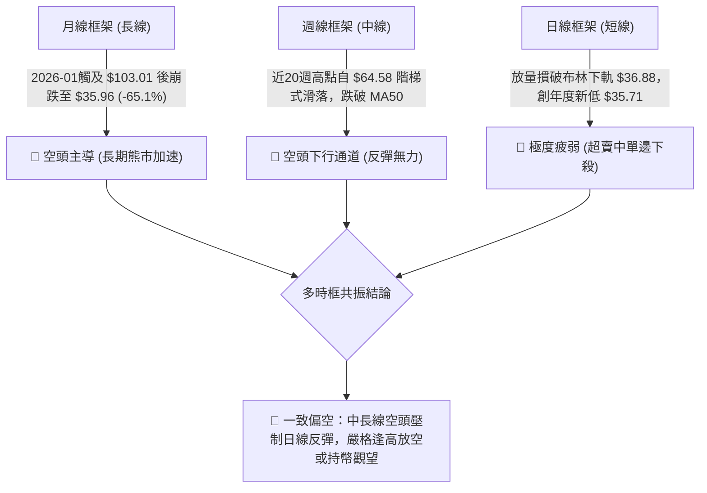

### 📈 長期趨勢 — 12個月走勢圖（Unicode）

依據月度收盤數據繪製過去 12 個月（2025-12 至 2026-11）的價格崩落走勢圖：

```
KTOS 月線收盤走勢圖（2025-12 至 2026-11）
價格軸 ($)
$105.00 ┤                     ● (2026-01: $103.01 高點)
$100.00 ┤                    ╱ ╲
 $90.00 ┤                   ╱   ● (2026-02: $86.18)
 $80.00 ┤ ● (2025-12: $75.91)     ╲
 $70.00 ┤                           ● (2026-03: $70.51)
 $65.00 ┤                             ╲   ● (2026-05: $64.13)
 $60.00 ┤                              ● (2026-04: $63.05)
 $50.00 ┤                                      ╲   ● (2026-08: $50.98)
 $45.00 ┤                                       ● (2026-06: $49.86) ╲
 $40.00 ┤                                         ● (2026-07: $46.60) ● (2026-10: $41.09)
 $35.00 ┤                                                              ╲  ● (2026-11: $35.96 現價)
        └────────────────────────────────────────────────────────────────────────
         12月   1月   2月   3月   4月   5月   6月   7月   8月   9月   10月  11月
```

#### 長期走勢特徵分析表格

| 階段區間 | 時間跨度 | 起訖收盤價 | 漲跌幅 | 結構特徵與量價解讀 |
|----------|----------|------------|--------|--------------------|
| 頂部衝刺 | 2025-12 ~ 2026-01 | $75.91 → $103.01 | +35.70% | 歷史級別加速噴出，投機情緒見頂，52週高點見於 $134.00 |
| 首波崩塌 | 2026-01 ~ 2026-04 | $103.01 → $63.05 | -38.79% | 頂部破位，連續三個月長黑下殺，失守百元與 $70 大關 |
| 弱勢抵抗 | 2026-04 ~ 2026-08 | $63.05 → $50.98 | -19.14% | 於 $46~$64 區間反覆震盪構築中繼平台，反彈高點逐次降低 |
| 破位加速 | 2026-08 ~ 2026-11 | $50.98 → $35.96 | -29.46% | 平台下軌失守，呈現單邊階梯式破底，直探 52 週低點 $35.71 |

### 📊 中期趨勢（週線分析）

中期走勢圖展示近期 8 週呈現的高端受壓與破底格局：

```
中期週線阻力與破線示意圖：
[阻力 R3] $54.22 ═══════════════════════════════════════════════════════════
                    (08/14 反彈高點 $64.58 回落後平台)
[阻力 R2] $51.49 ───────────────────────────────────────────────────────────
[阻力 R1] $49.68 ───────────────────────● (09/25 週高 $49.68)
                                         ╲
                                          ●─● (10/29 日高 $44.11 / MA50: $44.24)
                                             ╲
[現價跌破] $35.96 ═════════════════════════════●◄ (11/04 放量大黑K)
[52W 低點] $35.71 -----------------------------┴ (支撐懸崖边缘)
```

中期週線連續 5 週收黑，自 2026-08-14 高點 $64.58 跌至目前 $35.96，波段跌幅高達 -44.32%，空頭拋壓沉重且未見任何具有企穩特徵的週K線反轉形態。

### ⚡ 趨勢強度評估（ADX 解讀）

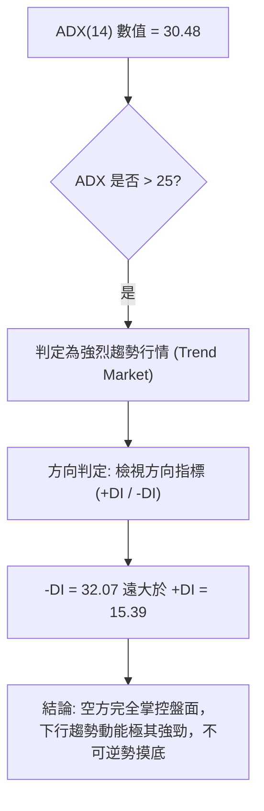

#### ADX 趨勢強度判定對照表

| 指標名稱 | 數值 | 門檻區間 | 當前狀態評估 |
|----------|------|----------|--------------|
| **ADX (14)** | **30.48** | > 25 (強趨勢) | 趨勢確立且動能強烈，排除盤整無方向狀態 |
| **+DI** | **15.39** | < 20 (多頭動能衰退) | 多頭買盤完全無組織反擊能力 |
| **-DI** | **32.07** | > 30 (空頭強烈壓制) | 空頭主導趨勢延伸，空方排列結構完整 |
| **趨勢架構** | **單邊空頭** | -DI 領先且擴散 | 典型的「空頭擴散推進」走勢，切忌左側做多 |

---

## 3. 圖表形態分析

### 🔍 形態識別系統

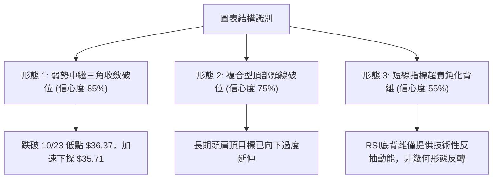

#### 形態判斷與信心度評估表（依規則 15）

| 形態名稱 | 信心度 | 判斷依據（引用數據） | 完成度 | 目標價（附計算式） |
|----------|--------|----------------------|--------|--------------------|
| **下降收斂中繼破位** | **85%** | 10/29反彈遇阻 $44.11（近MA50），11/04放量大陰線摜破前期收盤平台低點 $38.68 與 $36.37 | **100% (已突破)** | 依破位高度推算：破位點 $38.68 − (高點 $44.11 − 破位點 $38.68) = **$33.25** |
| **大級別複合頭部破位** | **75%** | 2026年1月創高後向下摜穿頸線聚類區 R1 $49.68，全均線空頭發散 | **100% (向下演化中)** | 頸線 $49.68 被有效跌破後，已轉化為超級強阻力，下方無形態目標對應點 |
| **雙底形態 (反轉)** | **30%** | 數據中未偵測到低點聚類支撐，僅 11/04 觸及 52W 低點 $35.71，無右底確認 | **0% (未成形)** | 訊號不足，僅做指標型超賣解讀，不得預設雙底 |

### 🕯️ 重要 K 線形態分析

嚴格依據數據中「近 10 根日 K」與「近 8 根週 K」之開高低收數據進行客觀解讀：

#### 近 10 根日 K 線形態解讀表

| 日期 | 開 | 高 | 低 | 收 | 成交量 | K線形態 | 解讀與訊號 |
|------|----|----|----|----|--------|---------|------------|
| 2026-10-22 | 38.27 | 39.96 | 37.40 | 38.27 | 4,194,300 | 墓碑型十字星 | 上影線承壓，盤中衝高回落，買盤猶豫 🟡 |
| 2026-10-23 | 37.64 | 39.08 | 36.37 | 38.68 | 4,201,100 | 下影小陽線 | 探底 $36.37 後收復，低檔買盤介入 🟢 |
| 2026-10-26 | 38.68 | 40.57 | 38.43 | 40.43 | 3,481,000 | 實體中陽線 | 伴隨均線靠攏展開超跌反彈 🟢 |
| 2026-10-27 | 40.73 | 42.12 | 40.06 | 41.32 | 4,320,500 | 續漲小陽線 | 挑戰 $42.00 關卡，多頭推進 🟢 |
| 2026-10-28 | 41.38 | 41.56 | 40.40 | 41.17 | 2,805,700 | 縮量十字陰線 | 縮量滯漲，顯示上方 MA50 賣壓沉重 🟡 |
| 2026-10-29 | 41.28 | 44.11 | 41.20 | 43.59 | 6,251,700 | 放量長上影陽線 | 衝高 $44.11 觸及 MA50 後大幅回落，主力誘多 🔴 |
| 2026-10-30 | 42.67 | 43.21 | 40.28 | 41.09 | 3,414,400 | 反向長黑吞噬 | 高開低走，完全吞沒前日漲幅，反彈夭折 🔴 |
| 2026-11-02 | 41.29 | 41.61 | 39.68 | 40.23 | 3,385,100 | 下行中陰線 | 跌破 $40.00 整數關卡，賣壓擴散 🔴 |
| 2026-11-03 | 40.41 | 41.72 | 40.10 | 40.99 | 3,235,100 | 弱勢小陽線 | 弱勢掙扎，未能突破前日高點，死貓跳 🟡 |
| 2026-11-04 | 39.86 | 40.25 | 35.71 | 35.96 | 8,239,500 | **破位放量大長黑** | **爆量 8.24M 崩跌，收於最低點附近，創年度新低** 🔴 |

#### 近 8 根週 K 線形態解讀表

| 日期 | 開 | 高 | 低 | 收 | 週成交量 | K線形態 | 解讀與訊號 |
|------|----|----|----|----|----------|---------|------------|
| 2026-09-18 | 45.76 | 49.46 | 45.72 | 47.46 | 20,728,200 | 長上影紡錘陽線 | 衝擊 R1 $49.68 失敗，上檔解套賣壓沉重 🟡 |
| 2026-09-25 | 48.22 | 49.68 | 44.81 | 45.62 | 20,499,100 | 墓碑大陰線 | 再次受阻於 $49.68，確立週線雙頂拋壓 🔴 |
| 2026-10-02 | 44.97 | 45.22 | 41.83 | 43.07 | 24,159,800 | 實體中黑棒 | 放量跌破 $44 關卡，下行趨勢加速 🔴 |
| 2026-10-09 | 43.80 | 44.14 | 40.93 | 42.36 | 26,620,200 | 下行流星陰線 | 弱勢震盪下行，反抽高點持續降低 🔴 |
| 2026-10-16 | 42.48 | 43.07 | 37.84 | 40.42 | 24,466,500 | 長下影中陰線 | 跌破 $40.00 逼出恐慌盤，低檔微幅承接 🟡 |
| 2026-10-23 | 40.40 | 40.50 | 36.37 | 38.68 | 18,266,100 | 下探收縮十字星 | 逼近 52 週低點，縮量探底 🟡 |
| 2026-10-30 | 38.68 | 44.11 | 38.43 | 41.09 | 20,273,300 | 衝高回落倒錘頭 | 反彈觸及 $44.11 慘遭空頭迎頭痛擊 🔴 |
| 2026-11-04 | 41.29 | 41.72 | 35.71 | 35.96 | 14,859,700 | **空頭破位大黑K** | 跌破前低 $36.37，直逼 $35.71，空方絕對掌控 🔴 |

### 📉 ASCII 走勢形態示意圖

```
KTOS 近期破位形態解析 (2026-10 ~ 2026-11)
價格 ($)
$44.11 ───────────────● (10/29 假突破受阻於 MA50: $44.24)
                      │╲
                      │ ╲
$41.09 ───────────────┼──● (10/30 吞噬大陰線)
                      │   ╲
$40.00 ───────────────┼────● (11/02 跌破整數關卡)
                      │     ╲
$38.68 ──[中繼破位頸線] ┴──────● (10/23 平台低點收盤)
                                ╲
$35.96 ──────────────────────────● (11/04 現價放量摜穿)
$35.71 ──[52W 歷史底部] ──────────┴ (當前唯一支撐邊界)
                                  │
$33.25 ──[形態推算目標] ──────────▼ (破位測幅延伸點)
```

### 🎯 形態目標價計算

根據 10/29 反彈高點至 10/23 收盤支撐構築的短線下跌旗形／中繼平台進行等距測幅（Measured Move）：
- **平台高點**：$44.11（2026-10-29 日高）
- **破位頸線點**：$38.68（2026-10-23 收盤價）
- **形態垂直幅度**：$44.11 − $38.68 = $5.43
- **空頭破位目標價**：$38.68 − $5.43 = **$33.25**（標注為：由下跌中繼形態高度推算）

---

## 4. 支撐與阻力

### 🗺️ 關鍵價位分布圖（Unicode）

```
╔══════════════════════════════════════════════════════════════╗
║               KTOS 價位結構分布圖 (依據 OHLCV)               ║
╠══════════════════════════════════════════════════════════════╣
║ $54.22 ║████████████████████████║ 強阻力 R3 (波段高點聚類)    ║
║ $51.49 ║████████████████████    ║ 阻力 R2 (波段反彈高點聚類)  ║
║ $49.68 ║████████████████████████║ 關鍵阻力 R1 (波段突破受阻點)║
║        ║                        ║                            ║
║ $40.27 ║------------------------║ 動態阻力 (MA20 / 布林中軌) ║
║ $36.88 ║........................║ 破位軌道 (布林下軌)        ║
║ $35.96 ╠════════════════════════╣ ◄ 現價 (收盤價)            ║
║ $35.71 ║▓▓▓▓▓▓▓▓▓▓▓▓▓▓▓▓▓▓▓▓▓▓▓▓║ 52週低點 (歷史邊界支撐)     ║
║        ║                        ║                            ║
║ 下方支撐║ (數據中未偵測到低點聚類) ║ 進入無支撐真空區間         ║
╚══════════════════════════════════════════════════════════════╝
```

### 🚧 阻力位分析表

阻力位嚴格引用數據中「關鍵價位」區塊之波段高點聚類：

| 阻力級別 | 價位 | 形成原因 | 突破難度 | 重要性 |
|----------|------|----------|----------|--------|
| **阻力 R1** | **$49.68** | 近一年波段高點聚類；09/25 週高 $49.68 雙重頂承壓處 | 極高 | ★★★★★ 關鍵多空分水嶺，未收復前均屬空頭格局 |
| **阻力 R2** | **$51.49** | 近一年反彈波段聚類阻力；密集解套籌碼帶 | 極高 | ★★★★☆ 中期反轉確認位 |
| **阻力 R3** | **$54.22** | 近一年高點強阻力聚類；前波下跌起跌平台 | 極高 | ★★★★★ 長期趨勢防守大限 |

*動態阻力補充：MA20 ($40.27)、MA50 ($44.24)、布林下軌反轉阻力 ($36.88)。*

### 🛡️ 支撐位分析表

支撐位嚴格引用數據中「關鍵價位」區塊：

| 支撐級別 | 價位 | 形成原因 | 守住機率 | 重要性 |
|----------|------|----------|----------|--------|
| **當前低點** | **$35.71** | 52週最低價 (52W Low / 2026-11-04盤中低點) | 35% | ★★★★★ 唯一的技術防線，跌破則無險可守 |
| **支撐 S1** | **無** | **數據中未偵測到（no swing-low support detected）** | N/A | 跌破 $35.71 即步入歷史價格真空區 |
| **形態推算** | **$33.25** | 由破位平台高度推算：$38.68 − ($44.11 − $38.68) | 50% | ★★★☆☆ 下行測幅目標滿足點 |

### 📐 斐波那契回調位分析

依據 52 週完整區間（最低 $35.71 至 最高 $134.00）之客觀回調價位對照：

| 斐波那契水平 | 對應價位 | 距現價空間 ($35.96) | 技術意義解讀 |
|--------------|----------|---------------------|--------------|
| **0.0% (高點)** | **$134.00** | +272.64% | 52 週最高極值，本輪超級牛市終點 |
| **23.6%** | **$110.80** | +208.12% | 多頭回踩第一道警戒線（已失守） |
| **38.2%** | **$96.45** | +168.21% | 強勢回調防守線（已失守） |
| **50.0%** | **$84.85** | +135.96% | 牛熊中樞軸心線（已失守） |
| **61.8%** | **$73.26** | +103.73% | 黃金分割強防守位（崩跌摜穿） |
| **78.6%** | **$56.74** | +57.79% | 深度回撤容忍極限（崩跌摜穿） |
| **100.0% (低點)**| **$35.71** | -0.70% | **現價 ($35.96) 正處於 100% 斐波那契回調極限位** |

**解讀**：股價已回吐過去一年全部漲幅，100.0% 回調位 ($35.71) 意味著本輪上漲動能已 100% 被空頭吞噬抹煞。若此最後堡壘失守，斐波那契模型宣告擴展向下（138.2% 擴展位為 $0 以下，無數學意義），市場將陷入極度缺乏錨定點的恐慌拋售。

---

## 5. 技術指標深度解讀

### 🎛️ 指標訊號總覽

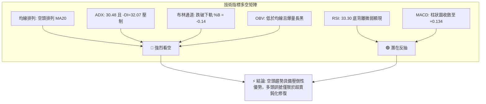

### 📈 移動平均線排列分析

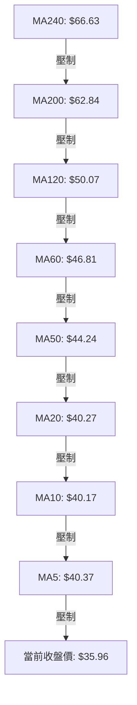

#### 均線發散狀態與偏離度表

| 均線名稱 | 數值 | 距現價偏離度 (%) | 趨勢方向 | 狀態解讀 |
|----------|------|------------------|----------|----------|
| **MA5** | $40.37 | -10.93% | ▼ 下行 | 極短線空頭下壓，日K完全無法站上 |
| **MA10** | $40.17 | -10.49% | ▼ 下行 | 短期均線壓制帶 |
| **MA20** | $40.27 | -10.70% | ▼ 下行 | 20日布林中軌，短波段多空分水嶺 |
| **MA50** | $44.24 | -18.72% | ▼ 下行 | 10/29反彈觸頂阻力，中期空頭防線 |
| **MA60** | $46.81 | -23.17% | ▼ 下行 | 季線下彎，賣壓沉重 |
| **MA120** | $50.07 | -28.18% | ▼ 下行 | 半年線死叉下行 |
| **MA200** | $62.84 | -42.78% | ▼ 下行 | 長期牛熊分界線，嚴重向下偏離 |
| **MA240** | $66.63 | -46.03% | ▼ 下行 | 年線崩塌，宣告長期熊市格局確立 |

所有週期均線（5, 10, 20, 50, 60, 120, 200, 240）無一例外呈現自上而下的空頭排列，下行傾斜角度陡峭，顯示自 2026 年初以來資金呈單邊逃逸態勢。

### 📉 RSI(14) 分析

- **當前數值**：**33.30**
- **強度進度條**：`███████░░░░░░░░░░░░░ 33.3%`（弱勢邊界）
- **超買超賣狀態**：接近 30 超賣臨界點，處於弱勢空頭震盪區間。
- **背離判斷**：⚠️ **偵測到底背離 (Bullish Divergence)**
  - **價格行為**：近 20 根 K 棒中，10/23 創收盤低點 $38.68 後，11/04 再次創出新低收盤價 $35.96（價格下行破底）。
  - **RSI 行為**：10/23 週 RSI 為 31.3，而 11/04 收盤 RSI 為 33.30（RSI 未同步破新低，呈現微幅墊高）。
  - **背離有效性分析**：儘管出現底背離技術特徵，但由於 ADX 高達 30.48（趨勢盤），在強烈下行趨勢中，振盪指標的底背離常以「指標鈍化」或「橫盤微彈後再度破底」化解，不可作為單獨進場做多依據。

### 📊 MACD(12, 26, 9) 訊號解讀

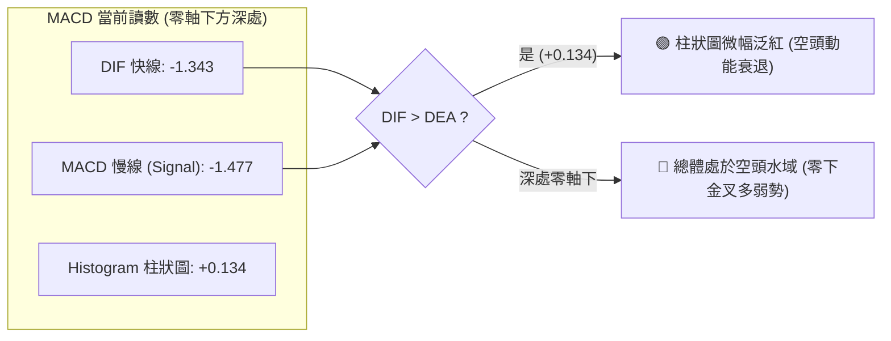

- **MACD 線**：-1.343
- **Signal 線**：-1.477
- **柱狀圖**：**+0.134**
- **交叉狀態**：快線在零軸深處緩慢交叉慢線，柱狀圖自 10/23 的 -0.002 轉為 +0.134。這表明短線下殺速率相較於 9 月份的急跌已有收斂，但快慢線仍深陷零軸下方負數區域，屬於標準的「空頭市場中的弱勢修正」，尚未形成實質反轉結構。

### 📦 布林通道分析

```
KTOS 布林通道 (20, 2) 結構圖
價格軸 ($)
$43.66 ┬────────────────────────────────────────── 上軌 (Upper Band)
       │
$40.27 ┼────────────────────────────────────────── 中軌 (MA20)
       │
$36.88 ┴────────────────────────────────────────── 下軌 (Lower Band)
       │
$35.96 ═══════════════════════════════════════════ 現價 (收盤跌破下軌)
       └──────────────────────────────────────────
```

- **帶寬與位置**：上軌 $43.66，中軌 $40.27，下軌 $36.88。
- **%B 指標**：**-0.14**（%B = (35.96 − 36.88) ÷ (43.66 − 36.88) = -0.92 ÷ 6.78 ≈ -0.14）。
- **解讀**：%B 小於 0 顯示股價已「穿透」布林帶下軌。伴隨開口重新向下擴張，此現象並非短期超賣買點，而是「布林單邊下軌漫步（Band Walking）」的典型空頭強勢推動訊號。

### 💹 成交量分析（量價配合度）

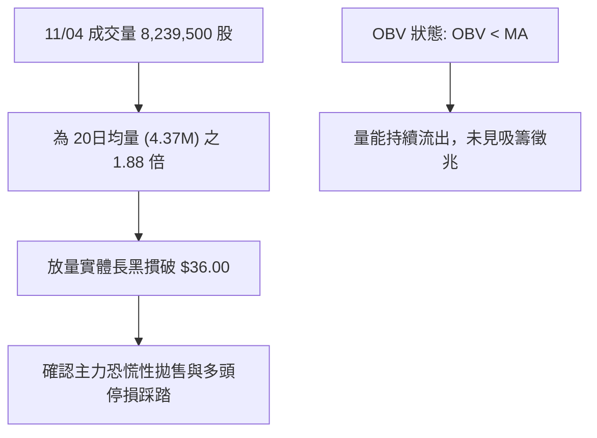

- **量價配合**：11/04 價格暴跌 -12.27%（自開盤 $39.86 殺至 $35.96），成交量急劇放大至 8.24M（量比 1.88 倍）。這是在經歷 10 月底縮量反彈後的「放量破位」，典型空頭量能釋放。
- **OBV 能量潮**：OBV 明確低於其均線，且趨勢向下發散，反映機構籌碼持續單邊流出，無顯著主力逢低護盤承接。

---

## 6. 動能與波動率

### ⚡ 動能評估四象限

| 象限 | 動能維度 | 波動維度 | 當前狀態標記 | 特徵解讀與操作指引 |
|------|----------|----------|--------------|--------------------|
| **Q1: 追隨強勢** | 強動能 (多頭) | 低波動 | — | 最佳多頭趨勢行情 |
| **Q2: 沉寂蓄勢** | 弱動能 (中性) | 低波動 | — | 區間盤整，等待方向 |
| **Q3: 風險爆發** | 強動能 (多/空) | 高波動 | — | 擴大停損的高風險博弈 |
| **Q4: 恐慌擴散** | **強空頭動能** | **極高波動** | **✓ (當前所處象限)** | **弱勢動能加速下行，ATR 偏高，下殺動能強烈，切勿摸底** |

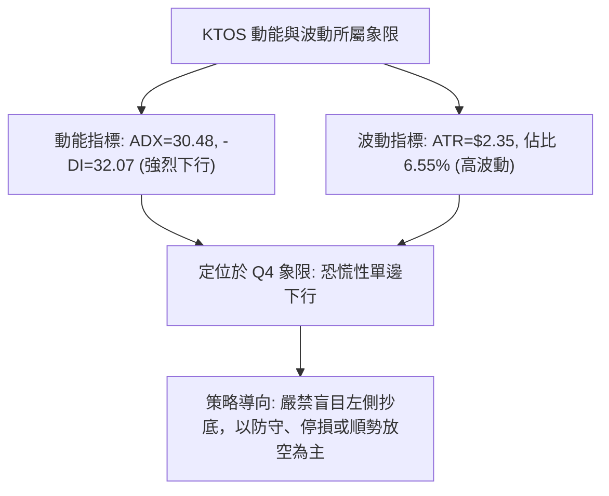

### 📊 ATR 波動率分析

- **ATR(14) 數值**：**$2.35**（Wilder 平滑）
- **波動佔比**：佔當前股價之 **6.55%**（$2.35 ÷ $35.96），處於個股極高波動範疇。
- **停損距離設定指引**：
  - **極短線策略 (1.0 × ATR)**：$2.35
  - **波段交易策略 (1.5 × ATR)**：$3.53
  - **空頭趨勢跟蹤 (2.0 × ATR)**：$4.70
  - **啟示**：單日平均潛在波動區間超過 $2.35，意味著任何反彈若未超過 $2.35 均屬日內隨機噪音；做空停損位至少需保留 1.5 倍 ATR 空間以免遭倒刺洗盤。

### 📐 Beta 與市場相關性

- **Beta 係數**：**1.165**
- **市場屬性解讀**：KTOS 具備高於大盤（S&P 500）16.5% 的波動彈性。在防禦性國防類股普遍具備抗跌屬性的背景下，KTOS 出現高 Beta 破底下殺，突顯其受到個股特有基本面惡化（如自由現金流持續為負 $-128.9M、政府合約進度審查與國會換屆預算風險等）的嚴重拖累，與防禦板塊走勢顯著脫節。

---

## 7. 多時框架總結

### 📋 時框架評分表

| 時框架 | 趨勢方向 | 動能指標狀態 | 均線排列狀態 | 形態結構 | 綜合評分 | 戰術建議 |
|--------|----------|--------------|--------------|----------|----------|----------|
| **月線 (長期)** | 🔴 強烈看空 | RSI 長線走弱，崩跌破前波起漲點 | 完全空頭壓制 | 自 $103 崩跌未見止跌底型 | **20/100** | 戰略性減倉，絕不長線建倉 |
| **週線 (中期)** | 🔴 單邊下行 | MACD 零下收斂但未能翻多 | MA50/200 下彎成巨大蓋頭 | 階梯破位，受制於 R1 $49.68 | **30/100** | 逢反彈至阻力位放空 |
| **日線 (短期)** | 🔴 破位超賣 | RSI 底背離，Stoch 鈍化超賣 | MA5/10/20 空頭擴散 | 跌破 $38.68 平台，直逼 $35.71 | **40/100** | 嚴禁抄底，等待反抽確認做空 |

### 🔲 綜合訊號矩陣

```
╔══════════════════════════════════════════════════════════════╗
║                    多時框訊號一致性矩陣                      ║
╠══════════════════════════════════════════════════════════════╣
║ 維度         短線 (日線)       中線 (週線)       長線 (月線) ║
╠══════════════════════════════════════════════════════════════╣
║ 趨勢方向     🔴 單邊急跌       🔴 空頭排列       🔴 深度熊市 ║
║ 均線結構     🔴 全線空頭發散   🔴 中期壓制       🔴 長期破位 ║
║ 動能狀態     🟢 底背離超賣     🔴 負向主導       🔴 空方掌控 ║
║ 量能狀態     🔴 爆量恐慌跌     🔴 週線縮量陰跌   🔴 逃逸外流 ║
║ 關鍵位置     🔴 跌破布林下軌   🔴 逼近52W邊界    🔴 無支撐區 ║
╠══════════════════════════════════════════════════════════════╣
║ 共振評估     日線超賣出現技術性雜音，但中長期趨勢具備 100% ║
║              向下共振壓力，遵循「順大勢、逆小勢」交易原則。  ║
╚══════════════════════════════════════════════════════════════╝
```

### ⚖️ 多時框收斂結論（依規則 14）

1. **行情性質判定**：ADX(14) 讀數為 **30.48**，大於 25 臨界值，明確判定當前為**強烈趨勢行情**而非盤整行情。
2. **時框權重收斂**：在 ADX > 25 的趨勢行情中，依規則 14，**以中長期（週線／MA50、MA200）方向為絕對主導**，日線指標僅能用於尋找順勢進場之時機或超賣反彈之離場點。
3. **最終唯一方向性結論**：**強烈偏空（Bearish）**。日線級別之 RSI 底背離與 MACD 柱狀圖泛紅，僅屬極端跌勢下的超賣指標修正，絕非反轉訊號；在日線反彈遭遇動態均線（MA20 $40.27 或 MA50 $44.24）壓制時，即為中長線空頭動能重新發力之最佳順勢放空點。第 8 章交易策略將嚴格依此結論展開。

---

## 8. 交易策略建議

### 🗺️ 策略決策流程圖

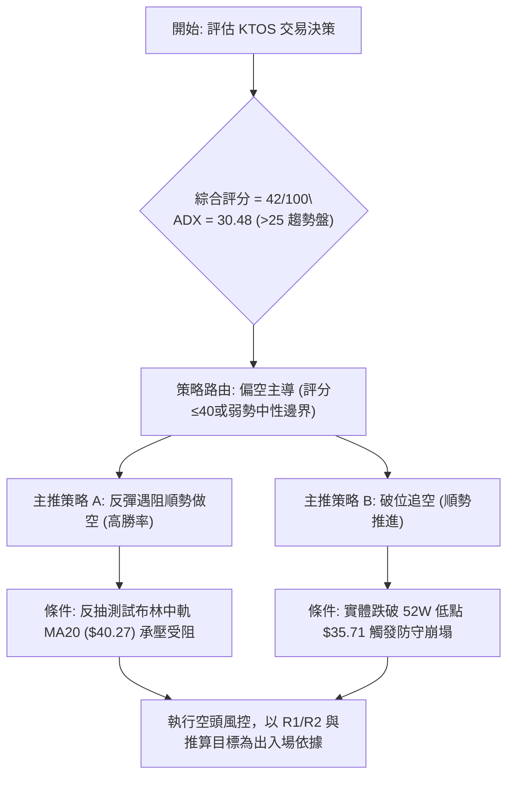

### 🧭 策略路由（依評分卡分流，規則 18）

> **當前主策略方向 = 強烈偏空（放空／逢高賣出），依據綜合評分 42/100 且 ADX 30.48 確立空頭趨勢。**

由於第 1 章評分卡之綜合評分為 42/100，技術面處於空頭強勢壓制範疇（中長期均線全數死叉、-DI 主導），報告**主推空頭策略**。多頭操作僅列為極端短線風險反轉點與對沖參考，不得作為核心推薦。

### 🎯 價格情境階梯（Price Scenarios）

價位嚴格引用第 4 章及數據庫中之波段數值：

| 觸發條件 | 下一目標 | 後續延伸 | 情境含義解讀 |
|----------|----------|----------|--------------|
| **跌破 52W 低點 $35.71** | **$33.25** (形態目標) | 下方無支撐真空 | 空頭趨勢展開新一輪恐慌拋售加速段 |
| **反彈受阻 MA20 $40.27** | **$35.96** (現價) | **$35.71** (52W低點) | 標準死貓跳反抽，空頭重新回補做空 |
| **強勢突破 R1 $49.68** | **R2 $51.49** | **R3 $54.22** | 空頭結構被實質破壞，趨勢中長線扭轉 |

### 📊 情境機率分佈

| 情境 | 機率 | 主要指標依據 |
|------|------|--------------|
| **跌破新低 / 延續跌勢** | **65%** | ADX=30.48 強勢下行、-DI=32.07 壓倒性領先、OBV 放量下殺跌破布林下軌 |
| **超賣反抽 / 低檔震盪** | **25%** | RSI=33.30 底背離鈍化、Stoch %K=2.98 極端超賣、MACD 柱狀圖泛紅收斂 |
| **強勢反轉 / 向上突破** | **10%** | 全均線呈標準空頭發散，上方累積 $40~$50 之天量套牢籌碼，反轉難度極高 |

### 🟢 主策略詳情（空頭主導策略）

進場點、止損點、目標價嚴格引用數據或形態計算數值；風險報酬比按規則 17 嚴格計算：
*做空風險報酬比 = (進場價 − 目標價 T1) ÷ (止損價 − 進場價)*

| 策略要素 | 策略 A：反彈受阻放空（勝率優先） | 策略 B：破位追空（動能優先） |
|----------|----------------------------------|------------------------------|
| **策略類型** | 順勢空頭（逢反抽動態阻力進場） | 突破空頭（破 52W 低點順勢打入） |
| **進場條件** | 股價反彈至 MA20 附近受阻收長上影K棒 | 跌破 52W 低點 $35.71 且 1小時未收復 |
| **進場價格** | **$40.27**（引用 MA20 數值） | **$35.71**（引用 52W 低點） |
| **目標價 T1** | **$35.96**（現價收盤支撐位） | **$33.25**（由形態高度推算） |
| **目標價 T2** | **$33.25**（由形態高度推算） | 數據中未提供更低價位，以 T1 為主 |
| **止損價格** | **$44.24**（引用 MA50 數值） | **$36.88**（引用布林下軌數值） |
| **風險報酬比** | **1 : 1.09（以 T1 計）** *(計算式見註1)*<br>另列：1 : 1.77（以 T2 計） *(註2)* | **1 : 2.10（以 T1 計）** *(計算式見註3)* |
| **成功機率** | **70%** | **60%** |
| **建議倉位** | **15%**（分批開倉） | **10%**（動能突破倉） |

- *註1 (策略A T1 風報比)*：(40.27 − 35.96) ÷ (44.24 − 40.27) = 4.31 ÷ 3.97 = **1 : 1.09**
- *註2 (策略A T2 風報比)*：(40.27 − 33.25) ÷ (44.24 − 40.27) = 7.02 ÷ 3.97 = **1 : 1.77**
- *註3 (策略B T1 風報比)*：(35.71 − 33.25) ÷ (36.88 − 35.71) = 2.46 ÷ 1.17 = **1 : 2.10**

### 🔴 反向風險觸發點（對沖與停損提示）

若出現以下情境，宣告空頭主策略失效，空單必須立即無條件止損出局：
1. **價格強勢收復 MA20 ($40.27)**：若日K以實體大陽線收於 $40.27 之上，表明短線超賣引發實質軋空行情，空單離場。
2. **帶量突破 R1 ($49.68)**：若多頭攻克近一年波段高點聚類 $49.68，中期空頭結構遭到根本破壞，策略需全面轉為觀望或跟隨做多。

### ⭐ 整體訊號強度評星

```
╔══════════════════════════════════════════════════════════════╗
║                    整體訊號強度評星                          ║
╠══════════════════════════════════════════════════════════════╣
║ 做多訊號強度：★☆☆☆☆  (1/5 星) — 僅剩指標鈍化超賣與微弱底背離║
║ 做空訊號強度：★★★★☆  (4/5 星) — 均線空排、ADX強勢、破位下殺║
║ 整體可信度：  ★★★★☆  (4/5 星) — 多時框訊號一致共振指向走空║
╚══════════════════════════════════════════════════════════════╝
```

---

## 9. 風險提示與監控

### ✅ 關鍵監控指標 Checklist

```
╔══════════════════════════════════════════════════════════════╗
║              交易員每日監控清單 (KTOS Checklist)             ║
╠══════════════════════════════════════════════════════════════╣
║ [ ] 52W 低點防守：盤中是否跌破 $35.71 觸發連鎖程式拋盤       ║
║ [ ] RSI(14) 變動：是否自 33.30 跌入 30 以下形成深層超賣鈍化   ║
║ [ ] 布林通道擴口：%B 是否持續低於 0（現為 -0.14）延續下軌漫步║
║ [ ] 成交量異動：次日量能是否萎縮至 4.37M 均量以下（確認洗盤） ║
║ [ ] ADX 與 -DI：ADX 是否進一步拉升破 35，確認恐慌趨勢主升段 ║
║ [ ] 財報與合約：NASA 相關合約與國會預算審查之基本面催化劑   ║
╚══════════════════════════════════════════════════════════════╝
```

### ⚠️ 風險場景分析

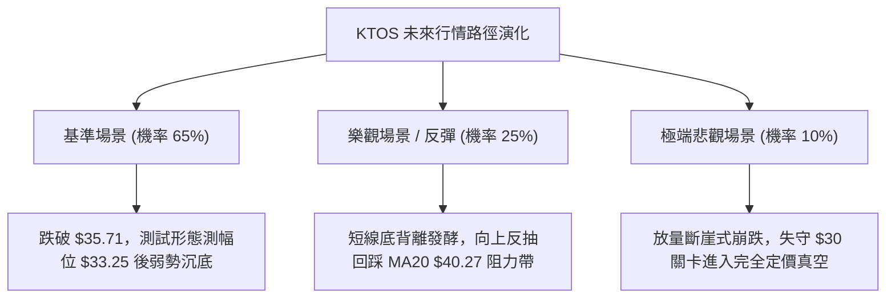

### 🛡️ 風險管理重要提醒

1. **嚴禁左側猜底**：52 週低點 $35.71 雖為心理防線，但技術面上「數據中未偵測到近一年波段低點聚類支撐（no swing-low support detected）」。在下行無結構支撐掩護下盲目猜底，極易遭遇加速滑點。
2. **ATR 波動風險溢價**：當前 ATR 為 $2.35，單日振幅高達 6.55%。無論進行何種交易，停損幅度必須基於 ATR 進行動態包容，切忌設定過窄的固定百分比停損。
3. **部位管理規範**：鑑於空頭波動放大，整體 KTOS 交易部位不得超過個人投資組合總資產之 **10% ~ 15%**，單筆止損風險暴露（Risk at Cost）嚴格控制在總權益的 **1.0%** 以內。

---

## 📋 報告總結

```
╔══════════════════════════════════════════════════════════════╗
║                    KTOS 技術分析報告總結                     ║
╠══════════════════════════════════════════════════════════════╣
║ 報告日期：2026-11-05                                         ║
║ 當前價格：$35.96                                              ║
║ 分析評級：🔴 強烈偏空 / 跌勢加速 (Bearish Momentum)          ║
║                                                              ║
║ 關鍵結論：                                                   ║
║ ├─ 長期趨勢：🔴 年線崩塌，全均線呈現標準空頭排列            ║
║ ├─ 中期趨勢：🔴 受制於 R1 $49.68 與 MA50 $44.24，反彈即賣點 ║
║ ├─ 短期趨勢：🔴 跌破布林下軌放量收黑，ADX=30.48 空方強推進   ║
║ ├─ 關鍵支撐：$35.71 (52W Low)；推算目標 $33.25               ║
║ ├─ 關鍵阻力：$40.27 (MA20) / $44.24 (MA50) / $49.68 (R1)     ║
║ └─ 外資共識：目標均價 $89.76 (但技術面處於嚴重破位熊市階段)  ║
║                                                              ║
║ 最優策略組合：                                               ║
║ 1. 🥇 最佳機會：等待超跌反抽至 MA20 ($40.27) 逢高建立空單     ║
║ 2. 🥈 次選機會：跌破 52W 低點 $35.71 順勢追空，下看 $33.25   ║
║ 3. 🥉 保守選擇：空手觀望，在價格未收復 MA20 前嚴禁買入現貨   ║
╚══════════════════════════════════════════════════════════════╝
```

---

> ⚠️ **免責聲明**：本報告為 AI 自動生成之技術分析，所有數據及估算均基於提供的歷史價格資訊。本報告**僅供研究與學術參考**，**不構成任何投資建議**。投資有風險，入市需謹慎。

---

*報告生成時間：2026-11-05 ｜ 數據來源：Yahoo Finance ｜ 分析框架：多時框技術分析*