# KTOS 技術分析報告

> **報告日期**：2026-11-06 ｜ **語言**：繁體中文 ｜ **數據來源**：Yahoo Finance ｜ **當前價格**：$33.39

---

## 目錄

| 章節 | 內容 |
|------|------|
| [1. 技術面概覽](#1-技術面概覽) | 訊號儀表板、核心指標、評分卡 |
| [2. 趨勢分析](#2-趨勢分析) | 多時框趨勢、長中短期走勢 |
| [3. 圖表形態分析](#3-圖表形態分析) | 形態識別、K線組合、目標價 |
| [4. 支撐與阻力](#4-支撐與阻力) | 關鍵價位、斐波那契回調 |
| [5. 技術指標深度解讀](#5-技術指標深度解讀) | MA/RSI/MACD/布林/成交量 |
| [6. 動能與波動率](#6-動能與波動率) | 動能評估、ATR、Beta |
| [7. 多時框架總結](#7-多時框架總結) | 時框架評分矩陣 |
| [8. 交易策略建議](#8-交易策略建議) | 多空策略、風險報酬比 |
| [9. 風險提示與監控](#9-風險提示與監控) | 監控指標、風險場景 |

---

## 1. 技術面概覽

### 🎯 技術訊號儀表板

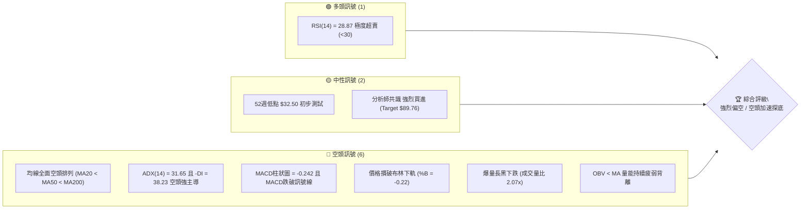

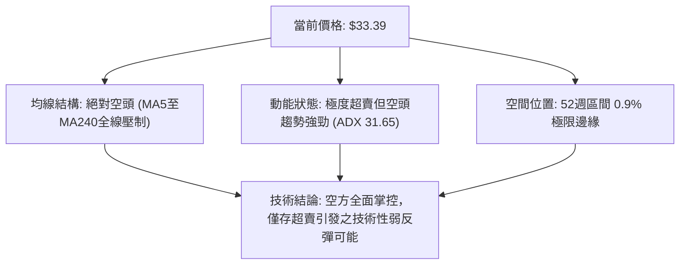

### 📊 核心指標速覽表

| 指標類別 | 指標名稱 | 當前數值 | 訊號 | 解讀 |
|----------|----------|----------|:----:|------|
| **價格** | 當前價格 | $33.39 | 🔴 | 距離52週高點重挫 -75.08%，貼近52週最低點 $32.50 |
| **均線** | MA20 | $39.84 | 🔴 | 價格在MA20下方 -16.19%，短中期下行斜率極陡 |
| **均線** | MA50 | $43.85 | 🔴 | 價格在MA50下方 -23.85%，中期多空分水嶺完全失守 |
| **均線** | MA200 | $62.41 | 🔴 | 價格在MA200下方 -46.50%，長期牛熊線已成沉重天花板 |
| **動能** | RSI(14) | 28.87 | 🟢 | 進入經典超賣區間（<30），隨時醞釀技術性乖離修正反抽 |
| **動能** | MACD (12,26,9) | -1.779 / -1.537 | 🔴 | DIF跌破DEA，Histogram為 -0.242，空頭動能擴散 |
| **動能** | Stoch %K / %D | 7.67 / 23.44 | 🟢 | 隨機指標深度超賣，短線存在低檔鈍化或金叉契機 |
| **趨勢** | ADX(14) / ±DI | 31.65 / -DI: 38.23 | 🔴 | ADX>25強趨勢確立，-DI(38.23)大幅輾壓+DI(13.83)，空頭主導 |
| **通道** | 布林通道 | 下軌 $35.36 (%B: -0.22) | 🔴 | 跌破布林下軌且通道開口擴大，呈現下軌騎乘弱勢特徵 |
| **成交量** | 20日成交量比 | 2.07x (9,477,800股) | 🔴 | 破位爆量下跌，顯示主動性恐慌拋壓湧現而非良性洗盤 |
| **波動** | ATR(14) | $2.43 (7.29%) | 🔴 | 高波動狀態，日震幅劇烈，下行風險溢價顯著攀升 |

### 🏆 技術評分卡

```
╔══════════════════════════════════════════════════════════════╗
║              技術評分卡 — KTOS (2026-11-06)                 ║
╠══════════════════════════════════════════════════════════════╣
║ 趨勢強度 (Trend)     ████████░░░░░░░░░░░░  40/100  🔴 空頭強勢║
║ 動能指標 (Momentum)  ██████░░░░░░░░░░░░░░  30/100  🔴 極度低迷║
║ 支撐穩定度 (Support) ████░░░░░░░░░░░░░░░░  20/100  🔴 支撐真空║
║ 成交量配合 (Volume)  ████░░░░░░░░░░░░░░░░  20/100  🔴 爆量殺多║
║ 形態完整度 (Pattern) ██████░░░░░░░░░░░░░░  30/100  🔴 破位下行║
║ 均線排列 (Moving Avg)██░░░░░░░░░░░░░░░░░░  10/100  🔴 完美空頭║
╠══════════════════════════════════════════════════════════════╣
║ 綜合評分             ████░░░░░░░░░░░░░░░░  25/100  🔴 強烈偏空║
║ 評分定義：算術平均 (40+30+20+20+30+10) ÷ 6 = 25/100 (規則18)  ║
╚══════════════════════════════════════════════════════════════╝
```

---

## 2. 趨勢分析

### 🌐 多時框趨勢分析

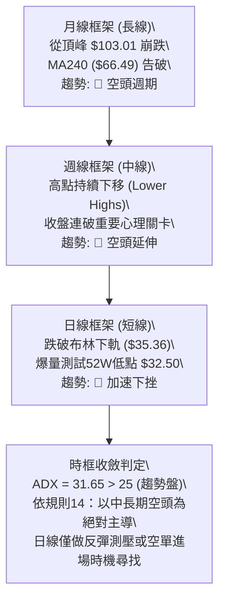

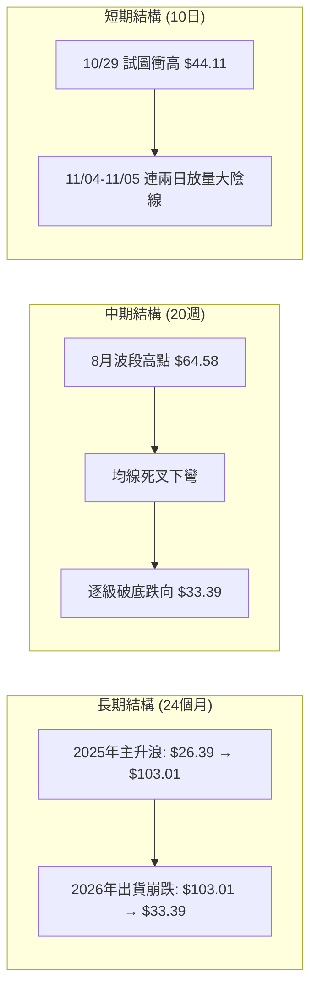

### 📈 長期趨勢 — 12個月走勢圖（Unicode）

KTOS 在過去 12 個月經歷了由牛轉熊的極端週期變換。2025 年底至 2026 年初股價飆升至歷史頂峰，但隨後基本面現金流惡化與國防開支重新配置等雜音引發機構獲利了結，形成長達 10 個月的流暢下行波段。

```
KTOS 月線走勢圖（過去12個月：2025-12 至 2026-11）
價格軸 ($)
$105 ┤                 ● (2026-01: $103.01 高點)
$95  ┤
$85  ┤                       ● (2026-02: $86.18)
$75  ┤ ● (2025-12: $75.91)
$65  ┤                             ● (2026-03: $70.51)
$55  ┤                                   ● (2026-05: $64.13)
$45  ┤                                         ● (2026-08: $50.98)
$35  ┤                                               ● (2026-10: $41.09)
$25  ┤                                                     ● (2026-11現價: $33.39)
     └─┬─────┬─────┬─────┬─────┬─────┬─────┬─────┬─────┬─────┬─────┬───
     12月   1月   2月   3月   4月   5月   6月   7月   8月   9月  10月  11月
    (2025) (2026)------------------------------------------------->
```

#### 走勢特徵分析表格

| 週期階段 | 起止月份 | 起始收盤 | 終止收盤 | 區間漲跌幅 | 走勢核心特徵與量價架構 |
|----------|----------|----------|----------|:----------:|------------------------|
| **做頭見頂** | 2025-12 ~ 2026-01 | $75.91 | $103.01 | +35.70% | 吹滅最後多頭氣焰，月線放量拉出最後狂熱長陽，確立歷史級大頂。 |
| **破位初跌** | 2026-01 ~ 2026-04 | $103.01 | $63.05 | -38.79% | 頂部迅速崩塌，直接摜破 MA50 水位，機構大單無情套現離場。 |
| **中繼抵抗** | 2026-04 ~ 2026-05 | $63.05 | $64.13 | +1.71% | 縮量橫盤盤整，形成下跌中繼平台，反彈動能極度匱乏。 |
| **主跌浪下瀉**| 2026-05 ~ 2026-07 | $64.13 | $46.60 | -27.33% | 再次下破平台支撐，均線加速發散，下行斜率擴大。 |
| **次級反抽** | 2026-07 ~ 2026-08 | $46.60 | $50.98 | +9.40% | 空頭回補引發週線級別反抽，觸及下降通道上軌後無力續攻。 |
| **恐慌趕底** | 2026-08 ~ 2026-11 | $50.98 | $33.39 | -34.50% | 破位加速，連續跌破整數關卡，直接逼近52週最低點 $32.50。 |

### 📊 中期趨勢（週線分析）

中期走勢呈現典型「梯級下跌（Cascading Sell-off）」架構。每一輪反彈的高點均無法越過前一波反彈高點，低點則不斷刷新：

```
KTOS 中期週線壓力與支撐階梯架構示意圖
價格軸 ($)
$65 ┤       ┌─ 8月波段高點 $64.58 (週線強阻力)
$60 ┤       │
$55 ┤       │       ┌─ 9月高點聚類聚壓 $49.68 (R2)
$50 ┤       │       │
$45 ┤       │       │       ┌─ 10/29 高點聚類聚壓 $44.11 (R1)
$40 ┤       │       │       │
$35 ┤       │       │       │       ┌─ [當前破位位置 $33.39]
$30 ┤       │       │       │       │       └─ 52W極限低點 $32.50
    └───────┴───────┴───────┴───────┴───────────────────────────────
          2026-08 ──> 2026-09 ──> 2026-10 ──> 2026-11
```

週線指標確認：近20週數據中，MACD柱狀圖自8月中旬的 +1.743 一路萎縮轉負，至 2026-11-05 錄得 -0.242；週成交量在最近一週急劇放大至 24,366,600 股，配合週收盤自 $41.09 跳水至 $33.39，確立了中期下行趨勢的重啟與加速。

### ⚡ 趨勢強度評估（ADX 解讀）

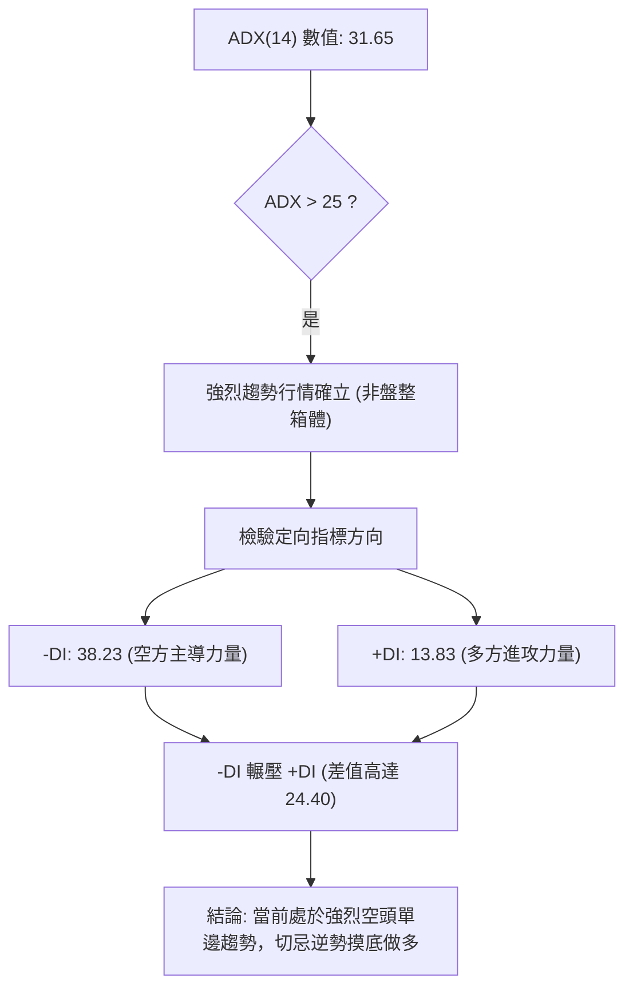

#### ADX 趨勢強度量化評估對照表

| 指標項 | 當前數值 | 門檻區間 | 技術解讀 | 交易涵義與策略指引 |
|--------|:--------:|:--------:|----------|--------------------|
| **ADX(14)** | **31.65** | > 25.0 | 處於標準強趨勢階段（趨勢行情） | 嚴禁採用擺盪指標進行區間逢低承接，順勢做空勝率遠高於逆勢抄底。 |
| **-DI** | **38.23** | > 30.0 | 空頭攻擊動能極其強悍且充沛 | 市場賣壓由機構主導，屬於持續性實質拋售，尚未見空頭動能衰竭。 |
| **+DI** | **13.83** | < 15.0 | 多頭防守與反攻力量極度萎縮 | 多頭缺乏買盤承接能力，買方籌碼渙散，任何上衝皆為弱勢技術反抽。 |
| **±DI 差值** | **-24.40** | 絕對值 > 15 | 空空分立差距巨大，趨勢具強方向性 | 多空力量處於完全失衡狀態，下跌動能處於主動擴散期。 |

---

## 3. 圖表形態分析

### 🔍 形態識別系統

在多時框架的圖表走勢中，KTOS 呈現出明確的「下降旗形向下破位」與「多重頭部破頸線」幾何軌跡：

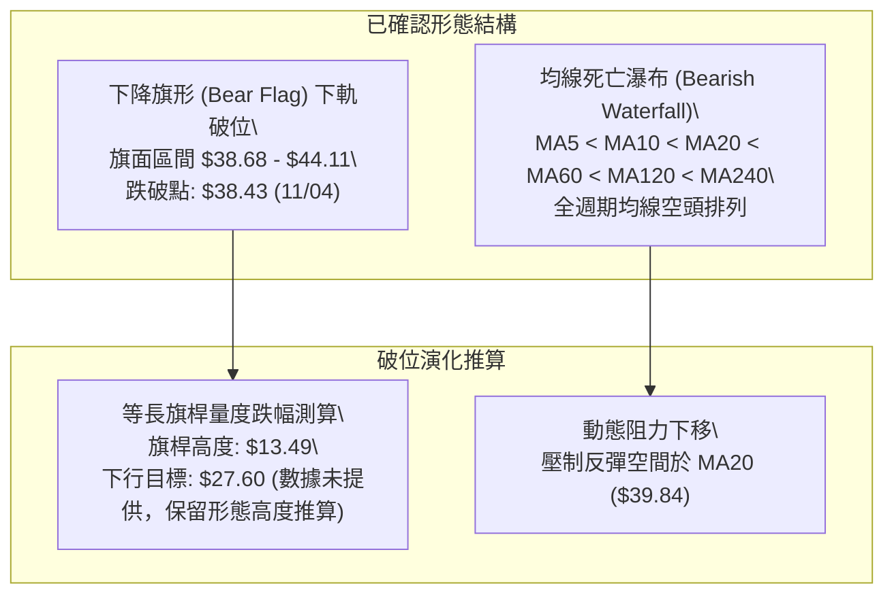

#### 形態識別與信心度評估表（依規則 15）

| 形態識別 | 信心度 (%) | 判斷依據（嚴格引用 OHLCV 數據） | 形態完成度 | 目標價測算（附計算式與數據引用） |
|----------|:----------:|----------------------------------|:----------:|-----------------------------------|
| **下降旗形破位** | **85%** | 10/23低點 $36.37 至 10/29高點 $44.11 形成上傾旗面整理；11/04 開盤 $39.86 直接放量跳空長黑摜破旗面下軌（10/30低點 $40.28 與 10/26低點 $38.43），11/05 收 $33.39 宣告破位成立。 | **100% (已破位)** | 旗桿高點為 10/09 高點 $44.14，旗桿起跌點至旗面低點 $36.37（高度 $7.77）。頸線破位點 $38.43，量度目標 = $38.43 − $7.77 = **$30.66**（註：由形態高度推算，下方數據未偵測到低點支撐）。 |
| **雙重頂破頸線 (中期)** | **75%** | 09/25 週高點 $49.68 與 10/29 日高點 $44.11 構成波段次級雙頂；頸線為 10/23 低點 $36.37，11/04 收 $35.96 正式跌破頸線。 | **95% (破位確認)** | 頸線 $36.37 − (反彈高點 $44.11 − 頸線 $36.37 = $7.74) = **$28.63**（註：由雙頂高度推算）。 |
| **頭肩底形態** | **0%** | **數據不足以支撐幾何形態**：當前處於無底破位態勢，無任何右肩架構，依規則 15 不予採納。 | 0% | 訊號不足，僅做指標型超賣解讀。 |

### 🕯️ 重要K線形態分析

嚴格依據數據提供的「近10根日K」與「近8根週K」實體開高低收進行精準形態識別（規則 19）：

#### 近 10 根日 K 線形態解讀

| 日期 | 開盤價 | 最高價 | 最低價 | 收盤價 | 成交量 | K線形態名稱 | 技術解讀與多空意涵 | 訊號 |
|:----:|:------:|:------:|:------:|:------:|:------:|:-----------:|--------------------|:----:|
| **2026-10-23** | $37.64 | $39.08 | $36.37 | $38.68 | 4,201,100 | 下影小陽線 | 測試 $36.37 低點後獲得買盤微弱抵抗，收盤收復開盤價。 | 🟡 |
| **2026-10-26** | $38.68 | $40.57 | $38.43 | $40.43 | 3,481,000 | 溫和中陽線 | 延續超跌反彈，但成交量僅 348 萬股，量能未能有效放大。 | 🟡 |
| **2026-10-27** | $40.73 | $42.12 | $40.06 | $41.32 | 4,320,500 | 推進陽線 | 突破 $41.00，成交量回升至 432 萬股，多頭持續試探上方壓力。 | 🟡 |
| **2026-10-28** | $41.38 | $41.56 | $40.40 | $41.17 | 2,805,700 | 高位窄幅十字星 | 追高意願急劇降溫（成交量縮至 280 萬），動能出現衰竭信號。 | 🔴 |
| **2026-10-29** | $41.28 | $44.11 | $41.20 | $43.59 | 6,251,700 | 衝高回落長陽 | 觸及阻力位 R1（$44.11），爆量 625 萬股，顯現主力逢高派發痕跡。 | 🟡 |
| **2026-10-30** | $42.67 | $43.21 | $40.28 | $41.09 | 3,414,400 | 空頭吞噬中陰 | 高開低走，完全吞沒前日漲幅實體大半，確認 $44.11 形成短期強頂。 | 🔴 |
| **2026-11-02** | $41.29 | $41.61 | $39.68 | $40.23 | 3,385,100 | 弱勢小陰線 | 連續失守整數關卡，盤中下探 $39.68，均線壓制明顯。 | 🔴 |
| **2026-11-03** | $40.41 | $41.72 | $40.10 | $40.99 | 3,235,100 | 弱勢吊頸小陽 | 衝高 $41.72 遇阻回落，量能極度萎縮，反彈動能耗盡。 | 🔴 |
| **2026-11-04** | $39.86 | $40.25 | $35.71 | $35.96 | 8,268,600 | **破位大陰線** | 放量暴跌 -12.27%，跌破所有短期均線與布林下軌，空頭長驅直入。 | 🔴 |
| **2026-11-05** | $35.63 | $35.79 | $32.50 | $33.39 | 9,477,800 | **恐慌長黑破位K** | 爆出 947 萬歷史級巨量，重挫直逼 52W 低點 $32.50，空頭掌控全局。 | 🔴 |

#### 近 8 根週 K 線形態解讀

| 週交易日 | 開盤價 | 最高價 | 最低價 | 收盤價 | 週成交量 | 週K形態解讀 | 訊號 |
|:--------:|:------:|:------:|:------:|:------:|:--------:|-------------|:----:|
| **2026-09-18** | $45.76 | $49.46 | $45.72 | $47.46 | 20,728,200 | 長上影十字陽：上測 $49.46 遇阻，空方賣壓深重。 | 🔴 |
| **2026-09-25** | $48.22 | $49.68 | $44.81 | $45.62 | 20,499,100 | 烏雲蓋頂陰線：高點形成 R2 阻力 $49.68 後滑落。 | 🔴 |
| **2026-10-02** | $44.97 | $45.22 | $41.83 | $43.07 | 24,159,800 | 下跌中繼中陰：連破 $44 與 $43 關卡，下行趨勢成形。 | 🔴 |
| **2026-10-09** | $43.80 | $44.14 | $40.93 | $42.36 | 26,620,200 | 下影小陰線：低檔放量震盪，多方抵抗力道薄弱。 | 🔴 |
| **2026-10-16** | $42.48 | $43.07 | $37.84 | $40.42 | 24,466,500 | 破位下挫陰線：跌破 $40 整數心理關卡，創波段新低。 | 🔴 |
| **2026-10-23** | $40.40 | $40.50 | $36.37 | $38.68 | 18,266,100 | 下影抵抗陰線：縮量測試 $36.37，空方動能短暫放緩。 | 🟡 |
| **2026-10-30** | $38.68 | $44.11 | $38.43 | $41.09 | 20,273,300 | 倒錘頭長上影陽：衝高 $44.11 慘遭全面空頭反撲。 | 🔴 |
| **2026-11-05** | $41.29 | $41.72 | $32.50 | $33.39 | 24,366,600 | **極長實體大陰線**：高開低走，暴跌摜穿 $35，直撲 52W 低位。 | 🔴 |

### 📉 ASCII 走勢形態示意圖

```
KTOS 下降旗形與雙頂破位幾何路徑圖
價格軸 ($)
$45 ┤                       ╭───● 10/29 高點聚類 R1: $44.11 (假突破)
$44 ┤                      ╱     ╲
$43 ┤                     ╱       ╲  10/30 空頭吞噬 ($41.09)
$42 ┤         ╭──●       ╱         ╲
$41 ┤        ╱    ╲     ╱           ● 11/03 反彈高點 $41.72
$40 ┤       ╱      ╲   ╱             ╲
$39 ┤      ╱        ●─╯ 10/26         ╲  11/04 跳空破位大陰線
$38 ┤     ╱          ($38.43)          ╲  (成交量 8,268,600)
$37 ┤    ╱                               ╲
$36 ┤───● 10/23 旗面下軌支撐 ($36.37) ───────╲───── 破位確立 ────────
$35 ┤                                      ╲  收盤 $35.96
$34 ┤                                       ╲
$33 ┤                                        ● 11/05 收盤: $33.39
$32 ┤─────────────────────────────────────────● 52W最低點: $32.50
    └─────────────────────────────────────────────────────────────
```

---

## 4. 支撐與阻力

### 🗺️ 關鍵價位分布圖（Unicode）

嚴格引用數據庫中計算完成的阻力與支撐數據，KTOS 當前下方已無任何近一年波段低點聚類的 swing-low 支撐存在，僅剩 52 週最低點 $32.50 作為最後脆弱防線。

```
KTOS 價位結構分布圖 (由 OHLCV 歷史數據計算)
═══════════════════════════════════════════════════════════════════
$51.49 ║████████████████████████████████║ 強阻力 R3 (波段高點聚類)
       ║                                ║
$49.68 ║████████████████████████        ║ 阻力 R2 (波段高點聚類)
       ║                                ║
$44.11 ║████████████████████████████████║ 關鍵頸線阻力 R1 (10/29高點)
       ║                                ║
$39.84 ║────────────────────────────────║ 布林中軌 / MA20 動態重壓
       ║                                ║
$35.36 ║┄┄┄┄┄┄┄┄┄┄┄┄┄┄┄┄┄┄┄┄┄┄┄┄┄┄┄┄┄┄║ 布林下軌 (破位反壓區)
       ║                                ║
$33.39 ╠════════════════════════════════╣ ◄ 當前市價 (收盤價)
       ║                                ║
$32.50 ║▓▓▓▓▓▓▓▓▓▓▓▓▓▓▓▓                ║ 52週極限低點 / 斐波 100.0%
       ║                                ║
 [真空]║░░░░░░░░░░░░░░░░░░░░░░░░░░░░░░░░║ 數據中未偵測到任何波段低點支撐
═══════════════════════════════════════════════════════════════════
```

### 🚧 阻力位分析表

阻力位嚴格引用數據中「關鍵價位」區塊由 OHLCV 計算的波段高點聚類數值：

| 阻力級別 | 價位 | 距現價幅離 | 形成原因與籌碼解讀 | 突破難度 | 重要性評級 |
|:--------:|:----:|:----------:|--------------------|:--------:|:----------:|
| **R1** | **$44.11** | +32.11% | 近一年波段高點聚類（2026-10-29 日高點與 10-30 週高點）。下降旗面上軌，套牢大量抄底散戶籌碼。 | 極高 | ★★★★★ |
| **R2** | **$49.68** | +48.79% | 2026-09-25 週高點聚類。中期箱體震盪頂部，強大機構出貨防線，MA120（$49.91）匯聚處。 | 極高 | ★★★★☆ |
| **R3** | **$51.49** | +54.21% | 近一年波段高點聚類，接近 2026-08 月線收盤平台（$50.98），多頭結構防守大本營。 | 幾無可能 | ★★★☆☆ |

### 🛡️ 支撐位分析表

依據數據庫顯示：「支撐位 (Support) — 近一年波段低點聚類：(no swing-low support detected below current price)」：

| 支撐級別 | 價位 | 距現價幅離 | 形成原因與結構意義 | 守住機率 | 重要性評級 |
|:--------:|:----:|:----------:|--------------------|:--------:|:----------:|
| **S1 (極限)** | **$32.50** | -2.67% | 52 週最低點（2026-11-05 盤中低點）與斐波那契 100.0% 回調位重合。唯一客觀數據底部。 | 30% (脆弱) | ★★★★★ |
| **S2** | **數據未偵測到** | N/A | **數據中未偵測到**（依規則 13/16，不予編造虛擬價位）。 | N/A | N/A |
| **S3** | **數據未偵測到** | N/A | **數據中未偵測到**（依規則 13/16，不予編造虛擬價位）。 | N/A | N/A |

### 📐 斐波那契回調位分析

依據數據庫中已給定的 52 週區間（$32.50 → $134.00）之客觀斐波那契數據，現價位置解析如下：

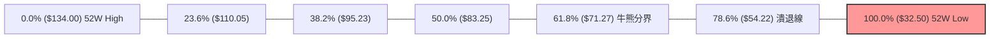

| 斐波那契層級 | 精確價位 | 距現價幅度 | 當前狀態與技術意涵解讀 |
|:------------:|:--------:|:----------:|------------------------|
| **0.0% (52W High)** | $134.00 | +301.32% | 歷史牛市終點，長線頂部。 |
| **23.6%** | $110.05 | +229.59% | 第一波出貨區間，多頭全線潰退。 |
| **38.2%** | $95.23 | +185.21% | 前期重要整理平台，跌破後轉為絕對阻力。 |
| **50.0%** | $83.25 | +149.33% | 中級回調中軸線，中長期反轉確立點。 |
| **61.8%** | $71.27 | +113.45% | 黃金分割防守位，2026-03 跌破後宣告主升浪徹底死亡。 |
| **78.6%** | $54.22 | +62.38% | 深度回撤防線，失守後引發長期機構清倉。 |
| **100.0% (52W Low)**| **$32.50** | **-2.67%** | **全波段起漲起跌底線。現價 $33.39 僅位於 78.6% ($54.22) 與 100.0% ($32.50) 區間的最下緣，極度瀕臨全面破位。** |

**現價區間解讀**：現價 $33.39 落在 78.6%（$54.22）與 100.0%（$32.50）之間，且極度貼近 100.0% 基準線。這表明 KTOS 過去一整年錄得的漲幅已全數回吐殆盡（回撤達 99.1% 的區間空間）。若 $32.50 宣告失守，將跌破近 52 週所有籌碼底線，進入技術性無支撐區間。

---

## 5. 技術指標深度解讀

### 🎛️ 指標訊號總覽

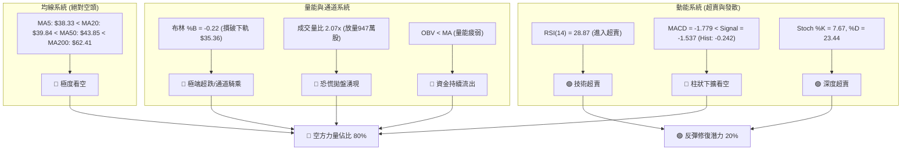

### 📈 移動平均線排列分析

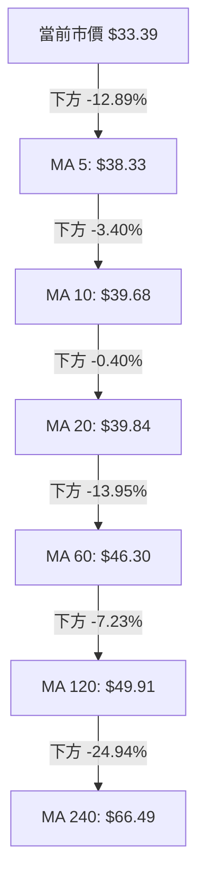

#### 均線全系統量化分析表

| 均線名稱 | 當前價格 | 乖離率 (%) | 均線斜率 | 均線狀態與歷史趨勢形態 |
|:--------:|:--------:|:----------:|:--------:|:----------------------|
| **MA 5** | $38.33 | -12.89% | 急墜下行 | 空頭短鋒，日K連續兩天被壓制在MA5之下。 |
| **MA 10** | $39.68 | -15.86% | 陡峭向下 | 兩週平均成本，下彎速度加快，構成極強短壓。 |
| **MA 20** | $39.84 | -16.19% | 持續走低 | 月線生命線，自 10 月以來從未被有效站穩。 |
| **MA 50** | $43.85 | -23.85% | 穩步下移 | 季線中線分水嶺，與 R1 阻力（$44.11）形成密集共振壓制帶。 |
| **MA 60** | $46.30 | -27.88% | 堅定向下 | 中期趨勢線，距離現價高達近 28%，負乖離嚴重。 |
| **MA 120**| $49.91 | -33.11% | 長期下彎 | 半年線，與 R2 阻力（$49.68）重合，中期牛熊轉換天花板。 |
| **MA 200**| $62.41 | -46.50% | 緩慢走平向下 | 長期年線，自 2026 年中旬失守後，KTOS 正式轉入長期熊市。 |
| **MA 240**| $66.49 | -49.78% | 走低下移 | 超長週期基線，現價已被腰斬，空頭形態臻於極致。 |

**均線綜合解讀**：MA 系統展現了教科書級別的「空頭排列（Bearish Alignment）」。從短期 MA5 到超長期 MA240，所有均線均嚴格滿足 $MA5 < MA10 < MA20 < MA60 < MA120 < MA240$ 的數學順序。多頭若想逆轉趨勢，需耗費數月時間進行底層籌碼沉澱，短期任何反彈皆屬修復負乖離的「解套波」。

### 📉 RSI(14) 分析

```
RSI(14) 刻度尺：當前值 = 28.87 (Wilder 計算)
0 ─────── [20] ────── [30: 超賣線] ─────── [50: 中軸] ─────── [70] ─────── 100
           │    ▲      │                    │                   │
           └────┼──────┘                    │                   │
             當前 28.87 (進入超賣警戒區)
```

- **超買超賣狀態**：RSI(14) 最新讀數為 **28.87**，正式擊穿 30.00 的經典超賣分界線。技術面上，這表明近 14 個交易日內空頭拋壓極為極端，價格已呈現過度延伸（Overextended）狀態。
- **背離判斷（嚴格依據數據）**：
  - 數據庫背離檢測結論：**無明顯背離**（僅比較近 20 根 K 棒首尾的價格與 RSI 方向）。
  - 事實確認：在近 10 根日 K 中，價格由 10/29 高點 $43.59 崩跌至 11/05 收盤 $33.39，RSI(14) 同步由約 45.9 大幅滑落至 28.87，價格與指標同向創出近期新低，**並無底背離現象**。這意味著空方動能是實打實的宣洩，並非動能耗盡引發的鈍化誘空，切不可單純因 RSI<30 盲目抄底。

### 📊 MACD(12/26/9) 訊號解讀

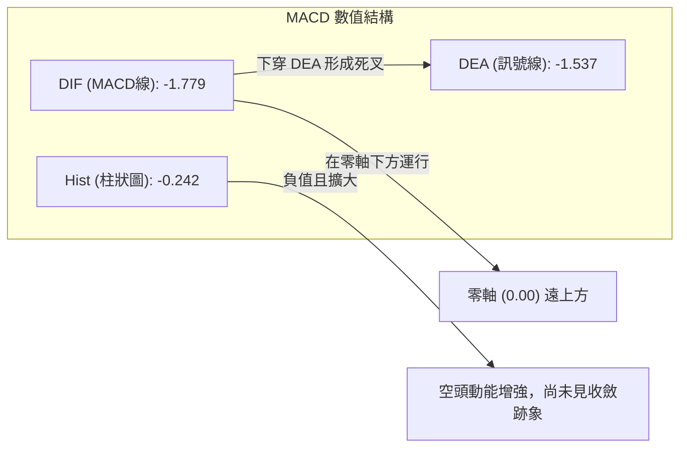

- **數值關係**：MACD 線（-1.779）低於信號線（-1.537），位於零軸深處下方。MACD 柱狀圖（Histogram）錄得 **-0.242**。
- **動能演變**：回顧近 20 週數據，週線 MACD 柱狀圖在 10/30 曾短暫回升至 +0.602，但隨著 11/05 的重挫，日線與週線的空頭柱狀體同步重新向下擴張。日線負柱體放大證明空頭力量處於二次加速釋放期，下行斜率陡峭，未見任何柱體縮腳或金叉萌芽跡象。

### 📦 布林通道分析

```
KTOS 布林通道 (20, 2) 當前幾何位置
價格 ($)
$45 ┤
$44 ┤ ═════════════════════════════════ 上軌: $44.32
$43 ┤
$42 ┤
$41 ┤
$40 ┤ --------------------------------- 中軌 (MA20): $39.84
$39 ┤
$38 ┤
$37 ┤
$36 ┤
$35 ┤ ═════════════════════════════════ 下軌: $35.36
$34 ┤
$33 ┤ ◄── 現價: $33.39 (%B = -0.22，脫軌運行)
$32 ┤     [52W最低點: $32.50]
    └──────────────────────────────────────────────────
```

- **通道參數與軌道值**：
  - 上軌：$44.32
  - 中軌 (MA20)：$39.84
  - 下軌：$35.36
  - 當前收盤價：$33.39
- **%B 深度解讀**：當前 **%B 數值為 -0.22**（註：%B = (Price − Lower) / (Upper − Lower)；當 Price < Lower 時，%B < 0）。
- **帶寬與形態涵義**：現價大幅脫離布林通道下軌達 $1.97 美元。在統計學意義上，股價位於 2 倍標準差之外，屬於罕見的極端下行擴散。布林通道開口顯著張開，呈現出標準的「下軌走肉（Walking the Lower Band）」高動能空頭態勢。儘管隨時存在均值回歸拉回下軌之內的技術需求，但在開口擴大初期，脫軌往往伴隨著強烈的主跌行情。

### 💹 成交量分析（量價配合度）

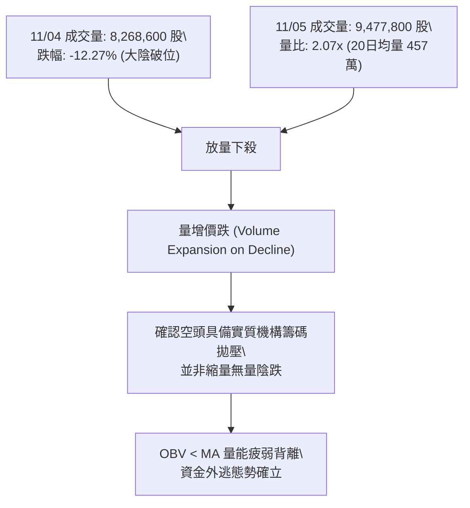

- **量比與異動**：最新單日成交量高達 **9,477,800 股**，相較於 20 日均量（4,578,120 股）錄得 **2.07 倍的巨大成交量比**；相較於 50 日均量（4,299,418 股）更達到 2.20 倍。
- **量價配合判定**：
  - 近期上漲縮量、下跌放量特徵極其顯著：10/26 至 10/28 反彈期間，日均量僅 280 萬 ~ 430 萬股；而 11/04 與 11/05 連續兩日放量至 826 萬與 947 萬股，直接擊碎旗面整理下軌。
  - **量價關係評估：🔴 量增價跌**。高量殺跌意味著長線機構持股鬆動，恐慌性停損盤與保證金斷頭盤大舉出籠，下行趨勢受到成交量的強烈驗證（Volume Confirms Price Trend）。
- **OBV 指標解讀**：數據明確標示「**OBV < MA → 量能疲弱**」。能量潮指標運行於其移動平均線下方，持續呈現「階梯式走低」，表明資金淨流出態勢完全未被扭轉，量能面全面利空於多頭。

---

## 6. 動能與波動率

### ⚡ 動能評估四象限

評估 KTOS 在「動能強度（Directional Momentum）」與「波動率（Volatility）」維度下的市場環境所屬區間：

| 象限 | 動能維度 | 波動維度 | 當前狀態 | 技術環境特徵與操作評估 |
|:----:|:--------:|:--------:|:--------:|------------------------|
| **Q1** | 強多頭 | 低波動 | — | 穩健單邊牛市，持股續抱的最佳區間。 |
| **Q2** | 弱動能 | 低波動 | — | 窄幅無趨勢盤整，適合區間網格操作。 |
| **Q3** | 強動能 | 高波動 | — | 主升浪或突發題材博弈，高風險高收益。 |
| **Q4** | **強空頭** | **高波動** | **✓ (當前)**| **恐慌主跌浪階段：空頭動能極強（ADX 31.65, -DI 38.23），波動率驟升（ATR 7.29%）。風險極大，嚴禁逆勢盲目摸底！** |

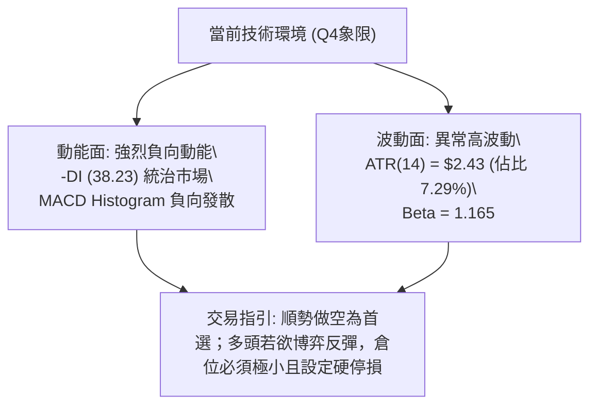

### 📊 ATR 波動率分析

- **ATR(14) 數值**：**$2.43**（基於 Wilder 平滑法）。
- **ATR 佔價格比**：佔當前股價（$33.39）的比例高達 **7.29%**。這意味著在當前市場結構下，KTOS 每日的平均隨機噪音波幅即高達約 2.5 美元。
- **止損距離建議**：
  - 由於高波動率特性，任何日內緊密停損（如 1%~2%）均極易被無序雜訊掃出場。
  - **空頭順勢策略**：建議動態移動停損距離至少設置在 **1.0 ~ 1.5 倍 ATR**（即 $2.43 ~ $3.65），以防範超賣引發的劇烈日內反抽。
  - **多頭反抽策略**：由於逆勢操作風險極高，停損空間必須嚴格卡在 52 週低點下方，停損距離建議控制在 **0.5 ~ 0.7 倍 ATR**（約 $1.20 ~ $1.70，即跌破 $32.00 必須立即止損離場）。

### 📐 Beta 與市場相關性

- **Beta 係數**：**1.165**。
- **市場敏感度解讀**：
  - KTOS 的波動性顯著高於標普 500 大盤（高出約 16.5%）。在美股整體科技股與國防板塊面臨拋售壓力時，KTOS 會呈現顯著的「放大下跌（Amplified Beta Sell-off）」效應。
  - 近期新聞指出「Rocket Lab 暴跌 12%，AI 拋售潮衝擊太空航太領域」，作為高估值（歷史 P/E 曾達 200+）且自由現金流為負（TTM FCF 為 $-128.90M）的高 Beta 標的，KTOS 在市場流動性緊縮時極易成為機構拋售變現的首選對象。

---

## 7. 多時框架總結

### 📋 時框架評分表

| 時框架 | 趨勢方向 | 動能狀態 | 均線排列 | 圖表形態 | 綜合評分 | 建議操作取向 |
|:------:|:--------:|:--------:|:--------:|:--------:|:--------:|:------------:|
| **日線 (短線)** | 🔴 極度偏空 | 🟢 極度超賣 (RSI 28.87) | 🔴 空頭排列 | 下降旗形破位 | **25/100** | 逢反彈測壓做空，忌追多 |
| **週線 (中線)** | 🔴 單邊下行 | 🔴 動能續跌 (MACD下彎) | 🔴 下行發散 | 次級雙頂成型 | **20/100** | 中期偏空，反彈尋找空點 |
| **月線 (長線)** | 🔴 週期見頂 | 🔴 漲幅全數吞噬 | 🔴 跌破MA240 | 圓弧頂破位 | **30/100** | 熊市深淵，長期防禦觀望 |

### 🔲 綜合訊號矩陣

```
╔═══════════════════════════════════════════════════════════════════╗
║                      KTOS 多時框綜合訊號矩陣                       ║
╠═══════════════════════════════════════════════════════════════════╣
║ 維度         短線 (日線)          中線 (週線)          長線 (月線)║
╠═══════════════════════════════════════════════════════════════════╣
║ 趨勢方向     🔴 破位重挫          🔴 階梯下行          🔴 熊市循環║
║ 動能指標     🟢 超賣鈍化          🔴 空頭增強          🔴 資金退潮║
║ 均線結構     🔴 完美空頭          🔴 均線反壓          🔴 長期轉空║
║ 量價形態     🔴 爆量殺多          🔴 縮量反彈放量跌    🔴 高位放量出貨║
║ 關鍵位置     🔴 逼近52W極限       🔴 跌破頸線 $36.37   🔴 回吐99%漲幅║
╠═══════════════════════════════════════════════════════════════════╣
║ 總結判定     🔴 空方掌控 (85%)    🔴 空方掌控 (90%)    🔴 空方掌控 (80%)║
╚═══════════════════════════════════════════════════════════════════╝
```

### ⚖️ 多時框收斂結論

依據技術分析「嚴格要求 14（多時框收斂規則）」：
1. **行情性質判定**：當前 ADX(14) 數值為 **31.65**（明確大於 25.0），且 -DI(38.23) 呈現統治級領先，系統確認當前為**極度標準的單邊趨勢行情（空頭強趨勢）**，而非低波動盤整箱體。
2. **主導時框優先級**：依規則 14，趨勢行情下必須**以中長期（週線、MA50、MA200）方向為絕對主導**。日線級別雖然 RSI(14)=28.87 與 Stoch=7.67 進入嚴重超賣，但超賣訊號「只能用來尋找空頭架構下的進場反彈測試時機，嚴禁作為扭轉中長期熊市趨勢的依據」。
3. **收斂方向唯一性**：各週期訊號在此高度共振收斂，**方向唯一結論：強烈偏空（Bearish）**。日線層面的超賣僅可能帶來短暫的日內脈衝修復，絕不構成中級反轉信號。第 8 章交易策略將完全鎖定空頭方向為主導路由。

---

## 8. 交易策略建議

### 🗺️ 策略決策流程圖

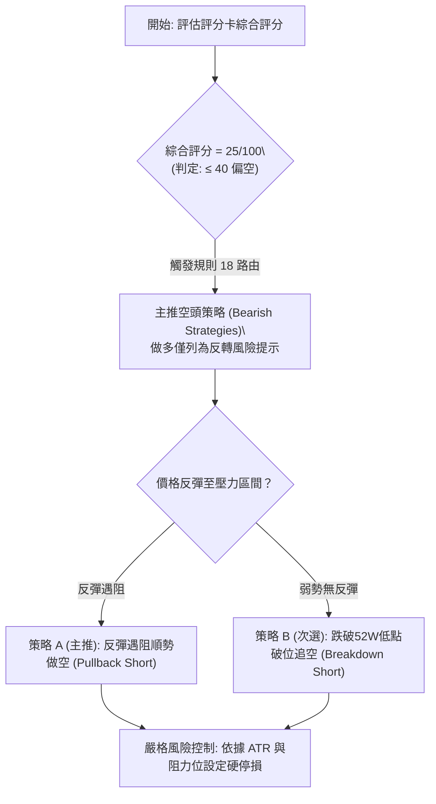

### 🧭 策略路由（依評分卡分流）

> **當前主策略方向 = 強烈偏空（依評分卡綜合評分 25/100，嚴格觸發 ≤40 偏空主路由）**

### 🎯 價格情境階梯（Price Scenarios）

價位嚴格引用第 4 章及數據庫中客觀計算之 OHLCV 點位：

| 觸發條件 | 下一目標 | 後續延伸 | 情境技術含義與應對要點 |
|----------|:--------:|:--------:|------------------------|
| **反彈遇阻 R1 $44.11** | 布林下軌 $35.36 | 52W低點 $32.50 | 典型的空頭回抽確認，形成極佳的中期逢高做空二次進場點。 |
| **跌破布林中軌 $39.84** | S1 (52W Low) $32.50 | 斐波 100.0% ($32.50) | 空頭動能持續釋放，短期弱勢反彈夭折。 |
| **跌破 S1 $32.50** | $30.66 (旗形測算) | $28.63 (雙頂測算) | 歷史低位全面潰敗，下方進入無支撐真空區，引發踩踏式崩跌。 |

### 📊 情境機率分佈

| 價格情境 | 機率估計 (%) | 主要技術指標支撐依據 |
|----------|:------------:|----------------------|
| **弱反抽後再破底 (主情境)** | **60%** | ADX(14)=31.65 強趨勢確立；均線全面空頭排列；放量大陰線顯示籌碼恐慌出逃，超賣反彈空間受限於 MA5/MA20。 |
| **直接破位加速下行 (次情境)**| **30%** | 成交量比高達 2.07x，布林 %B = -0.22 處於脫軌下行擴散狀態，若市場情緒進一步惡化將跳空摜破 $32.50。 |
| **反轉突破 R1 向上修復 (低機率)**| **10%** | 僅憑 RSI(14)=28.87 極度超賣，缺乏任何成交量底背離或形態支撐，多頭扭轉阻力重重。 |

### 🟢 主策略詳情（空頭主推，方向依上方路由）

所有價位均嚴格引用數據庫既有數值（如波段高點聚類、52週低點、布林軌道數值）：

| 策略要素 | 策略 A（主推：反彈遇阻做空） | 策略 B（次選：跌破52W低點追空） |
|----------|--------------------------------|----------------------------------|
| **策略名稱** | **超賣回抽布林下軌受阻做空** | **52週歷史低點破位順勢追空** |
| **進場條件** | 股價因超賣反抽至布林下軌（$35.36）至 MA5（$38.33）區間受阻，日K收出長上影線或陰線吞噬確認。 | 股價放量跌穿 52 週最低點 $32.50，盤中跌幅超過 1.5% 且成交量放大確認破位。 |
| **進場價格** | **$36.85**（取 $35.36 ~ $38.33 區間中點計算） | **$32.50**（52週低點關鍵位） |
| **目標價 T1** | **$33.39**（當前收盤價位置） | **$30.66**（由下降旗形形態高度推算） |
| **目標價 T2** | **$32.50**（52週低點） | **$28.63**（由中期雙頂形態高度推算） |
| **止損價格** | **$39.84**（布林中軌 / MA20 強阻力） | **$33.39**（突破無效拉回當前收盤價止損） |
| **風險報酬比** | **1 : 1.16（以 T1 計）**<br>計算式：$(36.85 - 33.39) \div (39.84 - 36.85) = 3.46 \div 2.99 = 1.157$<br>另：**1 : 1.45（以 T2 計）** | **1 : 2.07（以 T1 計）**<br>計算式：$(32.50 - 30.66) \div (33.39 - 32.50) = 1.84 \div 0.89 = 2.067$<br>另：**1 : 4.35（以 T2 計）** |
| **成功機率** | **65%** | **55%** |
| **建議倉位** | **8% ~ 10%**（輕中度倉位） | **5%**（突破性風控微型倉位） |

### 🔴 反向風險觸發點（對沖與止損提示）

若出現以下極端技術事件，表明空頭邏輯被實質顛覆，所有空頭頭寸必須無條件無延遲止損離場：
1. **價格強勢站穩布林中軌 $39.84**：若日K以大陽線收於 MA20 之上，宣告日線下行趨勢中斷，空單立即平倉。
2. **爆量長陽突破阻力位 R1 $44.11**：若突破 10/29 高點，代表下降旗形破位為「假破位（Bear Trap）」，中期頭部形態失效。
3. **日線 MACD 於零軸下方出現「低位雙金叉」且柱狀圖轉正放量**。

### ⭐ 整體訊號強度評星

```
╔══════════════════════════════════════════════════════╗
║ KTOS 技術訊號強度評星 (依據嚴格技術規則評定)        ║
╠══════════════════════════════════════════════════════╣
║ 做多訊號強度：★☆☆☆☆  (1/5星 — 僅有RSI超賣單項支撐)  ║
║ 做空訊號強度：★★★★☆  (4/5星 — 均線/趨勢/量能全共振) ║
║ 整體可信度：  ★★★★☆  (4/5星 — 趨勢確立，數據一致)   ║
╚══════════════════════════════════════════════════════╝
```

---

## 9. 風險提示與監控

### ✅ 關鍵監控指標 Checklist

```
╔══════════════════════════════════════════════════════════════════╗
║               KTOS 日常交易風控與技術監控清單                    ║
╠═══════════════════════════════════════════════════════════════════╣
║ [ ] 監控項 1：52週最低點 $32.50 的防守得失（盤中跌破即觸發止損） ║
║ [ ] 監控項 2：成交量是否持續放大（成交量比 > 1.5x 視為破位確認）║
║ [ ] 監控項 3：RSI(14) 是否在 20-30 區間鈍化（防止假性反彈誘多） ║
║ [ ] 監控項 4：布林帶寬是否持續張開（%B 是否持續小於 0）        ║
║ [ ] 監控項 5：阻力位 R1 $44.11 的反壓有效性                      ║
║ [ ] 監控項 6：ADX(14) 是否持續維持於 25 以上（趨勢行情延續）   ║
║ [ ] 監控項 7：大盤板塊情緒（航空國防類股是否持續出現流動性踩踏）║
╚═══════════════════════════════════════════════════════════════════╝
```

### ⚠️ 風險場景分析

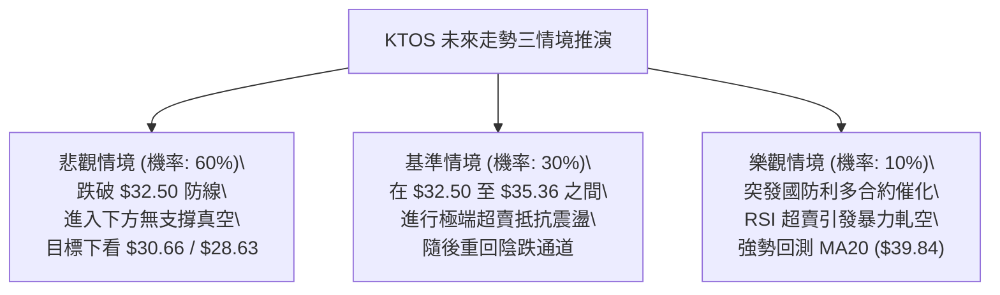

### 🛡️ 風險管理重要提醒

1. **基本面現金流風險對技術面的傳導**：
   - 財務數據顯示 KTOS 的 TTM 自由現金流為 **$-128.90M**（經營現金流 $-39.60M 減去 資本支出 $89.30M），且最新季度營業利益率轉負至 **-0.2%**。儘管分析師共識目標價給予 $89.76 高位，但現金流失血促使市場在流動性緊張時對其高估值（Forward P/E 仍近 30 倍）進行無情殺估值。
   - **操作啟示**：切勿以分析師之「強烈買進」共識作為技術摸底理由，技術價格走勢永遠先行反映基本面潛在風險。
2. **左側交易禁忌**：
   - 在均線呈現完整空頭排列且 ADX 高達 31.65 時，左側抄底無異於「用雙手接落下的飛刀」。任何多頭建倉必須等待右側信號——至少看到日線形成雙底結構且 MACD 在零軸上方金叉。
3. **嚴格執行倉位管理**：
   - 當前 ATR 高達 7.29%，屬於高波動殺戮行情。單筆交易的最大資金承擔風險（Maximum Capital at Risk）務必嚴格限制在總賬戶淨值的 **1.0% 以內**。

---

## 📋 報告總結

```
╔══════════════════════════════════════════════════════════════════╗
║                    KTOS 技術分析報告總結                         ║
╠═══════════════════════════════════════════════════════════════════╣
║ 報告日期：2026-11-06                                             ║
║ 當前價格：$33.39                                                 ║
║ 分析評級：🔴 強烈偏空 / 空頭加速探底（綜合評分：25/100）        ║
║                                                                  ║
║ 關鍵結論：                                                       ║
║ ├─ 長期趨勢：🔴 空頭週期，MA240 跌破，回吐全年度 99% 漲幅       ║
║ ├─ 中期趨勢：🔴 雙頂頸線破位，下降旗形展開量度跌幅              ║
║ ├─ 短期趨勢：🔴 跌破布林下軌 (%B: -0.22)，爆量 2.07x 恐慌下瀉    ║
║ ├─ 關鍵支撐：$32.50 (52W最低點，下方已無波段低點支撐)            ║
║ ├─ 關鍵阻力：$44.11 (R1 波段高點聚類) / $39.84 (MA20 中軌)      ║
║ └─ 趨勢強度：ADX(14) = 31.65 且 -DI = 38.23，空頭趨勢強烈主導   ║
║                                                                  ║
║ 最優策略組合：                                                   ║
║ 1. 🥇 最佳機會：策略 A — 反抽布林下軌 $35.36~$38.33 區間受阻做空 ║
║ 2. 🥈 次選機會：策略 B — 放量跌破 52W 低點 $32.50 順勢破位追空   ║
║ 3. 🥉 保守選擇：完全空倉觀望，嚴禁在下行趨勢中逆勢摸底做多      ║
╚═══════════════════════════════════════════════════════════════════╝
```

---

> ⚠️ **免責聲明**：本報告為技術分析研究，所有數據、圖表及價位推算均基於歷史量價數據（OHLCV）。本報告**僅供研究與學術參考**，**不構成任何要約、推薦或投資操作建議**。金融市場具有高度不確定性，標的可能面臨劇烈波動及本金虧損，投資人應獨立思考並自負盈虧。

---

*報告生成時間：2026-11-06 ｜ 數據來源：Yahoo Finance ｜ 分析框架：多時框技術分析模型*