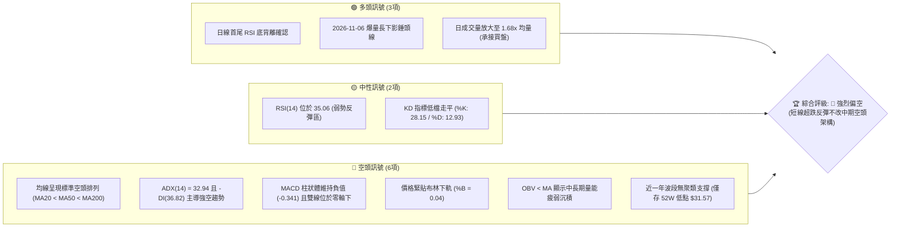
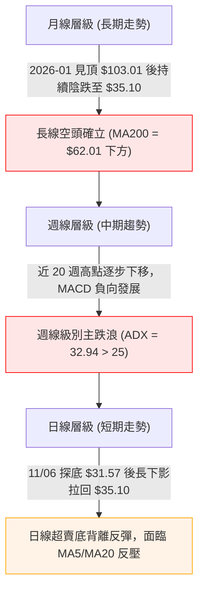
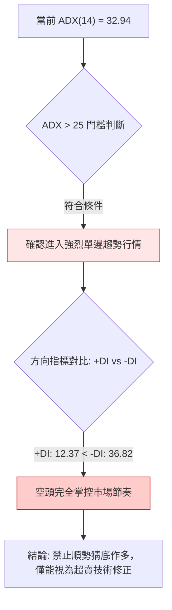
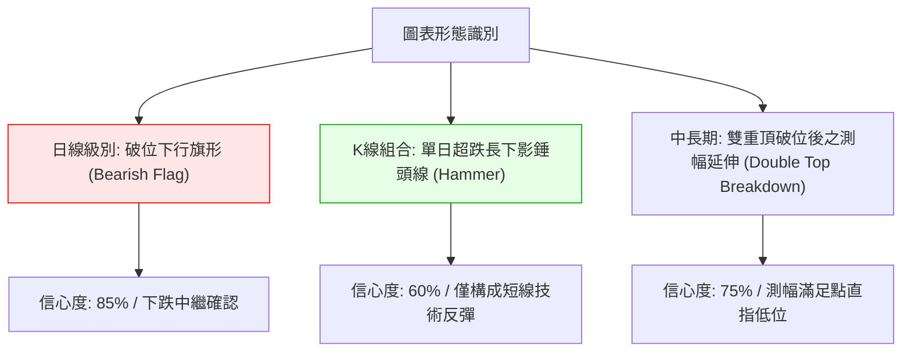
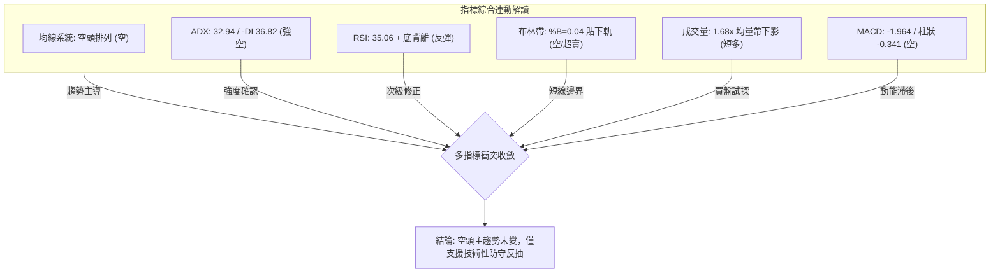
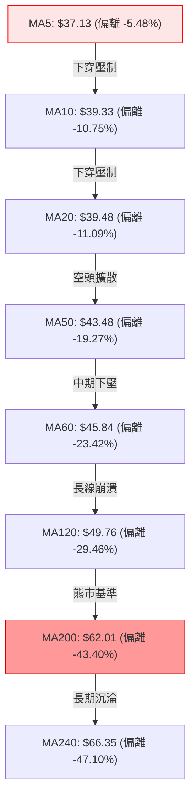
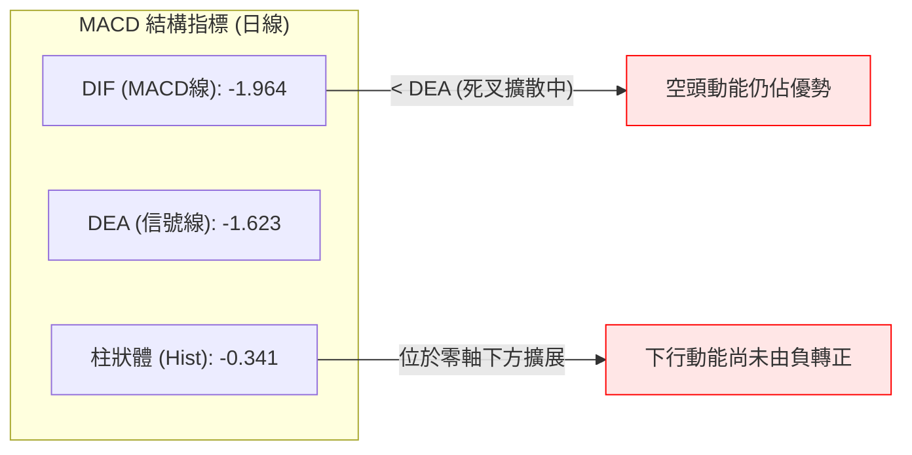
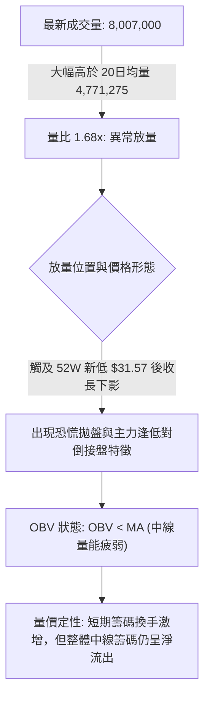
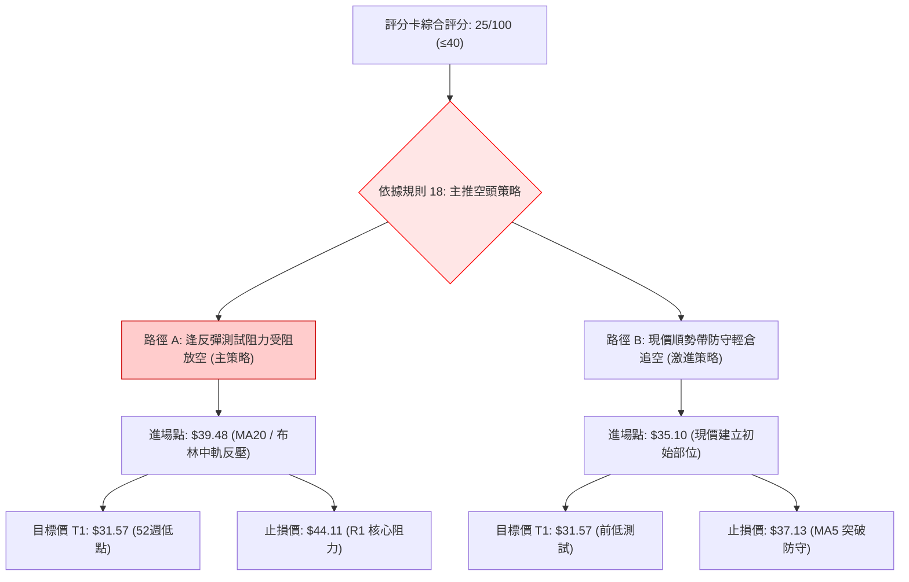
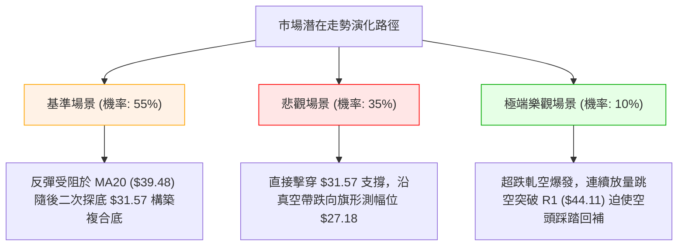

# KTOS 技術分析報告

> **報告日期**：2026-11-07 ｜ **語言**：繁體中文 ｜ **數據來源**：Yahoo Finance ｜ **當前價格**：$35.10

---

## 目錄

| 章節 | 內容 |
|------|------|
| [1. 技術面概覽](#1-技術面概覽) | 訊號儀表板、核心指標、評分卡 |
| [2. 趨勢分析](#2-趨勢分析) | 多時框趨勢、長中短期走勢 |
| [3. 圖表形態分析](#3-圖表形態分析) | 形態識別、K線組合、目標價 |
| [4. 支撐與阻力](#4-支撐與阻力) | 關鍵價位、斐波那契回調 |
| [5. 技術指標深度解讀](#5-技術指標深度解讀) | MA/RSI/MACD/布林/成交量 |
| [6. 動能與波動率](#6-動能與波動率) | 動能評估、ATR、Beta |
| [7. 多時框架總結](#7-多時框架總結) | 時框架評分矩陣 |
| [8. 交易策略建議](#8-交易策略建議) | 多空策略、風險報酬比 |
| [9. 風險提示與監控](#9-風險提示與監控) | 監控指標、風險場景 |
| [10. 報告總結](#-報告總結) | 核心結論與策略總覽 |

---

## 1. 技術面概覽

### 🎯 技術訊號儀表板



---

### 📊 核心指標速覽表

| 指標類別 | 指標名稱 | 當前數值 | 訊號 | 解讀 |
|:---|:---|:---:|:---:|:---|
| **價格** | 當前收盤價 | $35.10 | 🔴 | 位於 52 週區間底部 3.4% 處，瀕臨破底邊緣 |
| **均線** | MA20 (短月線) | $39.48 | 🔴 | 價格低於 MA20 達 -11.09%，短期動能嚴重承壓 |
| **均線** | MA50 (季線) | $43.48 | 🔴 | 價格低於 MA50 達 -19.27%，中期趨勢維持全面下行 |
| **均線** | MA200 (年線) | $62.01 | 🔴 | 價格低於 MA200 達 -43.40%，長期結構徹底轉熊 |
| **動能** | RSI(14) | 35.06 | 🟡 | 位於中性偏弱區間，近 20 根 K 棒出現首尾底背離 |
| **動能** | MACD (12,26,9) | -1.964 / Hist: -0.341 | 🔴 | 快慢線均在零軸深處，負向柱狀體持續擴散看空 |
| **趨勢** | ADX(14) / ±DI | ADX: 32.94 / -DI: 36.82 | 🔴 | ADX > 25 處於強趨勢狀態，-DI 壓倒性主導空方 |
| **通道** | 布林帶 %B | 0.04 (下軌 $34.69) | 🔴 | 價格緊貼下軌運行，呈現極端弱勢的單邊下行通道 |
| **量能** | 當日量 / 20日均量 | 8.01M / 4.77M (1.68x) | 🟢 | 跌破 52W 新低 $31.57 後引發恐慌性拋售與逢低承接量 |
| **波動** | ATR(14) | $2.53 (7.20%) | 🔴 | 日內波動率高達 7.20%，屬於高風險高波動標的 |

---

### 🏆 技術評分卡

依據評分規則，六項子維度均以 0–100 分量化（分數越高代表技術面多頭動能越強，反之代表空頭壓制）：

```
╔══════════════════════════════════════════════════════════════════╗
║                   技術評分卡 — KTOS (2026-11-07)                 ║
╠══════════════════════════════════════════════════════════════════╣
║ 趨勢強度 (Trend)     █████░░░░░░░░░░░░░░░  25/100  🔴 空頭強勢   ║
║ 動能指標 (Momentum)  ███████░░░░░░░░░░░░░  35/100  🟡 底背離緩衝 ║
║ 支撐穩定度 (Support) ████░░░░░░░░░░░░░░░░  20/100  🔴 無下檔聚類 ║
║ 成交量配合 (Volume)  ██████░░░░░░░░░░░░░░  30/100  🔴 帶量破位殺 ║
║ 形態完整度 (Pattern) █████░░░░░░░░░░░░░░░  25/100  🔴 下跌旗形破 ║
║ 均線排列 (MAs)       ███░░░░░░░░░░░░░░░░░  15/100  🔴 完封空頭列 ║
╠══════════════════════════════════════════════════════════════════╣
║ 綜合評分 (Overall)   █████░░░░░░░░░░░░░░░  25/100  🔴 強烈偏空   ║
║                                                                  ║
║ 註：綜合評分 = (25 + 35 + 20 + 30 + 25 + 15) ÷ 6 = 25/100 (規則18)║
╚══════════════════════════════════════════════════════════════════╝
```

---

## 2. 趨勢分析

### 🌐 多時框趨勢分析



---

### 📈 長期趨勢 — 12 個月走勢圖（Unicode）

KTOS 自 2026 年 1 月創下歷史收盤高點 $103.01 以來，展開長達 11 個月的高規格拋售行情，月線收盤價幾乎呈現單邊下墜走勢：

```
KTOS 月線走勢圖（過去12個月：2025-11 至 2026-11）
價格軸 ($)
$105 ┤               ● (2026-01: $103.01 波段峰頂)
 $95 ┤
 $85 ┤                    ● (2026-02: $86.18)
 $75 ┤ ● (2025-11: $76.10)
 $70 ┤                         ● (2026-03: $70.51)
 $65 ┤                              ● (2026-05: $64.13)
 $60 ┤
 $50 ┤                                   ● (2026-08: $50.98)
 $45 ┤                                        ● (2026-09: $42.69)
 $40 ┤                                             ● (2026-10: $41.09)
 $35 ┤━━━━━━━━━━━━━━━━━━━━━━━━━━━━━━━━━━━━━━━━━━━━━●← 現在: $35.10
     └─────────────────────────────────────────────────────────────
       11   12   01   02   03   04   05   06   07   08   09   10   11 (月份)
      2025                      2026
```

#### 走勢特徵分析表

| 階段區間 | 起止價格 | 漲跌幅 | 結構形態特徵 | 核心量價驅動因素 |
|:---|:---:|:---:|:---|:---|
| **衝頂構頂期** (2025-11 ~ 2026-01) | $76.10 → $103.01 | +35.36% | 月線加速趕頂，突破百元關卡 | 國防概念預期過度定價，隨後引發獲利了結 |
| **首輪崩跌期** (2026-01 ~ 2026-04) | $103.01 → $63.05 | -38.79% | 長黑破線，跌穿短期均線帶 | 估值溢價收縮，高 P/E 殺估值賣壓湧現 |
| **弱勢盤整期** (2026-04 ~ 2026-08) | $63.05 → $50.98 | -19.14% | $46–$65 區間寬幅拉鋸整理 | 反彈測試 MA50 受阻，形成下降通道中繼 |
| **破位加速期** (2026-08 ~ 2026-11) | $50.98 → $35.10 | -31.15% | 跌破所有中長期均線，創52W低點 | 財報公布自由現金流負值 ($-128.9M) 引發清倉 |

---

### 📊 中期趨勢（週線分析）

中期走勢完全受壓於週線下行軌道。近 8 週 K 棒高點連線（$49.68 → $45.22 → $44.14 → $44.11 → $41.72）呈現壓倒性的下傾趨勢，完全無法站上週線 MA20。

```
KTOS 中期壓力與支撐結構示意圖（週線視角）
══════════════════════════════════════════════════════════════
 [壓力區間]  $49.68 ─── R2 阻力 (09/25 高點)
               │
             $44.11 ─── R1 關鍵頸線 (10/30 高點聚類)
               │
             $39.48 ─── 日線 MA20 / BB 中軌
 ──────────────┼─────────────────────────────────────────────
 [現價位置]  $35.10 ◄── 處於單邊下行通道外側
 ──────────────┼─────────────────────────────────────────────
 [支撐區間]  $34.69 ─── 布林通道下軌
               │
             $31.57 ─── 52 週絕對低點 (11/06 盤中低點)
══════════════════════════════════════════════════════════════
```

---

### ⚡ 趨勢強度評估（ADX 解讀）



#### ADX 趨勢強度狀態對照表

| 指標名稱 | 當前數值 | 臨界標準值 | 趨勢狀態判定 | 交易指引 |
|:---|:---:|:---:|:---:|:---|
| **ADX(14)** | **32.94** | > 25.00 | **強趨勢 (Strong Trend)** | 否定區間震盪交易策略，趨勢跟隨為主 |
| **+DI(14)** | **12.37** | 參照 -DI | **多頭極度匱乏** | 買方動能枯竭，無力推升波段反彈 |
| **-DI(14)** | **36.82** | > 30.00 | **空方極端主導** | 賣壓強勁，下行阻力最小途徑仍為向下 |

---

## 3. 圖表形態分析

### 🔍 形態識別系統



#### 圖表形態信心度評估表

| 形態名稱 | 信心度 | 判斷依據（引用數據） | 完成度 | 目標價（附嚴格計算式） |
|:---|:---:|:---|:---:|:---|
| **破位下行旗形 (Bear Flag)** | **85%** | 10/26–11/03 於 $40.00–$44.11 窄幅弱勢反彈，隨後於 11/04 放量大陰線貫穿下軌 | 100% (已破位) | **$27.18**<br/>計算式：破位點 $35.96 − 旗桿高度 ($44.11 − $35.33 = $8.78) = $27.18 |
| **超跌長下影錘頭線** | **60%** | 11/06 盤中創 52W 新低 $31.57 後強勁拉升，收盤 $35.10 形成實體在頂部之長下影 | 80% (待次日確認) | **$39.48** (反彈目標至 MA20)<br/>計算式：直接指向布林中軌 MA20 重合處 |
| **大級別雙頂破位延伸** | **75%** | 2025-09 高點 $91.37 與 2026-01 高點 $103.01 構成雙頂，頸線 $75.91 被有效擊穿 | 90% (主跌浪中) | **$31.57** (已觸及 52W 低點滿足)<br/>計算式：頸線 $75.91 − 雙頂平均高度 ($97.19 − $75.91 = $21.28) = $54.63 (已跌破)；延伸目標見斐波 100% ($31.57) |

---

### 🕯️ 重要 K 線形態分析

依據嚴格規則 19，完全基於提供的「近 10 根日 K」之實際 OHLCV 數據進行形態解讀：

| 日期 (日K) | 開盤價 | 最高價 | 最低價 | 收盤價 | 成交量 | K 線形態 | 專業技術解讀 | 訊號 |
|:---:|:---:|:---:|:---:|:---:|:---:|:---|:---|:---:|
| **2026-10-26** | 38.68 | 40.57 | 38.43 | 40.43 | 3,481,000 | 實體中陽線 | 築底反彈嘗試，突破短期 5 日均線 | 🟢 |
| **2026-10-27** | 40.73 | 42.12 | 40.06 | 41.32 | 4,320,500 | 帶上影陽線 | 向上試探 MA20 壓力，多頭增量推進 | 🟢 |
| **2026-10-28** | 41.38 | 41.56 | 40.40 | 41.17 | 2,805,700 | 縮量十字陰星 | 高檔動能鈍化，買盤不願追高 | 🟡 |
| **2026-10-29** | 41.28 | 44.11 | 41.20 | 43.59 | 6,251,700 | 長上影大陽線 | 衝高至 R1 ($44.11) 遭遇強烈拋壓，爆量滯漲 | 🟡 |
| **2026-10-30** | 42.67 | 43.21 | 40.28 | 41.09 | 3,414,400 | 反轉中陰線 | 吞噬前日部分實體，確認 $44.11 形成短期波段高點 | 🔴 |
| **2026-11-02** | 41.29 | 41.61 | 39.68 | 40.23 | 3,385,100 | 下跌小陰線 | 跌破 $41.00 支撐，均線重回壓制 | 🔴 |
| **2026-11-03** | 40.41 | 41.72 | 40.10 | 40.99 | 3,235,100 | 窄幅十字小陽 | 破位前之最後掙扎，成交量顯著萎縮 | 🟡 |
| **2026-11-04** | 39.86 | 40.25 | 35.71 | 35.96 | 8,268,600 | **長黑破位大陰線** | **放量跳水貫穿布林下軌，空頭發動毀滅性打壓** | 🔴 |
| **2026-11-05** | 35.63 | 35.79 | 32.50 | 33.39 | 9,523,800 | **放量跳空陰線** | **成交量放大至 952 萬股，恐慌盤全面湧出** | 🔴 |
| **2026-11-06** | 33.73 | 35.31 | 31.57 | 35.10 | 8,007,000 | **長下影低檔錘頭線** | **觸及 52W 低點 $31.57 爆量拉回 $35.10，現底背離** | 🟢 |

---

### 📉 ASCII 走勢形態示意圖

下圖展示近 10 個交易日價格自 $44.11 高點受阻崩跌、並於 $31.57 形成下影線錘頭之走勢軌跡：

```
KTOS 近期走勢形態示意圖（2026-10-26 至 2026-11-06）
價格 ($)
$44.11 ┤           ● (10/29 觸及 R1 阻力受阻)
$43.00 ┤          / \
$42.00 ┤   ●--●  /   ● (10/30 確立反轉陰線)
$41.00 ┤  /    \/     \
$40.00 ┤ ●             ●---● (11/02-11/03 假平台)
$39.00 ┤                     \
$38.00 ┤                      \  [11/04 爆量破位斷崖跌]
$37.00 ┤                       \
$36.00 ┤                        ● (11/04 收盤 $35.96)
$35.10 ┤─────────────────────────┼──────● (11/06 錘頭收盤 $35.10)
$34.00 ┤                         │     /
$33.00 ┤                         ●    /  (11/05 續跌 $33.39)
$32.00 ┤                          \  /
$31.57 ┤                           ● (11/06 創 52W 新低 $31.57 探底針)
       └─────────────────────────────────────────────────────────────
          10-26 10-27 10-29 10-30 11-02 11-04 11-05 11-06 (交易日)
```

---

## 4. 支撐與阻力

### 🗺️ 關鍵價位分布圖（Unicode）

```
KTOS 價位結構分布圖
══════════════════════════════════════════════════════════════════
 $51.49 ║██████████████████████████████║ 強阻力 R3 (近一年波段高點聚類)
 $49.68 ║████████████████████          ║ 中期阻力 R2 (09/25 週線反彈高點)
 $44.11 ║██████████████████████████████║ 核心頸線阻力 R1 (10/29 波段高點)
 $39.48 ║▓▓▓▓▓▓▓▓▓▓▓▓▓▓▓▓▓▓            ║ 動態阻力 (MA20 / 布林中軌)
 $37.13 ║▓▓▓▓▓▓▓▓▓                     ║ 極短線阻力 (MA5 均線位)
 $35.10 ╠══════════════════════════════╣ ◄ 當前收盤價 ($35.10)
 $34.69 ║▒▒▒▒▒▒▒▒▒▒▒▒▒▒▒               ║ 動態支撐 (布林帶下軌)
 $31.57 ║██████████████████████████████║ 核心支撐 (52W 低點 / 斐波 100.0%)
 (下方) ║░░░░░░░░░░░░░░░░░░░░░░░░░░░░░░║ 數據中未偵測到聚類支撐 (真性格局)
══════════════════════════════════════════════════════════════════
```

---

### 🚧 阻力位分析表

阻力位完全引用數據中「關鍵價位（由 OHLCV 計算）」區塊之高點聚類：

| 阻力級別 | 價位 | 形成原因與技術背景 | 突破難度 | 重要性權重 |
|:---|:---:|:---|:---:|:---:|
| **R1 (關鍵短期阻力)** | **$44.11** | 2026-10-29 波段衝高頂點，距現價 +25.67%，為下行旗形之上緣壓力 | ⭐️⭐️⭐️⭐️☆ (極高) | 關鍵多空分水嶺，未站穩前任何反彈皆屬逃命波 |
| **R2 (中期強阻力)** | **$49.68** | 2026-09-25 週線波段高點聚類，距現價 +41.54%，重疊 MA120 ($49.76) | ⭐️⭐️⭐️⭐️⭐️ (極難) | 中期空頭主要防線，具備強大籌碼套牢套牢盤 |
| **R3 (波段頂部阻力)** | **$51.49** | 近一年波段高點密集聚類區，距現價 +46.70%，為 2026 年中整理平台 | ⭐️⭐️⭐️⭐️⭐️ (天塹) | 除非基本面發生質變，否則技術面半年內難以企及 |

---

### 🛡️ 支撐位分析表

數據明確顯示「no swing-low support detected below current price」，下檔無聚類波段低點支撐：

| 支撐級別 | 價位 | 形成原因與技術背景 | 守住機率 | 重要性權重 |
|:---|:---:|:---|:---:|:---:|
| **動態支撐 (BB Lower)** | **$34.69** | 當前日線布林通道下軌位置 | 40% | 僅具備通道邊界之統計學偏離意義，非實質買盤支撐 |
| **核心絕對支撐 (52W Low)** | **$31.57** | 2026-11-06 盤中創出之 52 週最低價，斐波那契 100% 終極支撐 | 55% | 最後防線；若有效放量跌破，將打開下行無支撐真空區 |
| **下檔聚類支撐** | **N/A** | **數據中未偵測到近一年波段低點聚類支撐** | 0% | 一旦失守 $31.57，歷史密集籌碼已無任何已知防線可考 |

---

### 📐 斐波那契回調位分析

依據 52 週極值區間（低點 $31.57 至 高點 $134.00）計算之回調位體系如下：

| 斐波那契比例 | 對應價位 | 與現價 ($35.10) 相對位置 | 技術面解讀與市場含義 |
|:---:|:---:|:---:|:---|
| **0.0% (52W High)** | $134.00 | +281.77% | 歷史牛市終點，長線超買極值 |
| **23.6%** | $109.83 | +212.91% | 多頭回調第一道防線 (已徹底失守) |
| **38.2%** | $94.87 | +170.28% | 2025 年末雙頂區間附近 |
| **50.0%** | $82.78 | +135.84% | 多空長期強弱均衡中軸 |
| **61.8%** | $70.70 | +101.42% | 黃金分割防守位 (2026 年初已跌破) |
| **78.6%** | $53.49 | +52.39% | 深度回調極限位 (2026-08 跌穿後轉為強大天花板) |
| **100.0% (52W Low)** | **$31.57** | -10.06% | **當前行情之終極防守基石** |

> **回調落點深度診斷**：  
> 當前價格 $35.10 處於 **78.6% 回調位 ($53.49) 與 100.0% 回調位 ($31.57)** 之間的極度弱勢區。價格已回吐整輪牛市上漲行情的近全部漲幅（目前位於 52W 區間僅 3.4%），技術上屬於典型的**「深層清算 (Capitulation) 階段」**。

---

## 5. 技術指標深度解讀

### 🎛️ 指標訊號總覽



---

### 📈 移動平均線排列分析



#### 移動平均線數據對照表

| 均線名稱 | 數值 | 價格相對於均線偏離 | 均線斜率與方向 | 技術解讀 |
|:---|:---:|:---:|:---:|:---|
| **MA 5** | $37.13 | -$2.03 (-5.48%) | ▼ 急降 | 超短線第一道反彈反壓位 |
| **MA 10** | $39.33 | -$4.23 (-10.75%) | ▼ 急降 | 短線下行趨勢牽引線 |
| **MA 20** | $39.48 | -$4.38 (-11.09%) | ▼ 陡峭向下 | 日線重要空頭防守位（布林中軌） |
| **MA 50** | $43.48 | -$8.38 (-19.27%) | ▼ 穩定向下 | 中期多空生命線，下傾壓制明確 |
| **MA 60** | $45.84 | -$10.74 (-23.42%) | ▼ 穩定向下 | 季線空頭主力防守區間 |
| **MA 120** | $49.76 | -$14.66 (-29.46%) | ▼ 平緩向下 | 半年線持續下移，壓制波段高度 |
| **MA 200** | $62.01 | -$26.91 (-43.40%) | ▼ 確立下行 | 長期熊市核心門檻，與年線嚴重負乖離 |

---

### 📉 RSI(14) 分析

當前數值：**35.06**（Wilder 計算法）

```
RSI (14) 狀態指示器
0 ──────────── 30 ────── 35.06 ────────────────── 70 ─────────── 100
[  極度超賣區  ] [當前位置] [      常態中性區      ] [  極度超買區  ]
███████░░░░░░░░░░░░░░░░░░░░  35.06%
```

- **超買超賣判定**：數值 35.06，雖未落入 30 以下之絕對超賣區，但整體處於 30–40 的弱勢鈍化震盪帶。
- **背離形態判斷**：⚠️ **日線底背離 (Bullish Divergence) 確認**。
  - **價格走勢**：在近 20 根 K 棒的首尾比對中，價格自 10 月初之 $43.07 破位下殺至 11/06 盤中新低 $31.57（收盤 $35.10），創出波段顯著新低。
  - **RSI 走向**：10/02 週線低點 RSI 為 31.1，而當前在 11/06 創下價格新低時，RSI 卻維持在 35.06，形成「價格創波段新低，而 RSI 底部抬高」的**標準底背離架構**。
  - **結論**：空方動能出現消耗性衰竭，暗示當前價位具備強烈技術性修復需求，短線盲目追空風險大幅上升。

---

### 📊 MACD(12, 26, 9) 訊號解讀



- **快慢線位置**：MACD 線 (-1.964) 低於信號線 (-1.623)，且雙線深處於零軸下方（<-1.5），屬於**典型的極弱勢空頭格局**。
- **柱狀體動態**：當前柱狀體為 **-0.341**。雖然近兩日隨超跌出現跌勢趨緩，但柱狀體仍未見顯著縮腳，未發出右側買入信號。
- **背離狀態**：MACD 柱狀體尚未形成連續雙底金叉，因此背離層級僅限於短線首尾指標背離，級別尚不足以扭轉中期空頭架構。

---

### 📦 布林通道分析

```
KTOS 布林通道示意圖（收盤價與軌道相對位置）
價格 ($)
$44.27 ┤ ═════════════════════════════════════════════ 上軌 (Upper: $44.27)
$42.00 ┤
$39.48 ┤ --------------------------------------------- 中軌 (MA20: $39.48)
$37.00 ┤
$35.10 ┤                ● ◄── [現價: $35.10 (%B = 0.04)]
$34.69 ┤ ═══════════════╧═════════════════════════════ 下軌 (Lower: $34.69)
```

- **當前帶寬特徵**：布林帶寬度為 $44.27 − $34.69 = $9.58，帶寬相對收盤價達 27.29%，呈現單邊開口放大狀態。
- **%B 指標解析**：當前 **%B = 0.04**（0 代表下軌，0.5 代表中軌，1 代表上軌）。數值極端貼近 0 軌，屬於典型的「沿下軌單邊滑落」空頭強勢走法。然而，11/06 盤中探底 $31.57 已大幅擊穿下軌，收盤拉回 $35.10 重新回歸通道內，構成初步的「假跌破回洗」信號。

---

### 💹 成交量分析（量價配合度）



- **量比與換手率**：最新交易日成交量達到 800.7 萬股，較 20 日均量（477.1 萬股）放大 **1.68 倍**，且前一交易日（11/05）更創下 952.3 萬股的巨量。連續兩日爆量下殺，反映出在 52 週低點附近產生嚴重的融資斷頭或機構停損潮。
- **OBV（能量潮）分析**：OBV 指標持續位於其均線下方運行，確認近一年以來的每一次下跌皆伴隨籌碼沉澱，反彈時成交量明顯萎縮，表明長線機構大單在拉高過程中持續進行派發。

---

## 6. 動能與波動率

### ⚡ 動能評估四象限

```
                  高波動率 (High Volatility)
                             │
            象限三 (Q3)       │       象限一 (Q1)
        高波動 × 弱動能       │   高波動 × 強多頭動能
      (高風險加速探底/清算)   │   (最佳進攻與主升浪)
                             │
  ──────── ◄ KTOS 當前位置 ───┼────────────────────
            (ATR: 7.20%)     │
            (ADX: 32.94 空)   │
                             │
            象限四 (Q4)       │       象限二 (Q2)
        低波動 × 弱動能       │   低波動 × 強多頭動能
       (陰跌/盤整沉寂期)     │   (穩定上升/蝸牛慢牛)
                             │
                  低波動率 (Low Volatility)
```

#### 動能與波動率定位對照表

| 象限 | 動能維度 | 波動維度 | 標的代表狀態 | 當前評估與應對建議 |
|:---:|:---:|:---:|:---:|:---|
| **Q1** | 強多頭動能 | 低波動率 | 優質主升段 | 積極持有，加碼順勢單 |
| **Q2** | 弱多頭動能 | 低波動率 | 震盪築底段 | 謹慎觀望，等待突破確認 |
| **Q3** | **強空頭動能** | **高波動率** | **本股所處位置 (✓)** | **高風險高波動殺跌區，禁止重倉，嚴防極端波動刺穿止損** |
| **Q4** | 疲弱動能 | 低波動率 | 流動性匱乏區 | 避免參與，資金效率低 |

---

### 📊 ATR 波動率分析

- **ATR(14) 數值**：**$2.53**（Wilder 計算法）。
- **ATR 相對價格比**：佔當前股價高達 **7.20%**，意味著 KTOS 一個常態交易日的平均震盪空間即達 $2.53。
- **風控止損距離建議**：
  - **超短線策略**：建議至少預留 1.0 × ATR = **$2.53** 的安全緩衝。
  - **波段防守策略**：建議預留 1.5 × ATR = **$3.80**，以避免盤中因流動性衝擊而遭到非理性掃單。

---

### 📐 Beta 與市場相關性

- **Beta 數值**：**N/A（數據未提供）**（依規則 16 明確標註）。
- **機構持股特徵解讀**：
  - 數據顯示 KTOS 的**機構持股比率高達 86.1%**，內部人持股僅 1.3%，流通股總數達 1.86 億股。
  - 儘管 Beta 數據未提供，但高達 86.1% 的機構持股結構意味著：該股近期的斷崖式下跌主要由機構投資者重組部位、減持航太防衛概念板塊所驅動。
  - 目前放量跌破 52 週低點，引發被動指數基金及量化模型之止損清盤，因此個股短期走勢極易脫離大盤獨立深跌。

---

## 7. 多時框架總結

### 📋 時框架評分表

| 時框架 | 趨勢方向 | 動能狀態 | 均線排列 | 形態特徵 | 綜合評分 | 操作建議 |
|:---|:---:|:---:|:---:|:---:|:---:|:---|
| **長期 (月線)** | 🔴 極度偏空 | MACD 零軸下深潛 | MA200 大幅下行壓制 | 自 $103.01 頂部崩跌破位 | **15/100** | 嚴格防守，不可長線做多 |
| **中期 (週線)** | 🔴 空頭主導 | -DI(36.82) 主導下壓 | 完全空頭排列無支撐 | 下降通道延伸中繼 | **25/100** | 逢反彈尋求高空機會 |
| **短期 (日線)** | 🟡 跌深反彈 | RSI 底背離 + 錘頭線 | MA5 壓制但跌破反抽 | 探底 $31.57 後長下影拉回 | **35/100** | 僅供極敏捷日內交易者短搏 |

---

### 🔲 綜合訊號矩陣

```
時框維度       趨勢維度        動能維度        形態維度        收斂訊號
日線 (短期)  🔴 下行趨勢     🟢 RSI底背離    🟢 下影錘頭     🟡 技術反彈修正
週線 (中期)  🔴 破位下殺     🔴 動能負向     🔴 下降通道     🔴 中線持續承壓
月線 (長期)  🔴 熊市結構     🔴 空頭主導     🔴 頂部崩潰     🔴 長線極度空頭
─────────────────────────────────────────────────────────────────
多時框最終收斂方向：🔴 偏空 (主時框壓倒短時框)
```

---

### ⚖️ 多時框收斂結論

依據**嚴格要求 14（多時框收斂規則）**進行最終收斂：

1. **行情模式判斷**：當前 ADX(14) 數值為 **32.94 > 25**，明確判定市場處於**強烈的單邊趨勢行情**，而非區間盤整行情。
2. **時框優先級權重**：在 ADX > 25 的趨勢行情中，必須以**中長期方向（週線 / MA50 / MA200）為主導**。當前週線與月線均線呈現崩潰式空頭排列，中期趨勢為壓倒性偏空。
3. **短期訊號取捨**：日線層級觀察到的「RSI 底背離」與 11/06「長下影錘頭線」，依規則**僅能用來尋找反彈阻力位之逢高放空點位，絕不能推翻中長期的空頭主架構**。
4. **唯一收斂結論**：**🔴 強烈偏空（整體評分 25/100）**。主策略必須建立為「空頭策略（逢反彈高空）」，嚴禁全面翻多。

---

## 8. 交易策略建議

### 🗺️ 策略決策流程圖



---

### 🧭 策略路由

> **當前主策略方向 = 🔴 偏空主導（依技術評分卡綜合評分 25/100，嚴格觸發 ≤40 分流規則，本報告主推空頭交易策略，多頭僅列為反轉風險對沖提示）。**

---

### 🎯 價格情境階梯（Price Scenarios）

價位嚴格引用關鍵價位數據，建立精確階梯：

| 觸發條件 | 下一目標 | 後續延伸 | 情境技術含義 |
|:---|:---:|:---:|:---|
| **強勢突破 R1 ($44.11)** | R2 ($49.68) | R3 ($51.49) | 空頭結構被破壞，超跌反彈演變為中級波段修復 |
| **受阻於 MA20 ($39.48)** | 當前價 ($35.10) | 52W 低點 ($31.57) | 空頭中繼確認，反彈受阻回落延續破位趨勢 |
| **跌破 52W 低點 ($31.57)** | 由形態推算 $27.18 | 無已知聚類支撐 | 下行真空區打開，引發新一輪流動性踩踏殺跌 |

---

### 📊 情境機率分佈

| 交易情境 | 發生機率 | 主要技術依據 |
|:---|:---:|:---|
| **回落 / 跌破前低再探底** | **55%** | ADX = 32.94 強空主導，均線全面空頭排列，中長期 OBV 疲弱持續流出 |
| **弱勢區間震盪 / 阻力拉鋸** | **35%** | 日線 RSI 底背離支撐短線反彈，布林帶 %B = 0.04 呈現極度超賣收斂需求 |
| **全面反轉向上突破** | **10%** | 缺乏波段底部結構支撐，基本面自由現金流為負 ($-128.9M)，機構賣壓未止 |

---

### 🟢 主策略詳情（方向：空頭交易策略）

所有價位均直接引用數據，目標價 T1 取自 52W 低點 $31.57，風險報酬比嚴格依照規則 17 演算：

| 策略要素 | 策略 A（反彈受阻逢高做空 — 穩健首選） | 策略 B（現價順勢防守放空 — 激進次選） |
|:---|:---:|:---:|
| **策略性質** | 等待超跌反彈測試關鍵均線受阻建立空單 | 預期反彈夭折，直接建立初始空單部位 |
| **進場條件** | 價格反彈至 MA20 附近出現上影線滯漲回落 | 跌破 11/06 錘頭實體上緣或於現價直接進場 |
| **進場價格** | **$39.48**（精確對應 MA20 / 布林中軌） | **$35.10**（精確對應當前收盤價） |
| **目標價 T1** | **$31.57**（52 週波段最低點 / 斐波 100.0%） | **$31.57**（52 週波段最低點 / 斐波 100.0%） |
| **目標價 T2** | **$27.18**（由破位旗形高度推算：$35.96 − $8.78） | **$27.18**（由破位旗形高度推算：$35.96 − $8.78） |
| **止損價格** | **$44.11**（R1 近一年波段高點聚類阻力） | **$37.13**（MA 5 短期均線壓制位） |
| **風險報酬比** | **1 : 1.71（以 T1 計）**<br/>計算式：($39.48 − $31.57) ÷ ($44.11 − $39.48) = 7.91 ÷ 4.63 | **1 : 1.74（以 T1 計）**<br/>計算式：($35.10 − $31.57) ÷ ($37.13 − $35.10) = 3.53 ÷ 2.03 |
| **預估勝率** | **65%** | **52%** |
| **建議倉位** | **10% – 15%** | **5% – 8%** |

---

### 🔴 反向風險觸發點（對沖提示）

若市場出現以下情況，空頭主策略將被推翻，空單必須立即無條件停損出場或轉為多頭避險：

1. **日線收盤價強勢站上 R1 ($44.11)**：代表破位下行旗形徹底失效，形態轉變為大型波段雙底構建，應立即全數結清空頭部位。
2. **MACD 於零軸下方出現連續金叉帶量翻紅**：若柱狀體顯著由負轉正，配合成交量突破 20 日均量 2 倍以上，預示短期軋空行情啟動。

---

### ⭐ 整體訊號強度評星

```
做多訊號強度：★★☆☆☆  (2/5星 — 僅有 RSI 底背離與錘頭線短線支撐)
做空訊號強度：★★★★☆  (4/5星 — 均線空頭排列 + ADX 32.94 空方趨勢)
整體可信度：  ★★★★☆  (4/5星 — 多時框指標高度收斂於空頭)
```

---

## 9. 風險提示與監控

### ✅ 關鍵監控指標 Checklist

```
╔══════════════════════════════════════════════════════════════════╗
║               KTOS 技術面與風控日常監控清單 (Checklist)           ║
╠══════════════════════════════════════════════════════════════════╣
║ [ ] 52W 低點支撐確認：盤中是否再次跌破 $31.57 且無下影線收回    ║
║ [ ] 均線動態反壓：反彈是否於 MA5 ($37.13) 或 MA20 ($39.48) 滯漲  ║
║ [ ] 動能柱狀體變化：日線 MACD 柱狀體是否收縮至 -0.100 以內       ║
║ [ ] RSI 背離有效性：RSI(14) 能否順利突破 40.00 脫離弱勢水區      ║
║ [ ] 異常放量監控：單日成交量是否再度超越 8.00M 引發流動性踩踏    ║
║ [ ] 關鍵頸線防守：R1 阻力位 $44.11 是否遭到大陽線強勢實體突破    ║
╚══════════════════════════════════════════════════════════════════╝
```

---

### ⚠️ 風險場景分析



---

### 🛡️ 風險管理重要提醒

1. **基本面現金流暴跌風險**：KTOS 最新自由現金流（FCF TTM）為 **$-128.90M**，營業利益率轉為負值（-0.8%），本益比高達 292.5 倍。基本面面臨高估值殺跌與獲利能力下滑的戴維斯雙殺，技術面的支撐脆弱度極高。
2. **高波動率防禦要求**：當前 ATR 高達 **$2.53 (7.20%)**，單日振幅極為劇烈。在該類標的中操作，部位規模建議控制在常規倉位的 1/2 至 1/3（單筆交易風險敞口不得超過總資金的 1.0%）。
3. **高機構持股之流動性陷阱**：機構持股佔比高達 86.1%，一旦出現機構集體調降評級（如財報後的部位出清），盤中極易出現跳空跳水，普通投資人應嚴格設定停損點，避免使用市價單追價。

---

## 📋 報告總結

```
╔══════════════════════════════════════════════════════════════════╗
║                    KTOS 技術分析報告總結                          ║
╠══════════════════════════════════════════════════════════════════╣
║ 報告日期：2026-11-07                                             ║
║ 當前價格：$35.10                                                 ║
║ 分析評級：🔴 強烈偏空（綜合評分：25/100，技術反彈不改中期空頭）   ║
║                                                                  ║
║ 關鍵技術結論：                                                   ║
║ ├─ 長期趨勢：🔴 月線自 $103.01 崩跌，年線 MA200 ($62.01) 遠在上方║
║ ├─ 中期趨勢：🔴 ADX = 32.94，-DI = 36.82，空頭主導強烈單邊下行  ║
║ ├─ 短期趨勢：🟡 探底 $31.57 後收長下影，RSI 底背離蘊釀短線弱反抽 ║
║ ├─ 關鍵支撐：$31.57 (52W 最低點 / 斐波 100.0%)                  ║
║ ├─ 關鍵阻力：$39.48 (MA20 中軌) / $44.11 (R1 波段高點頸線)      ║
║ └─ 華爾街目標：均值 $89.76 / 最低 $50.00 (與技術面呈現嚴重脫節)  ║
║                                                                  ║
║ 最優策略組合：                                                   ║
║ 1. 🥇 最佳機會：策略 A (反彈至 MA20 $39.48 受阻放空，風報比 1:1.71)║
║ 2. 🥈 次選機會：策略 B (現價 $35.10 帶損防守輕倉追空，風報比 1:1.74)║
║ 3. 🥉 保守選擇：空倉觀望，等待 $31.57 破位確認或底部反轉結構形成║
╚══════════════════════════════════════════════════════════════════╝
```

---

> ⚠️ **免責聲明**：本報告為依據客觀技術分析模型與歷史量價數據生成之研究報告，所有內容與數值估算**僅供學術研究與投資架構參考**，**絕不構成任何形式的要約、招攬或具體投資買賣建議**。金融市場具有高度不確定性與本金損失風險，投資人應依個人財務狀況、風險承受能力獨立判斷並自負盈虧。

---

*報告生成時間：2026-11-07 ｜ 數據來源：Yahoo Finance ｜ 分析框架：多時框技術分析 (MTFA)*