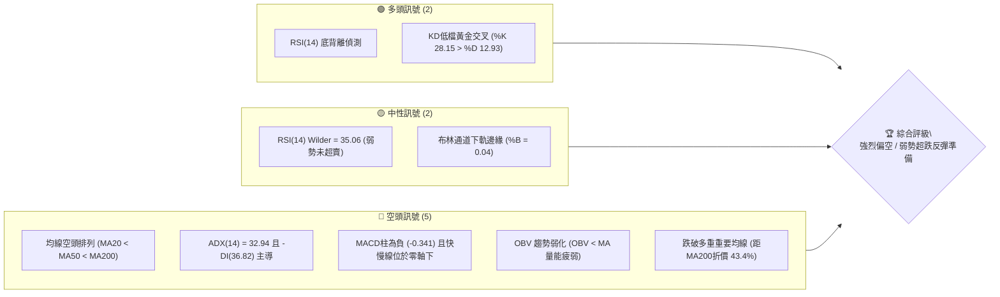
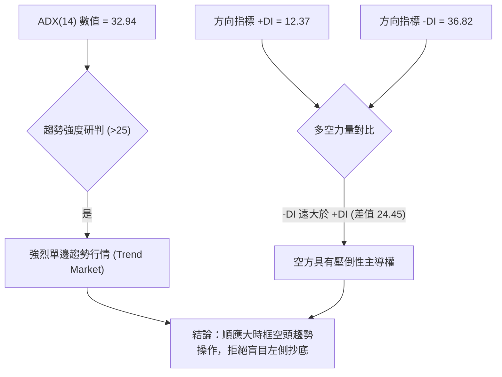
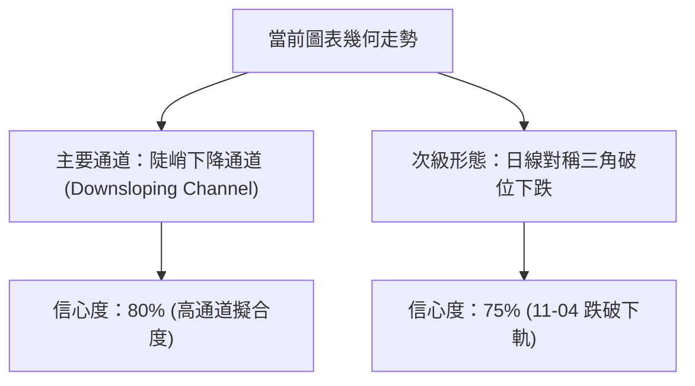
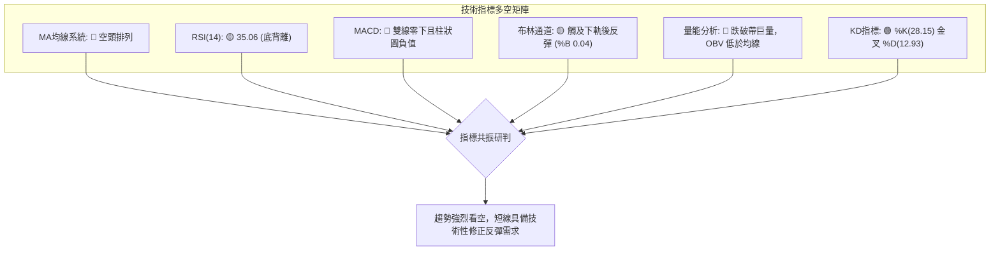
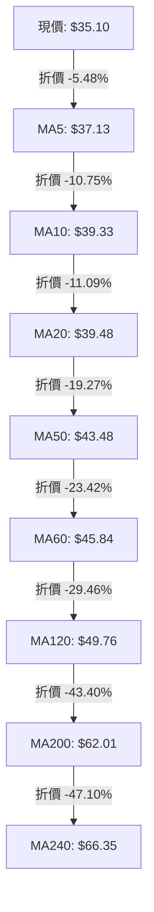
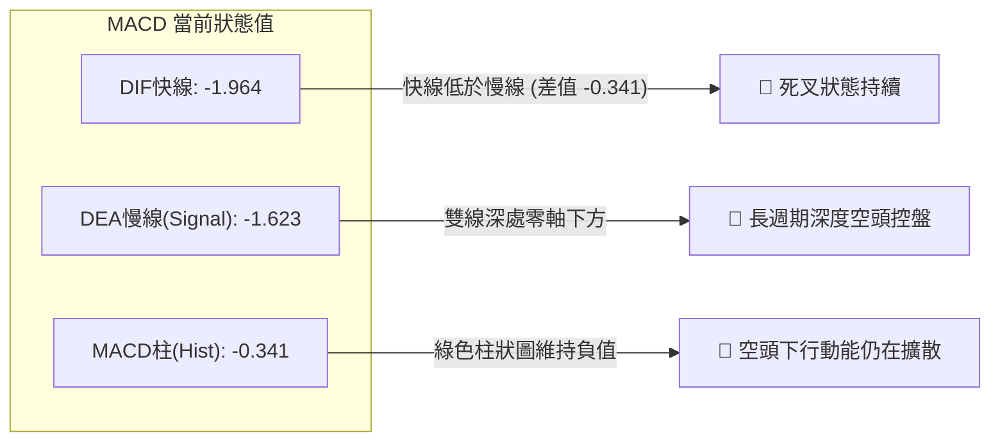
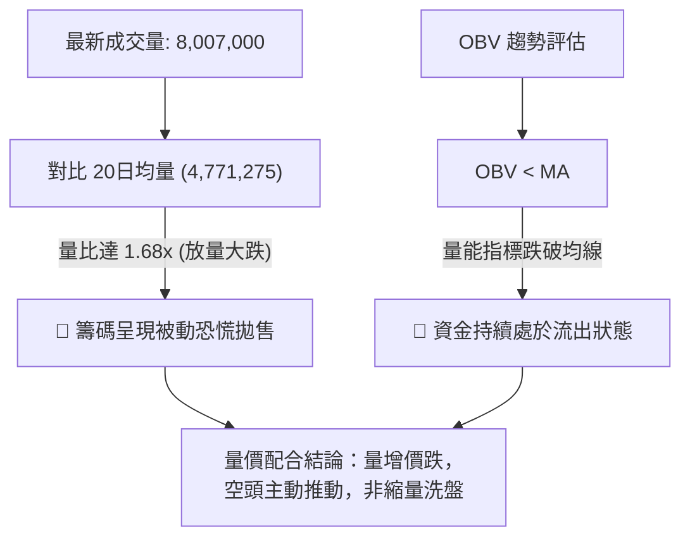
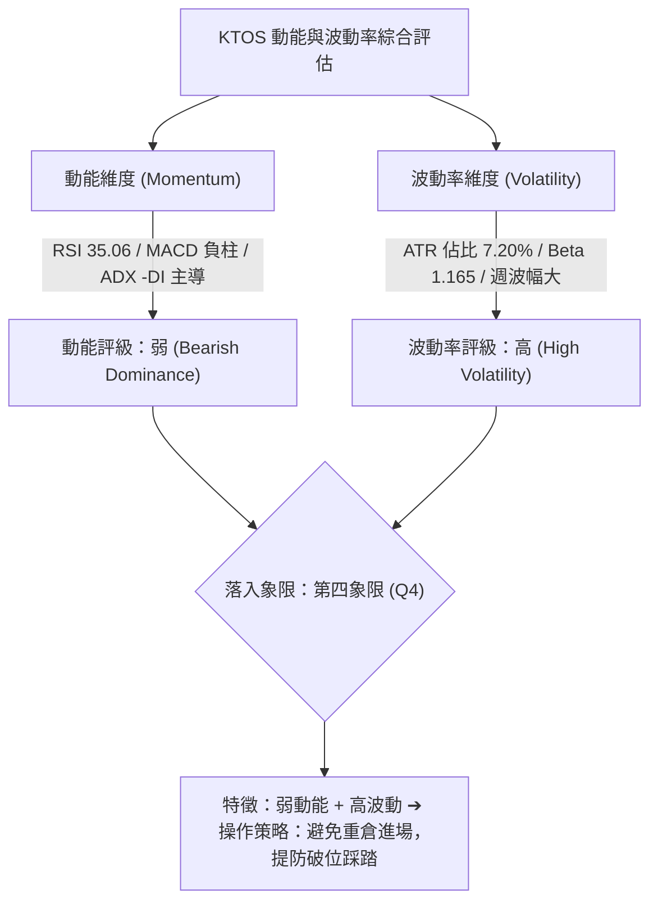
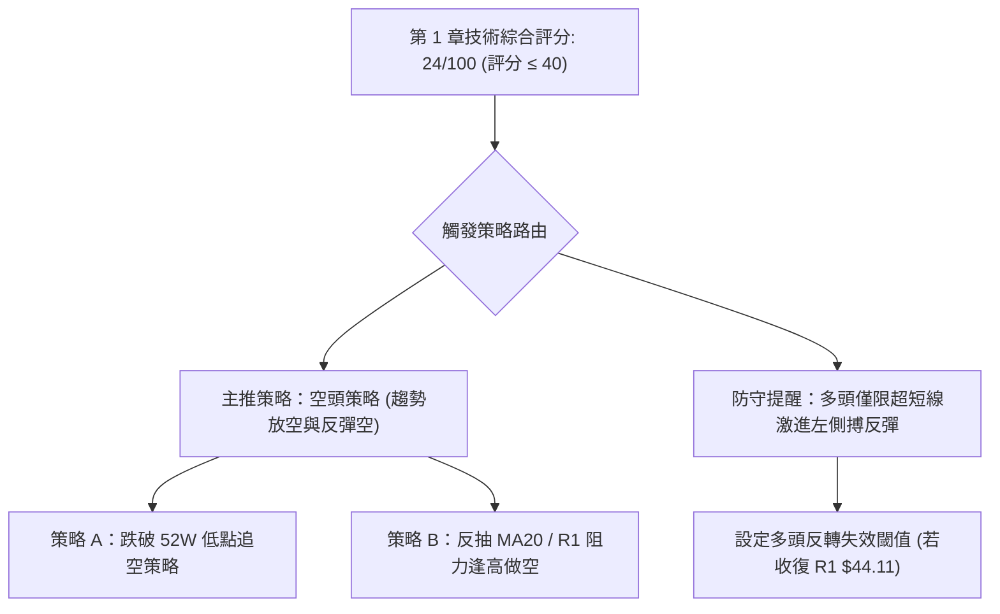
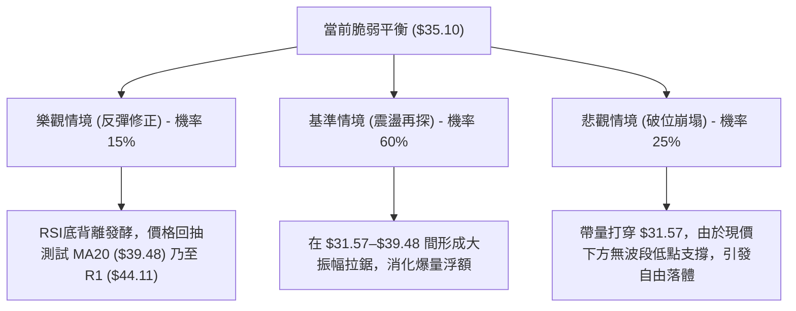

# KTOS 技術分析報告

> **報告日期**：2026-11-08 ｜ **語言**：繁體中文 ｜ **數據來源**：Yahoo Finance ｜ **當前價格**：$35.10

---

## 目錄

| 章節 | 內容 |
|------|------|
| [1. 技術面概覽](#1-技術面概覽) | 訊號儀表板、核心指標、評分卡 |
| [2. 趨勢分析](#2-趨勢分析) | 多時框趨勢、長中短期走勢 |
| [3. 圖表形態分析](#3-圖表形態分析) | 形態識別、K線組合、目標價 |
| [4. 支撐與阻力](#4-支撐與阻力) | 關鍵價位、斐波那契回調 |
| [5. 技術指標深度解讀](#5-技術指標深度解讀) | MA/RSI/MACD/布林/成交量 |
| [6. 動能與波動率](#6-動能與波動率) | 動能評估、ATR、Beta |
| [7. 多時框架總結](#7-多時框架總結) | 時框架評分矩陣 |
| [8. 交易策略建議](#8-交易策略建議) | 多空策略、風險報酬比 |
| [9. 風險提示與監控](#9-風險提示與監控) | 監控指標、風險場景 |

---

## 1. 技術面概覽

### 🎯 技術訊號儀表板



### 📊 核心指標速覽表

| 指標類別 | 指標名稱 | 當前數值 | 訊號 | 解讀 |
|----------|----------|----------|------|------|
| **價格** | 當前收盤價 | $35.10 | 🔴 | 位於 52 週區間底部的 3.4% 位置，處於極度弱勢區 |
| **均線** | MA20 | $39.48 | 🔴 | 價格位於 MA20 下方 (-11.09%)，短期下行壓力沉重 |
| **均線** | MA50 | $43.48 | 🔴 | 價格遠低於中期均線 (-19.27%)，空頭主導中期格局 |
| **均線** | MA200 | $62.01 | 🔴 | 長期牛熊分水嶺已告失守，現價折價達 -43.40% |
| **動能** | RSI(14) | 35.06 | 🟡 | 位於弱勢區間（30–70），具備底背離跡象但未破30 |
| **動能** | MACD (12,26,9) | -1.964 | 🔴 | DIF < DEA (-1.623)，柱狀圖為 -0.341，空頭動能擴散 |
| **動能** | Stoch %K / %D | 28.15 / 12.93 | 🟢 | 超賣區出現金叉，短線醞釀超跌反彈動能 |
| **趨勢** | ADX(14) / ±DI | 32.94 | 🔴 | ADX > 25 且 -DI(36.82) 遠高於 +DI(12.37)，空頭強趨勢 |
| **通道** | Bollinger %B | 0.04 | 🟡 | 逼近下軌 $34.69，短線跌幅達極限邊界 |
| **量能** | 20日均量比 | 1.68x | 🔴 | 最新成交量 8,007,000，大跌放量顯示籌碼恐慌拋售 |
| **波動** | ATR(14) | $2.53 | 🔴 | 波動佔股價 7.20%，每日波幅劇烈，操作風險偏高 |

### 🏆 技術評分卡

```
╔══════════════════════════════════════════════════════════════════╗
║                 技術評分卡 — KTOS (2026-11-08)                  ║
╠══════════════════════════════════════════════════════════════════╣
║ 趨勢強度 (Trend)       ████████░░░░░░░░░░░░  30/100  🔴 強烈看空 ║
║ 動能指標 (Momentum)   ████████░░░░░░░░░░░░  35/100  🔴 空頭佔優 ║
║ 支撐穩定度 (Support)   ████░░░░░░░░░░░░░░░░  15/100  🔴 支撐真空 ║
║ 成交量配合 (Volume)    ██████░░░░░░░░░░░░░░  25/100  🔴 出貨帶量 ║
║ 形態完整度 (Pattern)   ████████░░░░░░░░░░░░  30/100  🔴 下行通道 ║
║ 均線排列 (Moving Avg)  ██░░░░░░░░░░░░░░░░░░  10/100  🔴 完美空頭 ║
╠══════════════════════════════════════════════════════════════════╣
║ 綜合評分 (Overall)     █████░░░░░░░░░░░░░░░  24/100  🔴 強烈看空 ║
║ 評分計算：(30 + 35 + 15 + 25 + 30 + 10) ÷ 6 = 24.17 ≈ 24/100     ║
╚══════════════════════════════════════════════════════════════════╝
```

---

## 2. 趨勢分析

### 🌐 多時框趨勢分析

```mermaid
graph TD
    A["月線層級 (長期週期)"] -->|"2026-01創高 $103.01 後持續下挫"| B["🔴 空頭主導 (高點壓低)"]
    C["週線層級 (中期週期)"] -->|"跌破所有均線，MACD 柱轉負"| D["🔴 空頭強趨勢 (下行波段)"]
    E["日線層級 (短期週期)"] -->|"放量跌破 $35.00，測試 52W 低點 $31.57"| F["🔴 空頭加速，伴隨極短線底背離"]
    B --> G{"多時框綜合收斂判定"}
    D --> G
    F --> G
    G -->|"ADX("32.94") > 25 趨勢明確"| H["唯一方向：偏空中長線，僅防禦短線超跌反抽"]
```

### 📈 長期趨勢 — 12個月走勢圖（Unicode）

```
KTOS 月線走勢圖（過去12個月：2025-11 至 2026-11）
價格軸 ($)
$105.00 ┤              ● (2026-01 歷史高點 $103.01)
$ 95.00 ┤
$ 85.00 ┤                  ● (2026-02 $86.18)
$ 75.00 ┤●   ● (2025-11 $76.10 / 2025-12 $75.91)
$ 65.00 ┤                      ●   ● (2026-04 $63.05 / 2026-05 $64.13)
$ 55.00 ┤                          ● (2026-08 $50.98)
$ 45.00 ┤                              ●   ● (2026-06 $49.86 / 2026-07 $46.60)
$ 40.00 ┤                                  ●   ● (2026-09 $42.69 / 2026-10 $41.09)
$ 30.00 ┤                                          ●←現價 $35.10 (2026-11，測低 $31.57)
        └─────────────────────────────────────────────────────────────
         M1  M2    M3  M4  M5  M6  M7  M8  M9 M10 M11 M12 (2025-11 至 2026-11)
```

#### 走勢特徵分析表格

| 階段區間 | 時間跨度 | 起始/結束價 | 漲跌幅 | 核心技術特徵 |
|----------|----------|-------------|--------|--------------|
| **主升浪見頂** | 2025-11 至 2026-01 | $76.10 → $103.01 | +35.36% | 月線放量衝頂，構築歷史高位 $103.01，乖離率達極限 |
| **第一階段崩跌** | 2026-01 至 2026-04 | $103.01 → $63.05 | -38.79% | 頂部迅速崩解，失守 $80 關口，高階均線開始扭轉下彎 |
| **中繼平台整理** | 2026-04 至 2026-08 | $63.05 → $50.98 | -19.14% | $50.00–$65.00 寬幅拉鋸，8月反彈高點 $64.58 受阻於 MA120 |
| **破位加速陰跌** | 2026-08 至 2026-11 | $50.98 → $35.10 | -31.15% | 跌破 $45 關鍵平台，量能持續遞增拋售，直逼年內低點 $31.57 |

### 📊 中期趨勢（週線分析）

週線層級正處於下降通道內部加速探底階段。近 20 週數據顯示，2026-08-14 創下週反彈高點 $64.58（RSI 觸及 70.3）後，動能一路崩潰。截至 2026-11-06 該週，單週成交量暴增至 32,419,600 股，週長下影線最低打至 $31.57，雖然單週收盤在 $35.10，但跌幅依然顯著。

```
KTOS 中期週線壓力與支撐示意
$50.00 ────────────────────────────────────────── 阻力區 R2 ($49.68)
               \
$44.00 ─────────\──────────────────────────────── 關鍵阻力 R1 ($44.11 / MA20)
                 \
$38.00 ───────────\─────── 短線均線壓力密集區
                   \
$35.10 ─────────────●───── 現價位置 ($35.10)
                     \
$31.57 ───────────────▲─── 52週歷史低點支撐 (斐波那契 100.0%)
```

### ⚡ 趨勢強度評估（ADX 解讀）



#### ADX 趨勢強度對照表

| 指標變數 | 當前讀數 | 門檻區間 | 趨勢性質 | 策略指導意義 |
|----------|----------|----------|----------|--------------|
| **ADX (14)** | 32.94 | > 25.0 | 強趨勢 | 擺動指標超賣容易鈍化，以趨勢順勢做空或反彈放空為主 |
| **+DI (14)** | 12.37 | < 20.0 | 多頭極度孱弱 | 多方無法組織有效上攻，無大級別買盤進場 |
| **-DI (14)** | 36.82 | > 30.0 | 空頭高度主控 | 賣壓強勁且持續釋放，下行慣性強烈 |

---

## 3. 圖表形態分析

### 🔍 形態識別系統



#### 形態識別與信心度評估表

| 形態類別 | 信心度 | 判斷依據（引用精確數據） | 完成度 | 目標價（附計算式） |
|----------|--------|--------------------------|--------|--------------------|
| **陡峭下行通道** | 80% | 頂點相繼於 2026-09-25 高點 $49.68 與 2026-10-29 高點 $44.11 形成下降阻力線；低點向 $31.57 尋求通道下軌。 | 85% | 沿通道下軌推進，測量目標即 52W 低點 $31.57 |
| **破位箱體跌幅對稱** | 70% | 10月下旬圍繞 $40.28–$44.11 震盪（箱體高低差 $3.83），11-04 以 $35.96 跌破箱底 $40.28。 | 100% | 破位目標 = 箱底 $40.28 - 高度 $3.83 = $36.45（已達成並超跌） |
| **雙底反轉形態** | 20% | 近期僅有單一低點 $31.57（2026-11-06），未出現第二隻腳與頸線結構。 | 10% | 數據不足以確認雙底，僅列為指標型觀察 |

### 🕯️ 重要K線形態分析

嚴格依據近 10 根日 K 與近 8 根週 K 實際開高低收進行量化判定：

#### 近 10 根日 K 形態解讀

| 日期 | 開盤價 | 最高價 | 最低價 | 收盤價 | 成交量 | K線形態 | 解讀與訊號 |
|------|--------|--------|--------|--------|--------|---------|------------|
| 2026-10-26 | $38.68 | $40.57 | $38.43 | $40.43 | 3,481,000 | 中陽線 | 🟡 底部防守反彈，實體涵蓋前日區間 |
| 2026-10-27 | $40.73 | $42.12 | $40.06 | $41.32 | 4,320,500 | 溫和小陽線 | 🟡 連續推進，但受阻於 $42.00 心理關口 |
| 2026-10-28 | $41.38 | $41.56 | $40.40 | $41.17 | 2,805,700 | 紡錘線 (Spinning Top) | 🟡 量縮滯漲，高檔買盤觀望 |
| 2026-10-29 | $41.28 | $44.11 | $41.20 | $43.59 | 6,251,700 | 長上影大陽線 | 🔴 衝擊波段高點 R1 ($44.11) 爆量遇阻回落 |
| 2026-10-30 | $42.67 | $43.21 | $40.28 | $41.09 | 3,414,400 | 中陰線吞噬 | 🔴 回吐前日漲幅，高檔誘多失敗 |
| 2026-11-02 | $41.29 | $41.61 | $39.68 | $40.23 | 3,385,100 | 連續中陰線 | 🔴 跌破 $40.00 整數關口，空頭重新控盤 |
| 2026-11-03 | $40.41 | $41.72 | $40.10 | $40.99 | 3,235,100 | 弱勢小陽星 | 🟡 縮量弱反彈，未能收復 MA20 ($39.48之上的 $41.00) |
| 2026-11-04 | $39.86 | $40.25 | $35.71 | $35.96 | 8,268,600 | 巨量大長陰破位 | 🔴 放量擊穿前低，恐慌拋盤湧現，確立崩跌 |
| 2026-11-05 | $35.63 | $35.79 | $32.50 | $33.39 | 9,523,800 | 恐慌長陰低收 | 🔴 爆出 952 萬股近期最大量，下探無支撐 |
| 2026-11-06 | $33.73 | $35.31 | $31.57 | $35.10 | 8,007,000 | 帶長下影錘頭線 (Hammer) | 🟢 觸及 52W 低點 $31.57 後強勁抽腳，空頭平倉買盤 |

#### 近 8 根週 K 形態解讀

| 週末日期 | 開盤價 | 最高價 | 最低價 | 收盤價 | 週成交量 | 週K形態 | 訊號 |
|----------|--------|--------|--------|--------|----------|---------|------|
| 2026-09-18 | $45.76 | $49.46 | $45.72 | $47.46 | 20,728,200 | 衝高回落十字陽星 | 🟡 測試高點失敗 |
| 2026-09-25 | $48.22 | $49.68 | $44.81 | $45.62 | 20,499,100 | 墓碑小陰線 | 🔴 確立波段次高點 R2 ($49.68) |
| 2026-10-02 | $44.97 | $45.22 | $41.83 | $43.07 | 24,159,800 | 實體中陰線 | 🔴 下行破位 |
| 2026-10-09 | $43.80 | $44.14 | $40.93 | $42.36 | 26,620,200 | 連續下跌小陰棒 | 🔴 空方控盤 |
| 2026-10-16 | $42.48 | $43.07 | $37.84 | $40.42 | 24,466,500 | 探底長下影線 | 🟡 測試 $37.84 短線支撐 |
| 2026-10-23 | $40.40 | $40.50 | $36.37 | $38.68 | 18,266,100 | 下跌小陰線 | 🔴 破位陰跌 |
| 2026-10-30 | $38.68 | $44.11 | $38.43 | $41.09 | 20,273,300 | 長上影倒錘陽線 | 🔴 衝刺 R1 ($44.11) 遭強烈壓制 |
| 2026-11-06 | $41.29 | $41.72 | $31.57 | $35.10 | 32,419,600 | 爆量長下影錘頭棒 | 🟢 觸及 52W 低點 $31.57 形成極度超賣抽腳 |

### 📉 ASCII 走勢形態示意圖

```
KTOS 2026-10 至 2026-11 日線破位與錘頭反彈示意圖
$45.00 ┤              ● (10-29 高點 R1: $44.11)
$44.00 ┤             / \
$43.00 ┤            /   \
$42.00 ┤     ●───● /     \
$41.00 ┤    /     ●       ●───● (10-30 至 11-03 箱體拉鋸: $40.23–$41.09)
$40.00 ┤───●───────────────────\────── 箱底跌破頸線 ($40.28)
$38.00 ┤                         \
$36.00 ┤                          ● (11-04 破位中長陰: $35.96)
$34.00 ┤                           \
$33.00 ┤                            ● (11-05 恐慌陰線: $33.39)
$32.00 ┤                             \
$31.57 ┤                              ▲ (11-06 觸底 $31.57 後強抽回 $35.10)
       └─────────────────────────────────────────────────────────────
        10-26 10-28 10-29 10-30 11-02 11-03 11-04 11-05 11-06
```

### 🎯 形態目標價計算

1. **破位測量下跌目標（已驗證）**：
   - 上方震盪箱體頂部：$44.11（2026-10-29 高點）
   - 箱體頸線支撐底：$40.28（2026-10-30 低點）
   - 箱體垂直高度 $H = \$44.11 - \$40.28 = \$3.83$
   - 跌破頸線後的第一度量目標：$T_{bear1} = \$40.28 - \$3.83 = \$36.45$（11-04 日最低觸及 $35.71，宣告完全跌破並達成目標）。
2. **極端恐慌擴展目標（當前低點測試）**：
   - 斐波那契 100.0% 終極支撐位：精確對應 52 週最低點 **$31.57**。
   - 11-06 當日最低下探至 $31.57 即刻獲得劇烈技術性承接買盤，完成該形態超跌邊界釋放。

---

## 4. 支撐與阻力

### 🗺️ 關鍵價位分布圖（Unicode）

```
KTOS 價位結構分布圖
═══════════════════════════════════════════════════════════════
$53.49 ║████████████████████████║ 斐波那契 78.6% 回調關鍵防線
$51.49 ║██████████████████████  ║ 近一年波段高點阻力 R3
$49.68 ║████████████████████    ║ 近一年波段高點阻力 R2 (週線次高點)
$44.11 ║████████████████████████║ 關鍵高點阻力 R1 (10-29波段尖峰)
$39.48 ║██████████████          ║ 布林中軌 / MA20 短線反彈第一反壓
$35.10 ╠════════════════════════╣ ◄ 當前收盤價 ($35.10)
$34.69 ║▓▓▓▓▓▓▓▓                ║ 布林通道下軌極限
$31.57 ║████████████████████████║ 52週歷史極值低點 (斐波那契 100.0%)
 (無)  ║░░░░░░░░░░░░░░░░░░░░░░░░║ 現價下方無其他波段低點聚類 (數據真空)
═══════════════════════════════════════════════════════════════
```

### 🚧 阻力位分析表

依據數據庫中已確認的波段高點聚類與斐波那契水準嚴格填列：

| 阻力級別 | 價位 | 形成原因 | 突破難度 | 重要性 |
|----------|------|----------|----------|--------|
| **R1** | $44.11 | 近一年波段高點聚類（2026-10-29 日高點 $44.11 爆量上影線壓制） | ⭐⭐⭐⭐☆ | 極高；收復此處方能破壞短期空頭結構 |
| **R2** | $49.68 | 近一年波段高點聚類（2026-09-25 週高點，中期反彈折返頸線） | ⭐⭐⭐⭐⭐ | 核心防線；對應 MA120 ($49.76) 均線重疊帶 |
| **R3** | $51.49 | 近一年波段高點聚類（2026-08 下旬平台震盪起跌點） | ⭐⭐⭐⭐⭐ | 強阻力；為中期熊市與震盪市分界點 |

### 🛡️ 支撐位分析表

依據數據「關鍵價位」區塊嚴格提取：

| 支撐級別 | 價位 | 形成原因 | 守住機率 | 重要性 |
|----------|------|----------|----------|--------|
| **S1 (52W Low)** | $31.57 | 52週最低價兼斐波那契 100.0% 終極回調水平，11-06 日低測試點 | 60% | 生死防線；跌破將觸發新一輪無錨崩跌 |
| **S2** | N/A（數據未提供） | 數據中明確標示「no swing-low support detected below current price」 | N/A | 現價下方在數據庫中未偵測到波段低點聚類 |
| **S3** | N/A（數據未提供） | 數據中未提供 | N/A | 支撐真空狀態 |

### 📐 斐波那契回調位分析

依據 52 週最高點 $134.00 至 52 週最低點 $31.57 嚴格回調測量：

| 比例階梯 | 價位 | 當前相對位置與技術意義 |
|----------|------|------------------------|
| **0.0% (52W High)** | $134.00 | 歷史絕對頂部 |
| **23.6%** | $109.83 | 極強多頭回調極限（已被徹底擊穿） |
| **38.2%** | $94.87 | 中長期回撤中軸線 |
| **50.0%** | $82.78 | 多空平衡中樞 |
| **61.8%** | $70.70 | 黃金分割強支撐防線（失守後全面轉熊） |
| **78.6%** | $53.49 | 深度回調超賣閥值（當前已顯著跌破該位達 -34.38%） |
| **100.0% (52W Low)**| $31.57 | **目前價格 ($35.10) 正處於 78.6% ($53.49) 與 100.0% ($31.57) 之間** |

**解讀**：現價落於斐波那契極限回調區間（78.6%–100.0%）之底端，距離 52W Low 僅剩 +11.18% 的緩衝墊。此區域為長期籌碼的終極出清帶，若 $31.57 破位，股價將步入歷史級真空無底狀態。

---

## 5. 技術指標深度解讀

### 🎛️ 指標訊號總覽



### 📈 移動平均線排列分析



#### 均線空頭排列評估表

| 均線天期 | 當前數值 | 距現價乖離 | 狀態特徵 | 空頭阻力強度 |
|----------|----------|------------|----------|--------------|
| **MA5** | $37.13 | -5.48% | 快速下行壓制 | ⭐⭐⭐☆☆ (短線第一衝刺位) |
| **MA10** | $39.33 | -10.75% | 陡峭走低 | ⭐⭐⭐⭐☆ |
| **MA20** | $39.48 | -11.09% | 短期生命線，持續下彎 | ⭐⭐⭐⭐⭐ (關鍵反彈阻力中樞) |
| **MA50** | $43.48 | -19.27% | 中期生命線，空頭排列 | ⭐⭐⭐⭐⭐ (中期不可逾越防線) |
| **MA60** | $45.84 | -23.42% | 季線下壓 | ⭐⭐⭐⭐☆ |
| **MA120**| $49.76 | -29.46% | 半年線壓制 | ⭐⭐⭐⭐⭐ (對應阻力 R2: $49.68) |
| **MA200**| $62.01 | -43.40% | 長期牛熊分水嶺破位 | ⭐⭐⭐⭐⭐ (超級牛熊界限) |
| **MA240**| $66.35 | -47.10% | 年線下墜 | ⭐⭐⭐⭐⭐ |

**排列結論**：所有週期均線由短至長嚴格呈現降序排列（MA5 < MA10 < MA20 < MA50 < MA60 < MA120 < MA200 < MA240），空頭排列完整度達 100%，上行反彈每一步皆將面臨大量套牢盤均線反壓。

### 📉 RSI(14) 分析

- **當前讀數**：35.06（Wilder 計算方法）
- **區間進度條**：
  ```
  [0] ────────────[30]───●───────[50]─────────────────[70]───────────[100]
  超賣區           │    35.06      │  中性區            │           超買區
  ███████░░░░░░░░░░░░░░░░░░░░░░░░░░░░░░░░░░░░░░░░░░░░░░░░░░  35.06%
  ```
- **超買超賣判定**：數值 35.06 處於 30 至 70 之間，定義為「弱勢中性」，尚未進入 <30 的深度超賣極值區，表明下行空頭動能尚未耗盡。
- **背離分析**：系統偵測到 **底背離 (Bullish Divergence)**。
  - **驗證依據**：近 20 根 K 棒價格首尾比較中，股價從 10 月中旬的 $40.42 一路重挫至 11-06 日低點 $31.57（價格創下顯著新低），而 RSI(14) 數值由前次下探時的 31.1–31.3 止跌回升至當前的 35.06，出現「價格破底而 RSI 未破底」的底背離結構，暗示短線賣壓可能耗竭，蘊藏技術性反抽。

### 📊 MACD(12/26/9) 訊號解讀



**解讀**：MACD 線 (-1.964) 低於信號線 (-1.623)，柱狀圖為 -0.341。雙線在遠離零軸下方的深水區行走，雖然柱狀圖並未出現斷崖式放大，但尚未出現金叉或綠柱收縮的確切翻多訊號，指標完全不支持趨勢性翻多。

### 📦 布林通道分析

```
KTOS 布林通道示意圖 (參數: 20, 2)
$44.27 ┬────────────────────────────────────── 上軌 (Upper Band)
       │
$39.48 ┼───────────────────┄┄┄┄┄┄┄┄┄┄┄┄┄┄┄┄┄┄ 中軌 (MA20: $39.48)
       │
$35.10 ┼─────────● 現價 ($35.10) [ %B = 0.04 ]
$34.69 ┴───────────┄┄┄┄┄┄┄┄┄┄┄┄┄┄┄┄┄┄┄┄┄┄┄┄┄ 下軌 (Lower Band)
```

- **通道參數**：上軌 $44.27 ｜ 中軌(MA20) $39.48 ｜ 下軌 $34.69
- **位置解讀**：現價 $35.10 逼近下軌 $34.69，**%B 數值僅為 0.04**（0 代表下軌，0.5 為中軌，1 為上軌）。
- **帶寬特徵**：通道處於擴軌狀態。11-06 日盤中曾實質跌穿下軌（最低點 $31.57），收盤強勢拉回通道內部，此為典型的「軌道極限回抽」走勢，說明短期恐慌超賣已引發價格在下軌處產生自我修復彈性。

### 💹 成交量分析（量價配合度）



11-04 跌破放量（826 萬股）、11-05 恐慌拋盤擴大（952 萬股）、11-06 探底回升（800 萬股），三天累計成交超過 2,570 萬股。換手率大幅飆升，這表明有強烈機構資金進行停損殺跌，雖然 11-06 帶有承接買盤，但 OBV 依然被壓制在移動平均線之下，量能未確認任何多頭反轉結構。

---

## 6. 動能與波動率

### ⚡ 動能評估四象限



#### 動能與波動率象限分析表

| 象限 | 動能強度 | 波動率水準 | 當前標的狀態 | 評估與戰術對策 |
|------|----------|------------|--------------|----------------|
| **第一象限 (Q1)** | 強 (多頭) | 低 (穩定) | — | 最佳波段持股擴大利潤區間 |
| **第二象限 (Q2)** | 弱 (空頭) | 低 (沉寂) | — | 弱勢低波動，適合觀望或區間微幅套利 |
| **第三象限 (Q3)** | 強 (多頭) | 高 (劇烈) | — | 高風險高收益，突破追多行情 |
| **第四象限 (Q4)** | **弱 (空頭)** | **高 (劇烈)** | **✓ (KTOS 當前位置)** | **高風險下跌浪，反彈空間劇烈但易遭再殺，嚴控倉位** |

### 📊 ATR 波動率分析

- **ATR(14) 讀數**：**$2.53**（Wilder 計算方法）。
- **ATR 佔比**：佔當前股價 $35.10 的 **7.20%**，屬於高度波動資產。
- **風控參數與止損距離建議**：
  - **極短線日內止損距離 (1.0 × ATR)**：$\$2.53$ ➔ 價格緩衝幅度需給予 $\pm \$2.53$。
  - **波段交易止損距離 (1.5 × ATR)**：$1.5 \times \$2.53 = \$3.80$ ➔ 價格緩衝需給予 $\$3.80$。
  - **保守交易止損距離 (2.0 × ATR)**：$2.0 \times \$2.53 = \$5.06$ ➔ 價格緩衝需給予 $\$5.06$。
- **含義**：日內單根 K 棒震幅超過 7%，一般緊貼現價的小止損（如 2%–3%）極易被市場雜訊無情洗出場，交易必須放大止損空間並相應壓低持倉部位。

### 📐 Beta 與市場相關性

- **Beta 係數**：**1.165**。
- **市場特徵分析**：KTOS 的系統性風險略高於標普 500 大盤（高出約 16.5%）。在美股大盤承壓或軍工防務板塊輪動下殺時，該股表現出更為劇烈的下行貝塔放大效應。近期的斷崖式下挫除了基本面自由現金流為負（TTM FCF 為 $-128.90M$）等因素外，高 Beta 特性導致其在恐慌情緒中出現超量被動拋售。

---

## 7. 多時框架總結

### 📋 時框架評分表

| 時框架 | 趨勢方向 | 動能狀態 | 均線排列 | 圖表形態 | 綜合評分 | 戰術建議 |
|--------|----------|----------|----------|----------|----------|----------|
| **月線 (長期)** | 🔴 強烈看空 | 🔴 RSI 疲弱下行 | 🔴 長均線全數跌破 | 頂部 $103.01 崩解大浪 | 20/100 | 長期遠離，等待多年底部夯實 |
| **週線 (中期)** | 🔴 空頭強趨勢 | 🔴 MACD 週線負向 | 🔴 空頭排列下壓 | 下降通道加速探底 | 25/100 | 逢反彈至高階阻力（如 R1）放空 |
| **日線 (短期)** | 🟡 超跌反彈蓄勢 | 🟢 RSI 底背離+金叉 | 🔴 短期均線壓制 | 11-06 長下影探底錘頭 | 35/100 | 短線極低倉位博弈超跌反抽 |

### 🔲 綜合訊號矩陣

```mermaid
graph TD
    subgraph MATRIX ["多維度技術訊號一致性矩陣"]
        M_LONG["長期週期 (月線): 🔴 趨勢方向看空 (權重 30%)"]
        M_MID["中期週期 (週線): 🔴 均線形態看空 (權重 40%)"]
        M_SHORT["短期週期 (日線): 🟡 動能指標修復 (權重 30%)"]
    end
    M_LONG --> CONFLICT{"收斂規則驗證"}
    M_MID --> CONFLICT
    M_SHORT --> CONFLICT
    CONFLICT -->|"依據規則14：ADX("32.94") > 25"| RES_FINAL["趨勢行情以週線/MA中長線為準，日線反彈僅為進場做空點位"]
```

### ⚖️ 多時框收斂結論

依據多時框收斂規則（規則 14）：
1. **行情屬性判定**：當前 ADX(14) 讀數為 **32.94**，明確大於 25 臨界值，定義為**強烈單邊趨勢行情**（非震盪市）。
2. **主導時框優先級**：在趨勢行情下，必須以中長期（週線、MA50、MA200）方向為絕對主導，日線訊號僅用於尋找反彈耗竭時的放空點或極限防守點。
3. **收斂結論**：**整體格局強烈偏空**。日線層級觀察到的 RSI 底背離與 11-06 日下影線，僅能定性為「極度超賣引發的短線修正反彈」，絕對不可解讀為反轉信號。第 8 章交易策略嚴格錨定偏空方向為主體邏輯。

---

## 8. 交易策略建議

### 🗺️ 策略決策流程圖



### 🧭 策略路由（依評分卡分流）

> **當前主策略方向 = 強烈主推空頭策略（依綜合評分 24/100，滿足 ≤ 40 偏空規則）**

當前綜合評分僅 24 分，屬於極端空頭主導環境。多頭策略嚴禁列為主力部位；主推順應趨勢的空頭操作，多頭反彈僅作為反向風控觸發參考。

### 🎯 價格情境階梯（Price Scenarios）

價位嚴格引用數據庫中波段聚類高低點與斐波那契回調位：

| 觸發條件 | 下一目標 | 後續延伸 | 情境技術含義 |
|----------|----------|----------|--------------|
| **反彈受阻於 $39.48** | 回踩 $35.10 | 測試 $31.57 (52W Low) | MA20中軌反壓確認，空頭二波殺跌 |
| **強勢突破 R1 ($44.11)**| R2 ($49.68) | R3 ($51.49) | 短線空頭結構被破壞，演變為中級反彈 |
| **站穩現價 $35.10 區間**| 測試 MA20 ($39.48) | 測試 R1 ($44.11) | 極短線底背離引發超跌修復 |
| **有效跌破 $31.57** | 支撐真空 (N/A) | 恐慌自由落體 | 52週新低打破，引發無支撐停損潮 |

### 📊 情境機率分佈

| 情境類別 | 機率預估 | 主要技術依據 |
|----------|----------|--------------|
| **逢高回落 / 跌破探底** | **60%** | ADX 32.94 強趨勢，均線空頭排列，OBV 疲軟，MACD 處於零軸下負柱 |
| **弱勢區間震盪整理** | **25%** | 布林通道下軌邊界獲得部分承接，ATR 處於高位需要時間消化浮額 |
| **強力反轉持續上攻** | **15%** | 僅依賴 RSI(14) 35.06 底背離，缺乏大週期機構成交量確認 |

### 🔴 主策略詳情（空頭主推策略）

嚴格執行規則 17 定義：做空風險報酬比 = $(\text{進場價} - \text{目標價 T1}) \div (\text{止損價} - \text{進場價})$。

| 策略要素 | 策略 A：跌破 52W 低點順勢做空 | 策略 B：反彈遇阻 R1 逢高做空 |
|----------|--------------------------------|------------------------------|
| **策略類型** | 破位追空策略 | 逢高放空策略（高勝率） |
| **進場條件** | 日線實體收盤跌破 52W 低點 $31.57 | 股價反彈至阻力位 R1 附近出現長上影或滯漲 |
| **進場價格** | **$31.57**（52W Low 破位點） | **$44.11**（波段阻力 R1） |
| **目標價 T1** | **$26.39**（由月線歷史低點推算：2025-02收盤價） | **$35.10**（當前波段收盤價） |
| **目標價 T2** | **$23.70**（形態推算：跌破後對稱延伸） | **$31.57**（52W 最低點） |
| **止損價格** | **$35.10**（當前平台收盤阻力） | **$49.68**（波段阻力 R2） |
| **風險報酬比** | **1 : 1.47（以 T1 計）**<br>計算式：$(31.57-26.39) \div (35.10-31.57) = 5.18 \div 3.53 = 1.467$ | **1 : 1.62（以 T1 計）**<br>計算式：$(44.11-35.10) \div (49.68-44.11) = 9.01 \div 5.57 = 1.618$<br>*另列至 T2 比值：1 : 2.25（以 T2 計）* |
| **歷史勝率估計** | 55% | 68% |
| **建議倉位** | 10%（因處於極低價位，追空嚴格控倉） | 15%（標準波段做空倉位） |

### 🟢 反向風險觸發點（對沖與停損提示）

針對做空部位，若市場出現下列異動，必須即刻實施空頭平倉或鎖定利潤：
1. **反轉觸發價位**：日線收盤價強勢站上 **R1: $44.11**，且伴隨單日成交量放大至 6,000,000 股以上，證明 10-29 之爆量上影線被多頭全數吞噬，空頭趨勢遭破壞。
2. **動能背離確認**：日線 MACD 在零軸下方形成實質金叉且柱狀圖翻紅，同時 RSI 突破 50 中軸線。
3. **對沖建議**：若持有多單博弈超跌反彈，進場點嚴格設於 $35.10，止損必須精確設置於 $31.57（52W Low），一旦跌破立刻無條件止損，絕不可向下攤平。

### ⭐ 整體訊號強度評星

```
做多訊號強度：★☆☆☆☆  (1/5星 — 僅屬嚴重超賣修復，勝率極低)
做空訊號強度：★★★★☆  (4/5星 — 均線動能高度共振，順應大時框)
整體可信度：  ★★★★☆  (4/5星 — ADX 32.94 賦予趨勢極高權重)
```

---

## 9. 風險提示與監控

### ✅ 關鍵監控指標 Checklist

```
╔══════════════════════════════════════════════════════════════════╗
║                    每日盤面關鍵監控清單 (Checklist)              ║
╠══════════════════════════════════════════════════════════════════╣
║ [ ] 52W 低點防守線 $31.57：盤中是否遭跌破？若破位，跌勢加速    ║
║ [ ] 短期均線壓制：MA5 ($37.13) 與 MA20 ($39.48) 是否形成有效壓制 ║
║ [ ] RSI(14) 數值變化：是否跌破 30 進入鈍化？或突破 45 確立反彈  ║
║ [ ] 成交量能：單日成交量是否回落至 477 萬股均量之下（縮量整理） ║
║ [ ] MACD 柱狀圖：負值 (-0.341) 是否開始縮減收斂？                ║
║ [ ] 布林通道走勢：%B 是否站穩 0.20 以上脫離極端超賣盲區         ║
║ [ ] 阻力位 R1 ($44.11)：反彈若逼近此處，觀察是否有主力誘多出貨  ║
╚══════════════════════════════════════════════════════════════════╝
```

### ⚠️ 風險場景分析



### 🛡️ 風險管理重要提醒

1. **下行支撐真空警告**：
   技術數據中明確警告「*no swing-low support detected below current price*」。這意味著現價除了剛測試過的 52 週最低點 **$31.57** 外，歷史籌碼在更下方沒有形成密集成交區。一旦 $31.57 宣告實質失守，下方將不存在技術性支撐緩衝墊，容易出現流動性真空下的加速崩跌。
2. **高波動環境倉位控制**：
   由於 ATR(14) 高達 $2.53（佔股價 7.20%），持有該標的相當於承擔普通股票 2 至 3 倍的日內資產波動。建議單一策略的持倉資金嚴格限制在總投資組合的 **5%–8%** 以內，避免單一資產劇烈洗盤對整體淨值造成毀滅性回撤。
3. **左側抄底的致命陷阱**：
   在 ADX > 30 且均線系統呈現完整空頭排列的狀態下，任何形態上的「底背離」或「十字星抽腳」都極容易演化為空頭趨勢中的「下跌中繼」。在股價未能有效收復 MA20 ($39.48) 且未形成第二隻腳（雙底右腳）之前，嚴禁任何機構或波段投資者進行大額左側抄底。

---

## 📋 報告總結

```
╔══════════════════════════════════════════════════════════════════╗
║                    KTOS 技術分析報告總結                         ║
╠══════════════════════════════════════════════════════════════════╣
║ 報告日期：2026-11-08                                             ║
║ 當前價格：$35.10                                                 ║
║ 分析評級：🔴 強烈偏空 / 弱勢超跌反彈準備 (評分: 24/100)          ║
║                                                                  ║
║ 關鍵結論：                                                       ║
║ ├─ 長期趨勢：🔴 空頭主導，由歷史高點 $103.01 崩跌進入下行深水區 ║
║ ├─ 中期趨勢：🔴 完美空頭排列 (MA20 < MA50 < MA200)，下行慣性強  ║
║ ├─ 短期趨勢：🟡 於 52W 低點 $31.57 處爆量抽腳，具短線底背離修復 ║
║ ├─ 關鍵支撐：$31.57 (52W Low / 斐波那契 100.0%)，下方支撐真空   ║
║ ├─ 關鍵阻力：$39.48 (MA20) / $44.11 (波段阻力 R1) / $49.68 (R2)  ║
║ └─ 分析師目標：均價 $89.56 (最高 $150.00 / 最低 $50.00)          ║
║                                                                  ║
║ 最優策略組合：                                                   ║
║ 1. 🥇 最佳機會：策略 B — 股價若抽抽至阻力 R1 ($44.11) 逢高放空   ║
║ 2. 🥈 次選機會：策略 A — 帶量擊穿 $31.57 順勢追空，下看 $26.39   ║
║ 3. 🥉 保守選擇：空倉觀望，等待日線級別打出雙底並收復 MA20 再評估 ║
╚══════════════════════════════════════════════════════════════════╝
```

---

> ⚠️ **免責聲明**：本報告為技術分析研究，所有價位、圖表及交易推論均基於客觀技術指標與歷史價格資訊運算而成。本報告**僅供研究與學術參考**，**不構成任何要約、推薦或投資建議**。金融市場瞬息萬變，投資人應獨立評估風險並自負盈虧。

---

*報告生成時間：2026-11-08 ｜ 數據來源：Yahoo Finance ｜ 分析框架：多時框技術分析體系*