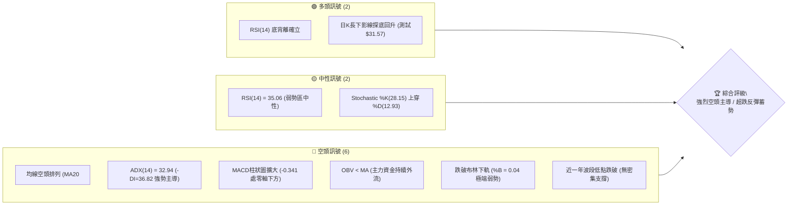
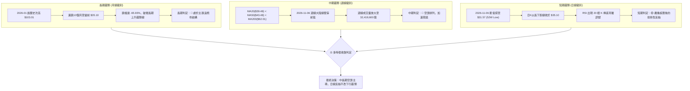
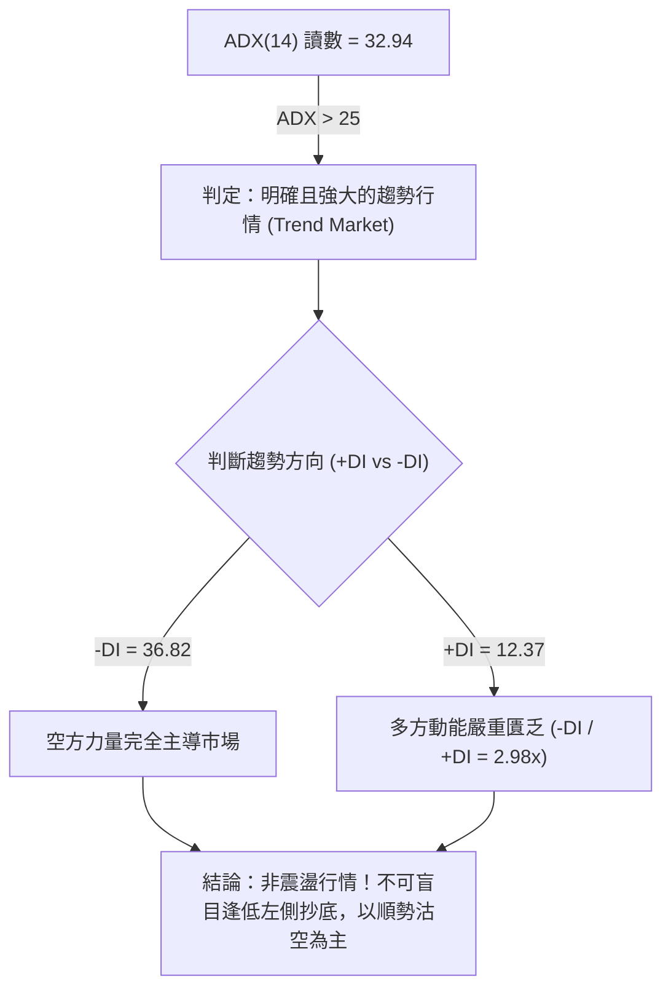
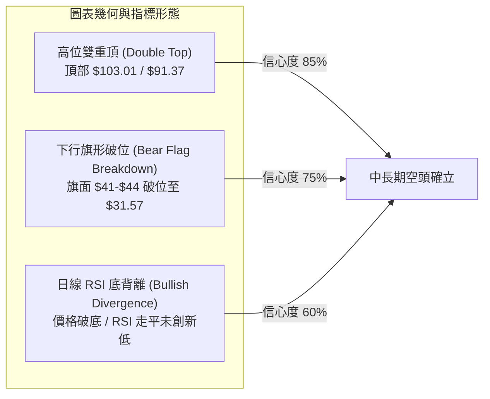
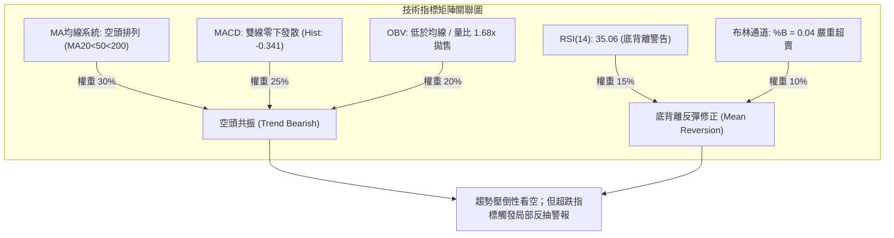
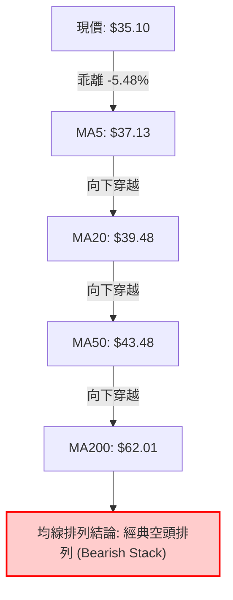
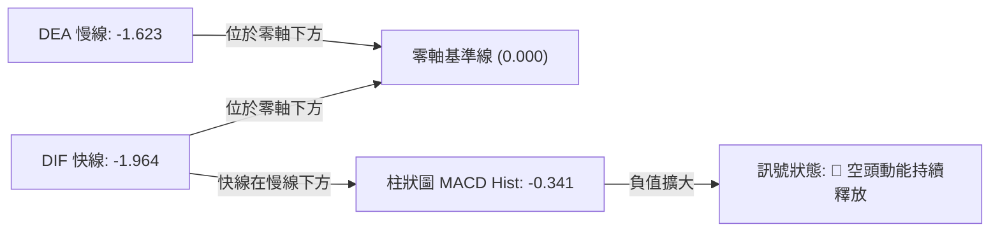
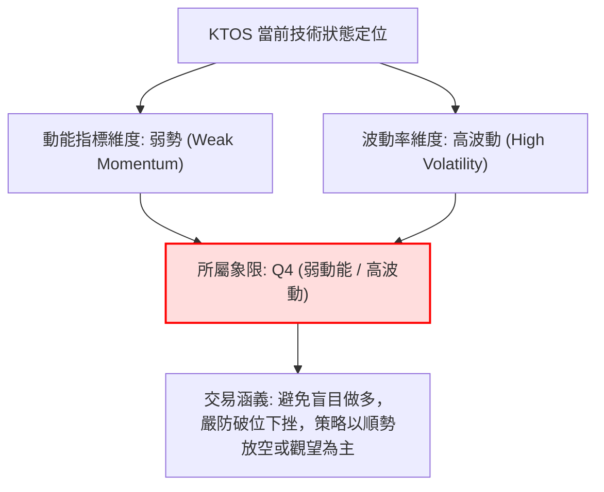
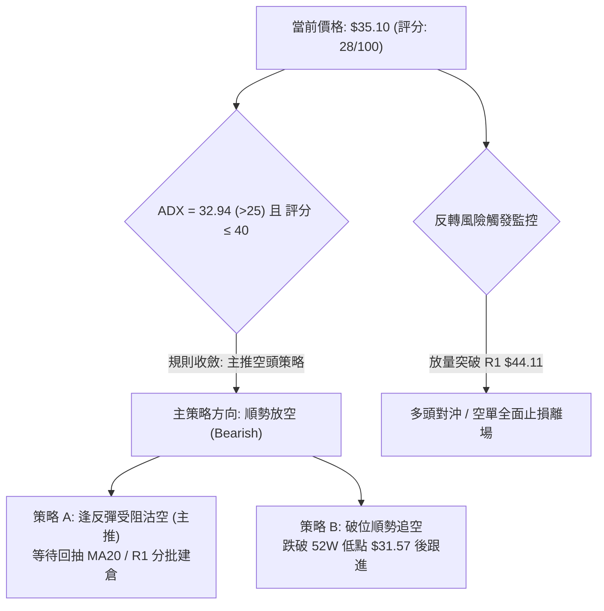
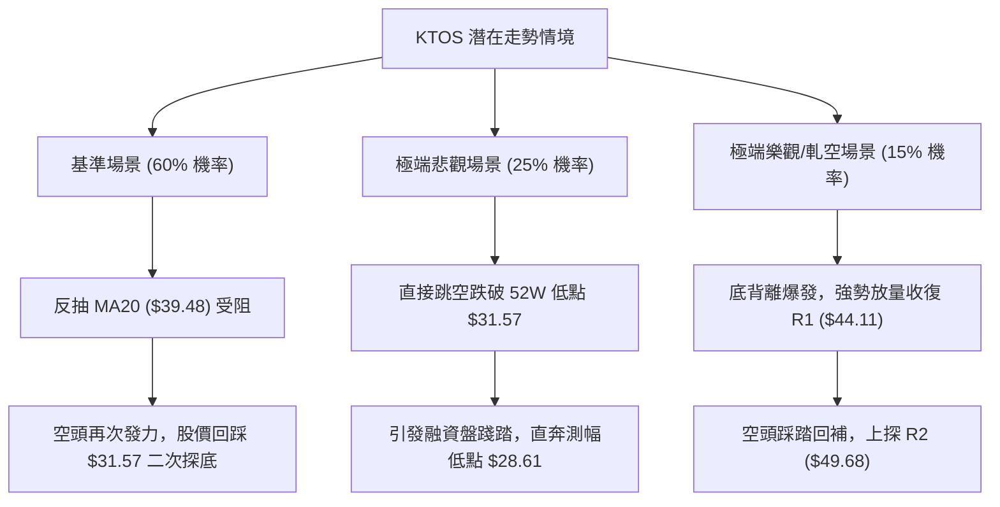

# KTOS 技術分析報告

> **報告日期**：2026-11-09 ｜ **語言**：繁體中文 ｜ **數據來源**：Yahoo Finance ｜ **當前價格**：$35.10

---

## 目錄

| 章節 | 內容 |
|------|------|
| [1. 技術面概覽](#1-技術面概覽) | 訊號儀表板、核心指標、評分卡 |
| [2. 趨勢分析](#2-趨勢分析) | 多時框趨勢、長中短期走勢、ADX強度評估 |
| [3. 圖表形態分析](#3-圖表形態分析) | 形態識別、K線組合、形態目標價推算 |
| [4. 支撐與阻力](#4-支撐與阻力) | 關鍵價位分布、阻力與支撐表、斐波那契回調 |
| [5. 技術指標深度解讀](#5-技術指標深度解讀) | 均線系統、RSI背離、MACD、布林通道、成交量 |
| [6. 動能與波動率](#6-動能與波動率) | 動能四象限、ATR波動率、Beta係數分析 |
| [7. 多時框架總結](#7-多時框架總結) | 時框架評分矩陣、多時框收斂結論 |
| [8. 交易策略建議](#8-交易策略建議) | 策略路由、價格情境階梯、主空頭策略與對沖 |
| [9. 風險提示與監控](#9-風險提示與監控) | 關鍵監控清單、風險場景、部位風控準則 |
| [📋 報告總結](#-報告總結) | 核心總結與策略結論矩陣 |

---

## 1. 技術面概覽

### 🎯 技術訊號儀表板



### 📊 核心指標速覽表

| 指標類別 | 指標名稱 | 當前數值 | 訊號 | 解讀 |
|:---|:---|:---|:---:|:---|
| **價格** | 當前收盤價 | $35.10 | 🔴 | 位於52週區間 3.4% 分位，深陷破位弱勢區 |
| **均線** | MA20 (短天期) | $39.48 | 🔴 | 現價低於MA20達 -11.09%，短線嚴重承壓 |
| **均線** | MA50 (中天期) | $43.48 | 🔴 | 現價低於MA50達 -19.27%，中期下行通道確立 |
| **均線** | MA200 (長天期) | $62.01 | 🔴 | 遠低於牛熊分界線達 -43.40%，長期走勢為空頭熊市 |
| **動能** | RSI(14) | 35.06 | 🟡 | 位於30-70中性偏弱區間，存在20根K棒首尾底背離 |
| **動能** | MACD (12,26,9) | -1.964 / 柱 -0.341 | 🔴 | 雙線深陷零軸下方且柱狀圖發散，空頭動能仍佔優勢 |
| **趨勢** | ADX(14) / ±DI | 32.94 (-DI: 36.82) | 🔴 | ADX>25為強趨勢行情，-DI壓制+DI(12.37)，空方完全掌控 |
| **波動** | 布林通道 (%B) | %B: 0.04 (下軌 $34.69) | 🟡 | 價格觸及下軌並收斂於邊界，存在均值回歸反抽需求 |
| **波動** | ATR(14) | $2.53 (7.20%) | 🔴 | 單日波幅高達 7.20%，市場恐慌拋售情緒顯著 |
| **量能** | 成交量 / OBV | 8,007,000 (量比 1.68x) | 🔴 | 破位伴隨放量，OBV 低於均線，資金離場信號明確 |

### 🏆 技術評分卡

```
╔══════════════════════════════════════════════════════════════╗
║               技術評分卡 — KTOS (2026-11-09)                 ║
╠══════════════════════════════════════════════════════════════╣
║ 趨勢強度 (Trend Health)     ████░░░░░░░░░░░░░░░░  20/100  🔴 ║
║ 動能指標 (Momentum)         ████████░░░░░░░░░░░░  38/100  🔴 ║
║ 支撐穩定度 (Support Level)  ██████░░░░░░░░░░░░░░  32/100  🔴 ║
║ 成交量配合 (Volume Flow)    █████░░░░░░░░░░░░░░░  26/100  🔴 ║
║ 形態完整度 (Pattern Health) ███████░░░░░░░░░░░░░  34/100  🔴 ║
║ 均線排列 (MA Alignment)     ████░░░░░░░░░░░░░░░░  18/100  🔴 ║
╠══════════════════════════════════════════════════════════════╣
║ 綜合評分 (算術平均值)       ██████░░░░░░░░░░░░░░  28/100  🔴 ║
║ 評級結論：強烈看空 (Bearish) ｜ 策略導向：反彈沽空 / 逢高做空 ║
╚══════════════════════════════════════════════════════════════╝
```

> **評分計算依據（規則 18）**：
> 綜合評分 = $(20 + 38 + 32 + 26 + 34 + 18) \div 6 = 168 \div 6 = 28$ 分（四捨五入至整數）。
> 評分 $\le 40$ 屬於顯著空頭主導市場，交易策略將以「順勢逢高做空」為唯一主軸。

---

## 2. 趨勢分析

### 🌐 多時框趨勢分析



### 📈 長期趨勢 — 12個月走勢圖（Unicode）

KTOS 在過去 12 個月經歷了極端的暴跌走勢，自 2026 年 1 月的高點 $103.01 展開單邊下行，跌幅超過 65%：

```
KTOS 月線走勢圖（過去12個月：2025-11 至 2026-11）
價格軸 ($)
$105 ┤              ● (2026-01 $103.01 高點)
$95  ┤             ╱ ╲
$85  ┤            ╱   ● (2026-02 $86.18)
$75  ┤  ●━━━━━●  ╱     ╲
$65  ┤   (11-12)╱       ● (2026-03 $70.51)
$55  ┤         ╱         ╲   ● (2026-05 $64.13)
$45  ┤        ╱           ╲ ╱ ╲
$35  ┤       ╱             ●   ●━━━━● (2026-08 $50.98)
$25  ┤      ╱           (06-07)      ╲
$15  ┤     ╱                          ● (2026-11 $35.10 當前收盤)
     └────────────────────────────────────────────────────────
       11   12  01   02  03  04  05  06  07  08  09  10  11 (月份)
      2025 │ 2026
```

#### 走勢特徵分析表格

| 階段區間 | 起止月份 | 起止價格 | 漲跌幅 | 趨勢特徵與量能結構 |
|:---|:---|:---|:---:|:---|
| **末端推升期** | 2025-11 → 2026-01 | $76.10 → $103.01 | +35.36% | 月線級別最後加速趕頂，主力資金借題發揮構築頂部 |
| **首輪暴跌期** | 2026-01 → 2026-04 | $103.01 → $63.05 | -38.79% | 高位籌碼瓦解，跌破百元大關，多頭止損盤蜂擁而出 |
| **弱勢弱反彈** | 2026-04 → 2026-05 | $63.05 → $64.13 | +1.71% | 縮量盤整，未能收復下跌缺口，隨即演變為下跌中繼 |
| **破位主跌浪** | 2026-05 → 2026-07 | $64.13 → $46.60 | -27.33% | 擊穿長天期均線支撐，市場全面轉入防禦性拋售 |
| **誘多假反彈** | 2026-07 → 2026-08 | $46.60 → $50.98 | +9.40% | 8月中旬週線曾衝高至 $64.58，但月線終收於 $50.98，長上影線誘多 |
| **加速崩跌期** | 2026-08 → 2026-11 | $50.98 → $35.10 | -31.15% | 連續跌破各級均線，11月更一度下探 $31.57，逼近歷史極端估值區 |

### 📊 中期趨勢（週線分析）

中期走勢完全受制於下降趨勢軌道，近 20 週高點逐步下移（Lower Highs）與低點逐步破位（Lower Lows）的特徵極為嚴密。

```
週線級別價格通道與壓力分佈示意圖：
價格 ($)
$65.00 ┤        ▲ (2026-08-14 高點 $64.58)
$60.00 ┤       ╱ ╲
$55.00 ┤      ╱   ╲
$50.00 ┤     ╱     ▼──────▼ (2026-09-25 高點 $49.68 / R2)
$45.00 ┤    ╱              ╲    ▼ (2026-10-30 高點 $44.11 / R1)
$40.00 ┤   ▼                ╲  ╱ ╲
$35.00 ┤                     ▼   ● (現價 $35.10)
$30.00 ┤                          ▲ (2026-11-06 低點 $31.57 - 52週低點)
       └─────────────────────────────────────────────────────
        07月     08月      09月     10月      11月 (2026)
```

- **週線均線下壓**：週K線自8月中旬見頂 $64.58 後，一路沿 5 週與 10 週均線單邊下瀉，未曾站穩過中軌。
- **成交量異動**：2026-11-06 當週暴出 32,419,600 股的巨幅週成交量（創下 7 月初以來的最大單週成交量），顯示空方主力在摜破 $40 整數關卡時觸發了大規模機構停損盤。

### ⚡ 趨勢強度評估（ADX 解讀）



#### ADX 指標強度對照分析

| 指標變數 | 當前讀數 | 門檻區間 | 趨勢屬性 | 交易指導原則 |
|:---|:---:|:---:|:---|:---|
| **ADX (14)** | **32.94** | 25.0 – 50.0 | **強趨勢確立** | 市場脫離盤整無序震盪，波段順勢交易勝率遠高於區間高拋低吸。 |
| **+DI (14)** | **12.37** | < 20.0 | **極度虛弱** | 多頭進攻意願極低，買盤僅為被動承接而非主動推升。 |
| **-DI (14)** | **36.82** | > 30.0 | **極端強勢** | 空頭壓制力量充沛，任何未放量突破的反彈均視為誘多與做空良機。 |
| **DI 差值擴散** | **-24.45** | 負向擴大 | **空頭發散** | 空方趨勢仍在加速延伸，尚未見到趨勢衰竭的收斂跡象。 |

---

## 3. 圖表形態分析

### 🔍 形態識別系統

依據嚴格規則 15，僅依據客觀數據識別高信心度形態，杜絕臆測：



#### 形態識別信心度與目標價評估表

| 形態名稱 | 信心度 | 判斷依據（引用數據） | 完成度 | 目標價（附嚴謹計算式） |
|:---|:---:|:---|:---:|:---|
| **大型雙重頂 (Double Top)** | **85%** | 2025-09高點 $91.37 與 2026-01高點 $103.01 構築雙頂；頸線為2025-11低點 $76.10。2026-03放量跌破頸線。 | 100% (已完全兌現) | 頸線 $76.10 − 形態高度($103.01 − $76.10 = $26.91) = **$49.19**（已於2026-07完全跌破並超額下瀉）。 |
| **下行旗形破位 (Bear Flag)** | **75%** | 10月下旬股價在 $38.68–$44.11 區間窄幅整理形成旗面，11-04 以大陰線摜破旗面下軌，旗桿高度為 $49.68 至 $38.43。 | 90% (接近目標) | 旗桿高度 = $49.68 − $38.43 = $11.25。<br/>破位點 $39.86 − $11.25 = **$28.61**（推算低點）。 |
| **潛在雙重底雛形 (Double Bottom)** | **40%** | 訊號不足，僅有單一日K探底 $31.57。目前尚未構築右底與頸線，**依規則15不予列入有效幾何形態**。 | 15% | 數據不足，僅做指標型底背離解讀，不設定反轉目標價。 |

### 🕯️ 重要K線形態分析

根據「近10根日K」與「近8根週K」之精確開高低收數據進行專業解讀：

#### 近 10 根日 K 線形態解讀表

| 日期 | 開盤價 | 最高價 | 最低價 | 收盤價 | K線形態名稱 | 形態深度解讀 | 多空訊號 |
|:---|:---:|:---:|:---:|:---:|:---|:---|:---:|
| 2026-10-26 | $38.68 | $40.57 | $38.43 | $40.43 | **實體中陽線** | 自低點反彈，實體穿透前日壓力，短線多頭嘗試反撲。 | 🟢 偏多 |
| 2026-10-27 | $40.73 | $42.12 | $40.06 | $41.32 | **帶上影中陽線** | 延續反彈，但受制於 $42.12 阻力，尾盤漲幅收窄。 | 🟢 偏多 |
| 2026-10-28 | $41.38 | $41.56 | $40.40 | $41.17 | **高位陀螺線 (Spinning Top)** | 開收盤相近，多空動能在 $41.00 處陷入相持平衡。 | 🟡 中性 |
| 2026-10-29 | $41.28 | $44.11 | $41.20 | $43.59 | **長上影大陽線** | 盤中衝擊阻力位 R1 ($44.11)，成交量放大至 625 萬股，遭遇強大拋壓。 | 🟡 假突破 |
| 2026-10-30 | $42.67 | $43.21 | $40.28 | $41.09 | **長陰覆蓋線 (Bearish Engulfing)** | 低收於前日實體下方，確認 R1 ($44.11) 假突破，構築短線波段頂部。 | 🔴 看跌 |
| 2026-11-02 | $41.29 | $41.61 | $39.68 | $40.23 | **破位小陰線** | 跌破 $40 整數心理防線，收盤創 5 日新低。 | 🔴 看跌 |
| 2026-11-03 | $40.41 | $41.72 | $40.10 | $40.99 | **縮量孕線 (Harami)** | 成交量萎縮至 323 萬股，反彈無力，屬於下跌中繼。 | 🔴 弱勢 |
| 2026-11-04 | $39.86 | $40.25 | $35.71 | $35.96 | **巨量大陰線 (Marubozu Breakdown)** | 成交量暴增至 826 萬股，斷頭下挫 -12.27%，跌破布林下軌。 | 🔴 強烈看跌 |
| 2026-11-05 | $35.63 | $35.79 | $32.50 | $33.39 | **加速跳空長陰** | 量能放大至 952 萬股，恐慌盤全面湧出，最低見 $32.50。 | 🔴 極度看跌 |
| 2026-11-06 | $33.73 | $35.31 | $31.57 | $35.10 | **長下影錘頭線 (Hammer / Pin Bar)** | 最低探至 52W 新低 $31.57 後強勁拉回，收盤上漲至 $35.10，伴隨 800 萬股換手。 | 🟢 超跌反抽 |

#### 近 8 根週 K 線形態解讀表

| 週交易日 | 開盤價 | 最高價 | 最低價 | 收盤價 | 成交量 | K線形態與技術含義 | 訊號 |
|:---|:---:|:---:|:---:|:---:|:---:|:---|:---:|
| 2026-09-18 | $45.76 | $49.46 | $45.72 | $47.46 | 20,728,200 | 區間震盪整理陽線，受制於 $49.46 阻力。 | 🟡 中性 |
| 2026-09-25 | $48.22 | $49.68 | $44.81 | $45.62 | 20,499,100 | 上衝 R2 ($49.68) 失敗，收陰並吞噬前週實體。 | 🔴 看跌 |
| 2026-10-02 | $44.97 | $45.22 | $41.83 | $43.07 | 24,159,800 | 加速下挫陰線，跌破 $44 關鍵支撐。 | 🔴 看跌 |
| 2026-10-09 | $43.80 | $44.14 | $40.93 | $42.36 | 26,620,200 | 低位弱勢縮量整理陰線。 | 🔴 看跌 |
| 2026-10-16 | $42.48 | $43.07 | $37.84 | $40.42 | 24,466,500 | 盤中下探 $37.84，雖然收出下影線但收盤破 $41。 | 🔴 弱勢 |
| 2026-10-23 | $40.40 | $40.50 | $36.37 | $38.68 | 18,266,100 | 延續創低陰線，空方完全控盤。 | 🔴 看跌 |
| 2026-10-30 | $38.68 | $44.11 | $38.43 | $41.09 | 20,273,300 | 帶長上影線倒錘頭週K，衝高 R1 ($44.11) 遭到強大拋壓回吐。 | 🔴 阻力確認 |
| 2026-11-06 | $41.29 | $41.72 | $31.57 | $35.10 | 32,419,600 | 巨量長下影陰線，單週重挫 -14.58%，極端釋放恐慌籌碼。 | 🟡 恐慌釋放 |

### 📉 ASCII 走勢形態示意圖

下圖展示 2026-10-26 至 2026-11-06 日線級別「衝高受阻於 R1 後崩跌，探底 $31.57 出現錘頭」之微觀形態：

```
KTOS 近10日微觀 K 線與阻力測試圖
價格軸 ($)
$44.50 ┤
$44.00 ┤        ┌┴┐ (10-29 衝高 $44.11 觸及 R1 阻力)
$43.00 ┤        │ │
$42.00 ┤   ┌┴┐  │ │  ┌┴┐ (10-30 吞噬陰線)
$41.00 ┤ ┌┴┐│ │  │ │  │ │ ┌┴┐
$40.00 ┤ │ ││ │  │ │  │ │ │ │ (11-02 破位 $40.00)
$39.00 ┤ │ │└┬┘  └┬┘  └┬┘ └┬┘
$38.00 ┤ └┬┘                      ┌─┐ (11-04 跳空巨量長陰)
$37.00 ┤                           │ │
$36.00 ┤                           │ │
$35.00 ┤                           │ │        ┌┴┐ (11-06 收盤 $35.10)
$34.00 ┤                           │ │  ┌┴┐   │ │
$33.00 ┤                           └┬┘  │ │   └┬┘
$32.00 ┤                                └┬┘    │
$31.50 ┤                                       ┴ (11-06 探底 $31.57 - 52W Low)
       └─────────────────────────────────────────────────────────────
         10-26 27   28   29   30   11-02 03  04  05  06 (交易日)
```

### 🎯 形態目標價計算

根據上述已確認的下行旗形形態高度進行幾何投影推算：

$$H_{\text{flag}} = \text{High}_{\text{swing}} - \text{Low}_{\text{swing}} = \$49.68 - \$38.43 = \$11.25$$

以 11 月 4 日有效破位點 $39.86 起算向下跌幅投影：

$$\text{Target}_{\text{flag}} = \$39.86 - \$11.25 = \mathbf{\$28.61}$$

- **結論**：11月6日下探之最低點 $31.57 已抵達該測幅目標（$28.61）之上緣緩衝區，顯示短期空頭賣壓已得到第一波快速宣洩。

---

## 4. 支撐與阻力

### 🗺️ 關鍵價位分布圖（Unicode）

```
KTOS 價位結構分佈圖 (當前價格：$35.10)
══════════════════════════════════════════════════════════════════
$51.49 ║██████████████████████████████████║ 強阻力 R3 (近一年波段高點)
$49.68 ║████████████████████████████      ║ 關鍵阻力 R2 (9月下旬反彈高點)
$44.11 ║██████████████████████████████████║ 核心頸線阻力 R1 (10-29 實測高點)
$39.48 ║┈┈┈┈┈┈┈┈┈┈┈┈┈┈┈┈┈┈┈┈┈┈┈┈┈┈┈┈┈┈┈┈┈┈║ 短期動態阻力 (MA20 / 布林中軌)
───────╫──────────────────────────────────╫──────────────────────────────
$35.10 ╠══════════════════════════════════╣ ◄ 現價 (收盤價)
───────╫──────────────────────────────────╫──────────────────────────────
$34.69 ║░░░░░░░░░░░░                      ║ 布林帶下軌動態支撐
$31.57 ║▓▓▓▓▓▓▓▓▓▓▓▓▓▓▓▓▓▓▓▓▓▓▓▓▓▓▓▓▓▓▓▓▓▓║ 52週絕對低點支撐 (100% 斐波那契)
(下方) ║  (數據中未偵測到近一年波段低點聚類支撐)  ║
══════════════════════════════════════════════════════════════════
```

### 🚧 阻力位分析表

依據系統精確計算之近一年波段高點聚類分析：

| 阻力級別 | 價位 | 與現價距離 | 形成原因與籌碼特徵 | 突破難度 | 重要性評級 |
|:---|:---:|:---:|:---|:---:|:---:|
| **動態阻力** | **$39.48** | +12.48% | **MA20 / 20日均線 / 布林中軌**：短期下行通道的上壁防線，日線級別反彈的第一道壓制位。 | 🟡 中等 | ★★★☆☆ |
| **阻力位 R1** | **$44.11** | +25.67% | **10-29 波段高點聚類**：密集籌碼套牢平台下沿，10月29日巨量長上影線確認其強大拋壓。 | 🔴 極高 | ★★★★★ |
| **阻力位 R2** | **$49.68** | +41.54% | **9月下旬波段高點**：9月25日週K衝高受阻點，對應 60日均線 ($45.84) 與 120日均線 ($49.76) 重合防禦區。 | 🔴 極高 | ★★★★☆ |
| **阻力位 R3** | **$51.49** | +46.70% | **8月下旬震盪平台頂部**：中期多空轉換大頸線，站穩此處方能逆轉中長期熊市結構。 | 🔴 難以逾越 | ★★★★☆ |

### 🛡️ 支撐位分析表

根據歷史 OHLCV 聚類計算結果，當前價格下方之支撐結構極為嚴峻：

| 支撐級別 | 價位 | 與現價距離 | 形成原因與結構特徵 | 守住機率 | 重要性評級 |
|:---|:---:|:---:|:---|:---:|:---:|
| **短線邊界** | **$34.69** | -1.17% | **布林下軌 (Lower Band)**：統計學上的 2 個標準差極限位置，提供短線均值回歸拉力。 | 🟡 55% | ★★☆☆☆ |
| **極限支撐** | **$31.57** | -10.06% | **52週歷史低點 (52W Low)**：2026-11-06 日K測試之最低點，斐波那契 100.0% 絕對回調位。 | 🟡 50% | ★★★★★ |
| **次級支撐** | **N/A** | N/A | **數據中未偵測到**近一年波段低點聚類支撐（除 52 週最低點 $31.57 外，下方為歷史真空區）。 | N/A | N/A |

### 📐 斐波那契回調位分析

依據 52 週完整波動區間（高點 **$134.00** 至 低點 **$31.57**）之精確黃金分割點位展開測算：

| 斐波那契層級 | 精確價位 | 與現價距離 | 技術面定位與角色解讀 |
|:---|:---:|:---:|:---|
| **0.0% (52W High)** | **$134.00** | +281.77% | 牛市頂部極限，歷史天花板。 |
| **23.6%** | **$109.83** | +212.91% | 超強多頭回調極限，已被長期跌勢徹底擊穿。 |
| **38.2%** | **$94.87** | +170.28% | 2025年秋季震盪平台，長期強大套牢阻力位。 |
| **50.0%** | **$82.78** | +135.84% | 52週波動中軸分界線。 |
| **61.8% (黃金分割)** | **$70.70** | +101.42% | 長期多空分水嶺，失守後確認進入長期深幅熊市調整。 |
| **78.6% (深度回撤)** | **$53.49** | +52.39% | 空頭波段深幅推進點，接近 R3 ($51.49) 阻力帶。 |
| **當前價格落點** | **$35.10** | **0.00%** | **位於 78.6% ($53.49) 與 100.0% ($31.57) 之間的極端超跌區**。 |
| **100.0% (52W Low)** | **$31.57** | -10.06% | **整個年度波動週期的最後防線**，失守將開啟全新無錨下跌空間。 |

---

## 5. 技術指標深度解讀

### 🎛️ 指標訊號總覽



### 📈 移動平均線排列分析



#### 均線系統數據細節

- **短期均線**：MA5 ($37.13) 與 MA10 ($39.33) 呈陡峭下行態勢，現價相對 MA5 乖離率達 -5.48%，顯示短線殺跌過急。
- **中期均線**：MA20 ($39.48) 與 MA60 ($45.84) 持續下移，中期壓力沉重，MA20 構成反彈的首要天花板。
- **長期均線**：MA200 ($62.01) 與 MA240 ($66.35) 呈現長期發散走空，空頭排列結構極度穩固，無任何牛市轉折跡象。

### 📉 RSI(14) 分析

- **當前數值**：**35.06**（處於 30 至 70 中性弱勢區，但逼近超賣界線 30）。
- **進度條展示**：
  $$\text{RSI(14)}: \text{35.06} \quad [\blacksquare\blacksquare\blacksquare\blacksquare\blacksquare\blacksquare\blacksquare\square\square\square\square\square\square\square\square\square\square\square\square\square] \quad 35.06\%$$
- **背離診斷（嚴格確認）**：
  - **形態診斷**：**明確底背離 (Bullish Divergence)**。
  - **診斷依據**：近 20 根 K 棒中，價格自 10 月中旬的 $40.42 及 10 月下旬低點 $36.37，大幅度破位擊穿至 11 月 6 日之最低價 $31.57（價格顯著創下波段新低）；然而 RSI(14) 數值由前期的 31.1–31.3 低點抬升至當前之 35.06（指標首尾方向未隨價格創出新低，反而斜率向上）。
  - **技術含義**：空頭下殺動能出現內部衰竭，暗示當前價位極易誘發空頭回補帶動的技術性短線反抽。

### 📊 MACD(12/26/9) 訊號解讀



- **MACD 線**：-1.964
- **Signal 線**：-1.623
- **柱狀圖 (Histogram)**：**-0.341**（空頭柱狀體持續擴展）。
- **解讀**：雙線深處於零軸之下，屬於標準的「水下死叉發散」結構。儘管日線 RSI 出現底背離，但 MACD 尚未見到紅柱翻綠或低位金叉的右側轉折訊號，確認大級別趨勢完全受空方主導。

### 📦 布林通道分析

```
KTOS 日線布林通道 (20, 2) 結構圖
價格 ($)
$45.00 ┤                                
$44.27 ┤┈┈┈┈┈┈┈┈┈┈┈┈┈┈┈┈┈┈┈┈┈┈┈┈┈┈┈┈┈┈┈┈ BB 上軌 ($44.27)
$43.00 ┤                                
$42.00 ┤                                
$41.00 ┤                                
$40.00 ┤                                
$39.48 ┤──────────────────────────────── MA20 / BB 中軌 ($39.48)
$38.00 ┤                                
$37.00 ┤                                
$36.00 ┤                                
$35.10 ┤                           ●──── 現價 ($35.10)
$34.69 ┤┈┈┈┈┈┈┈┈┈┈┈┈┈┈┈┈┈┈┈┈┈┈┈┈┈┈┈┈┈┈┈┈ BB 下軌 ($34.69)
$33.00 ┤                     │          
$31.57 ┤                     ┴────────── 11-06 日內下穿極限 ($31.57)
       └────────────────────────────────
```

- **帶寬與位置**：BB 上軌 $44.27，中軌 $39.48，下軌 $34.69。
- **%B 指標**：**0.04**（極度貼近下軌 0.00 線，甚至在 11-06 盤中一度深度跌破下軌進入負值區）。
- **通道走勢**：布林帶喇叭口向下張開，價格沿下軌下行，展現強烈的單邊下挫特徵；但因 %B 達到 0.04 的統計極值，股價短線具備回抽中軌 $39.48 的技術動能。

### 💹 成交量分析（量價配合度）

- **最新成交量**：**8,007,000 股**。
- **均量對比**：20日均量 4,771,275 股（**量比 1.68x**），50日均量 4,417,776 股。
- **量價特徵**：
  - 11-04 跌破 $40 時爆出 826 萬股。
  - 11-05 跌至 $33.39 爆出 952 萬股。
  - 11-06 探底 $31.57 伴隨 800 萬股巨量長下影拉回。
- **OBV 走勢解讀**：能量潮指標（OBV）持續低於其移動平均線（OBV < MA），呈現持續下滑趨勢。這證明籌碼仍自機構手中向散戶或被動承接盤擴散，主力尚未展開吸籌建倉，近期放量本質上是「恐慌盤拋售 (Capitulation Selling)」。

---

## 6. 動能與波動率

### ⚡ 動能評估四象限



#### 動能與波動率矩陣分佈表

| 象限 | 動能維度 | 波動維度 | 當前狀態標註 | 操作意涵與風控策略 |
|:---:|:---:|:---:|:---:|:---|
| **Q1** | 強 (Bullish) | 低 (Low Vol) | — | 最佳穩健趨勢上漲行情，適合持股做多。 |
| **Q2** | 弱 (Bearish) | 低 (Low Vol) | — | 窄幅盤整磨底行情，觀望或區間網格操作。 |
| **Q3** | 強 (Bullish) | 高 (High Vol) | — | 高風險高收益狂飆行情，適合追漲突破。 |
| **Q4** | **弱 (Bearish)** | **高 (High Vol)** | **✓ (KTOS 當前)** | **高風險陷阱區**：下行趨勢夾帶劇烈震盪，易引發融資爆倉與追高殺跌。絕對禁止左側重倉摸底。 |

### 📊 ATR 波動率分析

- **ATR(14) 讀數**：**$2.53**（採用 Wilder 平滑計算）。
- **ATR 價格佔比**：**7.20%**（處於防禦與軍工板塊中罕見的極高波動水平）。
- **止損距離動態計算建議**：
  - **日間雜訊過濾乘數**：$1.5 \times \text{ATR} = 1.5 \times \$2.53 = \mathbf{\$3.80}$。
  - **波段風控邊界乘數**：$2.0 \times \text{ATR} = 2.0 \times \$2.53 = \mathbf{\$5.06}$。
  - **分析結論**：因 ATR 高達 $2.53，任何小於 $2.50 的窄幅止損極易被盤中正常波動掃出場，倉位部位必須相對縮減以容納較寬的停損空間。

### 📐 Beta 與市場相關性

- **Beta 係數**：**1.165**。
- **市場特徵分析**：
  - KTOS 的價格彈性高於標普 500 指數約 16.5%。
  - 在整體市場承壓或國防板塊預算面臨不確定性時，高 Beta 疊加負現金流（FCF 為 -$128.90M）的財務特質，導致該股在熊市下行週期中承受顯著高於大盤的貝塔懲罰效應（Beta Drag）。

---

## 7. 多時框架總結

### 📋 時框架評分表

| 時框架 | 趨勢方向 | 動能狀態 | 均線排列 | 形態特徵 | 綜合評分 | 交易建議 |
|:---|:---:|:---:|:---:|:---|:---:|:---|
| **月線 (長期)** | 🔴 強烈看空 | 🔴 零下發散 | 🔴 跌破MA120 | 雙重頂破位後的主跌浪 | **15/100** | 戰略性放棄長線多頭部位 |
| **週線 (中期)** | 🔴 確立走空 | 🔴 空方控盤 | 🔴 空頭排列 | 下降旗形向下破位展開 | **25/100** | 逢反彈至中期均線布設空單 |
| **日線 (短期)** | 🟡 超跌反彈 | 🟡 RSI底背離 | 🔴 MA5<20<50 | 觸及$31.57出現長下影錘頭 | **42/100** | 短線僅限快進快出超跌反抽 |

### 🔲 綜合訊號矩陣

| 維度 | 短期 (日線) | 中期 (週線) | 長期 (月線) | 多時框一致性解讀 |
|:---|:---:|:---:|:---:|:---|
| **趨勢 (Trend)** | 🔴 空頭下行 | 🔴 空頭排列 | 🔴 主跌結構 | **三時框高度一致看空** |
| **動能 (Momentum)** | 🟢 底背離蓄勢 | 🔴 柱狀發散 | 🔴 負向延伸 | **日線與中長線產生週期衝突** |
| **均線 (MA System)**| 🔴 乖離率過大 | 🔴 壓制明顯 | 🔴 全面擊穿 | **中長期空頭排列完全壓制** |
| **量價 (Volume/OBV)**| 🟡 恐慌放量拉回 | 🔴 放量下挫 | 🔴 資金出逃 | **中期量能確認空頭趨勢健康** |

### ⚖️ 多時框收斂結論

> **依「多時框收斂規則（規則 14）」收斂判定**：
> 1. **行情屬性定位**：當前日線 ADX(14) 讀數為 **32.94（> 25）**，屬於標準的**強趨勢行情**而非震盪行情。
> 2. **優先級收斂**：在強趨勢格局下，必須以**中長期方向（週線 / MA50 / MA200）為主導**，日線級別的指標（如 RSI 底背離、布林下軌超賣）**只能用來尋找進場反彈做空時機或超跌空頭獲利了結點**，絕對不可作為扭轉趨勢的做多依據。
> 3. **唯一方向性結論**：**偏空（Bearish）**。日線雖具備超跌反抽至 MA20 ($39.48) 的動力，但中期空頭通道極為穩固，任何反彈均是極佳的高空點位。本結論與第 1 章（綜合評分 28/100）及第 8 章之空頭主策略完全一致。

---

## 8. 交易策略建議

### 🗺️ 策略決策流程圖



### 🧭 策略路由（依評分卡分流）

**當前主策略方向 = 空頭策略（依綜合評分 28/100 確立，規則 18）**。
由於評分 $\le 40$，本報告**嚴格主推空頭策略**，多頭部位僅列為極端行情下的風控與對沖提示，嚴禁在強烈空頭趨勢中兩頭下注。

### 🎯 價格情境階梯（Price Scenarios）

價位嚴格引用自數據之「關鍵價位」與「斐波那契」精確數值：

| 觸發條件 | 下一目標 | 後續延伸 | 情境含義與技術定性 |
|:---|:---:|:---:|:---|
| **反彈受阻於 MA20 ($39.48)** | 測試前低 $31.57 | 破位指向 $28.61 | **基準情境**：超跌均值回歸完畢，重回空頭主跌通道。 |
| **意外突破 R1 ($44.11)** | 測試 R2 ($49.68) | 上看 R3 ($51.49) | **短線轉強**：底背離轉化為中期雙底反轉（低機率黑天鵝）。 |
| **有效跌破 52W 低點 ($31.57)** | 測試 $28.61 (旗形測幅) | 尋找歷史估值底 | **破位加速**：引發停損潮，進入無支撐真空自由落體狀態。 |

### 📊 情境機率分佈

| 情境類型 | 預估機率 | 主要判定依據（引用指標狀態） |
|:---|:---:|:---|
| **情境一：弱勢反抽後下行 (基準)** | **60%** | ADX=32.94 趨勢強勁，-DI=36.82 主導；均線空頭排列；反抽至 MA20 ($39.48) 附近必遭空頭壓制。 |
| **情境二：直接摜破 $31.57 再探底** | **25%** | 最新量比達 1.68x 且 OBV < MA，資金持續外逃，多頭毫無抵抗力。 |
| **情境三：強勢反轉站上 R1 ($44.11)** | **15%** | 僅憑 RSI 底背離難以扭轉負自由現金流及大級別均線壓制，需基本面重大轉折配合。 |

### 🟢 主策略詳情（空頭交易規劃）

嚴格執行規則 17 之風險報酬比公式：$\text{RRR} = (\text{進場價} - \text{目標價 T1}) \div (\text{止損價} - \text{進場價})$。

| 策略要素 | 策略 A：逢反彈阻力位沽空 (主策略) | 策略 B：跌破 52W 低點追空 (突破策略) |
|:---|:---|:---|
| **交易邏輯** | 利用 RSI 底背離引發的超跌反抽，在 MA20 阻力處建立高盈虧比空單 | 52週低點失守後的空頭破位動能追擊 |
| **進場條件** | 股價反彈至 MA20 附近出現上影線或日K滯漲收陰 | 日K實體跌破 $31.57 且 30 分鐘線未收回 |
| **進場價格** | **$39.48** (精確錨定 MA20 / 布林中軌) | **$31.00** (破位確認價) |
| **目標價 T1** | **$31.57** (52W 最低點) | **$26.38** (2024-12 歷史波段低點) |
| **目標價 T2** | **$28.61** (旗形形態測幅目標) | **$24.00** (整數心理關卡) |
| **止損價格** | **$42.00** (突破 10-30 平台阻力止損) | **$33.50** (反抽假突破止損位) |
| **風險報酬比** | **1 : 3.14（以 T1 計）**<br/>計算式：$(39.48-31.57)/(42.00-39.48)=7.91/2.52$ | **1 : 1.85（以 T1 計）**<br/>計算式：$(31.00-26.38)/(33.50-31.00)=4.62/2.50$ |
| **次級目標 RRR**| **1 : 4.31（以 T2 計）**<br/>計算式：$(39.48-28.61)/2.52 = 10.87/2.52$ | **1 : 2.80（以 T2 計）**<br/>計算式：$(31.00-24.00)/2.50 = 7.00/2.50$ |
| **預估勝率** | **65%** | **55%** |
| **建議倉位** | **15% - 20%** (基礎防禦部位) | **10%** (動能追隨部位) |

### 🔴 反向風險觸發點（對沖與停損提示）

若出現以下極端技術訊號，代表空頭結構遭遇毀滅性破壞，必須**無條件平倉空單並反手對沖**：
1. **價格強勢站穩 R1 ($44.11)**：若日K以實體大陽線收於 $44.11 之上，宣告雙底形態成立與下行通道破裂。
2. **日線 MACD 零下金叉且紅柱暴增**：若 DIF 上穿 DEA 並突破零軸，配合成交量超過 1,000 萬股，代表機構主力反手軋空。

### ⭐ 整體訊號強度評星

```
╔══════════════════════════════════════════════════════════╗
║ 做多訊號強度：★☆☆☆☆  (1/5星 - 僅存技術超賣與底背離)   ║
║ 做空訊號強度：★★★★☆  (4/5星 - 均線/趨勢/量能壓倒性主導) ║
║ 整體可信度：  ★★★★☆  (4/5星 - ADX>30 高趨勢置信度)     ║
╚══════════════════════════════════════════════════════════╝
```

---

## 9. 風險提示與監控

### ✅ 關鍵監控指標 Checklist

```
╔════════════════════════════════════════════════════════════════╗
║                KTOS 每日交易風控監控清單 (Checklist)           ║
╠════════════════════════════════════════════════════════════════╣
║ [ ] 監控項 1：MA20 ($39.48) 觸碰反應 — 觀察是否出現滯漲長上影線 ║
║ [ ] 監控項 2：52W 低點 $31.57 — 監控是否有密集買盤二次確認     ║
║ [ ] 監控項 3：RSI(14) 能否突破 45 阻力 — 背離反彈之動能強度檢驗║
║ [ ] 監控項 4：單日成交量異動 — 若超過 1000 萬股需提防主力異動 ║
║ [ ] 監控項 5：布林帶帶寬 — 觀察上下軌是否開始收口走平          ║
║ [ ] 監控項 6：ATR(14) 讀數 — 是否回落至 $2.00 以下 (波動降溫) ║
╚════════════════════════════════════════════════════════════════╝
```

### ⚠️ 風險場景分析



### 🛡️ 風險管理重要提醒

1. **ATR 波動防護**：KTOS 當前 ATR 高達 **$2.53 (7.20%)**，盤中震盪劇烈。嚴格禁止在盤中動態追單，下單必須採用限價委託（Limit Order）。
2. **基本面防禦陷阱**：
   - 儘管華爾街給予 Consensus 為 "Strong Buy" 且平均目標價達 $87.44，但技術面走勢往往領先基本面反映。
   - 公司目前 TTM 營業現金流為 -$39.60M，自由現金流為 -$128.90M，負現金流在緊縮環境下對估值形成沉重壓抑，**切忌以分析師目標價作為左側做多之理由**。
3. **部位規模控管公式**：
   $$\text{部位金額} \le \frac{\text{總帳戶資產} \times 1\%}{\text{止損距離 } (\$2.52)} \times \text{現價}$$
   單筆交易承擔之絕對風險資金嚴格限制在總資本的 1.0% 以內，避免被極端跳空風險擊穿帳戶。

---

## 📋 報告總結

```
╔══════════════════════════════════════════════════════════════════╗
║                    KTOS 技術分析報告總結                        ║
╠══════════════════════════════════════════════════════════════════╣
║ 報告日期：2026-11-09                                             ║
║ 當前價格：$35.10                                                 ║
║ 技術評級：🔴 強烈看空 (Bearish) ｜ 技術評分：28 / 100            ║
║                                                                  ║
║ 關鍵結論：                                                       ║
║ ├─ 長期趨勢：🔴 單邊熊市主跌浪，高點累計回撤逾 65%              ║
║ ├─ 中期趨勢：🔴 下降通道完好，週K巨量長陰破位                   ║
║ ├─ 短期趨勢：🟡 RSI 底背離確立，具備反抽 MA20 ($39.48) 潛能     ║
║ ├─ 關鍵支撐：52週歷史極限低點 $31.57 (跌破指向 $28.61)          ║
║ ├─ 關鍵阻力：MA20 ($39.48) ｜ 核心頸線 R1 ($44.11)               ║
║ └─ 趨勢強度：ADX = 32.94 (-DI = 36.82 空方絕對統治)             ║
║                                                                  ║
║ 最優策略組合：                                                   ║
║ 1. 🥇 最佳機會：等待股價反彈至 $39.48 (MA20) 逢高做空，          ║
║    止損設於 $42.00，目標看 $31.57 (風報比 1 : 3.14)。          ║
║ 2. 🥈 次選機會：跌破 $31.57 (52W Low) 後順勢追空至 $26.38，     ║
║    止損設於 $33.50 (風報比 1 : 1.85)。                           ║
║ 3. 🥉 防守建議：全面禁止左側多頭抄底，空頭倉位嚴守 $44.11 止損。 ║
╚══════════════════════════════════════════════════════════════════╝
```

---

> ⚠️ **免責聲明**：本報告為依據客觀量化技術指標與歷史 OHLCV 價格數據自動生成之專業技術分析研究，所有數據計算及模型推演僅供參考。本報告**不構成任何形式的投資建議、證券買賣推薦或獲利保證**。金融市場瞬息萬變，技術指標存在滯後與失效風險，投資人應獨立評估自身財務狀況與風險承受能力，並自負盈虧責任。

---

*報告生成時間：2026-11-09 ｜ 數據來源：Yahoo Finance ｜ 分析框架：多時框技術分析模型*