# KTOS 技術分析報告

> **報告日期**：2026-11-10 ｜ **語言**：繁體中文 ｜ **數據來源**：Yahoo Finance ｜ **當前價格**：$37.69

---

## 目錄

| 章節 | 內容 |
|------|------|
| [1. 技術面概覽](#1-技術面概覽) | 訊號儀表板、核心指標、評分卡 |
| [2. 趨勢分析](#2-趨勢分析) | 多時框趨勢、長中短期走勢 |
| [3. 圖表形態分析](#3-圖表形態分析) | 形態識別、K線組合、目標價 |
| [4. 支撐與阻力](#4-支撐與阻力) | 關鍵價位、斐波那契回調 |
| [5. 技術指標深度解讀](#5-技術指標深度解讀) | MA/RSI/MACD/布林/成交量 |
| [6. 動能與波動率](#6-動能與波動率) | 動能評估、ATR、Beta |
| [7. 多時框架總結](#7-多時框架總結) | 時框架評分矩陣 |
| [8. 交易策略建議](#8-交易策略建議) | 多空策略、風險報酬比 |
| [9. 風險提示與監控](#9-風險提示與監控) | 監控指標、風險場景 |

---

## 1. 技術面概覽

### 🎯 技術訊號儀表板

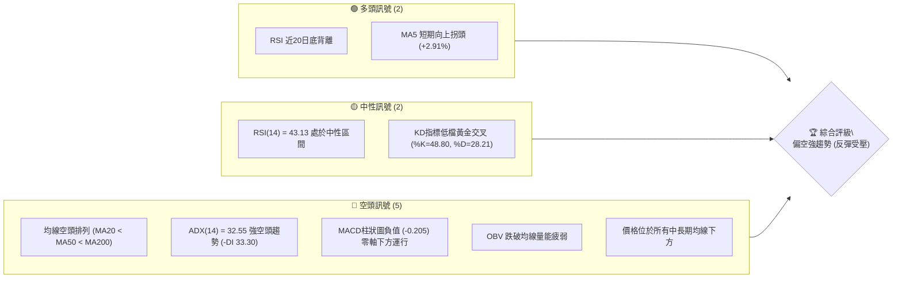

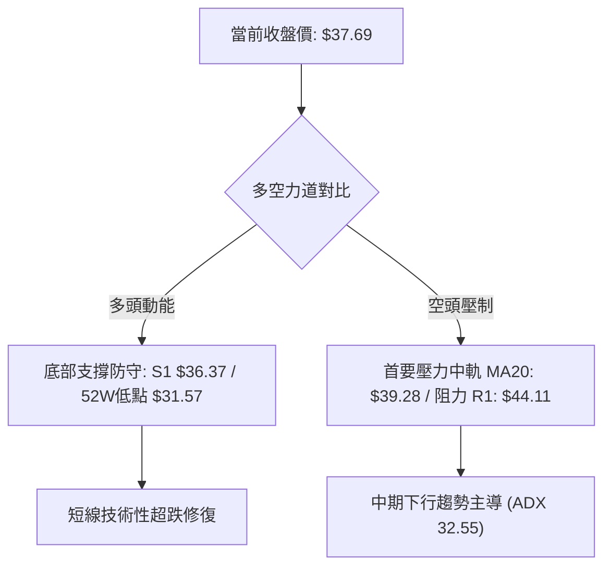

### 📊 核心指標速覽表

| 指標類別 | 指標名稱 | 當前數值 | 訊號 | 解讀 |
|----------|----------|----------|------|------|
| **價格** | 當前價格 | $37.69 | 🔴 | 位於 52 週低檔區（區間百分比 6.0%），整體處於顯著修正波段 |
| **均線** | MA20 | $39.28 | 🔴 | 價格低於 MA20（折價 -4.05%），且 MA20 呈下行趨勢 |
| **均線** | MA50 | $43.20 | 🔴 | 價格顯著低於 MA50，中期生命線持續走空 |
| **均線** | MA200 | $61.65 | 🔴 | 價格遠低於長期牛熊線（年線），長期結構處於空頭市場 |
| **動能** | RSI(14) | 43.13 | 🟡 | 脫離超賣區進入中性偏弱區，首尾呈現底背離反彈契機 |
| **動能** | MACD | -1.880 | 🔴 | 快慢線均在零軸下方運行，柱狀圖為 -0.205，空方動能佔優 |
| **動能** | Stoch %K/%D | 48.80 / 28.21 | 🟢 | %K 突破 %D 形成低檔交叉反彈，但未脫離弱勢整理格局 |
| **趨勢** | ADX(14) | 32.55 | 🔴 | ADX > 25 且 -DI(33.30) 遠大於 +DI(18.95)，顯示明確且強勁的空頭趨勢 |
| **通道** | 布林通道 %B | 0.33 | 🟡 | 價格自布林下軌（$34.54）向上反彈，朝中軌（$39.28）靠攏 |
| **成交量** | 量比 (vs 20MA) | 1.30x | 🟡 | 最新成交量 6,400,700 放大至 20 日均量（4,913,910）之上，出現反彈放量 |
| **量能** | OBV 趨勢 | OBV < MA | 🔴 | 能量潮指標位於均線下方，反映中長期資金持續淨流出 |
| **波動** | ATR(14) | $2.59 | 🔴 | 佔股價 6.88%，波動幅度極高，短線洗盤與跳空風險大 |

### 🏆 技術評分卡

```
╔════════════════════════════════════════════════════════════════╗
║                   技術評分卡 — KTOS (2026-11-10)               ║
╠════════════════════════════════════════════════════════════════╣
║ 趨勢強度 (ADX=32.55, -DI主導) ██████░░░░░░░░░░░░░░  30/100 🔴 ║
║ 動能指標 (RSI背離, MACD負值)  ████████░░░░░░░░░░░░  40/100 🟡 ║
║ 支撐穩定度 (S1=$36.37測試中)   ██████████░░░░░░░░░░  50/100 🟡 ║
║ 成交量配合 (量比1.30x但OBV偏弱)████████░░░░░░░░░░░░  40/100 🟡 ║
║ 形態完整度 (下行通道與空頭破位)██████░░░░░░░░░░░░░░  30/100 🔴 ║
║ 均線排列 (MA20<MA50<MA200空排)████░░░░░░░░░░░░░░░░  20/100 🔴 ║
╠════════════════════════════════════════════════════════════════╣
║ 綜合評分 (六項算術平均四捨五入)███████░░░░░░░░░░░░░  35/100 🔴 ║
║ 評級結論：偏空強趨勢 (短線弱勢反彈，反彈逢高尋找做空/避險契機)║
╚════════════════════════════════════════════════════════════════╝
```

---

## 2. 趨勢分析

### 🌐 多時框趨勢分析

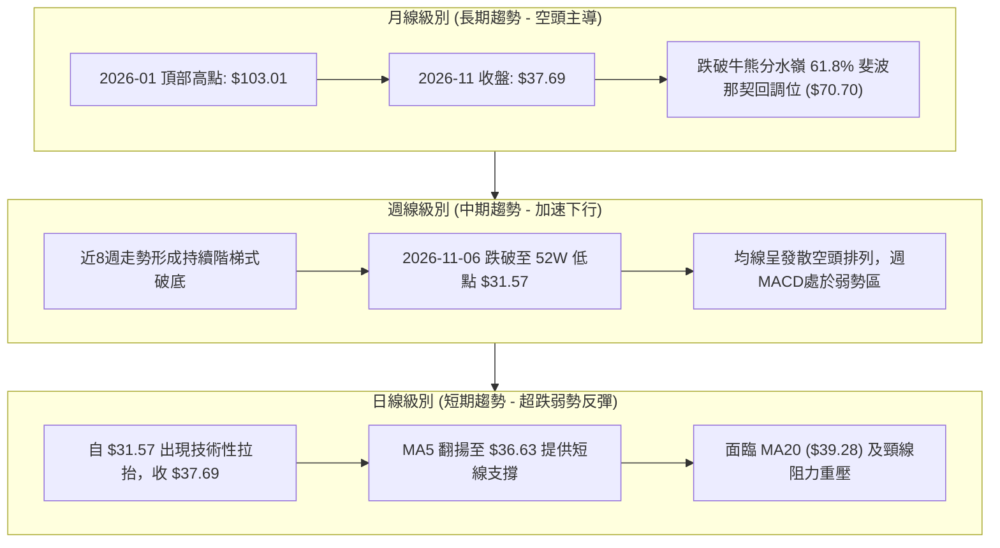


### 📈 長期趨勢 — 12個月走勢圖（Unicode）

KTOS 月線走勢呈現典型的暴跌崩潰浪潮。股價於 2026 年 1 月攀上 $103.01 峰值後，連續 10 個月震盪下跌，目前月線跌幅超過 63.4%。

```
KTOS 月線走勢圖（過去12個月：2024-12 至 2026-11）
價格軸 ($)
$105 ┤                                    ● $103.01 (2026-01 歷史波段高點)
$95  ┤
$85  ┤                                          ● $86.18
$75  ┤● $75.91(2024-12)                               ● $70.51
$65  ┤                                                      ● $64.13
$55  ┤                                                            ● $50.98
$45  ┤                                                                  ● $46.60  ● $41.09
$35  ┤━━━━━━━━━━━━━━━━━━━━━━━━━━━━━━━━━━━━━━━━━━━━━━━━━━━━━━━━━━━━━━━━━━━━━━━━━● $37.69 (現在)
     └─────────────────────────────────────────────────────────────────────────────
       M1     M2     M3     M4     M5     M6     M7     M8     M9     M10    M11    M12
     (12/24)(01/25)(02/25)(03/25)(04/25)(05/25)(06/25)(07/25)(08/25)(09/25)(10/25)(11/26)
     註：M1=2024-12, M2=2025-01 ... M12=2026-11
```

**長期月線走勢特徵分析表**：

| 階段時間 | 起始收盤 | 終止收盤 | 區間漲跌幅 | 結構特徵與走勢解讀 |
|----------|----------|----------|------------|--------------------|
| **2024-12 ~ 2025-09** | $26.38 | $91.37 | +246.36% | 主升浪爆發：國防無人系統與衛星地面站需求推動巨量買盤，價格連破均線 |
| **2025-09 ~ 2026-01** | $91.37 | $103.01 | +12.74% | 高位強烈震盪與築頂：月線創下 $103.01 歷史收盤高點，52W 盤中最高觸及 $134.00 |
| **2026-01 ~ 2026-06** | $103.01 | $49.86 | -51.60% | 主跌第一浪：現金流轉負及估值修正引發機構集中減持，連續擊穿 MA20 與 MA50 |
| **2026-06 ~ 2026-08** | $49.86 | $50.98 | +2.25% | 假反彈平台整理：反彈高點受制於下行的 MA60/MA120，形成下行中繼結構 |
| **2026-08 ~ 2026-11** | $50.98 | $37.69 | -26.07% | 主跌第二浪破底：跌破前低，2026-11-06 盤中創出 52W 新低 $31.57，均線徹底空頭發散 |

### 📊 中期趨勢（週線分析）

```
KTOS 近期週線壓力與支撐示意圖
═══════════════════════════════════════════════════════════════════
$50.00 ┤---------------------------------- [阻力 R2: $49.68] 近期波段反彈極限
       │
$45.00 ┤---------------------------------- [阻力 R1: $44.11] 10/30 當週高點
       │           ┌─┐
$40.00 ┤─┌─┐───────│ │─────── [中軌/整數關卡 $39.28-$40.00]
       │ │ │   ┌─┐ │ │ ┌─┐
$35.00 ┤─│ │───│ │─│ │─│ │─ [近期低點支撐 S1: $36.37] ◄ 現價 $37.69
       │ └─┘   │ │ └─┘ │ │
$30.00 ┤───────│ │─────└─┘─ [52W 低點強防守: $31.57]
═══════════════════════════════════════════════════════════════════
```

中期週線來看，KTOS 呈現典型的「低點越跌越低（Lower Lows）、高點越反彈越低（Lower Highs）」的熊市軌跡。近 8 週成交量在下跌週呈現放量特徵（例如 2026-11-06 當週暴跌至 $31.57 時成交量擴大至 32,419,600 股），顯示出賣壓在恐慌盤宣洩中加速釋放。雖然本週（截至 2026-11-09）自低點強烈反彈至 $37.69，但上方受到 $40.00 整數關卡及下行的 MA20 強壓壓制。

### ⚡ 趨勢強度評估（ADX 解讀）

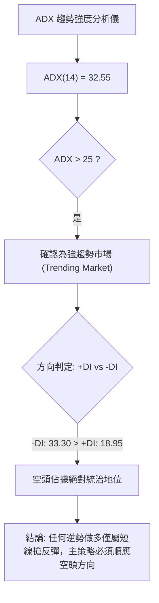

**ADX 趨勢強度對照解讀表**：

| 指標名稱 | 實際數值 | 臨界標準值 | 趨勢狀態判定 | 交易策略意涵 |
|----------|----------|------------|--------------|--------------|
| **ADX(14)** | **32.55** | > 25.00 | **強趨勢確立** | 盤整策略失效，通道破位策略與均線順勢策略具備極高可靠度 |
| **+DI** | **18.95** | < 20.00 | 多頭力道極度匱乏 | 買盤多為短線空頭回補，缺乏中長期增量資金介入 |
| **-DI** | **33.30** | > 30.00 | 空頭拋壓處於高潮 | 空方主導定價權，下行動能強烈，反彈容易遭受二次拋壓打擊 |
| **DI差值 (-DI - +DI)** | **+14.35** | > 10.00 | 空頭優勢顯著 | 順勢做空或逢高減碼為勝率最高的操作邏輯 |

---

## 3. 圖表形態分析

### 🔍 形態識別系統

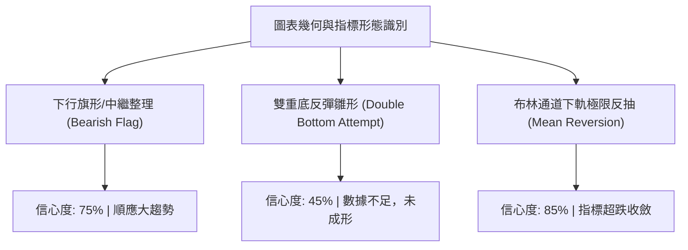

**形態識別與信心度評估表（依規則 15 嚴格執行）**：

| 形態名稱 | 信心度 | 判斷依據（嚴格引用數據） | 完成度 | 目標價（附嚴謹計算式） |
|----------|--------|--------------------------|--------|------------------------|
| **下降通道/中繼空頭旗形** | **75%** | 自 2026-09-25 高點 $49.68 下跌至 10-23 低點 $36.37，反彈至 10-30 高點 $44.11，隨後破底至 $31.57 | **85%** | 旗桿高點 $49.68 − 旗底 $36.37 = $13.31。破位點 $41.09 − 形態高度 $13.31 = 估算目標 $27.78（數據中未偵測到此支撐，保守看至 52W 低點 **$31.57**） |
| **雙重底（潛在反轉）** | **40%** | 低點聚類僅見 11-06 低點 $31.57 與前波次低 $34.66，兩次低點相隔不足，頸線尚未有效收復 | **30%** | **訊號不足，僅做指標型解讀**。若以 R1 $44.11 為頸線，當前價位遠在其下，形態尚未確立 |
| **布林通道下軌極值反抽** | **85%** | 11-06 日K低點 $31.57 貫穿布林下軌（$34.54），引發均值回歸买盤推升至 $37.69 | **100%** | 目標為測試布林中軌 MA20 **$39.28**（計算式：中軌阻力位） |

### 🕯️ 重要 K 線形態分析

依據提供的「近 10 根日 K」與「近 8 根週 K」之精確 OHLC 數據進行解讀：

| 日期（日K/週K） | 開 | 高 | 低 | 收 | 成交量 | K線形態名稱 | 形態特徵與技術解讀 | 訊號評級 |
|-----------------|----|----|----|----|--------|-------------|--------------------|----------|
| **2026-10-29 (日K)** | 41.28 | 44.11 | 41.20 | 43.59 | 6,251,700 | **長實體大陽線** | 盤中衝擊阻力 R1 ($44.11) 後收長陽，量能放大，看似突破但留阻力 | 🟡 |
| **2026-10-30 (日K)** | 42.67 | 43.21 | 40.28 | 41.09 | 3,414,400 | **長陰反噬 (烏雲蓋頂)** | 次日直接低開走低，完全吞噬前日陽線過半實體，確認 $44.11 為短期波段鐵頂 | 🔴 |
| **2026-11-04 (日K)** | 39.86 | 40.25 | 35.71 | 35.96 | 8,268,600 | **破位長陰殺跌** | 帶量貫穿 $36.37 支撐，單日大跌，空頭恐慌盤大舉宣洩 | 🔴 |
| **2026-11-05 (日K)** | 35.63 | 35.79 | 32.50 | 33.39 | 9,523,800 | **放量下挫大陰線** | 創年內成交量高峰，直逼 $32 關口，呈現崩潰式拋售 | 🔴 |
| **2026-11-06 (日K)** | 33.73 | 35.31 | 31.57 | 35.10 | 8,007,000 | **長下影錘頭線 (Hammer)** | 探出 52W 新低 $31.57 後遭遇強力逢低買盤拉升，下影線長達 $3.53，止跌訊號初現 | 🟢 |
| **2026-11-09 (日K)** | 35.63 | 38.13 | 34.66 | 37.69 | 6,400,700 | **多頭反撲大陽線** | 跳空高開並放量突破 MA5 ($36.63)，實體堅實，確認短期空頭力竭反彈 | 🟢 |
| **2026-11-06 (週K)** | 41.29 | 41.72 | 31.57 | 35.10 | 32,419,600| **巨量長下影陰錘線** | 單週下挫逾 $10 後自 $31.57 強力回抽，週量創波段最大，顯示極端恐慌盤湧出 | 🟡 |
| **2026-11-09 (週K)** | 35.63 | 38.13 | 34.66 | 37.69 | 6,400,700 | **延續回升小陽線** | 站回 $37.00 上方，初步確認 $31.57 具備波段下影線支撐效力 | 🟢 |

### 📉 ASCII 走勢形態示意圖

```
KTOS 日線近期「極端破底後長下影錘頭反彈」形態示意圖
價格 ($)
$44.11 ┤       ● 10-29 阻力 R1 (波段反彈頂部)
       │      / \
$42.00 ┤     /   ● 10-30 烏雲蓋頂
       │    /     \
$40.00 ┤   ●       \   ● 11-03 破位前最後震盪
       │            \ / \
$38.00 ┤─────────────┼───● 11-09 多頭反撲 ($37.69) ◄ 現價
       │              \  /│
$36.00 ┤───────────────┼──┼─── [跌破近期支撐 S1: $36.37]
       │               \  │
$34.00 ┤                \ │
       │                 \│
$31.57 ┤                  ● 11-06 錘頭線長下影低點 (52W Low: $31.57)
       └───────────────────────────────────────────────────
         10-27  10-29  10-30  11-04  11-05  11-06  11-09
```

### 🎯 形態目標價計算

根據經典技術分析形態計算法則：
1. **下行破位測算**：
   - 形態區間：2026-10-29 高點 **$44.11** 至 2026-11-03 震盪頸線破位點 **$40.23**。
   - 形態垂直高度 $H = \$44.11 - \$40.23 = \$3.88$。
   - 理論破位測算目標價 $= \$40.23 - \$3.88 = \$36.35$。
   - *驗證*：11-04 跌破後迅速擊穿至 $31.57，該目標已完全達成並產生超跌。
2. **反彈測算目標（技術性均值修復）**：
   - 錘頭線形成底部區間：低點 **$31.57**，反彈突破首個關鍵平台 **$36.37**。
   - 基礎反彈高度 $H_r = \$36.37 - \$31.57 = \$4.80$。
   - 向上等距投射目標 $= \$36.37 + \$4.80 = \$41.17$。
   - 該目標價與數據中的阻力高點 **$41.09**（10-30收盤）高度重疊，並受制於 R1 **$44.11**。

---

## 4. 支撐與阻力

### 🗺️ 關鍵價位分布圖（Unicode）

```
KTOS 價位結構分布圖（嚴格依據 OHLCV 計算聚類值）
═══════════════════════════════════════════════════════════════════
$51.49 ║████████████████████████████████████║ 強阻力 R3 (+36.61%)
       ║                                    ║
$49.68 ║██████████████████████████          ║ 中期阻力 R2 (+31.81%)
       ║                                    ║
$44.11 ║████████████████                    ║ 關鍵阻力 R1 / 布林上軌 $44.02 (+17.03%)
       ║                                    ║
$39.28 ║▓▓▓▓▓▓▓▓▓▓▓▓▓▓                      ║ 動態阻力：MA20 / 布林中軌 (+4.22%)
$37.69 ╠════════════════════════════════════╣ ◄ 現價 ($37.69)
$36.37 ║▓▓▓▓▓▓▓▓▓▓▓▓▓▓▓▓                    ║ 近期支撐 S1 (-3.50%)
       ║                                    ║
$31.57 ║████████████████████████████████████║ 核心防守：52W Low / 100% 斐波那契 (-16.24%)
═══════════════════════════════════════════════════════════════════
```

### 🚧 阻力位分析表

所有價位均直接取自系統計算之關鍵價位聚類：

| 阻力級別 | 價位 | 形成原因與籌碼結構 | 突破難度 | 技術重要性 |
|----------|------|--------------------|----------|------------|
| **動態阻力** | **$39.28** | **MA20 均線暨布林通道中軌**，20日投資者平均成本位 | 🟡 中等 | 判定短線弱勢反彈能否轉化為中級反彈之第一道分水嶺 |
| **阻力 R1** | **$44.11** | **近一年波段高點聚類**（2026-10-29 日K最高價、10-30 週K最高價，重疊布林上軌 $44.02） | 🔴 極高 | 波段空頭防線，無法帶量站穩前，整體結構仍屬反彈非反轉 |
| **阻力 R2** | **$49.68** | **近一年波段高點聚類**（2026-09-25 週K高點），重疊 MA120 ($49.62) | 🔴 極高 | 跌破該處後引發密集套牢籌碼，為中期反彈之極限天花板 |
| **阻力 R3** | **$51.49** | **近一年波段高點聚類**，2026-08 反彈波段頂部區域 | 🔴 堅不可摧 | 長期籌碼套牢密集峰，空頭終極防禦線 |

### 🛡️ 支撐位分析表

所有支撐價位嚴格引用歷史波段低點聚類與 OHLCV 計算：

| 支撐級別 | 價位 | 形成原因與籌碼結構 | 守住機率 | 技術重要性 |
|----------|------|--------------------|----------|------------|
| **支撐 S1** | **$36.37** | **近一年波段低點聚類**（2026-10-23 週K低點），跌破後曾轉化為反壓，現由下往上重新收復 | 🟡 60% | 短線多頭能否守住反彈戰果的底線，跌破則預示反彈結束 |
| **動態支撐** | **$34.54** | **布林通道下軌**，統計學超賣邊界 | 🟢 70% | 價格向下跌破下軌通常引發均值回歸买盤 |
| **核心防線** | **$31.57** | **52週歷史低點 (52W Low)**，2026-11-06 日K/週K探底低點，100.0% 斐波那契回調位 | 🟢 80% | KTOS 全年多頭生死線，若失守將面臨無支撐之自由落體探底 |
| **其他支撐** | **N/A** | **數據中未偵測到 S2/S3** | N/A | 下方除 $31.57 外無其他已計算之波段聚類支撐 |

### 📐 斐波那契回調位分析

依據 52 週完整波段（極致高點 **$134.00** 至極致低點 **$31.57**，波段總垂直空間達 $102.43）精確計算之回調位分佈：

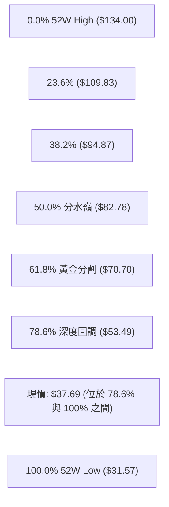

**斐波那契空間結構深度解讀**：
1. **極度弱勢區間定位**：
   - 當前收盤價 **$37.69** 深度深陷於 **78.6% 回調位 ($53.49)** 與 **100.0% 回調位 ($31.57)** 之間的極低階層。
   - 價格位於 52 週整體振幅的僅 **6.0%** 處，表明過去一年的多頭漲幅已被空頭回吐 94.0%。
2. **關鍵回調位技術意涵**：
   - **$70.70 (61.8%)**：傳統牛熊分水嶺，早已於 2026 年初被實體陰線跌穿，確認進入長期熊市週期。
   - **$53.49 (78.6%)**：長期最後的多頭防守位，目前已成為不可逾越的中長期重壓天花板。
   - **$31.57 (100.0%)**：波段起漲點與 52 週最低點，是阻擋股價墜入更深歷史無支撐區的最後一道實體屏障。現價距離此核心支撐僅有 **-16.24%** 之緩衝空間。

---

## 5. 技術指標深度解讀

### 🎛️ 指標訊號總覽

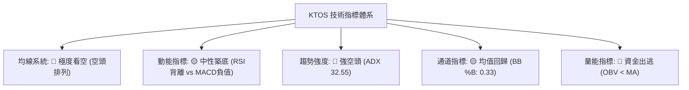

### 📈 移動平均線排列分析

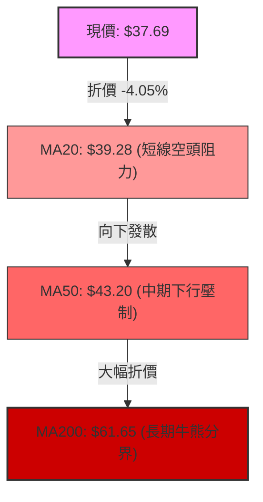

**移動平均線系統詳細數據追蹤表**：

| 均線名稱 | 當前數值 | 現價偏離幅度 | 方向與斜率 | 排列型態與多空解讀 |
|----------|----------|--------------|------------|--------------------|
| **MA5** | **$36.63** | **+2.91%** | 🟢 上行 (+1.06) | 短線出現向上拐頭，為自 $31.57 反彈以來的第一道動態防守位 |
| **MA10** | **$39.05** | **-3.49%** | 🔴 下行 (-1.36) | 快速下壓，與 MA20 在 $39.00-$39.30 區域形成短線死叉壓制帶 |
| **MA20** | **$39.28** | **-4.05%** | 🔴 下行 (-1.59) | 一個月均線，持續壓抑股價上行空間，構成短線反彈首要考驗 |
| **MA50** | **$43.20** | **-12.75%** | 🔴 下行 | 中期生命線，斜率陡峭向下，中期空頭趨勢固若金湯 |
| **MA60** | **$45.39** | **-16.96%** | 🔴 下行 (-7.70) | 季線下行，反彈逢此線必引發解套賣壓 |
| **MA120** | **$49.62** | **-24.05%** | 🔴 下行 (-11.93) | 半年線下壓，重疊阻力 R2 ($49.68) |
| **MA200** | **$61.65** | **-38.86%** | 🔴 下行 | 經典牛熊線，偏離度達近 39%，長期結構極度孱弱 |
| **MA240** | **$66.19** | **-43.06%** | 🔴 下行 (-28.50) | 年線下壓，確立超長期熊市格局 |

**均線綜合研判**：當前呈現標準且發散的 **完美空頭排列（MA20 < MA50 < MA200）**，雖然短期 MA5 向上拐頭提供超跌支撐，但在中長期均線無一例外陡峭向下的環境下，所有反彈均屬於次級修正浪，均線蓋頭壓力沉重。

### 📉 RSI(14) 分析

- **RSI(14) 數值**：**43.13** (Wilder 平滑法)
- **強度指示條**：`████████░░░░░░░░░░░░` 43.13%（處於 30–70 中性弱勢區間）

```
RSI(14) 區間位置標註：
0 ─────── 30 ───────────── 43.13 ──────────── 70 ─────── 100
[ 極度超賣 ] [  弱勢反彈區間  ▲  ] [  強勢多頭區間  ] [ 極度超買 ]
```

**背離深入研判（重要轉折訊號）**：
- **指標訊號**：系統確認 **底背離 (Bullish Divergence)**。
- **背離實體比對**：
  - 在近 20 根 K 棒期間，KTOS 價格自 2026-10-23 的低點 $36.37 進一步下探至 2026-11-06 的 $31.57（價格創出顯著新低）；
  - 然而 RSI(14) 於 2026-10-23 觸及 31.3 低點後，在 11-06 探底 $31.57 時 RSI 僅降至 35.1，未破前低，並隨後迅速彈升至當前的 **43.13**。
- **結論**：日線級別底背離確立，說明空頭殺跌力道在 $31.57 出現耗竭，空方動能減弱，短線支撐該股進行技術性均值回抽，但週線 RSI 仍偏弱，限制反彈幅度。

### 📊 MACD(12/26/9) 訊號解讀

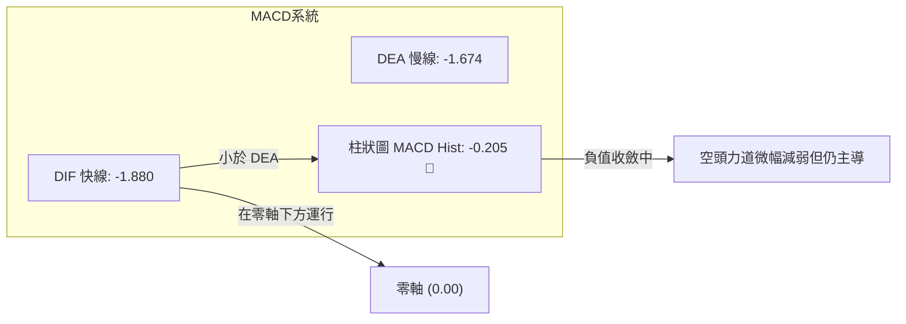

- **快線 (DIF)**：`-1.880`
- **慢線 (DEA / Signal)**：`-1.674`
- **柱狀圖 (Histogram)**：`-0.205`（🔴 看空訊號）
- **詳細解讀**：
  1. DIF 與 DEA 雙雙在零軸下方深處運行，這是典型的中長期弱勢空頭市特徵。
  2. 柱狀圖讀數為 -0.205，雖呈現負值（空頭佔優），但對比 2026-11-06 週線級別的 -0.341 與先前日線極值，柱狀實體正在向上縮短收斂。
  3. DIF 快線有向上靠攏慢線形成低檔「水下金叉」之趨勢，若隨後數日內能完成交叉翻紅，將強化當前由底背離所引發的技術性反彈。

### 📦 布林通道分析

```
KTOS 日線布林通道 (20, 2) 結構圖
價格軸 ($)
$44.02 ┤================================== 布林上軌 (Upper Band)
       │
$42.00 ┤
       │
$39.28 ┤---------------------------------- 布林中軌 (Middle Band = MA20)
       │            ● 現價: $37.69 (%B = 0.33)
$36.00 ┤          ▲
       │        /
$34.54 ┤================================== 布林下軌 (Lower Band)
       │       ● 11-06 跌破下軌 ($31.57) 極端超賣
═════════════════════════════════════════════════════════════════
```

- **布林參數與數值**：
  - 上軌 (Upper Band)：**$44.02**（重疊阻力 R1 $44.11）
  - 中軌 (Middle Band / MA20)：**$39.28**
  - 下軌 (Lower Band)：**$34.54**
  - 帶寬 (Bandwidth)：$\frac{\$44.02 - \$34.54}{\$39.28} \times 100\% = 24.13\%$
  - **%B 指標**：**0.33**（位於下軌至中軌之間之偏低水準）
- **通道行為解讀**：
  - 股價於 11-06 盤中跌穿布林下軌（$31.57 < \$34.54），引發極端超賣邊界外的強烈「均值回歸」效應。
  - 目前價格以長下影陽線回彈至通道內部，當前目標直指布林中軌 **$39.28**。在帶寬未見極度收窄前，中軌處將面臨顯著空頭反撲阻力。

### 💹 成交量分析（量價配合度）

- **最新日成交量**：`6,400,700` 股
- **20日平均量 (Volume MA20)**：`4,913,910` 股
- **50日平均量 (Volume MA50)**：`4,506,408` 股
- **量比 (Volume Ratio)**：`1.30x`（放量 30%）
- **OBV 能量潮狀態**：`OBV < MA`（能量潮跌破其均線，趨勢偏弱）

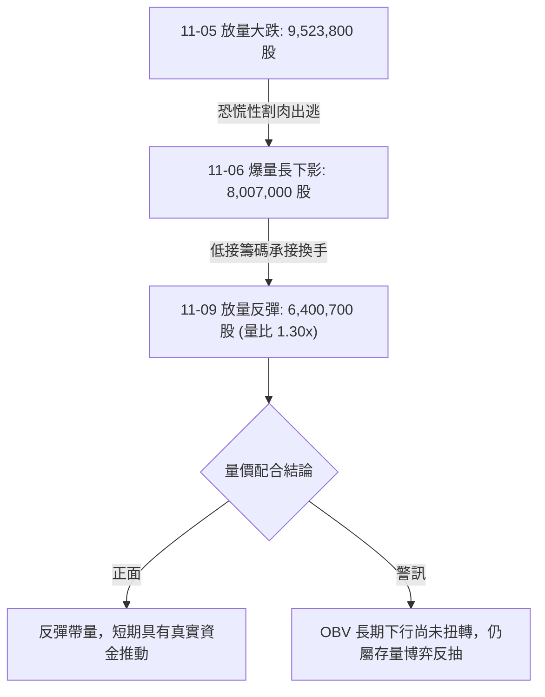

- **量價結構診斷**：
  - 2026-11-06 週成交量高達 32,419,600 股，創下過去 20 週以來的最大週天量，伴隨 $31.57 長下影線產生，符合「爆量見底」或「拋售潮高潮（Selling Climax）」之特徵。
  - 11-09 日K收陽放量達 640 萬股，高於 20 日均量，確認有短線抄底買盤進駐；但 OBV 指標目前仍受制於均線下方，說明這波量能尚不足以抵消近兩季度的資金淨流出規模。

---

## 6. 動能與波動率

### ⚡ 動能評估四象限

動能評估透過「動能強度（以 RSI、MACD 方向評估）」與「波動率（以 ATR、布林帶寬評估）」兩大維度進行橫向定位：

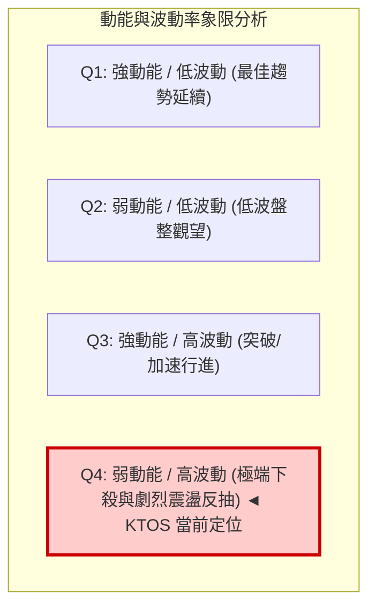

**象限特徵與當前狀態評估表**：

| 象限 | 動能方向 | 波動水準 | 當前狀態標註 | 操作意涵與策略應對 |
|------|----------|----------|--------------|--------------------|
| **Q1** | 強 (多頭) | 低波動 | — | 趨勢穩健上行，適合持股或順勢加碼 |
| **Q2** | 弱 (中性) | 低波動 | — | 橫盤窄幅震盪，方向未明，觀望為主 |
| **Q3** | 強 (多頭) | 高波動 | — | 主升浪爆發，追高需擴大止損 |
| **Q4** | **弱 (空頭主導/反彈動能衰弱)** | **高波動 (ATR=6.88%)** | **✓ 當前 KTOS 狀態** | **高風險高摩擦市場**：單日振幅巨大，容易出現破底後的報復性反彈與衝高回落。策略嚴禁追價，嚴守止損點 |

### 📊 ATR 波動率分析

- **ATR(14) 數值**：**$2.59** (Wilder 14天平滑真實波幅)
- **ATR 佔比 (ATR % of Price)**：**6.88%**（處於美股市場高波動個股前列）
- **動態止損與倉位控制指引**：
  - **1.0× ATR（極緊密短線止損）**：`$2.59`。若於現價 $37.69 做多，1.0 ATR 止損價為 `$35.10`（恰為 11-06 收盤價）。
  - **1.5× ATR（標準波段止損）**：`$3.89`。標準波段止損價應設為 `$33.80`。
  - **2.0× ATR（防洗盤寬鬆止損）**：`$5.18`。寬鬆止損價為 `$32.51`（仍守在 52W 低點 $31.57 之上）。
  - **波動度解讀**：每日近 $2.60 的常態波動要求交易者必須縮小頭寸規模，若單筆交易風險預算為總資產的 1%，則 KTOS 建議配置倉位不宜超過總資金的 15%。

### 📐 Beta 與市場相關性

- **Beta 係數**：**1.165**
- **市場特徵分析**：
  - Beta 為 1.165，顯示 KTOS 相對標普 500 指數具備較高彈性（大盤漲跌 1%，該股理論波動 1.165%）。
  - 近期走勢明顯與大盤脫節，主要受國防預算擔憂、財報負自由現金流（TTM FCF 為 $-123.00M）以及估值下修（Trailing P/E 達 289.92）等個股基本面逆風拖累，呈現防禦板塊內的「非系統性高 Beta 下殺」。

---

## 7. 多時框架總結

### 📋 時框架評分表

| 時框架 | 趨勢方向 | 動能狀態 | 均線排列 | 形態特徵 | 綜合評分 | 戰術建議 |
|--------|----------|----------|----------|----------|----------|----------|
| **月線 (長期)** | 🔴 極度看空 | 弱勢下探，未見底背離 | 完全空頭發散 | 自 $103.01 崩潰下跌，跌幅 >63% | **25/100** | 長期投資者切勿盲目接刀 |
| **週線 (中期)** | 🔴 延續下行 | MACD柱負值 (-0.205) | 空頭排列 (破年線) | 近8週階梯下行，巨量測試 $31.57 | **30/100** | 中期逢反彈至壓力區建立空頭保護 |
| **日線 (短期)** | 🟡 弱勢反彈 | RSI底背離，Stoch金叉 | MA5向上，MA20阻力 | 下影線錘頭反彈，測試 MA20 | **45/100** | 僅供超短線快進快出或尋找高拋點 |

### 🔲 綜合訊號矩陣

```
╔══════════════════════════════════════════════════════════════════╗
║               KTOS 多時框訊號一致性矩陣                         ║
╠════════════════╦════════════╦════════════╦═══════════════════════╣
║ 分析維度       ║ 短期 (日)  ║ 中期 (週)  ║ 長期 (月)             ║
╠════════════════╬════════════╬════════════╬═══════════════════════╣
║ 趨勢方向       ║ 🟡 反彈    ║ 🔴 跌勢    ║ 🔴 熊市               ║
║ 動能 (RSI/MACD)║ 🟢 背離翻多║ 🔴 負向壓制║ 🔴 深度鈍化           ║
║ 均線結構       ║ 🟡 短多MA5 ║ 🔴 空排    ║ 🔴 嚴重折價           ║
║ 籌碼量能 (OBV) ║ 🟢 短線放量║ 🔴 量弱流出║ 🔴 機構減持           ║
║ 關鍵通道位置   ║ 🟡 回歸中軌║ 🔴 下軌邊界║ 🔴 破下界             ║
╚════════════════╩════════════╩════════════╩═══════════════════════╝
```

### ⚖️ 多時框收斂結論

嚴格依據**規則 14（多時框收斂規則）**進行最終定奪：
1. **行情性質判定**：當前 ADX(14) 讀數為 **32.55**（顯著高於 25 臨界線），且 -DI 達 33.30，**確認當前市場處於絕對的「趨勢行情」**，而非無方向的盤整震盪行情。
2. **時框優先級裁決**：
   - 規則明確規定：「**趨勢行情（ADX > 25）：以中長期（週線/MA50、MA200）方向為主，日線只用來尋找進場時機。**」
   - 中長期週線均線系統全數呈空頭排列向下發散，月線級別崩跌逾 60%，因此日線級別出現的 RSI 底背離與長下影線陽線，**僅能定性為「強空頭趨勢中的超跌技術性反抽」**。
3. **唯一收斂結論**：
   - **整體方向定調為【偏空】（評分 35/100，落於 ≤40 偏空區間）**。
   - 日線的反彈非但不是新一輪牛市的開啟，反而是順應中長期空頭趨勢、以優異風險報酬比建立**高位做空（逢高做空）**的進場窗口。

---

## 8. 交易策略建議

### 🗺️ 策略決策流程圖

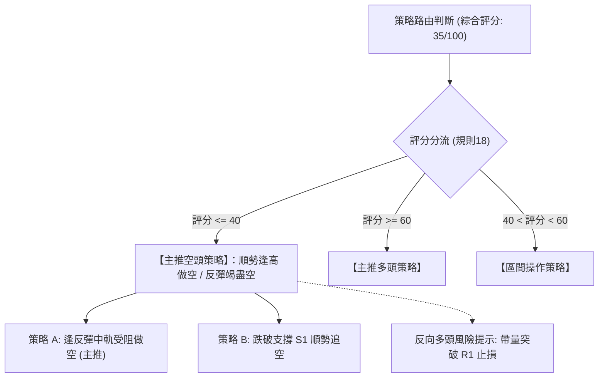

### 🧭 策略路由（依評分卡分流，不得兩頭下注）

> **當前主策略方向 = 偏空逢高做空（依綜合評分 35/100）**

因技術評分卡綜合評分為 **35/100**（符合規則 ≤40 之偏空分流），本報告**主推空頭策略**。日線級別的超跌反彈正好為中線空頭提供了「價格回抽均線壓制位」的優質進場點，多頭僅列為反轉風險對沖提示。

### 🎯 價格情境階梯（Price Scenarios）

價位嚴格引用第 4 章及數據計算數值：

| 觸發條件 | 下一目標 | 後續延伸 | 情境含義 |
|----------|----------|----------|----------|
| **反彈受阻於 MA20 $39.28** | 回測 S1 **$36.37** | 探底 52W 低點 **$31.57** | **空頭中繼確立**：反彈無力，重回主跌浪 |
| **向上假突破受阻於 R1 $44.11** | 回調至 MA20 **$39.28** | 震盪回落測試 S1 **$36.37** | **深幅反彈見頂**：測試強阻力後空頭再次控盤 |
| **跌破近期支撐 S1 $36.37** | 52W 低點 **$31.57** | 尋求數據中未標註之更低位 | **空頭加速突破**：跌破反彈底線，恐慌盤重啟 |

### 📊 情境機率分佈

| 情境劇本 | 機率 | 主要依據與技術支撐 |
|----------|------|--------------------|
| **情境一：反彈遇阻回落再探底（偏空主劇本）** | **60%** | ADX 32.55 強空頭引導；MA20 ($39.28) 下行壓制；OBV 能量潮持續疲弱未配合 |
| **情境二：在 S1 與 R1 區間寬幅震盪（次選劇本）** | **25%** | 日線 RSI 底背離提供下檔買盤；爆量長下影線 $31.57 形成短期情緒底 |
| **情境三：突破 R1 反轉向上（低機率多頭爆發）** | **15%** | 需連續帶量收復 MA50 ($43.20) 與 R1 ($44.11)，目前缺乏基本面與資金面支持 |

### 🔴 主策略詳情（空頭交易策略）

依據嚴格規則 17，做空之風險報酬比計算公式為：
$$\text{風險報酬比} = \frac{\text{進場價} - \text{目標價 T1}}{\text{止損價} - \text{進場價}}$$

| 策略要素 | 策略 A（主推：反彈遇阻做空） | 策略 B（突破：跌破 S1 順勢追空） |
|----------|------------------------------|-----------------------------------|
| **交易邏輯** | 趁超跌反彈測試中軌壓力衰竭時順勢做空 | 跌破反彈結構關鍵支撐 S1 後順勢加碼放空 |
| **進場條件** | 股價反彈至 MA20 附近出現上影線滯漲訊號 | 實體日 K 跌破並收於 S1 下方時進場 |
| **進場價格** | **$39.28**（精確取自 MA20 數值） | **$36.37**（精確取自支撐 S1 數值） |
| **止損價格** | **$41.09**（10-30 阻力收盤價，容忍度 +$1.81）| **$37.69**（現價/原支撐轉壓力，+$1.32） |
| **目標價 T1** | **$36.37**（回測 S1 支撐位，獲利空間 $2.91） | **$31.57**（下探 52W Low，獲利空間 $4.80） |
| **目標價 T2** | **$31.57**（下探 52W 歷史低點，獲利空間 $7.71） | **$31.57**（若破位則下無計算支撐，守 T1） |
| **風險報酬比** | **1 : 1.61（以 T1 計）**<br>*(計算: (39.28-36.37)/(41.09-39.28) = 2.91/1.81)*<br>*(以 T2 計則為 1 : 4.26)* | **1 : 3.64（以 T1 計）**<br>*(計算: (36.37-31.57)/(37.69-36.37) = 4.80/1.32)* |
| **成功機率** | **65%** | **60%** |
| **建議倉位** | **15%**（受制於高 ATR，輕倉操作） | **10%**（追空需嚴格控倉） |

### 🟢 反向風險觸發點（對沖提示）

若出現以下非預期多頭走勢，空頭策略必須**無條件停損出場或建立多頭對沖**：
1. **反轉關鍵價位**：日 K 收盤價強勢突破 **R1 $44.11**。一旦此位置被帶量大陽線攻破，代表日線底背離轉化為中級反轉浪，布林通道將進入向上開口模式。
2. **動能翻多訊號**：MACD 快線 DIF 上穿零軸，且 ADX 指標中的 +DI 向上金叉 -DI。
3. **對沖建議**：若持空單者見股價站穩 $41.09，應立即減半空倉；突破 $44.11 全數止損並可反手輕倉做多，目標上看 R2 **$49.68**。

### ⭐ 整體訊號強度評星

```
做多訊號強度：★★☆☆☆  (2/5星 - 僅屬超跌反抽，反轉證據不足)
做空訊號強度：★★★★☆  (4/5星 - 順應大級別空頭趨勢與均線壓制)
整體可信度：  ★★★★☆  (4/5星 - ADX>25 強趨勢確認，指標指引清晰)
```

---

## 9. 風險提示與監控

### ✅ 關鍵監控指標 Checklist

```
╔══════════════════════════════════════════════════════════════════╗
║               KTOS 每日盤後關鍵技術監控清單                      ║
╠══════════════════════════════════════════════════════════════════╣
║ [ ] 價格是否觸及 MA20 動態阻力 ($39.28)？                        ║
║     ── 若觸及且成交量萎縮，注意空頭回擊。                        ║
║ [ ] RSI(14) 是否在 50 中軸遇阻回落？                             ║
║     ── 若無法突破 50，底背離動能即告耗盡。                       ║
║ [ ] S1 支撐位 ($36.37) 是否再度失守？                            ║
║     ── 跌破則宣告反彈結束，策略 B 自動激活。                    ║
║ [ ] 日成交量是否再度爆出 800 萬股以上大陰線？                    ║
║     ── 警惕主跌浪二次加速。                                      ║
║ [ ] 52W 低點 ($31.57) 防守測試：                                 ║
║     ── 若跌破此處，下方無支撐聚類，需嚴格清倉觀望。              ║
╚══════════════════════════════════════════════════════════════════╝
```

### ⚠️ 風險場景分析

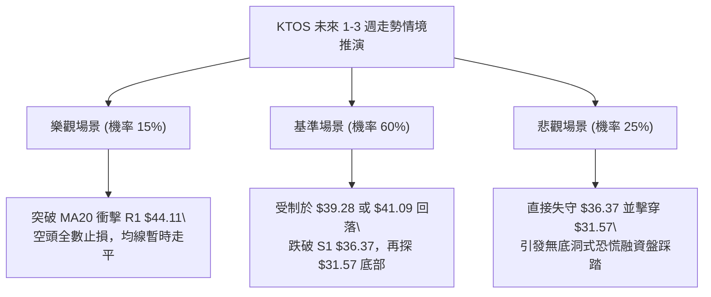

### 🛡️ 風險管理重要提醒

1. **極高 ATR 波動下的倉位稀釋法則**：
   - 當前 KTOS 的 ATR 高達 **$2.59**（佔股價近 **6.88%**）。這意味著該股正常的「單日隨機噪音波幅」就能輕易掃掉 3%–5% 的常規止損單。
   - **嚴格紀律**：單一帳戶在 KTOS 的名義曝險價值不得超過總資產的 15%，絕不可使用槓桿。止損點設定必須依據具備結構意義的關鍵價位（如 MA20 $39.28 上方之 $41.09，或支撐 S1 $36.37），而非固定的微小百分比。
2. **財報與基本面黑天鵝風險**：
   - 儘管分析師綜合給予 `strong_buy` 且平均目標價達 `$81.36`（最低目標亦有 `$46.00`），但市場近期處於極端定價狀態。
   - 公司最新季度營運利潤率為 `-0.8%`，自由現金流為負數（$-123.00M），且 Trailing P/E 高達 289 倍。技術面的反彈隨時可能受到基本面惡化的二次衝擊。
3. **逆勢摸底的致命誘惑**：
   - 「52 週跌幅深達 63%」常使散戶產生嚴重錨定心理而盲目抄底。在 ADX 趨勢強度達 32.55 且均線處於完全空頭排列的情況下，**絕不可在未見右側結構性放量突破前重倉做多**。

---

## 📋 報告總結

```
╔══════════════════════════════════════════════════════════════════════════╗
║                       KTOS 技術分析報告總結                              ║
╠══════════════════════════════════════════════════════════════════════════╣
║ 報告日期：2026-11-10                                                     ║
║ 當前價格：$37.69                                                         ║
║ 分析評級：🔴 偏空強趨勢 (綜合技術評分: 35/100)                           ║
║                                                                          ║
║ 關鍵結論：                                                               ║
║ ├─ 長期趨勢：🔴 極度看空 (自 $103 崩潰下行，完全跌破長期均線與牛熊分水嶺)║
║ ├─ 中期趨勢：🔴 空頭主導 (ADX=32.55 強空頭，週線各級均線形成蓋頭反壓)   ║
║ ├─ 短期趨勢：🟡 超跌反彈 (日線 RSI 底背離，自 $31.57 長下影錘頭回抽)    ║
║ ├─ 關鍵支撐：S1: $36.37  / 核心防守 (52W Low): $31.57                    ║
║ ├─ 關鍵阻力：動態: MA20 $39.28  / 關鍵波段頂 R1: $44.11                  ║
║ └─ 分析師目標：平均 $81.36 (最低 $46.00 / 最高 $145.00)                  ║
║                                                                          ║
║ 最優策略組合：                                                           ║
║ 1. 🥇 最佳機會 (策略 A)：逢短線反彈至 MA20 ($39.28) 遇阻做空，           ║
║    止損設於 $41.09，第一目標 S1 ($36.37)，風報比 1 : 1.61 (T1)。        ║
║ 2. 🥈 次選機會 (策略 B)：跌破 S1 ($36.37) 順勢追空，止損 $37.69，        ║
║    目標下探 52W 低點 $31.57，風報比 1 : 3.64 (T1)。                      ║
║ 3. 🥉 保守選擇：多頭完全空倉觀望，切勿盲目抄底接飛刀，等待站穩 R1 再行評估║
╚══════════════════════════════════════════════════════════════════════════╝
```

---

> ⚠️ **免責聲明**：本報告為技術分析專用模型生成之客觀研究產物，所有數據及估算均嚴格基於所提供之歷史價格與指標資訊。本報告**僅供研究與學術參考**，**不構成任何形式的投資買賣建議**。金融市場瞬息萬變，技術指標存在滯後性與失效風險，投資有風險，入市需獨立審慎評估。

---

*報告生成時間：2026-11-10 ｜ 數據來源：Yahoo Finance ｜ 分析框架：多時框技術分析體系*