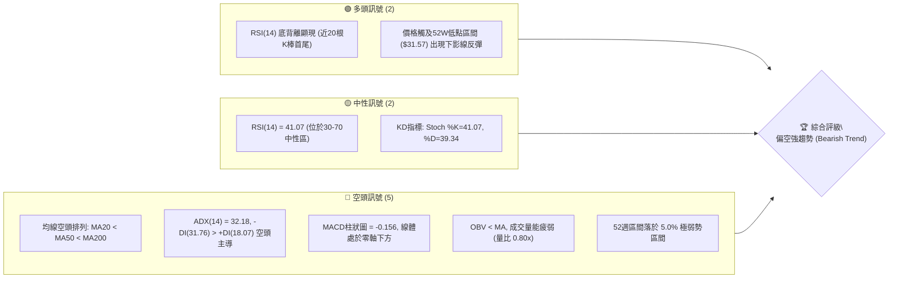
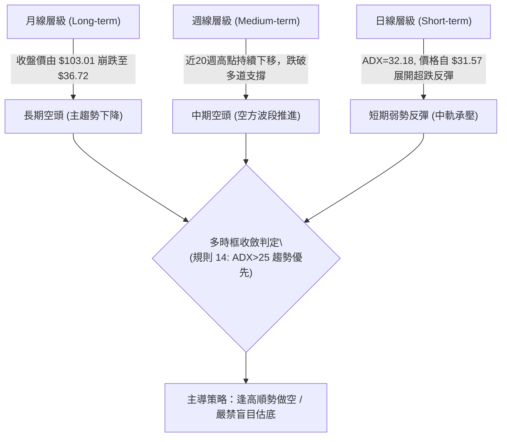
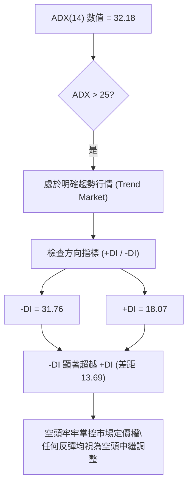
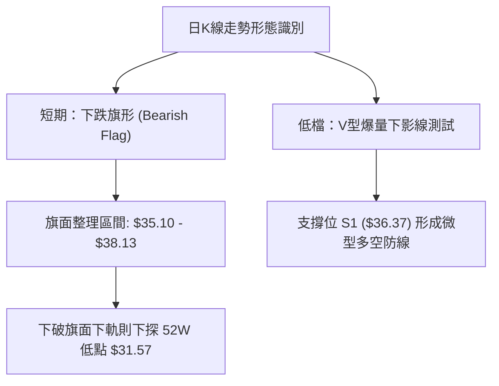
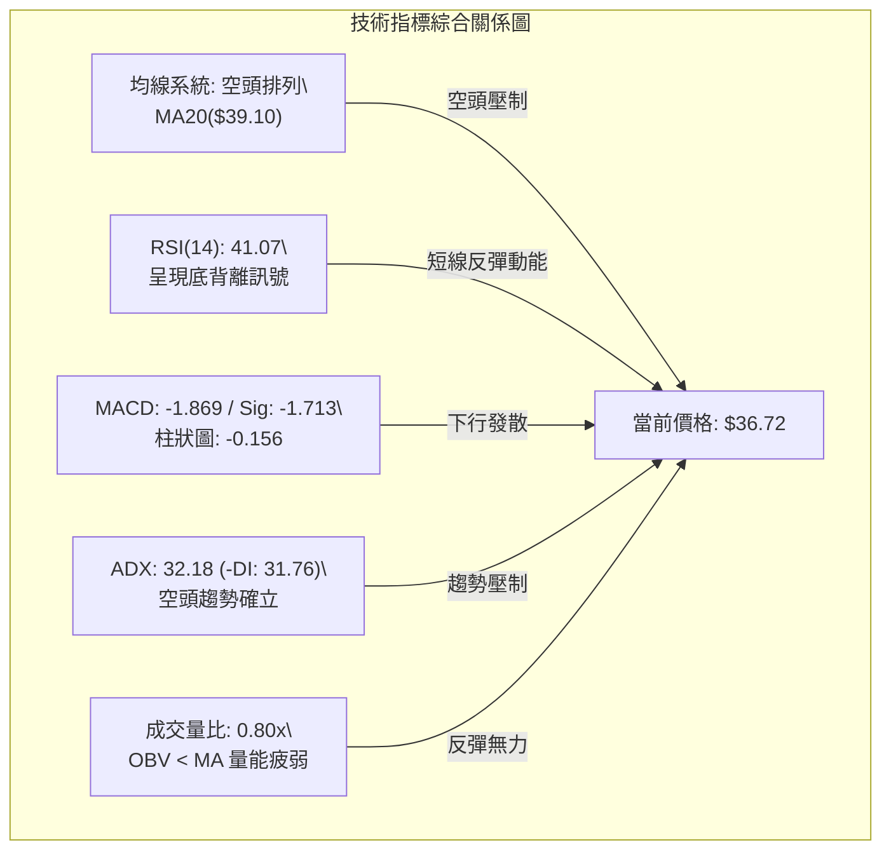
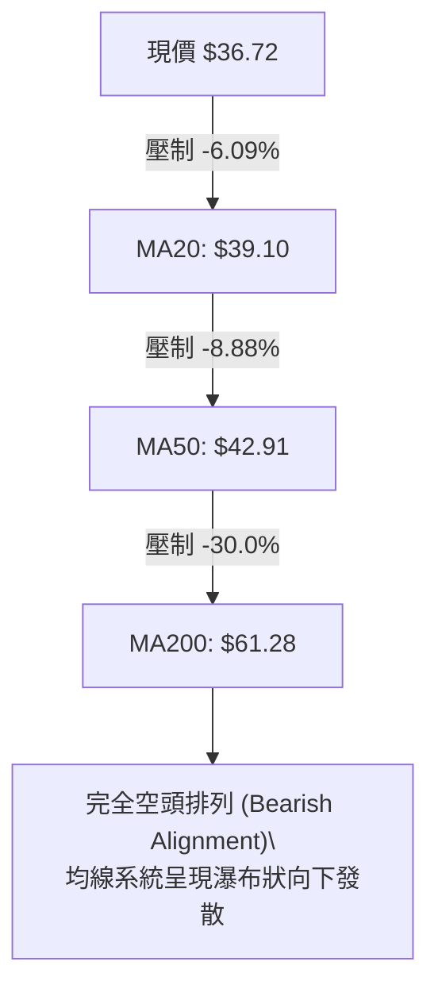
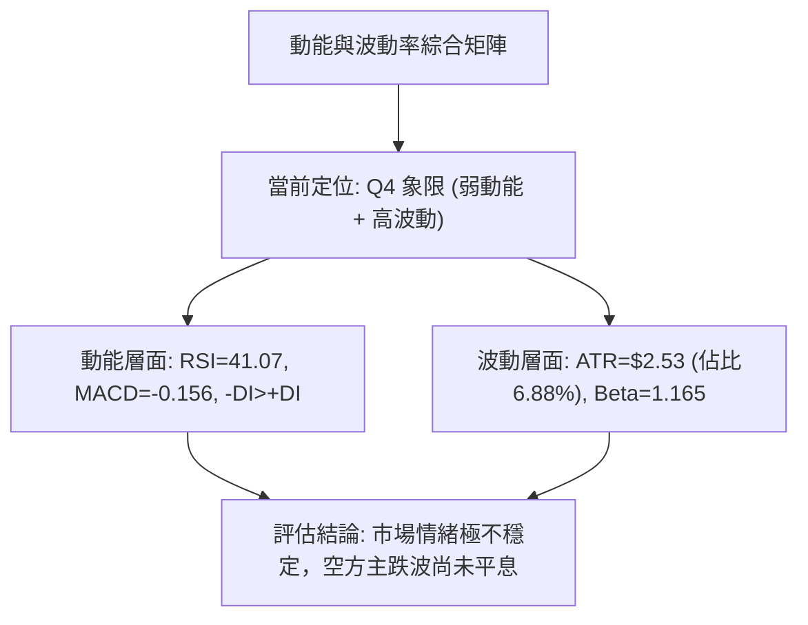
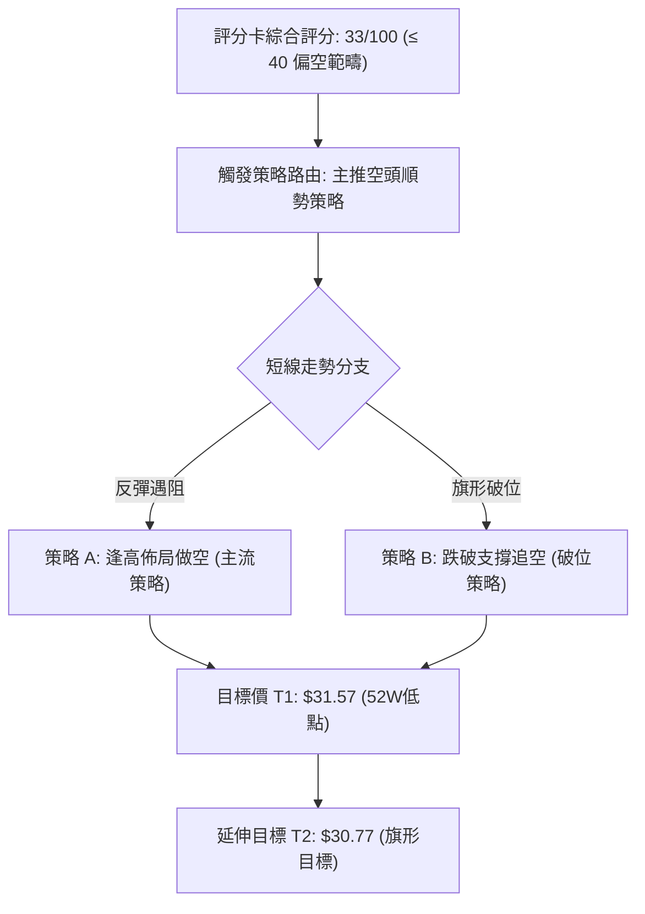
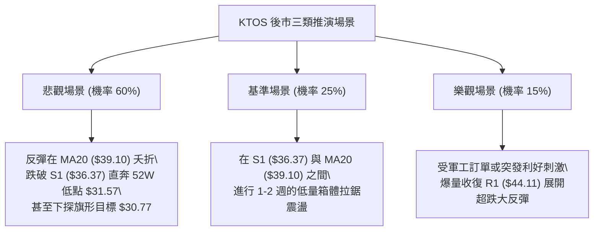

# KTOS 技術分析報告

> **報告日期**：2026-11-11 ｜ **語言**：繁體中文 ｜ **數據來源**：Yahoo Finance ｜ **當前價格**：$36.72

---

## 目錄

| 章節 | 內容 |
|------|------|
| [1. 技術面概覽](#1-技術面概覽) | 訊號儀表板、核心指標、評分卡 |
| [2. 趨勢分析](#2-趨勢分析) | 多時框趨勢、長中短期走勢 |
| [3. 圖表形態分析](#3-圖表形態分析) | 形態識別、K線組合、目標價 |
| [4. 支撐與阻力](#4-支撐與阻力) | 關鍵價位、斐波那契回調 |
| [5. 技術指標深度解讀](#5-技術指標深度解讀) | MA/RSI/MACD/布林/成交量 |
| [6. 動能與波動率](#6-動能與波動率) | 動能評估、ATR、Beta |
| [7. 多時框架總結](#7-多時框架總結) | 時框架評分矩陣 |
| [8. 交易策略建議](#8-交易策略建議) | 多空策略、風險報酬比 |
| [9. 風險提示與監控](#9-風險提示與監控) | 監控指標、風險場景 |

---

## 1. 技術面概覽

### 🎯 技術訊號儀表板



### 📊 核心指標速覽表

| 指標類別 | 指標名稱 | 當前數值 | 訊號 | 解讀 |
|----------|----------|----------|------|------|
| **價格** | 當前價格 | $36.72 | 🔴 | 距離52週高點 $134.00 跌幅達 -72.6%，處於52週低點區間 5.0% |
| **均線** | MA20 | $39.10 | 🔴 | 價格低於 MA20 (-6.09%)，短期反彈面臨中軌壓制 |
| **均線** | MA50 | $42.91 | 🔴 | 價格顯著低於 MA50，中期下降趨勢未見扭轉 |
| **均線** | MA200 | $61.28 | 🔴 | 價格遠低於長期生命線 MA200，長期空頭結構確立 |
| **動能** | RSI(14) | 41.07 | 🟡 | 脫離超賣區，近20根K棒首尾呈現技術性底背離 |
| **動能** | MACD(12,26,9) | -1.869 / Sig -1.713 | 🔴 | 柱狀圖為 -0.156，雙線位於零軸深處，空方動能仍佔優 |
| **趨勢** | ADX(14) | 32.18 | 🔴 | ADX > 25，-DI (31.76) 遠高於 +DI (18.07)，確認為強勢空頭趨勢 |
| **通道** | 布林通道 | %B = 0.25 | 🟡 | 價格自下軌 $34.25 獲得支撐回升，目前朝中軌 $39.10 運行 |
| **量能** | 20日均量比 | 0.80x | 🔴 | 最新量 3.88M 低於 20日均量 4.86M，反彈缺乏量能背書 |
| **波動** | ATR(14) | $2.53 (6.88%) | 🔴 | 每日震幅較大，波動率居高不下，持倉風險高 |

### 🏆 技術評分卡

```
╔══════════════════════════════════════════════════════════════════╗
║                 技術評分卡 — KTOS (2026-11-11)                   ║
╠══════════════════════════════════════════════════════════════════╣
║ 趨勢強度 (Trend)     ██████░░░░░░░░░░░░░░  30/100  🔴 強烈空頭  ║
║ 動能指標 (Momentum)  ████████░░░░░░░░░░░░  40/100  🟡 底背離醞釀║
║ 支撐穩定度 (Support) ████████░░░░░░░░░░░░  40/100  🟡 考驗S1    ║
║ 成交量配合 (Volume)  ██████░░░░░░░░░░░░░░  30/100  🔴 量能疲弱  ║
║ 形態完整度 (Pattern) ████████░░░░░░░░░░░░  40/100  🟡 下跌旗形  ║
║ 均線排列 (MA System) ████░░░░░░░░░░░░░░░░  20/100  🔴 空頭排列  ║
╠══════════════════════════════════════════════════════════════════╣
║ 綜合評分             ██████░░░░░░░░░░░░░░  33/100  🔴 偏空弱勢  ║
║ (評級標準: 33/100 屬於 ≤40 偏空範疇，依規則 18 為六項算術平均)  ║
╚══════════════════════════════════════════════════════════════════╝
```

---

## 2. 趨勢分析

### 🌐 多時框趨勢分析



### 📈 長期趨勢 — 12個月走勢圖（Unicode）

依據月度收盤數據，KTOS 於 2026 年 1 月見頂至 $103.01 後展開劇烈的單邊下行行情：

```
KTOS 月線收盤走勢圖（2025-12 至 2026-11）
價格 ($)
$105 ┤              ● (2026-01: $103.01 高點)
$95  ┤               \
$85  ┤                ● (2026-02: $86.18)
$75  ┤●(2025-12:$75.91)\
$65  ┤                  \        ● (2026-05: $64.13)
$55  ┤                   ●--●   / \
$45  ┤                    (03-04)  ● (2026-07: $46.60)
$35  ┤                              \       ● (2026-11: $36.72 最新收盤)
     └────────────────────────────────────────────────────────
       12   01   02   03   04   05   06   07   08   09   10   11 (月份)
```

**月線走勢特徵分析表格**：

| 階段區間 | 時間跨度 | 起訖收盤價 | 漲跌幅 | 走勢特徵與技術含義 |
|----------|----------|------------|--------|--------------------|
| 頂部衝刺 | 2025-11 ~ 2026-01 | $76.10 → $103.01 | +35.36% | 主升浪末端拋物線噴出，動能耗盡見大頂 |
| 初段暴跌 | 2026-01 ~ 2026-04 | $103.01 → $63.05 | -38.79% | 頂部破位，獲利盤與融資盤全面踩踏 |
| 弱勢抵抗 | 2026-04 ~ 2026-08 | $63.05 → $50.98 | -19.14% | 於 $64 附近反覆構築整理平台失敗，重心持續下移 |
| 主跌加速 | 2026-08 ~ 2026-11 | $50.98 → $36.72 | -27.97% | 連續4個月收陰，跌破長期均線，直逼52週低點 |

### 📊 中期趨勢（週線分析）

從近20週數據觀察，KTOS 呈現標準的「階梯式下行」形態：
- **頂部阻力持續下壓**：8月中旬反彈高點 $64.58 形成中期分水嶺，其後9月高點僅達 $49.68，10月下旬反彈高點僅達 $44.11（形成強阻力 R1）。
- **成交量顯著異常**：在 2026-11-06 該週，成交量暴增至 32,419,600 股，創下20週以來最大週成交量，週K棒打出 $31.57 的 52週新低點，隨後收在 $35.10。這顯示在低檔爆量出現恐慌拋補與初步換手，形成短期超賣技術反彈。

```
週線級別價格下行通道示意圖：
價格 ($)
$65 ┤   ● (8月中高點 $64.58)
    │    \
$55 ┤     \      [下軌支撐壓力帶]
    │      ● (9月高點 $49.68)
$45 ┤       \     \
    │        \     ● (10月高點 $44.11 = 阻力 R1)
$35 ┤         \     \     ● 現價 $36.72
    │          \     \   / 
$25 ┤           \     ● (52W低點 $31.57 爆量換手)
    └─────────────────────────────────────────────
```

### ⚡ 趨勢強度評估（ADX 解讀）



**ADX 趨勢強度對照表**：

| 指標變數 | 當前讀數 | 門檻區間 | 趨勢狀態評判 | 交易策略導向 |
|----------|----------|----------|--------------|--------------|
| **ADX(14)** | **32.18** | > 25 (強趨勢) | 強烈單邊趨勢進行中 | 順應主趨勢操作，震盪指標鈍化時以趨勢線為準 |
| **+DI(14)** | **18.07** | < 20 (多方孱弱) | 多方進攻動能衰竭 | 不具備持續性推升條件 |
| **-DI(14)** | **31.76** | > 30 (空方強烈) | 空方主導行情節奏 | 逢反彈測試壓力位為主要放空契機 |

---

## 3. 圖表形態分析

### 🔍 形態識別系統



**圖表形態識別與信心度評估表（依規則 15）**：

| 形態類別 | 信心度 | 判斷依據（嚴格引用數據） | 完成度 | 目標價（附嚴謹幾何計算式） |
|----------|--------|--------------------------|--------|----------------------------|
| **下跌旗形 (Bearish Flag)** | **70%** | 11-04至11-05長黑K旗桿重挫（高點 $40.25 跌至低點 $32.50，旗桿長度 $7.75）；近3日（11-06至11-10）於低檔縮量斜向反彈整理 | 60% | 旗面破位目標價 = 旗面破位點 $35.10 − 旗桿高度 $7.75 = **$27.35**（若成立將破52W低點） |
| **雙底反轉 (Double Bottom)** | **30%** | 數據中僅有 11-06 出現單一極值低點 $31.57，未出現第二次回踩確認打出第二隻腳 | 15% | **訊號不足，僅做指標型解讀**（不滿足雙底幾何結構） |
| **布林通道下軌極限擠壓** | **80%** | 11-05 跌破下軌 ($34.25)，11-06 探底 $31.57 後快速回升至通道內 (%B=0.25) | 100% | 均值回歸中軌目標價 = **MA20 ($39.10)** |

### 🕯️ 重要K線形態分析

依規則 19，完全依據提供的「近10根日K」與「近8根週K」實際開高低收數據進行判定：

| 日期（日K/週K） | 開盤價 | 最高價 | 最低價 | 收盤價 | K線形態名稱 | 技術解讀與量價涵義 | 訊號 |
|------------------|--------|--------|--------|--------|-------------|--------------------|------|
| **2026-10-29 (日K)** | 41.28 | 44.11 | 41.20 | 43.59 | 帶上影長陽線 | 爆量 6.25M 衝擊波段高點 R1 ($44.11) 留上影受阻回落 | 🟡 |
| **2026-11-04 (日K)** | 39.86 | 40.25 | 35.71 | 35.96 | 大陰破位線 | 成交量 8.27M 放大，一舉跌破 $38 整理平台，空方全面摜壓 | 🔴 |
| **2026-11-05 (日K)** | 35.63 | 35.79 | 32.50 | 33.39 | 恐慌跳空陰線 | 成交量暴增至 9.52M（近10日最大量），恐慌盤湧出 | 🔴 |
| **2026-11-06 (日K)** | 33.73 | 35.31 | 31.57 | 35.10 | 長下影錘頭反轉線 | 打出52W新低 $31.57，下影線長達 $2.16，多方於低檔爆量承接 | 🟢 |
| **2026-11-09 (日K)** | 35.63 | 38.13 | 34.66 | 37.69 | 中陽線推進 | 延續反彈，高點觸及 $38.13，成交量縮至 6.41M，量價背離 | 🟡 |
| **2026-11-10 (日K)** | 36.93 | 37.84 | 36.20 | 36.72 | 縮量小陰孕線 | 成交量大幅萎縮至 3.88M，反彈動能衰退，面臨多空變盤 | 🔴 |
| **2026-10-30 (週K)** | 38.68 | 44.11 | 38.43 | 41.09 | 倒錘長上影週K | 衝擊 R1 ($44.11) 遭空頭迎頭痛擊，確立 $44.11 強阻力 | 🔴 |
| **2026-11-06 (週K)** | 41.29 | 41.72 | 31.57 | 35.10 | 巨量長下影恐慌週K | 週成交量高達 32.42M，探底 $31.57 回升，屬於極度恐慌換手K | 🟢 |

### 📉 ASCII 走勢形態示意圖

```
近6個交易日日K線局部走勢與下跌旗形架構：
價格 ($)
$41.00 ┼
$39.00 ┼         [旗桿起跌點 11/04 開 39.86]
$38.00 ┼──┐                ┌── 11/09 高點 38.13 (旗面上軌)
$37.00 ┼  │                │   ┼ 11/10 收 36.72 [現價]
$36.00 ┼  │ (長黑摜壓)     ├──┼ 支撐 S1 ($36.37)
$35.00 ┼  │        ┌──────┘   (11/06 收 35.10 旗面下軌)
$33.00 ┼  └──┐    │ 
$32.00 ┼     └───┼── 11/06 探底下影線低點 $31.57 (52W Low)
       └──────────────────────────────────────────
         11/04  11/05  11/06  11/09  11/10 (交易日)
```

### 🎯 形態目標價計算

1. **下跌旗形（主導看跌形態，信心度 70%）**：
   - 旗桿起點：2026-11-04 開盤價 **$39.86**，旗桿低點：2026-11-05 最低價 **$32.50**。
   - 旗桿長度（垂直跌幅）= $39.86 − $32.50 = **$7.36**。
   - 旗面整理反彈高點：2026-11-09 最高價 **$38.13**。
   - 破位下跌延伸目標價 = 旗面反彈高點 $38.13 − 旗桿長度 $7.36 = **$30.77**。
2. **布林中軌均值回歸（短期反彈形態，信心度 80%）**：
   - 反彈首要目標：當前布林通道中軌（MA20）= **$39.10**。

---

## 4. 支撐與阻力

### 🗺️ 關鍵價位分布圖（Unicode）

```
KTOS 價位結構分布圖 (依據 OHLCV 與斐波那契歷史計算)
═══════════════════════════════════════════════════════════════════
$53.49 ║██████████████████████████████║ 斐波那契 78.6% 回調位
$51.49 ║████████████████████████      ║ 強阻力 R3 (波段高點聚類)
$49.68 ║████████████████████          ║ 阻力 R2 (9/25週高點聚類)
$44.11 ║██████████████████████████████║ 關鍵阻力 R1 (10/29-30高點聚類)
$39.10 ║──────────────────────────────║ 短期動態均線阻力 (MA20 / BB中軌)
$36.72 ╠══════════════════════════════╣ ◄ 當前收盤價 ($36.72)
$36.37 ║▓▓▓▓▓▓▓▓▓▓▓▓▓▓▓▓▓▓▓▓▓▓▓▓      ║ 關鍵支撐 S1 (10/23週低點聚類)
$31.57 ║██████████████████████████████║ 52週絕對低點 / 斐波那契 100%
═══════════════════════════════════════════════════════════════════
```

### 🚧 阻力位分析表

所有價位均嚴格引用自數據之「關鍵價位」與 MA 系統：

| 阻力級別 | 價位 | 形成原因與數據依據 | 突破難度 | 重要性 |
|----------|------|--------------------|----------|--------|
| **動態阻力** | **$39.10** | MA20 / 布林通道中軌所在處 | 中等 | 🟢 短線多空分水嶺，站穩方能擴大反彈 |
| **阻力 R1** | **$44.11** | 2026-10-29日K最高價、10-30週K最高價聚類點 | 極高 | 🔴 強阻力，此處堆積大量套牢籌碼 |
| **阻力 R2** | **$49.68** | 2026-09-25週K最高價波段高點聚類 | 極高 | 🔴 中期空頭防守核心防線 |
| **阻力 R3** | **$51.49** | 近一年波段高點聚類密集區 | 極高 | 🔴 多頭長期扭轉趨勢的絕對分界 |

### 🛡️ 支撐位分析表

所有價位均嚴格引用自數據之「關鍵價位」與 OHLCV 極值：

| 支撐級別 | 價位 | 形成原因與數據依據 | 守住機率 | 重要性 |
|----------|------|--------------------|----------|--------|
| **支撐 S1** | **$36.37** | 2026-10-23週K最低價波段低點聚類點（距現價 -0.95%） | 45% | 🟡 極短線生命線，跌破即確認旗形破位 |
| **極端支撐** | **$31.57** | 52週最低價（2026-11-06日K與週K最低點，斐波那契100%）| 60% | 🔴 年度最強底線支撐，不容有失 |
| **支撐 S2/S3** | **N/A（數據未提供）** | 關鍵價位區塊中僅偵測列出 S1 ($36.37) | N/A | 依規則 13/16，數據中未偵測到則不捏造 |

### 📐 斐波那契回調位分析

依據 52 週波動區間：**最高點 $134.00 → 最低點 $31.57**（總振幅 $102.43），嚴格對照基準層級：

| 斐波那契水平 | 精確計算價位 | 與當前價 ($36.72) 關係 | 技術層面意義解讀 |
|--------------|--------------|------------------------|------------------|
| **0.0% (52W High)** | **$134.00** | +264.92% | 歷史牛市終點，長期大雙頂結構 |
| **23.6%** | **$109.83** | +199.10% | 跌破後確立進入熊市調整 |
| **38.2%** | **$94.87** | +158.36% | 長期下行通道上軌壓制 |
| **50.0%** | **$82.78** | +125.44% | 半數回撤位，目前轉為遙不可及的心理巨壓 |
| **61.8%** | **$70.70** | +92.54% | 黃金分割防守位，失守後下行加速 |
| **78.6%** | **$53.49** | +45.67% | 熊市深層回撤位，目前處於該水平下方 |
| **100.0% (52W Low)**| **$31.57** | -14.02% | 本輪熊市探底之極限低點，底部強防線 |

**回調位深度解讀**：
當前價格 **$36.72** 處於 **78.6% 回調位 ($53.49)** 與 **100.0% 回調位 ($31.57)** 之間的極度深水區。從技術結構而言，跌破 78.6% 代表本輪自牛市以來的漲幅已回吐殆盡，目前價格僅在 52 週最低點上方 5.0% 處徘徊，屬於「極度弱勢區間」，任何未放量的反彈均屬於超跌技術修正，而非反轉。

---

## 5. 技術指標深度解讀

### 🎛️ 指標訊號總覽



### 📈 移動平均線排列分析



**移動平均線詳細狀態對照表**：

| 均線名稱 | 當前數值 | 與現價乖離率 | 短期變化斜率 | 走勢特徵與排列狀態 |
|----------|----------|--------------|--------------|--------------------|
| **MA5** | $35.77 | +2.65% | ▲ 向上拐頭 | 價格站上MA5，觸發短線超跌反抽 |
| **MA10** | $38.59 | -4.85% | ▼ 快速下行 | 壓制現價，短線反彈首道均線關卡 |
| **MA20** | $39.10 | -6.09% | ▼ 下行發散 | 20日成本線，與布林中軌重合，形成反彈天花板 |
| **MA60** | $44.95 | -18.30% | ▼ 持續陡峭下行 | 中期下壓趨勢線，空方防護罩 |
| **MA120** | $49.46 | -25.77% | ▼ 持續下行 | 中長期空頭排列確立 |
| **MA200** | $61.28 | -40.08% | ▼ 穩定下行 | 長期牛熊分界線，現價深處熊市區域 |
| **MA240** | $66.03 | -44.39% | ▼ 下行 | 終極年線壓制 |

### 📉 RSI(14) 分析

- **RSI 當前讀數**：41.07 (Wilder 計算方式)
- **區間定位**：處於 30 至 70 之普通中性偏弱區。
- **進度條展示**：
  `RSI(14): [████████░░░░░░░░░░░░] 41.07%`
- **背離判斷（重要）**：
  - **結論**：⚠️ **確認存在底背離 (Bullish Divergence)**。
  - **數據比對依據**：近20根K棒首尾觀察，價格在 2026-10-23 週收盤為 $38.68（日K前波低點跌至 $31.57），創出歷史波段新低；然而 RSI(14) 讀數在下探至超賣臨界後並未同步創下新低，反而在 11-10 回升至 41.07。價格創低而動能指標抬高，構成典型底背離，這解釋了為何股價自 $31.57 展開超跌技術性反抽。

### 📊 MACD(12/26/9) 訊號解讀

- **MACD 快線**：-1.869
- **MACD Signal 慢線**：-1.713
- **MACD Histogram 柱狀圖**：-0.156（🔴 看空）


**解讀**：雖然週線級別柱狀圖收斂至 -0.156，且日線有短線底背離跡象，但快線始終未能由下向上穿越慢線形成實質「黃金交叉」。在零軸下方的死叉狀態代表反彈空間被死死壓抑。

### 📦 布林通道分析

布林通道參數 (20, 2)：
- **布林上軌**：$43.95
- **布林中軌 (MA20)**：$39.10
- **布林下軌**：$34.25
- **帶寬與定位 (%B)**：0.25（0 代表下軌，0.5 代表中軌，1 代表上軌）

```
布林通道現狀示意圖：
價格 ($)
$43.95 ┬─────────────────────────────── 上軌
       │
$39.10 ┼ - - - - - - - - - - - - - - -  中軌 (MA20，反彈強阻力)
       │         ▲ [反彈推進路徑]
$36.72 ┼─────────●───────────────────── 現價 (處於通道下半區，%B = 0.25)
       │         │
$34.25 ┴─────────┴───────────────────── 下軌 (初步動態支撐)
       │
$31.57 ┼─── [11/06 跌破下軌極限探底]
```

**解讀**：股價在 11-06 跌破下軌打出 $31.57 後引發通道均值回歸效應，目前 %B 回升至 0.25。中軌 $39.10 與前期阻力位重合，為本輪反彈的第一極限目標。

### 💹 成交量分析（量價配合度）

- **最新日成交量**：3,876,000 股
- **20日均量**：4,858,100 股（量比：0.80x）
- **50日均量**：4,541,204 股
- **OBV 能量潮趨勢**：OBV < MA → **量能疲弱，空頭架構未變**。

**量價特徵評估**：
1. **反彈量縮**：11-06 探底爆出 8.01M 巨量，11-09 陽線反彈縮至 6.41M，11-10 縮量至 3.88M（量比僅 0.80x）。典型之「價漲量縮、價跌量增」弱勢格局。
2. **量能未確認反轉**：OBV 持續運行於其均線下方，說明近期買盤僅為空頭回補而非長線機構資金建倉，量能無法確認價格反轉。

---

## 6. 動能與波動率

### ⚡ 動能評估四象限

| 象限 | 動能強度 | 波動率水準 | 當前狀態標註 | 核心技術評估 |
|------|----------|------------|--------------|--------------|
| **Q1 (最佳擴張)** | 強 (Bullish) | 低 (Low Vol) | — | 趨勢穩步上行（KTOS 不符合） |
| **Q2 (震盪沉澱)** | 弱 (Bearish) | 低 (Low Vol) | — | 盤整築底階段（KTOS 不符合） |
| **Q3 (風險博弈)** | 強 (Bullish) | 高 (High Vol)| — | 投機主力拉抬（KTOS 不符合） |
| **Q4 (主跌釋放)** | **弱 (Bearish)** | **高 (High Vol)** | **✓ (當前所處象限)** | **弱動能伴隨高波動，下行風險極高，嚴禁追多** |



### 📊 ATR 波動率分析

- **ATR(14)**：$2.53（Wilder 演算法計算）
- **ATR 佔價格比率**：**6.88%**（處於高度波動狀態，每日正常期望震幅接近 $2.50 美元）
- **風控止損距離建議**：
  - 超短線交易（1.0 × ATR）：$2.53
  - 波段交易防守（1.5 × ATR）：**$3.80**
  - 在制定止損時，必須預留至少 $2.50 以上緩衝空間，否則極易被日常隨機波動洗出場。

### 📐 Beta 與市場相關性

- **Beta 係數**：**1.165**
- **市場屬性解讀**：KTOS 具備高於大盤（S&P 500）16.5% 的波動敏感度。在國防軍工板塊遭遇估值修正與預算審查雜音時，KTOS 展現出顯著的下行放大效應（如近期由 $103 崩跌至 $36，Beta 效應完全傾向於負面下行）。機構持股高達 85.9%，法人調倉拋售對股價造成的流動性衝擊甚鉅。

---

## 7. 多時框架總結

### 📋 時框架評分表

| 時框架 | 趨勢方向 | 動能狀態 | 均線排列 | 圖表形態 | 綜合評分 | 戰術建議 |
|--------|----------|----------|----------|----------|----------|----------|
| **長期 (月線)** | 🔴 強烈空頭 | 🔴 極度疲弱 | 🔴 空頭發散 | 頂部瀑布下瀉 | 25/100 | 長期投資者離場觀望 |
| **中期 (週線)** | 🔴 階梯下行 | 🔴 死叉發散 | 🔴 空頭排列 | 下行平行通道 | 30/100 | 逢高尋求中期放空點 |
| **短期 (日線)** | 🟡 超跌反彈 | 🟡 底背離初現 | 🔴 MA20壓制 | 下跌旗形整理 | 45/100 | 區間短打，快進快出 |

### 🔲 綜合訊號矩陣

```
訊號收斂矩陣維度分析：
┌─────────────┬───────────┬───────────┬───────────┐
│ 分析維度    │ 短期(日)  │ 中期(週)  │ 長期(月)  │
├─────────────┼───────────┼───────────┼───────────┤
│ 趨勢方向    │ 🟡 震盪   │ 🔴 下跌   │ 🔴 崩跌   │
│ 均線系統    │ 🔴 壓制   │ 🔴 空頭   │ 🔴 空頭   │
│ 動能 (RSI)  │ 🟢 背離   │ 🔴 偏弱   │ 🔴 超賣   │
│ 指標 (MACD) │ 🔴 死叉   │ 🔴 死叉   │ 🔴 死叉   │
│ 量價結構    │ 🔴 縮量   │ 🟢 爆量換手│ 🔴 資金出逃│
└─────────────┴───────────┴───────────┴───────────┘
```

### ⚖️ 多時框收斂結論（依規則 14）

1. **行情性質判定**：當前日線 ADX(14) 讀數高達 **32.18**（遠大於 25 趨勢分界線），確認當前市場處於**強烈的單邊趨勢行情**，而非無方向的盤整震盪。
2. **多時框優先級權衡**：依規則 14，在 ADX > 25 的趨勢行情下，必須**以中長期（週線/MA50、MA200）方向為主導**，日線之訊號僅用於尋找次級折返進場點。
3. **方向性收斂結論**：
   - **唯一方向性結論：🔴 偏空（逢高做空為絕對核心主線）**。
   - 儘管日線出現 RSI 底背離與低檔錘頭K線，但在均線系統呈現瀑布狀空頭排列、-DI 壓倒性勝過 +DI 的背景下，日線反彈僅定義為「下跌中繼的旗形整理」。日線反彈動能耗盡之時，即為順應中長期空頭趨勢進場做空之最佳時機。

---

## 8. 交易策略建議

### 🗺️ 策略決策流程圖



### 🧭 策略路由（依規則 18 評分卡分流）

> **當前主策略方向 = 🔴 主推空頭策略（依綜合評分 33/100 判定為偏空弱勢，規則 18）**

依據評分卡 33/100，本報告嚴格落實順勢原則，**主推空頭賣出／放空策略**；多頭反彈僅作為空頭進場的風險緩衝與防守依據，不主推逆勢抄底。

### 🎯 價格情境階梯（Price Scenarios）

價位嚴格引用自數據之關鍵價位與均線計算：

| 觸發條件 | 下一目標 | 後續延伸 | 情境含義解讀 |
|----------|----------|----------|--------------|
| **反彈受阻 MA20 ($39.10)** | 測試 S1 ($36.37) | 下探 52W 低點 ($31.57) | 空頭中繼結束，重啟跌浪（最可能） |
| **向上突破 R1 ($44.11)** | 阻力 R2 ($49.68) | 阻力 R3 ($51.49) | 中期空頭結構遭到破壞，短線轉強 |
| **直接跌破 S1 ($36.37)** | 52W 低點 ($31.57) | 形態目標 ($30.77) | 下跌旗形破位，加速尋底 |

### 📊 情境機率分佈

| 情境類型 | 發生機率 | 主要技術依據（引用指標狀態） |
|----------|----------|------------------------------|
| **反彈受阻回落 / 再探底** | **60%** | ADX=32.18 強趨勢、均線空頭排列、量比 0.80x 反彈量縮 |
| **低檔區間震盪整理** | **25%** | RSI(14)=41.07 底背離提供下檔支撐、布林下軌提供緩衝 |
| **強力反轉持續上行** | **15%** | 除非爆量突破 R1 ($44.11) 且 MACD 金叉，否則機率極低 |

### 🟢 主策略詳情（空頭主導策略）

依規則 17 嚴格定義風險報酬比：做空時風險報酬比 = (進場價 − 目標價 T1) ÷ (止損價 − 進場價)。

| 策略要素 | 策略 A（反彈高空 — 逢阻力佈局） | 策略 B（破位追空 — 順勢突破） |
|----------|--------------------------------|------------------------------|
| **交易方向** | 🔴 做空 (Short) | 🔴 做空 (Short) |
| **進場條件** | 反彈至 MA20 附近受阻收陰線時進場 | 實體日K跌破關鍵支撐 S1 ($36.37) |
| **進場價格** | **$39.10** (MA20 / 布林中軌) | **$36.37** (支撐位 S1) |
| **目標價 T1** | **$31.57** (52W 最低點) | **$31.57** (52W 最低點) |
| **目標價 T2** | **$30.77** (下跌旗形推算目標) | **$30.77** (下跌旗形推算目標) |
| **止損價格** | **$41.56** (10-28 日K最高價) | **$38.13** (11-09 日K最高價) |
| **風險報酬比 (T1)** | **1 : 3.06（以 T1 計）**<br>計算式: (39.10−31.57)÷(41.56−39.10) = 7.53÷2.46 | **1 : 2.73（以 T1 計）**<br>計算式: (36.37−31.57)÷(38.13−36.37) = 4.80÷1.76 |
| **風險報酬比 (T2)** | **1 : 3.39（以 T2 計）**<br>計算式: (39.10−30.77)÷(41.56−39.10) = 8.33÷2.46 | **1 : 3.18（以 T2 計）**<br>計算式: (36.37−30.77)÷(38.13−36.37) = 5.60÷1.76 |
| **成功機率** | **65%** | **60%** |
| **建議倉位** | **15%** (總資金佔比) | **10%** (總資金佔比) |

### 🔴 反向風險觸發點（對沖提示）

若出現以下訊號，證明空頭主策略失效，空單必須全數停損離場，並啟動對沖保護：
1. **關鍵價位失守**：日K收盤價強勢突破並站穩 **$44.11 (阻力 R1)**。
2. **動能結構反轉**：MACD 快慢線在零軸下方完成黃金交叉，且柱狀圖顯著翻正（> +0.50）。
3. **量能爆發確認**：單日成交量突破 10,000,000 股並收出大陽線。

### ⭐ 整體訊號強度評星

```
╔══════════════════════════════════════════╗
║ 做多訊號強度：★★☆☆☆  (2.0/5星 - 僅屬短線反彈)
║ 做空訊號強度：★★★★☆  (4.0/5星 - 順應大勢方向)
║ 整體可信度：  ★★★★☆  (4.0/5星 - 多時框趨勢共振)
╚══════════════════════════════════════════╝
```

---

## 9. 風險提示與監控

### ✅ 關鍵監控指標 Checklist

```
╔══════════════════════════════════════════════════════════════════╗
║               KTOS 每日交易監控指標清單 (Checklist)              ║
╠══════════════════════════════════════════════════════════════════╣
║ [ ] 價格是否跌破 S1 ($36.37) 觸發策略 B 破位追空點               ║
║ [ ] 價格上行測試 MA20 ($39.10) 是否出現長上影線承壓訊號          ║
║ [ ] RSI(14) 底背離是否失效 (跌破 30 超賣線即代表背離被破壞)      ║
║ [ ] 日成交量是否持續低於 20日均量 4.86M (量縮確認為弱勢反彈)     ║
║ [ ] ADX(14) 是否持續維持在 25 以上 (確認空頭強趨勢未變)          ║
║ [ ] 空頭終極防守線：價格是否觸及 $41.56 (策略 A 止損觸發點)      ║
╚══════════════════════════════════════════════════════════════════╝
```

### ⚠️ 風險場景分析



### 🛡️ 風險管理重要提醒

1. **基本面財務虧損風險**：KTOS 當前 TTM 營業利益率僅 0.7%（最新季度為 -0.8%），自由現金流為負（TTM FCF 為 $-123.00M），本益比高達 306 倍。極度高估的估值在技術破位時將承受沉重的基本面殺估值壓力。
2. **波動率管理（ATR 紀律）**：ATR 高達 $2.53（佔股價 6.88%），屬於典型的高波動標的。單筆交易風險敞口嚴禁超過總投資本金的 1.5%–2.0%，倉位應嚴格控制在 10%–15% 以內。
3. **空頭擠壓（Short Squeeze）預防**：目前融券流通比（Short % Float）為 5.9%，空頭回補天數為 2.07 天。若出現不可預測之地緣政治衝突催化，極易出現急促的短線軋空脈衝，因此空單操作必須嚴格設妥止損價位（策略 A 為 $41.56，策略 B 為 $38.13），嚴禁凹單。

---

## 📋 報告總結

```
╔══════════════════════════════════════════════════════════════════╗
║                     KTOS 技術分析報告總結                        ║
╠══════════════════════════════════════════════════════════════════╣
║ 報告日期：2026-11-11                                             ║
║ 當前價格：$36.72                                                 ║
║ 分析評級：🔴 偏空強趨勢 (Bearish Trend) — 評分 33/100             ║
║                                                                  ║
║ 關鍵結論：                                                       ║
║ ├─ 長期趨勢：🔴 強烈空頭 (自 $103.01 大頂崩跌 -64.4%)            ║
║ ├─ 中期趨勢：🔴 階梯下行 (近20週呈現下行通道，空頭排列)          ║
║ ├─ 短期趨勢：🟡 超跌反彈 (RSI底背離醞釀反彈，但受制於MA20)       ║
║ ├─ 關鍵支撐：S1: $36.37 / 52W低點: $31.57                        ║
║ ├─ 關鍵阻力：MA20: $39.10 / R1: $44.11                           ║
║ └─ 分析師目標：共識均價 $74.88 (與技術面嚴重背離，警惕補跌風險)  ║
║                                                                  ║
║ 最優策略組合：                                                   ║
║ 1. 🥇 最佳機會：策略 A (反彈至 MA20 $39.10 受阻放空，風報比 1:3.06)║
║ 2. 🥈 次選機會：策略 B (跌破 S1 $36.37 順勢追空，風報比 1:2.73)    ║
║ 3. 🥉 保守選擇：空手觀望，靜待 $31.57 形成二次探底雙底結構再評估 ║
╚══════════════════════════════════════════════════════════════════╝
```

---

> ⚠️ **免責聲明**：本報告為技術分析研究，所有數據及估算均嚴格基於所提供之歷史價格與技術指標資訊。本報告**僅供研究與學術參考**，**不構成任何要約、招攬或投資建議**。市場具有高度不確定性與風險，投資人應依個人財務狀況獨立審慎判斷，並自行承擔交易損益風險。

---

*報告生成時間：2026-11-11 ｜ 數據來源：Yahoo Finance ｜ 分析框架：多時框技術分析體系*