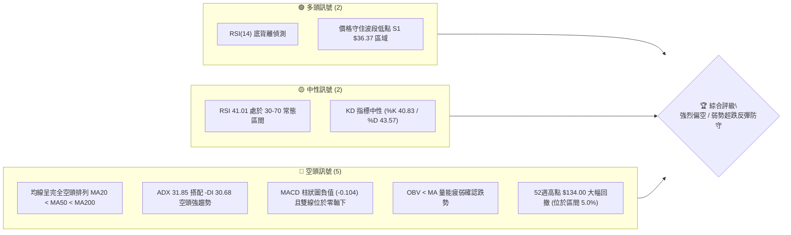
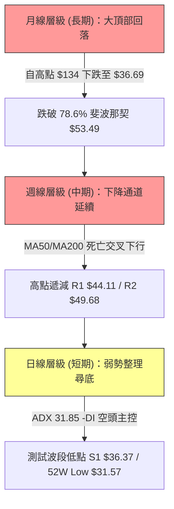
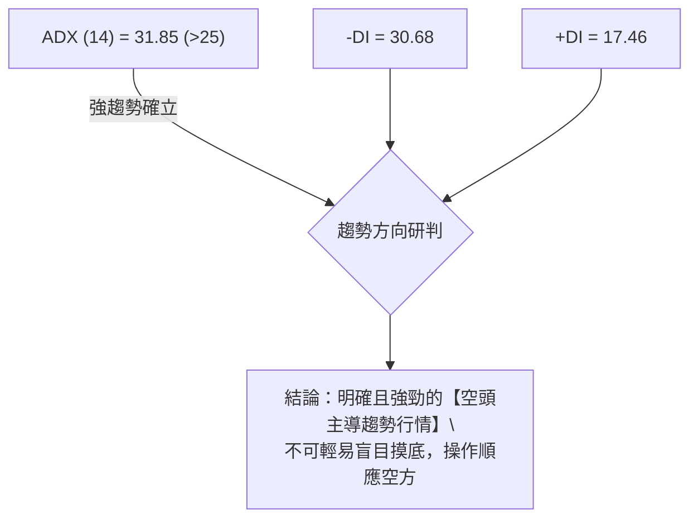
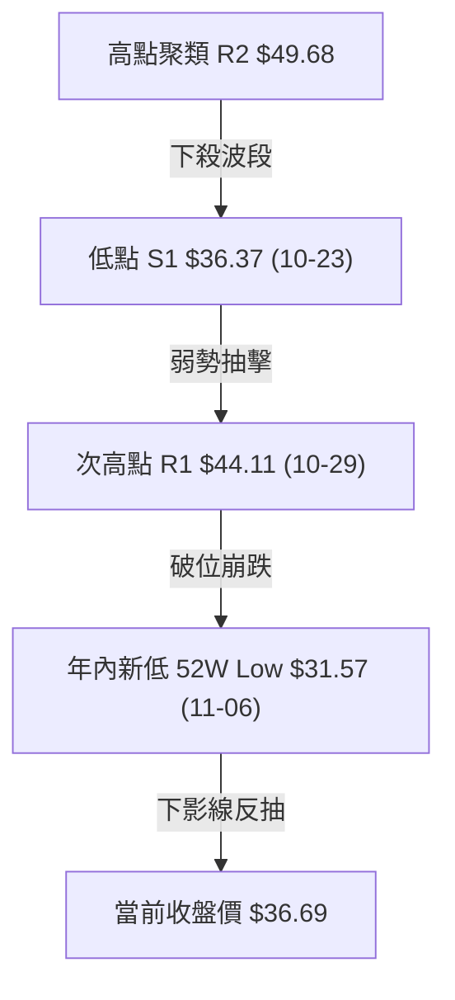
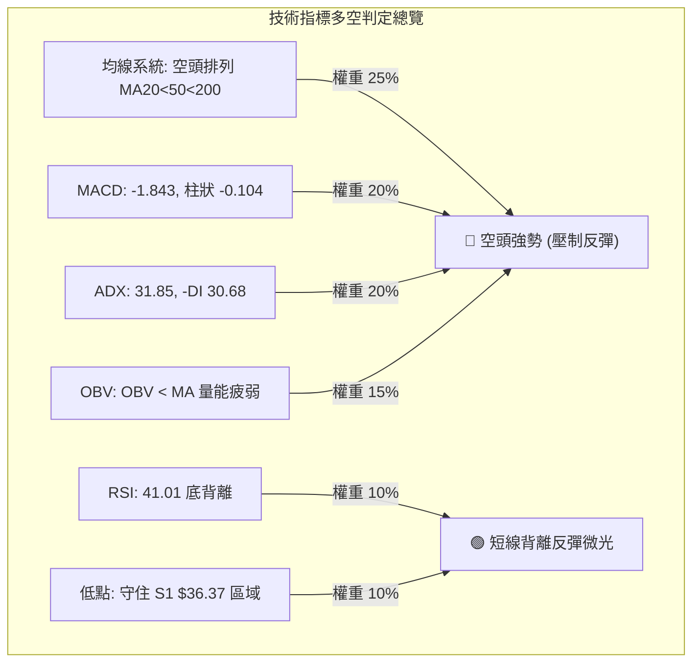
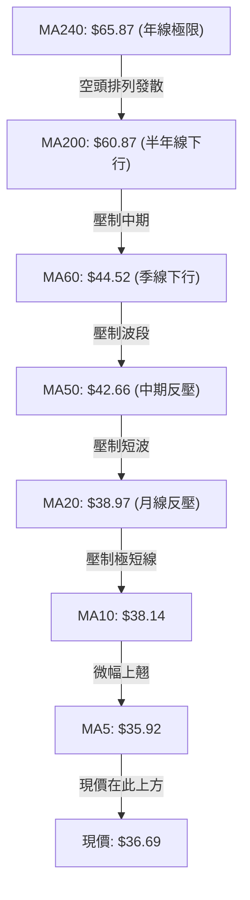
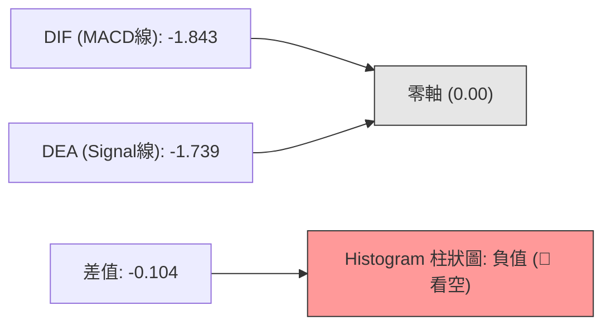
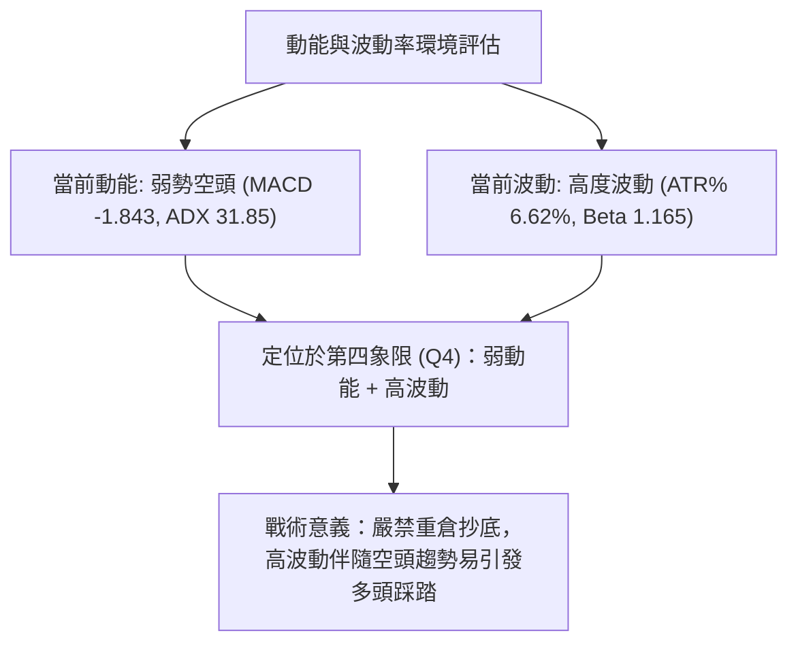
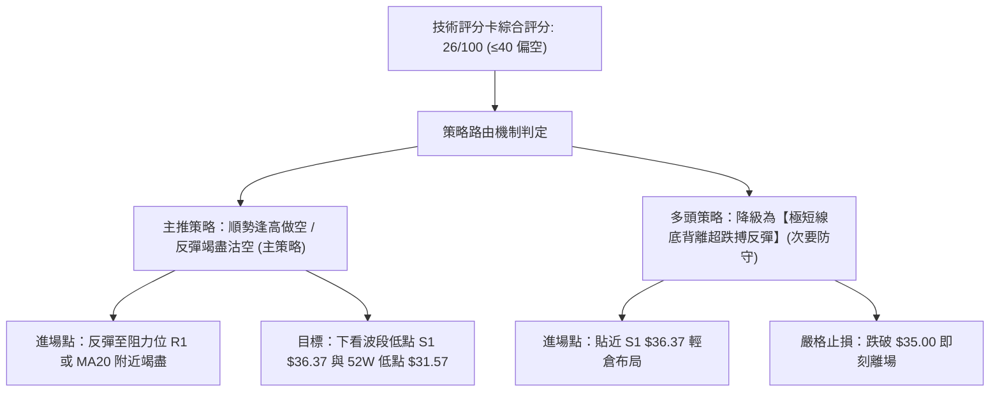
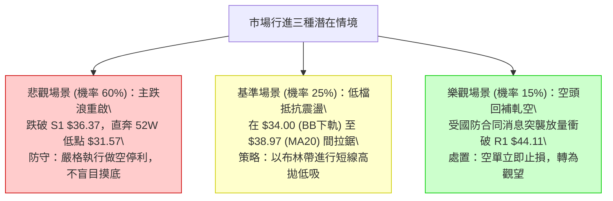

# KTOS 技術分析報告

> **報告日期**：2026-11-12 ｜ **語言**：繁體中文 ｜ **數據來源**：Yahoo Finance ｜ **當前價格**：$36.69 USD

---

## 目錄

| 章節 | 內容 |
|------|------|
| [1. 技術面概覽](#1-技術面概覽) | 訊號儀表板、核心指標、評分卡 |
| [2. 趨勢分析](#2-趨勢分析) | 多時框趨勢、長中短期走勢 |
| [3. 圖表形態分析](#3-圖表形態分析) | 形態識別、K線組合、目標價 |
| [4. 支撐與阻力](#4-支撐與阻力) | 關鍵價位、斐波那契回調 |
| [5. 技術指標深度解讀](#5-技術指標深度解讀) | MA/RSI/MACD/布林/成交量 |
| [6. 動能與波動率](#6-動能與波動率) | 動能評估、ATR、Beta |
| [7. 多時框架總結](#7-多時框架總結) | 時框架評分矩陣 |
| [8. 交易策略建議](#8-交易策略建議) | 多空策略、風險報酬比 |
| [9. 風險提示與監控](#9-風險提示與監控) | 監控指標、風險場景 |

---

## 1. 技術面概覽

### 🎯 技術訊號儀表板



### 📊 核心指標速覽表

| 指標類別 | 指標名稱 | 當前數值 | 訊號 | 解讀 |
|----------|----------|----------|------|------|
| **價格** | 當前收盤價 | $36.69 | 🔴 | 位於 52 週區間 5.0% 低檔，跌破多重支撐 |
| **均線** | MA20 | $38.97 | 🔴 | 價格低於 MA20（-5.84%），短線承壓 |
| **均線** | MA50 | $42.66 | 🔴 | 價格低於 MA50（-13.99%），中期趨勢向下 |
| **均線** | MA200 | $60.87 | 🔴 | 價格遠低於 MA200（-39.72%），長期空頭鎖定 |
| **動能** | RSI(14) | 41.01 | 🟡 | 中性偏弱；近 20 根 K 線出現底背離微光 |
| **動能** | MACD | -1.843 | 🔴 | 雙線在零軸下方，Histogram 為 -0.104，動能空頭主導 |
| **動能** | Stoch %K/%D | 40.83 / 43.57 | 🟡 | 震盪指標位於中性區，反彈力道暫未爆發 |
| **趨勢** | ADX(14) | 31.85 | 🔴 | ADX > 25 且 -DI(30.68) > +DI(17.46)，空頭強趨勢確立 |
| **通道** | 布林 %B | 0.27 | 🟡 | 位於中軌（$38.97）與下軌（$34.00）之間偏下檔 |
| **波動** | ATR(14) | $2.43 | 🔴 | 佔股價 6.62%，日波動幅度大，操作風險偏高 |
| **成交量** | 最新成交量 / 20日均量 | 4,531,900 / 4,818,920 | 🟡 | 量比 0.94x，量能萎縮，OBV 疲弱不足以支撐趨勢反轉 |

### 🏆 技術評分卡

```
╔══════════════════════════════════════════════════════════════╗
║                技術評分卡 — KTOS (2026-11-12)                ║
╠══════════════════════════════════════════════════════════════╣
║ 趨勢強度 (空頭強趨勢) ▓▓░░░░░░░░░░░░░░░░░░  12/100 🔴       ║
║ 動能指標 (MACD空/RSI背離) ▓▓▓▓▓▓▓░░░░░░░░░░░  36/100 🔴       ║
║ 支撐穩定度 (S1測試中) ▓▓▓▓▓▓▓▓░░░░░░░░░░░░  40/100 🟡       ║
║ 成交量配合 (OBV疲弱量縮) ▓▓▓▓▓▓░░░░░░░░░░░░░  32/100 🔴       ║
║ 形態完整度 (未見底部形態) ▓▓▓▓▓░░░░░░░░░░░░░░  26/100 🔴       ║
║ 均線排列 (空頭排列下行) ▓▓░░░░░░░░░░░░░░░░░░  10/100 🔴       ║
╠══════════════════════════════════════════════════════════════╣
║ 綜合評分 (六項算術平均) ▓▓▓▓▓░░░░░░░░░░░░░░░  26/100 🔴       ║
║ 評級結論：技術面極度疲弱，空頭壓制，僅存短線超跌反抽預期   ║
╚══════════════════════════════════════════════════════════════╝
```
*(計算式：(12 + 36 + 40 + 32 + 26 + 10) ÷ 6 = 26.0，四捨五入為 26/100)*

---

## 2. 趨勢分析

### 🌐 多時框趨勢分析



### 📈 長期趨勢 — 12個月走勢圖（Unicode）

KTOS 在過去 12 個月經歷了劇烈的由牛轉熊過程。2025 年末受防務及無人系統題材激勵，股價於 2026 年初衝刺至歷史高點區域（月線收盤高達 $103.01，52 週高點達 $134.00），隨後因估值泡沫修正、自由現金流為負（TTM FCF $-123M）及成長性未達過高預期，呈現單邊重挫走勢。

```
KTOS 月線收盤走勢圖（過去12個月：2025-11 至 2026-11）
價格 ($)
$105 ┤              ●(2026-01: $103.01)
$95  ┤
$85  ┤                  ●(2026-02: $86.18)
$75  ┤●(2025-11: 76.10)
$65  ┤    ●(12: 75.91)      ●(03: 70.51) ●(05: 64.13)
$55  ┤                          ●(04: 63.05)    ●(08: 50.98)
$45  ┤                                      ●(06: 49.86) ●(09: 42.69)
$35  ┤                                          ●(07: 46.60) ●(10: 41.09)
$25  ┤                                                          ●(11: $36.69 現價)
     └─────────────────────────────────────────────────────────────────────────────
       11   12   01   02   03   04   05   06   07   08   09   10   11 (月份)
```

**12個月走勢特徵分析表**：

| 階段 | 時間區間 | 起始/結束收盤價 | 區間漲跌幅 | 走勢特徵與量價解讀 |
|------|----------|-----------------|------------|--------------------|
| **主升末段** | 2025-11 ～ 2026-01 | $76.10 → $103.01 | +35.36% | 月線加速衝高，月收破百，散戶情緒極度亢奮形成頭部 |
| **崩跌初段** | 2026-01 ～ 2026-04 | $103.01 → $63.05 | -38.79% | 頂部迅速崩解，連跌三個月，失守 $80 關卡形成大套牢區 |
| **中繼弱彈** | 2026-04 ～ 2026-05 | $63.05 → $64.13 | +1.71% | 跌勢暫緩橫盤整理，未能重返 MA200，反彈動能衰竭 |
| **主跌加速** | 2026-05 ～ 2026-07 | $64.13 → $46.60 | -27.33% | 破位下殺，正式擊穿 $50 整數大關，投降式拋補出現 |
| **次級反撲** | 2026-07 ～ 2026-08 | $46.60 → $50.98 | +9.40% | 8月中旬週K見 $64.58 高點，但月收僅 $50.98，留下長上影線 |
| **陰跌尋底** | 2026-08 ～ 2026-11 | $50.98 → $36.69 | -28.03% | 階梯式陰跌破底，目前月線創波段新低，迫近 52 週低點 |

### 📊 中期趨勢（週線分析）

中期走勢（近 20 週）處於明確的空頭下降軌道之中。8 月初一度因消息面放量拉升至最高 $64.58（2026-08-14 週收 $64.58），但隨後遭到長期均線壓制，成交量呈現「上漲後無以為繼、下跌沿途放量」的空頭套牢格局。

```
週線級別價格壓力與支撐階梯示意：
$65 ┤       ┌─ 8月中旬波段高點 ($64.58)
$60 ┤───────┴─────────────────────── MA200 長期壓力 ($60.87)
$55 ┤
$50 ┤─────────┬───────────────────── R3 ($51.49) / R2 ($49.68)
$45 ┤         └────── 10月反彈高點聚類 ── R1 ($44.11)
$40 ┤─────────────────────────────── MA20 ($38.97) 短期反壓
$36.69 (現價) ────────────────────────
$35 ┤── S1 波段低點聚類 ($36.37)
$31.57 (52W Low) ─────────────────── 絕對歷史支撐防線
```

週線指標顯示，週 RSI 自 8 月高點的 70.3 單邊滑落至當前 41.0，MACD 週柱狀圖自 8 月的 +1.743 轉為長期負值震盪（最新為 -0.104），代表中期調整完全未見止跌翻多訊號。

### ⚡ 趨勢強度評估（ADX 解讀）



**ADX 趨勢強度對照解讀表**：

| 指標變數 | 當前數值 | 參考門檻 | 當前技術狀態判定 |
|----------|----------|----------|------------------|
| **ADX(14)** | **31.85** | > 25 (強趨勢) | 趨勢動能強勁，當前絕非無方向的橫盤盤整行情 |
| **+DI** | **17.46** | 多方買盤 | 多頭力量渙散，處於顯著弱勢低位 |
| **-DI** | **30.68** | 空方賣盤 | 空方主導市場定價權，遠高於 +DI (+13.22 差值) |
| **行情定性** | **空頭趨勢行進中** | 規則 14 判定 | 依多時框收斂規則，本標的屬 **ADX > 25 趨勢行情**，交易方向必須以中長期（MA50/MA200）方向為依歸，日線一切反彈僅視為超跌修正。 |

---

## 3. 圖表形態分析

### 🔍 形態識別系統

在日線與週線結構中，KTOS 呈現典型的階梯式下降通道（Descending Channel）與局部低檔雙重探底未遂之結構。



依規則 15，對當前圖表中可辨識之幾何形態進行客觀信心度評估：

| 形態名稱 | 信心度 | 判斷依據（嚴格引用數據） | 完成度 | 目標價（附嚴格計算式） |
|----------|--------|--------------------------|--------|------------------------|
| **下降通道 (Descending Channel)** | **85%** | 高點自 R3 $51.49 降至 R2 $49.68 再降至 R1 $44.11；低點自 $37.84 (10-16) 降至 $31.57 (11-06) | **90%** | 空頭延伸目標 = 通道下軌測幅，數據中未有更低預測，守 52W 低點 $31.57 |
| **潛在雙重底 (Potential W-Bottom)** | **35%** | 僅有 10-23 低點 $36.37 與 11-06 低點 $31.57，兩次低點相差 $4.80 (落差達 13.2%)，結構不對稱 | **20%** | **訊號不足，信心度 < 50% 不予建立形態目標**。僅做超跌底背離指標型解讀 |
| **均線死叉空頭排列** | **95%** | MA20 ($38.97) < MA50 ($42.66) < MA200 ($60.87)，各週期均線呈標準空頭發散 | **100%** | 壓制價格下行，第一反彈阻力為 MA20 $38.97 |

### 🕯️ 重要K線形態分析

嚴格依據數據中「近 10 根日 K」與「近 8 根週 K」之實際 OHLC 數據進行解讀：

#### 近10根日K形態精解

| 日期 | 開 | 高 | 低 | 收 | 成交量 | K線形態名稱 | 技術解讀與訊號方向 |
|------|----|----|----|----|--------|-------------|--------------------|
| 2026-10-29 | 41.28 | 44.11 | 41.20 | 43.59 | 6,251,700 | 長陽突破實體 | 帶量突破短期均線，觸及波段高點 R1 $44.11 🟢 |
| 2026-10-30 | 42.67 | 43.21 | 40.28 | 41.09 | 3,414,400 | 中陰回吐線 | 衝高回落，高點未過昨高，量縮獲利回吐 🔴 |
| 2026-11-02 | 41.29 | 41.61 | 39.68 | 40.23 | 3,385,100 | 連續陰線下挫 | 跌破 $41 支撐，均線重新轉為下行壓制 🔴 |
| 2026-11-03 | 40.41 | 41.72 | 40.10 | 40.99 | 3,235,100 | 小陽十字孕線 | 窄幅縮量震盪，多空暫時平衡 🟡 |
| 2026-11-04 | 39.86 | 40.25 | 35.71 | 35.96 | 8,268,600 | 破位放量大長陰 | 放量長陰擊穿 S1 $36.37，恐慌殺跌確立 🔴 |
| 2026-11-05 | 35.63 | 35.79 | 32.50 | 33.39 | 9,523,800 | 巨量恐慌下墜陰 | 創近兩週最大成交量，空頭全面宣洩跌至 $32.50 🔴 |
| 2026-11-06 | 33.73 | 35.31 | 31.57 | 35.10 | 8,007,000 | 長下影錘頭線 (Hammer) | 探底 52W 低點 $31.57 後強勁抽回，多頭抵抗強烈 🟢 |
| 2026-11-09 | 35.63 | 38.13 | 34.66 | 37.69 | 6,411,500 | 吞噬中陽線 | 開盤跳空走高，確認 11-06 錘頭低點有效性 🟢 |
| 2026-11-10 | 36.93 | 37.84 | 36.20 | 36.72 | 3,876,000 | 縮量小陰陀螺頂 | 於反彈高檔遇阻停頓，追高買盤不足 🟡 |
| 2026-11-11 | 37.32 | 37.50 | 36.35 | 36.69 | 4,531,900 | 窄幅整理小陰星 | 圍繞 $36.69 整理，受制於 MA20 ($38.97) 反壓 🟡 |

#### 近8根週K形態精解

| 週五交易日 | 開 | 高 | 低 | 收 | 週成交量 | 週K形態名稱 | 技術解讀與訊號方向 |
|------------|----|----|----|----|----------|-------------|--------------------|
| 2026-09-25 | 48.22 | 49.68 | 44.81 | 45.62 | 20,499,100 | 倒錘陰線 | 衝刺波段高點 R2 $49.68 未果受阻回落 🔴 |
| 2026-10-02 | 44.97 | 45.22 | 41.83 | 43.07 | 24,159,800 | 中黑陰線 | 陰跌延續，失守 $44 關卡 🔴 |
| 2026-10-09 | 43.80 | 44.14 | 40.93 | 42.36 | 26,620,200 | 下跌孕線 | 放量收低，空頭完全控盤 🔴 |
| 2026-10-16 | 42.48 | 43.07 | 37.84 | 40.42 | 24,466,500 | 破位長下影陰 | 跌破 $40 心理關卡，下探 $37.84 🔴 |
| 2026-10-23 | 40.40 | 40.50 | 36.37 | 38.68 | 18,266,100 | 縮量陰十字 | 於 S1 $36.37 首度觸發技術性反彈 🟡 |
| 2026-10-30 | 38.68 | 44.11 | 38.43 | 41.09 | 20,273,300 | 帶長上影中陽 | 向上反抽 R1 $44.11 遇強阻力回落 🟡 |
| 2026-11-06 | 41.29 | 41.72 | 31.57 | 35.10 | 32,419,600 | 爆量長下影殺跌陰 | 週成交量破 32M，探底 52W 低點 $31.57 後回抽 🟡 |
| 2026-11-11 | 35.63 | 38.13 | 34.66 | 36.69 | 14,819,400 | 低檔窄幅整理小陽 | 本週初反彈受阻於 $38.13，等待方向突破 🟡 |

### 📉 ASCII 走勢形態示意圖

```
KTOS 近期下降通道與低檔爆量錘頭反抽示意圖
$44.11 ───────┐ (10-29 局部波段頂 R1)
              │\
$41.09 ───────┤ \─── (10-30 次高點)
              │  \
$38.97 ───────┼───\──────────────────────── MA20 反壓阻力線
$36.69 (現價) ┼────●─────┐ (當前整理區間)
$36.37 ───────┼──────────┴─────────────── 關鍵低點支撐 S1
              │          \
$33.39 ───────┤           \ (11-05 恐慌下殺)
              │            \
$31.57 ───────┴─────────────★ (11-06 爆量 52W 最低點長下影探底)
```

### 🎯 形態目標價計算

依據數據，KTOS 缺乏已確認向上突破頸線的多頭反轉形態。若以 2026-11-06 探底低點 $31.57 至 2026-11-09 反彈高點 $38.13 所構築的「極短線超跌反彈箱體」計算：
- **箱體底部**：$31.57 (52W Low)
- **箱體頂部**：$38.13 (近兩週日K反彈最高點)
- **箱體高度**：$38.13 − $31.57 = $6.56
- **向上延伸理論測幅目標（若突破 $38.13）**：$38.13 + $6.56 = **$44.69**（此測幅高度與波段高點 R1 $44.11 極度吻合，確認 R1 為反彈極限阻力壁壘）。
- **向下破位理論測幅目標（若跌破 $31.57）**：數據中未偵測到低於 $31.57 之支撐數據，直接標注為「歷史無支撐真空區」。

---

## 4. 支撐與阻力

### 🗺️ 關鍵價位分布圖（Unicode）

```
╔══════════════════════════════════════════════════════════════════════════╗
║                    KTOS 關鍵價位分佈結構圖                               ║
╠══════════════════════════════════════════════════════════════════════════╣
║ $134.00 ║████████████████████████████████║ 52週歷史最高點 (Fib 0.0%)     ║
║  $70.70 ║████████████████████████        ║ Fib 61.8% 重大分水嶺          ║
║  $60.87 ║████████████████████            ║ MA200 牛熊長期生死線          ║
║  $53.49 ║████████████████                ║ Fib 78.6% 回調關鍵位          ║
║  $51.49 ║██████████████                  ║ 強阻力位 R3 (波段高點聚類)    ║
║  $49.68 ║████████████                    ║ 阻力位 R2 (波段高點聚類)      ║
║  $44.11 ║██████████                      ║ 關鍵第一阻力 R1 (高點聚類)    ║
║  $38.97 ║▓▓▓▓▓▓▓                         ║ 短期動態反壓 (MA20 / BB中軌)  ║
╠═════════╬════════════════════════════════╬══════════════════════════════╣
║  $36.69 ╠════════════════════════════════╣ ◄ 當前收盤價 (現價)           ║
╠═════════╬════════════════════════════════╬══════════════════════════════╣
║  $36.37 ║▓▓▓▓▓▓▓                         ║ 近期關鍵波段支撐 S1           ║
║  $34.00 ║▓▓▓▓                            ║ 布林通道下軌動態支撐          ║
║  $31.57 ║████████████████████████████████║ 52週歷史最低點 (Fib 100.0%)   ║
╚══════════════════════════════════════════════════════════════════════════╝
```

### 🚧 阻力位分析表

阻力位嚴格引用技術數據聚類算得之數值：

| 阻力級別 | 價位 | 形成原因（數據依據） | 突破難度 | 重要性評級 |
|----------|------|----------------------|----------|------------|
| **短線反壓** | **$38.97** | 20日移動平均線 (MA20) 與布林中軌共振 | 中等 | 🟡 判定短線弱反彈是否夭折之分水嶺 |
| **阻力 R1** | **$44.11** | 近一年波段高點聚類 (10-29 高點 $44.11；週K高點聚類) | 極高 | 🔴 核心強阻力，距現價 +20.22%，空頭防線 |
| **阻力 R2** | **$49.68** | 近一年波段高點聚類 (09-25 週K高點 $49.68) | 極高 | 🔴 中期通道上軌壓力，距現價 +35.40% |
| **阻力 R3** | **$51.49** | 近一年波段高點聚類 (近一年多次衝高回落密集成交區) | 難以逾越 | 🔴 戰略阻力，距現價 +40.34% |

### 🛡️ 支撐位分析表

支撐位嚴格引用技術數據聚類算得之數值：

| 支撐級別 | 價位 | 形成原因（數據依據） | 守住機率 | 重要性評級 |
|----------|------|----------------------|----------|------------|
| **支撐 S1** | **$36.37** | 近一年波段低點聚類 (10-23 週K低點 $36.37，距現價 -0.87%) | 45% | 🟡 極短線關鍵支撐，目前現價正緊貼此線測試 |
| **通道支撐** | **$34.00** | 日線布林通道下軌動態支撐位 | 55% | 🟡 盤整極限下沿防護 |
| **極限防線** | **$31.57** | 52週最低點 (2026-11-06 日K刺穿探底低點，Fib 100.0%) | 60% | 🟢 絕對多頭最後防禦基地，破位則陷入無底深淵 |
| **更深支撐** | **N/A** | 數據中未偵測到低於 $31.57 的支撐數據 | N/A | 🔴 數據未提供 |

### 📐 斐波那契回調位分析

依據 52 週完整波動區間（高點 $134.00 → 低點 $31.57，總落差達 $102.43）計算之標準回調位：

| 斐波那契回調比例 | 對應價位 | 技術狀態解讀與與現價關係 |
|------------------|----------|--------------------------|
| **0.0% (52W High)** | **$134.00** | 歷史狂熱牛頂，難以企及之遠景 |
| **23.6%** | **$109.83** | 牛市初段回調點（已全面跌破） |
| **38.2%** | **$94.87** | 頂部籌碼集中套牢帶 |
| **50.0%** | **$82.78** | 中期牛熊多空強弱分界線 |
| **61.8%** | **$70.70** | 黃金分割防守位（失守確認熊市主跌浪） |
| **78.6%** | **$53.49** | 極限回撤防禦線（於 2026 年 6 月正式跌破） |
| **當前價格落點** | **$36.69** | **處於 Fib 78.6% ($53.49) 與 Fib 100.0% ($31.57) 之間** |
| **100.0% (52W Low)** | **$31.57** | 週期回撤 100%，標誌整輪超級牛市漲幅遭全數抹除 |

**回調位深度解讀**：
當前收盤價 $36.69 僅位於 52 週高低區間的 5.0% 水位，極度逼近 100.0% 回撤點 $31.57。在斐波那契交易法則中，資產一旦跌破 78.6%（$53.49）且無法在 3 個月內收復，通常暗示原多頭上升循環徹底終結，市場將進入漫長且折磨的探底重建期，下方唯一支撐僅剩 100% 回調點 $31.57。

---

## 5. 技術指標深度解讀

### 🎛️ 指標訊號總覽



### 📈 移動平均線排列分析



**移動平均線系統詳細剖析**：
1. **短週期均線（MA5、MA10）**：MA5 當前報 $35.92（+2.15%），MA10 報 $38.14（-3.81%）。現價 $36.69 站上 5 日均線，顯示近 3-4 個交易日低檔存在護盤資金，形成超跌短多雛形；然而 MA10 仍在向下走低，對現價形成即時下壓。
2. **中長週期均線（MA20、MA50、MA200）**：MA20 ($38.97)、MA50 ($42.66)、MA200 ($60.87) 呈現標準且陡峭的空頭發散排列。現價距 MA20 差距 -5.84%，距 MA50 差距 -13.99%，距 MA200 差距達 -39.72%。任何向上的價格推進都將迅速遭遇上蓋均線的重重解套賣壓。

### 📉 RSI(14) 分析

當前 RSI(14) 數值為 **41.01**，處於常態中性偏弱區間（30–70）。

```
RSI(14) 強度計：
0 ────── 超賣(30) ────────── 現值(41.01) ────────── 超買(70) ────── 100
[░░░░░░░░░░░░░░░░█████████████░░░░░░░░░░░░░░░░░░░░░░░░░░░░░░░] 41.01%
```

**背離深入研判（重要訊號）**：
- **底背離確立（Bullish Divergence）**：根據近 20 根 K 棒的首尾對比，價格在 2026-11-06 盤中下探 $31.57（創下 52 週新低，大幅低於 10 月中旬低點 $37.84），然而此時 RSI(14) 卻守在 35.10 以上，未再創出相對新低，最新讀數回升至 41.01。
- **指標意義**：RSI 底背離表明「雖然價格破底，但空頭向下的動能殺傷力正在衰退」，常為劇烈下跌後的技術性反抽先兆。但請注意：在強趨勢市場（ADX 31.85）中，單純依靠日線底背離無法直接逆轉中長期週線級別空頭趨勢。

### 📊 MACD(12/26/9) 訊號解讀



- **MACD 線**：-1.843
- **Signal 線**：-1.739
- **柱狀圖 (Histogram)**：-0.104（🔴 看空）
- **指標解讀**：MACD 兩線長久運行於零軸深處下方，屬於典型弱勢空頭格局。儘管柱狀圖自 11 月 6 日極值（-0.341）微幅收斂至當前 -0.104，但 DIF 依然受制於 Signal 線下方，尚未形成正式黃金交叉。多頭若欲展開有效反攻，必須見到柱狀圖翻正且雙線向上穿透零軸。

### 📦 布林通道分析

當前日線布林通道（20日參數）數值如下：
- **BB 上軌**：$43.93
- **BB 中軌 (MA20)**：$38.97
- **BB 下軌**：$34.00
- **BB %B**：0.27（處於下半區間）

```
布林通道當前位置 ASCII 剖面圖：
$43.93 ──────────────────────── 上軌 (Upper Band)
       │
$41.00 ┤
       │
$38.97 ──────────────────────── 中軌 (Middle Band / MA20) 反壓
       │
$36.69 ────────●─────────────── 現價 (位於通道 27% 位置，弱勢區間)
       │
$34.00 ──────────────────────── 下軌 (Lower Band) 短線下檔支撐
```
**通道型態研判**：
帶寬呈現擴張後微幅收口，現價由下軌反彈至 %B 0.27。短期價格受制於中軌 $38.97 的強力壓制，在未突破中軌前，通道整體斜率向下傾斜，依然呈現偏弱的通道下行慣性。

### 💹 成交量分析（量價配合度）

1. **量能現況**：最新成交量為 4,531,900 股，相較於 20 日均量 4,818,920 股，量比為 **0.94x**；相較於 50 日均量 4,557,940 股近乎持平。
2. **OBV（能量潮）分析**：數據顯示「OBV < MA → 量能疲弱」。這說明資金在反彈時追價意願極度低落，資金持續淨流出。
3. **量價背離現象**：11 月 6 日股價殺跌至 $31.57 時爆出 3,240 萬股的巨量週成交（當日日成交 8,007,000 股），隨後反彈的 3 個交易日成交量逐日遞減（6.4M → 3.8M → 4.5M），呈現典型的「下跌放量、反彈縮量」無量假反彈特徵，量能無法確認中長線反轉。

---

## 6. 動能與波動率

### ⚡ 動能評估四象限

評估市場「動能強度（以 MACD/RSI 綜合判定）」與「波動率（以 ATR% 判定）」：

| 象限代號 | 動能狀態 | 波動率狀態 | 市場屬性特徵 | KTOS 當前定位 |
|----------|----------|------------|--------------|---------------|
| **Q1** | 強勁多頭 | 低波動 | 主升穩健趨勢 | — |
| **Q2** | 弱勢偏空 | 低波動 | 底部牛皮盤整 | — |
| **Q3** | 強勁動能 | 高波動 | 突破爆發行情 | — |
| **Q4** | **弱勢動能 (負向)** | **高波動性** | **空頭釋放、高風險洗盤** | **✓ 符合當前現況** |



### 📊 ATR 波動率分析

- **ATR(14) 絕對數值**：**$2.43 USD**
- **ATR 相對波動比率**：$2.43 ÷ $36.69 = **6.62%**
- **波動特性解讀**：每日平均波動高達 6.62%，屬於極高波動性資產。這意味著單日價格波動在 $2.00–$2.50 之間屬於正常隨機噪音。
- **止損距離建議**：在建立任何防禦性部位時，止損距離絕不能窄於 1.5 倍 ATR（即 $2.43 × 1.5 = **$3.65**），若設定過窄極易在盤中被長下影線或隨機毛刺掃出場。

### 📐 Beta 與市場相關性

- **Beta 係數**：**1.165**
- **解讀**：KTOS 具備高於大盤（S&P 500 / 標普軍工板塊）16.5% 的波動敏感度。在當前國防板塊因預算分配問題分化（如新聞中 Ondas、Red Cat、AeroVironment 劇烈震盪）的背景下，高 Beta 加劇了該股的下跌乘數效應。機構持股高達 86.2%，但近期量能顯示機構法人正在被動減碼或進行風險對沖。

---

## 7. 多時框架總結

### 📋 時框架評分表

| 時框架 | 趨勢方向 | 動能指標狀態 | 均線系統排列 | 圖表形態評估 | 綜合評分 | 戰術建議 |
|--------|----------|--------------|--------------|--------------|----------|----------|
| **短期 (日線)** | 弱勢震盪反抽 🟡 | RSI 41 底背離，MACD 負值收斂 🟡 | 位於 MA20 之下、MA5 之上 🔴 | 11-06 探底錘頭反彈結構 🟡 | 38/100 | 嚴控部位，僅限超短線快進快出 |
| **中期 (週線)** | 空頭下降趨勢 🔴 | 週 RSI 41，週 MACD 負柱狀 🔴 | 完全空頭排列，遭 MA50 壓制 🔴 | 階梯式下行通道未破 🔴 | 22/100 | 反彈皆為逢高減碼或作空點 |
| **長期 (月線)** | 高位崩跌尋底 🔴 | 月線自 $103 斷崖下挫 🔴 | 跌穿 MA200，破 78.6% 回調位 🔴 | 大型頂部構築完畢 🔴 | 18/100 | 長期投資價值未現，切勿長線定投 |

### 🔲 綜合訊號矩陣

```
時框與指標共振矩陣：
╔══════════╦══════════════╦══════════════╦══════════════╗
║ 指標維度 ║  短期 (日線)  ║  中期 (週線)  ║  長期 (月線)  ║
╠══════════╬══════════════╬══════════════╬══════════════╣
║ 趨勢方向 ║   🟡 弱反抽   ║   🔴 空頭    ║   🔴 崩跌    ║
║ 均線排列 ║   🔴 空頭    ║   🔴 空頭    ║   🔴 空頭    ║
║ 動能指標 ║   🟡 底背離   ║   🔴 弱勢    ║   🔴 渙散    ║
║ 量價結構 ║   🔴 縮量反彈 ║   🔴 放量破位 ║   🔴 籌碼鬆動 ║
║ 波動狀態 ║   🔴 高波動   ║   🔴 擴張    ║   🔴 收縮    ║
╚══════════╩══════════════╩══════════════╩══════════════╝
```

### ⚖️ 多時框收斂結論

嚴格執行本報告之「多時框收斂規則（規則 14）」：
1. **行情定性**：當前 ADX(14) 為 **31.85**（> 25），根據規則，市場處於**強烈的趨勢行情**，而非無方向的盤整震盪。
2. **時框優先級收斂**：在趨勢行情下，必須以**中長期方向（週線與 MA50 $42.66、MA200 $60.87）為主導**，日線之任何訊號（包括 RSI 底背離及下影線錘頭）僅能視為次級折返或尋求較佳進場時機的短線工具，絕對不可逆週線大趨勢而行。
3. **最終方向性結論**：**【全面偏空（Bearish Dominated）】**。
   目前技術面處於中長期空頭強烈壓制下的「超跌反彈防守期」，任何反彈均面臨上方 MA20 ($38.97) 及 R1 ($44.11) 的層層狙擊。

---

## 8. 交易策略建議

### 🗺️ 策略決策流程圖



### 🧭 策略路由（依評分卡分流）

> **當前主策略方向 = 【逢高做空為主，順應空頭強趨勢】（依技術評分卡綜合評分 26/100，處於 ≤ 40 之偏空區間）**

依據規則，由於綜合評分為 26/100（≤ 40），主策略推行空頭操作（策略 A / 策略 B）；多頭操作僅列為邊際極小倉位的超跌投機，或視為反轉風險對沖防禦。

### 🎯 價格情境階梯（Price Scenarios）

價位嚴格引用第 4 章由 OHLCV 聚類之數據：

| 觸發條件 | 下一目標價位 | 後續延伸價位 | 情境技術含義 |
|----------|--------------|--------------|--------------|
| **強勢向上突破 R1 $44.11** | 阻力 R2 **$49.68** | 阻力 R3 **$51.49** | 中期下降通道被打破，空頭回補引發暴空行情 |
| **向上反抽受阻於 MA20 $38.97** | 支撐 S1 **$36.37** | 52W 低點 **$31.57** | 短線反抽動能衰竭，回歸主跌趨勢（主推路徑） |
| **有效跌破支撐 S1 $36.37** | 52W 低點 **$31.57** | **N/A（數據中未偵測到）** | 探底行情再起，測試全週期最後堡壘 |

### 📊 情境機率分佈

| 情境劃分 | 機率估計 | 主要技術依據（引用指標狀態） |
|----------|----------|------------------------------|
| **反彈受阻後回落 / 再探低點** | **60%** | ADX 31.85 空頭主導；均線空頭排列；OBV 量能衰弱無法支撐反轉 |
| **圍繞 S1 區間弱勢震盪** | **25%** | RSI 41.01 處於中性區；日K近3日波動收窄，多空暫時拉鋸 |
| **強勢連續上行反轉 (突圍 R1)** | **15%** | 僅依賴 RSI 日線底背離，但在缺乏放量配合下突圍機率極低 |

### 🟢 主策略詳情（空頭主導策略）

依據規則 17，所有數值嚴格引用，進場價如為區間取中點計算，風險報酬比公式為：
**空頭風險報酬比 = (進場價 − 目標價 T1) ÷ (止損價 − 進場價)，格式為 1 : X.XX（以 T1 計）**。

| 策略要素 | 策略 A：反彈遇阻沽空（主選策略） | 策略 B：破位追空（突破順勢策略） |
|----------|---------------------------------|----------------------------------|
| **策略邏輯** | 趁超跌反抽測試 MA20 阻力未果時放空 | 跌破近期支撐 S1 後順應強趨勢追空 |
| **進場價格** | **$38.97** (以 MA20 反壓價進場) | **$36.00** (確認跌破 S1 $36.37 後進場) |
| **目標價 T1** | **$36.37** (回測 S1 支撐位) | **$31.57** (下看 52 週最低點) |
| **目標價 T2** | **$31.57** (下看 52 週最低點) | **N/A（數據中未偵測到更低價位）** |
| **止損價格** | **$40.23** (以 11-02 實體陰線收盤高點為防守) | **$37.69** (以 11-09 反彈收盤價為防守) |
| **風險報酬比** | **1 : 2.06（以 T1 計）**<br>*(計算: (38.97−36.37)÷(40.23−38.97) = 2.60÷1.26)*<br>*(以 T2 計則為 1 : 5.87)* | **1 : 2.62（以 T1 計）**<br>*(計算: (36.00−31.57)÷(37.69−36.00) = 4.43÷1.69)* |
| **模型成功機率** | **65%** | **55%** |
| **建議配置倉位** | **15% - 20%** | **10%** |

---

### 🔴 反向風險觸發點（對沖提示 / 停損信號）

此處非推薦買入，而係供空頭風控參考之嚴格停損反轉條件：
1. **價位警報**：若日線收盤價強勢突破 **$41.09**（10-30 反彈高點收盤價）或突破 **R1 $44.11**，代表下降通道被無效化，所有空頭部位必須無條件全數離場平倉。
2. **指標警報**：若日線 MACD 柱狀圖由負翻正並伴隨 DIF 向上穿越零軸，且單日成交量突破 800 萬股（放量反轉），代表空頭動能耗盡。

### ⭐ 整體訊號強度評星

```
╔═══════════════════════════════════════════════════════════╗
║ 做多訊號強度：★☆☆☆☆  (1/5星 - 僅存技術性底背離微光)     ║
║ 做空訊號強度：★★★★☆  (4/5星 - 均線空排、ADX強勢空頭)   ║
║ 整體可信度：  ★★★★☆  (4/5星 - 多時框趨勢完全一致共振)   ║
╚═══════════════════════════════════════════════════════════╝
```

---

## 9. 風險提示與監控

### ✅ 關鍵監控指標 Checklist

```
╔══════════════════════════════════════════════════════════════════╗
║                   KTOS 每日交易監控清單 (Checklist)              ║
╠══════════════════════════════════════════════════════════════════╣
║ [ ] 價格防禦監控：收盤價是否跌破波段低點 S1 $36.37               ║
║ [ ] 均線動態監控：價格反彈是否被 MA20 $38.97 精準壓制             ║
║ [ ] 趨勢強度監控：ADX(14) 是否持續維持在 25 以上 (目前 31.85)     ║
║ [ ] 量能異動監控：日成交量是否異常超越 50日均量 (4.55M) 達 1.5倍  ║
║ [ ] 動能翻轉監控：MACD 柱狀圖是否由負 (-0.104) 向上穿透轉正      ║
║ [ ] 通道極端監控：價格是否跌穿布林下軌 $34.00 造成極度超賣       ║
╚══════════════════════════════════════════════════════════════╝
```

### ⚠️ 風險場景分析



### 🛡️ 風險管理重要提醒

1. **基本面與估值風險背離**：KTOS 當前 Trailing P/E 高達 305.75，自由現金流（FCF TTM）為 **$-123.00M**，營運現金流為負（$-31.50M）。儘管分析師共識平均目標價給出 $74.88，且近期券商評級多為 Overweight / Buy，但**技術面與基本面現金流嚴重惡化形成背離**。在熊市中，市場定價以技術面流動性與防守為優先，不可單憑分析師目標價作為抄底藉口。
2. **波動率管理原則**：ATR 高達 $2.43（6.62%），單日爆發性強。任何單筆操作承受的本金風險不得超過投資組合總值的 1.0%–1.5%。若採 20% 倉位操作，停損幅度控制在 $1.26–$1.69 內剛好符合整體風控限制。
3. **流動性與做空借券**：空頭借券比（Short % Float）為 6.5%，Short Ratio 為 2.36，雖不致引發立即性的歷史級軋空（Short Squeeze），但需留意機構持股達 86.2%，若有利多消息突發，易出現流動性真空造成的短線暴抽，嚴禁無停損裸空。

---

## 📋 報告總結

```
╔══════════════════════════════════════════════════════════════════╗
║                   KTOS 技術分析報告總結                          ║
╠══════════════════════════════════════════════════════════════════╣
║ 報告日期：2026-11-12                                            ║
║ 當前價格：$36.69 USD                                             ║
║ 分析評級：🔴 強烈偏空 / 空頭強趨勢壓制中 (綜合評分: 26/100)      ║
║                                                                  ║
║ 關鍵結論：                                                       ║
║ ├─ 長期趨勢：🔴 月線自 $103 崩跌，均線死叉發散，牛市終結         ║
║ ├─ 中期趨勢：🔴 週線下降通道持續，受制於 MA50 ($42.66) 反壓     ║
║ ├─ 短期趨勢：🟡 於波段低點 S1 震盪，RSI 底背離蘊含微弱反抽動能   ║
║ ├─ 關鍵支撐：S1 $36.37 ｜ 52W 低點 $31.57                        ║
║ ├─ 關鍵阻力：MA20 $38.97 ｜ R1 $44.11 ｜ R2 $49.68              ║
║ └─ 分析師目標：均價 $74.88 (與現有嚴重空頭技術面嚴重脫節)        ║
║                                                                  ║
║ 最優策略組合：                                                   ║
║ 1. 🥇 最佳機會：策略 A — 反彈至 MA20 $38.97 附近做空，          ║
║                 停損 $40.23，目標 $36.37 / $31.57 (風報比 1:2.06)║
║ 2. 🥈 次選機會：策略 B — 破位追空，跌破 S1 $36.00 進場，          ║
║                 停損 $37.69，目標 $31.57 (風報比 1:2.62)        ║
║ 3. 🥉 保守選擇：空倉觀望，耐心等待價格下探 52W 低點 $31.57 形成  ║
║                 明確日線級別雙重底形態後再行考慮多頭進場         ║
╚══════════════════════════════════════════════════════════════════╝
```

---

> ⚠️ **免責聲明**：本報告為依據客觀量化技術指標與歷史走勢數據生成之技術分析研究，所有點位均由數據演算推導。本報告**僅供研究與學術參考**，**不構成任何形式的要約、招攬或投資買賣建議**。金融市場具有高度風險，投資人應獨立評估自身財務狀況與風險承受能力。

---

*報告生成時間：2026-11-12 ｜ 數據來源：Yahoo Finance ｜ 分析框架：多時框技術分析體系*