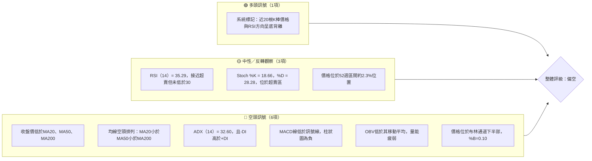
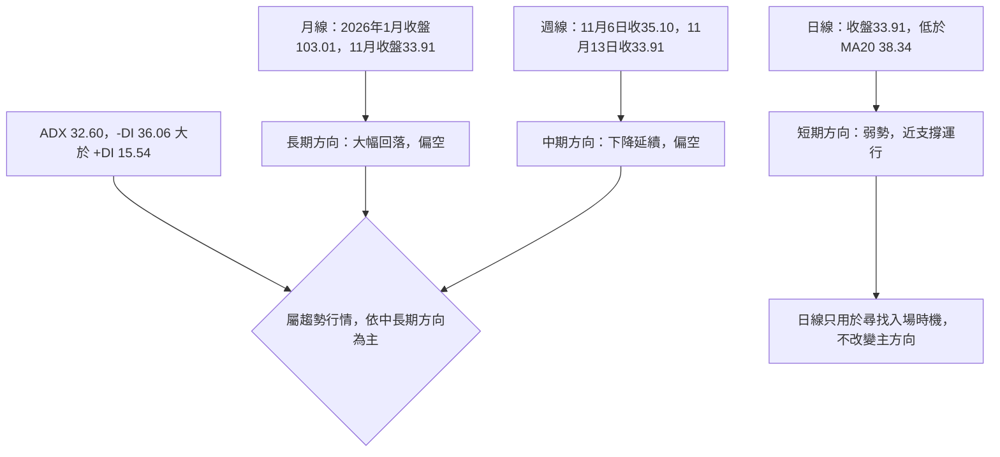
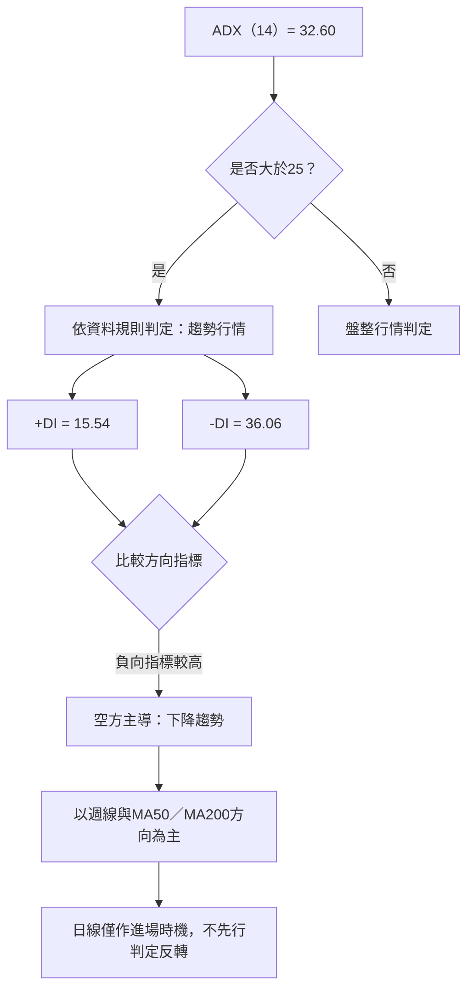
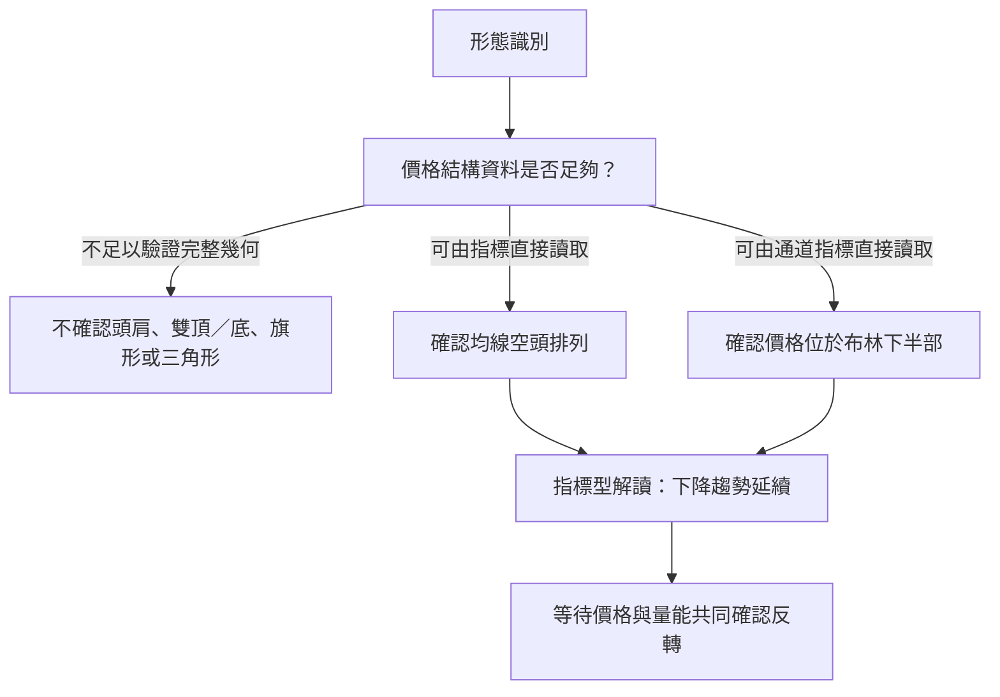
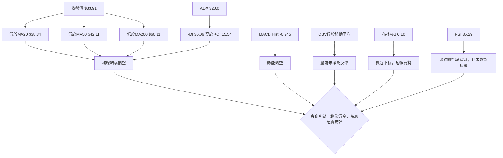
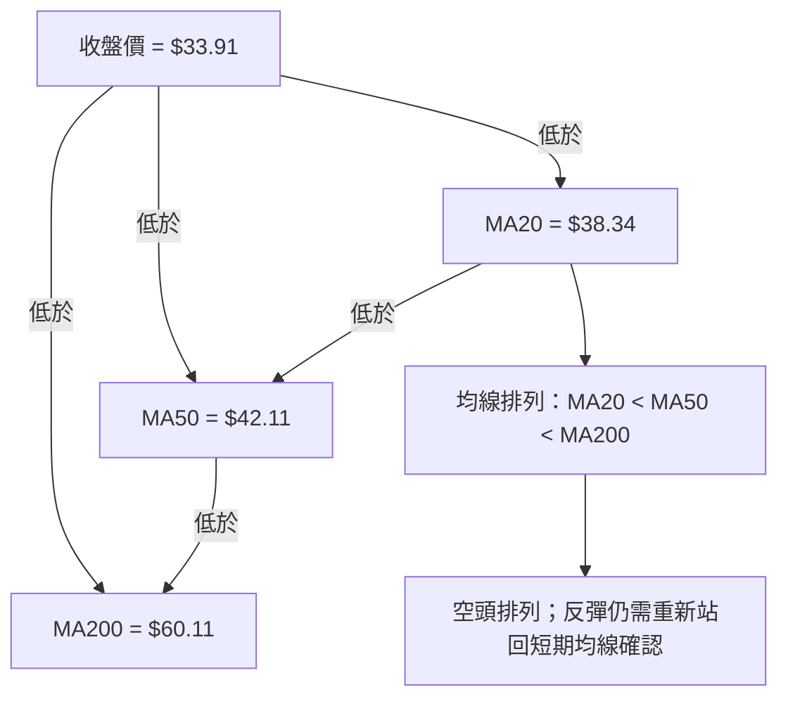
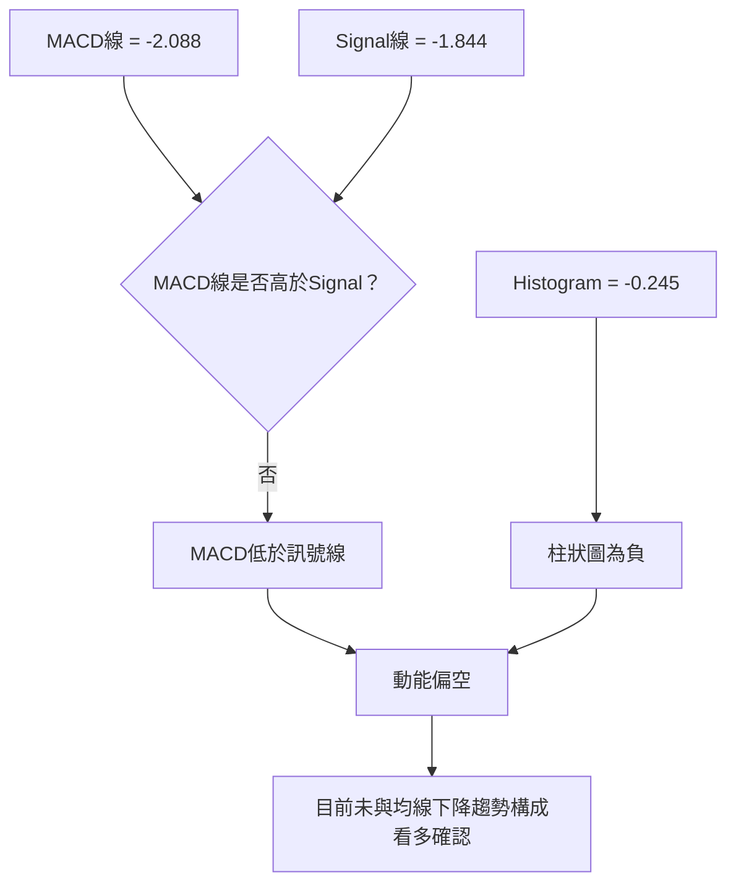
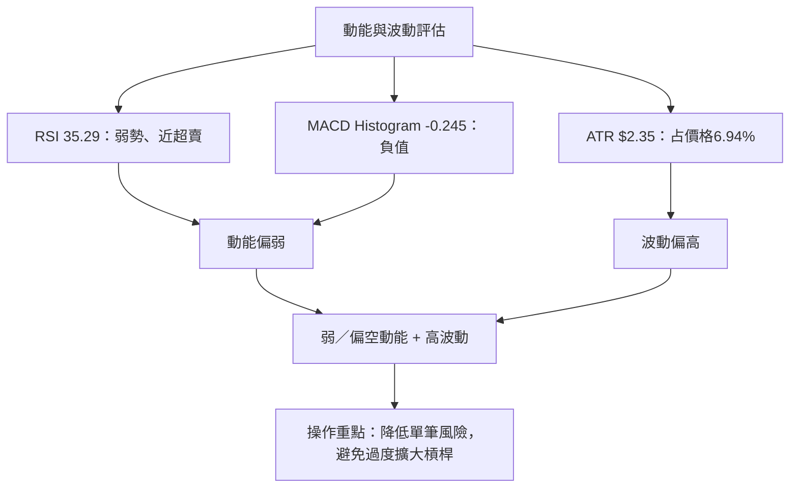
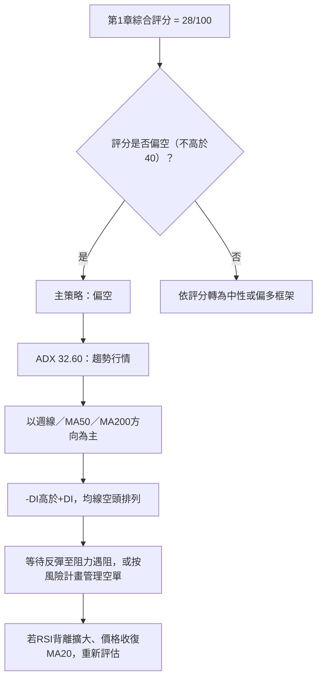
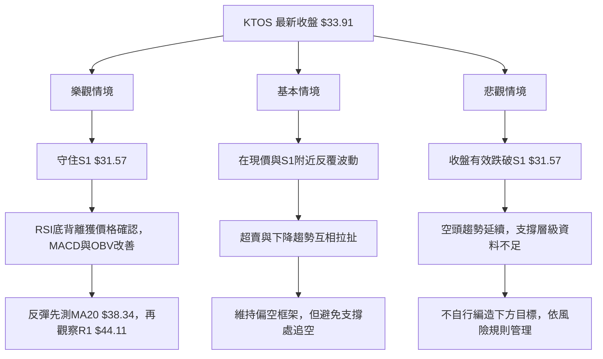

# KTOS 技術分析報告

> **報告日期**：2026-11-14 ｜ **語言**：繁體中文 ｜ **數據來源**：使用者提供之 Yahoo Finance 技術數據 ｜ **當前價格**：$33.91

---

## 目錄

| 章節 | 內容 |
|------|------|
| 1. 技術面概覽 | 訊號儀表板、核心指標、評分卡 |
| 2. 趨勢分析 | 多時框趨勢、長中短期走勢 |
| 3. 圖表形態分析 | 形態識別、K 線組合、目標價 |
| 4. 支撐與阻力 | 關鍵價位、斐波那契回調 |
| 5. 技術指標深度解讀 | MA、RSI、MACD、布林、成交量 |
| 6. 動能與波動率 | 動能評估、ATR、Beta |
| 7. 多時框架總結 | 時框架評分矩陣 |
| 8. 交易策略建議 | 空頭主策略、風險報酬比 |
| 9. 風險提示與監控 | 監控指標、風險場景 |
| 報告總結 | 核心結論與策略摘要 |

---

## 1. 技術面概覽

### 🎯 技術訊號儀表板

KTOS 收於 **$33.91**，位於 52 週區間低端，且低於 MA20、MA50 與 MA200。ADX 為 32.60，達到強趨勢門檻；-DI 明顯高於 +DI，代表目前趨勢方向由空方主導。RSI 的系統標記提供底背離提示，但 MACD、均線、OBV 尚未確認反轉。



**訊號整合判讀：**空頭訊號在趨勢、均線、MACD、OBV 等多個維度一致；RSI／Stochastic 超賣只代表短線可能出現反彈，不足以單獨推翻中期下降趨勢。

### 📊 核心指標速覽表

| 指標類別 | 指標名稱 | 當前數值 | 訊號 | 解讀 |
|----------|----------|----------:|:---:|------|
| 價格 | 收盤價 | **$33.91** | 🔴 | 低於 MA20、MA50、MA200 |
| 區間位置 | 52 週高／低 | $134.00／$31.57 | 🔴 | 收盤價位於區間約 2.3% 位置 |
| 均線 | MA20 | $38.34 | 🔴 | 價格低於 MA20，MA20 走低 |
| 均線 | MA50 | $42.11 | 🔴 | 價格低於 MA50 |
| 均線 | MA200 | $60.11 | 🔴 | 長期均線仍遠高於現價 |
| 動能 | RSI(14) | 35.29 | 🟡 | 弱勢區，尚未進入低於 30 的傳統超賣區 |
| 動能 | MACD／Signal／Histogram | -2.088／-1.844／-0.245 | 🔴 | MACD 低於訊號線，柱狀圖為負 |
| 趨勢 | ADX／+DI／-DI | 32.60／15.54／36.06 | 🔴 | 趨勢強度偏高，方向由空方主導 |
| 波動 | ATR(14) | $2.35 | 🟡 | ATR 約為價格的 6.94%，單日波動幅度顯著 |
| 布林 | %B | 0.10 | 🔴 | 靠近下軌，但未確認有效反轉 |
| 成交量 | 最新／20 日均量 | 5,001,700／4,782,600 | 🟡 | 量比 1.05 倍，略高於 20 日均量 |
| 量價 | OBV | OBV < MA | 🔴 | 量能尚未確認價格反彈 |

### 🏆 技術評分卡

評分為分析框架內的方向性量化評估；各子項以 0–100 分表示。綜合評分依六項算術平均：  
**(25 + 35 + 35 + 30 + 30 + 15) ÷ 6 = 28.33，四捨五入為 28/100。**

```text
技術評分卡 — KTOS（2026-11-14）
╔══════════════════════════════════════════════════════════════╗
║ 趨勢強度      ▓▓▓▓▓░░░░░░░░░░░░░░░  25/100  🔴             ║
║ 動能指標      ▓▓▓▓▓▓▓░░░░░░░░░░░░░░  35/100  🔴             ║
║ 支撐穩定度    ▓▓▓▓▓▓▓░░░░░░░░░░░░░░  35/100  🔴             ║
║ 成交量配合    ▓▓▓▓▓▓░░░░░░░░░░░░░░░  30/100  🔴             ║
║ 形態完整度    ▓▓▓▓▓▓░░░░░░░░░░░░░░░  30/100  🔴             ║
║ 均線排列      ▓▓▓░░░░░░░░░░░░░░░░░░  15/100  🔴             ║
╠══════════════════════════════════════════════════════════════╣
║ 綜合評分      ▓▓▓▓▓▓░░░░░░░░░░░░░░░  28/100  偏空           ║
║ 算式：(25+35+35+30+30+15) ÷ 6 = 28.33 → 28                 ║
╚══════════════════════════════════════════════════════════════╝
```

### 評分依據

| 子項 | 分數 | 評估理由 |
|------|-----:|----------|
| 趨勢強度 | 25/100 | ADX 32.60 顯示趨勢明確，但 +DI 15.54 低於 -DI 36.06；屬強度偏高的下降趨勢。 |
| 動能指標 | 35/100 | MACD 柱狀圖為負；RSI 為 35.29，低位但沒有進入低於 30 的區域；底背離訊號仍未被其他指標確認。 |
| 支撐穩定度 | 35/100 | 已提供的近一年波段低點聚類只有 S1 $31.57；現價至 S1 僅有 $2.34 距離，支撐附近短線下行空間有限，但下破風險存在。 |
| 成交量配合 | 30/100 | 量比 1.05 倍不算強烈放量，OBV 低於其均線，未見明確累積買盤確認。 |
| 形態完整度 | 30/100 | 現有摘要數據不足以確認高信心度反轉形態；近期週線收盤仍偏弱。 |
| 均線排列 | 15/100 | MA20 < MA50 < MA200，且收盤價低於全部三條均線；短、中、長週期均線結構一致偏空。 |

---

## 2. 趨勢分析

### 🌐 多時框趨勢分析



**收斂原則：**ADX(14) = 32.60，大於 25，按提供的規則判定為趨勢行情。此時應以週線／MA50／MA200 的方向為主，日線只輔助安排入場時機。三者目前同向偏空，因此不將短線超賣解讀成已完成的趨勢反轉。

### 📈 長期趨勢 — 12 個月走勢圖

下圖使用提供的 **2025 年 12 月至 2026 年 11 月共 12 個月月收盤價**繪製。圖形為視覺化趨勢呈現；精確月收盤數值列於圖下方。

```text
KTOS 月線走勢圖（2025-12 至 2026-11；每格約代表價格區間）
收盤價 ($)

110 ┤
100 ┤       ● 2026-01 $103.01
 90 ┤                    ●
 80 ┤                          ●──●
 70 ┤                                ●
 60 ┤                                      ●──●
 50 ┤                                              ●
 40 ┤                                                    ●──●
 30 ┤                                                          ●
    └─────────────────────────────────────────────────────────────
      25-12  26-01  26-02  26-03  26-04  26-05  26-06  26-07
                                                             26-08 26-09 26-10 26-11

月收盤：
2025-12 $75.91 → 2026-01 $103.01 → 2026-02 $86.18 → 2026-03 $70.51
→ 2026-04 $63.05 → 2026-05 $64.13 → 2026-06 $49.86 → 2026-07 $46.60
→ 2026-08 $50.98 → 2026-09 $42.69 → 2026-10 $41.09 → 2026-11 $33.91
```

**關鍵高低點說明：**

- 上圖 12 個月月收盤中的最高值為 **2026-01 的 $103.01**，最低值為 **2026-11 的 $33.91**。
- 這不等同於 52 週盤中高低；資料另列 52 週高點 **$134.00**、低點 **$31.57**。
- 2025-12 至 2026-11 月收盤變化：  
  **($33.91 ÷ $75.91 − 1) = -55.3%**。
- 2026-01 收盤 $103.01 至 2026-11 收盤 $33.91：  
  **($33.91 ÷ $103.01 − 1) = -67.1%**。

### 走勢階段與月收盤變化

| 階段 | 月收盤變化 | 階段特徵 |
|------|------------|----------|
| 2025-12 → 2026-01 | $75.91 → $103.01，約 **+35.7%** | 月收盤快速上移，之後進入高波動回落階段。 |
| 2026-01 → 2026-04 | $103.01 → $63.05，約 **-38.8%** | 連續數月收盤走低，顯示上升動能轉弱。 |
| 2026-04 → 2026-05 | $63.05 → $64.13，約 **+1.7%** | 月收盤小幅回升，未改變中期下降結構。 |
| 2026-05 → 2026-07 | $64.13 → $46.60，約 **-27.3%** | 再度走低，低點持續下移。 |
| 2026-07 → 2026-08 | $46.60 → $50.98，約 **+9.4%** | 短暫反彈，後續月線未延續。 |
| 2026-08 → 2026-11 | $50.98 → $33.91，約 **-33.5%** | 反彈失敗後再度回落，並逼近 52 週低位。 |

### 📊 中期趨勢（週線分析）

近 20 週收盤走勢顯示，2026-08-14 收盤 $64.58 後，價格大致呈下降；最新兩週收盤分別為 $35.10、$33.91。週線 MACD 柱狀值最新為 **-0.245**，RSI 為 **35.3**，兩者均未顯示明確週線反轉完成。

```text
KTOS 近期週線價格路徑（以提供之週收盤值繪製）
$65 ┤        ● 64.58
$60 ┤   ●
$55 ┤●
$50 ┤                     ●
$45 ┤          ●──●──●──●
$40 ┤                         ●──●──●
$35 ┤                                      ●──●
$30 ┤
    └───────────────────────────────────────────
     7/02 8/07 8/14 8/28 9/04 9/25 10/09 10/23 10/30 11/06 11/13

重要資料點：2026-08-14 收盤$64.58；2026-10-30 收盤$41.09；
             2026-11-06 收盤$35.10；2026-11-13 收盤$33.91。
```

**週線壓力與支撐示意：**

```text
KTOS 週線結構示意（只標示提供的價位）
$51.49 ───────── R3：近一年波段高點聚類
$49.68 ───────── R2：近一年波段高點聚類
$44.11 ───────── R1：近一年波段高點聚類
$38.34 ───────── MA20／布林中軌
$35.10 ───────── 2026-11-06 週收盤
$33.91 ───────── 最新收盤
$32.77 ───────── 布林下軌
$31.57 ───────── S1：近一年波段低點聚類／52週低點
```

### ⚡ 趨勢強度評估（ADX 解讀）



| ADX 區間 | 一般技術解讀 | KTOS 現況 |
|----------|--------------|-----------|
| 低於 20 | 趨勢弱，常見盤整 | 不符合 |
| 20–25 | 趨勢發展中，需確認 | 不符合 |
| 高於 25 | 趨勢較明確 | **32.60，符合** |
| 高於 40 | 趨勢強度很高，但不代表方向 | 未達 |

**方向判定：**ADX 只反映趨勢強度，不直接判定多空；需結合 +DI 與 -DI。此處 -DI 36.06 顯著高於 +DI 15.54，因此解讀為**空方主導的強勢下降趨勢**。

---

## 3. 圖表形態分析

### 🔍 形態識別系統

現有資料提供月收盤、週收盤、均線、指標與近端 OHLC，但沒有完整逐日兩年 OHLC 序列與全部成交量節點。因此，對頭肩頂、雙頂、雙底、旗形或三角形等幾何形態不作過度推定。



### 形態信心度表

| 形態／訊號 | 信心度 | 判斷依據（引用數據） | 完成度 | 目標價 |
|------|------:|------|------|------|
| 頭肩頂／底 | **N/A（數據未提供）** | 資料未列出可逐點核驗的肩部、頭部與頸線序列；不作形態宣稱。 | N/A | N/A（數據未提供） |
| 雙頂／雙底 | **N/A（數據未提供）** | 只提供關鍵低點聚類 S1 $31.57，沒有第二個可核驗低點的完整結構資料。 | N/A | N/A（數據未提供） |
| 旗形／三角形 | **N/A（數據未提供）** | 缺少完整逐日 OHLC 序列以判斷收斂邊界或旗桿／旗面。 | N/A | N/A（數據未提供） |
| 均線空頭排列 | **高，約 90%** | MA20 $38.34 < MA50 $42.11 < MA200 $60.11，且收盤 $33.91 低於全部均線。此為指標狀態，不是幾何形態。 | 已成立 | 不適用 |
| 布林下半部弱勢 | **中高，約 80%** | BB %B = 0.10；收盤靠近下軌 $32.77，但尚未跌破下軌。 | 已成立 | 不適用 |

> 信心度百分比為本報告對資料支持程度的主觀量化，不是統計回測勝率。幾何形態在資料不足時以 N/A 呈現，不以推測補足。

### 🕯️ 重要 K 線形態分析

以下判斷只使用題目指定的「近 10 根日 K」與「近 8 根週 K」OHLC。表中只列出有代表性的 K 棒；不以區塊外資料推定 K 線形態。

| 日期（日 K） | 開 | 高 | 低 | 收 | K 線形態判斷 | 解讀 | 訊號 |
|------|------:|------:|------:|------:|------|------|:---:|
| 2026-11-02 | 41.29 | 41.61 | 39.68 | 40.23 | 偏空實體，無明確標準反轉形態 | 收低於開盤，當日以賣方占優。 | 🔴 |
| 2026-11-03 | 40.41 | 41.72 | 40.10 | 40.99 | 小實體、上下影線 | 單根不足以確認反轉；後續價格快速下跌。 | 🟡 |
| 2026-11-04 | 39.86 | 40.25 | 35.71 | 35.96 | 長陰線／下跌實體 | 收盤接近當日低位，賣壓明顯。 | 🔴 |
| 2026-11-05 | 35.63 | 35.79 | 32.50 | 33.39 | 偏空實體、收近低位 | 延續前一交易日弱勢。 | 🔴 |
| 2026-11-06 | 33.73 | 35.31 | 31.57 | 35.10 | 錘頭型／長下影線候選 | 下影線約 $2.16，實體約 $1.37，收盤靠近日高；低位出現買回，但須後續確認。 | 🟡 |
| 2026-11-09 | 35.63 | 38.13 | 34.66 | 37.69 | 偏多實體 | 收盤高於開盤，呈現短線反彈；尚未收復 MA20。 | 🟢 |
| 2026-11-10 | 36.93 | 37.84 | 36.20 | 36.72 | 小實體、上下影線 | 反彈延續性不足，方向訊號有限。 | 🟡 |
| 2026-11-11 | 37.32 | 37.50 | 36.35 | 36.69 | 偏空小實體 | 收低於開盤，反彈動能轉弱。 | 🔴 |
| 2026-11-12 | 35.74 | 36.90 | 34.68 | 34.75 | 偏空實體 | 收盤接近當日低位，賣方重新主導。 | 🔴 |
| 2026-11-13 | 34.75 | 34.91 | 33.35 | 33.91 | 偏空實體 | 收低於開盤，低收於區間下半部，反彈未延續。 | 🔴 |

| 日期（週 K） | 開 | 高 | 低 | 收 | K 線形態判斷 | 解讀 | 訊號 |
|------|------:|------:|------:|------:|------|------|:---:|
| 2026-09-25 | 48.22 | 49.68 | 44.81 | 45.62 | 偏空實體 | 收低於開盤，週線反映上方賣壓。 | 🔴 |
| 2026-10-02 | 44.97 | 45.22 | 41.83 | 43.07 | 偏空實體 | 收盤低於開盤，延續弱勢。 | 🔴 |
| 2026-10-09 | 43.80 | 44.14 | 40.93 | 42.36 | 偏空實體 | 週線高低區間下移。 | 🔴 |
| 2026-10-16 | 42.48 | 43.07 | 37.84 | 40.42 | 偏空實體 | 低點進一步下移，趨勢尚未扭轉。 | 🔴 |
| 2026-10-23 | 40.40 | 40.50 | 36.37 | 38.68 | 偏空實體 | 收盤接近當週低位，賣方主導。 | 🔴 |
| 2026-10-30 | 38.68 | 44.11 | 38.43 | 41.09 | 長上影線候選／收高於開 | 週內反彈至 $44.11，但收盤回落，顯示高位遇壓。 | 🟡 |
| 2026-11-06 | 41.29 | 41.72 | 31.57 | 35.10 | 大幅週線區間、收低於開 | 週內下探 52 週低點，儘管有下影，週收仍偏弱。 | 🔴 |
| 2026-11-13 | 35.63 | 38.13 | 33.35 | 33.91 | 偏空實體 | 反彈高點未能維持，最新週收再次走低。 | 🔴 |

### 📉 ASCII 走勢形態示意圖

以下是指標型下降結構示意，僅標示已提供的收盤與關鍵價位；不代表另行確認任何幾何形態。

```text
KTOS 指標型下降結構示意
價格
$64.58  ● 2026-08-14 週收盤
          \
$50.98      ● 2026-08 月收盤
              \
$44.11 ───────────── R1（關鍵價位）
                  \
$41.09              ● 2026-10-30 週收盤
                    \
$38.34 ───────────── MA20／布林中軌
                      \
$35.10                 ● 2026-11-06 週收盤
                        \
$33.91                   ● 最新收盤
$32.77 ──────────────── 布林下軌
$31.57 ──────────────── S1／52週低點
```

### 🎯 形態目標價計算

- 資料中未確認頭肩、雙頂、雙底、旗形或三角形等幾何形態，故**不使用形態高度推算目標價**。
- 技術分析中可直接使用的價位僅採用提供的 R1–R3、S1、斐波那契價位與布林值。
- **S2／S3：N/A（數據未提供）**，不以其他資料自行推算。
- 策略目標價將引用已提供的支撐／阻力或當前收盤價，不另造精確目標。

---

## 4. 支撐與阻力

### 🗺️ 關鍵價位分布圖

> 下列 R1–R3、S1 直接引用題目「關鍵價位」區塊。布林中軌與下軌另以指標參考線標示，並不冒充波段支撐／阻力聚類。

```text
KTOS 價位結構分布圖（美元）
══════════════════════════════════════════════════════════
$51.49 ║████████████████████████║ R3：阻力
$49.68 ║██████████████████████  ║ R2：阻力
$44.11 ║████████████████████████║ R1：主要近端阻力
$38.34 ║──────── MA20／布林中軌
$33.91 ╠════════════════════════╣ ◄ 現價（2026-11-13 收盤）
$32.77 ║──────── 布林下軌
$31.57 ║▓▓▓▓▓▓▓▓▓▓▓▓▓▓▓▓▓▓▓▓▓▓║ S1：近一年波段低點聚類
S2/S3  ║ N/A（數據未提供）
══════════════════════════════════════════════════════════
```

### 🚧 阻力位分析表

| 阻力級別 | 價位 | 相對現價距離 | 形成原因 | 突破難度 | 重要性 |
|----------|------:|--------------:|----------|----------|--------|
| R1 | **$44.11** | +30.08% | 近一年波段高點聚類；亦高於 MA20 $38.34 | 高 | 高；第一個已提供的聚類阻力 |
| R2 | **$49.68** | +46.51% | 近一年波段高點聚類 | 高 | 高 |
| R3 | **$51.49** | +51.84% | 近一年波段高點聚類 | 高 | 中高 |

**解讀：**收盤價 $33.91 至 R1 $44.11 的距離約為現價的 30.08%。因此即使出現短線反彈，仍須觀察價格能否先站回 MA20 $38.34，再進一步面對 R1；沒有收復均線並不構成趨勢反轉確認。

### 🛡️ 支撐位分析表

| 支撐級別 | 價位 | 相對現價距離 | 形成原因 | 守住機率評估 | 重要性 |
|----------|------:|--------------:|----------|--------------|--------|
| S1 | **$31.57** | -6.90% | 近一年波段低點聚類；同時為提供資料中的 52 週低點 | 中低；現價已接近該價位，若反覆測試或放量跌破，支撐風險上升 | 高 |
| S2 | **N/A（數據未提供）** | N/A（數據未提供） | 未提供波段低點聚類 | N/A（數據未提供） | N/A（數據未提供） |
| S3 | **N/A（數據未提供）** | N/A（數據未提供） | 未提供波段低點聚類 | N/A（數據未提供） | N/A（數據未提供） |

**支撐風險：**

1. S1 $31.57 與收盤價 $33.91 相距 $2.34；此差額是兩個已提供價位的差，不另視為新增支撐。
2. 收盤若有效跌破 S1，資料中沒有下一級波段支撐聚類，因此不能據此報告更低的精確支撐或目標。
3. 布林下軌 $32.77 是動態技術指標值，不等同於 OHLCV 波段低點聚類 S1。

### 📐 斐波那契回調位分析

以下直接引用提供的 52 週區間 $31.57 → $134.00 的斐波那契數值。

| 回調位 | 價位 |
|------:|------:|
| 23.6% | $109.83 |
| 38.2% | $94.87 |
| 50.0% | $82.78 |
| 61.8% | $70.70 |
| 78.6% | $53.49 |
| 100.0%（52 週低） | $31.57 |

- 現價 **$33.91** 位於 **78.6% 回調位 $53.49** 與 **100.0% 回調位 $31.57** 之間，且明顯更接近 52 週低點。
- 這種位置反映前一段上漲區間大部分已被回吐，但不能單靠深度回調推定價格必然反彈。
- 若 S1 $31.57 失守，現有資料沒有列出更低的斐波那契延伸位，因此不提供新的精確下方目標。

---

## 5. 技術指標深度解讀

### 🎛️ 指標訊號總覽



### 📈 移動平均線排列分析



| 均線 | 數值 | 相對收盤價 | 資料所示方向 | 技術含義 |
|------|------:|------------|--------------|----------|
| MA5 | $35.95 | 收盤低於 MA5 | 下行 | 短線價格仍弱於短均線。 |
| MA10 | $36.54 | 收盤低於 MA10 | 下行 | 反彈尚未收復短線均值。 |
| MA20 | $38.34 | 收盤低於 MA20 | 下行 | 短期趨勢仍偏空。 |
| MA50 | $42.11 | 收盤低於 MA50 | 下行結構 | 中期趨勢偏弱。 |
| MA200 | $60.11 | 收盤低於 MA200 | 長期均線仍遠高 | 長期結構未反轉。 |
| MA240 | $65.54 | 收盤低於 MA240 | 下行 | 更長週期均線亦形成上方壓力參考。 |

各均線變化摘要亦偏向下行：MA20 變化 -11.56%、MA50 資料未直接提供、MA60 變化 -22.44%、MA120 變化 -30.72%、MA240 變化 -48.26%。此處不將 MA60、MA120 的數值冒稱為 MA50 或 MA200。

### 📉 RSI(14) 分析

**RSI(14) = 35.29**

```text
RSI 強度（尺度 0–100）
0     20    30    35.29             50             70             100
|------|-----|------●----------------|--------------|---------------|
                       ▲
                    當前 RSI
▓▓▓▓▓▓▓░░░░░░░░░░░░░░  35.29 / 100
```

- **區間判讀：**RSI 35.29 位於弱勢區域，接近常用的 30 超賣門檻，但仍高於 30。
- **底背離：**提供的技術快照標記「底背離」，其計算方式是比較近 20 根 K 棒首尾價格與 RSI 方向。由於沒有列出該比較的具體端點價格及 RSI 值，本報告只能將其視為**系統提供的初步背離提示**，無法獨立驗證背離的幾何細節。
- **是否確認：**目前 MACD Histogram 為 -0.245、-DI 大於 +DI、價格低於均線且 OBV < MA，故 RSI 底背離尚未獲得多指標確認。
- **結論：**有反彈風險，但暫不將其定性為已確認的趨勢反轉。

### 📊 MACD(12/26/9) 訊號解讀

- MACD：**-2.088**
- Signal：**-1.844**
- Histogram：**-0.245**



**背離判斷：**

| 背離類型 | 判定 | 依據與限制 |
|----------|------|------------|
| RSI 頂背離 | 未見資料支持 | 系統標記為底背離，沒有提供頂背離訊號。 |
| RSI 底背離 | **資料標記有，但未確認** | 只提供近 20 根 K 棒首尾比較結果，欠缺各端點數值供獨立核驗。 |
| MACD 頂背離 | 未見資料支持 | 未提供頂背離標記或對應波峰序列。 |
| MACD 底背離 | **未確認** | 最新 MACD 線低於訊號線，Histogram 為負；不能僅憑價格低位推論 MACD 底背離。 |

### 📦 布林通道分析

- 上軌：**$43.91**
- 中軌／MA20：**$38.34**
- 下軌：**$32.77**
- 收盤價：**$33.91**
- %B：**0.10**

```text
布林通道位置示意（美元；非按線性比例繪製）
$43.91 ───────────────────── 上軌
          │
          │        布林通道區間
$38.34 ───┼────────────────── 中軌／MA20
          │
$33.91 ───●────────────────── 最新收盤，%B=0.10
$32.77 ───────────────────── 下軌
```

- %B = 0.10 表示收盤位於布林通道下半部，偏向下軌一側。
- 收盤仍高於下軌 $32.77，並非已知的收盤價有效跌破下軌。
- 下軌附近可能出現短線均值回歸，但在 ADX 高於 25 且 -DI 明顯較高時，不能單純因靠近下軌就預期均值回歸。
- 布林通道帶寬的歷史變化值未提供，因此**布林帶寬變化：N/A（數據未提供）**。

### 💹 成交量分析（量價配合度）

| 量能資料 | 數值 | 解讀 |
|----------|------:|------|
| 最新成交量 | 5,001,700 | 高於 20 日均量，略低於或接近 50 日均量附近的量級。 |
| 20 日均量 | 4,782,600 | 最新量為其 1.05 倍。 |
| 50 日均量 | 4,595,618 | 最新量亦高於此均量。 |
| 近 20 週最新週成交量 | 24,693,000 | 低於前週 32,419,600。 |
| OBV 趨勢 | OBV < MA | 量能趨勢未確認價格反彈。 |

**量價整合：**

- 最新日成交量 5,001,700、20 日均量 4,782,600，量比 **1.05 倍**，屬略高於平均而非強烈爆量。
- 近 20 週週量資料顯示，2026-11-06 週量 32,419,600 高於 2026-11-13 週量 24,693,000；但最新週收仍下跌至 $33.91。
- OBV < MA 是較明確的量能疲弱訊號；目前成交量不能確認買方正在累積。
- 因此，RSI 底背離提示與 OBV 疲弱之間存在訊號矛盾，反轉證據不完整。

---

## 6. 動能與波動率

### ⚡ 動能評估四象限

以 RSI、MACD、均線排列與 ATR 進行定性分類；波動率位置依提供的 ATR 占價格比判斷。

| 象限 | 動能狀態 | 波動狀態 | 當前狀態 | 評估 |
|------|----------|----------|----------|------|
| Q1 | 強 | 低 | — | 趨勢平穩且動能明確，當前不符合。 |
| Q2 | 弱 | 低 | — | 弱勢但波動溫和，當前波動不屬低。 |
| Q3 | 強 | 高 | — | 強動能搭配高波動，方向性交易機會較大；目前動能是偏空而非多方強勢。 |
| Q4 | 弱／偏空 | 高 | **✓** | RSI 偏弱、MACD 負值、均線空頭排列，加上 ATR 占價格 6.94%；需嚴格控制倉位。 |



### 📊 ATR 波動率分析

- ATR(14)：**$2.35**
- ATR／收盤價：**6.94%**
- 按 ATR 計算的單日典型波動參考為 **$2.35**，但 ATR 不是價格必然上下限。
- 相較現價 $33.91，ATR 代表相對顯著的日內／日間價格波動。窄幅固定止損較容易受正常波動觸發；過寬止損又會提高單股風險。
- 本報告交易策略中若使用 ATR 止損，會清楚列出計算式；它是風險控制參考，不是新增支撐或阻力位。
- ATR 的移動方向或 ATR 時序變化：**N/A（數據未提供）**。

### 📐 Beta 與市場相關性

- Beta：**1.165**
- 一般解讀是該股歷史價格對市場變動的敏感度高於 1；但 Beta 不等同於目前的短期相關係數，也不保證未來同步程度。
- Beta 的估算期間、比較指數與相關係數未提供，因此：
  - KTOS 與大盤即時相關係數：**N/A（數據未提供）**
  - Beta 估算期間：**N/A（數據未提供）**
- 對交易風控的含義是：在市場波動加劇時，KTOS 的價格波動可能放大投資組合風險；應避免僅以單一股票的技術型態決定整體曝險。

---

## 7. 多時框架總結

### 📋 時框架評分表

評分為方向性技術評估，1–10 分；評分表中的綜合結論須與第 1 章 **28/100** 的偏空總評一致。

| 時框架 | 趨勢方向 | 動能 | 均線排列 | 形態 | 綜合評分 | 建議 |
|--------|----------|------|----------|------|----------|------|
| 月線／長期 | 🔴 偏空 | 🔴 偏弱 | 🔴 長期價格低於 MA200 | N/A（幾何形態不足） | 2/10 | 不以短線反彈視為長期反轉。 |
| 週線／中期 | 🔴 偏空 | 🔴 週 MACD 柱負值 | 🔴 收盤持續走低 | 無確認反轉形態 | 3/10 | 以空方趨勢為主，反彈留意上方阻力。 |
| 日線／短期 | 🔴 偏空、接近支撐 | 🟡 RSI 35.29、Stoch 超賣 | 🔴 收盤低於 MA20／MA50／MA200 | 11/06 日線錘頭型候選，未確認 | 4/10 | 日線只作進場時點，不單獨主導方向。 |
| 整體 | **偏空** | 偏弱 | 空頭排列 | 反轉訊號未確認 | **28/100** | **主策略方向：偏空** |

### 🔲 綜合訊號矩陣

| 維度 | 日線 | 週線 | 月線／長週期 | 一致性 |
|------|------|------|-------------|--------|
| 價格方向 | 弱勢，收盤 $33.91 | 最近兩週收盤走低 | 2026 年高位後大幅回落 | 🔴 高度偏空 |
| 均線 | 低於 MA20 | 週線價格弱勢 | 低於 MA200 | 🔴 偏空 |
| 動能 | RSI 接近超賣，MACD 負值 | 週 MACD Histogram 為負 | 長期均線結構仍弱 | 🟡 有短線反彈風險，但未反轉 |
| 成交量 | 最新量比 1.05 | 最新週量低於前週 | OBV 低於 MA | 🔴 未確認買盤 |
| 支撐 | 接近 S1 $31.57 | 52 週低位附近 | 需觀察低點是否守穩 | 🟡 支撐可能引發反彈，但下破風險仍在 |

### ⚖️ 多時框收斂結論

1. **行情分類：趨勢行情。**ADX(14) = 32.60，大於 25。
2. **主導時框：週線與中長期均線方向。**依規則，日線只用於尋找入場時機。
3. **方向依據：**週線收盤 $33.91，遠低於 MA50 $42.11 與 MA200 $60.11；日線均線同樣空頭排列，-DI 36.06 高於 +DI 15.54。
4. **衝突處理：**日線 RSI 底背離標記與 Stochastic 超賣，構成短線反彈風險；但 MACD、OBV、均線與週線仍未確認反轉，因此不讓短線指標凌駕中長期趨勢。
5. **唯一方向結論：🔴 偏空。**此結論與第 1 章 28/100 評分及第 8 章主策略一致。

---

## 8. 交易策略建議

> **交易策略說明：**以下為依照提供資料建立的條件式技術交易框架，不是保證成交或回報的預測。策略計算使用已提供的價格位或明列的 ATR 止損公式；若市場跳空、流動性不足或滑價，實際風險報酬會改變。

### 🗺️ 策略決策流程圖



### 🧭 策略路由

**當前主策略方向 = 偏空（依評分 28/100）**

- 評分低於 40，按規則主推空頭方向。
- 不以 RSI 底背離或 Stochastic 超賣理由同時強推多頭策略。
- 空頭策略的最大風險在於：價格已接近 S1 $31.57，支撐附近可能出現快速反彈；且目前 RSI 底背離標記尚未消失。

### 🎯 價格情境階梯（Price Scenarios）

| 觸發條件 | 下一目標 | 後續延伸 | 情境含義 |
|----------|----------|----------|----------|
| 突破並站穩 R1 **$44.11** | R2 **$49.68** | R3 **$51.49** | 短中期反彈加強；若同時收復均線並改善量能，偏空趨勢需重新評估。 |
| 價格在現價與 S1 之間運行 | — | — | 以 $33.91 現價與 S1 $31.57 觀察支撐附近是否築底；不能宣稱已形成區間底。 |
| 跌破 S1 **$31.57** | N/A（數據未提供） | N/A（數據未提供） | 近一年已提供支撐被破；資料無下一級 OHLCV 支撐聚類，避免自行編造目標。 |

### 📊 情境機率分佈

以下是依現有技術指標作出的**主觀情境權重**，不是統計模型或歷史回測勝率；三項總和為 100%。

| 情境 | 機率 | 主要依據 |
|------|-----:|----------|
| 反彈／短線上行 | **20%** | RSI 35.29、Stochastic 位於超賣區、系統標記 RSI 底背離、價格接近 S1；但尚無均線或 MACD 確認。 |
| 弱勢區間震盪 | **25%** | 價格已接近 S1 $31.57，布林 %B=0.10；支撐附近可能整理，但 ADX 32.60 不支持把盤整作為主判斷。 |
| 回落／再探底 | **55%** | ADX 高於 25、-DI 大於 +DI、收盤低於 MA20／MA50／MA200、MACD Histogram 負值、OBV < MA。 |

### 🟢 主策略詳情（偏空）

所有策略均以**做空方向**為主。T1、T2 只使用提供的價位；策略 A 的止損依 ATR 明列公式，策略 B 使用已提供的阻力 R2。

#### 策略 A：現價附近的風險受限空單框架

| 策略要素 | 設定 |
|----------|------|
| 進場條件 | 僅在交易者能承受支撐附近反彈風險、並有明確風險上限時，才考慮以當前收盤附近作為參考；不將其視為高勝率追空訊號。 |
| 進場價格 | **$33.91**（使用提供的收盤價；不代表下一交易日必然可成交） |
| 止損價格 | **$37.44**，計算式：$33.91 + 1.5 × ATR $2.35 = $37.435，四捨五入至美分為 $37.44 |
| 目標價 T1 | **$31.57**（S1） |
| 目標價 T2 | **N/A（數據未提供）**；沒有低於 S1 的波段支撐聚類或其他可引用目標。 |
| 風險報酬比 | 做空計算：風險 = $37.44 − $33.91 = $3.53；T1 報酬 = $33.91 − $31.57 = $2.34；**1 : 0.66（以 T1 計）** |
| 成功機率 | **約 45%（主觀）**；S1 接近與 RSI 底背離提示降低追空優勢，趨勢指標則支持偏空。 |
| 建議倉位 | 單筆最大帳戶風險宜控制在 **0.25%–0.50%**；倉位股數應依帳戶規模與止損距離計算，帳戶資產未提供，不提供股數。 |

#### 策略 B：反彈至 R1 遇阻後的空頭框架

| 策略要素 | 設定 |
|----------|------|
| 進場條件 | 價格反彈觸及已提供的阻力 R1 $44.11，且未能有效站穩，才考慮進場；若直接突破並站穩，策略條件失效。 |
| 進場價格 | **$44.11**（R1） |
| 止損價格 | **$49.68**（R2） |
| 目標價 T1 | **$33.91**（提供的當前收盤價，作為回落情境參考位） |
| 目標價 T2 | **$31.57**（S1） |
| 風險報酬比 | 做空風險 = $49.68 − $44.11 = $5.57；T1 報酬 = $44.11 − $33.91 = $10.20；**1 : 1.83（以 T1 計）**。T2 報酬 = $44.11 − $31.57 = $12.54；**1 : 2.25（以 T2 計）**。 |
| 成功機率 | **約 50%（主觀）**；等待反彈至阻力可改善盈虧結構，但目前沒有保證價格會反彈至 R1。 |
| 建議倉位 | 單筆最大帳戶風險宜控制在 **0.25%–0.50%**；以止損距離 $5.57 計算部位，不以目標報酬倒推加大倉位。 |

**進場區間規則：**本報告策略均使用單一進場價，沒有使用進場價格區間，因此不需以區間中點計算風險報酬比。交易成本、借券費、滑價與跳空風險未納入上述算式。

### 🔴 反向風險觸發點（對沖提示）

以下為會削弱空頭主策略、需要重評估或考慮降低曝險的訊號，不構成完整多頭操作建議：

- **價格站上 R1 $44.11 並持續維持其上方：**空頭策略 B 的阻力遇阻前提失效。
- **突破 R2 $49.68：**策略 B 止損觸發；若價格仍有上行，空頭結構可能進一步轉弱。
- **收復 MA20 $38.34 並伴隨 MACD Histogram 回升與 OBV 改善：**短線反彈訊號開始獲得確認，但仍需觀察 MA50 $42.11。
- **S1 $31.57 附近出現明確價格止跌且成交量配合：**追空的風險報酬吸引力下降；不要在支撐附近忽略反彈風險。
- **RSI 背離提示擴大或週線轉強：**重新檢視主策略方向，而不是機械式延續做空。

### ⭐ 整體訊號強度評星

```text
做多訊號強度：★☆☆☆☆  (1/5星)
做空訊號強度：★★★★☆  (4/5星)
整體可信度：  ★★★☆☆  (3/5星)

理由：
- 做空：趨勢、均線、MACD、DI方向與OBV多數一致。
- 做多：目前主要依據為RSI背離提示、超賣與接近S1，尚缺價格與量能確認。
- 可信度：方向一致性偏空，但價格接近S1且資料缺乏更低支撐層級，降低目標判斷的完整度。
```

---

## 9. 風險提示與監控

### ✅ 關鍵監控指標 Checklist

```text
╔══════════════════════════════════════════════════════════════╗
║ KTOS 技術監控清單 — 更新基準：2026-11-14                  ║
╠══════════════════════════════════════════════════════════════╣
║ □ 收盤是否守住 S1 $31.57？                                 ║
║ □ 若跌破 S1，記錄為支撐失守；不自行推算下一級目標。       ║
║ □ 價格是否重新站回布林中軌／MA20 $38.34？                 ║
║ □ 是否突破 R1 $44.11，並觀察 R2 $49.68、R3 $51.49？      ║
║ □ ADX 是否仍高於25？若是，按趨勢行情規則收斂方向。        ║
║ □ -DI 是否仍高於 +DI？目前為36.06對15.54。               ║
║ □ RSI 是否由35.29回升，且背離訊號能否獲得價格確認？       ║
║ □ MACD Histogram 是否由目前-0.245轉正或持續改善？         ║
║ □ OBV 是否站回其移動平均？目前 OBV < MA。                ║
║ □ 成交量是否持續高於均量且與價格方向一致？                ║
║ □ ATR 是否仍約為價格的6.94%？調整部位與止損距離。        ║
╚══════════════════════════════════════════════════════════════╝
```

### ⚠️ 風險場景分析



| 情境 | 觀察條件 | 技術含義 | 風控重點 |
|------|----------|----------|----------|
| 樂觀 | S1 $31.57 守住，並收復 MA20 $38.34；MACD、OBV 同步改善 | 可能由超賣反彈轉為較具確認度的修復行情；仍須觀察 R1 $44.11。 | 避免因單日反彈就判定長期趨勢翻多。 |
| 基本 | 收盤在 $31.57 支撐與 $38.34 MA20 之間反覆 | 趨勢偏空但短線進入支撐附近拉鋸；RSI／Stochastic 超賣可能造成快速反彈。 | 降低追空意願，觀察量價是否改善；區間上下界不延伸臆測。 |
| 悲觀 | 收盤有效跌破 S1 $31.57 | 已提供的波段低點支撐失守，原支撐結構轉弱。 | 下一級支撐為 N/A（數據未提供）；不以臆測價位設定新目標。 |

### 🛡️ 風險管理重要提醒

1. **支撐附近的追空風險：**收盤價距 S1 $31.57 只有 $2.34。雖然大方向偏空，但下方可引用支撐資料有限，不能將偏空判斷直接等同於任何價格都適合追空。
2. **反轉訊號尚未確認：**RSI 底背離提示與超賣指標可能帶來短線反彈；但 MACD、均線、OBV、DI 方向仍偏空。
3. **ATR 較高：**ATR $2.35 約為價格的 6.94%，停損過近可能受到正常波動干擾；停損過遠又會擴大每股風險。
4. **部位按風險計算：**應依止損距離與帳戶可承受損失決定股數，不依信念或預期目標任意加碼。帳戶規模、持倉成本與借券條件未提供，故不列具體股數。
5. **空頭交易的額外風險：**做空可能面臨借券費、召回、跳空上漲與損失理論上不封頂等風險。
6. **價格資料限制：**此分析以 2026-11-13 收盤 $33.91 為當前價格；不是即時盤中報價。
7. **目標價口徑：**分析師共識目標平均 $74.68、低點 $46.00、高點 $120.00，屬分析師估值目標，不是本技術報告推算的技術目標；不可混為同一價位系統。
8. **情境機率非保證：**第 8 章機率為主觀情境權重，未經回測或統計模型驗證，不應理解為實際勝率。
9. **資料缺漏處理：**S2、S3、低於 S1 的精確支撐與形態目標皆為 N/A（數據未提供），不應用非提供數據填補。

---

## 📋 報告總結

```text
KTOS 技術分析報告總結
════════════════════════════════════════════════════════════════
報告日期：2026-11-14
當前價格：$33.91
分析評級：🔴 偏空（綜合評分 28/100）

關鍵結論：
├─ 長期趨勢：🔴 偏空；收盤遠低於MA200 $60.11
├─ 中期趨勢：🔴 偏空；ADX 32.60，-DI高於+DI，週線方向弱
├─ 短期趨勢：🔴 偏空但接近支撐；RSI 35.29，留意反彈風險
├─ 關鍵支撐：$31.57（S1；S2／S3為N/A）
├─ 關鍵阻力：$44.11（R1），其後R2 $49.68、R3 $51.49
└─ 分析師目標：$74.68（共識平均，非本報告技術目標）

最優策略組合：
1. 🥇 最佳機會：等待反彈至R1 $44.11遇阻後，依條件式空頭框架管理風險。
2. 🥈 次選機會：現價附近只採低風險曝險；T1為S1 $31.57，風險報酬比1:0.66，吸引力有限。
3. 🥉 保守選擇：等待價格與成交量確認方向；若S1跌破，因下一級支撐資料缺失，不設定虛構下方目標。
════════════════════════════════════════════════════════════════
```

---

> ⚠️ **免責聲明**：本報告為依據所提供技術數據生成的分析，不構成買賣、做空或任何投資建議。技術指標與情境機率不保證未來結果；實際交易可能受跳空、滑價、借券條件及市場流動性影響。投資有風險，入市需謹慎。

*報告生成時間：2026-11-14 ｜ 數據來源：使用者提供之 Yahoo Finance 資料 ｜ 分析框架：多時框技術分析*