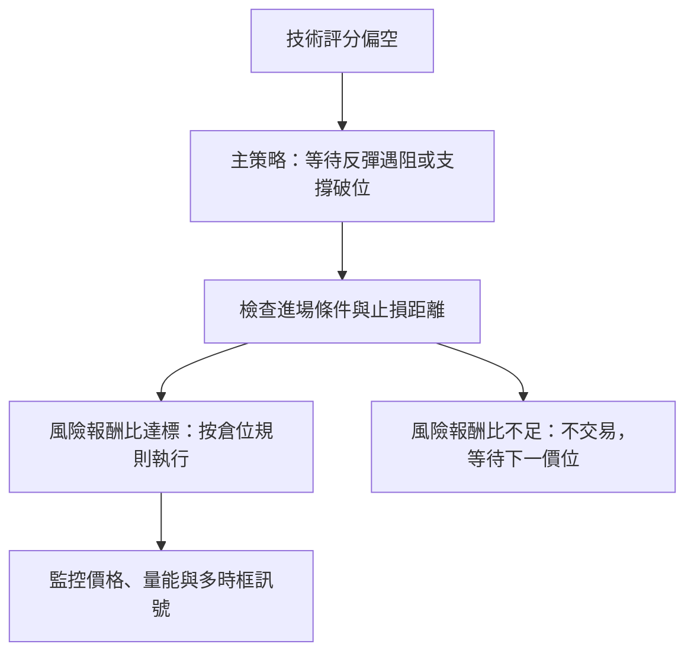

# KTOS 技術分析報告

> **報告日期**：2026-11-19 ｜ **語言**：繁體中文 ｜ **數據來源**：Yahoo Finance ｜ **當前價格**：US$30.24（2026-11-18 收盤）

---

## 目錄

| 章節 | 內容 |
|---|---|
| [1. 技術面概覽](#1-技術面概覽) | 核心指標速覽、評分卡 |
| [2. 趨勢分析](#2-趨勢分析) | 長中短期走勢、ADX |
| [3. 圖表形態分析](#3-圖表形態分析) | 形態、K線、缺口 |
| [4. 支撐與阻力](#4-支撐與阻力) | 關鍵價位、斐波那契 |
| [5. 技術指標深度解讀](#5-技術指標深度解讀) | MA／RSI／MACD／布林／成交量／進階指標 |
| [6. 動能與波動率](#6-動能與波動率) | ATR、Beta、相對強度 |
| [7. 多時框架總結](#7-多時框架總結) | 時框架方向與收斂 |
| [8. 交易策略建議](#8-交易策略建議) | 歷史基準、策略、風險報酬比 |
| [9. 風險提示與監控](#9-風險提示與監控) | 監控指標、風險情境 |

---

## 1. 技術面概覽

KTOS 的技術面明確偏空：價格低於主要均線，日、週、月三個時框方向一致偏空，且 ADX 顯示下跌趨勢具有強度。最重要的反向訊號是日線 RSI 已進入超賣區，並有程式標記的底背離；這提高短線反彈風險，但尚未推翻中長期下行結構。價格接近年度區間低位，若支撐失守，仍須防範下行延伸。

### 📊 核心指標速覽表

| 指標類別 | 指標名稱 | 當前數值 | 訊號 | 解讀 |
|---|---|---:|---|---|
| **價格** | 當前價格 | **US$30.24** | 🔴 | 收盤位於年度區間低位，趨勢結構仍弱。 |
| **均線** | MA20／MA50／MA200 | 見第 5 章 | 🔴 | 收盤低於三條均線，空頭排列。 |
| **動能** | RSI(14)（日線） | 見第 5 章 | 🟡 | 超賣並有底背離提示，可能出現反彈，但未構成趨勢反轉確認。 |
| **動能** | MACD 柱（日線） | 見第 5 章 | 🔴 | 位於零軸下方且柱值為負，空方動能仍占優。 |
| **趨勢** | ADX(14) | 見第 2 章 | 🔴 | 趨勢強度達趨勢行情門檻，方向由空方主導。 |
| **波動** | ATR(14) | 見第 6 章 | 🔴 | 日常波動幅度相對價格偏高，部位與止損需留有空間。 |
| **多時框** | 一致性 | 見第 7 章 | 🔴 | 日、週、月方向一致偏空，反彈訊號尚不足以扭轉主趨勢。 |

### 🏆 技術評分卡

| 維度 | 評分（0–100） | 訊號 | 主要依據（引用數值所在章節） |
|---|---:|---|---|
| 趨勢強度 | 25 | 🔴 | 趨勢強度偏高但方向由空方主導，見第 2 章。 |
| 動能指標 | 35 | 🔴 | MACD 與方向指標偏空；RSI 超賣及底背離為反向抵銷因素，見第 5 章。 |
| 支撐穩定度 | 25 | 🔴 | 價格接近年度區間低位，支撐尚未出現充分反轉確認，見第 4 章。 |
| 成交量配合 | 35 | 🔴 | OBV 與 A/D 顯示量能仍確認下跌，見第 5 章。 |
| 形態完整度 | 30 | 🔴 | 缺乏可確認的反轉幾何形態，近期 K 線仍偏弱，見第 3 章。 |
| 均線排列 | 10 | 🔴 | 收盤低於主要均線且排列偏空，見第 5 章。 |
| **綜合評分** | **27** | **偏空** | 六項算術平均為 26.67，四捨五入為 27。 |

---

## 2. 趨勢分析

**結論：** 長期價格自年初高點大幅回落，中期週線與短期日線均偏空。下行趨勢有 ADX 與負向 DI 支持；超賣可能帶來反彈，但趨勢優先級要求以中長期空方方向為主，日線僅用於尋找較佳進場時機。

### 📈 長期趨勢（近 12 個月）

以下階段以月收盤整理；漲跌幅依階段起訖收盤計算，代表價格變化，不是機率。

| 期間 | 起訖月收盤 | 漲跌幅 | 階段特徵 |
|---|---:|---:|---|
| 2025-11 至 2026-01 | US$76.10 → US$103.01 | +35.4% | 年初上行延續並創區間高位，屬前段強勢上漲。 |
| 2026-01 至 2026-06 | US$103.01 → US$49.86 | -51.6% | 高位轉弱後持續下跌，反映中期趨勢反轉。 |
| 2026-06 至 2026-11 | US$49.86 → US$30.24 | -39.3% | 下行延續，尚未形成月線反轉結構。 |

近月收盤序列亦顯示，從年初高位回落後，月線反彈幅度有限，最新月收盤再次走弱。月線方向判定依多時框指標區塊，為偏空。

### 📊 中期趨勢（週線）

| 觀察項目 | 週線資料 | 技術解讀 |
|---|---|---|
| 近 20 週價格走勢 | 由 2026-07-10 的 US$48.19 降至 2026-11-18 的 US$30.24 | 高位反彈未能延續，最近數週收盤逐步下移。 |
| 週 RSI(14) | 最新值 31.1；多時框指標值 31.15 | 接近超賣區，但仍低於中性分界，動能偏弱。 |
| 週 MACD 柱 | 最新值 -0.850 | 位於負值區，與週線價格下行相互確認。 |
| 週成交量 | 近週資料見價格走勢區塊 | 下跌期間曾有較高週成交量；近期量能回落，尚未形成明確買盤吸收證據。 |
| 週線方向 | 偏空 | 依多時框指標區塊照錄，收盤低於週趨勢均線且 RSI 低於 50。 |

週線動能仍偏空，雖然 RSI 已接近低位，但價格尚未重新站回趨勢均線，MACD 柱也仍在負值區。因此，目前較合理的解讀是「下跌中的超賣」，不是已確認的週線底部。

### ⚡ 趨勢強度（ADX）

| 指標 | 數值 | 解讀 |
|---|---:|---|
| ADX(14) | 35.77 | 高於趨勢行情判定門檻，表示趨勢強度明顯，不屬於一般低波動盤整。 |
| +DI | 12.89 | 多方方向力量較弱。 |
| −DI | 39.56 | 空方方向力量明顯高於多方，確認目前趨勢方向偏空。 |

ADX 衡量趨勢強度，不單獨判斷漲跌方向；方向須與 DI 配合解讀。本次 +DI 明顯低於 −DI，故判定為**空方趨勢行情**。依多時框收斂規則，趨勢行情須以週線及中長期均線方向為主，日線超賣訊號只用作安排進場，不應單獨作為逆勢做多依據。

---

## 3. 圖表形態分析

**結論：** 目前沒有足夠資料確認雙底、頭肩底、旗形等幾何形態；可確認的主要是均線與指標型空頭結構。近期日 K 與週 K 以賣方收盤為主，沒有達到足以定義反轉 K 線的明確訊號。市場脈絡計算的近期跳空缺口為無。

### 🔍 形態識別

| 形態 | 信心度 | 判斷依據 | 完成度 | 目標價 |
|---|---|---|---|---|
| 幾何反轉形態（雙底、頭肩底等） | 低 | 近 10 根日 K 與近 8 根週 K 不足以確認穩定的雙低或頸線結構；亦無足夠長期 OHLC 幾何資料支持更複雜形態。 | 訊號不足，僅做指標型解讀。 | N/A（數據未提供）；不以未確認形態推算目標。 |
| 均線型空頭排列 | 高 | 主要均線呈空頭排列，且價格在均線下方，見第 5 章。 | 已形成，尚未出現均線反轉確認。 | 不屬形態高度推算，目標價不適用。 |
| 布林下軌附近運行 | 中 | 日線收盤接近布林下軌，%B 靠近通道下緣；此訊號與空頭趨勢並存。 | 下軌壓力／超賣狀態持續，尚非反轉形態。 | 不以布林訊號自行推算價位。 |

### 🕯️ 重要 K 線形態與缺口

下表只判讀近 10 根日 K 或近 8 根週 K 所列的實際開、高、低、收。所列形態描述限於單根 K 棒外觀，不推斷資料區塊未提供的歷史 K 線。

| 日期（日 K／週 K） | 開 | 高 | 低 | 收 | K 線形態 | 解讀 | 訊號 |
|---|---:|---:|---:|---:|---|---|---|
| 2026-11-13（日 K） | US$34.75 | US$34.91 | US$33.35 | US$33.91 | 小實體偏空，影線有限 | 收低於開，反彈承接不足；單根形態本身不構成反轉。 | 🔴 |
| 2026-11-16（日 K） | US$33.07 | US$33.68 | US$31.52 | US$31.66 | 偏空實體 | 收盤接近日內低位，賣方控制收盤。 | 🔴 |
| 2026-11-17（日 K） | US$31.71 | US$32.56 | US$30.79 | US$31.06 | 偏空實體、上影較長 | 盤中反彈未能守住，收盤低於開盤。 | 🔴 |
| 2026-11-18（日 K） | US$31.01 | US$31.69 | US$29.98 | US$30.24 | 偏空實體，存在上下影線 | 收盤仍低於開盤；下影線顯示盤中有承接，但不足以確認反轉。 | 🔴 |
| 2026-10-30（週 K） | US$38.68 | US$44.11 | US$38.43 | US$41.09 | 上影較長的偏多週 K | 週內高位遭遇賣壓，反彈未能收在高位。 | 🟡 |
| 2026-11-06（週 K） | US$41.29 | US$41.72 | US$31.57 | US$35.10 | 長偏空實體 | 一週內跌幅顯著，收盤遠低於開盤，空方壓力突出。 | 🔴 |
| 2026-11-18（週 K） | US$33.07 | US$33.68 | US$29.98 | US$30.24 | 偏空實體 | 週內價格向下延伸；此週 K 為截至最新交易日的進行中 K 棒。 | 🔴 |

| 缺口資料 | 結果 |
|---|---|
| 近 60 個交易日、門檻 ≥1% | 無跳空缺口。 |
| 日期／方向／缺口區間／回補狀態 | N/A（數據未提供）；區塊明確標示近期無符合門檻的缺口。 |

---

## 4. 支撐與阻力

**結論：** 價格位於支撐與阻力結構的低位區域，若要反彈，需先看到價格止跌並收復短期技術阻力；若失守年度低位附近，波段支撐聚類集中在更低位置。下列價位按關鍵價位區塊原值列示，波段支撐使用價格資料庫的實際成交價，未作股息調整。

### 🚧 阻力位分析表

| 阻力級別 | 價位 | 形成原因 | 突破難度 | 重要性 |
|---|---:|---|---|---|
| R1 | US$44.11 | 近一年波段高點聚類 | 高 | 第一個主要波段阻力；若反彈至此，須留意空頭趨勢下的供給壓力。 |
| R2 | US$49.68 | 近一年波段高點聚類 | 高 | 位於較高波段供給區，突破須有價格結構與量能改善配合。 |
| R3 | US$51.49 | 近一年波段高點聚類 | 高 | 高位波段阻力；在多時框偏空下，需強勢反轉才能有效挑戰。 |

### 🛡️ 支撐位分析表

| 支撐級別 | 價位 | 形成原因 | 守住可能性 | 重要性 |
|---|---:|---|---|---|
| S1 | US$25.91 | 近兩年波段低點聚類 | 中 | 第一個下方波段支撐；接近此區時需觀察是否出現止跌與量價改善。 |
| S2 | US$25.04 | 近兩年波段低點聚類 | 低 | 若 S1 失守，此價位為下一層支撐聚類。 |
| S3 | US$23.90 | 近兩年波段低點聚類 | 低 | 更低層波段支撐；若到達，代表下行趨勢仍延伸。 |

波段支撐與阻力均已提供多個價位，不需以樞軸點補充第 4 章的支撐／阻力清單。樞軸公式值將於第 5 章按進階指標資料列示，不改標為波段 R 或 S。

### 📐 斐波那契回調位分析

斐波那契區間以 52 週低點至 52 週高點為基準。現價位於 **100.0% 回調位與 78.6% 回調位之間**，且靠近區間下端；這代表此前高位漲幅已大幅回吐，不能單憑接近區間低點推定反轉。

| 回調比例 | 價位 | 技術意義 |
|---|---:|---|
| 23.6% | US$109.45 | 高位回調中的第一級參考，不是目前鄰近阻力。 |
| 38.2% | US$94.26 | 中段回調參考。 |
| 50.0% | US$81.99 | 區間中點參考。 |
| 61.8% | US$69.72 | 常見回調參考位；現價已低於此位。 |
| 78.6% | US$52.24 | 深度回調參考，亦高於目前價格。 |
| 100.0%（52 週低點） | US$29.98 | 區間低點；若有效跌破，代表年度區間低位被下破。 |

---

## 5. 技術指標深度解讀

**結論：** 均線、MACD、DI、OBV、A/D 與一目均衡表整體確認空頭結構；RSI、Stoch 與布林位置提示短線超賣，但只是對趨勢的反向警訊，尚未形成完整的多頭反轉確認。程式標記 RSI 底背離，但其計算只比較近 20 根 K 棒首尾方向，應視為有限範圍的警示訊號。

### 📈 均線、RSI、MACD、布林通道

| 指標 | 數值 | 訊號 | 解讀 |
|---|---|---|---|
| MA20／MA50／MA200 與排列 | MA20：US$37.15；MA50：US$41.12；MA200：US$59.06；排列為 MA20＜MA50＜MA200 | 🔴 | 收盤低於三條均線，短、中、長期均線排列一致偏空。MA5、MA10、MA60、MA120、MA240 亦均向下，顯示弱勢不只限於單一週期。 |
| RSI(14)（日線）與背離 | RSI：28.95；程式標記「底背離」 | 🟡 | RSI 低於 30，屬超賣。底背離是反向風險提示，但來源僅比較近 20 根 K 棒首尾的價格與 RSI 方向，未提供多個擺動低點細節，故不等同已確認反轉。 |
| MACD 線／Signal／柱 | MACD：-2.785；Signal：-2.213；Hist：-0.572 | 🔴 | MACD 與 Signal 均在零軸下方，柱值為負，日線空方動能仍在。現有資料不足以確認 MACD 頂背離或底背離；不得把 RSI 的底背離標記移用至 MACD。 |
| Stoch | %K：1.97；%D：1.70 | 🟡 | 位於極低區，顯示短線超賣；與 RSI 相互確認超賣狀態，但不代表趨勢已反轉。 |
| 布林上軌／中軌／下軌／%B | 上軌：US$44.84；中軌：US$37.15；下軌：US$29.46；%B：0.05 | 🟡 | 收盤接近下軌，顯示價格位於通道下側。處於強趨勢時，貼近下軌可能是趨勢延續，也可能是短線反彈前的極端狀態，須配合價格收復均線確認。 |

**指標整合：** 均線空頭排列、負值 MACD 柱、−DI 高於 +DI，以及價格位於一目雲層下方，彼此相互確認中期偏空。RSI 與 Stoch 超賣、布林 %B 接近下緣，則提示短線反彈或波動放大的可能性；RSI 底背離也是警示，但目前尚無相應的均線翻多、MACD 柱轉正或價格收復阻力作確認。整體訊號仍是「主趨勢偏空、短線反彈風險上升」。

### 💹 成交量（量價配合度）

| 指標 | 數值／狀態 | 解讀 |
|---|---|---|
| 最新成交量 | 4,740,900 股 | 與 20 日均量相比略低，未見當日放量反轉確認。 |
| 20 日均量與量比 | 4,969,500 股；量比 0.95x | 成交量略低於 20 日均值，短線下跌並非由單日極端放量主導。 |
| 50 日均量 | 4,664,256 股 | 最新成交量略高於該均量，但單日比較不足以確認買方累積。 |
| OBV | OBV 低於其均線 | 量能疲弱，沒有確認價格反彈的正向背書。 |
| A/D 線（近 20 根） | 不高於 20 日均值；A/D 下降、價格下跌 | A/D 與價格同向下行，確認賣壓仍在，與 OBV 結論一致。 |

成交量訊號整體偏空：OBV 低於均線，A/D 下行並與價格同向，代表目前量價關係尚未呈現明確吸籌。最新成交量本身不足以單獨判斷趨勢反轉，因此反彈仍需後續價格結構與量能共同確認。

### 🧭 進階指標

| 指標 | 數值 | 收盤相對位置 | 解讀 |
|---|---|---|---|
| 一目均衡表 | 轉換線 US$34.06；基準線 US$37.05；先行帶 A US$43.46、B US$53.47；前方 26 根雲層 A US$35.55、B US$40.01 | 收盤位於雲層下方；轉換線低於基準線；前方雲層 A 低於 B | 一目均衡表偏空，與均線及 MACD 的空頭結論確認。前方雲層亦偏空，反彈上方存在雲層壓力。 |
| 成交量分布 | POC US$49.48；價值區 US$29.98–US$73.32（涵蓋 70% 成交量） | 收盤位於價值區內 | POC 高於現價，顯示主要成交控制點仍在上方；現價雖在價值區內，不能據此推定下方一定有強支撐。 |
| 錨定 VWAP | 自 52 週高點起 US$61.26；自 52 週低點起 US$30.64 | 收盤低於兩條錨定 VWAP | 兩條錨定 VWAP 均在收盤上方，反映相對於兩個錨定起點的成交成本壓力仍偏上方。與均線偏空相互確認。 |
| A/D 線 | 近 20 根不高於其 20 日均值；A/D 下降、價格下跌 | — | A/D 確認價格走弱，與 OBV 疲弱結論一致；不支持把超賣訊號直接解讀為已出現累積。 |
| 樞軸 | 樞軸 PR2：US$48.30；樞軸 PR1：US$44.70；樞軸 P：US$40.53；樞軸 PS1：US$36.93；樞軸 PS2：US$32.76 | 收盤低於上述樞軸價位 | 公式樞軸值不是波段高低點。各值均在現價上方，僅作公式參考，不替代第 4 章波段支撐／阻力。 |

---

## 6. 動能與波動率

**結論：** KTOS 的日常價格波動幅度較大，止損距離與倉位需避免過窄或過重。相對強度在多個觀察期間均落後 VTI，且比值趨勢偏弱，對順勢做空方向提供支持；Beta 則表示其價格對市場變動的敏感度略高於基準。

### 📊 ATR 波動率分析

| 指標 | 數值 | 解讀 |
|---|---:|---|
| ATR(14) | US$2.27 | 反映近期每日真實波幅的 Wilder 平滑值，可用於評估止損距離是否過窄。 |
| ATR 佔收盤價 | 7.51% | 相對價格的日常波動偏高，短線交易可能快速觸及止損。 |
| 1.5 倍 ATR 參考距離 | US$3.405 | 由 ATR × 1.5 計算，僅是止損距離參考，不是支撐位、目標價或價格預測。 |
| 2 倍 ATR 參考距離 | US$4.54 | 由 ATR × 2 計算，作為較寬止損距離的波動參考；是否採用仍須以策略風險報酬比為準。 |

以上 ATR 換算是波動距離，不是對價格位階的推算。實際交易止損應依策略表的已列價位設定，並以倉位大小控制單筆最大風險。

### 📐 Beta 與相對強度

| 期間 | 本股報酬 | VTI 報酬 | 超額報酬 |
|---|---:|---:|---:|
| 1 個月 | -20.7% | -4.1% | -16.6% |
| 3 個月 | -48.7% | -5.2% | -43.5% |
| 6 個月 | -41.9% | +0.0% | -41.9% |

| 其他指標 | 數值／狀態 | 對策略的含義 |
|---|---|---|
| Beta | 1.165 | 對市場變動的敏感度略高於 1；在市場波動期間，KTOS 的價格波動風險可能較高。 |
| 相對強度比值趨勢 | 相對走弱；比值低於其 50 日均值 | 本股在各觀察期間落後 VTI，支持順勢偏空判斷，不支持僅因超賣而逆勢做多。 |

資料區塊未提供與產業 ETF 的相對強度數值，因此產業 ETF 比較為 **N/A（數據未提供）**。相對強度表以市場脈絡區塊所列價格報酬為準，不包含股息。

---

## 7. 多時框架總結

**結論：** 日線、週線、月線均偏空，多時框一致性為 3/3。雖然日線 RSI 超賣且有底背離提示，但依趨勢行情收斂規則，中長期偏空方向優先；日線反向訊號只用於控制追空時機與防範短線反彈。

### 📋 時框架評分表

以下方向、RSI、MACD 柱、趨勢均線與收盤相對位置照錄多時框指標區塊；月線 MACD 柱依原資料保留缺漏。

| 時框架 | 趨勢方向 | RSI(14) | MACD 柱 | 收盤 vs 趨勢均線 | 形態 | 建議 |
|---|---|---:|---:|---|---|---|
| 日線 | 偏空 | 28.95 | -0.572 | 收盤低於 MA50（US$41.12） | 均線與動能偏空；RSI 超賣及底背離為反向警示 | 順勢為主，避免在下跌加速時追價；等待反彈或破位確認。 |
| 週線 | 偏空 | 31.15 | -0.850 | 收盤低於 MA20（US$45.76） | 週線價格與動能下行 | 週線方向主導趨勢判斷，反彈尚未改變週線結構。 |
| 月線 | 偏空 | 38.13 | N/A（數據未提供） | 收盤低於 MA10（US$54.53） | 月線仍在年初高點後的回撤趨勢中 | 以偏空方向為主，需等月線重新站回趨勢均線才檢討。 |

**多時框一致性：3/3 偏空。**

### ⚖️ 多時框收斂結論

ADX 判定目前為趨勢行情，且 DI 方向由空方主導，因此依規則以週線與中長期均線方向優先，日線只作進場時機參考。日、週、月方向一致偏空，沒有時框間方向衝突；日線超賣與 RSI 底背離雖提高反彈風險，但不足以抵銷週線、月線與均線的空頭訊號。

**唯一方向性結論：偏空。**

---

## 8. 交易策略建議

**當前主策略方向 = 偏空（依評分 27/100）。** 策略以順勢做空為主，不建議僅依超賣訊號逆勢做多；任何進場均須等待觸發條件，且僅在風險報酬比達標時執行。

### 📊 歷史基準機率

歷史狀態定義為「RSI(14) < 30 且收盤低於 MA200」。樣本期間為 2016-11-17 至 2026-11-18，共 2,514 個交易日；歷史基準由價格資料庫計算，報酬為價格報酬、不含股息。

| 持有期 | 相同狀態樣本（段數） | 上漲比例 | 中位數報酬 | 25%–75% 分位 | 全部交易日上漲比例／中位數 |
|---|---:|---:|---:|---:|---:|
| 5 日 | 61 個交易日（26 段） | 62% | +1.5% | -1.8% 至 +5.6% | 53%／+0.5% |
| 20 日 | 59 個交易日（25 段） | 59% | +3.2% | -6.5% 至 +13.1% | 56%／+2.0% |
| 60 日 | 52 個交易日（21 段） | 62% | +9.3% | -9.4% 至 +16.0% | 59%／+4.6% |

相同狀態樣本在三個持有期的上漲比例均高於全部交易日基準，且中位數報酬也較高，歷史上對超賣後反彈具有一定支持。然而，相同狀態交易日彼此重疊，段數才較接近獨立事件；各持有期的段數仍有限，不能視為精確預測。**歷史頻率不是預測**，本次多時框與趨勢強度仍偏空，故該歷史基準主要提醒須防範反彈，不足以單獨把主策略改為做多。

### 🎯 價格情境階梯（Price Scenarios）

以下情境可能性採高／中／低定性標示，不是機率百分比。價位均引用第 4 章列示的波段價位或原始關鍵價位，不另行推算新價位。

| 觸發條件 | 下一目標 | 後續延伸 | 可能性 | 依據 |
|---|---:|---:|---|---|
| 有效突破 R1 | R2 | R3 | 低 | 須先克服空頭均線與量價壓力；多時框仍偏空，突破須有收盤與量能確認。 |
| 持續在現價區域運行 | — | — | 中 | 超賣與 RSI 底背離增加反彈風險，但均線、MACD 與量能尚未反轉。 |
| 跌破 S1 | S2 | S3 | 中 | 空頭趨勢與相對弱勢支持下行延伸；但接近更低支撐時可能出現短線波動或反彈。 |

### 🟢 主策略詳情（方向依上方路由）

**策略 A：年度區間低位下破後順勢做空。** 只有在價格有效跌破指定觸發位後才考慮執行，避免在支撐仍未確認失守前提前追空。

**策略 B：反彈至錨定 VWAP 低點附近遇阻後做空。** 此策略是等待反彈失敗的順勢入場，不預設反彈一定會發生；若價格直接下跌，不應為了成交而追價。

| 策略要素 | 策略 A：破位做空 | 策略 B：反彈遇阻做空 |
|---|---|---|
| 進場條件 | 價格有效跌破斐波那契 100.0%／52 週低點位，並觀察收盤確認；未確認前不進場。 | 反彈至自 52 週低點起的錨定 VWAP 後，出現遇阻跡象才進場；若直接突破止損參考則取消。 |
| 進場價格 | **US$29.98** | **US$30.64** |
| 目標價 T1 | **US$25.91（S1）** | **US$25.91（S1）** |
| 目標價 T2 | **US$25.04（S2）** | **US$25.04（S2）** |
| 止損價格 | **US$30.64** | **US$32.76（樞軸 PS2）** |
| 風險報酬比 | **1 : 6.17（以 T1 計）**；計算： (29.98 − 25.91) ÷ (30.64 − 29.98) = 6.17。 | **1 : 2.23（以 T1 計）**；計算： (30.64 − 25.91) ÷ (32.76 − 30.64) = 2.23。 |
| 把握度 | 中：趨勢與多時框偏空支持破位方向；超賣與年度低位附近的反彈風險降低把握度。 | 中：順勢方向獲支持，但須等反彈遇阻；若價格沒有回測，不構成進場訊號。 |
| 建議倉位 | 以止損距離反推倉位，單筆風險建議不超過帳戶淨值的 0.25%；實際股數依帳戶規模計算。 | 以止損距離反推倉位，單筆風險建議不超過帳戶淨值的 0.25%；實際股數依帳戶規模計算。 |

上述風險報酬比均以做空方向反向計算，T1 均符合最低門檻。策略價格是條件觸發價，不是要求立即成交的市價指令；若實際成交價偏離表列進場價，須重新計算風險報酬比，不可直接沿用表內比值。

### 🔴 反向風險觸發點（對沖提示）

- 若價格重新站上第 5 章所列短期均線或雲層，且日線 MACD 柱轉強、OBV 與 A/D 同步改善，應重新評估空頭策略，而非只依單一 RSI 訊號判斷。
- 若第 4 章所列支撐區出現明確止跌，並伴隨收盤回升及量能轉強，破位做空策略應暫停。
- 若觸及策略止損價，按計畫執行止損；不得因超賣或「已跌很多」而移動止損。

---

## 9. 風險提示與監控

**結論：** 主要風險是下行趨勢中的急速反彈，以及波動偏高造成止損執行價格偏離。需同時監控支撐破位、反彈能否收復技術阻力、量能是否改變，以及財報日資料是否更新。下次財報日目前未提供，不能假定策略持有期內沒有財報事件。

### ✅ 關鍵監控指標

| 監控項目 | 目前資料／觸發條件 | 觸發後動作 |
|---|---|---|
| 波段支撐 | 監控第 4 章所列 S1、S2、S3；不在此重列數值。 | 支撐有效跌破才考慮破位策略；未收盤確認前避免追空。 |
| 波段阻力 | 監控第 4 章所列 R1、R2、R3；不在此重列數值。 | 反彈遇阻可評估順勢策略；若有效突破並有量能確認，降低空頭曝險。 |
| 短線均線與布林 | 關注第 5 章的均線、布林位置及收盤是否回到中軌上方。 | 重新收復均線且指標同步改善時，檢討空頭策略是否失效。 |
| 成交量確認 | OBV 低於均線，A/D 下降且與價格同向。 | 若 OBV 與 A/D 轉強並伴隨價格反彈，暫停新增空單並重新評估。 |
| 波動與止損 | ATR 及其價格比例見第 6 章。 | 止損距離過窄時縮小部位，不以擴大止損代替風險控制。 |
| 下次財報日 | N/A（數據未提供）；距最新收盤日的日曆天數亦為 N/A（數據未提供）。 | 資料未提供，無法判斷財報是否落在策略持有期間；交易前應核實公司公告。若財報落在持有期內，須考慮跳空風險，止損不保證按設定價格成交。 |

### ⚠️ 風險場景

| 情境 | 觸發條件 | 價位依據 | 可能性 | 應對 |
|---|---|---|---|---|
| 樂觀（空頭反彈） | 超賣後止跌，價格收復短期趨勢阻力，且量能轉強 | 參照第 4 章阻力與第 5 章技術指標，不另創新價位 | 中 | 不追空；等待價格是否能持續站穩阻力並確認週線結構改善。 |
| 基本（弱勢延續） | 價格仍低於均線，反彈受阻，成交量指標未改善 | 參照第 4 章波段支撐與阻力 | 中 | 以第 8 章順勢策略為主，分批管理倉位並遵守止損。 |
| 悲觀（支撐下破） | 支撐被有效跌破，空頭方向指標維持主導 | 依序參照第 4 章支撐位 | 中 | 只在破位確認後按策略計畫執行；若價格急速下跌，不因害怕錯過而追價。 |

### 🛡️ 風險管理提醒

1. **先定最大單筆風險，再反推倉位。** 本報告策略示例以單筆風險不超過帳戶淨值的 0.25% 作為保守控制原則；這不是保證適合所有帳戶的固定倉位。
2. **不得在未確認觸發前預先成交。** 破位策略須等待支撐失守確認，反彈策略須等待遇阻訊號；條件未成立即不交易。
3. **成交價偏離即重新計算風險報酬比。** 若滑價後 T1 的風險報酬比低於規定門檻，放棄交易，不以移動止損或臆測目標價補救。
4. **財報資訊未提供，須在交易前自行核實。** 若財報落在預定持倉期間，跳空可能使止損無法按指定價格成交。
5. **超賣不等同底部。** RSI 與歷史基準顯示反彈風險，但目前中長期趨勢仍偏空，避免只憑一項反向訊號逆勢重倉。

---

## 📋 報告總結

| 項目 | 結論 |
|---|---|
| 報告日期 | 2026-11-19 |
| 當前價格 | US$30.24（2026-11-18 收盤） |
| 綜合評分／方向 | 27/100，偏空 |
| 長期／中期／短期趨勢 | 🔴 長期下行延續；🔴 週線偏空；🔴 日線偏空但超賣反彈風險上升。 |
| 關鍵支撐／關鍵阻力 | 關鍵支撐見第 4 章 S1；關鍵阻力見第 4 章 R1。 |
| 🥇 最佳機會 | 策略 A：等待年度區間低位有效下破後順勢做空；未觸發前觀望。 |
| 最大風險 | 空頭趨勢中的超賣反彈可能造成急速回補，且高波動與潛在財報跳空可能令止損成交偏離。 |

> ⚠️ **免責聲明**：本報告為 AI 自動生成之技術分析，所有分析均基於歷史價格資訊與技術指標資料，僅供研究與學術參考，不構成任何投資建議。投資有風險，入市需謹慎。

---

## 資料與來源

| 項目 | 內容 |
|------|------|
| 價格 | 30.24 USD，2026-11-18 收盤（Yahoo Finance 日線） |
| K 棒 | 501 根日線，2024-11-19 至 2026-11-18（Yahoo Finance）；較長期間的價位與基準機率取自價格資料庫 |
| 關鍵價位回溯期間 | 阻力 近一年、支撐 近兩年 |
| 有回應的資料來源 | Yahoo Finance、Finviz、StockAnalysis、Roic.ai |
| 由程式計算 | 所有指標、R1–S3 與斐波那契價位、多時框方向、相對強度、缺口、歷史基準機率、綜合評分 |
| 撰寫模型 | openai / gpt-6-luna |

> 本區塊由產生報告的程式依實際取得的資料填寫，非模型撰寫。「由程式計算」的數字不是模型的估計；其餘判斷（評分、情境、策略）是模型的分析。
