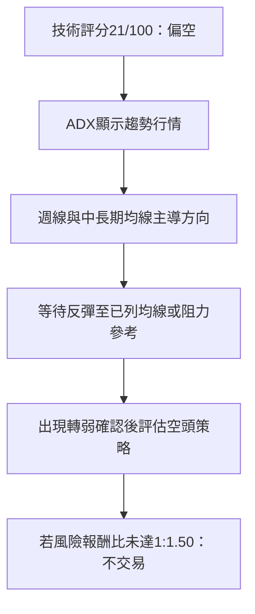

# KTOS 技術分析報告

> **報告日期**：2026-11-27 ｜ **語言**：繁體中文 ｜ **數據來源**：Yahoo Finance ｜ **當前價格**：$28.95（2026-11-25 收盤）

---

## 目錄

| 章節 | 內容 |
|------|------|
| [1. 技術面概覽](#1-技術面概覽) | 核心指標速覽、評分卡 |
| [2. 趨勢分析](#2-趨勢分析) | 長中短期走勢、ADX |
| [3. 圖表形態分析](#3-圖表形態分析) | 形態、K線、缺口 |
| [4. 支撐與阻力](#4-支撐與阻力) | 關鍵價位、斐波那契 |
| [5. 技術指標深度解讀](#5-技術指標深度解讀) | MA、RSI、MACD、布林、成交量、進階指標 |
| [6. 動能與波動率](#6-動能與波動率) | ATR、Beta、相對強度 |
| [7. 多時框架總結](#7-多時框架總結) | 時框架矩陣 |
| [8. 交易策略建議](#8-交易策略建議) | 歷史基準、策略、風險報酬比 |
| [9. 風險提示與監控](#9-風險提示與監控) | 監控指標、風險場景 |

---

## 1. 技術面概覽

KTOS目前呈現明確偏空格局：日、週、月三個時框方向一致，且價格受制於主要均線。最重要的確認訊號是強勢空頭趨勢與空頭均線排列；反向風險則是價格已靠近近期低位區，短線可能出現技術性反彈。評分反映趨勢、均線與量價結構的弱勢，不代表價格不會反彈，也不應單獨作為交易依據。

### 📊 核心指標速覽表

| 指標類別 | 指標名稱 | 當前數值 | 訊號 | 解讀 |
|----------|----------|----------|------|------|
| **價格** | 當前價格 | $28.95 | 🔴 | 位於52週區間低端，低位反彈風險與下行趨勢並存。 |
| **均線** | MA20／MA50／MA200 | 見第5章 | 🔴 | 收盤價低於三條均線，趨勢排列偏空。 |
| **動能** | RSI(14)（日線） | 見第5章 | 🟡 | 接近超賣區但未進入傳統超賣範圍，尚無明確反轉確認。 |
| **動能** | MACD柱（日線） | 見第5章 | 🔴 | 柱體為負，空頭動能仍佔優。 |
| **趨勢** | ADX(14) | 見第2章 | 🔴 | 強趨勢且空方主導，不符合盤整行情特徵。 |
| **波動** | ATR(14) | 見第6章 | 🔴 | 相對價格的日波動幅度偏大，倉位及止損須留足空間。 |
| **多時框** | 一致性 | 見第7章 | 🔴 | 日、週、月方向一致偏空。 |

### 🏆 技術評分卡

下表是全報告唯一評分卡。各子項分數採整數；綜合評分依六項算術平均計算並四捨五入。

| 維度 | 評分（0–100） | 訊號 | 主要依據 |
|------|---------------|------|----------|
| 趨勢強度 | 15 | 🔴 | ADX顯示強趨勢，且空方方向指標明顯主導，見第2章。 |
| 動能指標 | 25 | 🔴 | RSI接近低位、MACD柱為負；短線反彈可能性存在，但未見已確認的動能反轉，見第5章。 |
| 支撐穩定度 | 35 | 🟡 | 價格接近近期支撐與52週低位區，但下跌趨勢及多時框偏空降低支撐可靠性，見第4章。 |
| 成交量配合 | 20 | 🔴 | OBV低於其均線、A/D線下行並與價格同步走弱，量能未確認反轉，見第5章。 |
| 形態完整度 | 20 | 🔴 | OHLC資料不足以確認典型反轉或延續幾何形態；指標型趨勢訊號偏空，見第3章。 |
| 均線排列 | 10 | 🔴 | 均線為空頭排列，且收盤價位於主要均線下方，見第5章。 |
| **綜合評分** | **21** | **偏空** | 六項算術平均：125 ÷ 6 = 20.83，四捨五入為21。 |

---

## 2. 趨勢分析

### 📈 長期趨勢（近12個月）

長期結構已由先前高位轉為連續走弱。以下以完整月收盤資料整理階段；未完結的最新月份不在本表重列，當前收盤價僅見標題、第1章及第8章。

| 階段 | 起訖月收盤 | 漲跌幅 | 特徵 |
|------|------------|--------|------|
| 2025-11至2026-01 | $76.10 → $103.01 | +35.36% | 月收盤上行，形成區間內階段高點。 |
| 2026-01至2026-04 | $103.01 → $63.05 | -38.79% | 高位回落，長期動能轉弱。 |
| 2026-04至2026-06 | $63.05 → $49.86 | -20.92% | 反彈未能延續，收盤重回下行。 |
| 2026-06至2026-08 | $49.86 → $50.98 | +2.25% | 弱勢整理及短暫回升，未扭轉整體下降結構。 |
| 2026-08至2026-10 | $50.98 → $41.09 | -19.40% | 再度走低，月線趨勢維持偏空。 |

> 價格資料來源：價格資料庫。階段漲跌幅依表列起訖月收盤計算；不同階段的變化不代表未來報酬預測。

月線指標亦呈偏空方向。月收盤低於該時框趨勢均線，月RSI低於中性分界；月MACD柱為 **N/A（數據未提供）**，不以其他時框指標替代。

### 📊 中期趨勢（週線）

近20週週收盤資料顯示，週線曾於夏季回升，之後漲勢轉弱並於近期加速下跌。週RSI在反彈階段回升，其後回落；週MACD柱由正值轉負並延續負值，與週收盤走弱互相確認。

| 週末交易日 | 週收盤 | 週RSI(14) | 週MACD柱 | 判讀 |
|------------|--------|-----------|----------|------|
| 2026-07-17 | $46.03 | 37.1 | -1.624 | 週線偏弱，動能未轉多。 |
| 2026-07-24 | $47.35 | 38.2 | -1.373 | 收盤回升，但週MACD柱仍為負。 |
| 2026-07-31 | $46.60 | 37.8 | -1.129 | 動能仍弱，尚未形成週線反轉。 |
| 2026-08-07 | $60.77 | 49.2 | +0.053 | 週收盤反彈，週MACD柱短暫轉正。 |
| 2026-08-14 | $64.58 | 51.7 | +1.098 | 階段反彈延續，週動能改善。 |
| 2026-08-21 | $57.17 | 46.8 | +1.286 | 收盤回落但週MACD柱仍為正。 |
| 2026-08-28 | $52.00 | 43.7 | +1.065 | 反彈動能仍在，但收盤持續下滑。 |
| 2026-09-04 | $47.82 | 41.3 | +0.661 | 週收盤走低，正向動能收縮。 |
| 2026-09-11 | $46.69 | 40.6 | +0.357 | 收盤續弱，MACD正柱收窄。 |
| 2026-09-18 | $47.46 | 41.3 | +0.251 | 小幅回升，週動能仍弱化。 |
| 2026-09-25 | $45.62 | 40.1 | +0.108 | 收盤下行，MACD柱接近轉負。 |
| 2026-10-02 | $43.07 | 38.5 | -0.096 | 週MACD柱轉負，空頭訊號增加。 |
| 2026-10-09 | $42.36 | 38.0 | -0.210 | 週線續弱，負柱擴大。 |
| 2026-10-16 | $40.42 | 36.7 | -0.340 | 收盤下降，空頭動能延續。 |
| 2026-10-23 | $38.68 | 35.5 | -0.459 | 週RSI及收盤同步走低。 |
| 2026-10-30 | $41.09 | 38.5 | -0.300 | 收盤反彈，但週MACD柱仍為負。 |
| 2026-11-06 | $35.10 | 34.3 | -0.509 | 反彈後再跌，週線空頭動能擴大。 |
| 2026-11-13 | $33.91 | 33.5 | -0.632 | 收盤續跌，週RSI偏低。 |
| 2026-11-20 | $26.89 | 29.3 | -1.064 | 下行加速，週RSI進入低位區。 |
| 2026-11-25 | $28.95 | 32.0 | -1.085 | 最新週線資料仍偏空，週MACD柱維持負值。 |

週線趨勢均線方向、週RSI與週MACD柱均偏空。週線最後一根為進行中K棒，因此週收盤及其指標仍可能隨後續交易而變動。

### ⚡ 趨勢強度（ADX）

| 指標 | 數值 | 判讀 |
|------|------:|------|
| ADX(14) | 42.68 | 高於趨勢行情門檻，顯示趨勢強度高。 |
| +DI | 9.67 | 多方方向力量弱。 |
| −DI | 39.54 | 空方方向力量主導。 |
| 行情分類 | 趨勢行情 | 適用多時框收斂規則：以週線與MA50、MA200方向為主，日線用於尋找進場時機。 |

ADX本身衡量趨勢強度，不直接判斷趨勢方向；方向由DI及價格結構確認。本例−DI明顯高於+DI，故趨勢強度與空頭方向互相確認，不宜因單一短線反彈K棒便將行情改判為盤整。

---

## 3. 圖表形態分析

### 🔍 形態識別

現有數據足以識別均線、動能及波動指標狀態，但不足以穩健確認頭肩、雙底、旗形或其他幾何形態。故不以形態高度推算目標價，也不將短期低位反彈直接命名為反轉形態。

| 形態／訊號 | 信心度 | 判斷依據 | 完成度 | 目標價 |
|------------|--------|----------|--------|--------|
| 均線空頭排列 | 高 | 多條移動平均線呈空頭排列，且收盤低於主要均線。 | 已形成的趨勢指標訊號，並非幾何圖形。 | 不適用；不以均線排列推算形態目標。 |
| 布林通道偏下半部 | 中 | 日線%B低於通道中點，反映價格位於通道下半部；單獨不足以確認突破或反轉。 | 尚未形成明確的通道反轉訊號。 | 不適用；未使用形態高度推算。 |
| 雙底／頭肩／旗形等 | 低 | 現有近端OHLC樣本不足以確認足夠的高低點幾何結構。 | 訊號不足，僅做指標型解讀。 | 不適用；數據中未偵測到可供計算的形態目標。 |

### 🕯️ 重要K線形態與缺口

以下僅判讀指定的近10根日K與近8根週K。單根K線訊號須與趨勢及成交量合併觀察，不能獨立作為趨勢反轉證據。

| 日期（日K／週K） | 開 | 高 | 低 | 收 | K線形態 | 解讀 | 訊號 |
|------|----:|----:|----:|----:|----------|------|------|
| 2026-11-20（日K） | $28.93 | $29.41 | $26.60 | $26.89 | 收低的陰線，低位附近收盤 | 當日價格承壓，未見明顯長下影反轉特徵。 | 🔴 |
| 2026-11-23（日K） | $29.38 | $29.73 | $28.22 | $28.50 | 小幅陰線 | 低位短暫回升後仍收低，未確認趨勢轉向。 | 🔴 |
| 2026-11-24（日K） | $28.47 | $28.95 | $27.65 | $28.21 | 小實體陰線 | 多空力量短暫拉鋸，但收盤仍弱。 | 🟡 |
| 2026-11-25（日K） | $27.31 | $29.35 | $26.83 | $28.95 | 陽線 | 收盤高於開盤，顯示短線買盤回補；尚不足以抵銷大時框偏空。 | 🟡 |
| 2026-11-20（週K） | $33.07 | $33.68 | $26.60 | $26.89 | 大幅收低週陰線 | 下行壓力顯著，週成交量高於最近未完結週的量，但單週無法證明賣壓已耗盡。 | 🔴 |
| 2026-11-25（週K，進行中） | $29.38 | $29.73 | $26.83 | $28.95 | 小實體、帶下影週K | 週內低位回升，但該週尚未結束；不能據此確認週線反轉。 | 🟡 |

#### 跳空缺口

| 項目 | 結果 |
|------|------|
| 搜尋期間 | 近60個交易日 |
| 缺口結果 | 近期無 ≥1% 缺口。 |
| 日期、方向、區間與回補狀態 | 數據中未偵測到符合條件的缺口，故無可列日期、方向或區間。 |

---

## 4. 支撐與阻力

### 🚧 阻力位分析表

阻力取自「近一年波段高點聚類」。價位由價格資料庫提供，並非以當前收盤價外推。

| 阻力級別 | 價位 | 形成原因 | 突破難度 | 重要性 |
|----------|------:|----------|----------|--------|
| R1 | $44.11 | 近一年波段高點聚類。 | 高 | 首要波段阻力；若價格反彈至此，須觀察能否放量站穩。 |
| R2 | $49.68 | 近一年波段高點聚類。 | 高 | 上方供給區；若無趨勢改善，突破難度高。 |
| R3 | $51.49 | 近一年波段高點聚類。 | 高 | 波段聚類阻力，須有價格結構與量能共同改善才有突破依據。 |

### 🛡️ 支撐位分析表

支撐取自「近兩年波段低點聚類」。支撐不是保證有效的價格底部；若空方趨勢延續，價位可能失守。

| 支撐級別 | 價位 | 形成原因 | 守住可能性 | 重要性 |
|----------|------:|----------|------------|--------|
| S1 | $25.91 | 近兩年波段低點聚類。 | 中 | 首要觀察支撐；近期低位附近的支撐區域。 |
| S2 | $25.04 | 近兩年波段低點聚類。 | 低 | S1失守後的下一層波段支撐參考。 |
| S3 | $23.90 | 近兩年波段低點聚類。 | 低 | 更下方支撐參考；需價格實際測試才可評估反應。 |

支撐及阻力兩側均已有多個波段價位，故本章不需以樞軸點補足價位層級。

### 📐 斐波那契回調位分析

斐波那契基準區間為52週低點至52週高點。以下價位直接引用關鍵價位資料；現價位於78.6%回調位與100.0%區間低點之間。

| 回調比例 | 價位 | 解讀 |
|----------|-----:|------|
| 23.6% | $108.65 | 遠離目前價格，屬較高位置的回調參考。 |
| 38.2% | $92.97 | 遠離目前價格，現階段不是近端交易位。 |
| 50.0% | $80.30 | 遠離目前價格，未構成眼前支撐或阻力。 |
| 61.8% | $67.63 | 遠離目前價格，需大幅反彈後才可能測試。 |
| 78.6% | $49.58 | 上方回調參考，與近端阻力區相距較遠。 |
| 100.0% | $26.60 | 52週區間低點；若跌破，表示既有區間低位支撐失效。 |

現價靠近52週區間低端，並不等於已形成底部。斐波那契位置需結合日線收盤、週線方向及量能確認；目前多時框偏空，故不將深度回檔位置視為獨立買入訊號。

---

## 5. 技術指標深度解讀

### 📈 均線、RSI、MACD、布林通道

| 指標 | 數值 | 訊號 | 解讀 |
|------|------|------|------|
| MA20／MA50／MA200與排列 | MA20 $34.26；MA50 $39.23；MA200 $57.45；空頭排列 MA20<MA50<MA200 | 🔴 | 收盤位於三條均線下方，短、中、長期均線均呈下行壓力。 |
| RSI(14)（日線）與背離 | RSI 32.70；近20根K棒首尾比較結果為無明顯背離 | 🟡 | 接近低位但未低於常用超賣門檻。資料未確認頂背離或底背離；不可把低RSI等同底部。 |
| MACD線／Signal／柱 | MACD -3.389；Signal -2.968；柱 -0.421 | 🔴 | MACD線低於Signal且柱為負，日線動能偏空。 |
| Stoch | %K 20.38；%D 16.09 | 🟡 | 指標位於偏低區，但分類為中性；尚不足以單獨確認反轉。 |
| 布林上軌／中軌／下軌／%B | 上軌 $43.99；中軌 $34.26；下軌 $24.53；%B 0.23 | 🔴 | 價格位於通道下半部，反映弱勢；尚未觸及下軌，亦未形成通道下軌反彈確認。 |

四者整合後以偏空訊號為主：均線空頭排列、MACD負柱與布林下半部位置互相確認；RSI及Stoch處於偏低區，則提醒短線可能出現反彈，但兩者均未提供明確反轉或背離訊號。故短線超賣風險不推翻中長期空頭判斷。

### 💹 成交量（量價配合度）

| 指標 | 數值或狀態 | 解讀 |
|------|-------------|------|
| 最新日成交量 | 4,428,800股 | 低於20日均量，並非明確的放量反轉日。 |
| 20日均量 | 5,315,085股 | 量比為0.83倍，近期成交量低於短期均量。 |
| 50日均量 | 4,804,034股 | 最新量亦低於50日均量。 |
| OBV | OBV低於其均線；量能疲弱 | 量能未確認價格反轉，顯示累積買盤不足。 |
| A/D線 | 近20根不高於其20日均值；A/D下降、價格下跌 | A/D與價格同向，確認近期弱勢，而非出現明顯吸籌背離。 |

量價結論為偏空確認：成交量沒有提供足夠的反轉確認，OBV與A/D線亦未顯示買方累積優勢。若價格反彈但量能仍偏弱，反彈的趨勢可信度應保守評估。

### 🧭 進階指標

| 指標 | 數值 | 收盤相對位置 | 解讀 |
|------|------|--------------|------|
| 一目均衡表（轉換線／基準線／雲層） | 轉換線 $30.76；基準線 $35.36；最新雲層先行帶A $42.12／B $52.47；前方雲層A $33.06／B $38.14 | 雲層下方；轉換線低於基準線。前方雲層A低於B。 | 現況及前方雲層均偏空；與空頭均線、負MACD及低位RSI的趨勢判讀一致。 |
| 成交量分布（POC／價值區） | POC $46.74；價值區 $35.55–$80.30，涵蓋71%成交量 | 收盤位於價值區下方 | 價格低於近一年主要成交密集區，反映下方市場接受度不足；此訊號與均線及MACD偏空一致。 |
| 錨定VWAP（自52週高點／低點） | 自52週高點起 $60.37；自52週低點起 $28.19 | 低於自52週高點錨定VWAP；高於自52週低點錨定VWAP | 相對高點錨定VWAP仍弱，但短期高於低點錨定VWAP，呈現長期弱勢中的低位反彈狀態。 |
| A/D線 | 近20根不高於20日均值；A/D下降 | — | 與價格下跌同向，確認近期賣壓；未見A/D領先回升。 |
| 經典樞軸點 | 樞軸PR2 $48.30；樞軸PR1 $44.70；樞軸P $40.53；樞軸PS1 $36.93；樞軸PS2 $32.76 | 價格低於各列示樞軸位 | 全部樞軸位均在現價上方，反彈時可作公式型參考阻力；因波段支撐及阻力已有足夠層級，本報告不以樞軸取代R/S價位。 |

一目均衡表、成交量分布及高點錨定VWAP均支持弱勢判讀；低點錨定VWAP則顯示價格暫時高於近期低點形成的加權成本線，是局部反向訊號，但不足以改變整體結論。進階指標與均線、RSI及MACD並非全數同向，分歧主要來自短期低點反彈；中長期趨勢訊號仍偏空。

---

## 6. 動能與波動率

### 📊 ATR波動率分析

| 指標 | 數值 | 風控含義 |
|------|------:|----------|
| ATR(14) | $2.29 | 反映近期日線平均真實波幅，非預測價格方向。 |
| ATR占價格比例 | 7.92% | 相對價格的波動幅度偏高，固定小幅止損容易受正常波動觸發。 |
| 1.5倍ATR距離 | $3.44 | 由ATR換算的止損距離參考，不是新的支撐、阻力或目標價。 |
| 2倍ATR距離 | $4.58 | 較寬的波動容忍度參考；使用時須相應降低倉位。 |

ATR換算距離僅用於風險控制尺度，不代表應將止損直接放在某一個未列出的精確價位。策略止損使用已列出的均線參考值，並需考慮跳空及滑價風險。

### 📐 Beta與相對強度

| 期間 | KTOS價格報酬 | VTI價格報酬 | 超額報酬 | 判讀 |
|------|-------------:|------------:|---------:|------|
| 1個月 | -29.9% | -6.5% | -23.4% | 顯著落後整體市場。 |
| 3個月 | -46.1% | -7.2% | -38.9% | 相對弱勢持續擴大。 |
| 6個月 | -55.6% | -5.0% | -50.6% | 中期相對表現明顯落後。 |
| 比值趨勢 | 相對走弱 | 比值低於其50日均值 | — | 相對強度走弱，與偏空主策略方向一致。 |
| Beta | N/A（數據未提供） | — | — | 無法量化KTOS對市場波動的歷史敏感度，不以同業或其他來源代填。 |

相對強度在各期間皆不支持多頭；即使大盤本身下跌，KTOS仍有明顯額外弱勢。這提高反彈交易的風險，並支持等待反彈至阻力區後觀察空方訊號，而非在低位追空。

---

## 7. 多時框架總結

### 📋 時框架矩陣

以下數值及方向照錄多時框指標區塊；不將日線指標改稱為週線或月線。月MACD柱缺漏依規定標示。

| 時框架 | 趨勢方向 | RSI(14) | MACD柱 | 收盤 vs 趨勢均線 | 形態 | 建議 |
|--------|----------|---------|--------|------------------|------|------|
| 日線 | 偏空 | 32.70 | -0.421 | MA50 $39.23；收盤在下方 | 均線下方，動能偏空 | 等待反彈至阻力區，避免低位追空。 |
| 週線 | 偏空 | 31.99 | -1.085 | MA20 $44.63；收盤在下方 | 週收盤及MACD柱偏弱 | 以週線空頭方向為主，反彈只視為進場時機候選。 |
| 月線 | 偏空 | 37.66 | N/A（數據未提供） | MA10 $54.40；收盤在下方 | 月RSI低於50且低於趨勢均線 | 長期趨勢未反轉，避免把短線回升當成月線反轉。 |

**多時框一致性：3/3偏空。**

### ⚖️ 多時框收斂結論

ADX判定目前屬趨勢行情，故依規則以週線及中長期均線方向為主，日線只用於尋找風險報酬較合適的進場位置。日、週、月線方向一致偏空，短線低位反彈及低位錨定VWAP上方的訊號不足以抵銷整體弱勢。

**唯一方向性結論：偏空。** 第8章因此以反彈空頭策略為主；不在低位追空，並以明確止損限制反彈失敗風險。

---

## 8. 交易策略建議

### 🧭 策略路由

**當前主策略方向 = 偏空（依評分21/100）。**

評分低於偏空門檻，策略以等待反彈後尋找空方進場為主，不同時強力推薦多空兩套。現價靠近支撐區，直接追空的風險報酬條件不足；以下策略須等待價格到達指定進場區且出現轉弱確認，否則不交易。

### 📊 歷史基準機率

| 項目 | 數據 |
|------|------|
| 今日狀態 | RSI(14)介於30–50，且收盤在MA200下方。 |
| 樣本期間 | 2016-11-25至2026-11-25。 |
| 全部交易日樣本 | 2,514個交易日；價格報酬，不含股息。 |

| 持有期 | 相同狀態樣本（段數） | 上漲比例 | 中位數報酬 | 25%–75%分位 | 全部交易日上漲比例／中位數 |
|--------|----------------------|----------|------------|-------------|----------------------------|
| 5日 | 525日（76段） | 46% | -0.7% | -4.8%至+3.6% | 53%／+0.5% |
| 20日 | 513日（74段） | 45% | -1.8% | -10.5%至+8.2% | 56%／+2.0% |
| 60日 | 481日（70段） | 39% | -7.5% | -19.1%至+10.8% | 59%／+4.6% |

相同狀態後的上漲比例在各列持有期均低於全部交易日基準，中位數亦偏弱，方向上與空頭主策略一致。但相同狀態的交易日會重疊，應以段數衡量相對獨立事件；樣本段數並非極少，但也不能視為完全獨立或足以代表未來。這些數字是歷史頻率，不是預測，不能解讀為策略成功機率。

### 🎯 價格情境階梯

以下可能性採高／中／低作質化評估，並非自行估計百分比。價位只引用第4章的波段支撐／阻力。

| 觸發條件 | 下一目標 | 後續延伸 | 可能性 | 依據 |
|----------|----------|----------|--------|------|
| 突破並站穩R1 | R2 | R3 | 低 | 需先扭轉日線偏空結構，且相對強度及量能目前未確認；多時框方向亦不支持。 |
| 反彈但未能站回日線主要均線 | — | — | 中 | 趨勢、均線及相對強度偏空，但短線低位反彈可能延續，須等價格反應確認。 |
| 跌破S1並收盤確認 | S2 | S3 | 中 | 若支撐失守，空頭趨勢可能延續；但低位追空的風險報酬須重新核算。 |

### 🟢 主策略詳情

下表將收盤價僅於策略表內列示。風險報酬比按空頭公式計算：**（進場價－T1）÷（止損價－進場價）**。表列進場及止損使用第5章已列的均線參考值，目標使用第4章已列的支撐位。兩套策略皆非即時市價單，須等待價格到達進場位並出現轉弱確認。

| 策略要素 | 策略A：反彈至短期均線區轉弱 | 策略B：反彈至一目基準線轉弱 |
|----------|------------------------------|------------------------------|
| 現價參考 | $28.95 | $28.95 |
| 進場條件 | 反彈至MA20參考位後，出現日線轉弱確認；未確認不掛單追價。 | 反彈至一目基準線參考位後，出現轉弱確認；須留意更深反彈可能改變短線結構。 |
| 進場價格 | $34.26 | $35.36 |
| 目標價T1 | $25.91（S1） | $25.91（S1） |
| 目標價T2 | $25.04（S2） | $25.04（S2） |
| 止損價格 | $39.23（MA50） | $40.61（MA60） |
| 風險報酬比 | 1 : 1.68（以T1計）；1 : 1.86（以T2計） | 1 : 1.80（以T1計）；1 : 1.97（以T2計） |
| 把握度 | 中：趨勢及多時框支持空頭，但進場須等待反彈及轉弱確認。 | 中偏低：更高位置提供較佳空間，但觸價前可能先發生結構變化。 |
| 建議倉位 | 佔總資金比例不高於0.5%，依止損距離計算實際股數。 | 佔總資金比例不高於0.25%，視為較低優先級候選策略。 |

兩個策略的T1風險報酬比均達最低門檻，但均須等待指定價位，不代表現價可直接執行。若進場後以收盤或既定交易規則觸發止損，應退出而非擴大止損；若價格未到進場區，不因空頭評分偏低而追空。

### 🔴 反向風險觸發點（對沖提示）

| 觸發條件 | 風險含義 | 風控動作 |
|----------|----------|----------|
| 日線收復並站穩MA20 | 短線反彈強度提高，反彈空單的即時優勢下降。 | 暫停新增空單，重新評估策略A的進場條件。 |
| 週線收復週趨勢均線附近並伴隨量能改善 | 週線空頭結構可能減弱。 | 降低空頭曝險，等待週線方向再次確認。 |
| 突破第4章所列R1並延續 | 近端阻力被突破，空頭趨勢可能出現更深反彈。 | 依策略止損執行，不以主觀判斷延後出場。 |
| 低位回升但A/D與OBV仍弱 | 價格反彈缺少量能支持，仍可能是弱勢反彈。 | 不追多；重新檢查反彈是否到達預設空頭進場區。 |

---

## 9. 風險提示與監控

### ✅ 關鍵監控指標

| 監控項目 | 觸發條件或數值 | 觸發後動作 |
|----------|----------------|------------|
| S1支撐 | 見第4章 | 觀察收盤是否守住；若有效跌破，重新評估是否延伸至下一支撐，不在急跌時機械追空。 |
| R1阻力 | 見第4章 | 若反彈至該區，檢查量能、日線動能與收盤反應；未轉弱不執行反彈空單。 |
| MA20及MA50 | 見第5章 | 監測是否收復及能否站穩；若持續收復，空頭策略需降級或暫停。 |
| ADX與DI方向 | 見第2章 | 若趨勢強度下降或多方方向力量改善，重新檢視趨勢行情假設。 |
| OBV及A/D線 | 見第5章 | 若價格回升且量能指標同步改善，代表反彈品質提高，應降低逆勢空單風險。 |
| 下次財報日 | N/A（數據未提供） | 財報日期未知，無法核對是否落入策略持有期間；交易前應自行確認公司公告，財報可能造成跳空，止損不保證成交。 |
| 距最新收盤日的日曆天數 | N/A（數據未提供） | 由於財報日未提供，距離最新收盤日天數亦為N/A（數據未提供），不另行推算。 |

### ⚠️ 風險場景

| 情境 | 觸發條件 | 價位參考 | 可能性 | 應對 |
|------|----------|----------|--------|------|
| 樂觀（空頭失效風險） | 價格反彈並收復主要日線均線，且成交量與A/D線同步改善。 | MA20、MA50及第4章阻力位。 | 低 | 暫停新增空單；依止損紀律處理既有部位，不因歷史偏空訊號忽視新資料。 |
| 基本（偏空但有反彈） | 價格受制於短中期均線或阻力區，反彈後再度轉弱。 | 第4章R1及第5章短中期均線。 | 中 | 等待轉弱確認後才考慮策略A或B；未到價不交易。 |
| 悲觀（支撐續失守） | 收盤有效跌破首要支撐，且空方趨勢指標維持主導。 | 第4章S1、S2及S3。 | 中 | 檢查既有空單的目標與滑價風險；避免在急跌後加碼追空。 |

### 🛡️ 風險管理提醒

1. 以單筆交易可承受損失反推股數，不以預設股數忽略波動率及止損距離。
2. 策略A與策略B都須等待價格觸及進場參考位並出現轉弱確認；未達條件時，維持觀望。
3. 止損是風險控制參考，不保證成交價格；若出現跳空或流動性不足，實際損失可能高於預估。
4. 不因RSI偏低或價格接近支撐便假設底部形成；需要收盤結構、量能與多時框訊號確認。
5. 財報日期為N/A（數據未提供）；在確認財報時間前，避免將持倉計畫建立在未知事件風險之上。

---

## 📋 報告總結

| 項目 | 結論 |
|------|------|
| 報告日期 | 2026-11-27 |
| 當前價格 | 2026-11-25收盤；價格見標題、第1章及第8章策略表。 |
| 綜合評分／方向 | 21/100，偏空。 |
| 長期／中期／短期趨勢 | 🔴 長期：月線偏空；🔴 中期：週線偏空；🔴 短期：日線偏空，但低位反彈風險存在。 |
| 關鍵支撐／關鍵阻力 | 支撐：S1；阻力：R1，精確價位見第4章。 |
| 🥇 最佳機會 | 等待策略A條件成立後評估；未到進場位或未出現轉弱確認時，觀望。 |
| 最大風險 | 趨勢偏空但價格已處低位；急跌後追空可能遭遇反彈、跳空或滑價，財報日期亦未提供。 |

> ⚠️ **免責聲明**：本報告為AI自動生成之技術分析，分析僅依據所列歷史價格與技術數據，供研究與學術參考，不構成投資建議。技術指標及歷史頻率不保證未來表現；投資有風險，入市需謹慎。

---

## 資料與來源

| 項目 | 內容 |
|------|------|
| 價格 | 28.95，2026-11-25 收盤（Yahoo Finance 日線） |
| K 棒 | 501 根日線，2024-11-26 至 2026-11-25（Yahoo Finance）；較長期間的價位與基準機率取自價格資料庫 |
| 關鍵價位回溯期間 | 阻力 近一年、支撐 近兩年 |
| 有回應的資料來源 | Yahoo Finance、Finviz、StockAnalysis、Roic.ai |
| 由程式計算 | 所有指標、R1–S3 與斐波那契價位、多時框方向、相對強度、缺口、歷史基準機率、綜合評分 |
| 撰寫模型 | openai / gpt-6-luna |

> 本區塊由產生報告的程式依實際取得的資料填寫，非模型撰寫。「由程式計算」的數字不是模型的估計；其餘判斷（評分、情境、策略）是模型的分析。
