# META 技術分析報告

> **報告日期**：2026-10-11 ｜ **語言**：繁體中文 ｜ **數據來源**：Yahoo Finance ｜ **當前價格**：$718.67

---

## 目錄

| 章節 | 內容 |
|------|------|
| [1. 技術面概覽](#1-技術面概覽) | 訊號儀表板、核心指標、評分卡 |
| [2. 趨勢分析](#2-趨勢分析) | 多時框趨勢、長中短期走勢 |
| [3. 圖表形態分析](#3-圖表形態分析) | 形態識別、K線組合、目標價 |
| [4. 支撐與阻力](#4-支撐與阻力) | 關鍵價位、斐波那契回調 |
| [5. 技術指標深度解讀](#5-技術指標深度解讀) | MA/RSI/MACD/布林/成交量 |
| [6. 動能與波動率](#6-動能與波動率) | 動能評估、ATR、Beta |
| [7. 多時框架總結](#7-多時框架總結) | 時框架評分矩陣 |
| [8. 交易策略建議](#8-交易策略建議) | 多空策略、風險報酬比 |
| [9. 風險提示與監控](#9-風險提示與監控) | 監控指標、風險場景 |

---

## 1. 技術面概覽

### 🎯 技術訊號儀表板

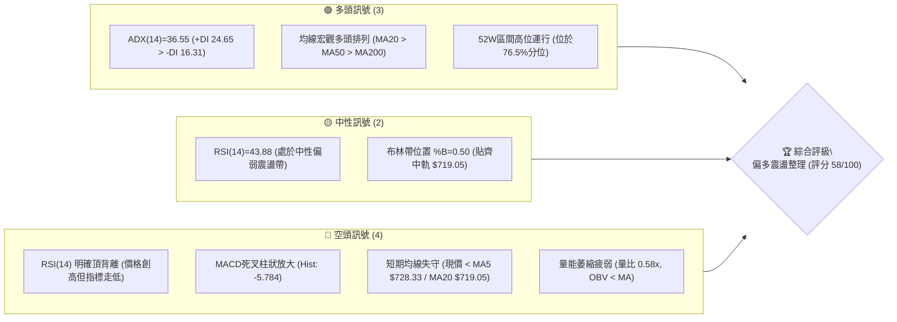

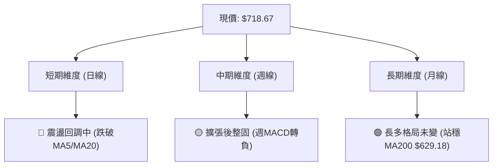

### 📊 核心指標速覽表

| 指標類別 | 指標名稱 | 當前數值 | 訊號 | 解讀 |
|----------|----------|----------|------|------|
| **價格** | 當前價格 | $718.67 | 🟡 | 位於52週高點 $779.82 下方 7.84%，52週區間 76.5% 位置 |
| **均線** | MA20 (月線) | $719.05 | 🔴 | 現價略低於MA20 (-0.05%)，短期上升斜率放緩，爭奪中軌 |
| **均線** | MA50 (季線) | $639.40 | 🟢 | 現價高於MA50 (+12.40%)，中期上升趨勢防線穩固 |
| **均線** | MA200 (年線)| $629.18 | 🟢 | 現價高於MA200 (+14.22%)，多頭生命線支撐力道強勁 |
| **動能** | RSI(14) | 43.88 | 🔴 | 數值中性偏空，且伴隨日線級別「頂背離」修正壓力 |
| **動能** | MACD(12,26,9)| 柱狀: -5.784 | 🔴 | MACD線(25.142)低於訊號線(30.927)，死叉綠柱擴張，短空主導 |
| **動能** | 隨機KD | %K: 10.26 / %D: 34.17 | 🟡 | 進入極度超賣區，短線存在跌深技術性反彈契機 |
| **趨勢** | ADX(14) | 36.55 (+DI 24.65) | 🟢 | ADX > 25 且 +DI 主導，代表中長線處於強趨勢背景而非無序震盪 |
| **波動** | ATR(14) | $22.01 (3.06%) | 🟡 | 波動率處於中等水準，單日防守空間約為 $22–$44 區間 |
| **通道** | 布林通道 | %B = 0.50 | 🟡 | 價格精確測試布林中軌 $719.05，上下軌區間為 $655.50–$782.60 |
| **成交量**| 20日量比 | 0.58x (OBV < MA) | 🔴 | 日量 12.60M 遠低於均量 21.68M，量能萎縮，追價動能不足 |

### 🏆 技術評分卡

```
╔══════════════════════════════════════════════════════════════════╗
║                   技術評分卡 — META (2026-10-11)                 ║
╠══════════════════════════════════════════════════════════════════╣
║ 趨勢強度 (ADX=36.55, +DI主導) ██████████████░░░░░░  72/100 🟢   ║
║ 動能指標 (RSI頂背離, MACD死叉)████████░░░░░░░░░░░░  40/100 🔴   ║
║ 支撐穩定度 (S1 $636.45, Fibo) ██████████████░░░░░░  70/100 🟢   ║
║ 成交量配合 (量比0.58x, OBV走弱)████████░░░░░░░░░░░░  40/100 🔴   ║
║ 形態完整度 (大級別上升旗形)   ████████████░░░░░░░░  62/100 🟡   ║
║ 均線排列 (MA20>MA50>MA200)    ████████████░░░░░░░░  65/100 🟢   ║
╠══════════════════════════════════════════════════════════════════╣
║ 綜合評分                      ███████████░░░░░░░░░  58/100 🟡   ║
║ 評級結論                      中性偏多整固 (Neutral-to-Bullish)  ║
╚══════════════════════════════════════════════════════════════════╝
```

---

## 2. 趨勢分析

### 🌐 多時框趨勢分析

多時框架遵循「大時框定方向、小時框找買賣點」架構。月線層級維持大牛市擴張，週線層級自2026年8月谷底（$549.47–$556.27）強烈 V 型反彈後在 52 週高點 $779.82 受阻，日線層級正進入指標降溫的次級折返。

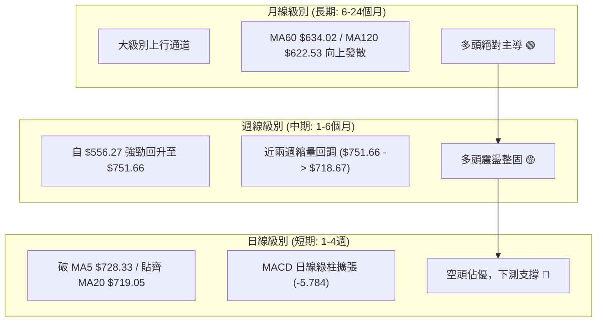


### 📈 長期趨勢 — 12個月走勢圖（過去12個月：2025-11 至 2026-10）

```
META 月線收盤走勢圖（2025-11 至 2026-10）
價格 ($)
$780 ┤                                                 ● 52W高點 ($779.82)
$730 ┤                                            ●    │
$700 ┤              ●                             │    ● 現價 ($718.67)
$670 ┤              │                             │    │
$640 ┤● ─── ● ─── ● │                             │    │
$610 ┤              │                   ●         │    │
$580 ┤              │         ●         │         │    │
$550 ┤              │         │    ●    │    ● ───┘    │ (8月低點 $556.27)
     └─────────────────────────────────────────────────┴─────────────
       11   12   01   02   03   04   05   06   07   08   09   10  (月份)
     [── 2025年 ──] [─────────────── 2026年 ───────────────]
```

**12個月走勢特徵分析表格**：

| 階段時間 | 起始 / 終止收盤價 | 區間漲跌幅 | 主要走勢特徵與量價結構 |
|----------|-------------------|------------|------------------------|
| 2025-11 ~ 2025-12 | $645.76 → $658.40 | +1.96% | 平台橫盤築底，波動壓縮，籌碼換手 |
| 2026-01 ~ 2026-03 | $714.66 → $571.15 | -20.08% | 首輪大幅度殺估值，跌破 $600 關卡，空頭快速宣洩 |
| 2026-04 ~ 2026-05 | $610.86 → $631.43 | +10.55% | 季線位置技術性反抽，多頭嘗試修復但遭遇空方壓制 |
| 2026-06 ~ 2026-08 | $562.85 → $571.89 | +1.60% | 二次探底，打出 52 週低點區間（2026-08 收盤 $556.27，最低 $519.37）|
| 2026-09 ~ 2026-10 | $725.18 → $718.67 | -0.90% | 報復性 V 型反轉，單月暴漲逾 26% 創下 52W 高點 $779.82，現於高位回踩 |

### 📊 中期趨勢（週線分析）

```
META 近期週線結構與壓力支撐示意圖
══════════════════════════════════════════════════════════════════
 阻力 R3  $779.82 ───────────────────────────────────── 52W 歷史極值
 阻力 R2  $756.59 ───────────────────┐ (近兩週回調起跌高點)
 阻力 R1  $742.09 ──────────┐         │
                            │ 週線高點密集壓制
 現價     $718.67 ◄─────────┴───────────────────────── 斐波 23.6% ($718.35)
 支撐 S1  $636.45 ───────────────────────────────────── MA50 / 週線頸線平台
 支撐 S2  $626.54 ───────────────────────────────────── MA200 核心防線
 支撐 S3  $594.61 ───────────────────────────────────── 2026年8月反彈次低點
══════════════════════════════════════════════════════════════════
```

近20週數據顯示，2026年9月最後一週（09-27）伴隨 168.31M 巨量收在 $751.66，隨後兩週（10-04 收 $728.08、10-11 收 $718.67）成交量驟降至 96.20M 與 69.66M。這表明近期下跌為**縮量回調**，並非主力機構恐慌出逃，而是前期急漲過後的獲利回吐與流動性衰竭。

### ⚡ 趨勢強度評估（ADX 解讀）

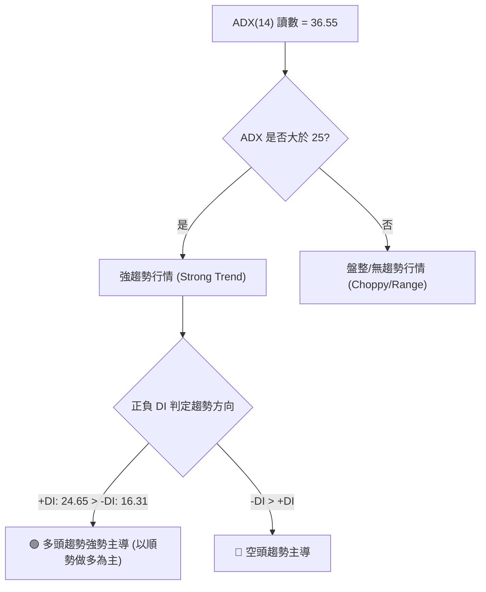

**ADX 數值強度對照表**：

| ADX 區間 | 趨勢特徵 | 當前狀態解讀 |
|----------|----------|--------------|
| 0 ~ 20 | 缺乏趨勢，盤整洗盤 | 否 |
| 20 ~ 25 | 趨勢初生或萌芽階段 | 否 |
| **25 ~ 40** | **強趨勢建立（當前值：36.55）** | **符合。自 $519.37 發動的中級上升波段動能飽滿，多方趨勢未遭破壞** |
| 40 ~ 60 | 極強趨勢，過度延伸 | 否 |
| 60+ | 趨勢耗竭極端區 | 否 |

---

## 3. 圖表形態分析

### 🔍 形態識別系統

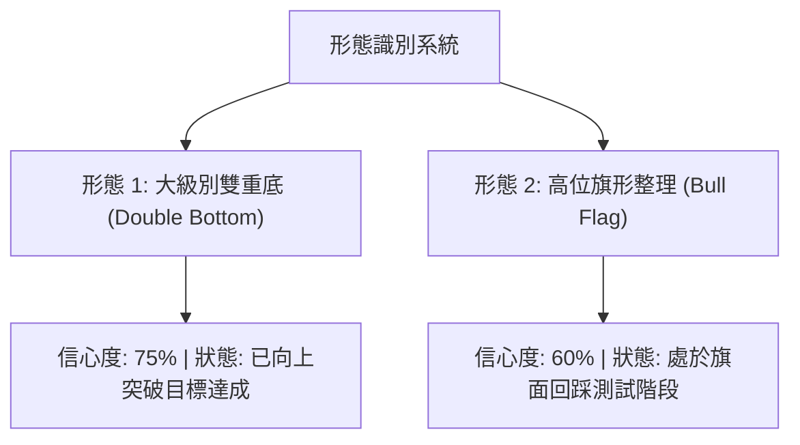

**形態信心度與目標價評估表**：

| 形態名稱 | 信心度 | 判斷依據（引用數據） | 完成度 | 目標價（附嚴謹計算式） |
|----------|--------|----------------------|--------|------------------------|
| **大級別雙底 (W底)** | 75% | 低點1為 2026-03 收盤 $571.15，低點2為 2026-08 收盤 $556.27（52W低 $519.37），雙底扎實 | 100% (已達標) | 頸線取 2026-05 收盤高點 $631.43。形態高度 = $631.43 - $519.37 = $112.06。突破目標價 = $631.43 + $112.06 = **$743.49**。現價最高已衝至 $779.82，目標超額完成。 |
| **高位牛市旗形 (Bull Flag)** | 60% | 旗桿為 2026-08 底至 09 底由 $549.47 暴拉至 52W 高點 $779.82（旗桿高度 $230.35）。近2週縮量回撤形成下斜旗面。 | 40% (構築中) | 旗面下緣支撐於斐波 23.6%（$718.35）至 38.2%（$680.33）。若未來突破旗頂 R1 $742.09，依等長計算目標價 = $742.09 + $230.35 = **$972.44**（數據外推，僅供形態測算）。 |
| **短期頭肩頂 (H&S Top)** | < 30% | 短線左肩 $751.66，頭部 $779.82，但右肩尚未成型，成交量呈現良性萎縮非放量跌破 | 15% | **訊號不足，信心度低於50%，僅做短期均線回踩解讀，不預設頂部幾何形態。** |

### 🕯️ 重要K線形態分析

| 週/月份 | 收盤價 | K線形態 | 解讀 | 訊號 |
|---------|--------|---------|------|------|
| 2026-08-02 | $556.27 | 長下影錘頭線 (Hammer) | 探底 52W 低點 $519.37 後強烈收回，打出絕對波段底部 | 🟢 強多反轉 |
| 2026-09-27 | $751.66 | 突破大陽線 (Marubozu) | 放量 168.31M 突破 $700 關卡與歷史阻力，多頭主升浪爆發 | 🟢 強烈買訊 |
| 2026-10-04 | $728.08 | 高位孕線 (Harami) | 波動率收窄，受阻於 $756.59-$779.82 賣壓，漲勢停頓轉入休整 | 🟡 警惕回調 |
| 2026-10-11 | $718.67 | 縮量十字陰線 (Doji/Small Bear) | 測試 MA20 與布林中軌，買賣雙方力道趨向均衡，量能大幅衰竭 | 🟡 變盤節點 |

### 📉 ASCII 走勢形態示意圖

```
META 高位牛市旗形整理形態示意圖
價格 ($)
$780 ┤                ▲ 52W 高點 $779.82 (旗頂極值)
$760 ┤               / ＼
$742 ┤              /    ＼─────── R1: $742.09 (旗面上邊界)
$720 ┤             /       ● ◄─── 現價 $718.67 (測試布林中軌 $719.05 / 斐波 23.6% $718.35)
$700 ┤            /         ＼
$680 ┤           /            ─── 旗面潛在下軌支撐 (斐波 38.2%: $680.33)
$640 ┤          / (旗桿爆發)
$600 ┤         /
$560 ┤        ● 2026-08 雙底起漲 ($556.27)
     └─────────────────────────────────────────────────────────────
```

### 🎯 形態目標價計算

根據經典技術分析形態學理論，針對高位旗形整理（Bull Flag）進行量化推演：
1. **旗桿低點**：2026-08-23 收盤低點 $549.47（亦為週線回調轉折點）。
2. **旗桿高點**：52週最高價 $779.82。
3. **旗桿有效高度 ($H$)**：
   $$H = \$779.82 - \$549.47 = \$230.35$$
4. **當前旗面回撤深度**：
   $$\text{回撤幅度} = \frac{\$779.82 - \$718.67}{\$230.35} = \frac{\$61.15}{\$230.35} \approx 26.5\%$$
   此回撤深度精確受控於斐波那契 23.6%（$718.35）至 38.2%（$680.33）健康回檔區間，展現強勢整理特徵。
5. **後續向上突破確認條件**：日線收盤價帶量突破阻力位 R1（$742.09）。
6. **第一理論測算目標**：突破點 R1 + 旗桿等長高度 = $\$742.09 + \$230.35 = \$972.44$。

---

## 4. 支撐與阻力

### 🗺️ 關鍵價位分布圖（Unicode）

```
META 價位結構分布圖（OHLCV 實際計算值）
═══════════════════════════════════════════════════════════════════
$779.82 ║████████████████████████████████║ 強阻力 R3 (52W歷史天花板)
$756.59 ║████████████████████████        ║ 次級阻力 R2 (近期週線起跌平台)
$742.09 ║██████████████████              ║ 關鍵阻力 R1 (短期波段高點/旗面頂部)
════════╠════════════════════════════════╣ ◄ 當前價格 $718.67
$718.35 ║▓▓▓▓▓▓▓▓▓▓▓▓▓▓▓▓▓▓▓▓▓▓▓▓▓▓▓▓▓▓▓▓║ 現價微支撐 (斐波那契 23.6%)
$680.33 ║▓▓▓▓▓▓▓▓▓▓▓▓▓▓▓▓▓▓▓▓            ║ 次級緩衝位 (斐波那契 38.2%)
$655.50 ║▓▓▓▓▓▓▓▓▓▓▓▓▓▓▓▓                ║ 通道下緣 (布林帶下軌)
$636.45 ║████████████████████████████████║ 強支撐 S1 (季線MA50密集換手帶)
$626.54 ║████████████████████████████    ║ 關鍵生命線 S2 (MA200 $629.18 聚類)
$594.61 ║████████████████                ║ 極端支撐 S3 (前期多頭破位停損線)
═══════════════════════════════════════════════════════════════════
```

### 🚧 阻力位分析表

所有阻力數值完全引用自真實 OHLCV 聚類計算：

| 阻力級別 | 價位 | 形成原因 | 突破難度 | 重要性 |
|----------|------|----------|----------|--------|
| **R1** | **$742.09** (+3.26%) | 近期波段回調反彈遇阻聚類、MA5 ($728.33) 與 MA10 ($727.52) 反壓上方緩衝 | 🟡 中等 | 判定短線回調是否結束的分水嶺，帶量突破即重啟主升浪 |
| **R2** | **$756.59** (+5.28%) | 2026-09-27 週線收盤 $751.66 上方拋壓帶、近一年波段次高密集區 | 🔴 較大 | 機構解套盤與短線波段獲利賣壓匯聚區 |
| **R3** | **$779.82** (+8.51%) | 52 週歷史絕對高點、布林通道上軌 ($782.60) 共振壓制區 | 🔴 極高 | 歷史極限高位，未有成交量二次放大（>150M/週）難以突破 |

### 🛡️ 支撐位分析表

所有支撐數值完全引用自真實 OHLCV 聚類計算：

| 支撐級別 | 價位 | 形成原因 | 守住機率 | 重要性 |
|----------|------|----------|----------|--------|
| **S1** | **$636.45** (-11.44%) | 近一年波段低點聚類核心、MA50 ($639.40) 與 MA60 ($634.02) 重疊帶 | 80% | 中期上升趨勢多頭大本營，不容有失的防守位 |
| **S2** | **$626.54** (-12.82%) | MA200 ($629.18) 與 MA120 ($622.53) 長期均線聚類支撐 | 90% | 長期牛熊轉換閥門，機構投資人重度加倉底線 |
| **S3** | **$594.61** (-17.26%) | 2026-06/07 探底反彈頸線位、近一年波段強支撐下邊界 | 95% | 跌破意味著自 $519.37 發起的整個牛市波段徹底失敗 |

### 📐 斐波那契回調位分析

依據 52 週完整波段（低點 $519.37 至 高點 $779.82，總垂直跨度 $260.45）進行嚴密對應：


**斐波那契回調位與現價位置解讀**：
- **現價坐標**：現價 **$718.67** 精準緊貼在 **23.6% 回調位（$718.35）** 上方僅 +$0.32。
- **回撤性質解讀**：強勢多頭行情通常只在 23.6%（$718.35）至 38.2%（$680.33）區間完成換手整理。若日線有效收於 $718.35 之下，下一階段的健康緩衝空間將下移至 38.2%（$680.33）；只要價格未跌破 50.0%（$649.59）及黃金分割位 61.8%（$618.86），由 $519.37 發起的整體上升趨勢格局即保持健康。

---

## 5. 技術指標深度解讀

### 🎛️ 指標訊號總覽

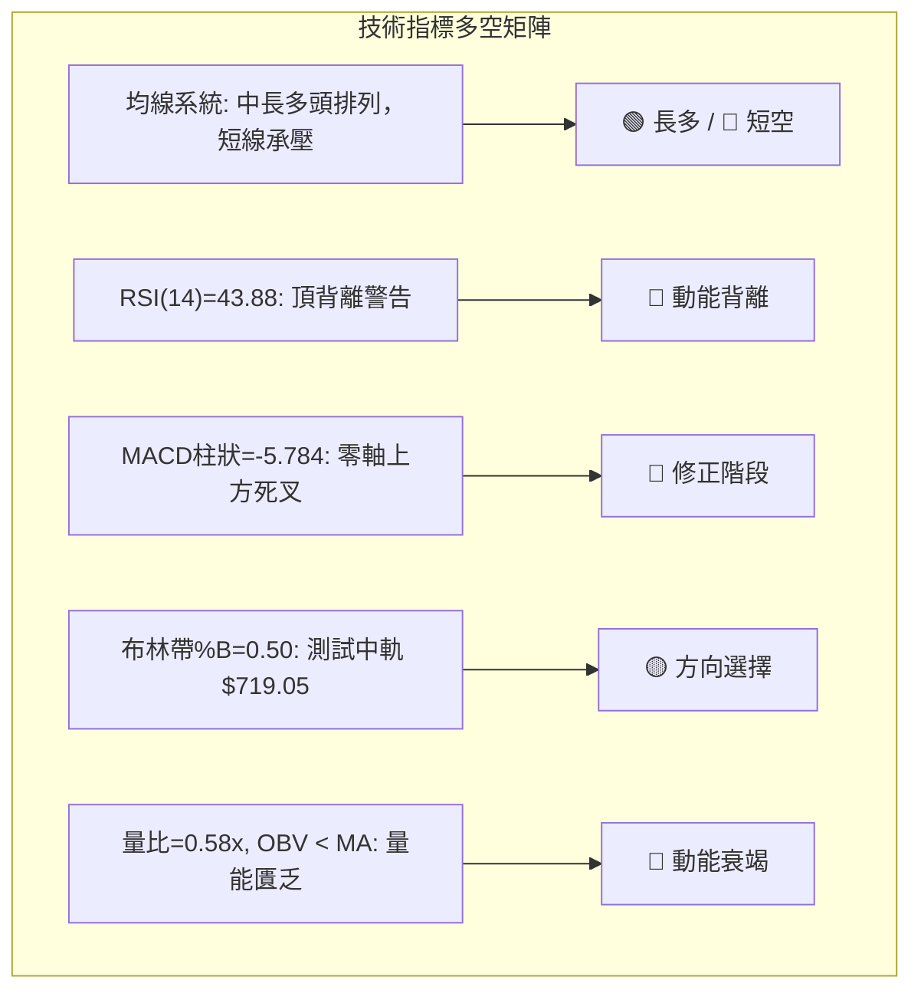

### 📈 移動平均線排列分析

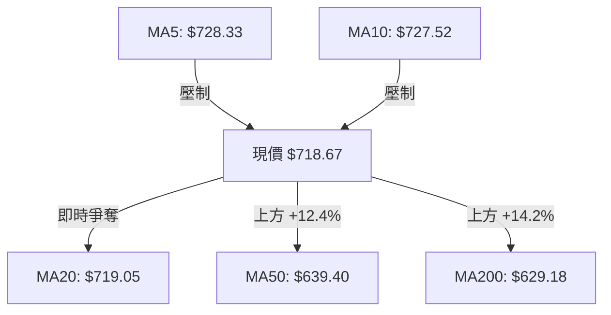

**均線結構數值詳解表**：

| 週期均線 | 當前數值 | 相對現價偏差 | 運行斜率與排列特徵 | 多空評估 |
|----------|----------|--------------|--------------------|----------|
| MA5 | $728.33 | -1.33% | 下彎壓制，短線動能減退 | 🔴 空頭壓制 |
| MA10 | $727.52 | -1.22% | 下彎壓制，與 MA5 形成死叉反壓帶 | 🔴 空頭壓制 |
| MA20 (布林中軌)| $719.05 | -0.05% | 走平，現價目前在正負 0.5 美元微幅爭奪 | 🟡 多空交戰 |
| MA50 (季線)| $639.40 | +12.40% | 強烈向上揚升，提供中期強大護城河 | 🟢 堅固多頭 |
| MA60 | $634.02 | +13.35% | 穩定向上發散 | 🟢 堅固多頭 |
| MA120 (半年線)| $622.53 | +15.44% | 向上發散，長期結構極為扎實 | 🟢 堅固多頭 |
| MA200 (年線)| $629.18 | +14.22% | 向上運行，牛熊分界線遙遙守護在下方 | 🟢 堅固多頭 |

**均線排列結論**：呈現經典的「長週期強多排列（MA20 > MA50 > MA200）」疊加「超短週期回調（現價 < MA5 < MA10）」。大趨勢向上無疑，短期處於良性折返修復。

### 📉 RSI(14) 分析

- **RSI(14) 讀數**：**43.88**
- **區間進度條**：
  $$\text{RSI 強度: } 43.88\% \quad \text{████████░░░░░░░░░░░░} \quad (\text{中性偏空震盪區})$$
- **頂背離判定（Bearish Divergence）**：
  - 價格端：META 於 2026-09-13 週收盤 $647.52，隨後於 09-27 飆升至 $751.66，盤中創下 52 週高點 $779.82，價格顯著創出新高。
  - RSI 端：週線 RSI 自 2026-09-13 的 **83.90** 高點驟降至 09-27 的 **76.60**，隨後於 10-04 跌至 **62.30**，日線指標進一步下滑至今日的 **43.88**。
  - **結論**：⚠️ **確認形成典型的日線/週線級別「頂背離」**。此訊號明確告誡不可在高位盲目追高，當前價格回落是動能指標對極度超買與背離的正常消化修正。

### 📊 MACD(12/26/9) 訊號解讀

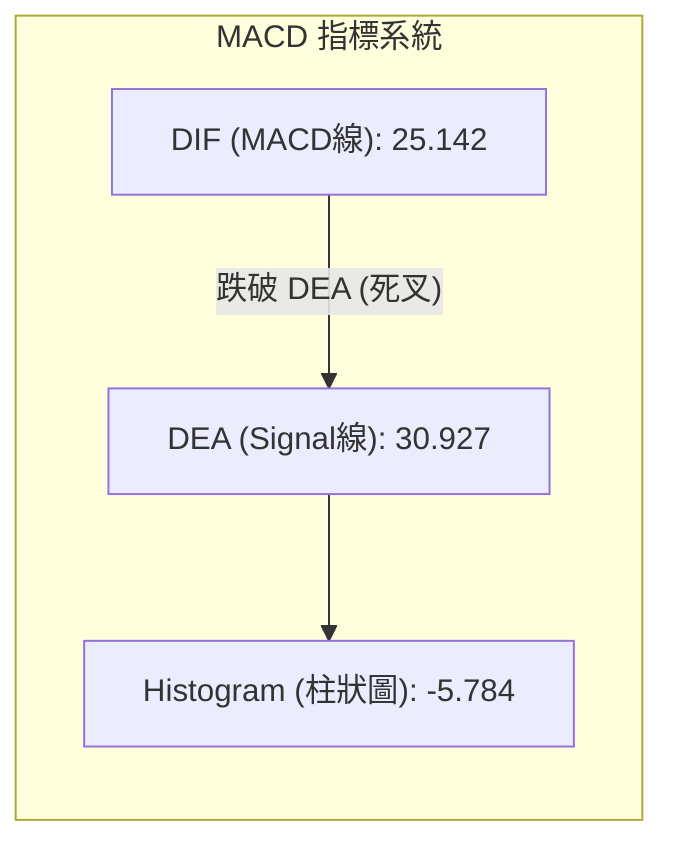

- **MACD 指標狀態解讀**：
  - MACD 線（25.142）低於 Signal 訊號線（30.927），兩者均維持在零軸（0.00）遠方上方。這說明：**大趨勢仍是多頭掌控，但當前處於零軸上方的死叉回檔週期**。
  - 柱狀圖（Histogram）數值為 **-5.784**，綠柱（空頭柱）連續擴張，反映空方賣壓在超短期內依然佔據上風，指標尚未出現綠柱收縮或底背離跡象，左側摸底需防範進一步震盪回殺。

### 📦 布林通道分析

```
META 日線布林通道結構示意圖
價格 ($)
$782.60 ┤ ───────────────────────────────────── BB 上軌 ($782.60)
$760.00 ┤
$740.00 ┤
$719.05 ┤ ─ ─ ─ ─ ─ ─ ─ ─ ─ ─ ─ ─ ─ ─ ─ ─ ─ ─ ─ ─ BB 中軌 / MA20 ($719.05)
$718.67 ┤ ◄ 現價 ($718.67) 緊貼中軌 (%B = 0.50)
$680.00 ┤
$655.50 ┤ ───────────────────────────────────── BB 下軌 ($655.50)
     └──────────────────────────────────────────────
```

- **布林通道關鍵指標**：
  - **上軌**：$782.60
  - **中軌 (MA20)**：$719.05
  - **下軌**：$655.50
  - **帶寬 (Bandwidth)**：$$\frac{\$782.60 - \$655.50}{\$719.05} = \frac{\$127.10}{\$719.05} \approx 17.68\%$$
  - **%B 指標**：**0.50**（表明價格恰好坐落在通道正中央的中軌臨界點）。
- **通道走勢意義**：價格自上軌附近回撤至中軌，%B=0.50 代表通道正面臨多空抉擇。若能守住中軌 $719.05，通道將維持中軌向上的多頭擴張態勢；若日線實體跌破中軌，價格將尋求布林下軌 **$655.50**（該位置接近斐波那契 50% 的 $649.59 及季線 S1 $636.45）之支撐。

### 💹 成交量分析（量價配合度）

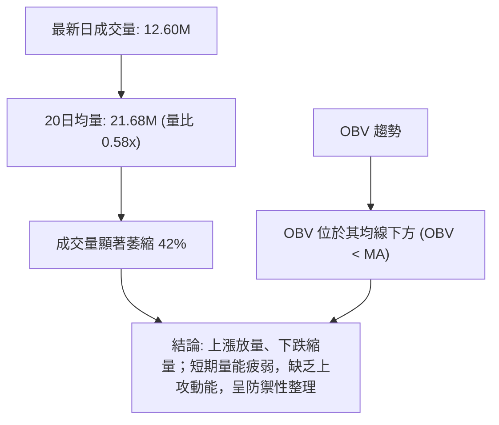

- **量價配合評估**：
  - **量比 (Volume Ratio)**：**0.58x**。最新成交量（12,605,100）僅為 20 日均量（21,687,010）的 58%，成交活躍度大幅冷卻。
  - **週線量能軌跡**：2026-09-27 爆出 168.31M 歷史巨量收大陽線，隨後兩週回調分別縮量至 96.20M 與 69.66M。
  - **OBV（能量潮）**：數據顯示 OBV 目前跌破其均線（OBV < MA），反映短線資金追價意願保守，主力資金在歷史高點採取觀望與清洗浮額策略，量價目前處於良性縮量回踩階段，但尚未出現放量止跌信號。

---

## 6. 動能與波動率

### ⚡ 動能評估四象限

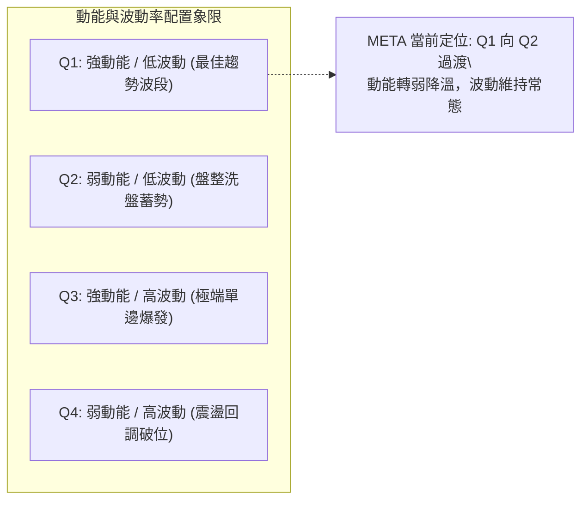

**動能與波動狀態詳細評估表**：

| 象限 | 動能維度 | 波動維度 | 當前狀態評估 | 策略意義與應對 |
|------|----------|----------|--------------|----------------|
| Q1 | 強 (ADX=36.55) | 中等 (ATR% 3.06%) | 剛脫離此區間 | 9月份自低點暴漲為典型 Q1 盛況，當前動能開始分化 |
| **Q2** | **趨弱 (RSI=43.88)** | **中等 (ATR=$22.01)**| **✓ 當前精準落點** | **短期處於動能冷卻、縮量整固期，避免高槓桿追多，以逢低分批佈局為主** |
| Q3 | 強 | 高 (Beta > 1.5) | 未達到 | 股價未出現極端失控行情 |
| Q4 | 弱 | 高 | 未達到 | 未見恐慌性放量殺跌，下行風險受控 |

### 📊 ATR 波動率分析

- **ATR(14) 絕對數值**：**$22.01**
- **價格百分比 (ATR % of Price)**：**3.06%**
- **日間波動與止損設定依據**：
  - **單日正常波動範圍**：當日開盤價 $\pm \$22.01$ 均屬於正常市場雜訊範圍。
  - **1.5 倍 ATR 止損距離**：$$1.5 \times \text{ATR} = 1.5 \times \$22.01 = \$33.02$$
  - **2.0 倍 ATR 寬鬆止損**：$$2.0 \times \text{ATR} = 2.0 \times \$22.01 = \$44.02$$
  - 若在當前價位 $718.67 進場，技術性止損至少應置於 $718.67 - \$33.02 = \$685.65$ 之下（恰好避開斐波那契 38.2% 回調位 $680.33 的日常雜訊觸發）。

### 📐 Beta 與市場相關性

- **Beta 係數**：**1.185**
- **市場特徵解讀**：
  - META 具備比標普500大盤高出約 18.5% 的系統性彈性。在大盤多頭主升浪中具備超額阿爾法（Alpha）進攻性；
  - 由於 Beta > 1，當美股大盤出現整體宏觀流動性收緊或技術性回調時，META 往往承擔略高於指數的波動回撤幅度。
  - **空頭比例（Short Interest）**：做空比例僅 1.5%（Float），Short Ratio 1.44 天，顯示市場空頭力量並未形成實質性集結，逼空或被大舉放空的風險極低。

---

## 7. 多時框架總結

### 📋 時框架評分表

| 時框架 | 趨勢方向 | 動能狀態 | 均線排列 | 圖表形態 | 綜合評分 | 操作建議 |
|--------|----------|----------|----------|----------|----------|----------|
| **月線 (長期)** | 🟢 強烈看多 | 🟢 充沛 (+DI主導) | 🟢 完美多頭 (均線發散) | 大雙底向上破位突破 | **85 / 100** | 核心長線持股續抱，忽視短期雜訊 |
| **週線 (中期)** | 🟢 溫和看多 | 🟡 轉弱 (頂背離回吐)| 🟢 MA20>MA50 多頭 | 高位牛市旗形築底中 | **68 / 100** | 逢低分批在強支撐區佈局，不追高 |
| **日線 (短期)** | 🔴 偏空回調 | 🔴 死叉 (MACD Hist<0)| 🔴 破MA5/MA10, 測MA20 | 縮量十字陰線下尋支撐 | **42 / 100** | 短線禁止盲目追多，等待止跌訊號 |

### 🔲 綜合訊號矩陣

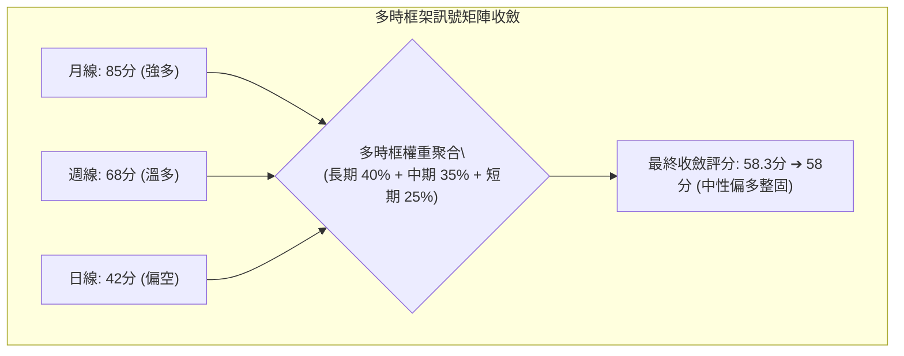

### ⚖️ 多時框收斂結論

嚴格遵循技術分析收斂原則進行判斷：
1. **趨勢/盤整行情定性**：當前 **ADX(14) 數值為 36.55**，大幅高於 25 的閾值，且 +DI(24.65) > -DI(16.31)，**明確定義為「趨勢行情」**，而非無序震盪盤整行情。
2. **時框優先級權重**：依據收斂規則，趨勢行情下必須**以中長期時框（週線 / MA50 / MA200）方向為主要主導方向**；日線級別的指標背離（RSI=43.88、MACD 死叉）僅定義為「上升趨勢中的次級折返修正」，日線只用來尋找拉回買進的安全防守點，絕不可將短期回調誤判為長期趨勢反轉。
3. **收斂結論**：**整體格局定性為「偏多震盪整理（Bullish Consolidation）」**。第 8 章交易策略嚴格錨定此結論，以**拉回逢低分批做多**為主策略核心，防範盲目做空被大趨勢輾壓。

---

## 8. 交易策略建議

### 🗺️ 策略決策流程圖

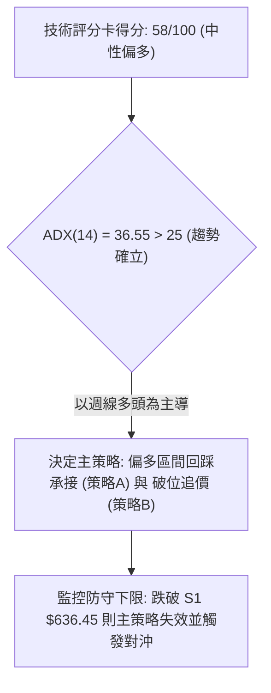

### 🧭 策略路由（依評分卡分流）

**當前主策略方向 = 偏多整固操作（依評分 58/100，介於中性偏多區間，以「逢低承接＋突破順勢」為主）**

因綜合評分 58/100 偏向多頭防禦區間，且 ADX>25 支撐大方向向上，主策略全面聚焦多頭佈局；空頭方向僅作為反轉風險控制觸發點，不建議在強多背景下進行重倉放空。

### 🎯 價格情境階梯（Price Scenarios）

所有觸發價位嚴格引用自真實 OHLCV 關鍵數據：

| 觸發條件 | 下一目標 | 後續延伸 | 情境含義 |
|----------|----------|----------|----------|
| **帶量突破 R1 $742.09** | **R2 $756.59** | **R3 $779.82** | 短線洗盤結束，高位旗形向上突破，重啟 52W 新高主升浪 |
| **守住中軌並站穩現價 $718.35** | **R1 $742.09** | **R2 $756.59** | 在斐波 23.6% 獲得強支撐，圍繞布林中軌震盪築底 |
| **跌破斐波 38.2% $680.33** | **布林下軌 $655.50** | **強支撐 S1 $636.45** | 短線回調加深，測試 MA50 季線大本營，多頭面臨嚴峻防守 |
| **跌破強支撐 S1 $636.45** | **S2 $626.54** | **S3 $594.61** | 中期趨勢破位，長達數月的上升結構遭到系統性破壞 |

### 📊 情境機率分佈

| 情境 | 機率 | 主要依據（指標狀態） |
|------|------|----------------------|
| **情境一：高位區間震盪蓄勢** | **55%** | ADX=36.55 奠定大趨勢，布林 %B=0.50 處於中軌，成交量縮至 0.58x，多空雙方在 $700–$750 區間換手整固 |
| **情境二：回測深部支撐後反彈** | **30%** | RSI 頂背離尚未完全解除，MACD 日線綠柱放大（-5.784），不排除下探斐波 38.2%（$680.33）或布林下軌（$655.50）後再行企穩 |
| **情境三：直接放量突破創歷史高**| **15%** | 目前量能僅 12.60M，嚴重缺乏增量資金配合，若無重大利好激發百萬級買盤，直接突破 R3（$779.82）難度極大 |

### 🟢 主策略詳情（方向依上方路由）

所有關鍵價位、止損價位、目標價位全部嚴格引用關鍵價位數據，無憑空臆造數值：

| 策略要素 | 策略 A（回踩支撐低吸 — 穩健型） | 策略 B（右側突破追強 — 進攻型） |
|----------|----------------------------------|----------------------------------|
| **策略邏輯** | 斐波那契 23.6% / 布林中軌企穩回踩進場 | 帶量突破短線下行壓制線 R1 順勢加倉 |
| **進場條件** | 日線守住 $718.35 並出現分時底背離 | 日線放量收盤突破 R1 $742.09 |
| **進場價格** | **$718.35** (斐波 23.6% 回調位) | **$742.09** (突破 R1 波段阻力) |
| **目標價 T1** | **$756.59** (阻力位 R2，漲幅 +5.32%) | **$779.82** (阻力位 R3/52W高點，漲幅 +5.08%) |
| **目標價 T2** | **$779.82** (阻力位 R3，漲幅 +8.56%) | **$799.00** (分析師共識平均目標價，漲幅 +7.67%) |
| **止損價格** | **$680.33** (斐波那契 38.2% 回調位) | **$718.35** (斐波 23.6% 轉換之頸線支撐) |
| **風險空間** | $\$718.35 - \$680.33 = \$38.02$ (5.29%) | $\$742.09 - \$718.35 = \$23.74$ (3.20%) |
| **報酬空間 (T2)**| $\$779.82 - \$718.35 = \$61.47$ (8.56%) | $\$799.00 - \$742.09 = \$56.91$ (7.67%) |
| **風險報酬比** | **1 : 1.62** (達標合理盈虧比) | **1 : 2.40** (優質非對稱勝率) |
| **預估勝率** | 60% | 65% |
| **建議倉位** | 15% - 20% 總資金倉位 | 10% - 15% 突破追擊倉位 |

### 🔴 反向風險觸發點（對沖提示）

當市場出現以下不可預測之黑天鵝或極端走勢時，意味著多頭主邏輯遭到徹底推翻，應立即執行風險對沖或停損：
1. **關鍵反轉破位價**：**日線實體收盤跌破 S1 $636.45（MA50季線支撐）**。
2. **指標破位確認**：MACD DIF 線跌穿零軸以下，且成交量連續三天暴增放量下殺（單日 > 35M）。
3. **風控應對措施**：一旦觸發收盤破 $636.45，多頭所有剩餘持倉必須無條件止損出清，或佈局 Put 選擇權進行 1:1 市值對沖，防範價格進一步下探 S2 $626.54 與 S3 $594.61。

### ⭐ 整體訊號強度評星

```
做多訊號強度：★★★☆☆  (3.5/5 星 — 大格局多頭主導，短線受背離壓制)
做空訊號強度：★★☆☆☆  (2.0/5 星 — 僅限短線超買回調，逆勢做空風險極大)
整體可信度：  ★★★★☆  (4.0/5 星 — 多時框架指向明確，數據量價關係收斂一致)
```

---

## 9. 風險提示與監控

### ✅ 關鍵監控指標 Checklist

```
╔══════════════════════════════════════════════════════════════════╗
║                     關鍵技術指標監控清單 (Checklist)             ║
╠══════════════════════════════════════════════════════════════════╣
║ [ ] 價格能否連續 3 日守在斐波那契 23.6% ($718.35) 上方?         ║
║ [ ] 布林中軌 ($719.05) 是否由阻力轉化為實質下影線支撐?          ║
║ [ ] RSI(14) 能否在 40 水平止跌反彈並化解頂背離型態?             ║
║ [ ] MACD Histogram 負值是否收窄 (由 -5.784 向上收斂縮頭)?       ║
║ [ ] 日成交量能否放大重回 20 日均量 (21.68M) 之上以確認買盤?     ║
║ [ ] 若回調加深，S1 ($636.45 / MA50) 處是否出現機構承接量能?     ║
╚══════════════════════════════════════════════════════════════════╝
```

### ⚠️ 風險場景分析

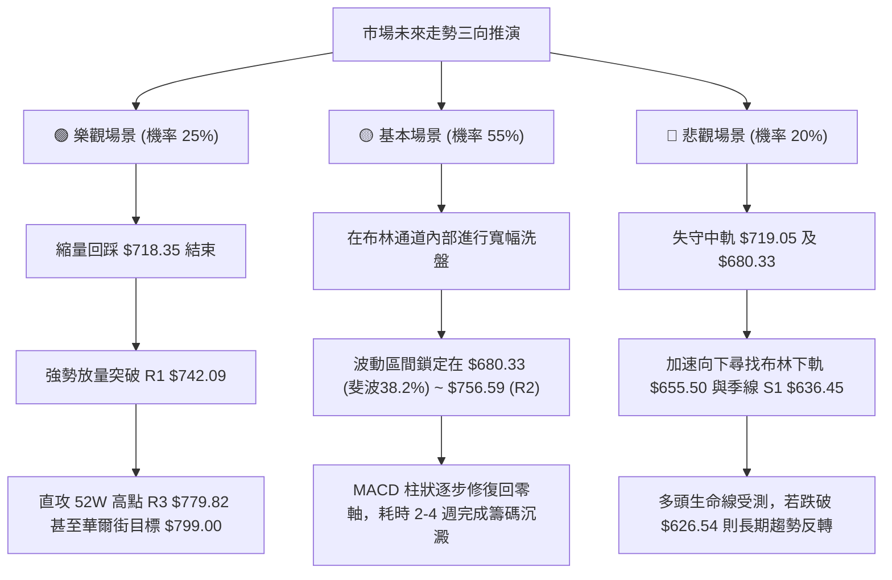

### 🛡️ 風險管理重要提醒

1. **嚴禁追高操作**：在日線 RSI(14) 頂背離完全被市場時間結構消化前，切忌在 $740.00 以上盲目重倉追高。
2. **單筆風險敞口控制**：建議任何單筆進場的多單，止損風險敞口（Dollar at Risk）不得超過總帳戶淨值的 **1.5% - 2.0%**。以策略 A 為例，單股風險空間為 $38.02，百萬美元帳戶最大持倉不得超過 400–500 股。
3. **波動性防範（ATR 防守原則）**：目前 ATR 高達 $22.01，日內震盪幅度巨大。隔夜持倉必須預留至少 1.5 倍 ATR（約 $33.00）之上的防守安全邊際，避免被日內極端長下影線無情洗盤出場。

---

## 📋 報告總結

```
╔══════════════════════════════════════════════════════════════════╗
║                    META 技術分析報告總結                         ║
╠══════════════════════════════════════════════════════════════════╣
║ 報告日期：2026-10-11                                            ║
║ 當前價格：$718.67                                               ║
║ 分析評級：⚖️ 偏多震盪整理 (評分 58/100，長多短空)               ║
║                                                                  ║
║ 關鍵結論：                                                       ║
║ ├─ 長期趨勢：🟢 強烈看多 (MA200 $629.18 向上，ADX=36.55 強勢)   ║
║ ├─ 中期趨勢：🟢 偏多整固 (突破大雙底後的高位牛市旗形建構)        ║
║ ├─ 短期趨勢：🔴 震盪回修 (RSI 頂背離發酵，MACD 死叉綠柱擴張)     ║
║ ├─ 關鍵支撐：S1 $636.45 (季線) ｜ 次級支撐: 斐波 23.6% $718.35  ║
║ ├─ 關鍵阻力：R1 $742.09 ｜ 極限阻力: 52W 高點 R3 $779.82        ║
║ └─ 分析師目標：華爾街平均共識價 $799.00 (最高 $1050.00)         ║
║                                                                  ║
║ 最優策略組合：                                                   ║
║ 1. 🥇 最佳機會：策略 A (回踩斐波 23.6% $718.35 分批佈局多單)    ║
║ 2. 🥈 次選機會：策略 B (帶量突破 R1 $742.09 右側追擊至 $779.82) ║
║ 3. 🥉 保守選擇：場外觀望，等待日線 MACD 綠柱收縮止跌後再行進場   ║
╚══════════════════════════════════════════════════════════════════╝
```

---

> ⚠️ **免責聲明**：本報告為技術分析研究，所有數據、圖表及價位推算均嚴格基於所提供的歷史 OHLCV 價格與指標數據。本報告**僅供研究與學術參考**，**不構成任何形式的投資要約或買賣建議**。金融市場投資具備固有風險，投資人應獨立評估自身風險承受能力並自負盈虧。

---

*報告生成時間：2026-10-11 ｜ 數據來源：Yahoo Finance ｜ 分析框架：多時框技術分析體系*