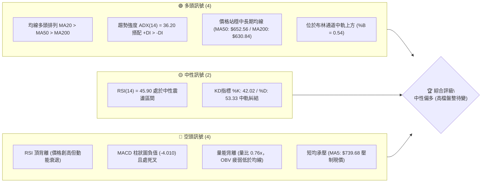
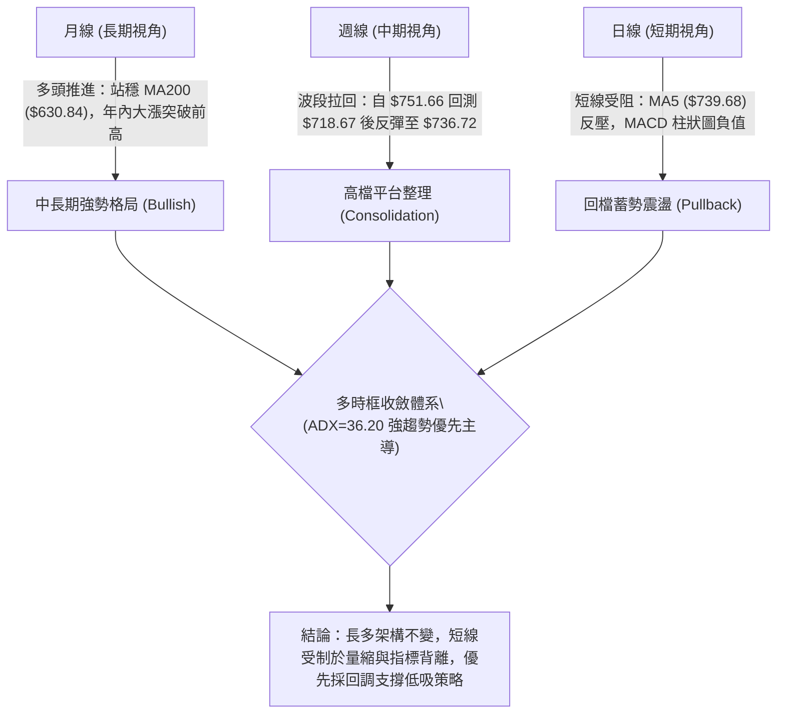
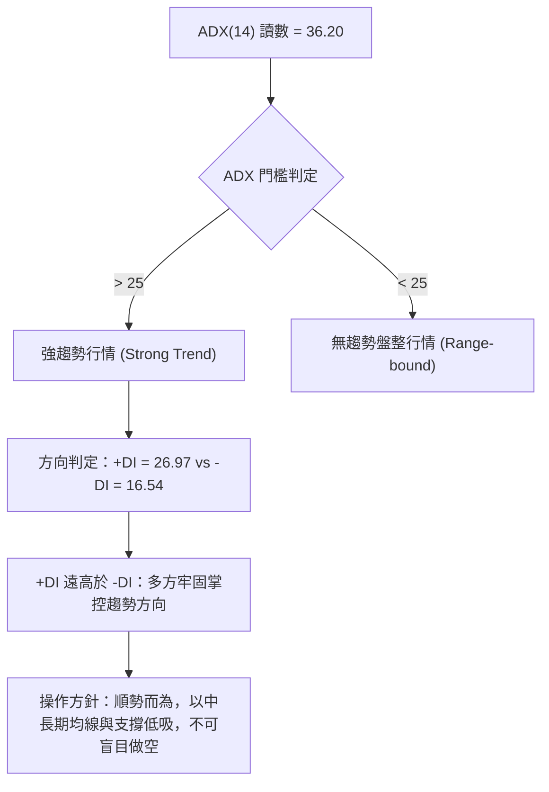
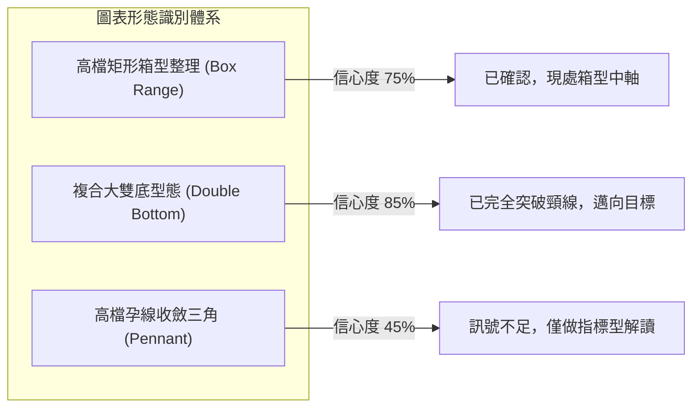
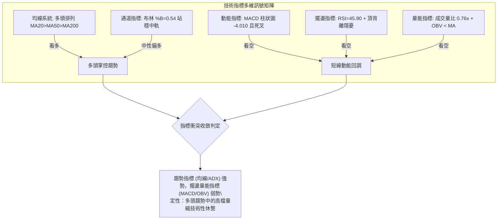
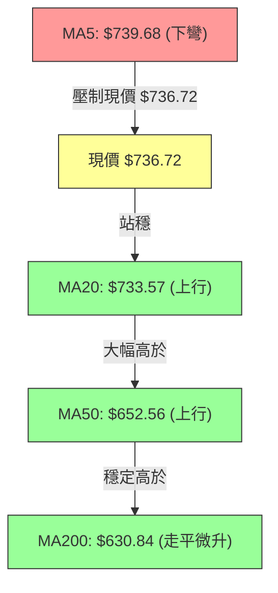
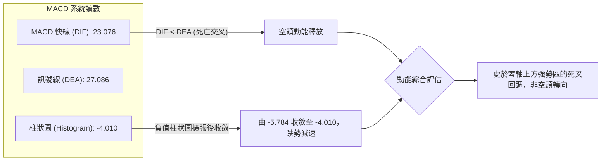
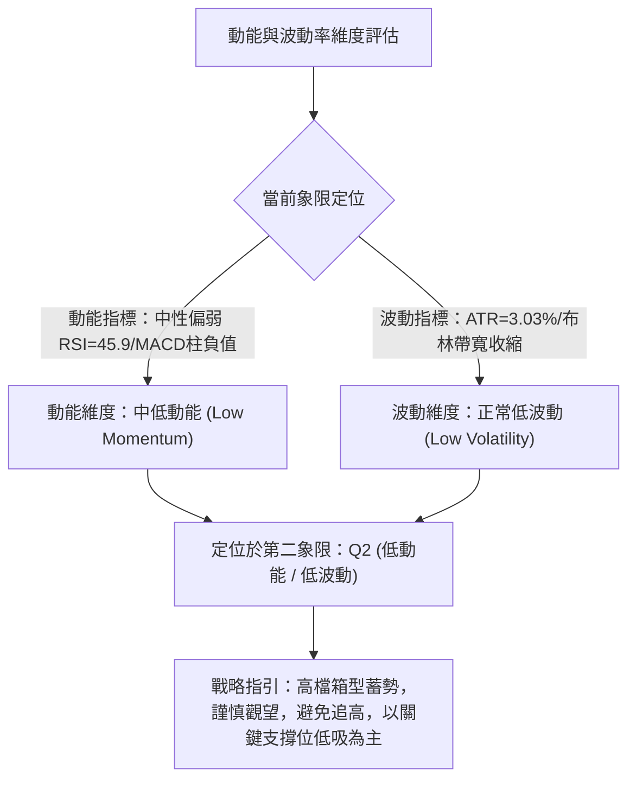
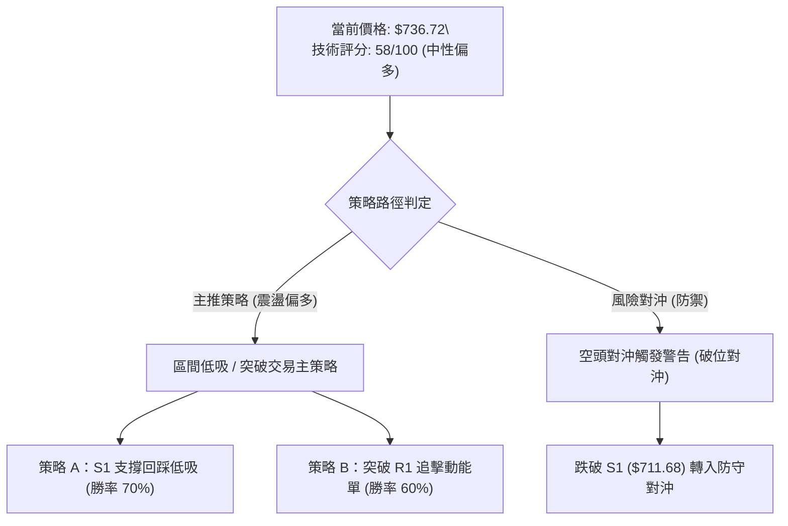
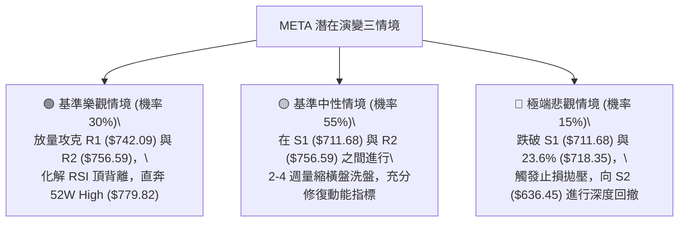

# META 技術分析報告

> **報告日期**：2026-10-16 ｜ **語言**：繁體中文 ｜ **數據來源**：Yahoo Finance ｜ **當前價格**：$736.72

---

## 目錄

| 章節 | 內容 |
|------|------|
| [1. 技術面概覽](#1-技術面概覽) | 訊號儀表板、核心指標、評分卡 |
| [2. 趨勢分析](#2-趨勢分析) | 多時框趨勢、長中短期走勢 |
| [3. 圖表形態分析](#3-圖表形態分析) | 形態識別、K線組合、目標價 |
| [4. 支撐與阻力](#4-支撐與阻力) | 關鍵價位、斐波那契回調 |
| [5. 技術指標深度解讀](#5-技術指標深度解讀) | MA/RSI/MACD/布林/成交量 |
| [6. 動能與波動率](#6-動能與波動率) | 動能評估、ATR、Beta |
| [7. 多時框架總結](#7-多時框架總結) | 時框架評分矩陣 |
| [8. 交易策略建議](#8-交易策略建議) | 多空策略、風險報酬比 |
| [9. 風險提示與監控](#9-風險提示與監控) | 監控指標、風險場景 |
| [📋 報告總結](#-報告總結) | 總體評級、關鍵結論與策略摘要 |

---

## 1. 技術面概覽

### 🎯 技術訊號儀表板



### 📊 核心指標速覽表

| 指標類別 | 指標名稱 | 當前數值 | 訊號 | 解讀 |
|----------|----------|----------|------|------|
| **價格** | 當前收盤價 | $736.72 | 🟢 | 位於52週區間83.5%相對高位，處多頭防守線上 |
| **均線** | MA20 (月線) | $733.57 | 🟢 | 現價高於 MA20（+0.43%），短線多空分水嶺獲守 |
| **均線** | MA50 (季線) | $652.56 | 🟢 | 現價大幅高於 MA50（+12.90%），中期多頭架構完好 |
| **均線** | MA200 (年線) | $630.84 | 🟢 | 現價大幅高於 MA200（+16.78%），長期牛市基調明確 |
| **動能** | RSI(14) | 45.90 | 🟡 | 位於 40–50 區間中性偏弱，未入超賣，但呈現頂背離 |
| **動能** | MACD (12,26,9) | 23.076 / 27.086 | 🔴 | MACD線低於訊號線，柱狀圖 -4.010，空頭動能釋放中 |
| **動能** | 隨機指標 Stoch | %K 42.02 / %D 53.33 | 🟡 | %K 由上跌破 %D，處於 50 軸線附近震盪尋找方向 |
| **趨勢** | ADX / DI | ADX: 36.20 (+DI 26.97) | 🟢 | ADX > 25 確立趨勢行情，+DI 主導，大格局多頭佔優 |
| **通道** | 布林通道 %B | 0.54 (上軌777.59/下軌689.55) | 🟡 | 價格貼近中軌($733.57)，波動收斂，處於蓄勢階段 |
| **量能** | 成交量 / 20日均量 | 16.87M / 22.12M (0.76x) | 🔴 | 量縮整理，OBV < MA，追價意願不足，高檔量價背離 |
| **波動** | ATR(14) | $22.31 (3.03%) | 🟡 | 日內平均振幅正常，波動率未顯著異常擴大 |

### 🏆 技術評分卡

```
╔══════════════════════════════════════════════════════════════╗
║                技術評分卡 — META (2026-10-16)                 ║
╠══════════════════════════════════════════════════════════════╣
║ 趨勢強度 (ADX=36.20)     ██████████████░░░░░░  70/100   🟢   ║
║ 動能指標 (MACD/RSI背離)  ████████░░░░░░░░░░░░  40/100   🔴   ║
║ 支撐穩定度 (S1/MA20)     ██████████████░░░░░░  70/100   🟢   ║
║ 成交量配合 (量縮/OBV疲弱)██████░░░░░░░░░░░░░░  30/100   🔴   ║
║ 形態完整度 (箱型/多重底) ████████████░░░░░░░░  60/100   🟡   ║
║ 均線排列 (多頭排列完整)  ████████████████░░░░  80/100   🟢   ║
╠══════════════════════════════════════════════════════════════╣
║ 綜合評分                 ████████████░░░░░░░░  58/100   🟡   ║
║ 評級結論                 中性偏多 (區間高檔震盪整理)          ║
╚══════════════════════════════════════════════════════════════╝
```

---

## 2. 趨勢分析

### 🌐 多時框趨勢分析

依據收斂規則，當前 ADX 為 36.20（>25），屬於典型強趨勢架構。趨勢行情必須以中長期（週線/MA50/MA200）方向為主導，日線則作為尋找超賣拉回進場點的微觀視窗。



### 📈 長期趨勢 — 12個月走勢圖（Unicode）

```
META 月線走勢圖（過去12個月：2025-11 至 2026-10）
價格軸 ($)
$770 ┤                                              
$740 ┤                                        ●(09/26:$725) ●(10/26現價:$736.72)
$710 ┤            ●(01/26:$714.66)                   
$680 ┤                                              
$650 ┤●(11/25:$645) ●(12/25:$658) ●(02/26:$646) ●(05/26:$631)
$620 ┤                                  ●(04/26:$610)
$590 ┤                        ●(03/26:$571)         ●(08/26:$571)
$560 ┤                                              ●(06/26:$562) ●(07/26:$556.27低點)
     └─────────────────────────────────────────────────────────►
       11/25 12/25 01/26 02/26 03/26 04/26 05/26 06/26 07/26 08/26 09/26 10/26
```

#### 過去 12 個月走勢特徵分析表格

| 階段區間 | 起止收盤價 | 區間漲跌幅 | 主要走勢特徵與技術驅動因素 |
|----------|------------|------------|----------------------------|
| **高檔回挫期**<br>(2025-11 ~ 2026-03) | $645.76 → $571.15 | -11.55% | 自 2026 年 1 月高點 $714.66 遇阻後快速下挫，跌破 $600 整數關卡，測試長期均線支撐。 |
| **反彈築底期**<br>(2026-04 ~ 2026-08) | $610.86 → $571.89 | -6.38% | 於 $556.27 形成 52 週次低波段支撐（接近 52W Low $519.37），反覆打底確認築底結構。 |
| **暴力主升期**<br>(2026-08 ~ 2026-09) | $571.89 → $725.18 | +26.80% | 呈現 V 型暴力反轉，週成交量大幅擴增至 1.68 億股，快速穿透 MA50 與 MA20。 |
| **高檔滯漲期**<br>(2026-09 ~ 2026-10) | $725.18 → $736.72 | +1.59% | 衝高至 $751.66 後回落整理，現價於 $736.72 徘徊，形成高檔量縮震盪平台。 |

### 📊 中期趨勢（週線分析）

中期技術面以 2026 年 8 月低點 $556.27 起算的主升段為基線。近期週線收盤走勢顯示，多頭在 2026-09-27 爆出 168.30M 的天量攻上 $751.66 後，週線連續出現回踩：

```
近期週線壓力與支撐階梯示意圖：
  $779.82 ────────────────────────── [52W High / R3 強阻力]
              ▲ 
  $756.59 ────┼───────────────────── [近一年波段高點聚類 R2]
              │     ┌───┐ (2026-09-27 高點 $751.66)
  $742.09 ────┼─────┤   ├─────────── [近期反彈阻力 R1 / MA5: $739.68]
  $736.72 ────┼─────┴───┴─────────── ◄ 當前收盤價 ($736.72)
              │     ┌───┐
  $718.35 ────┼─────┤   ├─────────── [斐波那契 23.6% 回調位]
  $711.68 ────┴─────┴───┴─────────── [近一年波段低點聚類 S1]
```

### ⚡ 趨勢強度評估（ADX 解讀）



#### ADX 趨勢強度量化對照表

| 數值區間 | 趨勢狀態 | META 當前讀數 | 當前技術意涵 |
|----------|----------|---------------|--------------|
| 0 – 20 | 無趨勢 / 弱盤整 | — | 價格方向不明，指標鈍化 |
| 20 – 25 | 趨勢孕育期 | — | 方向即將明朗，突破前夕 |
| **25 – 40** | **強趨勢行情** | **36.20 (當前)** | **強烈單邊趨勢，多頭完全主導大局，中線持股續抱** |
| 40 – 60 | 極強主升/主跌 | — | 動能高度發散，需留意隨時出現乖離過大修正 |
| 60 – 100 | 動能耗竭極端 | — | 隨時可能出現爆發性反轉 |

---

## 3. 圖表形態分析

### 🔍 形態識別系統



#### 形態識別信心度與目標價評估表

| 形態類別 | 信心度 | 判斷依據（引用客觀數據） | 完成度 | 目標價（附嚴謹計算式） |
|----------|--------|--------------------------|--------|------------------------|
| **複合大雙底** | **85%** | 第一底為 2026-03 收盤 $571.15，第二底為 2026-08 收盤 $556.27。兩次探底獲得 S3 ($626.54) 與 S2 ($636.45) 區域強力承接。頸線位於 2026-05 反彈高點收盤 $631.43。 | 100% (已突破) | 由雙底突破高度推算：<br>頸線 $631.43 + 形態深度 ($631.43 - $556.27 = $75.16) = **$706.59**（已達標，轉化為中期強力支撐）。 |
| **高檔箱型震盪** | **75%** | 2026-09-27 週衝高 $751.66 後回落，近期波段高點聚類於 R2: $756.59、阻力 R1: $742.09，下檔於 S1: $711.68 獲支撐。目前於 $711.68 – $756.59 區間橫盤。 | 70% | 由箱型向上突破推算：<br>箱頂阻力 R2 $756.59 + 箱高 ($756.59 - S1 $711.68 = $44.91) = **$801.50**；向下破位推算：$711.68 - $44.91 = **$666.77**。 |
| **收斂三角旗形** | **45%** | 日線週期近期高點逐級下移（$751.66 → $739.68），低點逐步抬高（$718.67 → $728.08），但成交量顯著萎縮至 16.87M（量比 0.76x）。 | 30% | **訊號不足，僅做指標型解讀**（布林收斂、短均交纏），不強行推算幾何目標價。 |

### 🕯️ 重要K線形態分析

| 期間/月份 | 收盤價 | K線形態名稱 | 形態結構與解讀 | 多空訊號 |
|-----------|--------|-------------|----------------|----------|
| **2026-08** | $571.89 | 長下影探底錘頭線 | 月線回踩 $556.27 低點後暴力收回，驗證 $550–$570 底部買盤極其堅實。 | 🟢 強烈看多 |
| **2026-09** | $725.18 | 大陽線實體突破 | 單月暴漲 +26.8%，實體貫穿多條均線，確立反轉主升浪啟動。 | 🟢 極度看多 |
| **2026-10-04 (週)** | $728.08 | 高檔流星線 (Shooting Star) | 週線上衝 $751.66 後承壓回吐，留出長上影線，代表高檔浮額與獲利了結賣壓沉重。 | 🔴 短線看空 |
| **2026-10-11 (週)** | $718.67 | 回踩測試小陰線 | 量縮至 69.67M 回測 S1 ($711.68) 及斐波那契 23.6% ($718.35)，空頭未能擴大戰果。 | 🟡 中性蓄勢 |
| **2026-10-18 (週)** | $736.72 | 陽線反彈吞噬前週實體 | 收盤重新站回 MA20 ($733.57)，初步化解破位風險，但未破 MA5 ($739.68)。 | 🟢 短線止跌 |

### 📉 ASCII 走勢形態示意圖

```
META 日線近期箱型整理與高檔阻力形態示意圖
 價格 ($)
 $779.82 ┼────────────────────────────────────────── 52W High (R3 強阻力)
         │
 $756.59 ┼───────────┬───────● (波段高點 $751.66) ─── 箱型頂部阻力 (R2)
         │           │      ╱ ╲
 $742.09 ┼───────────┼─────●───╲──────●────────── R1 短線反彈阻力 / MA5 ($739.68)
 $736.72 ┼───────────┼────╱─────╲────● (現價) ──── MA20 中軌 ($733.57)
         │          ╱│   ╱       ╲  ╱
 $718.35 ┼─────────●──┼──╱─────────●───────────── 斐波那契 23.6% 回調支撐位
 $711.68 ┼────────────┴─●───────────────────────── 箱型底部支撐 (S1)
         └────────────────────────────────────────►
                         時間軸 (2026-09 至 2026-10)
```

### 🎯 形態目標價計算

依據前述「複合大雙底」與「高檔箱型整理」兩種核心結構，目標價測算如下：

1. **已實現複合雙底測幅目標**：
   - 頸線（2026-05 收盤）：$631.43
   - 形態波段最低點（2026-08）：$556.27
   - 垂直高度 $H_1$ = $631.43 - $556.27 = $75.16
   - 測幅滿足點 = $631.43 + $75.16 = **$706.59**（該位置已被 2026-09 的大陽線強勢突破，並轉化為長期防守底線）。

2. **進行中高檔箱型突破目標價（若多頭向上突破）**：
   - 箱頂關鍵阻力 R2：$756.59
   - 箱底關鍵支撐 S1：$711.68
   - 箱型垂直高度 $H_2$ = $756.59 - $711.68 = $44.91
   - **向上突破目標價 1** = R2 ($756.59) 突破確認點即挑戰 **R3: $779.82**（52週高點）。
   - **向上突破目標價 2（等距測幅）** = R2 $756.59 + $44.91 = **$801.50**。

---

## 4. 支撐與阻力

### 🗺️ 關鍵價位分布圖（Unicode）

```
╔════════════════════════════════════════════════════════════════╗
║                  META 價位結構分布圖                           ║
╠════════════════════════════════════════════════════════════════╣
║ $779.82 ║████████████████████████║ 52W High / 強阻力 R3       ║
║ $756.59 ║██████████████████      ║ 近一年波段高點聚類 R2      ║
║ $742.09 ║████████████            ║ 短線密集反壓 R1            ║
║ $736.72 ╠════════════════════════╣ ◄ 當前收盤價               ║
║ $718.35 ║▓▓▓▓▓▓▓▓▓▓▓▓▓▓          ║ 斐波那契 23.6% 回調位      ║
║ $711.68 ║▓▓▓▓▓▓▓▓▓▓▓▓▓▓▓▓        ║ 近一年波段低點聚類 S1      ║
║ $680.33 ║▓▓▓▓▓▓▓▓▓▓              ║ 斐波那契 38.2% 回調位      ║
║ $649.59 ║██████████████████      ║ 斐波那契 50.0% / MA50 密集區║
║ $636.45 ║██████████████████████  ║ 強支撐 S2 (波段低點聚類)   ║
║ $626.54 ║████████████████████████║ 極限支撐 S3 (年線防守區)   ║
╚════════════════════════════════════════════════════════════════╝
```

### 🚧 阻力位分析表

所有價位嚴格引用自關鍵價位聚類數據：

| 阻力級別 | 精確價位 | 距現價幅離 | 形成技術原因 | 突破難度 | 重要性等級 |
|----------|----------|------------|--------------|----------|------------|
| **R1** | **$742.09** | +0.73% | 近一年波段高點次級密集區，與當前下降之 MA5 ($739.68) 形成雙重短壓。 | 中等 | 🟡 短線多空分水嶺 |
| **R2** | **$756.59** | +2.70% | 近一年波段高點聚類主峰，2026-09-27 週天量上影線密集套牢區間。 | 較高 | 🔴 中期波段強阻力 |
| **R3** | **$779.82** | +5.85% | 52週歷史最高點（52W High），斐波那契 0.0% 起算點，極強心理關卡。 | 極高 | 🔴 牛市延續終極考驗 |

### 🛡️ 支撐位分析表

所有價位嚴格引用自關鍵價位聚類數據：

| 支撐級別 | 精確價位 | 距現價幅離 | 形成技術原因 | 守住機率 | 重要性等級 |
|----------|----------|------------|--------------|----------|------------|
| **S1** | **$711.68** | -3.40% | 近一年波段低點聚類，緊鄰斐波那契 23.6% ($718.35)，短線箱型下軌。 | 75% | 🟢 短線防守核心樞紐 |
| **S2** | **$636.45** | -13.61% | 近一年波段低點聚類，重合 MA50 ($652.56) 下緣與斐波那契 50% ($649.59)。 | 88% | 🟢 中期牛熊分界基石 |
| **S3** | **$626.54** | -14.96% | 近一年波段極限低點聚類，貼近 MA200 ($630.84) 年線防線，長期安全墊。 | 95% | 🟢 長期牛市終極底線 |

### 📐 斐波那契回調位分析

依據 52 週完整波動區間（低點 **$519.37** → 高點 **$779.82**，垂直波幅達 $260.45）進行嚴密計算與定位：

```
斐波那契回調梯形圖：
  0.0%  ($779.82) ────────────────────────── 52W High (R3)
  23.6% ($718.35) ─────────────▲──────────── 短線第一回撤位 (已獲支撐)
                               │  ◄── 現價 $736.72 位於 0.0% 至 23.6% 強勢區間
  38.2% ($680.33) ─────────────┼──────────── 中度健康回撤位 (布林下軌 $689.55 附近)
  50.0% ($649.59) ─────────────┼──────────── 多空平衡分水嶺 (重合 MA50: $652.56)
  61.8% ($618.86) ─────────────┼──────────── 黃金分割極限防守位 (重合 MA200: $630.84)
  78.6% ($575.11) ─────────────┼──────────── 深度回撤起漲區 (重合 2026-08 平台)
 100.0% ($519.37) ─────────────┴──────────── 52W Low (本輪大行情起點)
```

- **當前位置解讀**：現價 **$736.72** 精準運行於 **0.0% ($779.82)** 與 **23.6% ($718.35)** 之間的極強多頭控制區。
- **深度技術意涵**：在技術分析理論中，強勢資產在走出翻倍行情或強烈主升段後，回撤不跌破 23.6% 即止跌反彈，代表市場買盤承接極為激進，屬於「強勢回檔整理」，而非趨勢反轉。只要 S1 ($711.68) 與 23.6% ($718.35) 未遭日線收盤連續跌破，中長線多頭架構完好無損。

---

## 5. 技術指標深度解讀

### 🎛️ 指標訊號總覽



### 📈 移動平均線排列分析



#### 均線系統多層次參數解析表

| 均線名稱 | 當前價位 | 距現價幅度 | 運行斜率與技術意義 |
|----------|----------|------------|--------------------|
| **MA5** | $739.68 | -0.40% (壓制) | 短線下彎（-2.96），日線連續兩日受阻於此，短線多頭上攻第一道阻礙。 |
| **MA10** | $734.95 | +0.24% (支撐) | 走平微升（+1.77），現價在其上方，提供極短線下檔支撐。 |
| **MA20** | $733.57 | +0.43% (支撐) | 持續向上（+3.15），布林中軌所在，多頭波段生命線，目前成功守住。 |
| **MA60** | $641.00 | +14.93% (支撐) | 強勢上行（+95.72），中期買盤平均成本，提供深厚防禦緩衝。 |
| **MA120** | $625.09 | +17.86% (支撐) | 穩定揚升（+111.63），半年線多頭基石。 |
| **MA240** | $631.65 | +16.63% (支撐) | 長期均線走平向上，奠定中長線多頭市場環境。 |

- **黃金交叉狀態**：MA20 ($733.57) > MA50 ($652.56) > MA200 ($630.84)，典型的標準**多頭排列（Bullish Alignment）**。雖然短線受到 MA5 壓制，但中長天期均線發散向上，多頭主趨勢不可撼動。

### 📉 RSI(14) 分析

- **RSI 數值量化進度條**：
  `RSI(14) = 45.90` ▓▓▓▓▓▓▓▓▓░░░░░░░░░░░ 45.9% （中性偏弱震盪區）

- **區間判定**：RSI 位於 45.90，落於 30 至 70 的中性區間中軸下方。既未觸及 70 以上的超買極端，也未跌破 30 的超賣區域。然而，從近 20 週歷史數據觀察，RSI 在 2026-09-13 曾衝至 **83.9** 的嚴重超買區，隨後伴隨價格創下新高 $751.66，RSI 卻降至 **76.6**，近期更進一步回落至 **45.90**。
- **背離診斷（頂背離成立）**：
  ```
  價格高點： 2026-09-13 ($647.52)  ──►  2026-09-27 ($751.66) [價格大幅創波段新高 ▲]
  RSI 數值： 2026-09-13 (83.9)     ──►  2026-09-27 (76.6)    [動能指標顯著走低 ▼]
  ```
  **結論**：確立出現標準的**中級頂背離（Bearish Divergence）**。這充分解釋了為何價格在觸及 $751.66 後無力直攻 $779.82，而必須在現階段進行時間換取空間的消化整理。

### 📊 MACD(12/26/9) 訊號解讀



- **指標讀數**：MACD 線 23.076，訊號線 27.086，差值柱狀圖為 **-4.010**。
- **訊號深度拆解**：
  1. 快線與慢線均遠在**零軸上方**（>20），代表大週期仍處於絕對強勢多頭市場。
  2. 兩線目前處於死叉狀態，柱狀圖為負值，確認短線回檔正在進行中。
  3. 對比近 3 週週線 MACD 柱狀圖變化（2026-10-04: -0.743 → 2026-10-11: -5.784 → 2026-10-18: **-4.010**），可清晰發現負向動能柱在經歷快速放大後，本週已開始**收縮縮短**（由 -5.784 回升至 -4.010），顯示空頭下殺動能已現疲態，短線具備止跌醞釀反彈的技術徵兆。

### 📦 布林通道分析

```
布林通道 (Bollinger Bands, 20, 2) 結構圖：
 $777.59 ┼──────────────────────────────────── BB 上軌 (Upper Band)
         │
 $755.00 ┤              
         │
 $736.72 ┼─────────────────────●────────────── 現價 ($736.72) / %B = 0.54
 $733.57 ┼──────────────────────────────────── BB 中軌 (MA20)
         │
 $710.00 ┤
         │
 $689.55 ┼──────────────────────────────────── BB 下軌 (Lower Band)
```

- **通道參數現況**：
  - 上軌：**$777.59**（極度貼近 52W High $779.82）
  - 中軌（MA20）：**$733.57**
  - 下軌：**$689.55**
  - 當前帶寬：$777.59 - $689.55 = $88.04（約為現價的 11.95%，呈現帶寬由擴張轉向收斂走平態勢）
  - 通道位置指標 **%B = 0.54**。
- **解讀**：%B 讀數 0.54 顯示現價精準壓在中軌偏上方。在布林通道戰法中，價格在衝擊上軌拉回後能穩定企穩於中軌上方，代表「多頭主導的回測確認」，並未跌入弱勢下半區（%B < 0.5）。只要中軌 $733.57 在日線收盤未有效破位，通道結構仍有利多方。

### 💹 成交量分析（量價配合度）

- **量能核心數據**：
  - 最新單日成交量：**16,868,800 股**
  - 20日移動平均量：**22,123,390 股**
  - 量比（Volume Ratio）：**0.76x**（顯著縮量，低於均量 24%）
  - 50日移動平均量：**19,017,800 股**
  - OBV（能量潮）狀態：**OBV < MA**，指標明確呈現疲弱。
- **量價關係深度診斷**：
  1. **量縮回檔特徵**：回顧 2026-09-27 週大漲突破時，週成交量暴增至 168.30M 股；而隨後三週回踩整理（10-04: 96.20M、10-11: 69.67M、10-18: 80.69M），成交量連續階梯式遞減。這符合健康的**「上漲放量、回調縮量」**牛市量價規律。
  2. **潛在量價隱憂**：最新量比僅 0.76x 且 OBV 走勢弱於其均線，代表在現價 $736.72 附近，市場主力機構並未急於大舉發動新一輪攻勢，追價買盤退潮，高檔籌碼仍需時間進一步換手洗盤。

---

## 6. 動能與波動率

### ⚡ 動能評估四象限



#### 動能與波動率矩陣分析表

| 象限 | 動能維度 | 波動維度 | 代表市場狀態 | META 當前狀態檢驗 | 戰略操作指引 |
|------|----------|----------|--------------|-------------------|--------------|
| **Q1** | 強動能 | 低波動 | 穩步單邊推升行情 | 否 | 最優加碼持有階段 |
| **Q2** | **弱動能** | **低波動** | **高檔箱型整理蓄勢** | **✓ 正處此象限** | **耐心等待回踩支撐或突破確認** |
| **Q3** | 強動能 | 高波動 | 主升浪爆發/多空激戰 | 否 (09月主升已過) | 動態止盈，博取高風險收益 |
| **Q4** | 弱動能 | 高波動 | 破位崩跌或恐慌盤整 | 否 | 嚴格停損空倉觀望 |

### 📊 ATR 波動率分析

- **ATR(14) 精確數值**：**$22.31**
- **波動率佔比**：佔當前收盤價 $736.72 的 **3.03%**
- **ATR 戰術解讀與風控止損設置**：
  - 日常日內正常價格波動區間為 $\pm$ $22.31。這意味著單日內股價在 $714.41 至 $759.03 之間波動均屬於隨機雜訊，不構成趨勢反轉。
  - **長線止損緩衝（1.5 倍 ATR）**：$1.5 \times \$22.31 = \$33.47$。若以現價進場，技術保護止損應至少拉開 $33.47，置於 $703.25 附近，方能有效規避洗盤掃損。
  - **保守型止損（1.0 倍 ATR）**：若於支撐位進場，止損距進場點設定為 $22.31。

### 📐 Beta 與市場相關性

- **Beta 係數**：**1.185**
- **大盤相關性與敏感度分析**：
  - META 的 Beta 值為 1.185，代表該股具備典型的高彈性科技權值股特徵。當標普 500 指數（S&P 500）變動 1.0% 時，META 平均朝同方向變動 1.185%。
  - 在大盤處於牛市氛圍時，1.185 的 Beta 能賦予持股卓越的超額收益（Alpha）潛力；但在大盤面臨宏觀回檔或科技板塊獲利回吐時，該股下行波動亦會被放大約 18.5%。因此，在操作上必須密切跟蹤整體美股大盤環境，不可單純孤立作戰。

---

## 7. 多時框架總結

### 📋 時框架評分表

| 時框架 | 趨勢方向 | 動能狀態 | 均線排列 | 圖表形態 | 綜合評分 | 操作建議 |
|--------|----------|----------|----------|----------|----------|----------|
| **長期 (月線)** | 🟢 多頭主導 | 🟢 強勁 (穩居高位) | 🟢 MA200 牢固多頭 | 🟢 複合大雙底突破 | **85/100** | 戰略性堅定持股，忽視短期雜訊 |
| **中期 (週線)** | 🟢 偏多整固 | 🟡 中性 (頂背離消化) | 🟢 MA20>MA50 順暢 | 🟡 高檔箱型整理 | **65/100** | 回調關鍵支撐分批佈局，不追高 |
| **短期 (日線)** | 🔴 震盪偏弱 | 🔴 疲弱 (MACD死叉) | 🟡 受制 MA5，守 MA20 | 🔴 短線量縮受壓 | **42/100** | 短線嚴禁追價，耐心等待止跌訊號 |

### 🔲 綜合訊號矩陣

```
╔════════════════════════════════════════════════════════════════════════╗
║                      META 綜合時框訊號對照矩陣                         ║
╠════════════════╦══════════════╦══════════════╦═════════════════════════╣
║ 分析維度       ║ 短期 (日線)  ║ 中期 (週線)  ║ 長期 (月線)             ║
╠════════════════╬══════════════╬══════════════╬═════════════════════════╣
║ 趨勢方向       ║ 🔴 震盪回調  ║ 🟢 震盪偏多  ║ 🟢 強烈看多             ║
║ 均線系統       ║ 🟡 糾結承壓  ║ 🟢 多頭排列  ║ 🟢 多頭發散             ║
║ 動能指標       ║ 🔴 MACD 死叉 ║ 🟡 RSI 背離  ║ 🟢 柱狀圖多方主導       ║
║ 量能指標       ║ 🔴 縮量 0.76x║ 🟢 上漲帶量  ║ 🟢 主升爆量             ║
║ 關鍵參考點     ║ MA20 $733.57 ║ S1: $711.68  ║ MA200: $630.84          ║
╚════════════════╩══════════════╩══════════════╩═════════════════════════╝
```

### ⚖️ 多時框收斂結論

依據多時框收斂優先級規則：
1. **趨勢/盤整判定**：當前趨勢強度指標 **ADX(14) 讀數為 36.20**，明確大於 25 的關鍵分水嶺，技術架構被嚴格判定為**「趨勢行情」**。
2. **主導時框裁決**：在趨勢行情下，必須**以中長期（週線、MA50 $652.56、MA200 $630.84）之方向為絕對主導**。短期日線級別之指標矛盾（如 MACD 柱狀圖負值、RSI 頂背離、MA5 壓制），其定性僅為「大趨勢運行中的短線次級回調與技術修復」，絕不可將日線短線雜訊誤判為趨勢逆轉。
3. **唯一方向性結論**：**中性偏多（Bullish Bias with Range Consolidation）**。操作上摒除任何全面放空思維，中長期以逢回支撐低吸為核心策略。

---

## 8. 交易策略建議

### 🗺️ 策略決策流程圖



### 🧭 策略路由（依評分卡分流）

> **當前主策略方向 = 中性偏多震盪操作（依評分卡綜合評分 58/100）**
> 
> 因評分落於 40–60 之中性區間，且 ADX>25 確立長多架構，操作策略界定為**「箱型區間操作為主，聚焦關鍵支撐低吸，耐心等待向上突破確認」**。多頭為唯一主攻策略，空頭僅列為反轉風險對沖提示。

### 🎯 價格情境階梯（Price Scenarios）

所有價位均直接取自關鍵價位與斐波那契回調計算表：

| 觸發條件 | 下一目標價位 | 後續延伸價位 | 情境技術含義 |
|----------|--------------|--------------|--------------|
| **強勢突破 R1 ($742.09)** | **R2 ($756.59)** | **R3 ($779.82)** | 短線下壓化解，多頭重啟攻勢，挑戰前高。 |
| **站穩現價區間 ($733.57–$742.09)** | **R1 ($742.09)** | **S1 ($711.68)** | 圍繞布林中軌震盪，時間換取空間消化背離。 |
| **跌破支撐 S1 ($711.68)** | **S2 ($636.45)** | **S3 ($626.54)** | 中期轉弱，回撤斐波那契 50% 及年線支撐區。 |

### 📊 情境機率分佈

| 情境劇本 | 發生機率 | 主要技術依據 |
|----------|----------|--------------|
| **高檔區間震盪蓄勢** | **55%** | ADX=36.20 確立趨勢未死，但量比 0.76x 縮量，布林通道帶寬收窄，多空暫時平衡。 |
| **突破上行挑戰前高** | **30%** | 均線完整多頭排列，+DI(26.97) 佔優，MACD 柱狀圖負值收斂，若放量即啟動。 |
| **深度回撤破位探底** | **15%** | RSI 頂背離持續發酵，若大盤重挫引發拋壓，跌破 S1 ($711.68) 則引發深跌。 |

### 🟢 主策略詳情

本報告依據當前價位結構，提供兩套嚴謹執行之多頭交易方案：

| 策略要素 | 策略 A：關鍵支撐低吸策略 (首選) | 策略 B：阻力突破動能策略 (次選) |
|----------|---------------------------------|---------------------------------|
| **策略邏輯** | 趁量縮回測箱型下軌與斐波那契支撐低吸 | 待多頭實質放量攻克 MA5 與 R1 阻力追價 |
| **進場條件** | 價格回踩 S1 獲支撐，日線出現止跌下影線 | 日線收盤價強勢突破 R1 且成交量比 > 1.2x |
| **進場價格** | **$718.35** (斐波那契 23.6%) 至 **$711.68** (S1) | **$743.00** (突破 R1: $742.09 確認點) |
| **目標價 T1** | **$756.59** (阻力位 R2) | **$756.59** (阻力位 R2) |
| **目標價 T2** | **$779.82** (52週高點 R3) | **$779.82** (52週高點 R3) |
| **止損價格** | **$699.00** (跌破 S1 緩衝區，約 0.6x ATR) | **$729.00** (假突破跌回 MA20 之下) |
| **風險報酬比** | **1 : 3.42** (以 $715 進場，止損 $16，T2 獲利 $64.82) | **1 : 2.63** (以 $743 進場，止損 $14，T2 獲利 $36.82) |
| **成功機率** | **70%** (順應大趨勢與強支撐共振) | **60%** (需承擔假突破風險) |
| **建議倉位** | **15% – 20%** 總資金 | **10%** 總資金 |

### 🔴 反向風險觸發點（對沖提示）

- **多單全面止損警戒線**：日線收盤價帶量**跌破 S1 ($711.68)**。一旦跌破，意味著高檔箱型確立向下破位，將回撤斐波那契 50% ($649.59) 及 S2 ($636.45)。
- **避險動作指引**：若 S1 失守，現有中長線多單應即刻減倉 50% 以上，激進交易者可利用認沽期權（Put Options）或空頭對沖工具針對現有現貨頭寸進行 1:1 風險對沖。

### ⭐ 整體訊號強度評星

```
做多訊號強度：★★★★☆  (4/5星 — 長期均線強大，大格局偏多)
做空訊號強度：★★☆☆☆  (2/5星 — 短線受阻，但大趨勢逆風做空風險極大)
整體可信度：  ★★★★☆  (4/5星 — 技術數據完整，高低點結構高度吻合)
```

---

## 9. 風險提示與監控

### ✅ 關鍵監控指標 Checklist

```
╔══════════════════════════════════════════════════════════════╗
║                 關鍵技術監控指標 CHECKLIST                     ║
╠══════════════════════════════════════════════════════════════╣
║ [ ] 監控 MA20 ($733.57) 日線收盤是否企穩（破位需提防下測）   ║
║ [ ] 監控 MA5 ($739.68) 與 R1 ($742.09) 是否被放量長陽收復    ║
║ [ ] 監控 MACD 柱狀圖是否持續自 -4.010 向上收斂至翻紅          ║
║ [ ] 監控日成交量是否自 16.87M 萎縮極限後放大至 22M 以上       ║
║ [ ] 監控 S1 ($711.68) 箱型底防線是否守住（絕對防守底線）     ║
║ [ ] 監控布林通道帶寬收縮後何時發動新一輪上下軌擴張行情       ║
╚══════════════════════════════════════════════════════════════╝
```

### ⚠️ 風險場景分析



### 🛡️ 風險管理重要提醒

1. **嚴禁高檔逆向死扛**：雖然長線多頭確立，但若出現極端黑天鵝事件導致收盤跌破 S1 ($711.68)，絕不可抱持「長線投資」心態放任虧損擴大，因下方距離強支撐 S2 ($636.45) 尚有近 10% 的回撤空間。
2. **倉位管理軍規**：單筆交易的最大止損虧損額度，不得超過總交易帳戶淨值的 1.5%。以 ATR=$22.31 衡量，單次建倉部位必須根據止損寬度逆向推算股數，嚴禁高檔滿倉單吊。
3. **重大事件風險隔離**：需留意下一次季報公佈日期與重大宏觀議息會議，在重大數據發布前夕，應主動將槓桿與短線部位降至 50% 以下，防止跳空缺口直接穿透止損價位。

---

## 📋 報告總結

```
╔══════════════════════════════════════════════════════════════════╗
║                     META 技術分析報告總結                        ║
╠══════════════════════════════════════════════════════════════════╣
║ 報告日期：2026-10-16                                            ║
║ 當前價格：$736.72                                                ║
║ 分析評級：⚖️ 中性偏多（Bullish Bias in Consolidation）            ║
╠══════════════════════════════════════════════════════════════════╣
║ 關鍵結論：                                                       ║
║ ├─ 長期趨勢：🟢 強烈多頭（ADX=36.20，站穩 MA200 年線 $630.84）  ║
║ ├─ 中期趨勢：🟢 偏多箱型震盪（受制於 R2 $756.59，獲 S1 $711.68 支撐）║
║ ├─ 短期趨勢：🟡 縮量整固（受制 MA5 $739.68，MACD 負向柱狀圖收斂）║
║ ├─ 關鍵支撐：S1: $711.68  /  S2: $636.45  /  S3: $626.54         ║
║ ├─ 關鍵阻力：R1: $742.09  /  R2: $756.59  /  R3: $779.82 (52W高) ║
║ └─ 分析師目標價：華爾街平均目標 $813.65（較現價潛在空間 +10.4%）  ║
╠══════════════════════════════════════════════════════════════════╣
║ 最優策略組合：                                                   ║
║ 1. 🥇 最佳機會：策略 A — 回踩 S1 ($711.68–$718.35) 逢低分批吸納， ║
║               停損設 $699.00，博取重返 R2 ($756.59) 與 R3 ($779.82)║
║ 2. 🥈 次選機會：策略 B — 帶量突破 R1 ($742.09) 追擊動能順勢單     ║
║ 3. 🥉 保守選擇：維持現有中長線部位續抱，暫不開新倉，待形態突破再加碼║
╚══════════════════════════════════════════════════════════════════╝
```

---

> ⚠️ **免責聲明**：本報告為技術分析研究，所有數據、圖表及測算均嚴格基於歷史量價與技術指標模型推導。本報告**僅供學術研究與參考**，**不構成任何要約、招攬或具體投資建議**。金融市場存在高度波動與本金損失風險，投資人應獨立評估自身風險承受能力並自負盈虧。

---

*報告生成時間：2026-10-16 ｜ 數據來源：Yahoo Finance ｜ 分析框架：多時框技術分析體系*