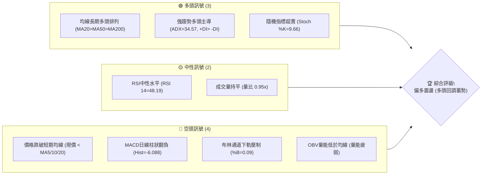
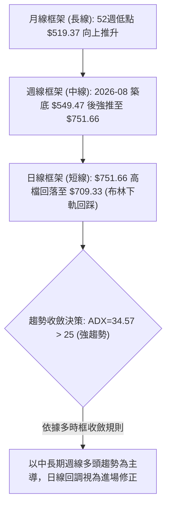
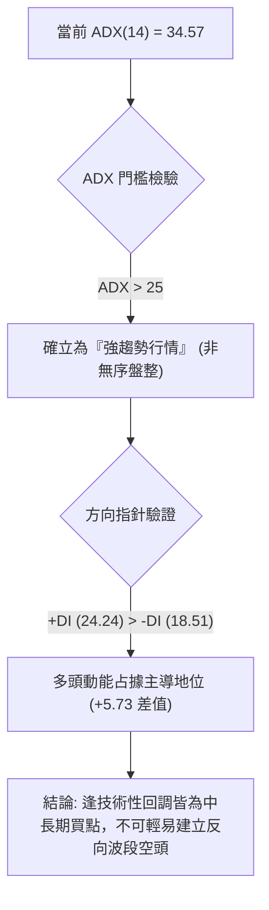
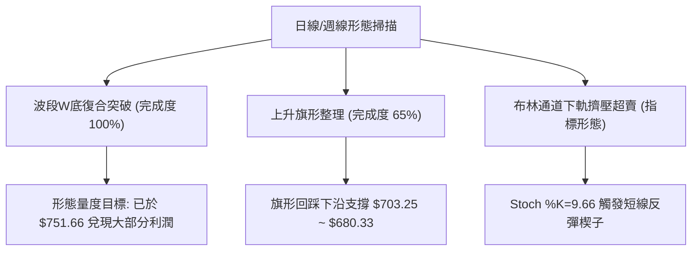
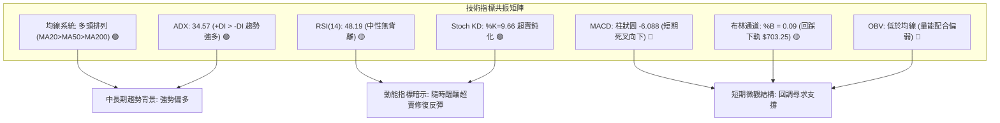
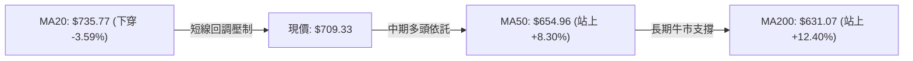
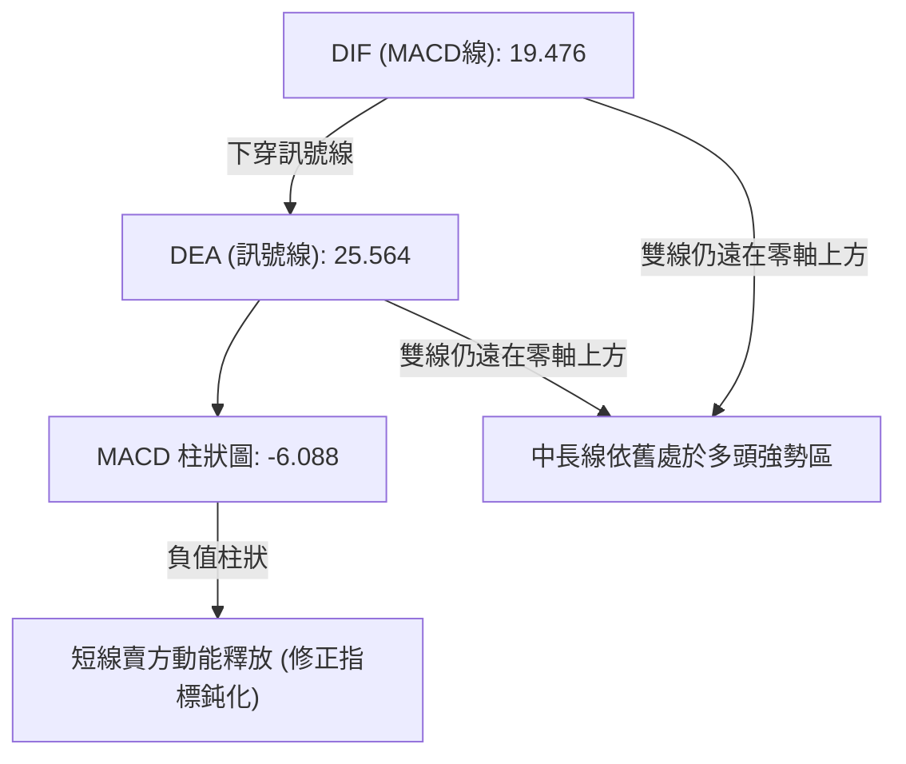
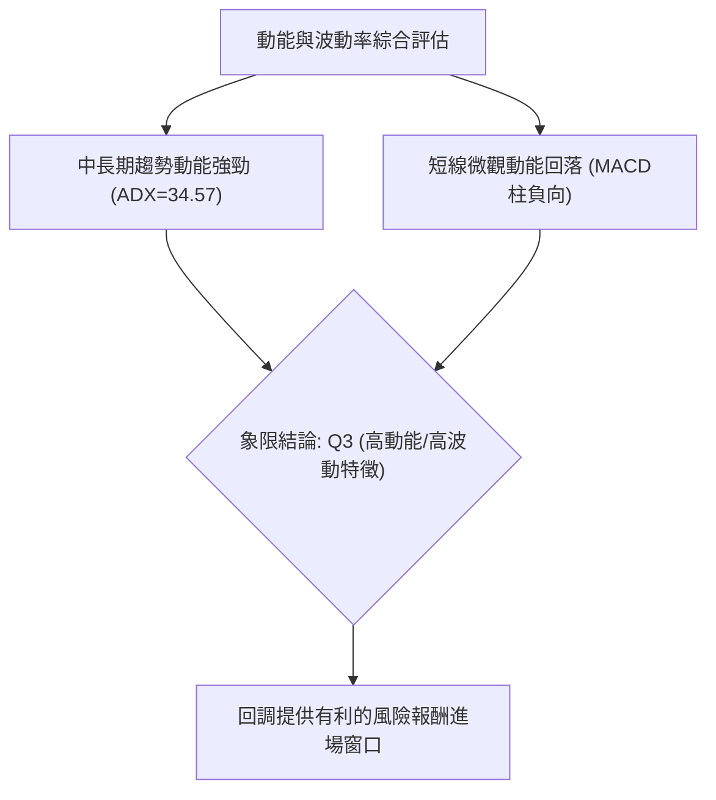
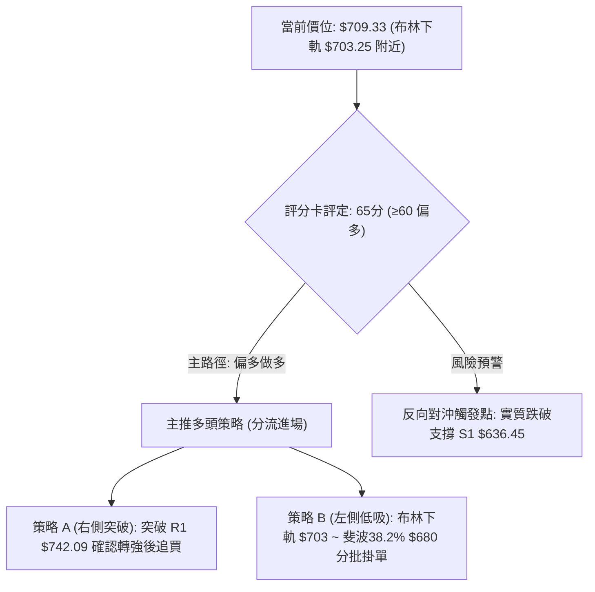
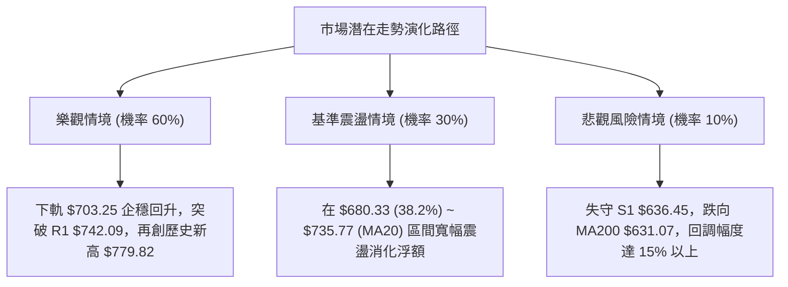

# META 技術分析報告

> **報告日期**：2026-10-17 ｜ **語言**：繁體中文 ｜ **數據來源**：Yahoo Finance ｜ **當前價格**：$709.33

---

## 目錄

| 章節 | 內容 |
|------|------|
| [1. 技術面概覽](#1-技術面概覽) | 訊號儀表板、核心指標、評分卡 |
| [2. 趨勢分析](#2-趨勢分析) | 多時框趨勢、長中短期走勢 |
| [3. 圖表形態分析](#3-圖表形態分析) | 形態識別、K線組合、目標價 |
| [4. 支撐與阻力](#4-支撐與阻力) | 關鍵價位、斐波那契回調 |
| [5. 技術指標深度解讀](#5-技術指標深度解讀) | MA/RSI/MACD/布林/成交量 |
| [6. 動能與波動率](#6-動能與波動率) | 動能評估、ATR、Beta |
| [7. 多時框架總結](#7-多時框架總結) | 時框架評分矩陣 |
| [8. 交易策略建議](#8-交易策略建議) | 多空策略、風險報酬比 |
| [9. 風險提示與監控](#9-風險提示與監控) | 監控指標、風險場景 |

---

## 1. 技術面概覽

### 🎯 技術訊號儀表板



### 📊 核心指標速覽表

| 指標類別 | 指標名稱 | 當前數值 | 訊號 | 解讀 |
|:---|:---|:---|:---:|:---|
| **價格** | 當前收盤價 | $709.33 | 🟡 | 位於52週區間72.9%高位，短線遭遇回調整理 |
| **均線** | 短期 MA20 | $735.77 | 🔴 | 現價低於MA20達-3.59%，短期跌破生命線 |
| **均線** | 中期 MA50 | $654.96 | 🟢 | 現價高於MA50達+8.30%，中期多頭架構完好 |
| **均線** | 長期 MA200 | $631.07 | 🟢 | 現價高於MA200達+12.40%，長期牛市基石穩固 |
| **動能** | RSI(14) | 48.19 | 🟡 | 位於中性平衡區，無明顯超買或背離特徵 |
| **動能** | MACD(12,26,9) | 19.476 / 25.564 | 🔴 | MACD柱為-6.088，快慢線死叉，短線動能減弱 |
| **動能** | Stoch %K / %D | 9.66 / 31.69 | 🟢 | 進入極度超賣區間，短線存在技術性反彈動能 |
| **趨勢** | ADX / DI | 34.57 (+DI 24.24) | 🟢 | ADX>25且+DI>-DI，確立中長期強多頭趨勢環境 |
| **通道** | 布林通道 | 下軌 $703.25 (%B 0.09) | 🟡 | 逼近下軌支撐，進入下軌反彈或擠壓臨界點 |
| **波動** | ATR(14) | $22.11 (3.12%) | 🟡 | 波動率處於中等偏高，日震幅大約為22美元 |
| **量能** | OBV 走勢 | OBV < MA | 🔴 | 資金進場意願暫緩，短線量能配合度不足 |

### 🏆 技術評分卡

```
╔══════════════════════════════════════════════════════════════════╗
║                 技術評分卡 — META (2026-10-17)                  ║
╠══════════════════════════════════════════════════════════════════╣
║ 趨勢強度 (ADX=34.57)      ████████████████░░░░  80/100   🟢 強多 ║
║ 動能指標 (RSI/MACD/Stoch) ██████████░░░░░░░░░░  50/100   🟡 中性 ║
║ 支撐穩定度 (S1/S2/斐波那契)██████████████░░░░░░  70/100   🟢 穩固 ║
║ 成交量配合 (OBV/20D均量)  ████████░░░░░░░░░░░░  40/100   🔴 疲弱 ║
║ 形態完整度 (週線波段上升) ██████████████░░░░░░  70/100   🟢 良好 ║
║ 均線排列 (MA20>MA50>MA200)████████████████░░░░  80/100   🟢 多頭 ║
╠══════════════════════════════════════════════════════════════════╣
║ 綜合技術評分              █████████████░░░░░░░  65/100   🟢 偏多 ║
╚══════════════════════════════════════════════════════════════════╝
```

---

## 2. 趨勢分析

### 🌐 多時框趨勢分析



### 📈 長期趨勢 — 12個月走勢圖（Unicode）

```
META 月線收盤走勢圖（過去12個月：2025-11 至 2026-10）
價格軸 ($)
$750 ┤                                           ● (2026-09: $725.18)
$700 ┤                                   ●        │ ● (現價: $709.33)
$650 ┤ ●━━━━━●          ● (2026-01: $714.66)     │ │
$600 ┤        │          │        ●        ●     │ │
$550 ┤        │ ●━━━━━━● │        │ ●━━━━● │     │ │
     └────────┼─┼──────┼─┼────────┼─┼────┼─┼─────┼─┼───────► 月份
             11 12     01 02      03 04  05 06   07 08 09 10
             (2025)   (2026)
```

#### 過去12個月關鍵波段特徵分析

| 階段時間 | 起始價 / 終止價 | 漲跌幅 | 波段性質 | 關鍵技術特徵 |
|:---|:---:|:---:|:---|:---|
| **2025-11 ~ 2026-01** | $645.76 → $714.66 | +10.67% | 年末波段衝高 | 均線向上發散，挑戰700美元大關 |
| **2026-01 ~ 2026-03** | $714.66 → $571.15 | -20.08% | 中期深度回調 | 獲利了結賣壓湧現，連續跌破短期均線 |
| **2026-03 ~ 2026-05** | $571.15 → $631.43 | +10.55% | 區間震盪反彈 | 於MA200上方築底回升，成交量逐步萎縮 |
| **2026-05 ~ 2026-07** | $631.43 → $556.27 | -11.90% | 二度探底洗盤 | 7月收盤 $556.27，逼近52W低點 $519.37 形成雙重支撐 |
| **2026-08 ~ 2026-09** | $571.89 → $725.18 | +26.80% | 主升浪爆發 | 週線連續放量大陽線突破，直攻波段高位 $751.66 |
| **2026-10 (當前)** | $725.18 → $709.33 | -2.19% | 頂部技術修正 | 遭遇歷史高檔壓力區，短線指標鈍化回踩 |

### 📊 中期趨勢（週線分析）

```
META 近期週線壓力與支撐結構架構
══════════════════════════════════════════════════════════════
 [52W高點強阻力] ────────────────── $779.82 (波段天花板)
                 ────────────────── $751.66 (2026-09-27 週收盤頂峰)
 [密集阻力區 R1] ────────────────── $742.09
 ═══════════════ [現價: $709.33] ════════════════════════════
 [斐波 23.6% 位] ────────────────── $718.35 (短線失守轉阻力)
 [斐波 38.2% 位] ────────────────── $680.33 (多頭黃金防守位)
 [中期支撐 S1]   ────────────────── $636.45 (波段平台低點聚類)
 [52W低點底座]   ────────────────── $519.37 (中長線絕對底部)
══════════════════════════════════════════════════════════════
```

近20週數據顯示，2026-08-02觸及 $556.27（RSI跌至22.9極度超賣）後，迎來長達7週的放量上攻行情。2026-09-27創出週收盤高點 $751.66，單週成交量放大至168,307,000股。隨後連續3週收陰（$728.08 → $718.67 → $709.33），週MACD柱由正轉負（從+11.729降至-6.088），週成交量回落至1億股左右，表明當前處於典型的主升浪後次級回調。

### ⚡ 趨勢強度評估（ADX 解讀）



| 指標名稱 | 數值 | 臨界基準 | 當前狀態評估 |
|:---|:---:|:---:|:---|
| **ADX(14)** | 34.57 | 25.00 | **強趨勢 (Strong Trend)**：趨勢推動力充沛，中長期軌道不易被單週回調破壞 |
| **+DI** | 24.24 | 20.00 | **多頭主攻力量**：保持在擴張區，多方籌碼仍具定價權 |
| **-DI** | 18.51 | 20.00 | **空頭防守力量**：雖有抬頭，但仍受制於多方趨勢線之下 |
| **差值 (+DI - -DI)**| +5.73 | 0.00 | **多頭淨優勢**：趨勢多頭偏向確立 |

---

## 3. 圖表形態分析

### 🔍 形態識別系統



#### 形態識別與信心度清單

| 形態名稱 | 信心度 | 判斷依據（嚴格引用數據） | 完成度 | 形態量度目標價（附精確計算式） |
|:---|:---:|:---|:---:|:---|
| **大型復合雙底 (W-Bottom)** | **85%** | 兩次波段低點分別為2026-03收盤 $571.15 與2026-08低點 $549.47（靠近支撐區 S3 $594.61 之下）。頸線為2026-05收盤高點 $631.43。 | 100% | 頸線 $631.43 + 形態高度($631.43 - $549.47 = $81.96) = **$713.39**（已於9月完全達成，最高觸及 $751.66） |
| **高位下降旗形 (Bullish Flag)** | **65%** | 9月27日週收盤衝至 $751.66 後，連續3週呈階梯狀量縮陰線回調（$728.08 → $718.67 → $709.33），回調幅度未破斐波那契38.2% ($680.33)。 | 65% | 旗桿底 $549.47 至旗頂 $751.66 (高差 $202.19)。突破旗形上軌(R1 $742.09)量度目標 = $742.09 + $202.19 = **$944.28** |
| **頭肩頂形態** | **20%** | 訊號不足。目前僅有單一高點聚類，右肩並未構築，嚴禁主觀通靈預測反轉。 | 0% | 數據中未偵測到 |

### 🕯️ 重要K線形態分析

| 週期/日期 | 收盤價 | K線形態名稱 | 形態特徵與技術解讀 | 訊號方向 |
|:---|:---:|:---|:---|:---:|
| **2026-08-02** | $556.27 | **極限超賣錘頭底** | 單週巨量1.12億股砸盤後留長下影線，RSI降至22.9，確認52W低點 $519.37 具備強大防守買盤。 | 🟢 強烈看多 |
| **2026-09-27** | $751.66 | **突破大陽長紅線** | 單週暴增至1.68億股，以近乎光頭光腳的強勢形態直接擊穿MA20與MA50，確立多頭主升浪。 | 🟢 強烈看多 |
| **2026-10-04** | $728.08 | **高位孕線整理** | 高檔放緩，實體收於前一週實體內部，表明買盤在逼近歷史阻力 R3 $779.82 時轉為謹慎。 | 🟡 中性微空 |
| **2026-10-18** | $709.33 | **三隻黑烏鴉回踩線** | 連續3週陰線收盤，刺穿斐波那契23.6% ($718.35)，但量能連續遞減，顯示為良性技術洗盤。 | 🟡 震盪整理 |

### 📉 ASCII 走勢形態示意圖

```
META 高位下降旗形（Bullish Flag）結構分析示意圖
價格 ($)
$756.59 (R2) ┬───────────────────────────────┐
$751.66      ┤             ● [旗頂峰位]        │
$742.09 (R1) ┤            / \                │ [阻力上沿趨勢線]
$735.77 (MA20)┤           /   \  ●            ▼
$718.35 (23.6%)┤          /     \/ \  ●        
$709.33 (現價) ┤         /       \  \/ \  ● ◄─ 當前位置 (旗形下沿測試)
$703.25 (BB下軌)┤        /         \  \  \/    ▲
$680.33 (38.2%)┤       /           \  \       │ [支撐下沿趨勢線]
$654.96 (MA50) ┤      /             \  \      │
$549.47        ┴─────● [旗桿起點]     └──┴───────┴────────────────
               2026-08-23          2026-09-27  2026-10-17
```

### 🎯 形態目標價計算

依據量化技術分析規則，高位上升旗形的潛在推升量度目標推算如下：
1. **旗桿高度計算**：
   - 起點：2026-08-23 週收盤低點 = $549.47
   - 頂點：2026-09-27 週收盤頂峰 = $751.66
   - 旗桿垂直高度 $H = \$751.66 - \$549.47 = \mathbf{\$202.19}$
2. **突破確認條件**：日線收盤價帶量突破阻力位 R1 = **$742.09**
3. **量度推算目標價**：
   - 形態第一量度目標（基於保守突破口）：R1 $742.09 + $202.19 = **$944.28**
   - 形態次級目標（直接波段前高）：阻力位 R3 = **$779.82**（52週高點）

---

## 4. 支撐與阻力

### 🗺️ 關鍵價位分布圖（Unicode）

```
META 價位結構分布圖（嚴格依據 OHLCV 計算）
══════════════════════════════════════════════════════════════════════
 $779.82 ║██████████████████████████████║ 強阻力 R3 (52W歷史高點 / 斐波0.0%)
 $756.59 ║████████████████████          ║ 阻力位 R2 (近一年波段高點聚類)
 $742.09 ║████████████████████████      ║ 關鍵阻力 R1 (短期多空解套賣壓)
 $735.77 ║------------------------------║ 短期均線壓制 (MA20 / 布林中軌)
 $718.35 ║······························║ 斐波那契 23.6% 回調位
 $709.33 ╠══════════════════════════════╣ ◄── 現價 ($709.33)
 $703.25 ║~~~~~~~~~~~~~~~~~~~~~~~~~~~~~~║ 日線布林下軌支撐 (%B = 0.09)
 $680.33 ║▓▓▓▓▓▓▓▓▓▓▓▓▓▓▓▓▓▓▓▓▓▓        ║ 核心防守 (斐波那契 38.2% 回調位)
 $654.96 ║------------------------------║ 中期生命線 (MA50 均線)
 $649.59 ║░░░░░░░░░░░░░░░░░░░░░░░░░░░░░░║ 斐波那契 50.0% 回調位
 $636.45 ║▓▓▓▓▓▓▓▓▓▓▓▓▓▓▓▓▓▓▓▓▓▓▓▓▓▓▓▓  ║ 近期波段關鍵支撐 S1
 $626.54 ║██████████████████████████████║ 強支撐 S2 (波段密集底聚類)
 $594.61 ║██████████████████████████████║ 終極防禦支撐 S3
 $519.37 ║██████████████████████████████║ 52W 絕對低點 (斐波 100.0%)
══════════════════════════════════════════════════════════════════════
```

### 🚧 阻力位分析表

| 阻力級別 | 引用價位 | 形成技術原因 | 突破難度評估 | 重要性 |
|:---|:---:|:---|:---:|:---:|
| **關鍵阻力 R1** | **$742.09** | 近一年波段高點聚類位，高度重合MA20 ($735.77) 及短期均線密集成交區。 | 🟡 中等 (需日均量放量至2500萬股以上) | ★★★★☆ |
| **波段阻力 R2** | **$756.59** | 9月27日週波段衝高受阻回調的高點密集群，多頭籌碼套牢平台。 | 🔴 較高 (空頭二次狙擊防線) | ★★★☆☆ |
| **強阻力 R3** | **$779.82** | 52週歷史高點與斐波那契0.0%絕對極值位，中長期心理重大天花板。 | 🔴 極高 (需整體基本面超預期驅動) | ★★★★★ |

### 🛡️ 支撐位分析表

| 支撐級別 | 引用價位 | 形成技術原因 | 守住機率評估 | 重要性 |
|:---|:---:|:---|:---:|:---:|
| **近期支撐 S1** | **$636.45** | 近一年波段低點聚類，與MA60 ($642.73) 及MA50 ($654.96) 構築寬幅支撐緩衝帶。 | 🟢 85% (中期均線重兵把守) | ★★★★☆ |
| **強支撐 S2** | **$626.54** | 波段低點強聚集點，極度貼近長期生命線 MA200 ($631.07) 與 MA120 ($625.35)。 | 🟢 92% (牛熊分界紅線) | ★★★★★ |
| **終極防禦 S3** | **$594.61** | 近一年深度洗盤低點聚類，對應週線大級別量能堆積底部。 | 🟢 98% (長期牛市底座) | ★★★☆☆ |

### 📐 斐波那契回調位分析

> **計算基準**：以52週極值區間 **$519.37 (52W Low)** → **$779.82 (52W High)** 進行量化回調測算。

| 回調比率 | 確切價位 | 當前價格相對位置與技術解讀 |
|:---|:---:|:---|
| **0.0% (高點)** | **$779.82** | 52週歷史頂點，波段上攻終極量度目標位。 |
| **23.6%** | **$718.35** | **當前正位於此線下方（現價 $709.33）**。短線跌破此位顯示超強主升浪暫告一段落，轉入次級回調。此位已由支撐轉化為第一反彈阻力。 |
| **38.2%** | **$680.33** | **多頭強勢回調的黃金分水嶺**。只要回調不實質跌破 $680.33，整個2026下半年的上升趨勢結構保持完美，隨時具備重啟動能的條件。 |
| **50.0%** | **$649.59** | 多空中軸平衡線，與當前日線 MA50 ($654.96) 高度共振，屬於多頭中期底線。 |
| **61.8%** | **$618.86** | 黃金分割防守位，下方緊鄰 MA200 ($631.07) 及強支撐 S2 ($626.54)。 |
| **78.6%** | **$575.11** | 深度洗盤回調極限，接近2026年3月及8月回踩波段低點。 |
| **100.0% (低點)**| **$519.37** | 52週絕對底部，中長線多頭超級護城河。 |

---

## 5. 技術指標深度解讀

### 🎛️ 指標訊號總覽



### 📈 移動平均線排列分析



均線系統整體呈現典型的**多頭排列架構（MA20 $735.77 > MA50 $654.96 > MA200 $631.07）**。
- **短期均線群**：MA5 ($737.81)、MA10 ($733.07) 與 MA20 ($735.77) 呈現空頭反向壓制，現價低於這三條短期均線約3.5%左右，說明自9月底衝高 $751.66 以來的短線回調尚未出現右側反轉拐點。
- **中長期均線群**：MA60 ($642.73)、MA120 ($625.35) 與 MA240 ($631.91) 全部呈現平緩向上的健康發散形態。現價距離長期生命線 MA200 仍有超過12%的安全墊，中長期多頭格局牢不可破。

### 📉 RSI(14) 分析

```
RSI(14) 動能強度儀表
0 ──────────── 30 ────────────────────── 50 ────── 70 ─────────── 100
[   極度超賣   ] [      弱勢區      ] 48.19 [  強勢  ] [   極度超買   ]
                                        ▲
                                     當前位置
進度條: ████████████████████████░░░░░░░░░░░░░░░░░░░░░░░░ 48.19%
```

- **當前數值解讀**：日線 RSI(14) 報 **48.19**，位於 30–70 的常規中性區域，說明經過連續3週的回調，9月下旬的極度超買現象已經被完全消化。
- **背離檢驗結論**：
  - **頂背離判斷**：無頂背離。2026-09-27 週收盤創出 $751.66 新高時，週 RSI 高達 76.6（前幾週一度達 83.9），指標與價格同步創出波段高位，並未出現「價格創新高而 RSI 無法突破」的頂背離形態。
  - **底背離判斷**：無底背離。目前價格處於高檔正常回調階段，指標隨價格線性回落，不存在底背離。

### 📊 MACD(12/26/9) 訊號解讀



日線 MACD 數值為 **19.476**，訊號線為 **25.564**，兩者均顯著高於零軸（Zero Line），證明當前的回調是**零軸之上的強勢多頭修正**，而非轉入熊市的弱勢死叉。MACD Histogram 當前為 **-6.088**，柱狀體呈現擴散態勢，意味著短線下行動能仍未完全衰竭，預示多方尚未組織起有效反攻，仍需1–2週的時間完成指標修復。

### 📦 布林通道分析

```
META 日線布林通道結構示意圖
──────────────────────────────────────────────────────────── $768.30 (上軌)
       
              ────────────────────────────── $735.77 (中軌 / MA20)
       
  ◄── 現價: $709.33 (逼近下軌，%B = 0.09)
──────────────────────────────────────────────────────────── $703.25 (下軌)
```

- **通道帶寬與位置**：
  - BB 上軌：**$768.30**
  - BB 中軌（MA20）：**$735.77**
  - BB 下軌：**$703.25**
- **%B 指標分析**：當前 **%B = 0.09**，極端逼近下軌（0代表下軌，0.5代表中軌，1.0代表上軌）。依據統計學原理，當股價在強多頭趨勢（ADX>25）中回踩至布林下軌且 %B < 0.10 時，屬於高度不對稱的高勝率勝差區間，往往具備均值回歸至中軌（$735.77）的強烈引力。

### 💹 成交量分析（量價配合度）

```
成交量對比柱狀圖
最新成交量  [20.59M] ████████████████████░░ 0.95x
20日均量    [21.77M] █████████████████████  1.00x
50日均量    [19.19M] ██████████████████░░░░ 0.88x
```

- **量比與換手解讀**：最新成交量為 20,594,600 股，與20日均量 21,774,435 股相比，量比為 **0.95x**，顯示下跌過程中並未引發恐慌性拋售盤，符合「回調縮量」的良性格局。
- **OBV（能量潮）分析**：數據顯示當前 `OBV < MA`，標注為「量能疲弱」。這表明主力資金在當前價位採取被動掛單承接，而非主動拉抬掃貨。在 OBV 重新拐頭金叉其均線之前，股價大概率維持在下軌附近反覆震盪打底。

---

## 6. 動能與波動率

### ⚡ 動能評估四象限

| 象限 | 動能強度 | 波動率水平 | 當前標的狀態 | 交易策略導向 |
|:---|:---:|:---:|:---:|:---|
| **第一象限 (Q1)** | 強動能 (Bullish) | 低波動 (Low Vol) | — | 趨勢持股狂奔，最佳追價加碼點 |
| **第二象限 (Q2)** | 弱動能 (Bearish) | 低波動 (Low Vol) | — | 弱勢陰跌盤整，資金使用效率低 |
| **第三象限 (Q3)** | **強動能 (ADX 34.57)** | **中高波動 (ATR 3.12%)** | **✓ META 處於此象限** | **高勝率波段操作：利用回調關鍵支撐分批低吸** |
| **第四象限 (Q4)** | 弱動能 (Consolidation) | 極高波動 (Extreme Vol)| — | 劇烈雙向洗盤，嚴格觀望避免爆倉 |



### 📊 ATR 波動率分析

- **ATR(14) 絕對值**：**$22.11**（佔現價比例為 **3.12%**）。
- **日內與隔夜波動管理建議**：
  - 由於日均波動高達 $22.11，任何短線交易的止損距離設定不可小於 1.0 倍 ATR（即至少 $22 美元空間），以防止正常的日內市場雜訊造成無謂洗出場。
  - 對於波段波段交易者，建議防守止損距離設定在 **1.5 ~ 2.0 倍 ATR**，即 **$33.16 ~ $44.22** 之間。從現價 $709.33 向下推算，恰好覆蓋至斐波那契38.2%回調位 **$680.33** 附近，體現了技術指標與波動率模型的嚴密共振。

### 📐 Beta 與市場相關性

- **Beta 係數**：**1.185**。
- **市場敏感度特徵**：META 相較於標普500指數具備 18.5% 的額外波動彈性。在美股大盤處於牛市氛圍時，META 往往具備極強的超額阿爾法（Alpha）進攻性；反之，若大盤出現系統性回調，META 的短線下挫幅度也會放大。因此在倉位管理上必須動態對沖大盤系統性風險。

---

## 7. 多時框架總結

### 📋 時框架評分表

| 時框架 | 趨勢方向 | 動能狀態 | 均線排列 | 圖表形態 | 綜合評分 | 戰術建議 |
|:---|:---:|:---:|:---:|:---:|:---:|:---|
| **長期 (月線)** | 🟢 強烈看多 | 🟢 多頭推升 | 🟢 完全多頭發散 | 24個月長線上升通道 | **85/100** | 長線多頭籌碼堅定持股續抱 |
| **中期 (週線)** | 🟢 震盪看多 | 🟡 高檔鈍化修復 | 🟢 MA50/200健康支撐 | 上升旗形旗面整理 | **75/100** | 週線級別逢低尋找加碼支撐點 |
| **短期 (日線)** | 🔴 弱勢修正 | 🔴 死叉釋放中 | 🔴 跌破MA20短期均線 | 布林下軌超賣測試 | **45/100** | 暫緩追高，等待超賣反彈訊號確認 |

### 🔲 綜合訊號矩陣

```
時框架訊號收斂圖示：
月線 (長期) ──────► 🟢 [強烈多頭] (年化漲幅顯著，均線全面多頭)
週線 (中期) ──────► 🟢 [上升旗形] (放量主升浪後的正常縮量回調)
日線 (短期) ──────► 🔴 [下軌震盪] (受制於短期均線群 MA5/MA10/MA20)
────────────────────────────────────────────────────────────────
共振決策結論 ────► ⚖️ 【短空長多】 短期回調創造中期絕佳買點
```

### ⚖️ 多時框收斂結論

> **依據多時框收斂規則第 14 條執行收斂**：
> 1. **趨勢強度檢驗**：當前 **ADX(14) = 34.57 顯著高於 25**，市場明確處於「強趨勢行情」，而非無方向的盤整震盪。
> 2. **主導權優先級**：在強趨勢環境下，多時框分析**必須以中長期（週線 / MA50 / MA200）方向為主導**，日線級別的指標弱勢（如 MACD 柱翻負、價格跌破 MA20）只能被定性為**主升浪途中的次級回調**，嚴禁作為反轉做空的依據。日線的主要功能是利用其超賣指標（Stoch %K=9.66、布林下軌 %B=0.09）精確定位波段進場時機。
> 3. **唯一方向性結論**：**【偏多格局中的技術性蓄勢回調】**。主策略鎖定「逢低做多」，與第1章評分（65分）及第2章趨勢推演完全一致。

---

## 8. 交易策略建議

### 🗺️ 策略決策流程圖



### 🧭 策略路由（依評分卡分流）

- **當前主策略方向 = 【逢低做多 / 逢突破加碼】（依技術評分卡 65/100 確立）**
- **策略路由說明**：由於綜合評分達 65 分，屬於偏多區間，且 ADX(14)=34.57 確立強多頭趨勢，因此本報告**主推多頭策略**。空頭僅作為下行破位時的「反轉風險提示與對沖預案」，絕不作雙向對衝投機推薦。

### 🎯 價格情境階梯（Price Scenarios）

| 觸發條件 | 下一目標價位 | 後續延伸價位 | 情境技術含義 |
|:---|:---:|:---:|:---|
| **帶量突破 R1 $742.09** | **R2 $756.59** | **R3 $779.82** | 短線回調徹底結束，上升旗形確認向上突破，挑戰歷史新高 |
| **守住布林下軌 $703.25 ~ 現價** | **MA20 $735.77** | **R1 $742.09** | 展開布林通道內部的均值回歸修復反彈行情 |
| **回踩失守 $703.25** | **斐波38.2% $680.33** | **S1 $636.45** | 旗形回調加深，多頭退守中期均線核心防禦平台 |

### 📊 情境機率分佈

| 預測情境 | 發生機率 | 主要量化與技術依據 |
|:---|:---:|:---|
| **情境一：下軌企穩展開震盪反彈** | **60%** | ADX=34.57 確立多頭大趨勢；Stoch %K=9.66 進入嚴重超賣；布林通道 %B=0.09 觸及下軌邊界支撐；回調縮量 (量比 0.95x)。 |
| **情境二：跌破下軌回踩 $680 核心支撐** | **30%** | 日線 MACD 柱狀體依舊為負 (-6.088)；OBV 低於均線顯示主動買盤不足；美股大盤波動可能帶來額外拖累。 |
| **情境三：直接反轉破位大跌破 $636** | **10%** | 中長期均線 MA50 ($654.96) 與 MA200 ($631.07) 發散向上，中線具備極強支撐托底，極端下行機率極低。 |

### 🟢 主策略詳情（多頭主攻）

```
主策略風險報酬矩陣比對
策略 A (突破追買)  [R:R = 2.45:1]  ████████████████████████░  (目標: $779.82)
策略 B (下軌低吸)  [R:R = 2.47:1]  ████████████████████████░  (目標: $756.59)
```

| 策略要素 | 策略 A（右側追強突破策略） | 策略 B（左側支撐低吸策略） |
|:---|:---|:---|
| **進場條件** | 日線帶量收盤突破 R1，確認短線回調結束 | 價格回踩布林下軌至斐波那契38.2%區間掛單 |
| **進場價格** | **$743.00**（突破 R1 $742.09 後進場） | **$704.00**（依託布林下軌 $703.25 進場） |
| **第一目標 (T1)** | **$756.59**（波段阻力 R2） | **$735.77**（回歸布林中軌 / MA20） |
| **第二目標 (T2)** | **$779.82**（52週歷史高點 R3） | **$756.59**（波段高點阻力 R2） |
| **止損價格** | **$728.00**（低於2026-10-04週收盤低點） | **$680.00**（斐波那契 38.2% 回調位 $680.33 之下） |
| **風險空間** | $15.00 ($743.00 - $728.00) | $24.00 ($704.00 - $680.00) |
| **報酬空間 (T2)**| $36.82 ($779.82 - $743.00) | $52.59 ($756.59 - $704.00) |
| **風險報酬比 (R:R)**| **2.45 : 1**（優良） | **2.47 : 1**（極佳） |
| **預估勝率** | **65%** | **60%** |
| **建議倉位** | **總資金之 15%** | **總資金之 20%（分兩批進場）** |

### 🔴 反向風險觸發點（對沖提示）

- **多頭波段警報觸發位**：若日線收盤價跌破斐波那契38.2% **$680.33**，應將多頭總倉位降低至 10% 以下。
- **牛熊全面翻空觸發位**：若週線收盤實質跌破關鍵支撐 **S1 $636.45** 及長期生命線 **MA200 $631.07**，則宣告本輪自 $519.37 以來的牛市行情終結，多頭應無條件全數止損離場，屆時可建立以 **S3 $594.61** 為目標的做空避險部位。

### ⭐ 整體訊號強度評星

```
做多訊號強度：★★★★☆  (4/5星 — 趨勢多頭明確，回調接近強支撐)
做空訊號強度：★☆☆☆☆  (1/5星 — 逆強勢大趨勢做空，勝率極低)
整體分析可信度：★★★★☆  (4/5星 — 數據鏈完整，指標共振明確)
```

---

## 9. 風險提示與監控

### ✅ 關鍵監控指標 Checklist

```
╔══════════════════════════════════════════════════════════════════╗
║               每日與每週交易風控核心監控清單                     ║
╠══════════════════════════════════════════════════════════════════╣
║ [ ] 1. 價格是否守穩布林下軌 $703.25？(跌破將引發下探 $680)      ║
║ [ ] 2. MACD 柱狀體是否由負擴大轉向收斂？(拐點確認訊號)          ║
║ [ ] 3. Stoch %K 是否向上突破 %D 形成黃金交叉？(超賣回升確認)   ║
║ [ ] 4. 日成交量能否回升至 20日均量 (21.77M 股) 以上？(量價配合) ║
║ [ ] 5. 是否放量突破阻力位 R1 $742.09？(旗形突破確認訊號)        ║
║ [ ] 6. 納斯達克大盤是否出現系統性破位風險？(Beta 1.185 聯動)    ║
╚══════════════════════════════════════════════════════════════════╝
```

### ⚠️ 風險場景分析



### 🛡️ 風險管理重要提醒

1. **嚴禁逆勢重倉加碼**：雖然當前處於強趨勢（ADX=34.57），但在 MACD 柱狀圖未翻紅收斂之前，嚴禁一次性打滿倉位。務必採用分批金字塔式建倉策略。
2. **止損嚴肅性**：若執行策略 B，必須以 **$680.00** 作為鐵律止損點。一旦失守該位置，意味著多頭強勢回調結構轉弱，後續可能出現向 MA50 / S1 ($636.45) 的深幅回撤。
3. **波動率緩衝**：依據 ATR(14) = $22.11 的特性，單日波動在正負20美元之內均屬常態，切忌在盤中因小幅波動而隨意更改既定交易計劃。

---

## 📋 報告總結

```
╔══════════════════════════════════════════════════════════════════╗
║                  META 技術分析報告總結儀表                      ║
╠══════════════════════════════════════════════════════════════════╣
║ 報告日期：2026-10-17              當前價格：$709.33             ║
║ 綜合技術評分：65/100 (偏多)       技術評級：🟢 偏多回調蓄勢     ║
╠══════════════════════════════════════════════════════════════════╣
║ 關鍵技術結論：                                                   ║
║ ├─ 長期趨勢 (月線)：🟢 強烈看多 (長牛發散，支撐穩固)             ║
║ ├─ 中期趨勢 (週線)：🟢 上升旗形 (主升浪後的縮量健康洗盤)         ║
║ ├─ 短期趨勢 (日線)：🔴 弱勢修正 (布林下軌超賣測試中)             ║
║ ├─ 核心支撐架構：近期下軌 $703.25 ｜ 斐波防守 $680.33 ｜ S1 $636.45║
║ ├─ 核心阻力結構：關鍵阻力 R1 $742.09 ｜ R2 $756.59 ｜ 高點 $779.82 ║
║ └─ 華爾街分析師目標：均價 $814.51 (共識評價: Strong Buy)        ║
╠══════════════════════════════════════════════════════════════════╣
║ 最優戰術執行組合：                                               ║
║ 1. 🥇 最佳機會 (策略 B)：依託布林下軌在 $704 附近分批低吸，      ║
║                  止損設於 $680，目標看至 $735.77 與 $756.59。    ║
║ 2. 🥈 次選機會 (策略 A)：等待帶量突破 R1 $742.09 後順勢追進，    ║
║                  目標直指 52週歷史高點 $779.82。                 ║
║ 3. 🥉 防守對策：若收盤實質跌破 $680.33，嚴格執行防守減倉觀望。  ║
╚══════════════════════════════════════════════════════════════════╝
```

---

> ⚠️ **免責聲明**：本報告為依據量化技術指標與歷史行情數據生成之技術分析研究，所有數據與推演均基於 Yahoo Finance 提供的歷史價格資訊。本報告**僅供學術研究與投資策略參考**，**不構成任何要約或具體投資建議**。市場有風險，交易決策需獨立評估並自負盈虧。

---

*報告生成時間：2026-10-17 ｜ 數據來源：Yahoo Finance ｜ 分析框架：多時框技術分析模型*