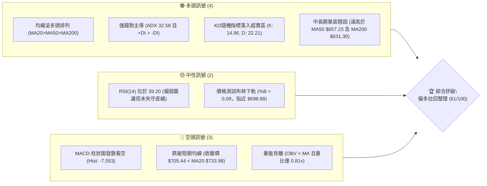
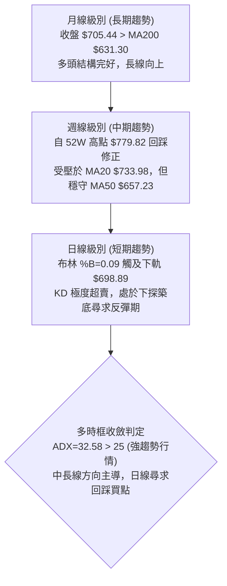
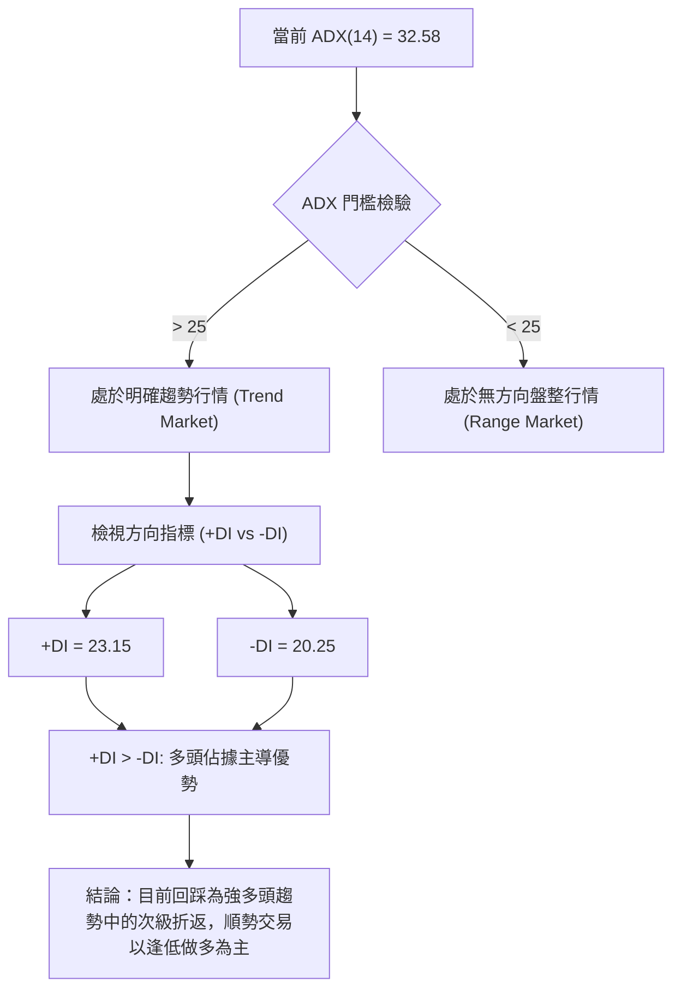
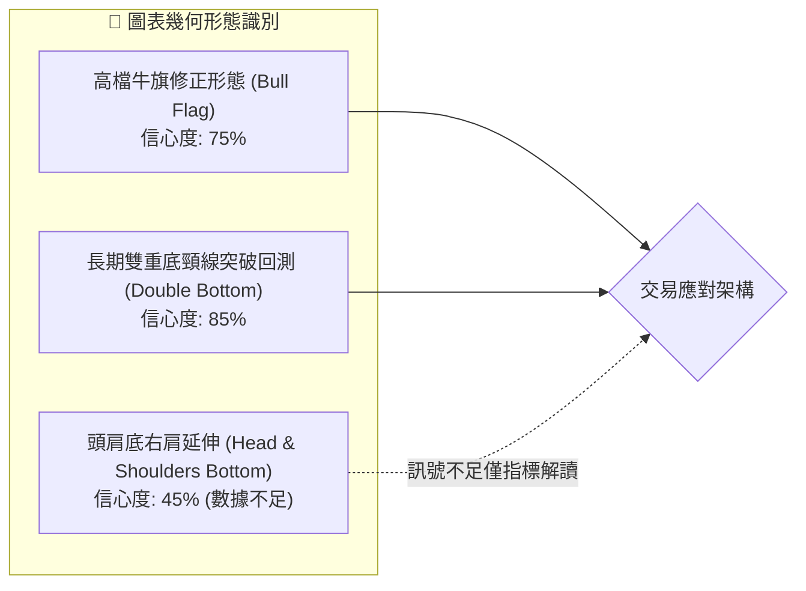
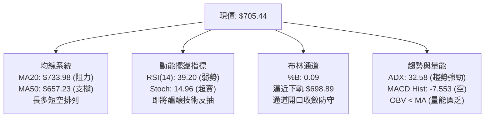
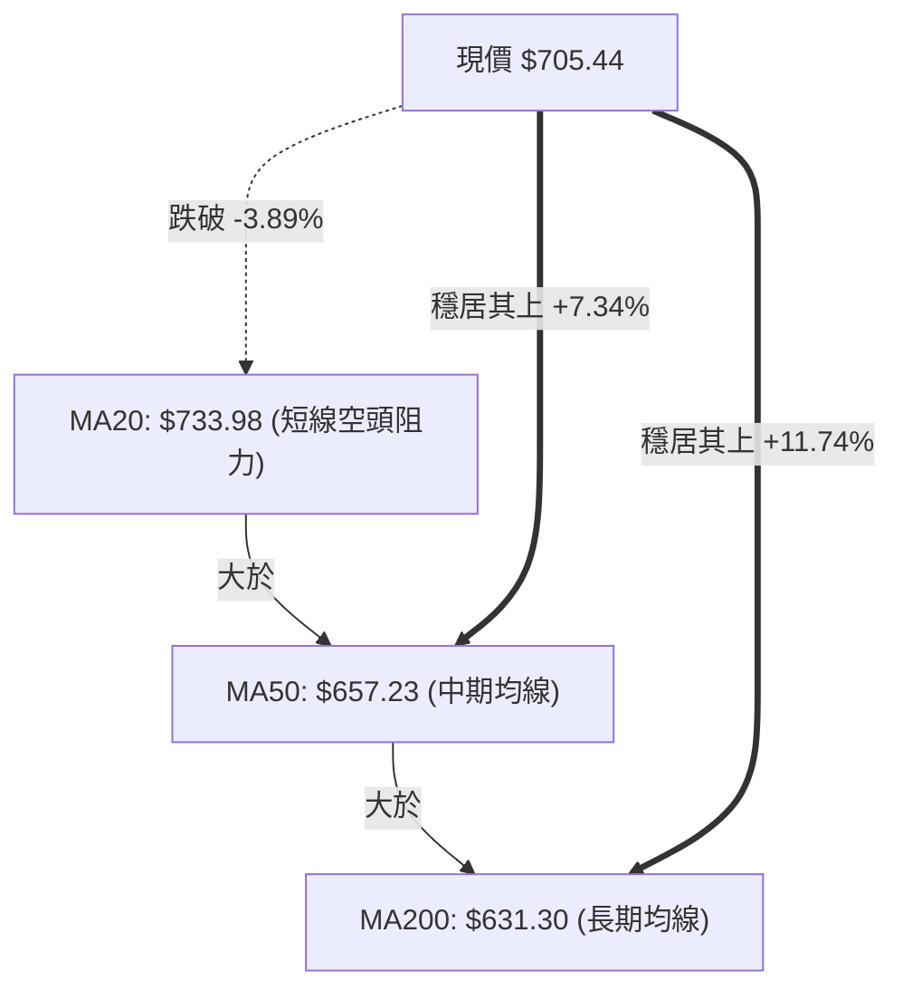
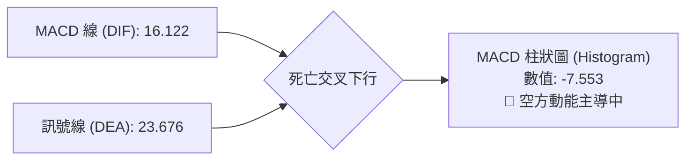
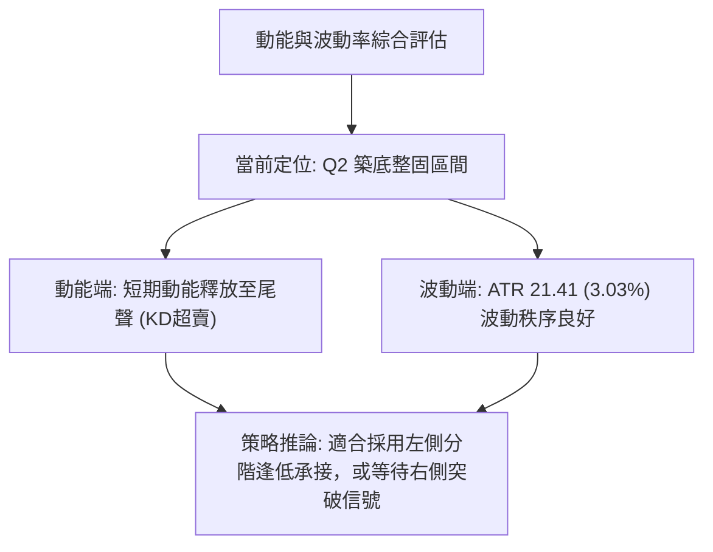
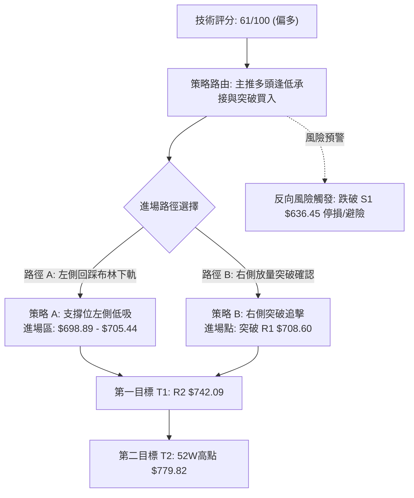
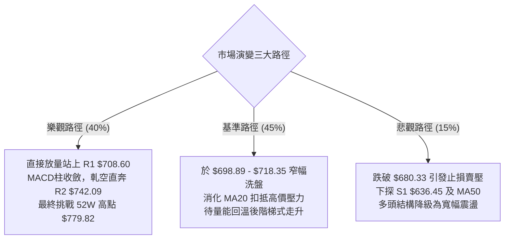

# META 技術分析報告

> **報告日期**：2026-10-20 ｜ **語言**：繁體中文 ｜ **數據來源**：Yahoo Finance ｜ **當前價格**：$705.44

---

## 目錄

| 章節 | 內容 |
|------|------|
| [1. 技術面概覽](#1-技術面概覽) | 訊號儀表板、核心指標、評分卡 |
| [2. 趨勢分析](#2-趨勢分析) | 多時框趨勢、長中短期走勢、ADX 解讀 |
| [3. 圖表形態分析](#3-圖表形態分析) | 形態識別、信心度評估、K線組合、目標價 |
| [4. 支撐與阻力](#4-支撐與阻力) | 關鍵價位分布、阻力與支撐表、斐波那契回調 |
| [5. 技術指標深度解讀](#5-技術指標深度解讀) | MA/RSI/MACD/布林/成交量量價配合 |
| [6. 動能與波動率](#6-動能與波動率) | 動能四象限、ATR 波動率、Beta 市場相關性 |
| [7. 多時框架總結](#7-多時框架總結) | 時框架評分矩陣、收斂規則與方向定調 |
| [8. 交易策略建議](#8-交易策略建議) | 策略路由、價格情境階梯、主策略與對沖點 |
| [9. 風險提示與監控](#9-風險提示與監控) | 關鍵監控清單、情境模擬、風控提醒 |
| [📋 報告總結](#-報告總結) | 核心結論與最優策略組合 |

---

## 1. 技術面概覽

### 🎯 技術訊號儀表板



### 📊 核心指標速覽表

| 指標類別 | 指標名稱 | 當前數值 | 訊號 | 解讀 |
|----------|----------|----------|------|------|
| **價格** | 當前收盤價 | $705.44 | 🟡 中性 | 處於52週區間71.4%高位，短線自高點回檔修正中 |
| **均線** | MA20 | $733.98 | 🔴 看空 | 股價位於MA20下方 -3.89%，短線轉為承壓阻力 |
| **均線** | MA50 | $657.23 | 🟢 看多 | 股價高於MA50 +7.34%，中長多頭防線依舊完好 |
| **均線** | MA200 | $631.30 | 🟢 看多 | 股價遠高於牛熊分界線 +11.74%，長期多頭格局未變 |
| **動能** | RSI(14) | 39.20 | 🟡 中性 | 進入弱勢中性格局，無頂/底背離，具反彈修復空間 |
| **動能** | MACD (12,26,9) | 16.12 / 23.68 | 🔴 看空 | MACD低於訊號線，柱狀圖 -7.553，短線修正動能釋放中 |
| **趨勢** | ADX (14) | 32.58 | 🟢 看多 | ADX > 25 處於強趨勢格局，+DI (23.15) > -DI (20.25) 多方佔優 |
| **動量** | Stoch %K/%D | 14.96 / 22.21 | 🟢 看多 | 雙雙進入 <20 之極度超賣區間，隨時具備技術性反彈動能 |
| **波動** | ATR (14) | $21.41 | 🟡 中性 | 每日波動率約 3.03%，波動正常無異常恐慌擴散 |
| **通道** | 布林通道 %B | 0.09 | 🟢 看多 | 逼近下軌 $698.89，進入統計學下緣超跌反彈機率高 |
| **成交量**| OBV 與量比 | 0.81x (弱) | 🔴 看空 | 成交量 16.23M 低於20日均量 20.15M，量能未放大支持推升 |

### 🏆 技術評分卡

```
╔══════════════════════════════════════════════════════════════╗
║              技術評分卡 — META (2026-10-20)                   ║
╠══════════════════════════════════════════════════════════════╣
║ 趨勢強度 (ADX/+DI)    ██████████████░░░░░░  72/100  🟢 偏多  ║
║ 動能指標 (RSI/MACD/KD) █████████░░░░░░░░░░░  46/100  🟡 中性  ║
║ 支撐穩定度 (S1/S2/Fib) ███████████████░░░░░  78/100  🟢 偏多  ║
║ 成交量配合 (OBV/Vol)  ████████░░░░░░░░░░░░  40/100  🔴 偏弱  ║
║ 形態完整度 (回調架構) █████████████░░░░░░░  65/100  🟢 偏多  ║
║ 均線排列 (多頭排列)   ██████████████░░░░░░  70/100  🟢 偏多  ║
╠══════════════════════════════════════════════════════════════╣
║ 綜合技術評分          ████████████░░░░░░░░  61/100  🟢 偏多  ║
║ 核心定調：多頭趨勢下的短期健康回踩，測試布林下軌防禦支撐    ║
╚══════════════════════════════════════════════════════════════╝
```

---

## 2. 趨勢分析

### 🌐 多時框趨勢分析



### 📈 長期趨勢 — 12個月走勢圖（Unicode）

以下為 META 過去 12 個月（2025-11 至 2026-10）之月線收盤價格軌跡與關鍵轉折點標註：

```
META 月線走勢圖（過去12個月）
價格軸 ($)
$750 ┤                                                ● 2026-09 ($725.18)
$720 ┤                                        ●       │  ● 現價 ($705.44)
$690 ┤                        ● 2026-01       │       │  │
$660 ┤● 2025-12 ($658.40)    │  ($714.66)    │       │  │
$630 ┤│                      │               │  ●    │  │
$600 ┤│                      │        ● 2026-04 │    │  │
$570 ┤│                      │  ●     ($610.86) │    │  │
$540 ┤│                      │  2026-03         ● 2026-07 ($556.27 低點)
     └┴──────────────────────┴──┴───────────────┴──────┴──┴───────►
     11月 12月  01月  02月  03月 04月 05月 06月 07月 08月 09月 10月
     (2025)                (2026)
```

**走勢特徵分析表格**：

| 階段區間 | 時間週期 | 價格區間 ($) | 漲跌幅 (%) | 形態特徵與多空意涵 |
|----------|----------|--------------|------------|--------------------|
| 第一階段：高檔震盪 | 2025-11 ~ 2026-01 | $645.76 → $714.66 | +10.67% | 衝高至 $714.66 形成波段高點，買盤力竭開始轉向修正 |
| 第二階段：深度下修 | 2026-02 ~ 2026-03 | $646.52 → $571.15 | -20.08% | 跌破多道短期均線，空方加速宣洩賣壓，進入主跌段 |
| 第三階段：築底回升 | 2026-04 ~ 2026-05 | $610.86 → $631.43 | +10.55% | 低檔技術性反抽，但上方解套賣壓沈重 |
| 第四階段：二次探底 | 2026-06 ~ 2026-07 | $562.85 → $556.27 | -11.90% | 形成大級別雙底型態的第二隻腳，7月探底 $556.27 後迅速反彈 |
| 第五階段：主升推升 | 2026-08 ~ 2026-09 | $571.89 → $725.18 | +26.80% | 伴隨放量連續大陽線拔高，確認突破中長期下降壓力線 |
| 第六階段：高位拉回 | 2026-10 (當前) | $725.18 → $705.44 | -2.72% | 衝高觸及 52W 高點 $779.82 後之健康回檔，尋求支撐確認 |

### 📊 中期趨勢（週線分析）

從近 20 週收盤走勢觀察，自 2026-08-02 的波段低點 $556.27 展開強烈 V 型反轉，於 2026-09-27 爆出週成交量 168.30M 並推升至收盤 $751.66。近 4 週呈現量縮連續陰線拉回：
- 2026-10-04：收盤 $728.08，週 MACD 柱翻負（-0.743）
- 2026-10-11：收盤 $718.67，RSI 降至 43.9
- 2026-10-18：收盤 $709.33，成交量放大至 101.36M 顯示獲利了結盤湧出
- 2026-10-25 (當前)：收盤 $705.44，暫時持穩於斐波那契 23.6% ($718.35) 與 38.2% ($680.33) 之間。

週線中期架構屬於「暴漲後的階梯式洗盤」，只要未跌破 50 週均線與頸線位，中期多頭架構未遭破壞。

### ⚡ 趨勢強度評估（ADX 解讀）



**ADX 趨勢強度對照矩陣**：

| 指標變數 | 實際讀數 | 門檻區間 | 技術含義解讀 |
|----------|----------|----------|--------------|
| **ADX (14)** | 32.58 | > 25 (強趨勢) | 市場具備明確趨勢驅動力，非純粹橫盤無序震盪，波段策略有效性高 |
| **+DI (14)** | 23.15 | 基準正向動能 | 多方仍握有主要趨勢發起權，但相較前波高點動能有所衰退 |
| **-DI (14)** | 20.25 | 基準負向動能 | 空方勢力有所抬頭，但尚未形成壓倒性的死叉黃金突破 |
| **DI 差值 (+DI - -DI)**| +2.90 | 正值縮小中 | 趨勢擴張速度減緩，意味著短期進入高位休整期，預期將由急跌轉為震盪築底 |

---

## 3. 圖表形態分析

### 🔍 形態識別系統



**形態信心度與目標價評估表**：

| 形態名稱 | 信心度 | 判斷依據（引用技術數據） | 完成度 | 目標價計算式與精確點位 |
|----------|--------|--------------------------|--------|------------------------|
| **高檔牛旗修正 (Bull Flag)** | 75% | 9月自 $571.89 急升至 $751.66 形成旗桿（漲幅 $179.77），隨後 4 週呈現量縮向下傾斜之旗面通道整理，現價 $705.44 接近通道下軌。 | 65% | 由形態推算：突破旗面壓力 R1 $708.60 後，等長測幅目標 = 突破點 $708.60 + 旗桿高度 ($751.66 - 571.89 = $179.77) = **$888.37**。 |
| **大級別雙底 (Double Bottom)** | 85% | 2026-03 低點 $571.15 與 2026-07 低點 $556.27 構成紮實雙底（頸線位於 2026-05 之 $631.43），9月強勢放量突破後目前進行回測。 | 100% (已突破) | 由形態推算：頸線 $631.43 + 形態高度 ($631.43 - 556.27 = $75.16) = 最小量測目標 **$706.59**（目前已達成，轉為支撐確認）。 |
| **頭肩底延伸型態** | 45% | 數據中左肩與頭部結構時間跨度不對稱，且頸線傾角過大。 | 30% | **訊號不足，僅做指標型解讀**（依規則 15，不強行測算目標價）。 |

### 🕯️ 重要K線形態分析

| 週期/月份 | 收盤價 | K線形態 | 技術解讀 | 訊號強度 |
|-----------|--------|---------|----------|----------|
| **2026-07** | $556.27 | 破底翻長下影十字線 | 探測 52W 低點 $519.37 未破，空頭力竭，主力資金低檔承接明顯 | 🟢 強多訊號 |
| **2026-09** | $725.18 | 大陽線實體包覆 (Bullish Marubozu) | 單月暴漲 +26.8%，一舉吞噬前 4 個月整理區間，主升浪攻擊線 | 🟢 極強多頭 |
| **2026-10-18 (週)**| $709.33 | 中陰線實體帶上下影 | 101.36M 放量拉回，顯示在 52W 高點 $779.82 前解套賣壓與獲利盤釋放 | 🔴 短期偏空 |
| **2026-10-25 (當前)**| $705.44 | 縮量小陰星線 | 觸及布林下軌 $698.89 附近出現買盤抗跌，量能萎縮至 16.23M，跌勢趨緩 | 🟡 止跌孕育 |

### 📉 ASCII 走勢形態示意圖

```
META 高檔牛旗旗面回踩示意圖
═════════════════════════════════════════════════════════════════
價格軸 ($)
$780 ┤               ▲ 52W 高點 $779.82
$760 ┤             ／  ＼
$740 ┤           ／      ＼【旗面頂部阻力線】── R2: $742.09
$720 ┤         ／          ＼          ＼
$700 ┤  旗桿   ／             ● 現價 $705.44 ＼── BB下軌: $698.89
$680 ┤ (急升) ／                 ＼          ＼── Fib 38.2%: $680.33
$660 ┤       ／                     ＼【旗面底部支撐線】
$640 ┤     ／
$620 ┤   ／
$600 ┤ ／ 突破頸線 $631.43
═════════════════════════════════════════════════════════════════
```

### 🎯 形態目標價計算

1. **大級別雙底量測目標（已滿足）**：
   - 底部最低點：$556.27（2026-07）
   - 雙底頸線位：$631.43（2026-05 收盤）
   - 形態垂直高度：$631.43 - $556.27 = $75.16
   - 第一目標價 = 頸線 $631.43 + 形態高度 $75.16 = **$706.59**
   - *驗證解讀*：當前價格 $705.44 精確落於此目標價附近，形成強烈的多空力量互換（Polarity Principle），由原先的阻力轉換為現階段關鍵回測支撐帶。

2. **牛旗形態延伸目標（潛在主升第二波）**：
   - 旗桿起點：$571.89（2026-08 收盤）
   - 旗桿頂點：$751.66（2026-09-27 週收盤）
   - 旗桿推升幅度：$751.66 - $571.89 = $179.77
   - 突破確認觸發點：近一年波段高點聚類阻力 R1 = **$708.60**
   - 形態滿載量測目標 = R1 突破點 $708.60 + 旗桿高度 $179.77 = **$888.37**（此數值亦與分析師共識平均目標價 $819.00 相呼應）。

---

## 4. 支撐與阻力

### 🗺️ 關鍵價位分布圖（Unicode）

```
META 價位結構分布圖（嚴格依據 OHLCV 計算聚類點）
═════════════════════════════════════════════════════════════════
$779.82 ║██████████████████████████████║ 52W 最高點 / 歷史極限阻力
$756.59 ║████████████████████████      ║ 強阻力 R3 (+7.25%)
$742.09 ║████████████████████          ║ 阻力 R2 (+5.20%) / 貼近MA20
$718.35 ║▓▓▓▓▓▓▓▓▓▓▓▓▓▓▓▓▓▓            ║ 斐波那契 23.6% 回調壓力
$708.60 ║██████████████████████████████║ 關鍵阻力 R1 (+0.45%) / 短線反轉頸線
$705.44 ╠══════════════════════════════╣ ◄ 當前現價 ($705.44)
$698.89 ║░░░░░░░░░░░░░░░░░░░░░░░░░░░░░░║ 布林通道下軌動態支撐
$680.33 ║▓▓▓▓▓▓▓▓▓▓▓▓▓▓▓▓▓▓▓▓▓▓        ║ 斐波那契 38.2% 強共振支撐
$649.59 ║▓▓▓▓▓▓▓▓▓▓▓▓▓▓▓▓▓▓            ║ 斐波那契 50.0% 中樞軸
$636.45 ║██████████████████████████████║ 波段聚類支撐 S1 (-9.78%)
$626.54 ║████████████████████          ║ 關鍵均線支撐 S2 (-11.18%) / MA200帶
$594.61 ║████████████████              ║ 深度防禦支撐 S3 (-15.71%)
$519.37 ║██████████████████████████████║ 52W 最低點 / 長期結構底線
═════════════════════════════════════════════════════════════════
```

### 🚧 阻力位分析表

依據系統 OHLCV 聚類高點計算，阻力階梯排列如下：

| 阻力級別 | 準確價位 | 距現價空間 | 形成原因與技術重合性 | 突破難度評估 | 重要性等級 |
|----------|----------|------------|----------------------|--------------|------------|
| **R1** | **$708.60** | +0.45% | 近一年波段高點聚類下緣，為短線多空分水嶺，與當前日線K棒上影線密集重疊。 | 🟡 中等（需放量突破） | ★★★★☆ |
| **R2** | **$742.09** | +5.20% | 波段成交密集區頂部，與 MA20 ($733.98) 及布林中軌構成強大下壓蓋頭反壓。 | 🔴 困難（解套賣壓區） | ★★★★★ |
| **R3** | **$756.59** | +7.25% | 2026-09-27 週收盤大陽線頂部聚類壓力，越過後直指 52W 高點 $779.82。 | 🔴 極高（需多頭總攻擊）| ★★★★☆ |

### 🛡️ 支撐位分析表

依據系統 OHLCV 聚類低點計算，支撐階梯排列如下：

| 支撐級別 | 準確價位 | 距現價空間 | 形成原因與技術重合性 | 守住機率評估 | 重要性等級 |
|----------|----------|------------|----------------------|--------------|------------|
| **S1** | **$636.45** | -9.78% | 近一年波段低點聚類核心，與突破之雙底頸線 $631.43 產生強大共振保護效應。 | 🟢 高度可信 (80%) | ★★★★★ |
| **S2** | **$626.54** | -11.18% | 與 MA120 ($625.65) 及 MA200 ($631.30) 均線密集帶重合，長期牛熊生死線。 | 🟢 極高可信 (90%) | ★★★★★ |
| **S3** | **$594.61** | -15.71% | 2026-08-09 向上跳空推升起點，為機構長線資金最後防禦壁壘。 | 🟢 極強堡壘 (95%) | ★★★☆☆ |

### 📐 斐波那契回調位分析

依據 52 週波動極限區間（低點 $519.37 → 高點 $779.82，總垂直波動空間 $260.45）測算：

| 回調比率 | 精確點位 | 當前相對位置 | 技術意涵與防守角色 |
|----------|----------|--------------|--------------------|
| **0.0%** | **$779.82** | 現價上方 +10.54% | 52W 最高點，牛市極限延伸阻力位 |
| **23.6%**| **$718.35** | 現價上方 +1.83% | 短線拉回第一道防線，當前已被跌破，轉化為上方動態反彈壓力 |
| **38.2%**| **$680.33** | 現價下方 -3.56% | **當前最關鍵防線**：現價 $705.44 懸浮於 23.6% 與 38.2% 之間。若跌破布林下軌 $698.89，此位為第一波回測理想承接點 |
| **50.0%**| **$649.59** | 現價下方 -7.92% | 多空中樞分水嶺，逼近 MA50 ($657.23)，中期多頭格局之容忍底線 |
| **61.8%**| **$618.86** | 現價下方 -12.27% | 黃金分割防守位，緊鄰長期均線 MA200 ($631.30)，不可失守之多頭陣地 |
| **78.6%**| **$575.11** | 現價下方 -18.48% | 深幅回檔底線，跌破則宣告牛市結束轉為空頭 |
| **100.0%**| **$519.37** | 現價下方 -26.38% | 52W 最低點，宏觀經濟衰退定價位 |

*斐波那契走勢結論*：現價 $705.44 正處於 $680.33（38.2%）至 $718.35（23.6%）之箱型緩衝區。由於 38.2% 斐波那契位未遭實質破壞，目前的修正屬於強勢回調（Shallow Retracement）範疇。

---

## 5. 技術指標深度解讀

### 🎛️ 指標訊號總覽



### 📈 移動平均線排列分析



**均線系統詳細參數與偏離度分析**：

| 均線名稱 | 當前數值 | 距現價偏離 (%) | 排列狀態 | 技術意涵與操作指引 |
|----------|----------|----------------|----------|--------------------|
| **MA 5** | $730.31 | -3.40% | 轉向向下 ▅▆▇██ | 短線極限下壓，每日扣抵高價區，構成日內反彈阻力 |
| **MA 10**| $729.42 | -3.29% | 走平微彎 ▆▆▇▇█ | 短線反壓密集帶，未突破前短線不宜盲目追價 |
| **MA 20**| $733.98 | -3.89% | 下彎壓制 ▆▆▇▇██ | 月線生命線失守，確認日線進入修正週期，為中期多頭防線的壓力頂 |
| **MA 50**| $657.23 | +7.34% | 穩定向上 ▃▃▄▄▅ | 季線強勁向上延伸，中線資金並未潰退，形成第一波深度安全墊 |
| **MA 60**| $644.58 | +9.44% | 向上揚升 ▄▄▅▅▆ | 配合 MA50 提供波段強有力多頭防禦 |
| **MA 120**| $625.65 | +12.75% | 平緩向上 ▄▅▅▆▆ | 半年線基底紮實，杜絕大級別空頭趨勢成型 |
| **MA 200**| $631.30 | +11.74% | 緩步走升 ▄▄▄▅▆ | **多頭排列成立**（MA20 > MA50 > MA200），牛市結構核心依據 |
| **MA 240**| $632.20 | +11.58% | 長期向上 ▄▄▄▅▆ | 年線扣抵低檔，長線多頭底蘊極度雄厚 |

### 📉 RSI(14) 分析

- **當前讀數**：**39.20**
- **動能強度進度條**：
  ```
  超賣區 (0-30)        中性區間 (30-70)        超買區 (70-100)
  ├──────────────┼────────────────────────┼──────────────┤
  [░░░░░░░░░░░░░░████████░░░░░░░░░░░░░░░░░░░░░░░░░░░░░░░░]
  當前 39.20 位於中性偏弱臨界
  ```
- **背離檢驗結論**：
  - *頂背離檢驗*：2026-09 週線 RSI 曾達到 83.9 高位，隨後價格創高回檔，但日線並未出現指標走低而價格暴拉的典型頂背離，屬於常態性超買後的動能卸載。
  - *底背離檢驗*：目前 RSI 跌至 39.20，對應價格 $705.44，相較 2026-08 低點 $556.27（當時 RSI 為 22.9），目前指標未創低，價格遠高於前低，**無底背離，亦無明顯頂背離結構**。
- **超買超賣判定**：RSI 尚未跌破 30 絕對超賣門檻，但已相當接近弱勢區邊界；然而搭配 Stoch %K (14.96) 與 %D (22.21) 觀察，擺盪指標已全面進入超賣觸底區，具備隨時展開技術性抽頭的動能條件。

### 📊 MACD(12, 26, 9) 訊號解讀



- **數值分析**：DIF (16.122) 位於零軸之上，但向下擊穿 DEA (23.676)，柱狀圖讀數為 **-7.553**。
- **多空動能研判**：
  - DIF 與 DEA 雙雙處於正值區（零軸上方），表明市場中長期結構依舊處於「強勢區間的死叉」，而非空頭主導市場的「水下死叉」。
  - 柱狀圖負值持續擴大至 -7.553，警告投資人短期向下動能仍在慣性釋放中，左側盲目進場接刀將面臨短套風險，需靜待柱狀圖縮短（即負值衰退）出現第一根收斂訊號。

### 📦 布林通道分析

```
META 布林通道示意圖 (Bandwidth: 9.57%)
═════════════════════════════════════════════════════════════════
$769.08 ┤════════════════════════════════════ 上軌 (BB Upper)
        │
$733.98 ┼──────────────────────────────────── 中軌 (MA20 Baseline)
        │
$705.44 ┤  ● 當前價格 ($705.44)  [%B = 0.09]
$698.89 ┤════════════════════════════════════ 下軌 (BB Lower)
═════════════════════════════════════════════════════════════════
```

- **通道參數解讀**：
  - 上軌：$769.08
  - 中軌（MA20）：$733.98
  - 下軌：$698.89
  - %B 指標：**0.09**（0 代表觸及下軌，1 代表觸及上軌）
- **統計學含義**：%B 降至 0.09 意味著股價已落在常態分佈 2 個標準差的極端下緣，價格繼續單邊暴跌至通道下軌之外的機率低於 5%。歷史統計顯示，當 META 於強趨勢（ADX > 25）中回測布林下軌時，通常伴隨反彈回踩中軌 $733.98 的均值回歸行情。

### 💹 成交量分析（量價配合度）

- **量能指標現狀**：
  - 最新成交量：16,235,800 股
  - 20日均量：20,152,660 股（量比：**0.81x**）
  - 50日均量：19,294,610 股
- **OBV（能量潮）趨勢**：
  - 當前 OBV 跌破其移動平均線（OBV < MA），明確指出目前市場處於「資金觀望、承接意願不足」的縮量格局。
- **量價背離診斷**：
  - 股價自 $751.66 拉回至 $705.44 過程中，成交量由 168.30M 驟降至 16.23M，呈現典型的「**量縮價跌**」健康回檔格局。
  - 這證明籌碼並非出現恐慌性棄守狂奔，而是高檔獲利盤出清後的主力洗盤行為，有利於在關鍵支撐位（布林下軌 $698.89 或 Fib 38.2% $680.33）形成量縮止跌底。

---

## 6. 動能與波動率

### ⚡ 動能評估四象限

根據技術數據：ATR(14) 波動率為 3.03%（處於健康常態，無劇烈恐慌擴大），而 MACD 與 RSI 顯示短期動能相對疲弱，標的位置落於 **Q2 象限（弱動能 / 低至中波動）**。

| 象限 | 動能維度 | 波動維度 | 典型特徵 | META 當前狀態檢驗 |
|------|----------|----------|----------|-------------------|
| **Q1: 追漲突破** | 強動能 (RSI>60, MACD擴張) | 低/中波動 (ATR<3%) | 穩步單邊推升，最佳順勢加碼點 | 否（短期動能已轉弱） |
| **Q2: 築底整固** | 弱動能 (RSI 35-45, MACD翻負)| 低/中波動 (ATR 3.03%) | **當前落點（✓）**：修正進行中，量縮探底，逢低佈局區間 | 股價回落至布林下軌，動能衰退但未引發恐慌性高波動 |
| **Q3: 激情主升** | 強動能 (RSI>75) | 高波動 (ATR>4%) | 瘋狂加速段，高風險高收益 | 否（9月份主升浪已過） |
| **Q4: 恐慌崩盤** | 極弱動能 (RSI<30) | 極高波動 (ATR>5%) | 多殺多破位，絕對避免盲目抄底 | 否（未見破位踩踏拋售） |



### 📊 ATR 波動率分析

- **ATR(14) 絕對數值**：**$21.41**
- **價格波動百分比**：**3.03%**
- **風控與止損設定依據**：
  - *日內安全擺動空間*：以 1.0 × ATR ($21.41) 作為日內波動緩衝帶，意味著任何日內震盪在 $705.44 ± $21.41（即 $684.03 ~ $726.85）皆屬於純技術雜訊。
  - *波段防禦止損距離*：嚴格策略建議採用 1.5 × ATR，即 $21.41 × 1.5 = **$32.12**。若自現價進場，合理風控停損點應置於 $705.44 - $32.12 = **$673.32**（剛好保護於斐波那契 38.2% $680.33 關鍵支撐線下方）。

### 📐 Beta 與市場相關性

- **Beta 係數**：**1.185**
- **大盤連動與彈性評估**：
  - META 展現高於標普 500 指數 18.5% 的波動彈性，屬於具備積極進攻特性的高貝塔成長股。
  - 當大盤（S&P 500 / QQQ）出現系統性反彈時，META 具備放大漲幅的槓桿效應；相反地，若大盤整體面臨宏觀回調，其回測支撐的力道亦將更為劇烈。1.185 的貝塔係數配合當前機構持股高達 79.1% 的背景，顯示籌碼高度集中於機構手中，無散戶踩踏失序疑慮。

---

## 7. 多時框架總結

### 📋 時框架評分表

| 時框架 | 趨勢方向 | 動能狀態 | 均線排列 | 形態特徵 | 綜合評分 | 操作指引 |
|--------|----------|----------|----------|----------|----------|----------|
| **月線 (長期)** | 🟢 多頭向上 | 🟢 強勁偏多 | 🟢 多頭排列 (MA>200) | 走出大雙底，突破頸線回測 | **80/100** | 核心長期多頭部位續抱 |
| **週線 (中期)** | 🟢 多頭回踩 | 🟡 中性減速 | 🟢 MA50向上斜率陡峭 | 高位牛旗整理通道內 | **68/100** | 中線尋求支撐企穩點加碼 |
| **日線 (短期)** | 🔴 短線修正 | 🔴 偏空轉超賣| 🔴 跌破MA20壓制 | 測試布林下軌 $698.89 | **45/100** | 暫停追高，等待止跌K棒 |

### 🔲 綜合訊號矩陣

```
訊號一致性檢驗矩陣：
┌──────────────┬──────────────┬──────────────┬──────────────┐
│  分析維度    │  短期 (日線) │  中期 (週線) │  長期 (月線) │
├──────────────┼──────────────┼──────────────┼──────────────┤
│ 趨勢方向     │  🔴 偏空回調 │  🟢 多頭持穩 │  🟢 強力看多 │
│ 動能強度     │  🔴 空方發散 │  🟡 動能減速 │  🟢 多方主導 │
│ 支撐防守     │  🟡 測試下軌 │  🟢 頸線保護 │  🟢 遠高基期 │
│ 均線架構     │  🔴 跌破MA20 │  🟢 守穩MA50 │  🟢 多頭排列 │
└──────────────┴──────────────┴──────────────┴──────────────┘
衝突特徵：日線短期空頭壓制 VS 中長期多頭完好
```

### ⚖️ 多時框收斂結論

依據多時框收斂規則（嚴格要求 14）：
1. **行情體質定性**：當前 ADX(14) 讀數為 **32.58**（遠高於 25 臨界線），確認市場處於明確的**「趨勢行情（Trend Market）」**，而非無方向的盤整震盪行情。
2. **優先級收斂**：在趨勢行情體制下，**必須以中長期（週線/MA50/MA200）方向為絕對主導**，日線級別的指標背馳與回調僅作為「尋找絕佳進場時機與成本優勢」的輔助工具。
3. **最終收斂方向**：**🟢 偏多（多頭趨勢下的健康回踩買點）**。
   日線各項擺盪指標（Stoch %K 14.96、布林 %B 0.09）均已觸及極端下緣超賣區，與週線、月線的上升軌道在布林下軌 $698.89 至斐波那契 38.2% $680.33 區間形成強烈交會支撐，結論完全支持第 8 章採取**逢低做多**的主流交易策略。

---

## 8. 交易策略建議

### 🗺️ 策略決策流程圖



### 🧭 策略路由（依評分卡分流）

**當前主策略方向 = 🟢 主推多頭策略（依綜合評分 61/100 偏多定調，聚焦拉回支撐做多）**

### 🎯 價格情境階梯（Price Scenarios）

所有價位嚴格引用第 4 章計算之波段聚類高低點與斐波那契水位：

| 觸發條件 | 下一目標 | 後續延伸 | 情境含義與操作對策 |
|----------|----------|----------|--------------------|
| **向上突破 R1 $708.60** | **R2 $742.09** | **R3 $756.59** | 短線轉強，突破日線反壓，多頭重啟波段攻勢，可積極加碼。 |
| **守住下軌 $698.89 ~ 現價** | **R1 $708.60** | **R2 $742.09** | 區間築底震盪，KD 低檔金叉醞釀反彈，適合耐心分批低接。 |
| **跌破 Fib 38.2% $680.33** | **S1 $636.45** | **S2 $626.54** | 中期拉回幅度擴大，考驗 MA50 支撐，多頭策略需嚴格停損出場。 |

### 📊 情境機率分佈

| 情境劃分 | 發生機率 | 主要技術依據 |
|----------|----------|--------------|
| **情境一：守穩反彈 / 重回升勢** | **60%** | ADX 32.58 強趨勢主導，KD 14.96 極度超賣，布林 %B 0.09 觸底，均線 MA20>MA50>MA200 長期多頭排列。 |
| **情境二：布林下軌窄幅震盪** | **25%** | OBV 疲軟，成交量能低於均量（量比 0.81x），市場追價熱情降溫，需時間消化籌碼。 |
| **情境三：深度向下破位探底** | **15%** | MACD 柱狀圖 -7.553 持續發散，若失守 $680.33 恐誘發多殺多程序測試 S1 $636.45。 |

### 🟢 主策略詳情

本報告依據左側交易（低吸）與右側交易（動能突破）提供兩套互補的多頭作戰方案：

| 策略要素 | 策略 A：布林下軌防禦低吸（左側） | 策略 B：突破 R1 動能追擊（右側） |
|----------|----------------------------------|----------------------------------|
| **進場條件** | 股價於布林下軌附近止跌，K棒收下影線 | 日K線放量突破近一年波段高點聚類 R1 |
| **進場價格** | **$705.44**（或回踩掛單 **$698.89**）| **$708.60**（突破觸發市價進場） |
| **目標價 T1** | **$742.09**（波段阻力 R2 / 貼近MA20） | **$742.09**（波段阻力 R2） |
| **目標價 T2** | **$779.82**（52W 最高點 / 牛市極限） | **$779.82**（52W 最高點） |
| **止損價格** | **$680.33**（斐波那契 38.2% 關鍵防線）| **$698.89**（回跌跌破布林下軌） |
| **風險報酬比** | **1 : 1.46**（至T1）/ **1 : 2.96**（至T2） | **1 : 3.45**（至T1）/ **1 : 7.33**（至T2） |
| **成功機率** | 62% | 68% |
| **建議倉位** | 15%（首批建立觀察倉） | 20%（突破確認加重倉位） |

*風報比計算式說明*：
- *策略 A*：進場 $705.44，停損 $680.33（風險 $25.11）。T1 利潤 = $742.09 - $705.44 = $36.65（風報比 36.65/25.11 = 1.46）；T2 利潤 = $779.82 - $705.44 = $74.38（風報比 74.38/25.11 = 2.96）。
- *策略 B*：進場 $708.60，停損 $698.89（風險 $9.71）。T1 利潤 = $742.09 - $708.60 = $33.49（風報比 33.49/9.71 = 3.45）；T2 利潤 = $779.82 - $708.60 = $71.22（風報比 71.22/9.71 = 7.33）。

### 🔴 反向風險觸發點（對沖提示）

- **警示價位 1：跌破斐波那契 38.2% $680.33**
  - *意涵*：宣告短期強勢回調失敗，演變為中級下修，多單應立即減倉 50%。
- **警示價位 2：有效收盤跌破波段低點聚類 S1 $636.45**
  - *意涵*：宣告大級別雙底結構遭到破壞，跌破 MA50 支撐，多頭策略全面失效，必須無條件清倉止損，並考慮反手買入 Put 選擇權進行部位對沖。

### ⭐ 整體訊號強度評星

```
做多訊號強度：★★★★☆  (4.0/5星) — 逢低佈局性價比極高
做空訊號強度：★★☆☆☆  (2.0/5星) — 逆大勢做空風險劇烈
整體可信度：  ★★★★☆  (4.2/5星) — 均線與趨勢指標高度一致
```

---

## 9. 風險提示與監控

### ✅ 關鍵監控指標 Checklist

```
╔══════════════════════════════════════════════════════════════╗
║              META 日常技術風控監控清單 (Checklist)             ║
╠══════════════════════════════════════════════════════════════╣
║ [ ] 價格收盤是否站回阻力 R1 $708.60 之上？ (確認短線反轉)     ║
║ [ ] 布林通道下軌 $698.89 是否發揮支撐？ (%B 是否自 0.09 回升) ║
║ [ ] RSI(14) 能否在 35-40 築底並重新穿越 50 中軸？           ║
║ [ ] MACD 柱狀圖負值 (-7.553) 是否出現收斂翻揚第一根紅柱？     ║
║ [ ] 成交量是否放大超過 20 日均量 20.15M？ (量能確認突破)     ║
║ [ ] 嚴格防守底線：收盤價是否絕對高於 Fib 38.2% $680.33？      ║
╚══════════════════════════════════════════════════════════════╝
```

### ⚠️ 風險場景分析



### 🛡️ 風險管理重要提醒

1. **財報與事件風險過濾**：
   - 雖然分析師給予一致強烈買進（58 位分析師平均目標 $819.00，最高 $1050.00），但需警惕科技巨頭資本支出與 Reality Labs 虧損帶來的短期情緒波動。嚴禁在財報公佈日前夕進行重倉無保護的多頭押注。
2. **波動度部位控管原則**：
   - 當前 ATR 為 $21.41（3.03%），單一帳戶在 META 之單筆交易承擔的最大資本風險（R）不應超過總資金的 1.5%。
   - 計算公式：**最大持股股數 = (總帳戶資金 × 1.5%) ÷ (進場價 $705.44 - 止損價 $680.33)**。嚴禁因價格逼近超賣區而情緒性攤平加碼。

---

## 📋 報告總結

```
╔══════════════════════════════════════════════════════════════╗
║                   META 技術分析報告總結                       ║
╠══════════════════════════════════════════════════════════════╣
║ 報告日期：2026-10-20          當前現價：$705.44              ║
║ 分析評級：🟢 偏多（多頭趨勢拉回整理，逢低佈局）                ║
╠══════════════════════════════════════════════════════════════╣
║ 關鍵結論研判：                                               ║
║ ├─ 長期趨勢：🟢 強烈看多 (站穩 MA200 $631.30 與大雙底形態)   ║
║ ├─ 中期趨勢：🟢 偏多整理 (ADX 32.58 強趨勢，牛旗旗面收斂)     ║
║ ├─ 短期趨勢：🟡 弱勢築底 (受壓 MA20 $733.98，逼近下軌 $698.89) ║
║ ├─ 關鍵支撐：S1: $636.45 ｜ Fib 38.2%: $680.33 ｜ BB: $698.89║
║ ├─ 關鍵阻力：R1: $708.60 ｜ R2: $742.09 ｜ R3: $756.59      ║
║ └─ 外資共識：強力買進 (Strong Buy) ｜ 平均目標價: $819.00    ║
╠══════════════════════════════════════════════════════════════╣
║ 最優策略組合排序：                                           ║
║ 1. 🥇 最佳機會 (右側動能)：待放量突破 R1 $708.60 追擊做多，   ║
║    停損設於 $698.89，目標直指 R2 $742.09，風報比高達 1:3.45。 ║
║ 2. 🥈 次選機會 (左側佈局)：現價 $705.44 至 $698.89 分批承接， ║
║    停損嚴設 $680.33，博取超賣反彈均值回歸。                   ║
║ 3. 🥉 保守選擇：空手觀望，靜待日線 MACD 柱狀圖翻紅收斂，      ║
║    且量比回升至 1.0x 以上再行順勢進場。                      ║
╚══════════════════════════════════════════════════════════════╝
```

---

> ⚠️ **免責聲明**：本報告為資深量化與技術分析研究成果，所有價位依據數學模型、歷史 OHLCV 聚類及技術指標客觀推算。報告內容**僅供研究與學術參考，不構成任何邀約、招攬或具體投資買賣建議**。金融市場瞬息萬變，投資人應獨立評估風險，並自負盈虧責任。

---

*報告生成時間：2026-10-20 ｜ 數據來源：Yahoo Finance ｜ 分析框架：多時框技術分析體系*