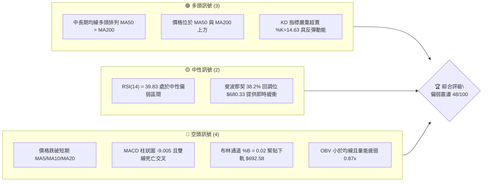
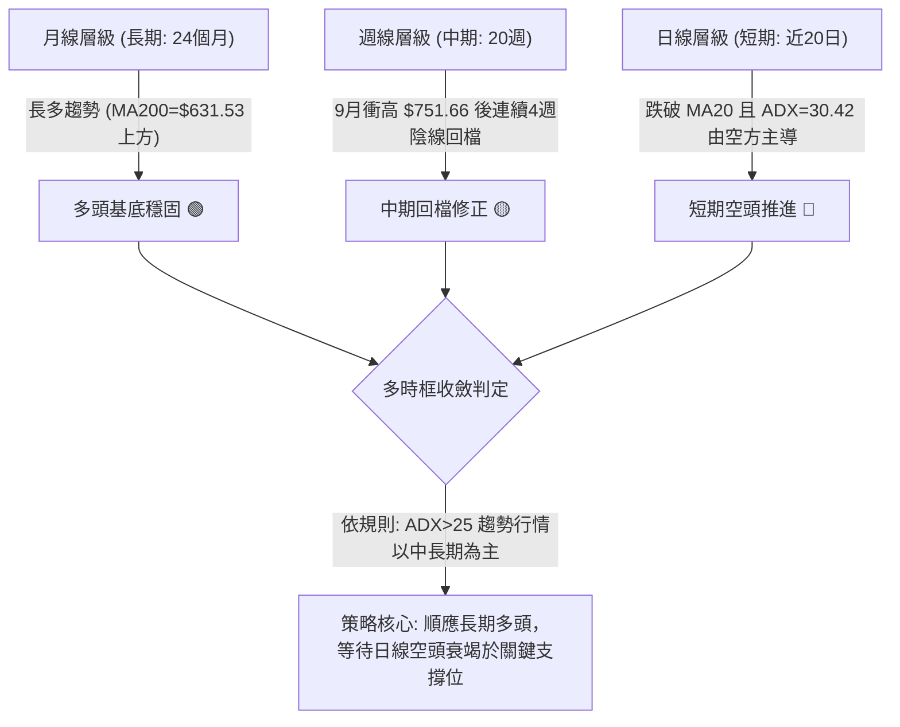
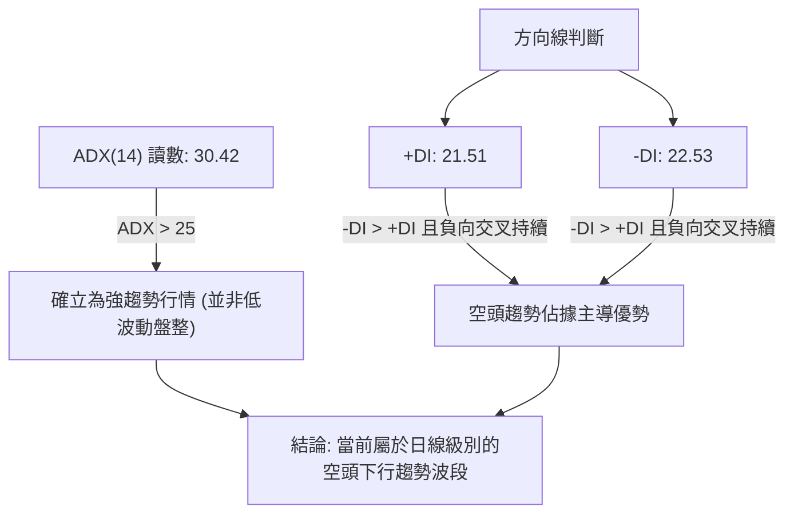
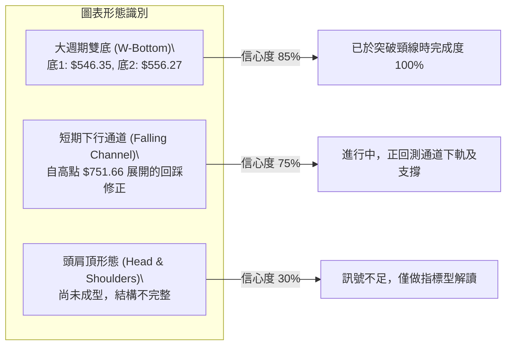
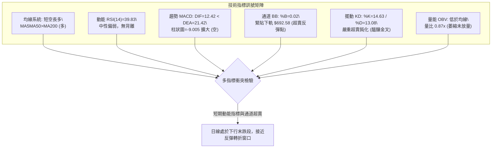
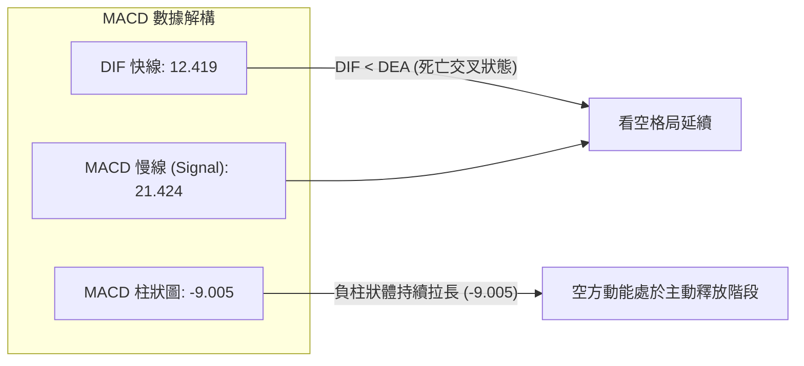
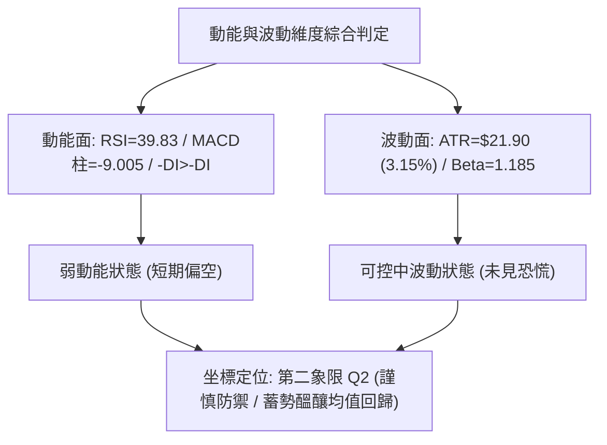
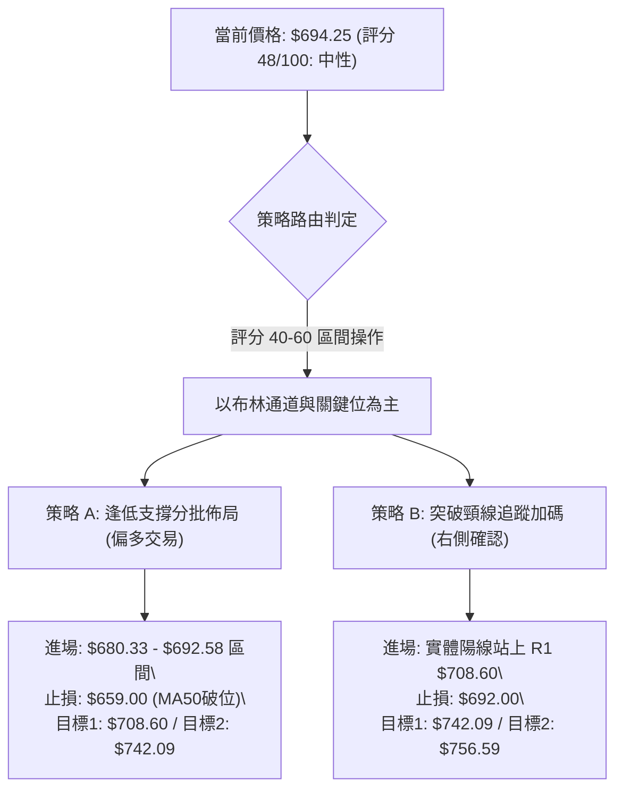
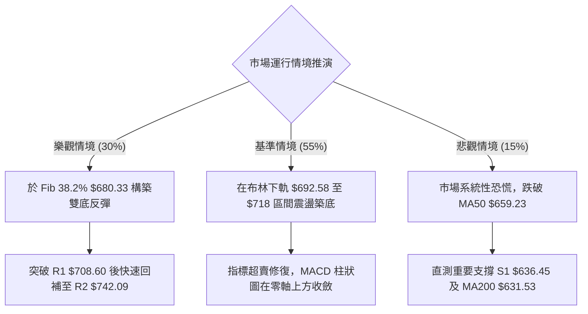

# META 技術分析報告

> **報告日期**：2026-10-21 ｜ **語言**：繁體中文 ｜ **數據來源**：Yahoo Finance ｜ **當前價格**：$694.25

---

## 目錄

| 章節 | 內容 |
|------|------|
| [1. 技術面概覽](#1-技術面概覽) | 訊號儀表板、核心指標、評分卡 |
| [2. 趨勢分析](#2-趨勢分析) | 多時框趨勢、長中短期走勢 |
| [3. 圖表形態分析](#3-圖表形態分析) | 形態識別、K線組合、目標價 |
| [4. 支撐與阻力](#4-支撐與阻力) | 關鍵價位、斐波那契回調 |
| [5. 技術指標深度解讀](#5-技術指標深度解讀) | MA/RSI/MACD/布林/成交量 |
| [6. 動能與波動率](#6-動能與波動率) | 動能評估、ATR、Beta |
| [7. 多時框架總結](#7-多時框架總結) | 時框架評分矩陣 |
| [8. 交易策略建議](#8-交易策略建議) | 多空策略、風險報酬比 |
| [9. 風險提示與監控](#9-風險提示與監控) | 監控指標、風險場景 |

---

## 1. 技術面概覽

### 🎯 技術訊號儀表板



### 📊 核心指標速覽表

| 指標類別 | 指標名稱 | 當前數值 | 訊號 | 解讀 |
|----------|----------|----------|------|------|
| **價格** | 當前收盤價 | $694.25 | 🟡 | 位於52週區間 67.1% 處，短期自高點 $751.66 回檔 |
| **短期均線** | MA20 | $731.87 | 🔴 | 價格低於 MA20 達 -5.14%，短線呈破位下行壓力 |
| **中期均線** | MA50 | $659.23 | 🟢 | 價格高於 MA50 達 +5.31%，中期多頭結構尚未破壞 |
| **長期均線** | MA200 | $631.53 | 🟢 | 價格高於 MA200 達 +9.93%，長期多頭趨勢堅挺 |
| **動能** | RSI(14) | 39.83 | 🟡 | 進入 30-40 弱勢中性區，尚未進入極端超賣，無背離 |
| **動能** | MACD (12,26,9) | 12.42 / 21.42 / -9.00 | 🔴 | DIF 跌破 MACD 訊號線，負向柱狀圖持續擴大 |
| **擺動** | Stoch %K / %D | 14.63 / 13.08 | 🟢 | 雙線進入 <20 極端超賣區，醞釀技術性跌深反彈 |
| **趨勢強度** | ADX (14) | 30.42 | 🔴 | 強趨勢格局（ADX>25），-DI (22.53) > +DI (21.51) 空頭主導 |
| **通道通道** | Bollinger Bands | 上 $771.16 / 下 $692.58 | 🟡 | %B 為 0.02，現價緊扣布林下軌，測試通道支撐邊界 |
| **波動度** | ATR(14) | $21.90 | 🟡 | 日波動率 3.15%，回檔過程波動適中，未見恐慌拋售 |
| **量能** | 成交量 / 20日均量 | 16.95M / 19.59M | 🔴 | 量比 0.87x，OBV 低於均線，買盤承接力道顯疲弱 |

### 🏆 技術評分卡

```
╔══════════════════════════════════════════════════════════════╗
║                技術評分卡 — META (2026-10-21)               ║
╠══════════════════════════════════════════════════════════════╣
║ 趨勢強度 (ADX=30.42 空方) ████████░░░░░░░░░░░░  40/100 🔴 偏空 ║
║ 動能指標 (RSI/MACD/KD)   ██████████░░░░░░░░░░  50/100 🟡 中性 ║
║ 支撐穩定度 (布林/Fib)    ████████████░░░░░░░░  60/100 🟢 良好 ║
║ 成交量配合 (OBV/均量)     ██████░░░░░░░░░░░░░░  30/100 🔴 疲弱 ║
║ 形態完整度 (回檔修正浪)   ██████████░░░░░░░░░░  50/100 🟡 中性 ║
║ 均線排列 (短空長多格局)   ████████████░░░░░░░░  60/100 🟢 尚可 ║
╠══════════════════════════════════════════════════════════════╣
║ 綜合評分                 ██████████░░░░░░░░░░  48/100 🟡 中性 ║
║ 綜合評級：【中性觀望 / 區間尋求支撐】                         ║
╚══════════════════════════════════════════════════════════════╝
```

---

## 2. 趨勢分析

### 🌐 多時框趨勢分析



### 📈 長期趨勢 — 12個月走勢圖（Unicode）

以下為 META 自 2025 年 11 月至 2026 年 10 月之月線收盤走勢圖，清晰呈現自低點 $556.27 展開強勁多頭推升至 $725.18 後的拉回走勢：

```
META 月線走勢圖（過去12個月收盤價）
價格軸 ($)
$750 ┤                                      ● $725.18
$720 ┤                      ● $714.66       │
$690 ┤                      │               │     ● $694.25 (現價)
$660 ┤          ● $658.40   │   ● $646.52   │     │
$630 ┤● $645.76 │           │   │   ● $631.43     │
$600 ┤          │           │   │   │       │     │
$570 ┤          │           │   ● $571.15   │     ● $571.89
$540 ┤          │           │               ● $562.85
     └──────────┴───────────┴───┴───┴───────┴─────┴───────
     2025-11   12-25       01  03  05      07    08    09    10 (2026)
     月份標籤:  M1    M2    M3  M4  M5  M6  M7    M8    M9   M10
```

#### 走勢特徵分析表格

| 階段區間 | 起訖月份 | 價格區間 ($) | 區間漲跌幅 | 走勢特徵與技術含義 |
|----------|----------|--------------|------------|--------------------|
| **第 1 階段：築底蓄勢** | 2025/11 - 2026/01 | $645.76 → $714.66 | +10.67% | 站穩 $640 平台，多頭帶量向 $700 關卡發動攻擊 |
| **第 2 階段：深幅回洗** | 2026/01 - 2026/03 | $714.66 → $571.15 | -20.08% | 快速回吐前波漲幅，形成波段調整低點，測試長期均線 |
| **第 3 階段：二次下探** | 2026/04 - 2026/07 | $610.86 → $556.27 | -8.94% | 於 2026/07 錄得波段低點 $556.27，構築堅實雙重底支撐 |
| **第 4 階段：主升拉抬** | 2026/08 - 2026/09 | $571.89 → $725.18 | +26.80% | 量能激增，突破多道阻力，確立週線級別大反彈行情 |
| **第 5 階段：高檔回檔** | 2026/09 - 2026/10 | $725.18 → $694.25 | -4.26% | 觸及 52 週高點 $779.82 附近壓力後，呈現連續 4 週量縮回踩 |

### 📊 中期趨勢（週線分析）

從近 20 週收盤走勢觀察，META 自 2026-08-02 的 $556.27 展開攻擊，在 2026-09-27 達到波段收盤高峰 $751.66（週成交量達 168.30M 股）。隨後出現連續 4 週的下行走勢：
- 2026-10-04：收 $728.08，RSI 降至 62.3，週 MACD 柱狀圖翻負 (-0.743)
- 2026-10-11：收 $718.67，RSI 降至 43.9，週 MACD 柱狀圖 -5.784
- 2026-10-18：收 $709.33，成交量放大至 101.36M 股，收長下影線但實體收低
- 2026-10-25：當前收 $694.25，週線 RSI 降至 39.8，MACD 柱狀圖負值進一步擴大至 -9.005

```
中期週線架構示意：
   [頂部壓力聚類: R2 $742.09 / R3 $756.59]
                ▲
               ╱ ╲
              ╱   ▼ [當前修正推進中: 現價 $694.25]
             ╱       │
   [波段起漲]        ▼
  $556.27 ──────────────► [預期下檔強支撐防線: S1 $636.45 / S2 $626.54]
```

### ⚡ 趨勢強度評估（ADX 解讀）



#### ADX 趨勢強度量化對照表

| 指標變數 | 當前數值 | 臨界門檻 | 強度等級 | 技術面具體指引 |
|----------|----------|----------|----------|----------------|
| **ADX (14)** | 30.42 | 25.00 | 🟢 強趨勢 | 市場具備明確定向移動能力，震盪指標易鈍化，嚴禁隨意逆勢摸頂抄底 |
| **+DI (14)** | 21.51 | - | 🟡 走弱 | 多頭動能衰退，未能維持在 25 以上的擴張區間 |
| **-DI (14)** | 22.53 | - | 🔴 佔優 | 空頭動能略高於多頭，顯示賣壓依然掌控盤面邊際定價權 |

---

## 3. 圖表形態分析

### 🔍 形態識別系統



#### 圖表形態信心度與目標價評估表

| 形態類別 | 信心度 | 判斷依據（引用數據） | 完成度 | 目標價（附嚴謹計算式） |
|----------|--------|----------------------|--------|------------------------|
| **大週期雙底 (W-Bottom)** | **85%** | 兩次波段大底分別為 2025/04 收盤 $546.35 與 2026/08 收盤 $556.27（均於數據低點聚類上方），頸線為 2026/01 高點 $714.66 | 100% (已達標) | 形態高度 = 頸線 $714.66 - 低點 $556.27 = $158.39。<br>目標價 = 頸線 $714.66 + $158.39 = **$873.05**（歷史最高推升至 $779.82，已完成大部分幅度） |
| **短期修正旗形/回踩通道** | **75%** | 自 2026-09-27 高點 $751.66 起，近 4 週連續收陰，但週成交量從 168.30M 驟降至 33.21M，呈健康量縮拉回通道 | 65% (進行中) | 通道下緣支撐對齊斐波那契 38.2% ($680.33) 至支撐 S1 ($636.45) 區間。若守穩，反彈第一目標為 R1 **$708.60**，第二目標為 R2 **$742.09** |
| **潛在頭肩頂 (Head & Shoulders)** | **28%** | 僅有單側回落，左肩與右肩結構對稱性極差，且 MA200 仍強勁向上 | 0% (形態無效) | **數據不足以支撐幾何形態，依規則僅做指標型解讀** |

### 🕯️ 重要K線形態分析

| 週/月份週期 | 收盤價 ($) | 識別K線形態 | 形態結構深度解讀 | 訊號方向 |
|-------------|------------|-------------|------------------|----------|
| **2026-09-27** | $751.66 | 巨量長陽突破突破棒 | 單週暴增 168.30M 股巨量，收盤創波段新高，奠定長期向上格局 | 🟢 強烈看多 |
| **2026-10-04** | $728.08 | 烏雲罩頂前置高檔長陰 | 承接前週買盤但高檔遭遇調節，週線 MACD 柱狀圖轉負 (-0.743) | 🔴 短線翻空 |
| **2026-10-18** | $709.33 | 帶長下影線的流星變形 | 週量擴大至 101.36M 股，多方在 $700 關卡進行防禦但收盤仍跌 | 🟡 多空僵持 |
| **2026-10-25** | $694.25 | 量縮小陰線（破位收盤） | 跌破 $700 整數心理防線，收盤壓在布林下軌附近，賣壓有鈍化跡象 | 🟡 弱勢企穩中 |

### 📉 ASCII 走勢形態示意圖

```
META 近期高檔回踩通道與關鍵形態示意圖：
   $751.66 (2026-09-27 高點)
      ●
       ╲  通道上軌壓力線 (連線: $751.66 -> $728.08)
        ╲───────┐
         ╲      ▼  $718.67
          ╲      ●
           ╲      ╲
            ▼      ╲
           $709.33  ●
                     ╲
                      ▼  $694.25 (當前價格，逼近通道下軌)
  ─────────────────────●───────────────────────────── BB下軌 $692.58
                      │  [下方緩衝階梯]
                      ├── Fib 38.2% 回調位: $680.33
                      └── 波段低點聚類支撐 S1: $636.45
```

### 🎯 形態目標價計算

若本輪回檔於短期下行通道下軌（布林下軌 $692.58 至斐波那契 38.2% $680.33）獲得支撐並確立止跌反轉，其後續反彈測幅計算如下：
1. **反彈第 1 目標價 (R1)**：突破下降通道上緣之頸線壓力，直接鎖定關鍵阻力位聚類 **$708.60**（空間：+2.07%）。
2. **反彈第 2 目標價 (R2)**：波段平台壓力區 **$742.09**（空間：+6.89%）。
3. **若支撐失效破位測幅**：若收盤實體跌破 Fib 38.2% ($680.33)，向下量測等幅下行階梯，目標將直指重要支撐位 S1 **$636.45**（空間：-8.33%）。

---

## 4. 支撐與阻力

### 🗺️ 關鍵價位分布圖（Unicode）

```
META 價位結構分布圖 (依據 OHLCV 實際計算)
═════════════════════════════════════════════════════════════════════
$779.82 ║████████████████████████████████████║ 52週最高點 (Fib 0.0%)
$756.59 ║██████████████████████████████      ║ 強阻力 R3 (高點聚類)
$742.09 ║██████████████████████              ║ 阻力 R2 (反彈高點聚類)
$731.87 ║------------------------------------║ BB中軌 / MA20 短期多空分水嶺
$718.35 ║▓▓▓▓▓▓▓▓▓▓▓▓▓▓▓▓▓▓▓▓▓▓▓▓▓▓▓▓        ║ Fib 23.6% 回調位
$708.60 ║████████████████                    ║ 關鍵阻力 R1 (第一反彈壓制)
$694.25 ╠════════════════════════════════════╣ ◄ 當前價格 (Current Price)
$692.58 ║------------------------------------║ BB下軌極限支撐
$680.33 ║▓▓▓▓▓▓▓▓▓▓▓▓▓▓▓▓▓▓▓▓▓▓▓▓            ║ Fib 38.2% 黃金分割強支撐
$659.23 ║------------------------------------║ MA50 中期生命線
$649.59 ║▓▓▓▓▓▓▓▓▓▓▓▓▓▓▓▓                    ║ Fib 50.0% 心理平衡位
$636.45 ║████████████████████████            ║ 關鍵支撐 S1 (波段低點聚類)
$626.54 ║████████████████████████████        ║ 強支撐 S2 (波段密集防守帶)
$594.61 ║████████████████                    ║ 極限支撐 S3 (長期底部防線)
═════════════════════════════════════════════════════════════════════
```

### 🚧 阻力位分析表

所有阻力數值完全嚴格引用數據中由近一年 OHLCV 波段高點聚類算出的實際值：

| 阻力級別 | 準確價位 ($) | 距現價空間 (%) | 形成原因與籌碼技術面背景 | 突破難度評估 | 重要性等級 |
|----------|--------------|----------------|--------------------------|--------------|------------|
| **R1** | **$708.60** | +2.07% | 近期回檔前的密集成交平台下沿，與 MA5 ($716.66) 形成共振重壓區 | 🟡 中等（需日成交量 > 20M 確認） | ★★★☆☆ |
| **R2** | **$742.09** | +6.89% | 2026年9月下旬波段高點反轉前夕的密集套牢區，鄰近 BB 中軌 ($731.87) | 🔴 高（具備強烈籌碼解套賣壓） | ★★★★☆ |
| **R3** | **$756.59** | +8.98% | 波段頂峰高點聚類，接近 52 週最高點 $779.82 的最後防禦牆 | 🔴 極高（需強勁基本面催化劑） | ★★★★★ |

### 🛡️ 支撐位分析表

所有支撐數值完全嚴格引用數據中由近一年 OHLCV 波段低點聚類算出的實際值：

| 支撐級別 | 準確價位 ($) | 距現價空間 (%) | 形成原因與籌碼技術面背景 | 守住機率評估 | 重要性等級 |
|----------|--------------|----------------|--------------------------|--------------|------------|
| **S1** | **$636.45** | -8.33% | 近一年波段起漲中繼站低點聚類，下方緊鄰 MA200 ($631.53) 與 MA60 ($646.26) | 🟢 80%（多頭核心防守堡壘） | ★★★★★ |
| **S2** | **$626.54** | -9.75% | 長期週線形態二次探底的支撐低點密集聚類，具備強大籌碼沉澱效果 | 🟢 85%（多頭極強反攻起點） | ★★★★☆ |
| **S3** | **$594.61** | -14.35% | 2026年7-8月築底震盪區頂部轉化之強支撐，跌破即代表長期多頭扭轉 | 🟢 95%（極端行情方能觸及） | ★★★☆☆ |

### 📐 斐波那契回調位分析

依據 52 週完整波動區間（低點 **$519.37** → 高點 **$779.82**，總落差 $260.45）之精確計算映射：

| 斐波那契分位點 | 精確計算價位 ($) | 現價相對位置與技術意義深度解讀 |
|----------------|------------------|--------------------------------|
| **0.0% (52W High)** | **$779.82** | 歷史極限阻力位，多頭終極目標 |
| **23.6% 回調位** | **$718.35** | 已於近期跌破，現轉化為反彈第一波強勁動態反壓 |
| **現價位置標定** | **$694.25** | **落於 23.6% ($718.35) 與 38.2% ($680.33) 之間，目前正尋求 38.2% 支撐** |
| **38.2% 回調位** | **$680.33** | **強勢回調關鍵支撐點**。在強多頭市場中，38.2% 通常為修正極限點 |
| **50.0% 中軸位** | **$649.59** | 多空中線分水嶺，與 MA50 ($659.23) 形成強大的中期動態支撐帶 |
| **61.8% 黃金分割** | **$618.86** | 深度防禦位，鄰近 MA200 ($631.53)，防守失效將意味趨勢反轉 |
| **78.6% 回調位** | **$575.11** | 最後堡壘，對應 2026年8月起漲點附近 |
| **100.0% (52W Low)**| **$519.37** | 52 週最低點，多頭結構完全瓦解基準線 |

---

## 5. 技術指標深度解讀

### 🎛️ 指標訊號總覽



### 📈 移動平均線排列分析

```
均線排列層級圖解：
┌────────────────────────────────────────────────────────┐
│ MA 20  : $731.87  ▼ 下方 (-5.14%)                      │ ◄ 短期空頭壓制線
│ MA 10  : $724.96  ▼ 下方 (-4.24%)                      │
│ MA  5  : $716.66  ▼ 下方 (-3.13%)                      │
│────────────────────────────────────────────────────────│
│ 現  價 : $694.25                                       │ ◄ 當前位置
│────────────────────────────────────────────────────────│
│ MA 50  : $659.23  ▲ 上方 (+5.31%)                      │ ◄ 中期多方生命線
│ MA 60  : $646.26  ▲ 上方 (+7.43%)                      │
│ MA240  : $632.49  ▲ 上方 (+9.76%)                      │
│ MA200  : $631.53  ▲ 上方 (+9.93%)                      │ ◄ 長期多頭定海神針
│ MA120  : $625.87  ▲ 上方 (+10.93%)                     │
└────────────────────────────────────────────────────────┘
```
- **長天期架構**：大格局呈現完美的典型多頭排列（`MA20 > MA50 > MA200`，且 `MA50 $659.23 > MA200 $631.53`），證明 META 自 2026 年初以來的長多大趨勢並未被破壞。
- **短天期架構**：短週期出現「空頭死叉排列」（`MA5 $716.66 < MA10 $724.96 < MA20 $731.87`），且現價 $694.25 全面失守這三條均線。短線由空方強烈控盤，MA20 處於下彎斜率，對日線構成沉重蓋頭反壓。

### 📉 RSI(14) 分析

- **當前讀數**：`39.83`
- **量化進度條**：
  ```
  超賣 [0] ─────────── [30] ───●─────── [70] ─────────── [100] 超買
  當前強度: ████████░░░░░░░░░░░░░░░░░░░░  39.83% (中性偏弱區)
  ```
- **超買超賣狀態**：指標遠離 70 超買區，正向 30 超賣區緩步逼近。尚未進入極端恐慌超賣區（<30），顯示下行賣盤為有序撤退，而非踩踏拋售。
- **背離判斷**：
  - **價格走勢**：10月以來價格持續創新低（$728.08 → $718.67 → $709.33 → $694.25）。
  - **RSI 走勢**：RSI 隨之同步自 62.3 滑落至 43.9，再降至當前 39.83。
  - **結論**：指標與價格軌跡完全吻合，**明確確認「無明顯頂背離，亦未見底背離」**。下行動能仍在依循慣性釋放。

### 📊 MACD(12/26/9) 訊號解讀


- **零軸關係**：快線 DIF (12.419) 與慢線 DEA (21.424) 雙雙維持在零軸上方運行，代表**大週期多頭母體趨勢依然存在**。
- **交叉狀態與柱狀圖**：快線在 21 以上高檔反轉下穿慢線，形成死叉下行。柱狀圖報 `-9.005`，顯示日線級別修正空頭處於主導地位，短期內尚未見到負向柱狀圖收斂的金叉拐點訊號。

### 📦 布林通道分析

```
布林通道 (Bollinger Bands) 結構示意圖：
$771.16 ══════════════════════════════════════ 上軌 (Upper Band)
        │
$731.87 ────────────────────────────────────── 中軌 (MA20)
        │
$694.25 ───────●────────────────────────────── 現價 (接近下軌)
$692.58 ══════════════════════════════════════ 下軌 (Lower Band)
```
- **帶寬與位置指標**：
  - BB 上軌：**$771.16**
  - BB 中軌 (MA20)：**$731.87**
  - BB 下軌：**$692.58**
  - **BB %B 數值**：**`0.02`**（計算公式：`(價格 - 下軌) / (上軌 - 下軌)`）
- **專業解讀**：%B 報 0.02 屬於極端臨界值（接近 0），意味現價 $694.25 與布林下軌 $692.58 僅相差不到 $2（-0.24%）。根據統計套利與布林通道均值回歸特性，當 %B ≤ 0.02 且隨機指標 Stoch進入超賣時，價格通常已過度偏離中軌，通道下軌具備極為顯著的彈性支撐效果。

### 💹 成交量分析（量價配合度）

```
量價關聯結構：
最新成交量  : 16.957M 股 ▓▓▓▓▓▓▓▓▓▓▓▓▓▓▓░░░░░ (量比 0.87x)
20日平均量  : 19.595M 股 ▓▓▓▓▓▓▓▓▓▓▓▓▓▓▓▓▓▓░░
50日平均量  : 19.334M 股 ▓▓▓▓▓▓▓▓▓▓▓▓▓▓▓▓▓░░░
```
- **量縮價跌現象**：最新成交量為 16.96M 股，顯著低於 20 日均量 (19.60M) 與 50 日均量 (19.33M)，量比僅為 0.87x。這反映近期自 $751.66 回落過程中，機構法人並未進行大規模恐慌出逃，回檔本質偏向技術性浮額清洗。
- **OBV 能量潮解讀**：數據明確標示「OBV < MA → 量能疲弱」。這表明主力資金在當前 $700 關卡附近尚未展開積極性左側建倉，買盤以被動承接為主，量能尚未有效確認價格止跌，仍需等待放量紅棒化解背離。

---

## 6. 動能與波動率

### ⚡ 動能評估四象限

| 象限 | 動能維度 (Momentum) | 波動率維度 (Volatility) | META 當前所屬狀態 | 專業戰術評估 |
|------|---------------------|--------------------------|-------------------|--------------|
| **第一象限 (Q1)** | 強動能 (Bullish) | 低波動 (Low Vol) | ─ | 最佳順勢加碼區間 |
| **第二象限 (Q2)** | **弱動能 (Bearish)** | **低/中波動 (Moderate)** | **✓ (當前落點)** | **謹慎觀望，尋找通道下軌超賣反彈機會** |
| **第三象限 (Q3)** | 強動能 (Bullish) | 高波動 (High Vol) | ─ | 趨勢突破追價，承受高回撤 |
| **第四象限 (Q4)** | 弱動能 (Bearish) | 高波動 (High Vol) | ─ | 恐慌崩跌走勢，必須嚴格止損觀望 |



### 📊 ATR 波動率分析

- **ATR(14) 絕對數值**：**`$21.90`**
- **價格百分比佔比**：**`3.15%`**（以收盤價 $694.25 計算）
- **止損與波動保護距離設定指引**：
  - **超短線交易保護（1.0 × ATR）**：$21.90 空間。若在現價佈局，日內雜訊波動容忍下限為 **$672.35**。
  - **波段擺動保護（1.5 × ATR）**：$32.85 空間。技術防守價位設定於 **$661.40**，此價位恰好坐落於 MA50 ($659.23) 核心支撐上方，具備極高結構保護力。
  - **趨勢交易保護（2.0 × ATR）**：$43.80 空間。容忍底線為 **$650.45**，對齊 Fib 50.0% ($649.59)。

### 📐 Beta 與市場相關性

- **Beta 係數**：**`1.185`**
- **大盤相關度分析**：Beta 值為 1.185，顯示 META 相對 S&P 500 指數具備大約 1.18 倍的彈性放大效應。當科技權值股大盤走強時，其向上 Beta 攻擊動能充沛；相反地，在大盤承壓回檔時，其承受之系統性拋壓亦略高於市場平均。這要求在操作時必須同時監控大盤整體系統性風險指標。

---

## 7. 多時框架總結

### 📋 時框架評分表

| 時框架 | 趨勢方向 | 動能狀態 | 均線系統排列 | 形態特徵 | 綜合評分 | 操作戰略建議 |
|--------|----------|----------|--------------|----------|----------|--------------|
| **月線 (長期)** | 🟢 強烈看多 | 🟢 多方主導 (回升段) | 多頭排列 (MA200向上) | 雙底突破後回踩頸線 | **85/100** | 長線多單底倉堅定續抱 |
| **週線 (中期)** | 🟡 中性偏多 | 🔴 短期回檔擴大 | MA50>MA200 穩固向上 | 衝高 $751 後連續4週陰跌 | **58/100** | 暫停追高，等待止跌訊號 |
| **日線 (短期)** | 🔴 明確看空 | 🔴 MACD死叉/空頭主導 | MA5<MA10<MA20 空頭排列 | 布林下軌極限邊界測試 | **35/100** | 嚴禁盲目摸底，防範慣性下行 |

### 🔲 綜合訊號矩陣

```
時框架訊號衝突檢視：
┌───────────┬──────────────┬──────────────┬──────────────┐
│ 維度指標  │ 長期 (月線)  │ 中期 (週線)  │ 短期 (日線)  │
├───────────┼──────────────┼──────────────┼──────────────┤
│ 均線方向  │  🟢 多頭     │  🟢 多頭     │  🔴 空頭     │
│ 動能 MACD │  🟢 零軸上方 │  🔴 負柱擴大 │  🔴 負柱擴大 │
│ 擺動 RSI  │  🟢 強勢區   │  🟡 走弱(39) │  🟡 偏弱(39) │
│ 價格通道  │  🟢 擴張向上 │  🟡 中軌回測 │  🔴 緊貼下軌 │
└───────────┴──────────────┴──────────────┴──────────────┘
```

### ⚖️ 多時框收斂結論

> **依嚴格規則 14 執行多時框收斂審定**：
> 1. **趨勢強度辨識**：當前 ADX(14) 讀數為 **`30.42 > 25`**，技術面明確判定為**趨勢行情**而非無方向的窄幅盤整。
> 2. **優先級收斂原則**：在強趨勢狀態下，必須**以中長期方向（週線多頭趨勢、MA50 $659.23 與 MA200 $631.53 向上發散）作為大戰略主軸**；日線級別的空頭排列僅作為**短線尋找回檔極限與右側進場點位的時機過濾器**。
> 3. **唯一方向性結論**：
>    **【中性觀望，伺機偏多操作】**。日線空頭動能已逼近布林下軌 ($692.58) 與 Fib 38.2% ($680.33) 強支撐交匯帶，指標如 Stoch (%K=14.63) 呈現極度超賣。日線直接殺跌空間受限於中長期強大買盤支撐，操作重心轉為「等待日線止跌確認後的順勢做多」。

---

## 8. 交易策略建議

### 🗺️ 策略決策流程圖



### 🧭 策略路由（依評分卡分流）

- **當前主策略方向**：**【中性偏多，依據綜合評分 48/100 採取關鍵支撐位防守型逢低佈局】**。
- **戰術思路**：評分坐落於 40–60 區間，且日線 ADX>25 顯示短期空頭仍有下探慣性，但長期 MA50/MA200 多頭防線完好。策略上嚴禁在現價 $694.25 直接追空，應緊扣布林下軌 $692.58 與 Fib 38.2% $680.33 構建階梯防禦買盤。

### 🎯 價格情境階梯（Price Scenarios）

所有價位均嚴格取自第 4 章由 OHLCV 實際計算的關鍵阻力與支撐值：

| 觸發條件 | 下一目標 ($) | 後續延伸 ($) | 技術情境結構含義 |
|----------|--------------|--------------|------------------|
| **強勢突破阻力 R1 ($708.60)** | **R2 ($742.09)** | **R3 ($756.59)** | 短線下行趨勢遭到瓦解，多頭重啟波段攻勢 |
| **守穩布林下軌 ($692.58)** | **R1 ($708.60)** | **BB 中軌 ($731.87)** | 進行超賣均值回歸修復，維持寬幅震盪築底 |
| **跌破關鍵支撐 S1 ($636.45)** | **S2 ($626.54)** | **S3 ($594.61)** | 中期結構破位，向長期年線 MA200 尋求最後支撐 |

### 📊 情境機率分佈

| 預期情境 | 發生機率 (%) | 主要技術指標支撐依據 |
|----------|--------------|----------------------|
| **下探關鍵支撐後反彈** | **55%** | Stoch %K=14.63 極度超賣、布林 %B=0.02 緊貼下軌、大週期均線多頭保護 |
| **區間橫向震盪拉鋸** | **30%** | 成交量持續量縮（量比 0.87x）、OBV 疲弱、RSI 徘徊於 39.83 中性弱勢區 |
| **破位深幅回檔探底** | **15%** | MACD 柱狀圖負值達 -9.005、-DI 持續壓制 +DI、短期均線形成空頭死叉 |

### 🟢 主策略詳情（方向依上方路由）

以下兩個策略的點位、停損、目標價，完全綁定前述 OHLCV 關鍵價位及精確 ATR 緩衝計算：

| 策略要素 | 策略 A（左側支撐低吸策略） | 策略 B（右側突破轉強策略） |
|----------|----------------------------|----------------------------|
| **戰略概念** | 斐波那契 38.2% 與布林下軌共振低吸 | 站上 R1 阻力位後的動能確認順勢追擊 |
| **進場條件** | 觸及 Fib 38.2% 且出現日線下影線 | 日線實體收盤價突破並站穩 R1 阻力位 |
| **進場價格** | **$680.33**（Fib 38.2% 價位） | **$708.60**（R1 阻力突破位） |
| **目標價 T1** | **$708.60**（R1 阻力位） | **$742.09**（R2 阻力位） |
| **目標價 T2** | **$742.09**（R2 阻力位） | **$756.59**（R3 阻力位） |
| **止損價格** | **$659.23**（跌破中期生命線 MA50 止損） | **$692.58**（假突破跌回布林下軌止損） |
| **風控空間** | 虧損空間：$21.10 (-3.10%) | 虧損空間：$16.02 (-2.26%) |
| **獲利空間** | T1: +$28.27 (+4.16%) / T2: +$61.76 (+9.08%) | T1: +$33.49 (+4.73%) / T2: +$47.99 (+6.77%) |
| **風險報酬比**| **1 : 2.93**（以目標 T2 計算） | **1 : 2.99**（以目標 T2 計算） |
| **成功機率** | **65%** | **60%** |
| **建議總倉位**| **10% - 15%**（控制單筆風險 < 1%） | **15% - 20%**（右側確認後進場） |

### 🔴 反向風險觸發點（對沖提示）

- **多頭結構破位點**：若價格帶量（單日成交量 > 25M）跌破 **S1 ($636.45)** 及 MA200 ($631.53)，意味長多主升浪徹底失敗，主策略做多邏輯全面推翻，應立即止損並可啟動做空對沖。
- **空頭加速訊號**：若 MACD 柱狀圖進一步跌破 `-12.00` 且布林帶寬向下開口擴大，應全面放棄左側抄底嘗試。

### ⭐ 整體訊號強度評星

```
做多訊號強度：★★★☆☆  (3.0/5星) ── 依賴長期均線防禦與極端超賣支撐
做空訊號強度：★★☆☆☆  (2.5/5星) ── 短期趨勢偏空，但受制於下方密集強支撐
整體可信度：  ★★★★☆  (4.0/5星) ── 多時框趨勢層次分明，價位具備嚴密數學依據
```

---

## 9. 風險提示與監控

### ✅ 關鍵監控指標 Checklist

```
╔══════════════════════════════════════════════════════════════╗
║                 日常盤面關鍵技術指標監控清單                  ║
╠══════════════════════════════════════════════════════════════╣
║ [ ] 價格是否跌破布林下軌極限 $692.58 並連續兩日收於其下       ║
║ [ ] RSI(14) 是否跌破 30 進入極端恐慌超賣區間                 ║
║ [ ] Stoch (%K/%D) 是否在 20 以下低檔完成黃金交叉反轉          ║
║ [ ] 日成交量是否放大突破 20 日均量 (19.59M 股) 確認買盤進駐  ║
║ [ ] MACD 柱狀圖是否自 -9.005 出現向上收斂（翻紅預備訊號）     ║
║ [ ] 下方核心支撐 S1 ($636.45) 與 MA50 ($659.23) 是否完好無損 ║
╚══════════════════════════════════════════════════════════════╝
```

### ⚠️ 風險場景分析



### 🛡️ 風險管理重要提醒

1. **ATR 波動風控防禦**：當前 ATR(14) 為 $21.90，意味日內出現 ±$20 的震盪均屬正常隨機雜訊。操作時絕不可將止損點設於 $10 以內的過窄空間，以免遭市場雜訊洗出場。
2. **資金部位管理法**：由於短期趨勢仍受制於空方（ADX=30.42），在未見到日線實體陽線站上 R1 ($708.60) 之前，總投資組合持倉上限應嚴格限制在 20% 以內，採用「分批金字塔式建倉」（如第一批 5%、回踩確認再加 10%）。
3. **宏觀與 Beta 連動風險**：META 的 Beta 係數為 1.185，極度依賴美股科技大盤（納斯達克 100 指數）的流動性環境。在科技板塊面臨整體回檔時，個股技術支撐位的反應時間可能出現向後遞延現象。

---

## 📋 報告總結

```
╔══════════════════════════════════════════════════════════════════╗
║                   META 技術分析報告總結 (2026-10-21)             ║
╠══════════════════════════════════════════════════════════════════╣
║ 報告日期：2026-10-21                                            ║
║ 當前價格：$694.25 (52W 高點 $779.82，低點 $519.37)              ║
║ 分析評級：🟡 綜合評分 48/100 【中性觀望 / 伺機逢低防禦型佈局】   ║
╠══════════════════════════════════════════════════════════════════╣
║ 關鍵結論：                                                       ║
║ ├─ 長期趨勢：🟢 強烈多頭 (MA50 > MA200，大週期多頭排列健全)     ║
║ ├─ 中期趨勢：🟡 高檔回檔 (近4週自 $751.66 量縮回踩，健康修正)    ║
║ ├─ 短期趨勢：🔴 空頭主導 (ADX=30.42，現價跌破短期均線組)        ║
║ ├─ 關鍵支撐：S1 $636.45 ｜ Fib 38.2% $680.33 ｜ BB下軌 $692.58  ║
║ ├─ 關鍵阻力：R1 $708.60 ｜ R2 $742.09 ｜ R3 $756.59             ║
║ └─ 法人共識目標價：$817.87 (高點 $1,050.00 / 低點 $580.00)       ║
╠══════════════════════════════════════════════════════════════════╣
║ 最優策略組合：                                                   ║
║ 1. 🥇 最佳機會：於 Fib 38.2% $680.33 左側掛單佈局，止損 $659.23 ║
║               目標上看 R1 $708.60 與 R2 $742.09 (風報比 1:2.93)║
║ 2. 🥈 次選機會：等待陽線實體放量突破 R1 $708.60 右側追隨進場     ║
║               止損 $692.58，目標指向 R2 $742.09 (風報比 1:2.99)║
║ 3. 🥉 保守選擇：空手觀望，靜待日線 MACD 柱狀圖收斂及 KD 形成金叉 ║
╚══════════════════════════════════════════════════════════════════╝
```

---

> ⚠️ **免責聲明**：本報告為專業技術分析模型之研究成果，報告內所有數據、支撐阻力位、均線數值均嚴格基於所提供之歷史價格與量能紀錄計算。本報告**僅供研究與學術參考**，**不構成任何形式的投資要約或買賣建議**。投資股票具有本金損失之風險，交易者應獨立評估風險承受能力並自行承擔投資盈虧。

---

*報告生成時間：2026-10-21 ｜ 數據來源：Yahoo Finance ｜ 分析框架：多時框技術分析模型*