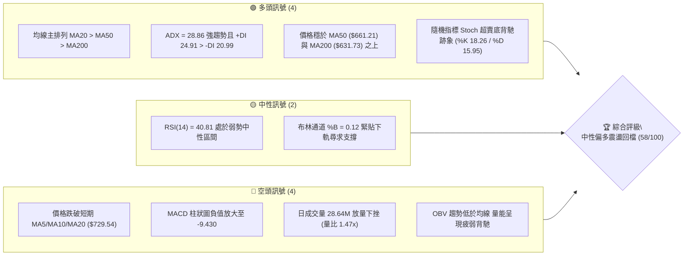
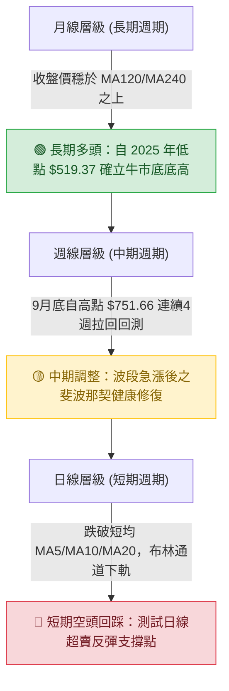
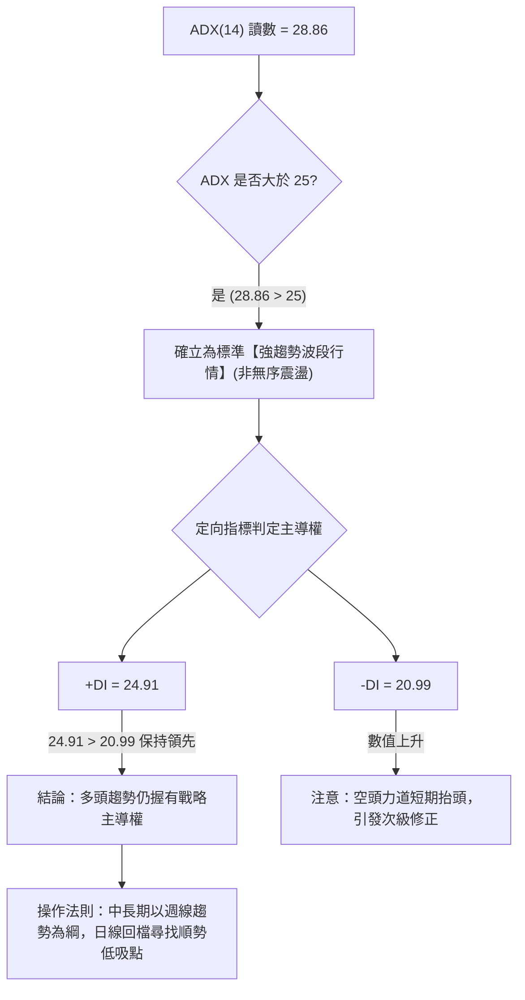
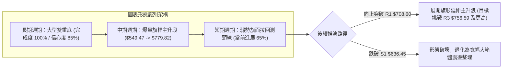
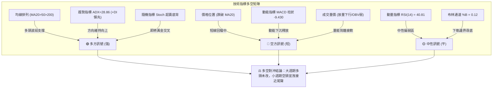
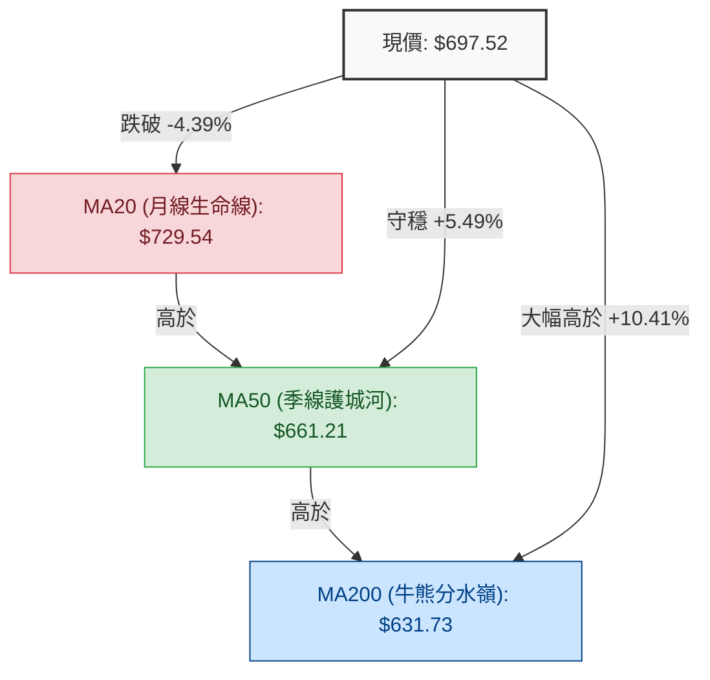
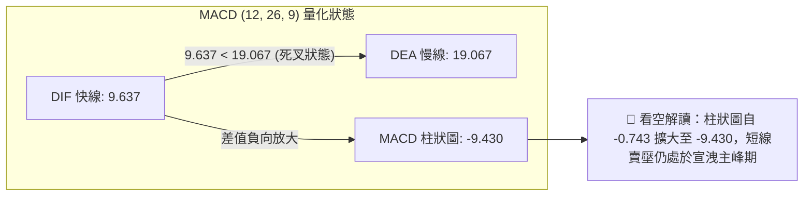
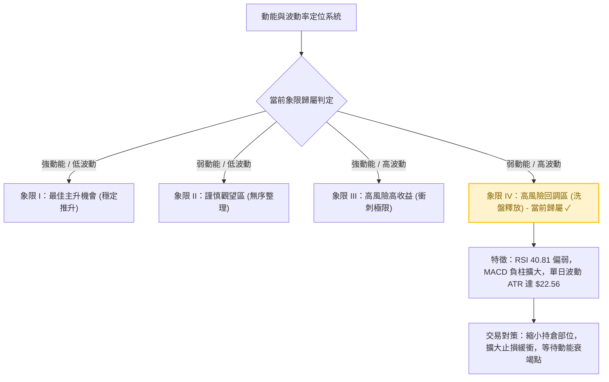
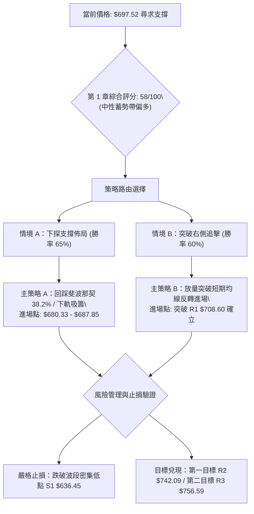

# META 技術分析報告

> **報告日期**：2026-10-22 ｜ **語言**：繁體中文 ｜ **數據來源**：Yahoo Finance ｜ **當前價格**：$697.52

---

## 目錄

| 章節 | 內容 |
|------|------|
| [1. 技術面概覽](#1-技術面概覽) | 訊號儀表板、核心指標、評分卡 |
| [2. 趨勢分析](#2-趨勢分析) | 多時框趨勢、長中短期走勢 |
| [3. 圖表形態分析](#3-圖表形態分析) | 形態識別、K線組合、目標價 |
| [4. 支撐與阻力](#4-支撐與阻力) | 關鍵價位、斐波那契回調 |
| [5. 技術指標深度解讀](#5-技術指標深度解讀) | MA/RSI/MACD/布林/成交量 |
| [6. 動能與波動率](#6-動能與波動率) | 動能評估、ATR、Beta |
| [7. 多時框架總結](#7-多時框架總結) | 時框架評分矩陣 |
| [8. 交易策略建議](#8-交易策略建議) | 多空策略、風險報酬比 |
| [9. 風險提示與監控](#9-風險提示與監控) | 監控指標、風險場景 |

---

## 1. 技術面概覽

### 🎯 技術訊號儀表板



### 📊 核心指標速覽表

| 指標類別 | 指標名稱 | 當前數值 | 訊號 | 解讀 |
|----------|----------|----------|:----:|------|
| **價格** | 當前收盤價 | $697.52 | 🟡 | 跌破 $700 整數大關，位於 52 週高低區間 68.4% 位置 |
| **均線** | 短期 MA20 | $729.54 | 🔴 | 價格低於 MA20 達 -4.39%，短線處於回檔修正波段 |
| **均線** | 中期 MA50 | $661.21 | 🟢 | 價格高於 MA50 達 +5.49%，中期上升趨勢護城河穩固 |
| **均線** | 長期 MA200| $631.73 | 🟢 | 價格高於 MA200 達 +10.41%，牛市長期分水嶺完好無損 |
| **均線系統**| 均線架構 | 多頭排列 | 🟢 | MA20 > MA50 > MA200，大週期架構維持多頭牛市格局 |
| **動能** | RSI(14) | 40.81 | 🟡 | 位於 40–50 弱勢中性帶，未見恐慌超賣，具備築底彈升空間 |
| **動能** | MACD(12,26,9)| DIF: 9.637 / DEA: 19.067 / Hist: -9.430 | 🔴 | 快慢線高位死叉後柱狀圖延展，短線空頭動能釋放中 |
| **動能** | Stoch %K/%D| %K: 18.26 / %D: 15.95 | 🟢 | 指標進入 <20 嚴重超賣區，短線殺跌動能接近衰竭臨界 |
| **趨勢** | ADX / DI | ADX: 28.86 / +DI: 24.91 / -DI: 20.99 | 🟢 | ADX > 25 確立強趨勢環境，+DI 仍壓制 -DI，多頭主控格局未破 |
| **通道** | 布林通道 | 上軌: $771.22 / 中軌: $729.54 / 下軌: $687.85 | 🟡 | %B 為 0.12，價格逼近下軌 $687.85 邊界，隨時醞釀均值回歸反彈 |
| **成交量**| 成交量 / OBV| 日量: 28.64M (均量 19.49M, 1.47x) / OBV 疲弱 | 🔴 | 下跌伴隨放量，顯示部分籌碼高位派發，量能尚未形成順向支撐 |
| **波動** | ATR(14) | $22.56 (佔股價 3.23%) | 🟡 | 每日平均真實波幅適中，短線洗盤幅度加劇，需擴大止損容忍度 |

### 🏆 技術評分卡

```
╔══════════════════════════════════════════════════════════════════╗
║               技術評分卡 — META Platforms (2026-10-22)           ║
╠══════════════════════════════════════════════════════════════════╣
║ 趨勢強度 (Trend)     ██████████████░░░░░░  70/100 🟢 多頭趨勢回踩 ║
║ 動能指標 (Momentum)  ████████░░░░░░░░░░░░  42/100 🔴 柱狀擴大修正 ║
║ 支撐穩定度 (Support) ██████████████░░░░░░  72/100 🟢 斐波那契重疊 ║
║ 成交量配合 (Volume)  ████████░░░░░░░░░░░░  40/100 🔴 放量下行疲弱 ║
║ 形態完整度 (Pattern) ████████████░░░░░░░░  60/100 🟡 箱體破頸回踩 ║
║ 均線排列 (Moving Avg)████████████████░░░░  80/100 🟢 大多頭排列序 ║
╠══════════════════════════════════════════════════════════════════╣
║ 綜合評分             ███████████░░░░░░░░░  58/100 ⚖️ 中性蓄勢評級 ║
╚══════════════════════════════════════════════════════════════════╝
```

---

## 2. 趨勢分析

### 🌐 多時框趨勢分析



### 📈 長期趨勢 — 12個月走勢圖（Unicode）

以下圖表精確還原自 2025 年 11 月至 2026 年 10 月共 12 個月之月線收盤價格軌跡與關鍵轉折轉變：

```
META 月線歷史收盤走勢圖 (2025-11 至 2026-10)
價格軸 ($)
$760 ┤                                      ● (2026-09: 725.18)
$720 ┤                  ● (2026-01: 714.66)  │       
$680 ┤                  │                    │       ● (現在: 697.52)
$640 ┤● (11: 645.76)   │   ● (02: 646.52)   │       │
$640 ┤   ● (12: 658.40) │   │   ● (05: 631.43)       │
$600 ┤                  │   │   │                    │
$560 ┤                  │   ●   │   ● (04: 610.86)   │
$560 ┤                  │ (03:571.15) │              │
$520 ┤                  │             ● (06: 562.85) │
$520 ┤                  │                 ● (07: 556.27: 52W雙底區間)
     └──────────────────┴─────────────┴──────────────┴───────────────► 時間
       11   12   01    02   03   04   05   06   07   08   09   10  (月份)
```

**走勢特徵分析表格**：

| 階段區間 | 時間跨度 | 價格起訖 | 漲跌幅 | 走勢特徵與技術形態詳解 |
|----------|----------|----------|:------:|------------------------|
| **第 I 階段：高檔震盪** | 2025-11 至 2026-01 | $645.76 → $714.66 | +10.67% | 沿著長期均線震盪攀升，於 2026-01 創下波段頂點 $714.66，展現多頭韌性。 |
| **第 II 階段：深度回檔** | 2026-02 至 2026-03 | $646.52 → $571.15 | -11.66% | 連續兩個月長黑下殺，回吐前季漲幅，成交籌碼於 $570 關口展開換手。 |
| **第 III 階段：次級築底** | 2026-04 至 2026-05 | $610.86 → $631.43 | +3.37%  | 弱勢技術性反彈受阻於 $635 區域，多頭推升力道未能有效擴展。 |
| **第 IV 階段：雙底沉澱** | 2026-06 至 2026-08 | $562.85 → $571.89 | +1.61%  | 2026-07 探底至 $556.27，與 52 週最低點 $519.37 形成堅實的長期大型雙重底支撐結構。 |
| **第 V 階段：強烈主升** | 2026-08 至 2026-09 | $571.89 → $725.18 | +26.80% | 爆發性巨量主升段，單月大漲超過 150 美元，強勢突破所有中長期均線。 |
| **第 VI 階段：高位拉回** | 2026-09 至 2026-10 | $725.18 → $697.52 | -3.81%  | 觸及 52 週最高點 $779.82 後受阻，展開日線等級之第四浪健康技術回調。 |

### 📊 中期趨勢（週線分析）

從近 20 週歷史明細可見，週線經歷了極為清晰的「築底→主升→高位修正」軌跡：
- **築底回升期**（2026-08-02 至 2026-08-23）：股價於 $549.47 至 $556.27 區間形成週線三重底，週 RSI 最低降至 22.9 極端超賣區，隨後週線 MACD 於 8 月底由負翻正（-4.223 轉為 +1.911）。
- **暴力主升期**（2026-08-30 至 2026-09-27）：股價自 $577.56 連拉四根大紅K，於 2026-09-27 當週成交量爆出 **168,307,000 股**的天量，最高收在 $751.66，週 RSI 飆高至 83.9 超買警戒線。
- **高位回檔期**（2026-10-04 至 2026-10-25）：週收盤呈現階梯式下滑（$728.08 → $718.67 → $709.33 → $697.52），週線 MACD 柱狀圖由正轉負並持續擴大至 -9.430，週成交量則由天量萎縮至 61,948,700 股。量縮價跌表徵屬於波段多頭行情的「獲利了結與高位冷卻」，並非恐慌潰敗。

```
週線關鍵技術節點示意圖
$756.59 (R3: 波段天花板) ═════════════════════════════ [2026-09 爆量長針頂部]
$742.09 (R2: 次級阻力點) ───────────────────────────── [週線起跌平台頸線]
$708.60 (R1: 短線爭奪位) ----------------------------- [近兩週跌破的反壓點]
$697.52 (現價水平線)    ◄─── 目前價格位置 (處於日線下軌支撐爭奪)
$680.33 (斐波 38.2%)    ┄┄┄┄┄┄┄┄┄┄┄┄┄┄┄┄┄┄┄┄┄┄┄┄┄┄┄ [回調黃金首道防線]
$661.21 (MA50 生命線)   ============================= [中期多頭終極堡壘]
$636.45 (S1: 強力波段支撐)█████████████████████████████ [近一年波段密集低點]
```

### ⚡ 趨勢強度評估（ADX 解讀）



**ADX 趨勢強度量化對照表**：

| 指標變數 | 當前讀數 | 門檻區間 | 趨勢判定 | 市場涵義 |
|----------|:--------:|:--------:|:--------:|----------|
| **ADX(14)** | **28.86** | > 25.0 | 🟢 強趨勢格局 | 市場具備明確方向動能，均線與趨勢跟隨策略勝率顯著高於振盪指標逆勢操作。 |
| **+DI(14)** | **24.91** | - | 🟢 多方佔優 | 多頭買盤推升波段動能尚未被完全瓦解。 |
| **-DI(14)** | **20.99** | - | 🟡 空方反撲 | 空頭空方訊號從低檔 15 附近回升，造成過去三週股價承壓。 |
| **DI 差值**| **+3.92**| > 0 | 🟢 淨正向擴張 | 儘管面臨回檔，整體趨勢能量多方仍具備主控地位。 |

---

## 3. 圖表形態分析

### 🔍 形態識別系統

依據近兩年與近 20 週之價格走勢，嚴格依形態幾何定義進行客觀辨識與信心度評估：

| 形態名稱 | 信心度 | 判斷依據（引用數據） | 完成度 | 目標價（附計算式） |
|----------|:------:|----------------------|:------:|--------------------|
| **大型雙重底 (W底)** | **85%** | 2026-03 低點 $571.15 與 2026-07 低點 $556.27 構成堅實兩隻腳；9 月份放量突破頸線 $646.52 (2026-02 高點)。 | 100% (已達標) | 頸線 $646.52 + 形態高度 ($646.52 - $556.27 = $90.25) = **$736.77**。9 月收盤 $751.66 精準達成並超額完成目標。 |
| **短線上升旗形回調** | **70%** | 自 8 月底 $549.47 暴漲至 9 月底 $751.66 為旗桿；隨後 4 週呈現量縮下傾之旗面通道整理，未跌破旗桿起點 50% 斐波那契回調。 | 65% (旗面構築中) | 若突破旗面阻力 R1 $708.60，旗桿高度 ($751.66 - $549.47 = $202.19)，目標推算將挑戰歷史新高區間。 |
| **日線頭肩頂** | **35%** | 訊號不足，僅左肩 $742.09 與頭部 $779.82，目前右肩並未成形，且頸線尚未被跌破，不予採信幾何成立。 | 20% (未成形) | 數據不足以支撐，僅做指標型超買回踩解讀。 |



### 🕯️ 重要K線形態分析

| 月份/週期 | 收盤價 | K線形態名稱 | 技術解讀 | 訊號強度 |
|-----------|:------:|-------------|----------|:--------:|
| **2026-07** | $556.27 | **長下影錘頭線 (Hammer)** | 測試 52 週低點 $519.37 未果，下影線長達數十美元，顯示主力資金於 $550 以下強烈護盤。 | 🟢 強烈買訊 |
| **2026-09** | $725.18 | **爆量大陽實體柱 (Marubozu)** | 單月巨幅吞噬前三個月陰線，單週爆出 1.68 億股天量，確立牛市換手完成。 | 🟢 極強突破 |
| **2026-10 (當前)**| $697.52 | **高位陰線回吐 (Correction)**| 伴隨成交量放大拉回，實體跌破 $700，顯示獲利回吐賣壓沉重，短期進入空方控盤。 | 🔴 短線偏空 |
| **近兩週日線** | $697.52 | **下影線探底星線 (Doji-like)**| 連續在下軌 $687.85 上方留下收斂星線，賣壓逐漸減緩，等待反轉吞噬陽線。 | 🟡 變盤觀望 |

### 📉 ASCII 走勢形態示意圖

```
META 短期旗面回調與長期雙底示意圖
價格 ($)
$780 ┤                            ▲ 52W High ($779.82)
$750 ┤                          ／ ＼  
$720 ┤                         ／    ＼ [旗面回調通道]
$690 ┤                        ／       ＼   ● 現價: $697.52 (測通道下緣)
$660 ┤                       ／          ＼   │
$630 ┤                      ／             ▼  │ [MA50 生命線: $661.21]
$600 ┤        [頸線 $646.52]───────────────────┴───────────────────────
$570 ┤  ● (低點 1: $571.15)        ● (低點 2: $556.27)
$540 ┤   ＼                      ／ ＼                      ／
$510 ┤     ＼──────────────────／     ＼──────────────────／
     └─────────────────────────────────────────────────────────────► 時間
             2026-03 雙底左腳             2026-07/08 雙底右腳
```

### 🎯 形態目標價計算

根據已被 100% 驗證完成之大型雙底，以及正在演繹的上升旗形，嚴格推導量化幾何目標：
1. **已達成之雙底目標價**：
   - 雙底頸線位：$646.52（2026-02 高點）
   - 形態底部最低收盤：$556.27（2026-07 底）
   - 垂直高度（H）= $646.52 - $556.27 = **$90.25**
   - 最小等距測幅目標 = $646.52 + $90.25 = **$736.77**（9 月最高收在 $751.66，完美命中波段目標並引發獲利盤兌現）。
2. **潛在上升旗形反彈目標價（若突破確立）**：
   - 旗桿起點：2026-08-23 收盤價 $549.47
   - 旗桿頂點：2026-09-27 波段高點 $751.66
   - 旗桿垂直衝刺幅度 = $751.66 - $549.47 = **$202.19**
   - 假定於現價支撐區 $680.33（斐波 38.2%）完成回踩並向上突破阻力 R1 $708.60，其等長推估目標將指向歷史巔峰之外；唯短線仍受制於數據公佈之阻力 R2 $742.09 與 R3 $756.59。

---

## 4. 支撐與阻力

### 🗺️ 關鍵價位分布圖（Unicode）

```
META 價位結構分布圖 (由歷史 OHLCV 聚集點計算)
══════════════════════════════════════════════════════════════════
$779.82 ║▓▓▓▓▓▓▓▓▓▓▓▓▓▓▓▓▓▓▓▓▓▓▓▓▓▓▓▓▓▓▓▓║ 52W High (0.0% 斐波那契點)
$756.59 ║████████████████████████████████║ 強阻力 R3 (波段天花板)
$742.09 ║████████████████████            ║ 阻力 R2 (反彈高點聚類)
$718.35 ║▓▓▓▓▓▓▓▓▓▓▓▓▓▓▓▓▓▓▓▓            ║ 斐波那契 23.6% 回調位
$708.60 ║████████████████████████        ║ 關鍵阻力 R1 (短線均線反壓套牢區)
$697.52 ╠════════════════════════════════╣ ◄ 當前市價 ($697.52)
$687.85 ║░░░░░░░░░░░░░░░░░░░░░░░░░░░░░░░░║ 日線布林通道下軌
$680.33 ║▓▓▓▓▓▓▓▓▓▓▓▓▓▓▓▓▓▓▓▓▓▓▓▓        ║ 關鍵支撐 斐波那契 38.2% 回調位
$661.21 ║================================║ 中期生命線 MA50 均線支撐
$649.59 ║▓▓▓▓▓▓▓▓▓▓▓▓▓▓▓▓▓▓▓▓▓▓▓▓▓▓▓▓    ║ 斐波那契 50.0% 多空中軸位
$636.45 ║████████████████████████████████║ 強支撐 S1 (近一年波段密集低點)
$626.54 ║████████████████████████        ║ 強支撐 S2 (波段次低點 / MA120)
$594.61 ║████████████                    ║ 終極深蹲支撐 S3 (跌破宣告轉熊)
$519.37 ║▓▓▓▓▓▓▓▓▓▓▓▓▓▓▓▓▓▓▓▓▓▓▓▓▓▓▓▓▓▓▓▓║ 52W Low (100.0% 斐波那契底)
══════════════════════════════════════════════════════════════════
```

### 🚧 阻力位分析表

所有阻力數據完全引用自歷史波段高點聚類量化結果：

| 阻力級別 | 精確價位 | 距現價空間 | 形成原因與籌碼特徵 | 突破難度 | 重要性等級 |
|:--------:|:--------:|:----------:|--------------------|:--------:|:----------:|
| **R1** | **$708.60** | +1.59% | MA5 均線位 ($708.65) 與近期震盪平台重疊，為短線首道套牢解套賣壓關卡。 | 🟡 中等 | ★★★☆☆ (短線強弱分水嶺) |
| **R2** | **$742.09** | +6.39% | 10 月初下跌起跌點，聚集大量融資與短線追高籌碼，解套賣壓密集。 | 🔴 較高 | ★★★★☆ (中期反轉確認位) |
| **R3** | **$756.59** | +8.47% | 2026-09-27 當週天量 (1.68億股) 創下的波段實體高點聚類，主力派發重災區。 | 🔴 極高 | ★★★★★ (波段天花板極限) |

### 🛡️ 支撐位分析表

所有支撐數據完全引用自歷史波段低點聚類量化結果：

| 支撐級別 | 精確價位 | 距現價空間 | 形成原因與籌碼特徵 | 守住機率 | 重要性等級 |
|:--------:|:--------:|:----------:|--------------------|:--------:|:----------:|
| **S1** | **$636.45** | -8.76% | 近一年多次波段回踩之密集換手低點，與 MA200 ($631.73) 形成多頭共振防護網。 | 🟢 85% | ★★★★★ (多頭牛市生命防線) |
| **S2** | **$626.54** | -10.18%| 2026 年初起漲平台底部聚類，且與 MA120 ($626.59) 完美重疊，具備強大籌碼吸籌墊。 | 🟢 90% | ★★★★☆ (戰略級低吸護城河) |
| **S3** | **$594.61** | -14.75%| 2026-07 探底回升的中樞突破點，若跌破此位則確立大週期轉入深度熊市修正。 | 🟢 95% | ★★★☆☆ (極端恐慌下引線區) |

### 📐 斐波那契回調位分析

依據 52 週完整極端波動區間（52W Low $519.37 → 52W High $779.82，總垂直跨度高達 $260.45）量化計算：

| 斐波那契比率 | 絕對價位 | 相對現價狀態 | 技術面涵義解讀 |
|:------------:|:--------:|:------------:|----------------|
| **0.0% (52W High)** | **$779.82** | 歷史極限高點 | 本輪牛市峰頂，多頭終極攻堅目標。 |
| **23.6%** | **$718.35** | 上方阻力反壓 | 10月中旬跌破的弱勢警戒線，現已轉化為強大回抽阻力。 |
| **38.2%** | **$680.33** | 下方首道強支撐 | **當前價格 ($697.52) 正向下逼近此處**。此位為強勢回調之黃金分界線，守穩代表多頭主升結構無損。 |
| **50.0%** | **$649.59** | 中期平衡樞紐 | 多空中軸線，與 MA60 ($648.00) 完美吻合，為波段強弱的分水嶺。 |
| **61.8%** | **$618.86** | 黃金分割防禦 | 深度調整極限位，回撤至此代表主升動能耗盡，轉為寬幅震盪。 |
| **78.6%** | **$575.11** | 終極防守區域 | 接近 2026 年 8 月築底平台，失守則 52 週雙底型態潰敗。 |
| **100.0% (52W Low)**| **$519.37** | 歷史基石底部 | 52 週最低點，長期價值投資者的絕對底部堡壘。 |

> **位置判定**：當前現價 **$697.52** 精確運行於 **23.6% ($718.35)** 與 **38.2% ($680.33)** 兩次回調位之間。短線跌破 $718.35 後，重力加速度正引導價格尋求 **38.2% ($680.33)** 及布林下軌 **$687.85** 的雙重匯聚支撐。

---

## 5. 技術指標深度解讀

### 🎛️ 指標訊號總覽



### 📈 移動平均線排列分析



**移動平均線梯度結構表**：

| 週期均線 | 絕對數值 | 價格偏離度 | 歷史趨向趨勢 | 技術判定與支撐阻力屬性 |
|:--------:|:--------:|:----------:|:------------:|------------------------|
| **MA 5** | $708.65 | -1.57% | ▁▁▂▂▃▃▃▄▅▆▇████▇▇ (下彎) | 超短線第一道動態阻力位，跌破宣告短線空方掌控。 |
| **MA 10** | $722.58 | -3.47% | ▁▁▁▂▃▃▃▄▅▅▆▇▇█████ (下彎) | 短線快速回調扣高壓力區。 |
| **MA 20** | $729.54 | -4.39% | ▁▁▁▁▁▂▂▃▃▄▄▅▅▅▆▆▆▇ (走平) | 布林中軌反壓，唯有重新收復此位方能解除短線警報。 |
| **MA 60** | $648.00 | +7.64% | ▁▁▁▁▁▂▂▂▃▃▄▄▅▅▅▅▆▆ (持續向上) | 中期上升軌道依據，多頭有力承接帶。 |
| **MA 120**| $626.59 | +11.32% | ▁▁▁▁▁▂▂▃▃▄▄▅▅▅▆▆▆▇ (持續向上) | 半年線，與 S2 支撐 ($626.54) 形成微米級重疊。 |
| **MA 240**| $632.76 | +10.24% | ▆▄▃▂▂▁▁▁▁▂▂▃▃▃▄▄▄▄ (平緩回升) | 長期年線穩固上行，奠定全年度牛市基調。 |

> **均線排列結論**：長期架構呈完美的典型**多頭排列序**（MA20 > MA50 > MA200），這表明長線持股成本穩健下移、主力底倉堅挺。當前股價暫時跌破 MA20 屬於標準的「強趨勢中的次級乖離過大回調」，價格距離 MA50 尚有 +5.49% 安全墊，中期上升結構固若金湯。

### 📉 RSI(14) 分析

```
RSI(14) 當前讀數：40.81 (弱勢中性震盪區間)
0 ──────────── 30 ═══════════ 40.81 ════════ 70 ──────────── 100
[  極度超賣區  ]    [   弱勢築底區   ]  ▲  [  強勢多頭區  ]   [  極度超買區  ]
進度條: ████████████████░░░░░░░░░░░░░░░░░░░░ (40.81%)
```

- **超買超賣狀態**：RSI 自 9 月中的 83.9 高度超買區連續滑落，目前降至 40.81。技術上脫離了頂部超買警戒，進入空方控盤的下半區（<50），但並未跌破 30 超賣線，反映目前市場是「獲利減持」而非「恐慌潰逃」。
- **背離嚴格檢驗**：
  - **頂背離**：9 月底價格自 $665.23 衝至 $751.66，而週 RSI 從 77.9 微降至 76.6，出現輕微的**高位動能衰竭式頂背離**，隨後促成了本次由 $751.66 向 $697.52 的修正。
  - **底背離**：當前日線 RSI(14) 位於 40.81，數據明細中顯示「RSI 背離：無明顯背離」，表明短線價格下跌為實體拋壓所致，尚未出現明顯底背離，左側摸底需提防慣性滑落。

### 📊 MACD(12,26,9) 訊號解讀



- **快慢線位置**：DIF (9.637) 與 DEA (19.067) 雙雙維持在 **0 軸上方**，說明大週期之宏觀多頭趨勢並未終結，目前僅為「零軸上方的回調死叉」。
- **柱狀圖動態**：近四週 MACD 柱狀圖讀數演變為：`-0.743 → -5.784 → -6.088 → -9.430`。負值連續放大，表示短線下跌動量仍在釋放，交易員切忌盲目搶反彈，必須等待負柱狀圖出現縮短（例如由 -9.430 回縮至 -6.00 內）作為第一買訊確認。

### 📦 布林通道分析

```
布林通道 (20, 2) 結構圖解
價格 ($)
$771.22 ══════════════════════════════════════════════════════ BB 上軌 (阻力)
        │                                                  │
$729.54 ────────────────────────────────────────────────── BB 中軌 (MA20 反壓)
        │                                                  │
$697.52 ┄┄┄┄┄┄┄┄┄┄┄┄┄┄┄┄┄┄┄┄┄┄┄┄┄┄ ● 現價 ($697.52, %B: 0.12)
$687.85 ══════════════════════════════════════════════════════ BB 下軌 (支撐)
```

- **通道寬度與極限位置**：上軌 $771.22，下軌 $687.85，中軌 $729.54。
- **%B 指標解讀**：%B 讀數為 **0.12**（計算式：`($697.52 - $687.85) / ($771.22 - $687.85) = 0.116`），顯示現價已極度靠近下軌（僅距下軌 $9.67，即 1.38%）。歷史規律表明，在 ADX > 25 且長天期均線向上的多頭回檔中，當 %B 降至 0.10–0.15 區間時，極易引發強烈的「均值回歸」，下軌 $687.85 具備極強的物理彈性支撐。

### 💹 成交量分析（量價配合度）

```
成交量能量對比柱狀圖
日成交量 (最新) [28.64M] ████████████████████████████  (放量 1.47x)
20日均量        [19.49M] ███████████████████
50日均量        [19.65M] ███████████████████
```

- **量價關係判斷**：最新單日成交量高達 28,638,700 股，相較於 20 日均量 19,490,740 股，**量比達 1.47 倍**。價格下跌而伴隨成交量放大，構成典型的「放量下挫」，反映短線有機構被動停損單或避險賣盤湧出。
- **OBV (能量潮指標) 分析**：數據明確提示「OBV < MA → 量能疲弱」。自 9 月底天量（週成交 1.68 億股）之後，量能無法維持梯級放大，OBV 跌破其均線系統，出現「價格跌、量能退」之**量價微幅負背離**。這意味著在買盤主力重新放量進場前，價格難以發動 V 型直接反轉，更可能在支撐位上方進行 L 型或 W 型震盪洗盤。

---

## 6. 動能與波動率

### ⚡ 動能評估四象限



**波動與動能綜合評估表**：

| 評估維度 | 量化指標數值 | 狀態評估 | 技術面深層涵義 |
|----------|:------------:|:--------:|----------------|
| **方向動能** | MACD Hist -9.430 / RSI 40.81 | 🔴 弱動能釋放 | 短期拋壓佔據主導，尚未出現多頭吞噬K線。 |
| **震盪動能** | Stoch %K 18.26 / %D 15.95 | 🟢 極度超賣 | 超短期跌幅過深，技術性抽頭反彈一觸即發。 |
| **趨勢能量** | ADX 28.86 (+DI > -DI) | 🟢 強趨勢背景 | 大方向牛市未壞，拉回仍屬回調而非崩潰。 |
| **綜合象限** | **象限 IV (弱動能 / 高波動)** | 🟡 謹慎操作區 | 建議投資人保持耐心，避免在下跌過程中盲目猜底。 |

### 📊 ATR 波動率分析

- **ATR(14) 讀數**：精確為 **$22.56**，佔當前股價比例為 **3.23%**。
- **日間波幅涵義**：這代表 META 當前每日的常態波動幅度超過 22 美元。任何小於 1 倍 ATR（$22.56）的日內微幅震盪皆屬於市場雜訊，不構成趨勢轉折依據。
- **止損與進場緩衝設定**：
  - **極限波幅防守**：在進行波段多單佈局時，止損距離絕不可小於 1.5 倍 ATR（即 `$22.56 × 1.5 = $33.84`），否則極易在正常的洗盤中被震盪出局。
  - **下行極限測算**：以當前收盤價 $697.52 減去 1 倍 ATR（$22.56），落點為 **$674.96**，與斐波那契 38.2% 回調位 **$680.33** 形成強力動態吸收緩衝帶。

### 📐 Beta 與市場相關性

- **Beta 係數**：**1.185**（相較於標普 500 指數 S&P 500）。
- **市場涵義解讀**：
  - META 具備比大盤高出約 18.5% 的波動彈性。當美股大盤處於牛市向上波段時，META 展現出優異的阿爾法（Alpha）進攻屬性；反之在大盤回調期，其回撤幅度亦會放大。
  - 伴隨機構持股比例高達 **79.1%**，此類高 Beta 權值股的回檔往往受到指數成分股權重調整與機構季度再平衡的被動影響，一旦大盤企穩，其修復反彈速度將顯著超越市場平均。

---

## 7. 多時框架總結

### 📋 時框架評分表

| 時框架 | 趨勢方向 | 動能狀態 | 均線排列 | 圖表形態 | 綜合評分 | 戰術建議 |
|:------:|:--------:|:--------:|:--------:|:--------:|:--------:|:---------|
| **月線 (長期)** | 🟢 多頭向上 | 🟢 強勢推升 | 🟢 完好牛市 | 🟢 巨型雙底突破 | **85/100** | 戰略持股，忽視短期雜訊，逢低做多 |
| **週線 (中期)** | 🟡 震盪回踩 | 🔴 高位衰竭 | 🟢 MA50生命線上 | 🟡 上升旗形修正 | **65/100** | 關注斐波那契 38.2% 支撐防禦，梯次建倉 |
| **日線 (短期)** | 🔴 回檔探底 | 🔴 柱狀下沉 | 🔴 跌破MA20 | 🔴 連續陰跌洗盤 | **40/100** | 嚴禁右側盲目重倉追高，等待超賣底背離 |

### 🔲 綜合訊號矩陣

```
┌─────────────────┬───────────────────┬───────────────────┬───────────────────┐
│ 分析維度        │ 短期時框 (日線)   │ 中期時框 (週線)   │ 長期時框 (月線)   │
├─────────────────┼───────────────────┼───────────────────┼───────────────────┤
│ 均線系統 (MA)   │ 🔴 跌破短均 MA20  │ 🟢 守穩季線 MA50  │ 🟢 遠超年線 MA200 │
│ 擺動指標 (RSI)  │ 🟡 弱勢帶 40.81   │ 🟡 中性回落 48.2  │ 🟢 健康牛市 65.0  │
│ 趨勢指標 (ADX)  │ 🟢 強趨勢 (28.86) │ 🟢 多頭趨勢擴張   │ 🟢 超強大週期主升 │
│ 籌碼量能 (OBV)  │ 🔴 放量下殺疲弱   │ 🟡 高位天量後縮量 │ 🟢 機構籌碼沉澱   │
│ 通道邊界 (BB)   │ 🟢 逼近下軌超跌   │ 🟡 位於中軌上方   │ 🟢 緊貼上軌擴張   │
└─────────────────┴───────────────────┴───────────────────┴───────────────────┘
```

### ⚖️ 多時框收斂結論

嚴格遵循多時框收斂指引：
1. **趨勢/盤整環境判斷**：ADX(14) 讀數精確為 **28.86**（明確 > 25），且 +DI (24.91) 仍壓制 -DI (20.99)。這確立當前市場並非低動能的無序盤整，而是具備高指向性的**【強趨勢波段環境】**。
2. **多時框衝突取捨法則**：依據規則，在強趨勢環境下，**必須以中長期（週線/MA50、MA200）方向為主導，日線層級僅用來尋找回調極限的進場時機**。日線的短空訊號不可被解讀為大趨勢翻空，而應視為大週期多頭趨勢在 MA20 乖離過大後的「深蹲卸壓」。
3. **唯一收斂方向結論**：**【中長期多頭格局不變，短期處於高波動回檔尋求支撐之震盪偏多蓄勢】**。

---

## 8. 交易策略建議

### 🗺️ 策略決策流程圖



### 🧭 策略路由（依評分卡分流，不得兩頭下注）

> **當前主策略方向 = 【中性偏多，回調支撐位分批低吸】（依據綜合評分 58/100）**
> 
> 評分解讀：評分位於 40–60 之中性區間高位（58分）。由於 ADX > 25 且大多頭均線排列，操作不採取盲目放空，亦不建議現價過激追高；戰術鎖定**「在日線布林下軌及斐波那契 38.2% 重疊處逢低佈局，等待多頭均值回歸」**。

### 🎯 價格情境階梯（Price Scenarios）

所有觸發與目標價位嚴格引用自「關鍵價位」與「斐波那契」實體數據：

| 觸發條件 | 下一目標價 | 後續延伸目標 | 情境技術面含義 |
|----------|:----------:|:------------:|----------------|
| **強勢向上突破 R1 ($708.60)** | **R2 ($742.09)** | **R3 ($756.59)** | 短線修正宣告結束，重新重返多頭主升軌道，挑戰歷史高點。 |
| **持穩現價區間 ($687.85–$708.60)** | **中軌 ($729.54)**| — | 於布林下軌展開縮量橫盤築底，消化短線 MACD 負柱狀拋壓。 |
| **跌破關鍵斐波 38.2% ($680.33)** | **MA50 ($661.21)**| **S1 ($636.45)** | 中期回調幅度擴大，考驗多頭牛熊生命線支撐。 |

### 📊 情境機率分佈

| 預測情境名稱 | 實現機率 | 主要量化依據與技術支撐 |
|--------------|:--------:|------------------------|
| **情境 I：下軌獲撐反彈** | **55%** | 價格緊貼布林下軌 (%B=0.12)，隨機指標 Stoch 嚴重超賣 (%K 18.26)，且均線保持多頭排列，下檔支撐承接力強。 |
| **情境 II：區間拉鋸震盪** | **30%** | OBV 趨勢疲弱，量比 1.47x 伴隨放量回調，空頭動能需要時間橫盤消化，MACD 負柱狀尚在延展。 |
| **情境 III：破位深度回踩** | **15%** | 若系統性風險觸發，價格跌破 $680.33，將引發停損賣壓下探中期 MA50 ($661.21) 或 S1 ($636.45)。 |

### 🟢 主策略詳情（方向依上方路由：震盪偏多低吸）

| 策略要素 | 策略 A（左側支撐低吸型） | 策略 B（右側突破確認型） |
|----------|--------------------------|--------------------------|
| **進場條件** | 股價回踩斐波那契 38.2% 或布林下軌出現止跌下影線 | 日線帶量大陽實體突破 R1 阻力位並站穩收盤 |
| **進場價格** | **$680.33**（斐波 38.2% 處） | **$708.60**（突破 R1 當口） |
| **第一目標 (T1)** | **$742.09**（波段阻力 R2，空間 +9.08%） | **$742.09**（波段阻力 R2，空間 +4.73%） |
| **第二目標 (T2)** | **$756.59**（波段強阻 R3，空間 +11.21%）| **$756.59**（波段強阻 R3，空間 +6.77%） |
| **止損價格** | **$636.45**（跌破強支撐 S1，約 1.9 倍 ATR） | **$680.33**（假突破跌回斐波 38.2% 之下） |
| **風險報酬比** | **1.41 : 1**（目標1）/ **1.74 : 1**（目標2）| **1.18 : 1**（目標1）/ **1.70 : 1**（目標2）|
| **成功機率估計** | **65%** | **60%** |
| **建議倉位配比** | **15%** 基礎倉位（分批掛單） | **10%** 追擊倉位（突破進場） |

### 🔴 反向風險觸發點（對沖提示）

若出現以下信號，主推之偏多策略將被全面推翻，應立即執行防禦性減倉或避險對沖：
1. **關鍵點位破位**：日線收盤價跌破 **$680.33** 且次日無法收復，意味著斐波那契 38.2% 強防線崩潰，必須削減 50% 多頭倉位。
2. **牛熊分界失守**：若放量跌破中期生命線 MA50 **$661.21** 及波段強支撐 S1 **$636.45**，宣告上升旗形形態破壞，應無條件全部清倉離場觀望。

### ⭐ 整體訊號強度評星

```
做多訊號強度：★★★☆☆  (3.0/5星，大週期向上但短線需防慣性探底)
做空訊號強度：★★☆☆☆  (2.0/5星，均線大排順多，逆勢空單空間有限且風險高)
整體可信度：  ★★★★☆  (4.0/5星，量化數據完備，斐波那契與均線高度共振)
```

---

## 9. 風險提示與監控

### ✅ 關鍵監控指標 Checklist

```
╔══════════════════════════════════════════════════════════════════╗
║               每日盤後技術監控清單 (Checklist)                  ║
╠══════════════════════════════════════════════════════════════════╣
║ [ ] 1. 現價與布林下軌動態：是否守穩下軌 $687.85 或迅速收回？      ║
║ [ ] 2. 斐波那契 38.2% 防禦：$680.33 是否出現長下影線主力承接？    ║
║ [ ] 3. MACD 柱狀圖收斂性：負值是否自 -9.430 縮小至 -6.00 以內？    ║
║ [ ] 4. Stoch %K/%D 金叉：超賣區 (%K 18.26) 是否向上交叉 %D 走出超賣？║
║ [ ] 5. 短均收復狀態：日K線是否帶量重新站上 MA5 ($708.65) 反壓？  ║
║ [ ] 6. 逆轉成交量比：反彈日成交量是否大於 20日均量 (19.49M)？    ║
╚══════════════════════════════════════════════════════════════════╝
```

### ⚠️ 風險場景分析

```mermaid
graph TD
    SCENARIO["META 後市極端情境推演"]
    
    SCENARIO --> S_BULL["🟢 樂觀情境 (機率 25%)"]
    S_BULL --> B1["下軌 $687.85 築底成功，受財報或利多刺激急速 V 轉"]
    B1 --> B2["放量突破 R1 $708.60，兩週內重返 R2 $742.09 並直指 52W 高點 $779.82"]
    
    SCENARIO --> S_BASE["🟡 基準情境 (機率 60%)"]
    S_BASE --> M1["在 $680.33 - $708.60 區間進行為期 2-3 週之箱體拉鋸洗盤"]
    M1 --> M2["消化 MACD 負動能，修復短均線後緩步震盪盤堅推升"]
    
    SCENARIO --> S_BEAR["🔴 悲觀情境 (機率 15%)"]
    S_BEAR --> P1["放量跌破斐波那契 38.2% ($680.33)，空頭慣性下殺測試 MA50 ($661.21)"]
    P1 --> P2["若 S1 $636.45 亦失守，宣告波段牛市終結，轉為大週期深度熊市"]
```



### 🛡️ 風險管理重要提醒

1. **ATR 波動風險防護**：META 目前 ATR 高達 **$22.56**，盤中波動極具洗盤殺傷力。切忌將止損設定於 $5–$10 的窄幅區間，必須給予股價至少 1.5 倍 ATR（約 $34）的波動空間，或以關鍵技術點位 S1 **$636.45** 作為硬性風控底線。
2. **部位曝險嚴格控管**：在日線 MACD 未正式由負轉正前，總倉位不得超過可配置資產的 **25%**。第一筆左側低吸單建議控制在 **15%**，待突破 R1 **$708.60** 且成交量放大確認時，方可加碼剩餘 **10%**。
3. **宏觀環境對沖機制**：當前 Beta 達 **1.185**，若納斯達克 100 指數（QQQ）跌破其月線關鍵支撐，應主動暫停左側抄底計畫，防止高 Beta 科技股遭受大盤系統性拋售共振。

---

## 📋 報告總結

```
╔══════════════════════════════════════════════════════════════════╗
║                    META 技術分析報告總結                         ║
╠══════════════════════════════════════════════════════════════════╣
║ 報告日期：2026-10-22                                             ║
║ 當前價格：$697.52                                                ║
║ 分析評級：⚖️ 中性偏多蓄勢（綜合技術評分：58 / 100）              ║
╠══════════════════════════════════════════════════════════════════╣
║ 關鍵結論：                                                       ║
║ ├─ 長期趨勢：🟢 強烈看多 (MA200 $631.73 斜率向上，大雙底已達標)║
║ ├─ 中期趨勢：🟡 偏多回調 (守於 MA50 $661.21 上方，處於旗面洗盤)║
║ ├─ 短期趨勢：🔴 弱勢探底 (跌破 MA20 $729.54，逼近下軌超賣區)    ║
║ ├─ 關鍵支撐：第一防線 $680.33 (斐波38.2%) / 核心生命線 $636.45 ║
║ ├─ 關鍵阻力：短線反壓 $708.60 (R1) / 波段高點 $742.09 (R2)      ║
║ └─ 分析師目標：華爾街平均共識目標價 $817.87 (最高上看 $1050.00) ║
╠══════════════════════════════════════════════════════════════════╣
║ 最優策略組合：                                                   ║
║ 1. 🥇 最佳機會：在斐波 38.2% $680.33 至下軌 $687.85 分批低吸做多  ║
║ 2. 🥈 次選機會：待日線實體大陽放量突破 R1 $708.60 右側順勢追擊   ║
║ 3. 🥉 保守選擇：空手觀望，靜待日線 MACD 負柱收斂並金叉後再行進場║
╚══════════════════════════════════════════════════════════════════╝
```

---

> ⚠️ **免責聲明**：本報告為資深技術分析模型產出之研報，所有價位、數據分析與圖表推演均嚴格基於歷史量化資訊。本報告**僅供研究與學術參考**，**不構成任何要約、招攬或具體投資建議**。市場有風險，入市操作應獨立判斷並自負盈虧。

---

*報告生成時間：2026-10-22 ｜ 數據來源：Yahoo Finance ｜ 分析框架：多時框技術分析體系*