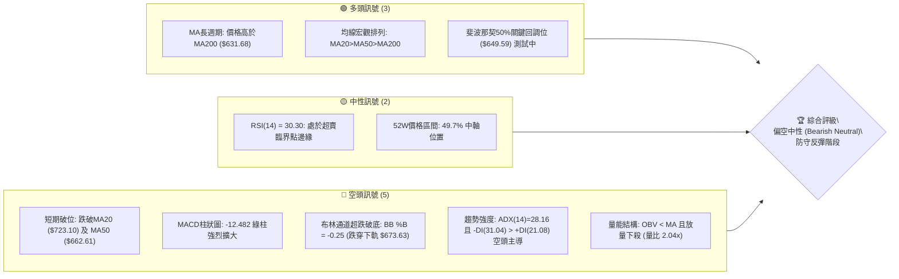
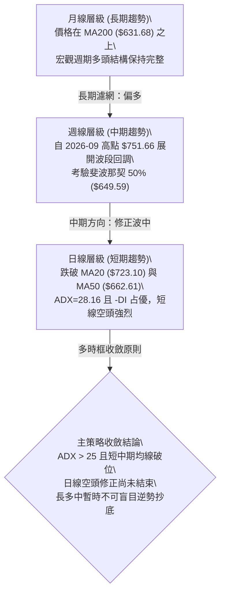
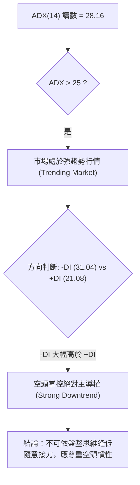
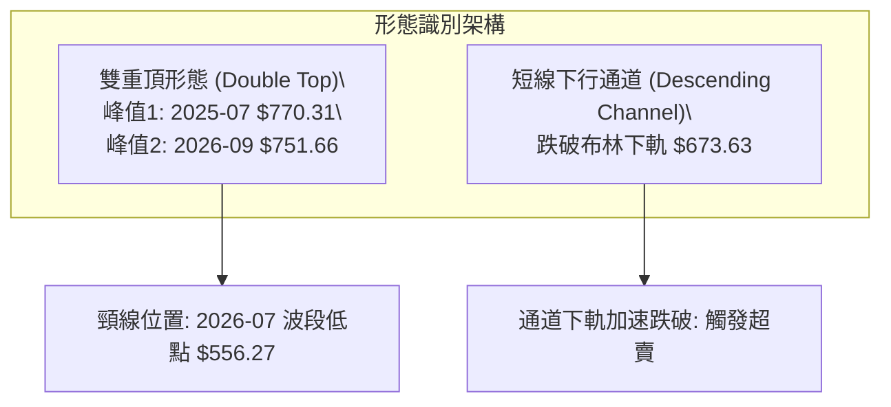
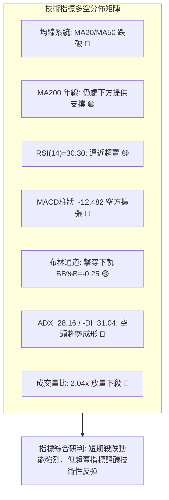
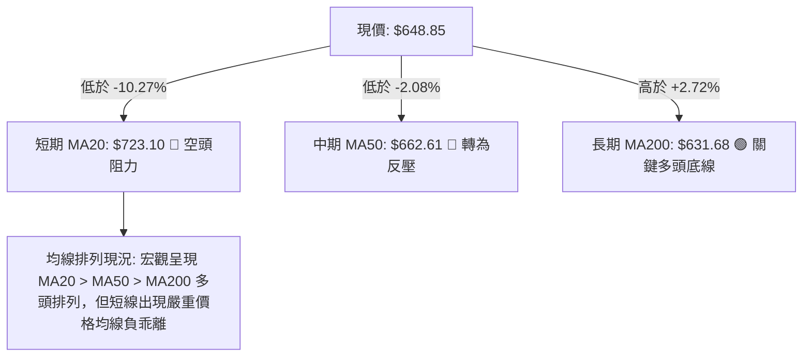
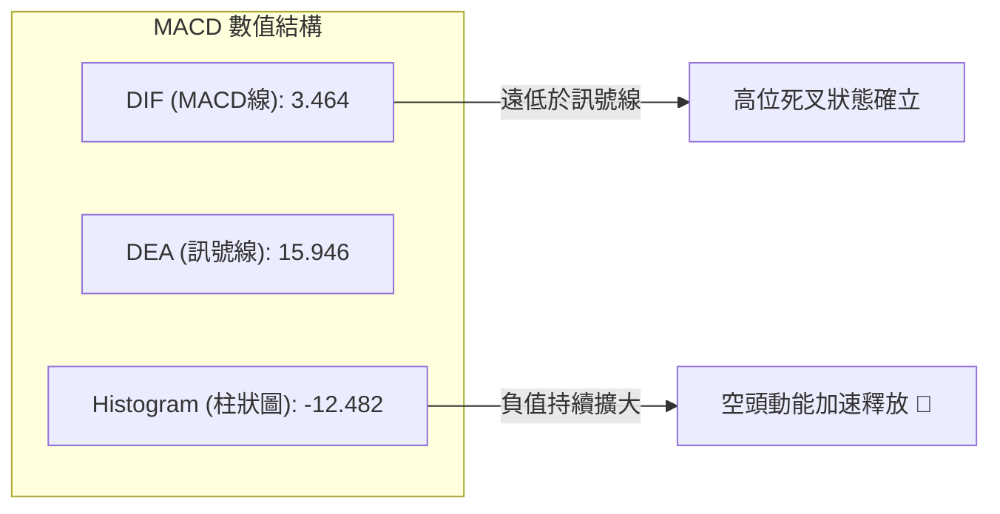
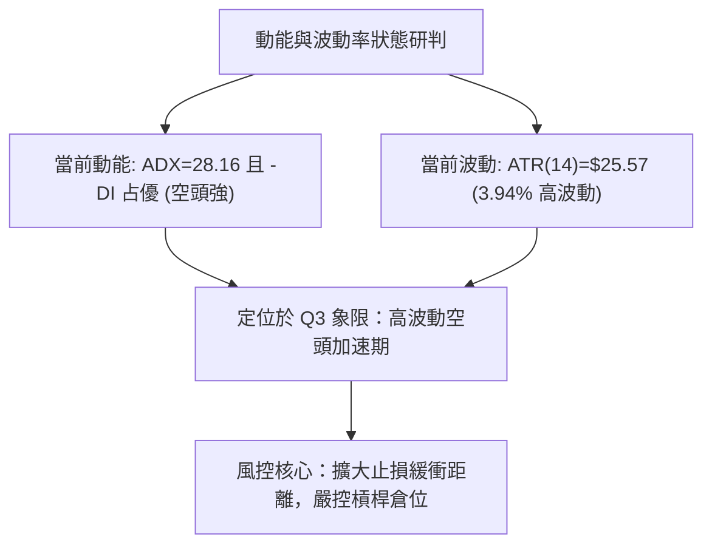
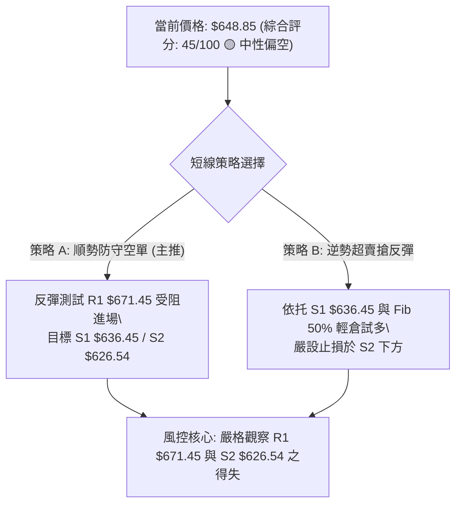
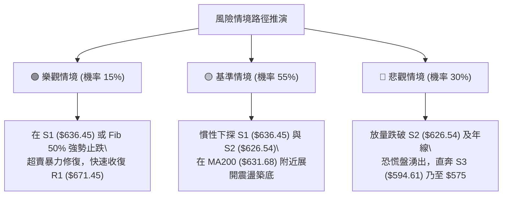

# META 技術分析報告

> **報告日期**：2026-10-23 ｜ **語言**：繁體中文 ｜ **數據來源**：Yahoo Finance ｜ **當前價格**：$648.85

---

## 目錄

| 章節 | 內容 |
|------|------|
| [1. 技術面概覽](#1-技術面概覽) | 訊號儀表板、核心指標、評分卡 |
| [2. 趨勢分析](#2-趨勢分析) | 多時框趨勢、長中短期走勢 |
| [3. 圖表形態分析](#3-圖表形態分析) | 形態識別、K線組合、目標價 |
| [4. 支撐與阻力](#4-支撐與阻力) | 關鍵價位、斐波那契回調 |
| [5. 技術指標深度解讀](#5-技術指標深度解讀) | MA/RSI/MACD/布林/成交量 |
| [6. 動能與波動率](#6-動能與波動率) | 動能評估、ATR、Beta |
| [7. 多時框架總結](#7-多時框架總結) | 時框架評分矩陣 |
| [8. 交易策略建議](#8-交易策略建議) | 多空策略、風險報酬比 |
| [9. 風險提示與監控](#9-風險提示與監控) | 監控指標、風險場景 |

---

## 1. 技術面概覽

### 🎯 技術訊號儀表板



### 📊 核心指標速覽表

| 指標類別 | 指標名稱 | 當前數值 | 訊號 | 解讀 |
|----------|----------|----------|------|------|
| **價格** | 當前收盤價 | $648.85 | 🔴 | 跌破多道短期均線，處於近三個月波段回調低位 |
| **均線** | MA20 | $723.10 | 🔴 | 價格低於MA20達 -10.27%，短線空頭下壓強勁 |
| **均線** | MA50 | $662.61 | 🔴 | 跌破中期生命線，短中期動能受阻 |
| **均線** | MA200 | $631.68 | 🟢 | 價格仍高於年線 +2.72%，長期多頭底線尚未破壞 |
| **動能** | RSI(14) | 30.30 | 🟡 | 逼近30超賣區，短線殺跌動能接近衰竭臨界 |
| **動能** | MACD (12/26/9) | 3.46 / 15.95 / -12.48 | 🔴 | 快慢線高位死叉，負柱狀圖急速發散，空方控盤 |
| **動能** | Stoch %K / %D | 6.96 / 13.28 | 🟢 | 極度超賣區間，具備強烈技術性死貓反彈或抽腳需求 |
| **趨勢** | ADX(14) / ±DI | 28.16 / -DI 31.04 | 🔴 | ADX>25確認趨勢成形，-DI高於+DI顯示空頭趨勢強勁 |
| **通道** | 布林通道 %B | -0.25 | 🟡 | 跌出下軌 ($673.63) 之外，短線嚴重超賣有回歸均值拉力 |
| **量能** | 最新量 / 20日均量 | 40.48M / 19.80M | 🔴 | 放量下挫（量比2.04倍），顯示機構拋壓釋放 |
| **波動** | ATR(14) | $25.57 (3.94%) | 🔴 | 波動度放大，日內震幅加劇，操作難度提升 |

### 🏆 技術評分卡

```
╔══════════════════════════════════════════════════════════════╗
║              技術評分卡 — META (2026-10-23)                 ║
╠══════════════════════════════════════════════════════════════╣
║ 趨勢強度 (ADX/趨勢方向)   ████████░░░░░░░░░░░░  40/100  🔴   ║
║ 動能指標 (RSI/MACD/KD)    ██████░░░░░░░░░░░░░░  30/100  🔴   ║
║ 支撐穩定度 (S1/S2/年線)   ████████████░░░░░░░░  60/100  🟡   ║
║ 成交量配合 (量比/OBV)     ████████░░░░░░░░░░░░  40/100  🔴   ║
║ 形態完整度 (雙重頂/均值)  ██████████░░░░░░░░░░  50/100  🟡   ║
║ 均線排列 (多時框收斂)     ██████████░░░░░░░░░░  50/100  🟡   ║
╠══════════════════════════════════════════════════════════════╣
║ 綜合評分                  ████████░░░░░░░░░░░░  45/100  🟡   ║
║ 評級結論                  中性偏空（區間防守 / 等待止跌）    ║
╚══════════════════════════════════════════════════════════════╝
```

---

## 2. 趨勢分析

### 🌐 多時框趨勢分析



### 📈 長期趨勢 — 12個月走勢圖（Unicode）

```
META 月線走勢圖（過去12個月：2025-11 至 2026-10）
價格軸 ($)
$770 ┤                                   
$730 ┤                                  ● (2026-09: $725.18)
$690 ┤              ● (2026-01: $714.66)
$650 ┤● (2025-11)        ●              ●←現價 $648.85
$610 ┤                               ● (2026-04: $610.86)
$570 ┤                         ● (2026-03: $571.15)
$550 ┤                                      ● (2026-07: $556.27)
     └───────────────────────────────────────────────────────────
       11   12   01   02   03   04   05   06   07   08   09   10
      2025      2026                                         2026
```

#### 走勢特徵分析表格

| 階段區間 | 時間跨度 | 起訖收盤價 | 區間漲跌幅 | 主要走勢特徵與量價結構 |
|----------|----------|------------|------------|------------------------|
| **第1階段：高位盤整** | 2025-11 ~ 2026-01 | $645.76 → $714.66 | +10.67% | 震盪衝高至 $714.66，市場承接力強，均線多頭發散。 |
| **第2階段：春季回調** | 2026-01 ~ 2026-03 | $714.66 → $571.15 | -20.08% | 大幅下修，跌破短中期支撐，觸發獲利了結賣壓。 |
| **第3階段：二次築底** | 2026-04 ~ 2026-07 | $610.86 → $556.27 | -8.94% | 探底至年度次低點 $556.27，構築堅實長期支撐區間。 |
| **第4階段：強勢爆發** | 2026-07 ~ 2026-09 | $556.27 → $725.18 | +30.36% | 出現單週 1.68 億股巨量拉升，形成主升浪測試高點。 |
| **第5階段：近期回落** | 2026-09 ~ 2026-10 | $725.18 → $648.85 | -10.53% | 放量殺跌回吐 9 月大部分漲幅，回測斐波那契 50% 回調位。 |

### 📊 中期趨勢（週線分析）

中期技術面目前正處於「主升段後的次級折返走勢（Secondary Correction）」。2026年9月最後一週曾創下收盤價 $751.66，隨後連續4週收陰（$728.08 → $718.67 → $709.33 → $648.85），週成交量均維持在 7,000 萬至 1 億股之上，週線 MACD 柱狀圖由正轉負（最新一週達 -12.482），確認中期多頭動能已被階段性空頭壓制。

```
週線關鍵位示意：
  $751.66 ──────────────── 週線前高阻力
            ╲
             ╲  放量連陰下殺
              ╲
  $671.45 ─────▼────────── 近端阻力 R1 (MA50 $662.61 附近)
  $648.85 ──────●───────── 現價（斐波那契 50% $649.59）
  $636.45 ──────────────── 近期支撐 S1
  $626.54 ──────────────── 強支撐 S2 / MA200 ($631.68)
```

### ⚡ 趨勢強度評估（ADX 解讀）



#### ADX 強度對照表

| ADX 區間 | 趨勢狀態 | META 當前數值 (28.16) 評估 | 交易指引 |
|----------|----------|----------------------------|----------|
| 0 - 20 | 無趨勢 / 震盪盤整 | 否 | 適合區間網格操作 |
| 20 - 25 | 趨勢萌芽 / 微弱 | 否 | 觀望突破確認 |
| **25 - 50** | **強趨勢 (Strong Trend)** | **符合 (28.16)** | **順應 -DI 方向操作，嚴格執行防守** |
| 50 - 75 | 極強趨勢 | 否 | 警惕趨勢隨時耗竭過熱 |
| 75 - 100 | 極端走勢 | 否 | 歷史極罕見，往往面臨劇烈均值回歸 |

---

## 3. 圖表形態分析

### 🔍 形態識別系統



#### 形態信心度與目標價評估表

| 形態名稱 | 信心度 | 判斷依據（引用數據） | 完成度 | 目標價（附精確計算式） |
|----------|--------|----------------------|--------|------------------------|
| **雙重頂 (大週期寬幅)** | 55% | 2025-07 高點 $770.31 與 2026-09 週線高點 $751.66 形成宏觀雙峰；現價尚未跌破頸線。 | 40% | 頸線 $556.27 - 形態高度 ($770.31 - $556.27 = $214.04) = 理論投射 $342.23（數據過度遠離，信心度一般，僅供結構預警）。 |
| **短期次級回撤通道** | 75% | 自 2026-09-27 ($751.66) 連跌4週，破 MA20 ($723.10) 及 MA50 ($662.61)。 | 85% | 跌破 MA50 後，量度等長目標：前波低點聚類支撐 S1: **$636.45**，第二支撐 S2: **$626.54**。 |

### 🕯️ 重要K線形態分析

| 週/月份 | 收盤價 | K線形態特徵 | 技術意涵解讀 | 訊號方向 |
|---------|--------|-------------|--------------|----------|
| **2026-08** | $571.89 | 低檔破底翻小陽線 | 結束長達4個月之築底，買盤重新介入 | 🟢 多頭啟動 |
| **2026-09** | $725.18 | 大陽突破線 (週量1.68億) | 突破前波所有中短期均線阻力，動能達到高峰 | 🟢 強烈買訊 |
| **2026-10-04** | $728.08 | 高位吊頸線/滯漲陰線 | 遇阻回落，週線 MACD 柱翻負 (-0.743)，多頭力竭 | 🔴 賣出信號 |
| **2026-10-25** | $648.85 | 長黑放量貫穿線 | 一舉擊穿 MA50 與布林下軌，空方實體完全吞噬 | 🔴 空方加速 |

### 📉 ASCII 走勢形態示意圖

```
META 短期日/週線破位與支撐形態圖
$751.66 ──────────────┐ (雙頂峰值2，2026-09)
                      │╲
                      │ ╲  連週放量下跌
                      │  ╲
$723.10 ──────────────┼───▼────── MA20 (布林中軌，短線天花板)
                      │    ╲
$662.61 ──────────────┼─────▼──── MA50 / R1: $671.45 (阻力區)
$648.85 ──────────────┼──────●─── 當前現價 (考驗斐波那契 50% $649.59)
                      │       │
$636.45 ──────────────┴───────▼── S1 (波段低點支撐)
$626.54 ───────────────────────── S2 (MA200 $631.68 共振強支撐)
```

### 🎯 形態目標價計算

以近期高點 $751.66 跌破 MA50 ($662.61) 之破位形態計算：
- **波段跌幅高度**：$751.66 - $662.61 = $89.05
- **等倍空頭滿足位 (量度目標)**：$662.61 - $89.05 = **$573.56**（接近歷史關鍵低點 $571.15 及斐波那契 78.6% $575.11）
- **第一緩衝防守目標**：數據中波段低點聚類 S1 **$636.45** 及 S2 **$626.54**。若多方在 $626.54 ~ $636.45 有效企穩，則下探 $573.56 之極端形態將被化解。

---

## 4. 支撐與阻力

### 🗺️ 關鍵價位分布圖（Unicode）

```
META 價位結構分布圖（引用 OHLCV 波段聚類數據）
════════════════════════════════════════════════════════════════
$708.60 ║████████████████████████████████████║ 強阻力 R3 (+9.21%)
$687.94 ║████████████████████████            ║ 中期阻力 R2 (+6.02%)
$671.45 ║████████████████████████████        ║ 關鍵阻力 R1 (+3.48%)
$648.85 ╠════════════════════════════════════╣ ◄ 現價 (Fib 50%: $649.59)
$636.45 ║▓▓▓▓▓▓▓▓▓▓▓▓▓▓▓▓▓▓▓▓                ║ 近期支撐 S1 (-1.91%)
$626.54 ║██████████████████████████████      ║ 強支撐 S2 (-3.44%, MA200)
$594.61 ║████████████████████████████████████║ 核心防守 S3 (-8.36%)
════════════════════════════════════════════════════════════════
```

### 🚧 阻力位分析表

| 阻力級別 | 價位 | 形成原因（依據提供之數據） | 突破難度 | 重要性 |
|----------|------|----------------------------|----------|--------|
| **R1** | **$671.45** | 近一年波段高點聚類位，且鄰近 MA50 ($662.61)。短期反彈首要考驗。 | 🟡 中等偏高 | ★★★★☆ |
| **R2** | **$687.94** | 斐波那契 38.2% 回調位 ($680.33) 與 MA5 ($691.08) 之間之成交密集下壓帶。 | 🔴 困難 | ★★★☆☆ |
| **R3** | **$708.60** | 波段密集下殺起跌點，上方緊鄰 MA20 ($723.10) 及 Fib 23.6% ($718.35)。 | 🔴 極難突破 | ★★★★★ |

### 🛡️ 支撐位分析表

| 支撐級別 | 價位 | 形成原因（依據提供之數據） | 守住機率 | 重要性 |
|----------|------|----------------------------|----------|--------|
| **S1** | **$636.45** | 近一年波段低點聚類，距離現價僅 -1.91%，短線空頭首要測試關卡。 | 🟡 50% | ★★★☆☆ |
| **S2** | **$626.54** | 波段低點強聚類，且與長期年線 MA200 ($631.68) 及 MA120 ($626.93) 高度共振。 | 🟢 70% | ★★★★★ |
| **S3** | **$594.61** | 近一年深次回撤支撐聚類，若失守將直接回測 2026-08 之 $556.27 築底區。 | 🟢 85% | ★★★★☆ |

### 📐 斐波那契回調位分析

依據 52 週波段區間：低點 **$519.37** 至高點 **$779.82** 計算：

```
0.0%  (52W High) ─── $779.82
23.6% ────────────── $718.35  (上方強阻力帶)
38.2% ────────────── $680.33  (反彈第一波目標區間)
50.0% ────────────── $649.59  ◄ 現價 $648.85 恰好收於此回調位 (-0.11%)
61.8% ────────────── $618.86  (黃金分割防守位，緊鄰 S2 $626.54)
78.6% ────────────── $575.11  (極限深幅回撤位)
100.0%(52W Low)  ─── $519.37
```

**解讀**：現價 $648.85 與斐波那契 50.0% 水平 ($649.59) 幾乎重合（相差僅 $0.74）。此位置為多空爭奪的關鍵平衡點。若此處收盤確認跌破，價格將迅速尋求 61.8% ($618.86) 與波段支撐 S2 ($626.54) 之共振支撐帶。

---

## 5. 技術指標深度解讀

### 🎛️ 指標訊號總覽



### 📈 移動平均線排列分析



#### 移動平均線數據對比表

| 均線天數 | 均線數值 | 現價與均線距離 ($) | 現價與均線幅度 (%) | 狀態解讀 |
|----------|----------|-------------------|-------------------|----------|
| **MA 5** | $691.08 | -$42.23 | -6.11% | 短線極速下墜，下行斜率陡峭 |
| **MA 10** | $715.38 | -$66.53 | -9.30% | 短線空頭排列，阻力沉重 |
| **MA 20** | $723.10 | -$74.25 | -10.27% | 布林中軌，反彈中期強阻力 |
| **MA 50** | $662.61 | -$13.76 | -2.08% | 近期跌破，確認短中期多轉空 |
| **MA 60** | $649.06 | -$0.21 | -0.03% | 現價恰好貼合 MA60 季線位置 |
| **MA 120** | $626.93 | +$21.92 | +3.50% | 半年線持續向上，支撐 S2 匯聚處 |
| **MA 200** | $631.68 | +$17.17 | +2.72% | 長期牛熊分界線，未破前不宜判定牛市結束 |
| **MA 240** | $632.89 | +$15.96 | +2.52% | 雙年線托底，多頭最後防線 |

### 📉 RSI(14) 分析

- **RSI(14) 讀數**：`30.30`
- **強度指示**：`██████░░░░░░░░░░░░░░` 30.30% 🟡
- **超買超賣判定**：數值精確降至 30.30，已緊貼 30 超賣臨界線。隨機指標 Stoch %K (6.96) 與 %D (13.28) 則已全面深陷超賣區（<20），這表明短線情緒極端悲觀。
- **背離判斷**：
  - 日線 RSI：當前無底背離（價格創新低，RSI 同步滑落）。
  - 週線 RSI：自 2026-09-13 之高點 83.9 急速拉回至 30.3，未出現經典頂背離，純屬高位多殺多的單邊回撤走勢。

### 📊 MACD(12/26/9) 訊號解讀



**解讀**：MACD 線 (3.464) 雖然仍在零軸上方，但與訊號線 (15.946) 產生了高達 -12.482 的巨大負乖離。在週線層級，MACD 柱自 9 月底的 +11.729 連續收縮並翻負至 -12.482，顯示中期趨勢已被空頭主導。

### 📦 布林通道分析

```
布林通道結構 (BB 20, 2)
$772.58 ───────────────────────────── 布林上軌
          │
$723.10 ──┼────────────────────────── 布林中軌 (MA20)
          │
$673.63 ──┼────────────────────────── 布林下軌
          │
$648.85 ──●  ◄ 現價 (BB %B = -0.25)
```

- **帶寬與位置**：現價收於 $648.85，顯著低於布林下軌 $673.63。
- **%B 指標數值**：`-0.25`。當 %B < 0 時，代表價格已經完全脫離常態分佈帶（超過 2 個標準差外）。歷史統計顯示，價格在布林下軌外運行通常難以長期維持，高機率出現「乖離修復反彈」或至少降速轉為橫盤築底。

### 💹 成交量分析（量價配合度）

- **最新成交量**：40,482,900 股
- **20日均量**：19,802,720 股（**量比高達 2.04 倍**）
- **量價特徵**：最新交易日呈現典型的「放量長黑破位」。高達 2 倍於均量的拋售，代表機構投資者（持股佔比 79.1%）存在集中性調倉或停損行為。
- **OBV 趨勢**：數據顯示 `OBV < MA`，能量潮指標向下穿透均線，確認資金處於淨流出態勢，量能並未對價格提供支撐，印證了目前空頭行情的真實性。

---

## 6. 動能與波動率

### ⚡ 動能評估四象限

| 象限 | 動能維度 | 波動維度 | 當前狀態標註 | 戰術指引 |
|------|----------|----------|--------------|----------|
| **Q1** | 強動能 (多頭) | 低波動 | — | 穩定多頭主升段，全力做多 |
| **Q2** | 弱動能 (中性) | 低波動 | — | 狹幅無聊盤整，網格策略 |
| **Q3** | 強動能 (空頭) | 高波動 | ✓ **META 處於此象限** | **空方宣洩主跌段，切忌逆勢接刀，嚴設止損** |
| **Q4** | 弱動能 (衰竭) | 高波動 | — | 築底或頂部震盪，警惕多空雙殺 |



### 📊 ATR 波動率分析

- **ATR(14) 數值**：**$25.57**（佔當前價格之 3.94%）
- **止損距離建議**：
  - *短期日內/隔夜波段*：以 1.0 倍 ATR 作為最小止損保護區間 = **$25.57**。
  - *波段趨勢交易*：以 1.5 ~ 2.0 倍 ATR 設定止損 = **$38.35 ~ $51.14**。
  - 此數值說明 META 日內常規震幅可達 $25 美元以上，任何過於緊密的止損（如 < $15）極易被市場雜訊無效掃出場。

### 📐 Beta 與市場相關性

- **Beta 係數**：`1.185`
- **解讀**：META 屬於典型的高彈性成長股，波動度比標普500大盤高出約 18.5%。當大盤面臨宏觀回調壓力時，META 通常會承受 1.2 倍左右的下行放大乘數；反之，若大盤止跌企穩，其超賣彈升的爆發力亦相應較強。

---

## 7. 多時框架總結

### 📋 時框架評分表

| 時框架 | 趨勢方向 | 動能狀態 | 均線排列狀況 | 形態特徵 | 綜合評分 | 操作建議 |
|--------|----------|----------|--------------|----------|----------|----------|
| **月線 (長期)** | 🟢 多頭 | 🟡 中性回調 | MA200 之上多頭排列 | 巨幅震盪上行結構 | 65/100 | 長期投資者無需恐慌，年線之上結構未壞 |
| **週線 (中期)** | 🔴 空頭 | 🔴 柱狀下破 | 跌破 20 週線考驗 50 週線 | 雙峰滯漲回落 | 35/100 | 中期波段減倉，等待回調落底企穩 |
| **日線 (短期)** | 🔴 極空 | 🟡 極度超賣 | 全面空頭發散 | 貫穿布林下軌加速 | 30/100 | 短線禁止追空，嚴防超賣報復性抽腳 |

### 🔲 綜合訊號矩陣

```
時框維度        趨勢指標       動能指標       量能指標       矩陣判定
─────────────────────────────────────────────────────────────────
月線 (長期)     🟢 看多        🟡 中性        🟢 穩定        長期牛市基調
週線 (中期)     🔴 看空        🔴 空方擴大    🔴 沉重        中期修正波段
日線 (短期)     🔴 看空        🟢 超賣反彈訊  🔴 放量破位    短線加速探底
─────────────────────────────────────────────────────────────────
多時框收斂判定：短中期全面受制於空頭修正，長期支撐正迎來關鍵大考。
```

### ⚖️ 多時框收斂結論

依據多時框收斂規則：
1. **趨勢/盤整判定**：當前 ADX(14) 讀數為 **28.16 > 25**，市場明確處於「強趨勢行情」，不可採用盤整網格思維。
2. **時框優先級**：趨勢行情中，中長期（週線/MA50、MA200）方向具有決定性主導權，日線超賣只代表可能隨時出現技術性抽腳，不代表趨勢已逆轉。
3. **收斂方向唯一結論**：**中性偏空（等待回測強支撐 S2 $626.54 / MA200 $631.68 止跌確認）**。

---

## 8. 交易策略建議

### 🗺️ 策略決策流程圖



### 🧭 策略路由

- **技術評分卡綜合評分**：`45 / 100`（處於 40–60 中性區間，且偏向中性偏空邊界）
- **當前主策略方向**：**區間防守 / 順勢高空為主，逆勢超賣搶反彈為輔（依評分 45/100）**。
- **操作指導**：在跌破 MA50 且 ADX=28.16 的強烈空頭趨勢下，禁止在當前半山腰位置重倉盲目猜底。重點關注反彈遇阻做空機會，或等待價格砸至年線強支撐 S2 企穩信號。

### 🎯 價格情境階梯（Price Scenarios）

| 觸發條件 | 下一目標 | 後續延伸 | 情境技術含義 |
|----------|----------|----------|--------------|
| **強勢收復 R1 $671.45** | R2 **$687.94** | R3 **$708.60** | 突破 MA50，形成 V 轉修復行情，短線轉強 |
| **跌破現價，測試 S1 $636.45** | S2 **$626.54** | MA200 **$631.68** | 釋放剩餘殺跌動能，測試長期年線牛熊分水嶺 |
| **有效擊穿 S2 $626.54** | S3 **$594.61** | Fib 78.6% **$575.11** | 中期走勢惡化，大週期雙頂形態完成度提升 |

### 📊 情境機率分佈

| 情境劃分 | 發生機率 | 主要依據（指標狀態） |
|----------|----------|----------------------|
| **回落探底 (測試 S1/S2)** | **55%** | ADX=28.16 空頭主導、MACD 柱狀發散 (-12.482)、量比 2.04x 放量下殺 |
| **區間震盪 (Fib 50% 拉鋸)** | **30%** | 現價收於 Fib 50% ($649.59)、RSI(14)=30.30 與 KD(6.96) 極度超賣 |
| **強勢反彈 (重返 R1 之上)** | **15%** | 均線系統呈明顯空頭壓制，短線上方解套賣壓沉重，缺乏即時催化劑 |

### 🟢 主策略詳情（精確數值依關鍵價位執行）

#### 策略 A（主推：順勢逢高沽空 / 防守做空）
- **進場條件**：超賣引發技術性反抽，價格測試關鍵阻力 R1 附近滯漲收上影線
- **進場價格**：**$671.45** (R1)
- **目標價 T1**：**$636.45** (S1)
- **目標價 T2**：**$626.54** (S2，MA200 關鍵支撐)
- **止損價格**：**$687.94** (R2 上方，止損距離 $16.49)
- **風險報酬比**：
  - 至 T1：($671.45 - $636.45) / ($687.94 - $671.45) = $35.00 / $16.49 = **2.12 : 1**
  - 至 T2：($671.45 - $626.54) / ($687.94 - $671.45) = $44.91 / $16.49 = **2.72 : 1**
- **成功機率**：60%
- **建議倉位**：15%

#### 策略 B（輔助：激進超賣搶反彈）
- **進場條件**：現價回踩 S1 獲得支撐，或 Stoch %K 低檔金叉 %D 形成短多訊號
- **進場價格**：**$636.45** (S1)
- **目標價 T1**：**$671.45** (R1 / MA50 附近)
- **目標價 T2**：**$687.94** (R2)
- **止損價格**：**$618.86** (斐波那契 61.8% 跌破位，止損距離 $17.59)
- **風險報酬比**：
  - 至 T1：($671.45 - $636.45) / ($636.45 - $618.86) = $35.00 / $17.59 = **1.99 : 1**
  - 至 T2：($687.94 - $636.45) / ($636.45 - $618.86) = $51.49 / $17.59 = **2.93 : 1**
- **成功機率**：45%
- **建議倉位**：8%（嚴控風險）

### 🔴 反向風險觸發點（對沖提示）

若日線收盤價**強勢帶量突破 R1 $671.45 並站穩**，表明短線空頭力竭，V 轉修復展開，所有空頭頭寸必須立即無條件止損離場，並可將策略轉化為逢回踩做多。

### ⭐ 整體訊號強度評星

```
做多訊號強度：★★☆☆☆  (2/5星 - 僅有極度超賣支撐，順勢動能缺乏)
做空訊號強度：★★★★☆  (4/5星 - 短中期均線破位，量能宣洩明顯)
整體可信度：  ★★★★☆  (4/5星 - 技術指標共振度高，價位界線分明)
```

---

## 9. 風險提示與監控

### ✅ 關鍵監控指標 Checklist

```
╔══════════════════════════════════════════════════════════════╗
║              每日交易關鍵風控監控清單 (Checklist)            ║
╠══════════════════════════════════════════════════════════════╣
║ [ ] 價格是否跌破長期多頭年線 MA200 ($631.68)                ║
║ [ ] RSI(14) 是否在 30 之下形成低檔「底背離」                 ║
║ [ ] MACD 負柱狀圖 (-12.482) 是否出現拐點收縮                 ║
║ [ ] 日成交量是否由放量 (40M) 轉為縮量 (<20M) 沉澱            ║
║ [ ] 價格能否有效收復布林通道下軌 ($673.63)                   ║
║ [ ] 支撐位 S2 ($626.54) 的多頭防禦力道是否堅挺               ║
╚══════════════════════════════════════════════════════════════╝
```

### ⚠️ 風險場景分析



### 🛡️ 風險管理重要提醒

1. **波動放大應對**：當前 ATR 高達 **$25.57**，單日潛在波動近 4%。倉位規模建議較平時縮小 30%–50%，防止被日內隨機洗盤震出。
2. **財報與宏觀風險**：近期科技股板塊受高資本支出與利潤率壓縮疑慮困擾（最新季度 EPS 成長為 -13.4%），基本面與技術面在此形成共振下壓，切忌單憑分析師買進評級（58位分析師目標均價 $833.13）而盲目硬扛浮虧。
3. **年線生死線紀律**：**MA200 ($631.68) / S2 ($626.54)** 是 META 自 2024 年以來宏觀多頭架構的最關鍵底線。若此處被週線級別實體長黑摜破，意味著長達兩年的大多頭走勢告終，必須果斷將所有多頭倉位降至零。

---

## 📋 報告總結

```
╔══════════════════════════════════════════════════════════════╗
║                 META 技術分析報告總結                        ║
╠══════════════════════════════════════════════════════════════╣
║ 報告日期：2026-10-23                                         ║
║ 當前價格：$648.85                                             ║
║ 分析評級：🟡 偏空中性 (Bearish Neutral / 防守觀望)           ║
║                                                              ║
║ 關鍵結論：                                                   ║
║ ├─ 長期趨勢：🟢 多頭格局仍在 (高於 MA200 $631.68)           ║
║ ├─ 中期趨勢：🔴 次級修正波段 (高位拉回 -10.5%，MACD死叉)      ║
║ ├─ 短期趨勢：🔴 空方加速探底 (ADX=28.16，擊穿布林下軌)      ║
║ ├─ 關鍵支撐：S1: $636.45  /  S2: $626.54 (年線共振)         ║
║ ├─ 關鍵阻力：R1: $671.45  /  R2: $687.94                    ║
║ └─ 斐波那契：現價正處 50.0% 平衡點 ($649.59) 關鍵爭奪區       ║
║                                                              ║
║ 最優策略組合：                                               ║
║ 1. 🥇 最佳機會：反彈至阻力 R1 ($671.45) 順勢高空 (風報比 2.7) ║
║ 2. 🥈 次選機會：下探強支撐 S2 ($626.54) 尋求左側企穩買點    ║
║ 3. 🥉 保守選擇：完全空倉觀望，等待日線收復 MA50 再行決策   ║
╚══════════════════════════════════════════════════════════════╝
```

---

> ⚠️ **免責聲明**：本報告為 AI 自動生成之技術分析，所有數據及估算均基於提供的歷史價格資訊。本報告**僅供研究與學術參考**，**不構成任何投資建議**。投資有風險，入市需謹慎。

---

*報告生成時間：2026-10-23 ｜ 數據來源：Yahoo Finance ｜ 分析框架：多時框技術分析*