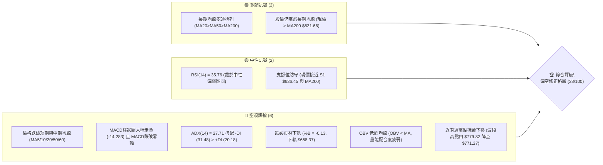
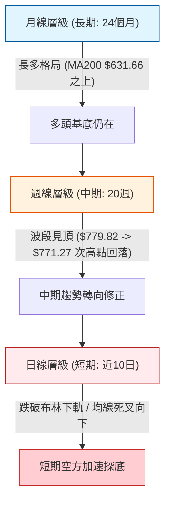
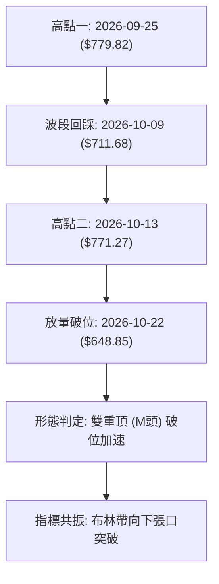
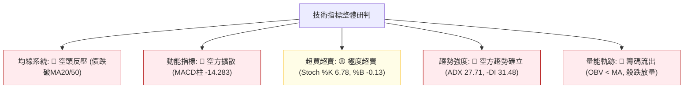
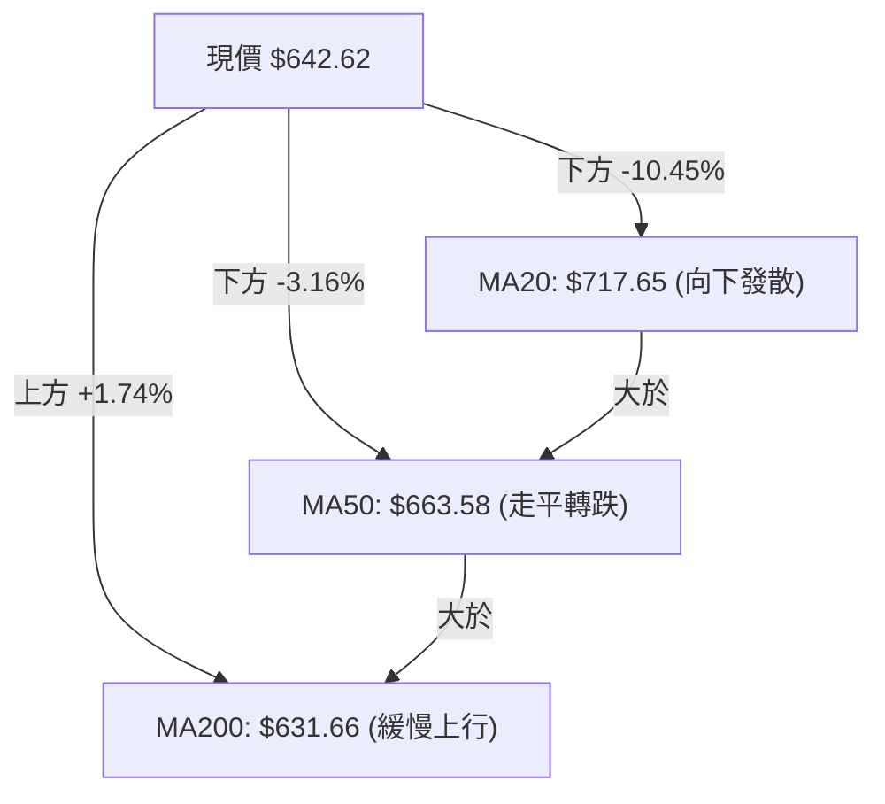
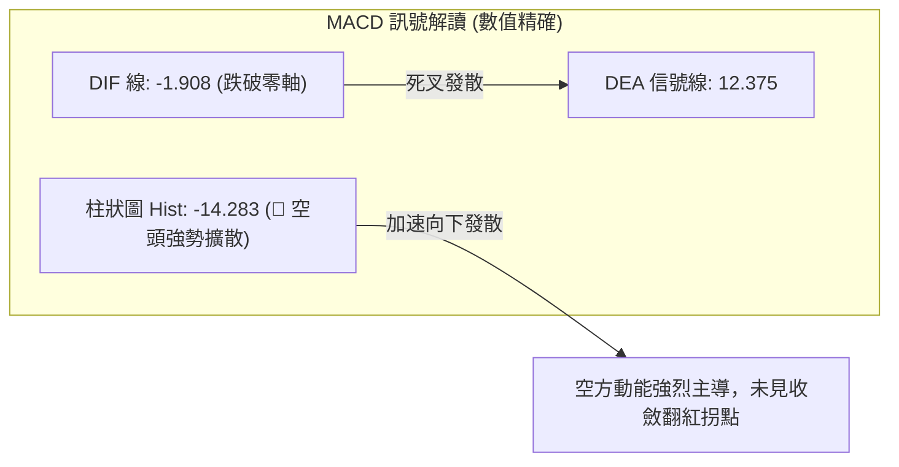
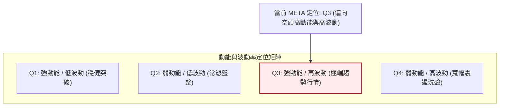
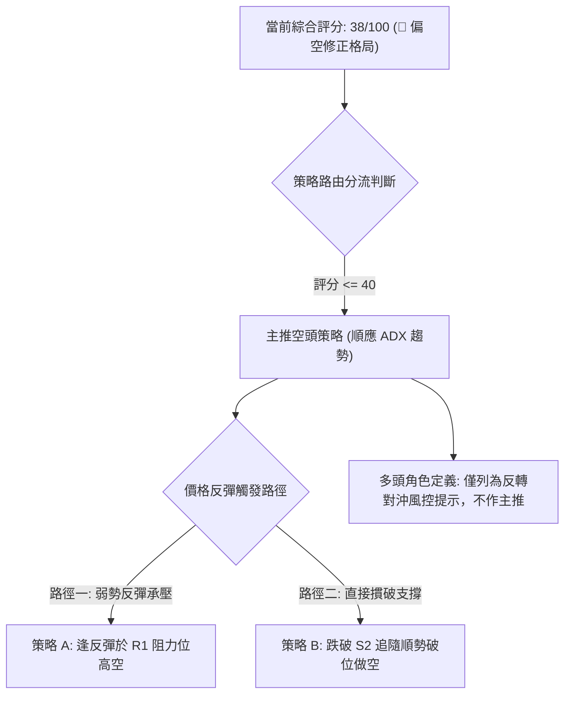
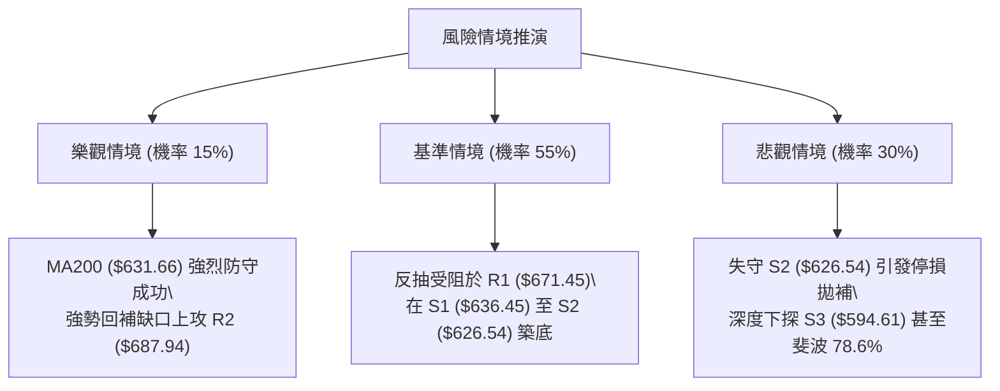

# META 技術分析報告

> **報告日期**：2026-10-24 ｜ **語言**：繁體中文 ｜ **數據來源**：Yahoo Finance ｜ **當前價格**：$642.62

---

## 目錄

| 章節 | 內容 |
|------|------|
| [1. 技術面概覽](#1-技術面概覽) | 訊號儀表板、核心指標、評分卡 |
| [2. 趨勢分析](#2-趨勢分析) | 多時框趨勢、長中短期走勢 |
| [3. 圖表形態分析](#3-圖表形態分析) | 形態識別、K線組合、目標價 |
| [4. 支撐與阻力](#4-支撐與阻力) | 關鍵價位、斐波那契回調 |
| [5. 技術指標深度解讀](#5-技術指標深度解讀) | MA/RSI/MACD/布林/成交量 |
| [6. 動能與波動率](#6-動能與波動率) | 動能評估、ATR、Beta |
| [7. 多時框架總結](#7-多時框架總結) | 時框架評分矩陣 |
| [8. 交易策略建議](#8-交易策略建議) | 多空策略、風險報酬比 |
| [9. 風險提示與監控](#9-風險提示與監控) | 監控指標、風險場景 |

---

## 1. 技術面概覽

### 🎯 技術訊號儀表板



### 📊 核心指標速覽表

| 指標類別 | 指標名稱 | 當前數值 | 訊號 | 解讀 |
|----------|----------|----------|------|------|
| **價格** | 當前價格 | $642.62 | 🔴 | 位於52週區間47.3%，短線經歷急速修正，跌破多條短期均線 |
| **均線** | MA20 | $717.65 | 🔴 | 價格低於MA20達-10.45%，短期趨勢嚴重偏空，斜率向下 |
| **均線** | MA50 | $663.58 | 🔴 | 價格低於MA50達-3.16%，中期生命線宣告失守，轉為上方強阻力 |
| **均線** | MA200 | $631.66 | 🟢 | 價格仍高於MA200約+1.74%，長期牛熊分界線提供最後防守支撐 |
| **動能** | RSI(14) | 35.76 | 🟡 | 位於30–70常態區間偏下緣，接近超賣但尚未形成底背離鈍化 |
| **動能** | MACD(12,26,9) | -1.908 / 柱 -14.283 | 🔴 | DIF下穿MACD信號線，柱狀圖持續擴散，空方動能處於主導地位 |
| **動能** | KD (Stoch %K/%D) | 6.78 / 10.66 | 🟡 | 數值嚴重超賣（<20），短線存在技術性超跌反彈動能 |
| **趨勢** | ADX(14) / ±DI | 27.71 (-DI:31.48) | 🔴 | ADX>25確立趨勢行情，-DI大幅高於+DI，確認空方趨勢主導 |
| **通道** | 布林通道 %B | -0.13 (下軌 $658.37) | 🔴 | 價格摜破布林下軌，呈現極端開口擴張與通道超賣狀態 |
| **量能** | OBV 趨勢 | OBV < MA (量比 0.77x) | 🔴 | 下殺過程中籌碼流出，OBV跌破均線，缺乏量能承接買盤 |
| **波動** | ATR(14) | $26.08 (4.06%) | 🟡 | 日內平均振幅達26美元以上，波動率擴張，止損區間需相應拉寬 |

### 🏆 技術評分卡

```
╔══════════════════════════════════════════════════════════════════╗
║                   技術評分卡 — META (2026-10-24)                 ║
╠══════════════════════════════════════════════════════════════════╣
║ 趨勢強度      ███████░░░░░░░░░░░░░  35/100  🔴 空方強趨勢主導   ║
║ 動能指標      █████░░░░░░░░░░░░░░░  25/100  🔴 MACD擴散/超賣區  ║
║ 支撐穩定度    ███████████░░░░░░░░░  55/100  🟡 臨近MA200與S1   ║
║ 成交量配合    ██████░░░░░░░░░░░░░░  30/100  🔴 殺跌放量/反彈縮量 ║
║ 形態完整度    ████████░░░░░░░░░░░░  38/100  🔴 雙頂頸線破位走勢 ║
║ 均線排列      █████████░░░░░░░░░░░  45/100  🟡 長多短空均線乖離 ║
╠══════════════════════════════════════════════════════════════════╣
║ 綜合評分      ████████░░░░░░░░░░░░  38/100  🔴 偏空修正格局     ║
╚══════════════════════════════════════════════════════════════════╝
```
*註：綜合評分由六項子評分算術平均所得：(35 + 25 + 55 + 30 + 38 + 45) ÷ 6 = 38 分（依規則 18）。*

---

## 2. 趨勢分析

### 🌐 多時框趨勢分析



### 📈 長期趨勢 — 12個月走勢圖（Unicode）

依據過去 12 個月歷史收盤價繪製月線走勢圖（2025-11 至 2026-10）：

```
META 月線走勢圖（過去12個月歷史收盤）
價格軸 ($)
$780 ┤
$740 ┤                                      ● (2026-09: $725.18)
$700 ┤              ● (2026-01: $714.66)   / \
$660 ┤  ●    ●     / \                    /   \
$620 ┤   \  / \   /   \    ●    ●         /     ● (2026-10: $642.62 現價)
$580 ┤    ●    \ /     \  / \  / \       /
$540 ┤          ●       ●    ●    ●     /
     └─┬────┬────┬────┬────┬────┬────┬────┬────┬────┬────┬────┬────
     11月 12月 01月 02月 03月 04月 05月 06月 07月 08月 09月 10月
     2025                       2026
```

**過去12個月走勢特徵分析表格**：

| 時間區間 | 起訖收盤價 | 區間漲跌幅 | 走勢特徵描述 |
|----------|------------|------------|--------------|
| 2025-11 ~ 2026-01 | $645.76 → $714.66 | +10.67% | 年底波段反彈，多頭穩步推升創波段高點 |
| 2026-01 ~ 2026-03 | $714.66 → $571.15 | -20.08% | 首季快速拉回修正，回測 570 美元支撐 |
| 2026-03 ~ 2026-05 | $571.15 → $631.43 | +10.55% | 震盪築底後反彈，受阻於 630 美元關卡 |
| 2026-05 ~ 2026-07 | $631.43 → $556.27 | -11.90% | 二次探底，打出年度雙重底低點 $556.27 |
| 2026-07 ~ 2026-09 | $556.27 → $725.18 | +30.37% | 強勢主升段行情，9月一度創下52週高點 $779.82 |
| 2026-09 ~ 2026-10 | $725.18 → $642.62 | -11.38% | 10月中旬自次高點 $771.27 暴跌跳水，單月大幅吐回漲幅 |

### 📊 中期趨勢（週線分析）

從近 20 週收盤數據觀察，META 於 2026-09-25 創下 52 週高點 $779.82（收盤 $751.66），成交量爆出 168.3M 的歷史巨量。隨後週 K 連收 4 根黑 K，RSI 由 71.4 崩跌至 35.8，MACD 柱狀圖由 +11.729 翻負至 -14.283。

```
週線近期壓力與支撐示意圖
══════════════════════════════════════════════════════════════════
 52W 歷史高點  $779.82 ────────────────────────── (09-25 週高點，巨量頂部)
 次高阻力區間  $771.27 ────────────────────────── (10-16 週高點，構築次頂)
 20週均線阻力  $717.65 ────────────────────────── (本週跌破之關鍵頸線)
 斐波 50% 回調 $649.59 ────────────────────────── (昨日跌破之多空軸心)
 當前現價      $642.62 ◄────── (現正測試短期下軌支撐)
 近期強支撐 S1 $636.45 ────────────────────────── (波段低點聚類)
 長期牛熊線    $631.66 ────────────────────────── (MA200 生命線)
 斐波 61.8%    $618.86 ────────────────────────── (黃金分割關鍵防線)
══════════════════════════════════════════════════════════════════
```

### ⚡ 趨勢強度評估（ADX 解讀）

```mermaid
graph TD
    A["ADX(14) = 27.71"] --> B{"ADX > 25 臨界值判斷"}
    B -->|"是 (27.71 > 25)"| C["確立當前處於強趨勢行情 (非無方向盤整)"]
    C --> D{"方向指標判斷 (+DI vs -DI)"|"}
    D -->|"-DI: 31.48 大於 +DI: 20.18"| E["空頭全面主導走勢"]
    E --> F["結論: 確立為空方主導的強勁下行趨勢，嚴禁逆勢盲目猜底"]
```

**ADX 趨勢強度對照解讀表**：

| 指標變數 | 當前讀數 | 門檻區間 | 技術解讀與操作意義 |
|----------|----------|----------|--------------------|
| **ADX(14)** | **27.71** | > 25（強趨勢） | 擺脫 8 月份以來的震盪狀態，趨勢能量顯著增強，順勢交易勝率較高 |
| **-DI** | **31.48** | > 30（極度強勢） | 空方力量掌控盤面，賣壓沉重且具備主動性進攻特徵 |
| **+DI** | **20.18** | < 25（多方衰竭） | 多方買盤意願低落，反彈難以形成持續性推升力道 |
| **趨勢方向** | **空頭主導** | -DI 領先幅度 +11.30 | 依規則 14，以中長期走勢為主導，日線層級僅作為尋找空方進場時機 |

---

## 3. 圖表形態分析

### 🔍 形態識別系統



**圖表形態識別與信心度評估表**（依規則 15）：

| 形態名稱 | 信心度 | 判斷依據（引用數據） | 完成度 | 目標價（附計算式） |
|----------|--------|----------------------|--------|--------------------|
| **雙重頂 (M頭)** | **75%** | 兩次衝高受阻於 $779.82（09-25週高）與 $771.27（10-13日高），頸線位置座落於 $702.71（10-16日低點）。10-22 以 40.57M 巨量摜破頸線。 | 90% | 頸線 $702.71 − 形態高度 ($771.27 − $702.71 = $68.56) = **$634.15**（接近 S1 $636.45） |
| **布林帶破位** | **85%** | 價格連破中軌 $717.65 與下軌 $658.37，%B 跌至 -0.13，進入極端向下破位軌道。 | 100% | 下探測試關鍵支撐 S1 **$636.45** 與 S2 **$626.54** |
| **頭肩底形態** | **< 30%** | 數據中未偵測到任何底部結構，低點持續刷新，不具備幾何頭肩特徵。 | 0% | 訊號不足，僅做指標型超跌解讀 |

### 🕯️ 重要K線形態分析

依規則 19，嚴格採用數據提供之「近10根日K」與「近8根週K」之實際價格展開分析：

**近10根日K形態精細解析表**：

| 日期 | 開盤價 | 最高價 | 最低價 | 收盤價 | 成交量 | K線形態名稱 | 技術解讀與多空訊號 | 訊號 |
|:---:|:---:|:---:|:---:|:---:|:---:|:---:|:---|:---:|
| 10-12 | 728.50 | 752.24 | 727.64 | 742.96 | 24.88M | 中陽線 | 突破回升，帶上影線，多頭再度挑戰波段高點 | 🟢 |
| 10-13 | 735.99 | 771.27 | 734.84 | 762.50 | 22.71M | 長陽衝高受阻 | 盤中衝至 $771.27 構築次頂，留下近 9 美元上影線 | 🟡 |
| 10-14 | 760.75 | 761.50 | 734.29 | 737.54 | 16.24M | 烏雲罩頂/大陰吞噬 | 高開低走，完全吞噬前日陽線實體大部，見頂確認 | 🔴 |
| 10-15 | 726.56 | 743.97 | 715.58 | 736.72 | 16.89M | 跳空低開陀螺線 | 低開反彈遇阻，多方無力回補缺口，反彈動能衰退 | 🔴 |
| 10-16 | 736.70 | 738.49 | 702.71 | 709.33 | 20.64M | 光腳大黑K | 擊穿 710 美元支撐，逼近頸線 $702.71，空方集結 | 🔴 |
| 10-19 | 707.16 | 708.83 | 693.86 | 705.44 | 16.26M | 低開下影小十字 | 破位 700 關卡後出現暫時性抵抗，但反彈量能不足 | 🟡 |
| 10-20 | 694.98 | 696.51 | 681.05 | 694.25 | 17.05M | 弱勢下探十字線 | 低點推移至 $681.05，均線呈現下壓空頭排列 | 🔴 |
| 10-21 | 697.60 | 713.22 | 689.68 | 697.52 | 29.20M | 長上影倒錘頭 | 放量至 29.2M 誘多反抽，遭空方強力壓回原點 | 🔴 |
| 10-22 | 676.35 | 681.07 | 639.69 | 648.85 | 40.57M | 斷頭鍘放量長黑 | 巨量 40.57M 跳空崩跌，摜破 MA50 與布林下軌 | 🔴 |
| 10-23 | 638.18 | 648.04 | 633.27 | 642.62 | 14.76M | 縮量抵抗十字星 | 低探 $633.27 後微幅回升，量能驟減，屬超跌喘息 | 🟡 |

**近8根週K形態特徵表**：

| 週末日期 | 開盤價 | 最高價 | 最低價 | 收盤價 | 週成交量 | 週K形態特徵與多空意義 | 訊號 |
|:---:|:---:|:---:|:---:|:---:|:---:|:---|:---:|
| 09-04 | 577.17 | 618.97 | 555.66 | 616.28 | 81.44M | 週線長陽突破，脫離底部盤整區間 | 🟢 |
| 09-11 | 615.72 | 663.72 | 609.26 | 647.52 | 93.27M | 實體大陽線，推升站穩 640 美元關卡 | 🟢 |
| 09-18 | 657.31 | 689.61 | 648.71 | 665.23 | 99.58M | 連三陽走勢，均線多頭排列擴散 | 🟢 |
| 09-25 | 680.30 | 779.82 | 679.60 | 751.66 | 168.31M | 巨量爆量衝頂線，留下近 28 美元長上影，見頂信號 | 🟡 |
| 10-02 | 750.04 | 750.58 | 713.19 | 728.08 | 96.20M | 高檔陰線吞噬，主力籌碼開始派發 | 🔴 |
| 10-09 | 727.71 | 747.60 | 711.68 | 718.67 | 69.67M | 縮量陰十字星，反抽無力，下跌中繼 | 🔴 |
| 10-16 | 728.50 | 771.27 | 702.71 | 709.33 | 101.36M | 次頂長上影避雷針，確認雙頂成立 | 🔴 |
| 10-23 | 707.16 | 713.22 | 633.27 | 642.62 | 117.85M | 週線放量破位長黑K，週跌幅達 -9.40%，失守中期支撐 | 🔴 |

### 📉 ASCII 走勢形態示意圖

```
雙重頂 (M頭) 破位與當前價位結構示意圖
價格軸
$780 ┤               頂1: $779.82 (09-25)
$760 ┤               ▲            頂2: $771.27 (10-13)
$740 ┤              / \                ▲
$720 ┤             /   \  谷底: $711.68 \
$700 ┤────────────/─────\───────▲────────\─────── 頸線區域: $702.71 (10-16低點)
$680 ┤           /       \     / \        \
$660 ┤          /         \   /   \        \     (放量跌破頸線)
$640 ┤─────────/───────────\─/─────\────────\───► 現價 $642.62 (跌破布林下軌)
$634 ┤                                      ▼ M頭量度跌幅目標 $634.15
$620 ┤                                        (臨近支撐 S1 $636.45 / S2 $626.54)
```

### 🎯 形態目標價計算

雙重頂形態量度跌幅計算依據：
1. **第一頂部最高點**：$779.82（2026-09-25 週高）
2. **第二頂部最高點**：$771.27（2026-10-13 日高）
3. **頸線破位關鍵點**：$702.71（2026-10-16 日低點）
4. **形態高度 ($H$)**：以次頂高度計算 $H = \$771.27 - \$702.71 = \$68.56$
5. **最小量度滿足跌幅目標**：
   $$\text{目標價} = \text{頸線} - H = \$702.71 - \$68.56 = \mathbf{\$634.15}$$
6. **目標達成度評估**：
   2026-10-23 盤中最低已下探至 **$633.27**，已精準抵達形態理論目標價 $634.15。當前收盤於 $642.62，顯示形態理論跌幅已初步滿足，短線下行斜率可能減緩，轉為在支撐位 S1（$636.45）與 S2（$626.54）之間尋求喘息。

---

## 4. 支撐與阻力

### 🗺️ 關鍵價位分布圖（Unicode）

```
META 價位結構分布圖（OHLCV 嚴格計算）
══════════════════════════════════════════════════════════════════
$708.60 ║████████████████████████║ 強阻力 R3（近一年波段高點聚類）
$687.94 ║████████████████████    ║ 阻力 R2（跳空缺口阻力帶）
$671.45 ║████████████████████████║ 關鍵阻力 R1（MA50反彈重壓區）
$649.59 ║▒▒▒▒▒▒▒▒▒▒▒▒▒▒▒▒▒▒▒▒▒▒▒▒║ 斐波那契 50.0% 多空分水嶺
$642.62 ╠════════════════════════╣ ◄ 當前收盤價（位於S1與Fib 50%之間）
$636.45 ║▓▓▓▓▓▓▓▓▓▓▓▓▓▓▓▓        ║ 近期支撐 S1（-0.96%，首道防線）
$631.66 ║████████████████        ║ 長期均線 MA200（牛熊生命線）
$626.54 ║████████████████████████║ 強支撐 S2（-2.50%，密集波段低點）
$618.86 ║▒▒▒▒▒▒▒▒▒▒▒▒▒▒▒▒▒▒▒▒▒▒▒▒║ 斐波那契 61.8% 黃金分割回調位
$594.61 ║████████████████████████║ 終極防守 S3（-7.47%，深度支撐帶）
══════════════════════════════════════════════════════════════════
```

### 🚧 阻力位分析表

所有阻力價位嚴格引用系統計算之聚類數據：

| 阻力級別 | 價位 | 與現價差距 | 形成技術原因 | 突破難度 | 重要性評級 |
|:---:|:---:|:---:|:---|:---:|:---:|
| **R1** | **$671.45** | +4.49% | 波段反彈高點聚類，且上方臨近下降中之 MA50（$663.58）及 MA5（$677.74）壓制帶 | 🔴 極高 | ⭐️⭐️⭐️⭐️☆ |
| **R2** | **$687.94** | +7.05% | 10-21 長上影倒錘頭測試之波段頂部（當日高點 $713.22 回落處的密集套牢層） | 🔴 極高 | ⭐️⭐️⭐️⭐️☆ |
| **R3** | **$708.60** | +10.27% | 雙頂頸線下破處（$702.71~$709.33）形成的重度密集籌碼套牢峰，亦為布林中軌所在 | 🔴 極難 | ⭐️⭐️⭐️⭐️⭐️ |

### 🛡️ 支撐位分析表

所有支撐價位嚴格引用系統計算之聚類數據：

| 支撐級別 | 價位 | 與現價差距 | 形成技術原因 | 守住機率 | 重要性評級 |
|:---:|:---:|:---:|:---|:---:|:---:|
| **S1** | **$636.45** | -0.96% | 近一年波段低點聚類，今日最低下探至 $633.27 獲得初步買盤承接，距離現價僅 6 美元 | 🟡 55% | ⭐️⭐️⭐️☆☆ |
| **S2** | **$626.54** | -2.50% | 與長期均線 MA200（$631.66）及 MA120（$627.21）形成三合一高強度防禦屏障 | 🟢 65% | ⭐️⭐️⭐️⭐️⭐️ |
| **S3** | **$594.61** | -7.47% | 2026年7月至8月築底平台中樞（8-07 收盤 $591.63），為中期趨勢徹底轉熊前之最後防線 | 🟢 80% | ⭐️⭐️⭐️⭐️☆ |

### 📐 斐波那契回調位分析

依據 52 週完整波段（低點 $519.37 至高點 $779.82，波幅 $260.45）之嚴格斐波那契回調位：

| 斐波那契回調比例 | 理論價位 | 與現價相對位置 | 結構意義解讀 |
|:---:|:---:|:---:|:---|
| **0.0% (52W High)** | **$779.82** | +21.35% | 波段絕對頂部，巨量派發區 |
| **23.6%** | **$718.35** | +11.78% | 弱度回調位，失守後宣告強勢主升浪結束 |
| **38.2%** | **$680.33** | +5.87% | 正常回調分界點，現已轉為強烈反彈阻力 |
| **50.0%** | **$649.59** | +1.08% | **多空平衡中樞軸**：現價 $642.62 剛跌破此位置，轉入弱勢格局 |
| **61.8%** | **$618.86** | -3.70% | **黃金分割關鍵支撐**：若失守此位，本輪自 $519 起漲之多頭結構徹底瓦解 |
| **78.6%** | **$575.11** | -10.51% | 深度回撤防禦線，接近 8 月底起漲點 |
| **100.0% (52W Low)**| **$519.37** | -19.18% | 52 週波段最低點 |

**位置解讀**：
當前收盤價 **$642.62** 恰好跌破 50.0% 回調位（$649.59），並運行於 **50.0%（$649.59）與 61.8%（$618.86）之間**。在技術分析中，股價跌破 50% 回位意味著回調幅度已超出強勢多頭範圍，下方 61.8%（$618.86）具備強大技術引力，與下方支撐位 S2（$626.54）形成疊加保護。

---

## 5. 技術指標深度解讀

### 🎛️ 指標訊號總覽



### 📈 移動平均線排列分析



**移動平均線系統詳細矩陣**：

| 均線名稱 | 當前價格 | 與現價乖離率 | 排列狀態 | 技術含義 |
|:---:|:---:|:---:|:---:|:---|
| **MA5** | $677.74 | -5.18% | 快速下行 | 超短期極端負乖離，下行斜率極陡 |
| **MA10** | $707.77 | -9.21% | 加速下墜 | 短期空頭防守線，压制一切短線反抽 |
| **MA20** | $717.65 | -10.45% | 高檔死叉 | 布林中軌，中期多空分水嶺徹底失守 |
| **MA50** | $663.58 | -3.16% | 走平轉下 | 中期生命線遭跳空破位，成為反彈第一反壓 |
| **MA60** | $650.80 | -1.26% | 跌破 | 季線遭擊穿，短線多頭防線全面後退 |
| **MA120** | $627.21 | +2.46% | 向上支撐 | 半年線位於 S2（$626.54）附近，具支撐力 |
| **MA200** | $631.66 | +1.74% | 向上支撐 | **長期年線牛熊分水嶺**，多頭最後生命線 |
| **MA240** | $632.98 | +1.52% | 向上支撐 | 與 MA200 形成雙重年線支撐帶 |

**排列總結**：
雖然宏觀呈現長線多頭排列（MA20 > MA50 > MA200），但股價以「斷頭鍘」方式直接貫穿 MA5、MA10、MA20、MA60 與 MA50，造成均線系統出現「長線多頭、短線破位」的極端乖離衝突。

### 📉 RSI(14) 分析

**RSI(14) 當前數值**：35.76

```
RSI(14) 狀態進度條：
0 ────── 超賣 (30) ────────── 中性 (50) ────────── 超買 (70) ────── 100
[███████████░░░░░░░░░░░░░░░░░░░░] 35.76% (中性偏弱區間，逼近超賣界限)
```

- **區間評估**：RSI 讀數自 9 月底的 71.4（超買區）單邊下墜至 35.76，顯示多頭動能經歷雪崩式潰散，目前處於弱勢空方掌控區。
- **背離判斷**：
  依據近 20 根 K 棒走勢檢驗，價格由高點回落過程中，RSI 與價格同步刷新波段低點，**目前無明顯底背離亦無頂背離現象**（數據明示「無明顯背離」）。這代表下殺屬於趨勢性動能推動，並非主力刻意洗盤產生的技術背離。

### 📊 MACD(12,26,9) 訊號解讀



- **MACD 指標數值**：DIF = -1.908，Signal (DEA) = 12.375，Hist = -14.283。
- **解讀**：DIF 已跌穿零軸進入負值區，與信號線的高檔死叉開口持續擴大，柱狀圖（-14.283）處於深度負值區且呈現發散狀態，說明當前空方賣壓仍在宣洩，尚未形成右側買進信號。

### 📦 布林通道分析

```
布林通道結構示意圖 (Bandwidth: 118.56, %B: -0.13)
$776.93 ──────────────────────────────── 上軌 (Upper Band)
                     
$717.65 ──────────────────────────────── 中軌 (MA20 Baseline)
                     
$658.37 ──────────────────────────────── 下軌 (Lower Band)
════════════════════════════════════════
$642.62 ◄────── 現價位置 (%B = -0.13，已實質摜破下軌 15.75 美元)
```

- **軌道特徵**：布林上軌為 $776.93，中軌為 $717.65，下軌為 $658.37。現價 $642.62 顯著低於下軌，%B 讀數為 **-0.13**。
- **技術意義**：%B 小於 0 屬於「通道外極端超跌」狀態。通常此類走勢伴隨兩種情境：
  1. 通道開口暴烈擴張（帶量下殺時），價格貼著下軌甚至在下軌外持續滑落；
  2. 出現均值回歸反抽，朝下軌（$658.37）及中軌（$717.65）進行技術性修復。

### 💹 成交量分析（量價配合度）

- **成交量量化對比**：
  - 最新成交量（10-23）：14,761,500（14.76M）
  - 20 日均量：19,253,865（19.25M），量比僅 **0.77x**
  - 50 日均量：20,217,516（20.22M）
- **量價背離分析**：
  10-22 股價崩跌時成交量爆出 **40.57M**（達均量 2.1 倍），顯示主力大單資金具有出逃傾向；而在 10-23 股價微幅反抽時，成交量萎縮至 **14.76M**（低於均量）。這種「跌有量、彈無量」的量價結構，配合 **OBV < MA** 的量能疲弱指標，確認當前市場買盤意願低落，反彈屬於無量空頭抵抗。

---

## 6. 動能與波動率

### ⚡ 動能評估四象限



| 象限區塊 | 動能維度 | 波動維度 | 當前狀態判定 | 操作評估與技術意涵 |
|:---:|:---:|:---:|:---:|:---|
| **Q1** | 強 | 低 | — | 最佳波段推升機會，趨勢穩定 |
| **Q2** | 弱 | 低 | — | 缺乏方向性，適宜區間高拋低吸 |
| **Q3** | **強 (空向)** | **高** | **✓ (META 當前定位)** | **高風險、高動能下行階段，趨勢加速，嚴格防範下檔風險** |
| **Q4** | 弱 | 高 | — | 籌碼混亂洗盤，多空容易雙巴 |

### 📊 ATR 波動率分析

- **ATR(14) 讀數**：**$26.08**（佔當前股價之 **4.06%**，Wilder 平滑法）。
- **波動率特性**：每日平均真實波幅高達 26 美元，意味著日內價格雜訊極大。若交易者設置過於狹窄的止損（如 10 美元），極易被日常波動掃出場。
- **止損距離建議**：
  - **保守型止損距離 (1.5 × ATR)**：$1.5 \times \$26.08 = \mathbf{\$39.12}$
  - **進取型短線止損 (1.0 × ATR)**：$1.0 \times \$26.08 = \mathbf{\$26.08}$
  - **極限緊密止損 (0.5 × ATR)**：$0.5 \times \$26.08 = \mathbf{\$13.04}$

### 📐 Beta 與市場相關性

- **Beta 係數**：**1.185**。
- **市場敏感度解讀**：META 之 Beta 值高於 1.0，具備典型高成長科技股的高彈性特質。當標普 500 或納斯達克大盤波動 1% 時，META 理論上將同向放大波動約 1.185%。在當前大盤避險情緒上升或科技股承壓背景下，高 Beta 將進一步加劇下行空間。

---

## 7. 多時框架總結

### 📋 時框架評分表

| 時框架 | 趨勢方向 | 動能狀態 | 均線排列狀況 | 形態特徵 | 綜合評分 | 操作建議 |
|:---:|:---:|:---:|:---:|:---:|:---:|:---:|
| **月線 (長期)** | 🟢 偏多 | 🟡 中性回落 | 🟢 多頭排列 (股價 > MA200) | 大波段多頭回踩支撐 | 62/100 | 長線資金分批關注 MA200 防守 |
| **週線 (中期)** | 🔴 看空 | 🔴 柱狀擴散 | 🟡 均線開口收斂破位 | 雙重頂頸線失守確認 | 35/100 | 中期波段減倉，禁止追多 |
| **日線 (短期)** | 🔴 極空 | 🔴 MACD死叉 | 🔴 價格低於全部短期均線 | 破布林下軌放量殺跌 | 25/100 | 順勢尋找逢反彈高空機會 |

### 🔲 綜合訊號矩陣

```
時框訊號收斂矩陣
══════════════════════════════════════════════════════════════════
維度            短期 (日線)          中期 (週線)          長期 (月線)
──────────────────────────────────────────────────────────────────
趨勢方向        🔴 強烈空頭          🔴 轉向空頭          🟢 維持多頭
均線支撐        🔴 跌破MA5/20/50     🔴 跌破MA20          🟢 守住MA200
動能指標        🔴 MACD擴散/超賣     🔴 RSI跳水/MACD走負  🟡 動能放緩
量價結構        🔴 殺跌放量彈無量    🔴 爆量衝頂後破位    🟢 歷史籌碼沉澱
形態完整度      🔴 雙頂量度滿足      🔴 頭部結構確立      🟡 大箱體震盪
══════════════════════════════════════════════════════════════════
綜合收斂方向    🔴 短中期空方共振 (主導權在於日週線層級之空方推進)
══════════════════════════════════════════════════════════════════
```

### ⚖️ 多時框收斂結論

依據「嚴格要求 14」之多時框收斂收斂優先級規則：
1. **行情性質判定**：當前 ADX(14) 讀數為 **27.71（> 25）**，系統確認當前處於**明確的趨勢行情**（非盤整行情）。
2. **時框優先級收斂**：在趨勢行情中，必須以中長期（週線 / MA50 / MA200）方向為主導，日線僅用來尋找順應大方向的精確進場時機。
3. **矛盾取捨與收斂**：雖然長期月線 MA200（$631.66）仍在下方提供潛在支撐，但中期週線已宣告雙頂成立、跌破週 MA20，且日線層級空方趨勢極為強烈（-DI = 31.48）。因此，長期多頭僅能視為「下方潛在買盤防禦區」，而無法扭轉短中期確立的下行趨勢。
4. **唯一方向性結論**：**偏空（主推空頭順勢策略，嚴禁左側抄底）**。

---

## 8. 交易策略建議

### 🗺️ 策略決策流程圖



### 🧭 策略路由

**當前主策略方向 = 偏空（依評分 38/100）**
依規則 18 與策略路由規則，當綜合評分 $\le 40$ 分時，技術面確立為偏空態勢，**主推空頭策略**。多頭僅列為反轉風險觸發點與風控提示，嚴禁兩頭下注。

### 🎯 價格情境階梯（Price Scenarios）

價位嚴格引用第 4 章由 OHLCV 聚類計算之關鍵價位：

| 觸發條件 | 下一目標 | 後續延伸 | 情境技術含義 |
|:---|:---|:---|:---|
| **強勢突破 R1 ($671.45)** | R2 ($687.94) | R3 ($708.60) | 短線超跌強勁修復，回補跳空缺口，可能宣告日線雙底反彈開始 |
| **受阻於 R1 ($671.45)** | 跌回 S1 ($636.45) | S2 ($626.54) | 弱勢反彈確立，空方阻擊點成立，順勢恢復下行探底 |
| **跌破 S1 ($636.45)** | S2 ($626.54) | S3 ($594.61) | 短線超跌抵抗失敗，直接向下尋求年線 MA200（$631.66）防禦 |
| **失守 S2 ($626.54)** | 斐波 61.8% ($618.86) | S3 ($594.61) | 長期均線 MA200 宣告失守，牛熊轉折確立，空頭全面打開下行空間 |

### 📊 情境機率分佈

| 情境劇本 | 發生機率 | 主要技術依據 |
|:---|:---:|:---|
| **情境一：超跌弱勢反抽後恢復下探** | **55%** | Stoch %K（6.78）極度超賣引發技術反抽，但遭下降中之 MA50 與 R1 重壓打回 |
| **情境二：直接跌破支撐加速探底** | **30%** | ADX（27.71）趨勢強烈，-DI（31.48）強大賣壓推動，摜破 S1 及 MA200 |
| **情境三：V型強勢反轉站回中軌** | **15%** | 需成交量巨幅放大至 40M 以上且日線收復 R2（$687.94），當前量能機率極低 |

### 🟢 主策略詳情（空頭主推）

所有進場、止損、目標價嚴格引用第 4 章關鍵價位，計算式完全自洽（依規則 17）：

| 策略要素 | 策略 A（逢反彈高空 — 優先推薦） | 策略 B（破位順勢做空 — 突破追空） |
|:---|:---|:---|
| **策略邏輯** | 利用超賣反彈至第一強阻力區間進場放空 | 跌破強支撐及 MA200 後順勢追空擴大戰果 |
| **進場條件** | 價格反彈至阻力位 R1 出現上影線受阻確認 | 價格實體跌破支撐位 S2 觸發順勢追單 |
| **進場價格** | **$671.45**（精確引用阻力位 R1） | **$626.54**（精確引用支撐位 S2） |
| **止損價格** | **$687.94**（精確引用阻力位 R2） | **$636.45**（精確引用支撐位 S1，轉為阻力） |
| **目標價 T1** | **$636.45**（精確引用支撐位 S1） | **$594.61**（精確引用支撐位 S3） |
| **目標價 T2** | **$626.54**（精確引用支撐位 S2） | **$575.11**（精確引用斐波 78.6% 回調位） |
| **單筆承擔風險** | $\$687.94 - \$671.45 = \mathbf{\$16.49}$ | $\$636.45 - \$626.54 = \mathbf{\$9.91}$ |
| **T1 目標利潤** | $\$671.45 - \$636.45 = \mathbf{\$35.00}$ | $\$626.54 - \$594.61 = \mathbf{\$31.93}$ |
| **風險報酬比** | **1 : 2.12（以 T1 計）**<br>*(註：以 T2 計為 1 : 2.72)* | **1 : 3.22（以 T1 計）**<br>*(註：以 T2 計為 1 : 5.19)* |
| **技術成功機率** | **65%** | **55%** |
| **建議配置倉位** | **10% ~ 15%**（空頭部位） | **5% ~ 10%**（破位跟進單） |

*算式驗證備註*：
- *策略 A (以 T1 計)：$(\$671.45 - \$636.45) \div (\$687.94 - \$671.45) = 35.00 \div 16.49 = 2.12$。*
- *策略 B (以 T1 計)：$(\$626.54 - \$594.61) \div (\$636.45 - \$626.54) = 31.93 \div 9.91 = 3.22$。*

### 🔴 反向風險觸發點（對沖提示）

若出現以下情境，主策略（偏空）將被實質推翻，空頭部位必須立即停損離場或進行對沖保護：
1. **突破關鍵阻力 R2（$687.94）**：若日 K 收盤價以放量長紅實體站上 $687.94，宣告雙頂量度跌幅消化完畢，空頭排列遭受實質破壞。
2. **MACD 柱狀圖翻正**：MACD Hist 由 -14.283 出現連續 3 日快速縮腳並站上 0 軸，伴隨 DIF 向上穿越信號線。
3. **成交量異動**：出現單日成交量突破 35M 之低檔長下影陽線（吞噬 10-22 跌幅）。

### ⭐ 整體訊號強度評星

```
╔══════════════════════════════════════════════════════════════════╗
║ 做多訊號強度：★☆☆☆☆  (1.5/5星 - 僅存超跌超賣，缺乏買盤確認)  ║
║ 做空訊號強度：★★★★☆  (4.0/5星 - 均線死叉破位，量能配合殺跌)  ║
║ 整體可信度：  ★★★★☆  (4.0/5星 - 趨勢指標 ADX>25 具高可信度)   ║
╚══════════════════════════════════════════════════════════════════╝
```

---

## 9. 風險提示與監控

### ✅ 關鍵監控指標 Checklist

```
╔══════════════════════════════════════════════════════════════════╗
║               每日盤後技術監控清單 (Checklist)                   ║
╠══════════════════════════════════════════════════════════════════╣
║ [ ] 1. 價格是否跌破長期生命線 MA200 ($631.66)？                 ║
║ [ ] 2. 支撐位 S1 ($636.45) 盤中跌破後收盤能否收復？              ║
║ [ ] 3. 布林通道 %B 是否自 -0.13 回升至 0.0 以上重回通道內？      ║
║ [ ] 4. Stoch %K 是否自 6.78 金叉 %D (10.66) 形成超賣鈍化解除？  ║
║ [ ] 5. MACD 柱狀圖負值 (-14.283) 是否開始連續收縮？              ║
║ [ ] 6. 成交量能否有效萎縮至 12M 以下形成籌碼沉澱（殺跌衰竭）？    ║
║ [ ] 7. 阻力位 R1 ($671.45) 是否在反彈時構成明確壓制？            ║
╚══════════════════════════════════════════════════════════════════╝
```

### ⚠️ 風險場景分析



### 🛡️ 風險管理重要提醒

1. **單筆交易風險上限**：任何交易部位之最大本金損失必須嚴格控制在總資金的 **1.0% ~ 1.5%** 以內。
2. **ATR 動態倉位計算**：當前 ATR 為 $26.08（波幅 4.06%）。若使用策略 A（止損幅度 $16.49），總資金 100 萬美元之帳戶，單筆最大風險 1 萬美元時，可交易股數上限為：
   $$\text{部位規模} = \frac{\$10,000}{\$16.49} \approx 606 \text{ 股（約佔總資金 40 萬美元，可再依 15% 倉位限額下調至 220 股）}$$
3. **隔夜跳空風險防範**：美股科技巨頭財報與大盤消息面極易引發開盤跳空，當前價格緊貼布林下軌運行，切忌滿倉操作，必須保留至少 50% 現金流動性。

---

## 📋 報告總結

```
╔══════════════════════════════════════════════════════════════════╗
║                     META 技術分析報告總結                        ║
╠══════════════════════════════════════════════════════════════════╣
║ 報告日期：2026-10-24                                             ║
║ 當前價格：$642.62                                                ║
║ 分析評級：🔴 偏空修正格局（綜合評分：38 / 100）                  ║
║                                                                  ║
║ 關鍵技術結論：                                                   ║
║ ├─ 長期趨勢：🟢 仍守在 MA200 ($631.66) 之上，長多根基受威脅      ║
║ ├─ 中期趨勢：🔴 雙頂確立，跌破週線 MA20，下行壓力強烈            ║
║ ├─ 短期趨勢：🔴 摜破布林下軌 (%B -0.13)，均線空頭排列            ║
║ ├─ 關鍵支撐：S1: $636.45 ｜ S2: $626.54 ｜ S3: $594.61           ║
║ ├─ 關鍵阻力：R1: $671.45 ｜ R2: $687.94 ｜ R3: $708.60           ║
║ └─ 分析師目標：均價 $843.39 (高 $1050 / 低 $600，共58位評級)     ║
║                                                                  ║
║ 最優策略組合：                                                   ║
║ 1. 🥇 最佳機會：策略 A — 反彈至 R1 ($671.45) 放空，風報比 1:2.12  ║
║ 2. 🥈 次選機會：策略 B — 破位 S2 ($626.54) 追空，風報比 1:3.22  ║
║ 3. 🥉 保守選擇：空手觀望，靜待股價於 S2 與 MA200 形成縮量築底結構║
╚══════════════════════════════════════════════════════════════════╝
```

---

> ⚠️ **免責聲明**：本報告為技術分析研究，所有數據與推算均基於提供之歷史市場資訊。本報告**僅供研究與學術參考**，**不構成任何要約、招攬或投資建議**。市場有風險，交易需設立停損，入市請獨立審慎評估。

---

*報告生成時間：2026-10-24 ｜ 數據來源：Yahoo Finance ｜ 分析框架：多時框技術分析模型*