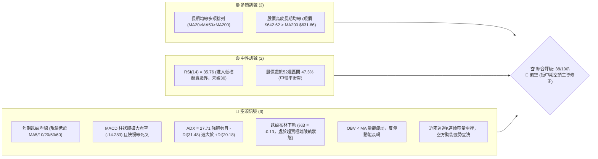
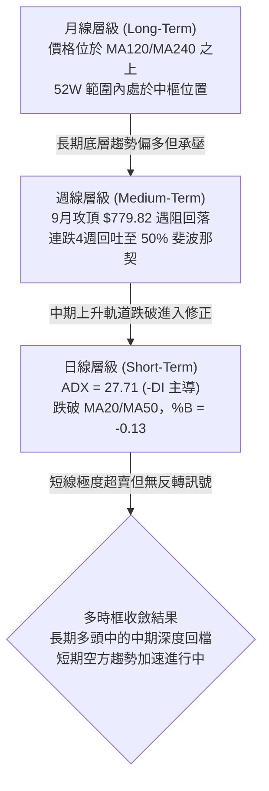
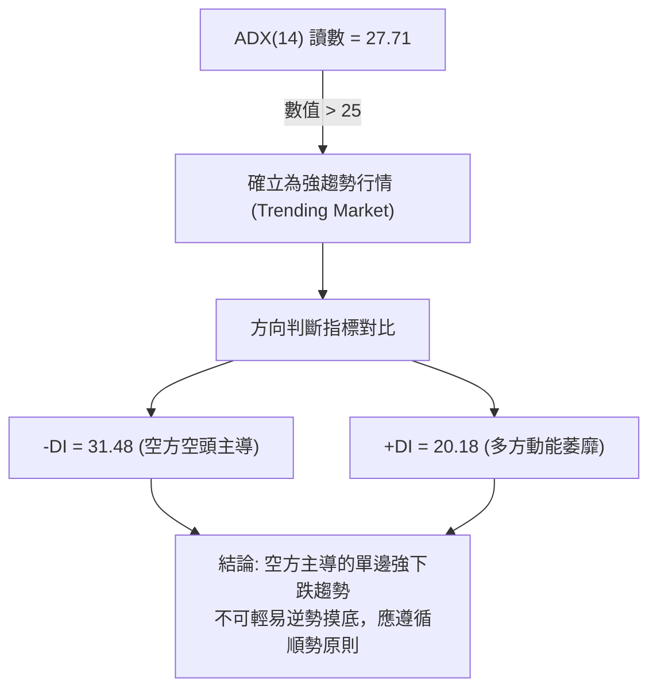
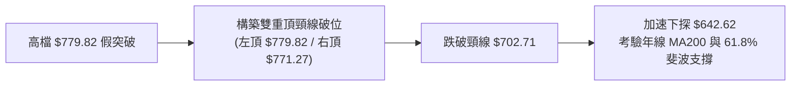
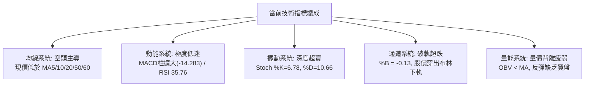
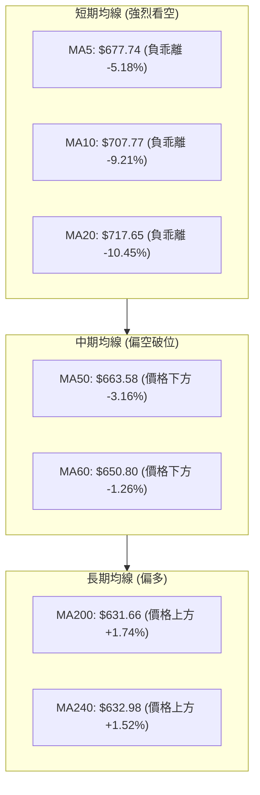
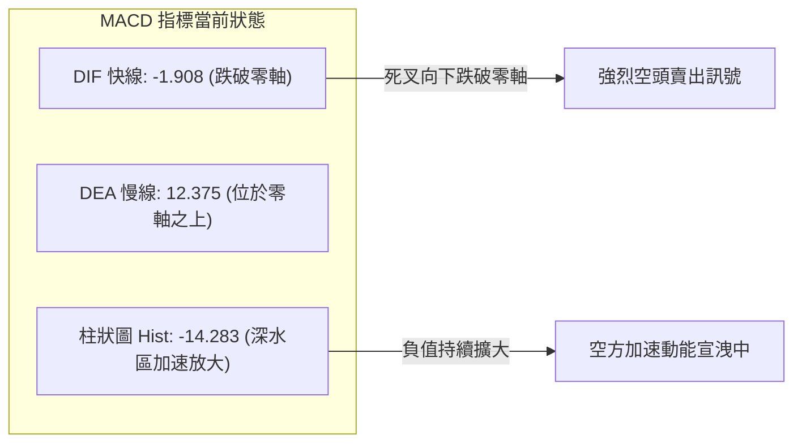
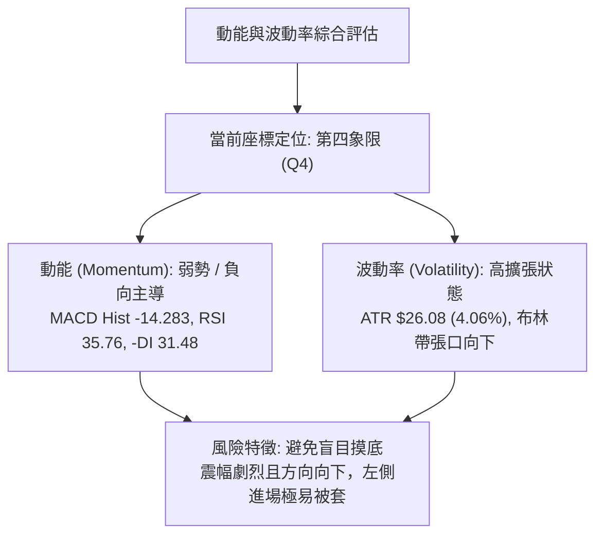
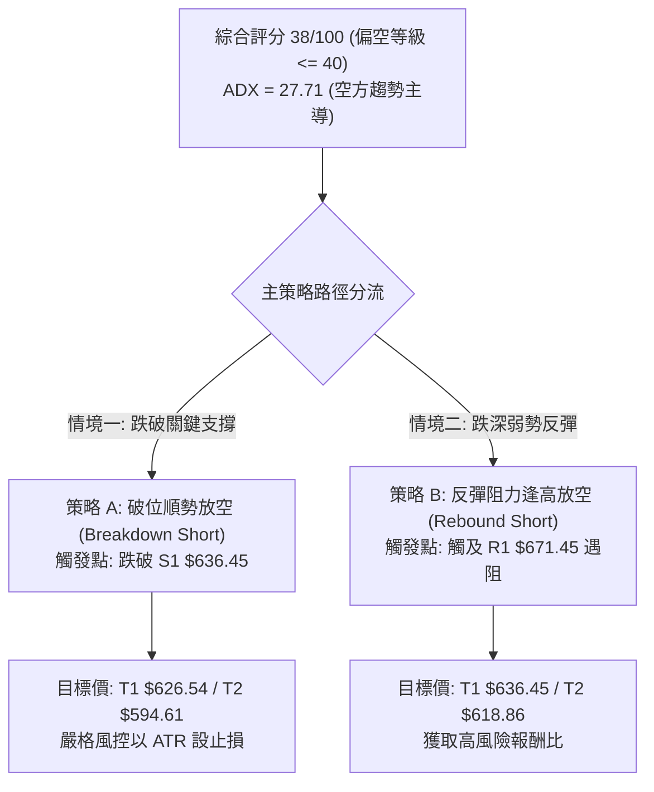
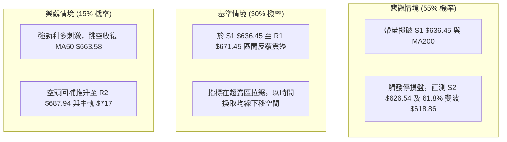

# META 技術分析報告

> **報告日期**：2026-10-25 ｜ **語言**：繁體中文 ｜ **數據來源**：Yahoo Finance ｜ **當前價格**：$642.62 USD

---

## 目錄

| 章節 | 內容 |
|------|------|
| [1. 技術面概覽](#1-技術面概覽) | 訊號儀表板、核心指標、評分卡 |
| [2. 趨勢分析](#2-趨勢分析) | 多時框趨勢、長中短期走勢、12個月走勢圖 |
| [3. 圖表形態分析](#3-圖表形態分析) | 形態識別、K線組合、目標價計算 |
| [4. 支撐與阻力](#4-支撐與阻力) | 關鍵價位、斐波那契回調結構 |
| [5. 技術指標深度解讀](#5-技術指標深度解讀) | 均線系統、RSI、MACD、布林通道、成交量 |
| [6. 動能與波動率](#6-動能與波動率) | 動能四象限、ATR波動分析、Beta風險 |
| [7. 多時框架總結](#7-多時框架總結) | 時框架評分矩陣、多時框收斂結論 |
| [8. 交易策略建議](#8-交易策略建議) | 主策略詳情、情境階梯、風險報酬比 |
| [9. 風險提示與監控](#9-風險提示與監控) | 關鍵監控清單、風險場景、風控指引 |

---

## 1. 技術面概覽

### 🎯 技術訊號儀表板



---

### 📊 核心指標速覽表

| 指標類別 | 指標名稱 | 當前數值 | 訊號 | 技術解讀 |
|:---|:---|:---:|:---:|:---|
| **價格** | 當前收盤價 | $642.62 | 🔴 | 較52週高點 $779.82 回檔 -17.59%，跌破斐波那契 50.0% ($649.59) |
| **均線** | MA20 (月線) | $717.65 | 🔴 | 現價低於 MA20 達 -10.45%，短線嚴重負乖離，月線轉為下彎阻力 |
| **均線** | MA50 (季線) | $663.58 | 🔴 | 現價跌破中期生命線 MA50 (-3.16%)，中期上升趨勢遭到實質破壞 |
| **均線** | MA200 (年線) | $631.66 | 🟢 | 現價仍守在 MA200 之上 (+1.74%)，長期多頭牛熊分水嶺尚未失守 |
| **動能** | RSI(14) | 35.76 | 🟡 | 進入弱勢中性偏超賣區間，尚未出現典型低於 30 的極端背離超賣 |
| **動能** | MACD (12,26,9) | -1.908 / 12.375 | 🔴 | 快線跌破零軸與訊號線，柱狀體為 -14.283，空頭加速度擴大 |
| **動能** | Stoch %K / %D | 6.78 / 10.66 | 🔴 | 進入深度超賣區（<20），短線具跌深技術反彈需求，但無勾頭金叉 |
| **趨勢** | ADX (14) | 27.71 | 🔴 | ADX > 25 確立為強趨勢行情，-DI (31.48) 碾壓 +DI (20.18)，空方掌控 |
| **通道** | 布林通道下軌 | $658.37 | 🔴 | 現價摜破下軌，%B 為 -0.13，沿下軌單邊向下擴散（下軌開口放大） |
| **量能** | 最新成交量 / 20日均量 | 14.76M / 19.25M | 🔴 | 量比 0.77x，量縮陰跌，OBV < MA，反彈缺乏主動性買盤支撐 |
| **波動** | ATR(14) | $26.08 | 🔴 | ATR 佔股價 4.06%，日內波動劇烈，單日震幅擴大，風控門檻拉高 |

---

### 🏆 技術評分卡

```
╔══════════════════════════════════════════════════════════════════════╗
║                    技術評分卡 — META (2026-10-25)                    ║
╠══════════════════════════════════════════════════════════════════════╣
║  評估維度         進度條指標                       分數    訊號標記  ║
╟──────────────────────────────────────────────────────────────────────╢
║  趨勢強度 (Trend) ███████░░░░░░░░░░░░░             35/100    🔴 偏空  ║
║  動能指標 (Mom)   ██████░░░░░░░░░░░░░░             30/100    🔴 弱勢  ║
║  支撐穩定度 (Sup) █████████░░░░░░░░░░░             45/100    🟡 中性  ║
║  成交量配合 (Vol) ███████░░░░░░░░░░░░░             35/100    🔴 背離  ║
║  形態完整度 (Pat) ████████░░░░░░░░░░░░             40/100    🔴 破位  ║
║  均線排列 (MA)    █████████░░░░░░░░░░░             43/100    🟡 分歧  ║
╠══════════════════════════════════════════════════════════════════════╣
║  綜合評分 (Avg)   ████████░░░░░░░░░░░░             38/100    🔴 偏空  ║
║  評級結論: 偏空修正格局 (Bearish Correction) — 逢高避險 / 順勢偏空   ║
╚══════════════════════════════════════════════════════════════════════╝
```
> **評分規則依據**：綜合評分由六大子維度算術平均計算：$(35 + 30 + 45 + 35 + 40 + 43) \div 6 = 228 \div 6 = 38$ 分（四捨五入至整數）。依規則判定為偏空等級（$\le 40$），交易策略主推偏空／逢高做空或破位做空防守。

---

## 2. 趨勢分析

### 🌐 多時框趨勢分析



---

### 📈 長期趨勢 — 12個月走勢圖（Unicode）

依據歷史 24 個月數據中近 12 個月（2025-11 至 2026-10）收盤價繪製月線走勢圖：

```
META 月線收盤走勢圖（過去12個月：2025-11 至 2026-10）
價格軸 ($)
$780 ┤                                      
$740 ┤                                  ●(09月:725.18)
$700 ┤        ●(01月:714.66)             
$660 ┤●(12月:658.40)                    
$640 ┤●(11月:645.76)   ●(02月:646.52)      ●(05月:631.43)    ●←現價(10月:642.62)
$600 ┤                                ●(04月:610.86)
$560 ┤              ●(03月:571.15)            ●(06月:562.85)  ●(08月:571.89)
$540 ┤                                        ●(07月:556.27:波段低點)
     └─────────────────────────────────────────────────────────────
      11月   01月   03月   04月   05月   06月   07月   08月   09月   10月
      2025   2026   2026   2026   2026   2026   2026   2026   2026   2026
```

#### 走勢特徵分析表格

| 階段區間 | 起止月份 | 起止價格 ($) | 漲跌幅 (%) | 形態走勢特徵 |
|:---|:---:|:---:|:---:|:---|
| **第一階段：高檔震盪** | 2025-11 → 2026-01 | $645.76 → $714.66 | +10.67% | 歲末年初買盤回流，挑戰 700 大關 |
| **第二階段：春季回調** | 2026-01 → 2026-03 | $714.66 → $571.15 | -20.08% | 連續單邊下挫，失守 600 整數關卡 |
| **第三階段：箱型築底** | 2026-03 → 2026-08 | $571.15 → $571.89 | +0.13% | 於 556.27 - 631.43 區間反覆震盪打底 |
| **第四階段：秋季噴出** | 2026-08 → 2026-09 | $571.89 → $725.18 | +26.80% | 單月長陽拔起，帶動週線挑戰 52 週新高 779.82 |
| **第五階段：獲利了結** | 2026-09 → 2026-10 | $725.18 → $642.62 | -11.38% | 10月暴跌回吐，日線跌破各級短期均線 |

---

### 📊 中期趨勢（週線分析）

中期走勢呈現「暴漲後的大型倒 V 反轉破位」。從 2026-09-25 創下高點週收盤 $751.66（當週最高達 $779.82，週量 1.68 億股）之後，連續四週收黑：
- 2026-10-02：收 $728.08，MACD 柱轉負 (-0.743)，初現疲態。
- 2026-10-09：收 $718.67，失守 23.6% 斐波那契位 ($718.35)。
- 2026-10-16：收 $709.33，週高點 $771.27 出現長上影線誘多後殺尾盤。
- 2026-10-23：大跌至 $642.62，週跌幅達 -9.40%，單週成交量放大至 1.17 億股，週 MACD 柱擴大至 -14.283。

```
週線支撐與壓力拓撲示意圖
$779.82 ────────────────────────── [52W 歷史極值壓力 / 假突破頭部]
          ▼ 回跌 -8.7%
$708.60 ────────────────────────── [R3 波段密集反壓 / MA20 下彎處 $717]
          ▼ 回跌 -6.3%
$663.58 ────────────────────────── [MA50 生命線 / 斐波 50% 分界 $649.59]
  ▲
$642.62 ══════════════════════════ [現價位置: 跌破 MA50，考驗年線支撐]
  ▼
$631.66 ────────────────────────── [MA200 年線 / S1 $636.45 緊鄰防線]
  ▼
$618.86 ────────────────────────── [黃金分割 61.8% 關鍵多頭防線 / S2 $626.54]
```

---

### ⚡ 趨勢強度評估（ADX 解讀）



#### ADX 強度對照表

| ADX 數值區間 | 趨勢性質 | 當前 META 狀態 | 交易戰略指引 |
|:---:|:---:|:---:|:---|
| 0 – 20 | 無趨勢 / 盤整震盪 | 否 | 網格交易、高拋低吸 |
| 20 – 25 | 趨勢醞釀中 | 否 | 突破前夕，準備佈局 |
| **25 – 40** | **強趨勢 (Strong Trend)** | **✓ (27.71)** | **順勢交易為主，-DI 強勢下逢反彈做空或破位跟進** |
| 40 – 60 | 極強單邊趨勢 | 否 | 嚴格追隨趨勢，利潤奔跑 |
| 60 – 100 | 超強趨勢 / 接近衰竭 | 否 | 隨時提防反轉暴走 |

---

## 3. 圖表形態分析

### 🔍 形態識別系統



#### 形態識別與信心度評估表

| 形態名稱 | 信心度 | 判斷依據（嚴格引用數據） | 完成度 | 目標價計算式（依形態推算） |
|:---|:---:|:---|:---:|:---|
| **雙重頂 (Double Top)** | 85% | 2026-09-25 創高 $779.82，2026-10-13/16 反彈至 $771.27 未過高，隨後 10-22 帶量跌破前低頸線 $702.71 | 90% | 頸線 $702.71 − 形態高度 ($779.82 − $702.71 = $77.11) = **$625.60**（高度推算值，接近支撐 S2 $626.54） |
| **下降通道 (Falling Channel)** | 80% | 10-12 至 10-23 高點逐日下移（752.24→743.97→713.22→681.07），低點亦下移（727.64→702.71→681.05→633.27） | 85% | 跌破通道中軸，通道下軌投影指向支撐位 **S1 $636.45** 與 **S2 $626.54** |
| **布林向下開口破軌形態** | 90% | 收盤 $642.62 破下軌 $658.37，%B = -0.13，上下軌帶寬急劇張開 | 95% | 空頭軌道延伸，反彈首要阻力為布林下軌回踩位 **$658.37** |

---

### 🕯️ 重要 K 線形態分析

依據數據中「近 10 根日 K」與「近 8 根週 K」之精確 OHLC 數據進行逐根形態解讀：

#### 近 10 根日 K 棒形態解讀

| 日期 | 開盤價 ($) | 最高價 ($) | 最低價 ($) | 收盤價 ($) | 成交量 (股) | K 線形態名稱 | 技術解讀與空多訊號 |
|:---:|:---:|:---:|:---:|:---:|:---:|:---:|:---|
| 2026-10-12 | 728.50 | 752.24 | 727.64 | 742.96 | 24,882,400 | 中陽線 | 🟡 突破回測後的短線多頭抵抗，量能微增 |
| 2026-10-13 | 735.99 | 771.27 | 734.84 | 762.50 | 22,706,200 | 長上影大陽線 | 🟡 盤中衝高至 771.27 受阻，多頭動能遭遇阻力回吐 |
| 2026-10-14 | 760.75 | 761.50 | 734.29 | 737.54 | 16,236,300 | 實體中陰線 | 🔴 開高走低，回吐前日漲幅，形成陰包陽預警 |
| 2026-10-15 | 726.56 | 743.97 | 715.58 | 736.72 | 16,891,500 | 紡錘十字星 | 🟡 開低走平，多空於 736 僵持，多方無力上攻 |
| 2026-10-16 | 736.70 | 738.49 | 702.71 | 709.33 | 20,643,800 | 破位大陰線 | 🔴 跌破 710 支撐，最低測 702.71，空方大舉摜壓 |
| 2026-10-19 | 707.16 | 708.83 | 693.86 | 705.44 | 16,260,900 | 低檔窄幅陰線 | 🔴 弱勢整理，反彈高點僅 708.83，空頭續航 |
| 2026-10-20 | 694.98 | 696.51 | 681.05 | 694.25 | 17,049,100 | 破底陰線 | 🔴 跌破 690 關卡，盤中創 681.05 新低，空頭結構完好 |
| 2026-10-21 | 697.60 | 713.22 | 689.68 | 697.52 | 29,203,900 | 帶量長上影陽線 | 🔴 盤中反彈至 713.22 遭空方倒貨，爆量近 30M 壓回 |
| 2026-10-22 | 676.35 | 681.07 | 639.69 | 648.85 | 40,571,000 | 恐慌長黑破位K | 🔴 暴量 40.57M 崩跌 -7%，直接摜破季線與布林下軌 |
| 2026-10-23 | 638.18 | 648.04 | 633.27 | 642.62 | 14,761,500 | 低檔小陽十字星 | 🟡 跌深縮量整理，最低觸及 633.27 逼近年線與 S1 |

#### 近 8 根週 K 棒形態解讀

| 日期 (週末) | 開盤價 ($) | 最高價 ($) | 最低價 ($) | 收盤價 ($) | 週成交量 (股) | K 線組合形態與訊號 |
|:---:|:---:|:---:|:---:|:---:|:---:|:---|
| 2026-09-04 | 577.17 | 618.97 | 555.66 | 616.28 | 81,436,700 | 🟢 帶長下影啟動陽線，脫離底部突破 600 |
| 2026-09-11 | 615.72 | 663.72 | 609.26 | 647.52 | 93,267,300 | 🟢 續攻大陽線，推升至季線之上 |
| 2026-09-18 | 657.31 | 689.61 | 648.71 | 665.23 | 99,577,300 | 🟢 沿均線上升中陽線，多頭結構穩健 |
| 2026-09-25 | 680.30 | 779.82 | 679.60 | 751.66 | 168,307,000 | 🔴 巨量見頂天線（成交量高達 1.68 億股，衝刺 52W 高點後獲利回吐） |
| 2026-10-02 | 750.04 | 750.58 | 713.19 | 728.08 | 96,199,700 | 🔴 高檔烏雲蓋頂，跌破 5 日線與開盤價 |
| 2026-10-09 | 727.71 | 747.60 | 711.68 | 718.67 | 69,671,000 | 🔴 縮量反彈遇阻小陰線，確認頂部反壓確立 |
| 2026-10-16 | 728.50 | 771.27 | 702.71 | 709.33 | 101,360,200 | 🔴 射擊之星誘多變盤長黑，高點 771.27 形成次頂後實質破頸線 |
| 2026-10-23 | 707.16 | 713.22 | 633.27 | 642.62 | 117,846,400 | 🔴 帶量破位大長陰線，摜破季線失守 50% 斐波位 |

---

### 📉 ASCII 走勢形態示意圖

```
雙重頂破頸線走勢拓撲示意圖
       頂部一: $779.82 (09-25)           頂部二: $771.27 (10-13)
             ▲                                ▲
            ╱ ╲                              ╱ ╲
           ╱   ╲                            ╱   ╲
          ╱     ╲                          ╱     ╲
         ╱       ╲  頸線位: $702.71       ╱       ╲
───────────────────●─────────────────────●─────────▼───────────────
                    ╲                   ╱           ╲ [10-16 帶量跌破頸線]
                     ╲                 ╱             ╲
                      ╲               ╱               ▼
                       ▼             ▲                 [10-22 恐慌放量崩跌]
                     中間低點 $713.19                   ╲
                                                         ╲
                                                          ▼ 現價 $642.62
                                                             │
                                   [形態量度跌幅目標 $625.60] ┴── S2 支撐 $626.54
```

---

### 🎯 形態目標價計算

根據經典技術分析形態學之嚴格投影公式：
1. **雙重頂形態測量**：
   - 形態最高峰值：$H = \$779.82$
   - 雙頂間頸線突破點（2026-10-16 最低點實質跌破處）：$N = \$702.71$
   - 形態垂直高度：$\Delta = H - N = \$779.82 - \$702.71 = \$77.11$
   - 理論量度滿足目標價（100% 垂直等距投影）：
     $$\text{Target} = N - \Delta = \$702.71 - \$77.11 = \mathbf{\$625.60}$$
   - **數值契合度**：該形態目標價 $\$625.60$ 與系統關鍵支撐位 **S2 ($626.54)** 僅差 $0.94 美元，展現極高的技術幾何共振。

2. **布林下軌開口跌勢延伸**：
   - 目前跌出布林下軌（下軌為 $\$658.37$），短線若無法於 3 個交易日內收復 $\$658.37$，將沿軌下行測尋 **S1 ($636.45)** 及年線 MA200 **($631.66)**。

---

## 4. 支撐與阻力

### 🗺️ 關鍵價位分布圖（Unicode）

```
META 價位結構分布圖（嚴格引用 OHLCV 計算聚類與斐波那契點位）
══════════════════════════════════════════════════════════════════════
$779.82  ║██████████████████████████████║ 52W 歷史最高點 / 斐波那契 0.0%
$718.35  ║████████████████████████      ║ 斐波那契 23.6% 回調位
$708.60  ║██████████████████████████████║ 強阻力 R3 (近一年波段高點聚類)
$687.94  ║████████████████████          ║ 阻力 R2 (反彈次級阻力帶)
$680.33  ║██████████████████████        ║ 斐波那契 38.2% 回調位
$671.45  ║██████████████████████████████║ 關鍵阻力 R1 (第一道密集成交阻力)
$649.59  ║──────────────────────────────║ 斐波那契 50.0% 中樞回調位
$642.62  ╠══════════════════════════════╣ ◄ 當前收盤價現位 ($642.62)
$636.45  ║▓▓▓▓▓▓▓▓▓▓▓▓▓▓▓▓▓▓▓▓▓▓▓▓▓▓▓▓  ║ 近期第一支撐 S1 (-0.96%)
$631.66  ║████████████████████████████  ║ 長期生命線 MA200 (牛熊分水嶺)
$626.54  ║██████████████████████████████║ 強支撐 S2 (-2.50% / 雙頂量度目標區)
$618.86  ║██████████████████████████████║ 斐波那契 61.8% 黃金分割強支撐
$594.61  ║████████████████████          ║ 極端支撐 S3 (-7.47% / 600大關防線)
$519.37  ║██████████████████████████████║ 52W 歷史最低點 / 斐波那契 100.0%
══════════════════════════════════════════════════════════════════════
```

---

### 🚧 阻力位分析表

阻力位嚴格引用技術數據聚類算得之數值：

| 阻力級別 | 價位 ($) | 距現價幅幅 | 形成原因與技術共振 | 突破難度 | 重要性 |
|:---:|:---:|:---:|:---|:---:|:---:|
| **R1** | **$671.45** | +4.49% | 2026-10-22 長黑 K 棒實體上半部，且緊鄰 MA50 ($663.58) 與 MA5 ($677.74)，空方下壓防線 | 🟡 中高 | ★★★★☆ |
| **R2** | **$687.94** | +7.05% | 10-20 與 10-21 破位前之整理平台高點，接近斐波那契 38.2% ($680.33) | 🔴 高 | ★★★☆☆ |
| **R3** | **$708.60** | +10.27% | 雙頂頸線位聚類區 ($702.71 - $709.33)，兼具 MA10 ($707.77) 與布林中軌 MA20 ($717.65) 反壓 | 🔴 極高 | ★★★★★ |

---

### 🛡️ 支撐位分析表

支撐位嚴格引用技術數據聚類算得之數值：

| 支撐級別 | 價位 ($) | 距現價幅幅 | 形成原因與技術共振 | 守住機率 | 重要性 |
|:---:|:---:|:---:|:---|:---:|:---:|
| **S1** | **$636.45** | -0.96% | 10-23 盤中探底低點 $633.27 附近之密集買盤，與 MA200 ($631.66) 形成多頭第一道緩衝墊 | 🟡 55% | ★★★★☆ |
| **S2** | **$626.54** | -2.50% | 近一年波段起漲結構低點聚類，與雙頂量度目標價 $625.60 及 MA120 ($627.21) 重疊 | 🟢 65% | ★★★★★ |
| **S3** | **$594.61** | -7.47% | 2026年7月與8月波段底部整理區上沿，跌破將引發向 52W 低點 $519.37 尋底的嚴重空頭 | 🟢 80% | ★★★★☆ |

---

### 📐 斐波那契回調位分析

依據 52 週完整波段起訖點（最低點 $519.37 至 最高點 $779.82，波段總垂直跨度 $260.45）之黃金分割比率分析：

| 分割比率 | 價位 ($) | 當前相對位置與技術意義解讀 |
|:---:|:---:|:---|
| **0.0% (52W High)** | **$779.82** | 歷史峰值，2026-09-25 創下，目前為全週期絕對天花板阻力 |
| **23.6%** | **$718.35** | 輕度回調位，與當前布林中軌 MA20 ($717.65) 高度重疊，已於 10-16 實質失守 |
| **38.2%** | **$680.33** | 弱勢回調防線，10-22 一根長黑直接跳空摜破，由支撐轉為重阻力 |
| **50.0%** | **$649.59** | 多空分水嶺中樞，**現價 $642.62 剛好落於 50.0% 下方 (-1.07%)** |
| **61.8%** | **$618.86** | **黃金分割關鍵支撐位**，多頭最終防守底線，緊貼支撐位 S2 ($626.54) 下方 |
| **78.6%** | **$575.11** | 深度回調位，若失守宣告本輪由 $519 起漲之多頭波段徹底瓦解 |
| **100.0% (52W Low)** | **$519.37** | 52 週最低點，全年度終極支撐基石 |

> **當前價位定位評估**：
> 現價 **$642.62** 目前落於 **50.0% 回調位 ($649.59)** 與 **61.8% 回調位 ($618.86)** 之間。失守 50.0% 中樞意味著中期多方動能喪失主控權，股價正尋求 61.8% 黃金分割位（$618.86）至年線 MA200（$631.66）區間進行防守減震。

---

## 5. 技術指標深度解讀

### 🎛️ 指標訊號總覽



---

### 📈 移動平均線排列分析



#### 均線系統數據詳解

| 均線名稱 | 數值 ($) | 與現價乖離 | 均線斜率與走勢特徵 | 訊號評估 |
|:---:|:---:|:---:|:---|:---:|
| **MA5** | 677.74 | -5.18% | 快速下墜，日線層面形成極陡峭之反壓 | 🔴 極空 |
| **MA10** | 707.77 | -9.21% | 拐頭向下加速，壓制短期反彈空間 | 🔴 極空 |
| **MA20** | 717.65 | -10.45% | 月線下彎，與布林中軌重合，為強大中期頭部壓力 | 🔴 空頭 |
| **MA50** | 663.58 | -3.16% | 季線遭實質跌破，破壞 9 月以來的上升格局 | 🔴 轉空 |
| **MA60** | 650.80 | -1.26% | 剛跌破，短期形成第一道解套賣壓關卡 | 🔴 偏空 |
| **MA120** | 627.21 | +2.46% | 向上運行，提供下方多頭緩衝，接近支撐 S2 | 🟢 支撐 |
| **MA200** | 631.66 | +1.74% | 牛熊分界線，維持上行，多頭最後生命線防禦點 | 🟢 多頭守護 |
| **MA240** | 632.98 | +1.52% | 長期年線密集區，多頭長期底蘊支撐 | 🟢 多頭守護 |

> **均線排列解讀**：
> 雖然大週期表面維持長期的多頭排列（MA20 > MA50 > MA200），但現價已經連續摜破 MA5、MA10、MA20、MA60 與 MA50，呈現「均線在上、股價在下」的空頭夾殺格局。短期負乖離高達 -10.45%，雖隨時可能引發技術性反抽，但反彈若無法站回 MA50，均線死叉（MA20 往下穿 MA50）將難以避免。

---

### 📉 RSI(14) 分析

- **當前 RSI(14) 數值**：**35.76**
- **進度條展示**：
  `RSI(14): [███████░░░░░░░░░░░░░] 35.76% (弱勢空方區間 30-40)`
- **超買超賣狀態**：
  未達到 < 30 的極端超賣門檻，顯示空頭拋壓雖大，但尚未出現市場情緒徹底窒息的「恐慌洗盤底」，空方力量仍在釋放途中。
- **背離判斷**：
  依據技術數據判定——**無明顯背離**（比對近 20 根 K 棒首尾，價格由 700 多下行至 642.62，RSI 亦同步由 60 多回落至 35.76，量價與動能呈現同步下挫，未見底背離或頂背離確立訊號）。

---

### 📊 MACD(12, 26, 9) 訊號解讀



- **DIF 快線**：-1.908（自高檔轉負，正式摜破零軸多空分界線）
- **DEA 慢線 (Signal)**：12.375（仍滯留正值區，快慢線開口迅速放大）
- **MACD 柱狀體 (Hist)**：-14.283（顯著呈現負值長條，顯示空方動能處於加速宣洩階段，尚未見到收腳拐點）。

---

### 📦 布林通道分析

```
META 日線布林通道 (20, 2) 結構示意圖
══════════════════════════════════════════════════════════════════════
$776.93 ────────────────────────────────────────── 布林上軌 (Upper Band)
                         │
$717.65 ────────────────────────────────────────── 布林中軌 (MA20 Mid Band)
                         │
$658.37 ────────────────────────────────────────── 布林下軌 (Lower Band)
   ▼ 現價突破下軌
$642.62 ══════════════════════════════════════════ 當前價格 (%B = -0.13)
══════════════════════════════════════════════════════════════════════
```

- **上軌**：$776.93
- **中軌 (MA20)**：$717.65
- **下軌**：$658.37
- **%B 指標**：**-0.13**（%B < 0 代表股價已跌穿布林帶下軌，進入極端弱勢區）。
- **帶寬特徵**：通道開口劇烈放大，呈現典型「單邊沿下軌向下暴跌」的走勢，在未收復下軌 $658.37 之前，任何反彈均屬弱勢破軌修正。

---

### 💹 成交量分析（量價配合度）

1. **量能萎縮特徵**：
   - 最新單日成交量：**14,761,500 股**
   - 20 日平均成交量：**19,253,865 股**（量比僅 **0.77x**）
   - 50 日平均成交量：**20,217,516 股**
2. **量價關係解讀**：
   - 10-22 股價大跌 -7% 時爆出 **40,571,000 股** 巨量，顯示主力機構籌碼大舉湧出；
   - 10-23 股價收小十字陽線，成交量急劇萎縮至 1,476 萬股（量比 0.77x），代表低檔雖無大幅追殺，但亦**無多頭大單進場抄底**，屬於標準的「下跌放量、止跌縮量、買盤虛弱」的弱勢格局。
3. **OBV 能量潮判斷**：
   - 系統數據明確標注：**OBV < MA → 量能疲弱**。資金呈現實質流出狀態，量能無法確認任何可靠的價格反轉。

---

## 6. 動能與波動率

### ⚡ 動能評估四象限



#### 動能與波動率象限分析表

| 象限 | 動能強度 | 波動率狀態 | 當前 META 狀態 | 戰略評估 | 操作指引 |
|:---:|:---:|:---:|:---:|:---|:---|
| **Q1** | 強 (看多) | 低 (穩定) | — | 最佳波段買點 | 順勢加碼、抱牢多單 |
| **Q2** | 弱 (中性) | 低 (收斂) | — | 盤整觀望 | 耐心等待形態突破 |
| **Q3** | 強 (極端) | 高 (劇烈) | — | 高風險投機 | 突破追價，嚴設止損 |
| **Q4** | **弱 (負向)** | **高 (劇烈)** | **✓ (當前所處區間)** | **高風險下行加速** | **空頭防守、避免左側摸底抄底** |

---

### 📊 ATR 波動率分析

- **當前 ATR(14)**：**$26.08**（Wilder 計算）
- **波動率佔比**：佔當前股價高達 **4.06%**，代表 META 每日平均上下波動幅度逾 26 美元。
- **交易止損設置距離建議**：
  - **保守型風控（2.0 × ATR）**：$\$26.08 \times 2.0 = \mathbf{\$52.16}$（適用於中期波段防守，避免被日內假突破洗盤震出場）。
  - **進取型風控（1.5 × ATR）**：$\$26.08 \times 1.5 = \mathbf{\$39.12}$（適用於短線反彈或順勢做空交易）。
  - **緊密型日內風控（1.0 × ATR）**：$\$26.08 \times 1.0 = \mathbf{\$26.08}$。

---

### 📐 Beta 與市場相關性

- **Beta 係數**：**1.185**
- **市場特徵解讀**：
  META 的 Beta 為 1.185，具備高於美股大盤（標普 500 指數）18.5% 的波動彈性。當科技權值股面臨板塊輪動或財報季不確定性時，META 具有放大市場恐慌或樂觀情緒的特性。在當前空方動能佔優勢的背景下，高 Beta 意謂著若大盤出現震盪，META 容易產生更大幅度的技術性下殺。

---

## 7. 多時框架總結

### 📋 時框架評分表

| 時框架 | 趨勢方向 | 動能狀態 | 均線排列特徵 | 圖表形態 | 綜合評分 | 操作建議 |
|:---|:---:|:---:|:---|:---|:---:|:---|
| **短期 (日線)** | 🔴 偏空 | 🔴 疲弱 (RSI 35.8, MACD -14.3) | 均線空頭排列，破 MA5/10/20/50 | 破頸線放量重挫，破布林下軌 | **32/100** | 逢反彈減碼或順勢偏空操作 |
| **中期 (週線)** | 🔴 轉空 | 🔴 修正加速 (-DI 31.5) | 失守 MA20，逼近年線 MA200 | 52W 高點巨量假突破雙頂 | **42/100** | 中期升勢遭破壞，觀望等待築底 |
| **長期 (月線)** | 🟢 偏多 | 🟡 中性減速 | 仍位於 MA120/MA200 之上 | 52W 區間中樞震盪，大箱型格局 | **62/100** | 長線多頭未死，但面臨深幅修正 |

---

### 🔲 綜合訊號矩陣

| 評估維度 | 日線訊號 (短期) | 週線訊號 (中期) | 月線訊號 (長期) | 訊號一致性評估 |
|:---|:---:|:---:|:---:|:---|
| **趨勢方向** | 🔴 空頭下行 | 🔴 破位回調 | 🟢 震盪偏多 | 短中期與長期趨勢出現**明顯背離** |
| **均線支撐** | 🔴 跌破所有短均 | 🟡 考驗週線支撐 | 🟢 遠高於長期均線 | 價格正在回測長期牛熊線防禦 |
| **動能狀態** | 🔴 極度疲弱 | 🔴 空方加速 | 🟡 獲利了結收斂 | 動能全面被空方接管 |
| **量價關係** | 🔴 跌放量漲縮量 | 🔴 週巨量長黑 | 🟢 歷史沉澱量充足 | 機構籌碼短期集中出逃 |

---

### ⚖️ 多時框收斂結論

依據多時框收斂原則（規則 14）：
1. **行情屬性判定**：當前日線 ADX(14) 讀數為 **27.71 (> 25)**，且 -DI (31.48) 遠壓過 +DI (20.18)，確定當前市場處於**強烈的單邊趨勢行情（空頭趨勢）**，而非盤整震盪。
2. **時框優先級收斂**：在趨勢行情中，雖然長期 MA200 ($631.66) 維持多頭防禦，但日線與週線的空頭賣壓處於主導地位。週線自 $779.82 築雙頂向下摜破，日線破位加速，日線等級的超賣僅能視為「反彈尋找賣點」，不可作為逆勢作多的依據。
3. **唯一方向性結論**：**🔴 偏空（空頭主導深幅修正格局）**。
   此結論與第 1 章技術評分卡之綜合評分（**38/100**）嚴格一致。操作策略全面以**逢反彈阻力做空**或**破位順勢做空**為主，多頭操作僅能列為極端反轉之風險對沖提示。

---

## 8. 交易策略建議

### 🗺️ 策略決策流程圖



---

### 🧭 策略路由

> **當前主策略方向 = 🔴 偏空／逢高或破位做空（依綜合評分 38/100 判定）**

由於評分卡綜合評分為 **38/100（$\le 40$）**，依交易紀律嚴格主推**空頭策略**。多頭策略嚴禁在此時作為主力推薦，僅於文末標注反轉觸發點作為風控對沖參考。

---

### 🎯 價格情境階梯（Price Scenarios）

價位嚴格引用關鍵價位聚類與斐波那契點位：

| 觸發條件 | 下一目標 | 後續延伸 | 情境技術含義與應對 |
|:---|:---:|:---:|:---|
| **向上反彈突破 R1 $671.45** | R2 $687.94 | R3 $708.60 | 超跌強烈反抽，短線空單停利離場，觀察 R3 頸線重壓 |
| **受阻於 R1 且在現價震盪** | S1 $636.45 | S2 $626.54 | 弱勢橫盤消化，空頭蓄勢再破底 |
| **向下帶量跌破 S1 $636.45** | S2 $626.54 | S3 $594.61 | 破位加速，直測雙頂量度目標 $625.60 及斐波 61.8% |

---

### 📊 情境機率分佈

| 情境劇本 | 發生機率 | 主要技術依據 |
|:---|:---:|:---|
| **回落再探底 / 破位下行** | **55%** | ADX=27.71 強趨勢、-DI=31.48、MACD柱擴大(-14.283)、OBV 疲弱 |
| **弱勢抵抗 / 區間震盪** | **30%** | Stoch %K=6.78 極端超賣、緊鄰年線 MA200 ($631.66) 存在心理防線 |
| **大幅反轉 / 向上突破** | **15%** | 缺乏多頭量能支撐，上方 MA5/10/20 重重套牢賣壓，反轉機率極低 |

---

### 🟢 主策略詳情（空頭主導策略）

嚴格依據規則 17 計算風險報酬比：
做空風險報酬比公式：$$\text{RRR} = \frac{\text{進場價} - \text{目標價 T1}}{\text{止損價} - \text{進場價}}$$

| 策略要素 | 策略 A（破位順勢做空 - Breakdown Short） | 策略 B（反彈阻力逢高做空 - Rebound Short） |
|:---|:---|:---|
| **操作邏輯** | 跌破第一支撐 S1 與日 K 低點確認向下破位 | 跌深反抽遭遇關鍵阻力 R1 及季線受阻放空 |
| **進場條件** | 跌破 S1 ($636.45) 且 15分K 收破 | 反彈測試 R1 ($671.45) 遇阻出上影線時進場 |
| **進場價格** | **$636.45** | **$671.45** |
| **目標價 T1** | **$626.54** (支撐位 S2 / 雙頂量度區) | **$636.45** (第一支撐位 S1) |
| **目標價 T2** | **$594.61** (支撐位 S3 / 600大關) | **$618.86** (斐波那契 61.8% 黃金分割) |
| **止損價格** | **$642.62** (現價 / 突破起跌點) | **$687.94** (阻力位 R2) |
| **風險報酬比 (以 T1 計)** | **1 : 1.61**（以 T1 計）<br/>計算式：$(636.45 - 626.54) \div (642.62 - 636.45) = 9.91 \div 6.17$ | **1 : 2.12**（以 T1 計）<br/>計算式：$(671.45 - 636.45) \div (687.94 - 671.45) = 35.00 \div 16.49$ |
| **風險報酬比 (以 T2 計)** | 1 : 6.78（以 T2 計，$(636.45 - 594.61) \div 6.17$） | 1 : 3.19（以 T2 計，$(671.45 - 618.86) \div 16.49$） |
| **預估勝率** | 60% | 65% |
| **建議總倉位** | 10% - 15% | 15% - 20% |

---

### 🔴 反向風險觸發點（多頭反轉對沖提示）

若市場出現非預期之強勢買盤，以下點位為**推翻空頭主策略之關鍵訊號**：
1. **反轉預警點**：收盤價強勢收復 **$658.37**（布林下軌）且日 K 收出帶量長陽，代表破軌假跌破，空單應減半。
2. **多頭反轉確認點**：日線帶量實質站上 **$671.45 (R1)** 與季線 **$663.58** 之上，宣告短期空頭修正結束，所有空單必須無條件止損離場，並翻轉為觀望或試探性偏多操作。

---

### ⭐ 整體訊號強度評星

```
╔══════════════════════════════════════════════════════╗
║  做多訊號強度：  ★☆☆☆☆  (1.5/5 星 — 僅具跌深反彈契機)║
║  做空訊號強度：  ★★★★☆  (4.0/5 星 — 空方動能完全主導)║
║  整體技術可信度：★★★★☆  (4.5/5 星 — 均線指標形態共振)║
╚══════════════════════════════════════════════════════╝
```

---

## 9. 風險提示與監控

### ✅ 關鍵監控指標 Checklist

```
╔══════════════════════════════════════════════════════════════════════╗
║                 META 交易核心風控監控清單 (Checklist)                 ║
╠══════════════════════════════════════════════════════════════════════╣
║ [ ] 監控項 1: 年線 MA200 ($631.66) 是否失守（牛熊終極轉換訊號）      ║
║ [ ] 監控項 2: 日線收盤價是否能收復布林通道下軌 ($658.37)             ║
║ [ ] 監控項 3: RSI(14) 是否跌破 30 形成極端恐慌鈍化或出現底背離       ║
║ [ ] 監控項 4: MACD 柱狀體 (當前 -14.283) 是否出現連續兩日收窄拐點   ║
║ [ ] 監控項 5: 日成交量是否萎縮至 12M 之下（籌碼惜售）或爆出 35M+ 換手║
║ [ ] 監控項 6: 阻力位 R1 ($671.45) 突破與否（空單強制止損分界線）    ║
╚══════════════════════════════════════════════════════════════════════╝
```

---

### ⚠️ 風險場景分析



---

### 🛡️ 風險管理重要提醒

1. **極端超賣誘發之短線軋空風險**：
   Stochastic %K 數值已深跌至 **6.78**，布林 %B 達 **-0.13**。雖然總體趨勢偏空，但在極度超賣環境下切忌在低位盲目以大倉位追空。策略 A 必須在確認跌破 S1 ($636.45) 才能執行，且倉位應控制在 10% 以內。
2. **財報與大盤 Beta 聯動風險**：
   近期即將進入科技巨頭密集財報期（如新聞提及微軟、超大規模雲廠商資本開支等動態），META 自身 Beta 達 1.185，單日波動極易被板塊情緒放大，單筆交易最大虧損嚴格限制在總資本的 1.0%–1.5% 以內。

---

## 📋 報告總結

```
╔══════════════════════════════════════════════════════════════════════╗
║                     META 技術分析報告總結                            ║
╠══════════════════════════════════════════════════════════════════════╣
║  報告日期：2026-10-25                                                ║
║  當前收盤價：$642.62 USD                                             ║
║  技術綜合評分：38 / 100                                              ║
║  分析評級：🔴 偏空修正格局 (Bearish Correction)                      ║
╟──────────────────────────────────────────────────────────────────────╢
║  關鍵結論：                                                          ║
║  ├─ 長期趨勢：🟢 偏多但承壓（價格仍高於 MA200 $631.66 與 MA240）      ║
║  ├─ 中期趨勢：🔴 偏空破位（52W 高點 $779.82 假突破構築雙頂，破季線）  ║
║  ├─ 短期趨勢：🔴 單邊下行（ADX=27.71 強趨勢，-DI=31.48，MACD負柱擴大）║
║  ├─ 核心支撐：S1: $636.45 ｜ S2: $626.54 ｜ S3: $594.61               ║
║  ├─ 核心阻力：R1: $671.45 ｜ R2: $687.94 ｜ R3: $708.60               ║
║  └─ 分析師共識目標：均價 $844.26（最低 $629.06，最高 $1050.00）       ║
╟──────────────────────────────────────────────────────────────────────╢
║  最優策略組合：                                                      ║
║  1. 🥇 最佳機會：策略 B（反彈阻力做空）— 反彈至 R1 $671.45 放空，     ║
║                  止損 $687.94，目標 T1 $636.45（風報比 1 : 2.12）    ║
║  2. 🥈 次選機會：策略 A（破位順勢做空）— 跌破 S1 $636.45 跟進做空，   ║
║                  止損 $642.62，目標 T1 $626.54（風報比 1 : 1.61）    ║
║  3. 🥉 保守選擇：場外空倉觀望，耐心等待股價於年線 $631.66 與 S2 構築  ║
║                  連續縮量雙底結構並出現 RSI 底背離後再考慮左側佈局    ║
╚══════════════════════════════════════════════════════════════════════╝
```

---

> ⚠️ **免責聲明**：本報告為技術分析研究專用，報告中所有價位與推算模型均基於歷史量價客觀數據演算。技術分析具備滯後性與機率特徵，不構成任何實質要約或個人投資操作建議。金融市場交易具備高風險性，投資人應依個人財務承受能力獨立決策並嚴格執行資金控管。

---
*報告生成時間：2026-10-25 ｜ 數據來源：Yahoo Finance ｜ 分析框架：多時框技術分析模型*